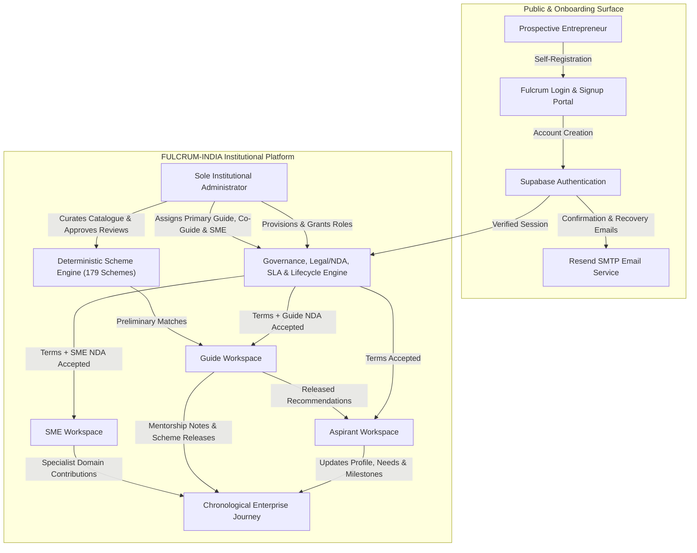
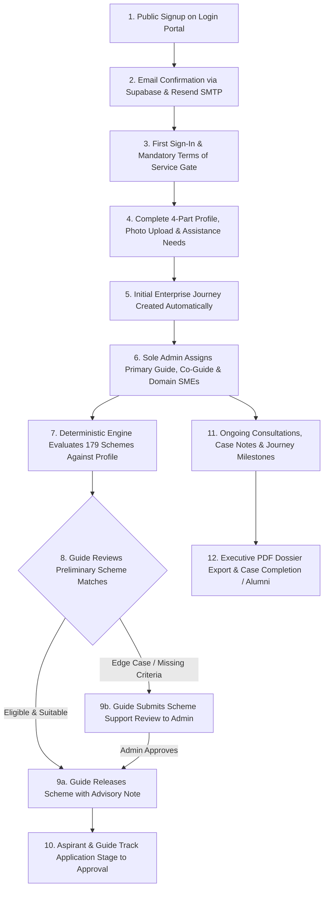
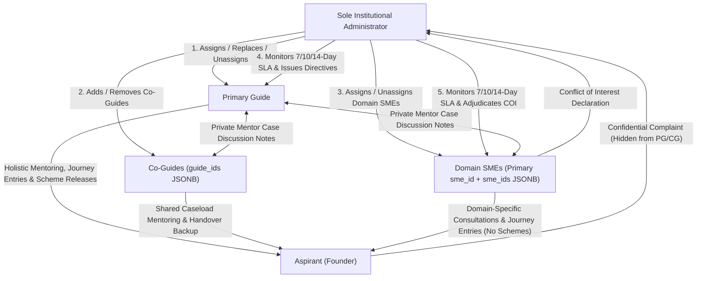
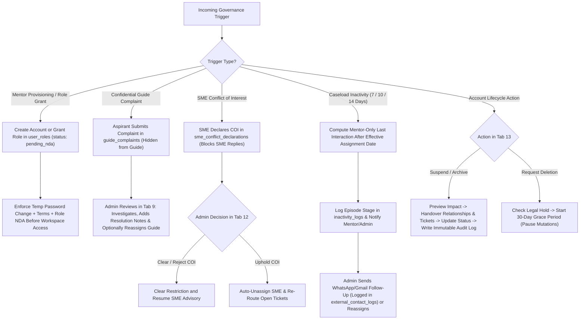
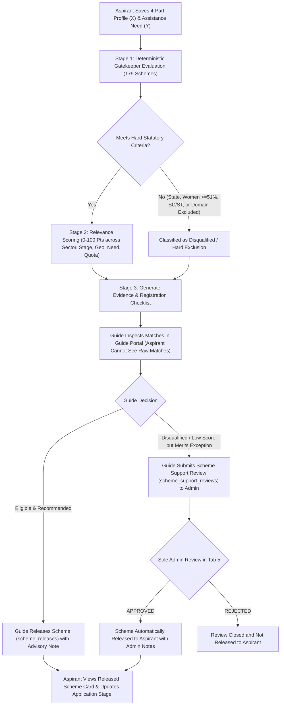

# FULCRUM-INDIA BETA 2.0.0 — BUSINESS REQUIREMENTS DOCUMENT (BRD)

| Document Attribute | Value |
| :--- | :--- |
| **Document ID** | `FULCRUM-BRD-V2.0` |
| **Version** | `2.0-baseline` |
| **Date of Analysis** | `2026-11-16` |
| **Reviewed Repository Commit** | `235767754f8d8bb4605e819593bb3f370ddeab27` (`2026-11-11`) |
| **Deployment Parity** | Root source and `FULCRUM_FRESH_DEPLOYMENT/` verified identical by SHA-256 |
| **Target Audience** | CEO, Institutional Leadership, Programme Managers, Business Stakeholders |
| **Document Status** | Baseline Reference (Derived from Reverse-Engineering of Existing Codebase) |

---

## How to Read This Document & Status Legend

This Business Requirements Document (BRD) establishes the authoritative business baseline for **FULCRUM-INDIA Beta 2.0.0**. It is derived directly from the implemented software, database migrations, and operational documentation in the repository—not from speculative design proposals. Every business capability and rule references its corresponding requirement identifier (`BO-*`, `BR-*`, `FR-*`, `DEC-*`, `DEF-*`, `DISC-*`) for end-to-end traceability in [`FULCRUM_REQUIREMENTS_TRACEABILITY.md`](./FULCRUM_REQUIREMENTS_TRACEABILITY.md).

Throughout this baseline suite, implementation status is classified using eight strict evidence categories:
- **Implemented — verified in source**: Feature logic, UI controls, and database operations are present in active source files.
- **Tested — supported by actual test evidence**: Automated unit, integration, or regression test scripts exist in the repository covering the workflow (note: tests were inspected in source and not re-executed against live production during this documentation audit).
- **Partially implemented**: Core structures exist, but part of the workflow is manual, stubbed, or incomplete.
- **Documented only**: Described in markdown guides or comments, but not present in active code.
- **Planned / proposed**: Future enhancement or architectural proposal outside the active Beta 2.0.0 codebase.
- **Defect identified**: Source inspection or owner-supplied live evidence reveals a functional, UX, or configuration flaw.
- **Requires live verification**: Behaviour depends on external cloud state (Supabase dashboard, Resend DNS/SMTP, Hostinger VPS) that cannot be proven from repository files alone.
- **Not found in the reviewed source**: No implementation evidence exists in the repository.

---

## 1. Executive Summary

**FULCRUM-INDIA** is a specialized, institutional entrepreneurship-support and mentoring management platform built for entrepreneurs ("Aspirants"), general business mentors ("Guides"), domain specialists ("Subject Matter Experts" or "SMEs"), and a single institutional Programme Administrator across Tamil Nadu and India (`services/constants.py` L30–L143, `README.md` L1–L60).

Unlike a public directory or a generic content website, Fulcrum manages stateful, multi-party mentoring relationships around a chronological record of an entrepreneur's progress called the **Enterprise Journey** ("The Movie / Post-Credits" model, `README.md` L15–L17, `services/journey.py` L1–L82). It combines four core pillars under strict institutional governance:
1. **Structured Entrepreneur Profiling & Private Identity Records**: A 4-part enterprise profile covering personal details, professional background, business structure, demographics/statutory registrations, and specific funding/assistance needs (`views/aspirant.py` L220–L454, `services/profiles.py` L541–L692), paired with private, access-controlled profile photographs (`services/aspirant_photos.py` L39–L154).
2. **Admin-Governed Mentorship & Specialist Advisory**: Exclusive administrative assignment of primary Guides, additive Co-Guides, and Domain SMEs (`services/relationships.py` L216–L673), supported by structured consultation tickets, private mentor-only case collaboration notes, and administrative escalation directives (`services/help_requests.py` L184–L1363, `services/collaboration.py` L18–L237).
3. **Rule-Based Government Scheme Discovery & Guide-Gated Release**: A deterministic, 3-stage matching engine across a curated catalogue of **179 central, state, and private schemes** (`seed/canonical_179_schemes.json`, `services/scheme_matching_engine.py` L1–L517) where preliminary matches are evaluated by the assigned Guide before being formally released to the Aspirant (`services/schemes.py` L401–L542) or escalated to the Administrator via a Scheme Support Review when mandatory criteria are missing (`services/scheme_reviews.py` L18–L247).
4. **Institutional Governance, Compliance & Lifecycle Control**: Versioned Terms of Service and role-specific Non-Disclosure Agreements (NDAs) (`services/legal.py` L19–L487), confidential Aspirant complaints against Guides (`services/governance.py` L63–L224), SME conflict-of-interest declarations (`services/governance.py` L228–L359), automated caseload inactivity monitoring at 7, 10, and 14 days (`services/inactivity.py` L1–L334), and an immutable, append-only account lifecycle and archival state machine (`services/account_lifecycle.py` L1–L1527, `migrations/009_account_lifecycle_and_archive.sql` L180–L287).

---

## 2. Business Background and Problem Statement

Entrepreneurship development programmes in Tamil Nadu—spanning 38 revenue districts from Chennai and Coimbatore to emerging hubs such as Madurai, Tiruchirappalli, Salem, and Thoothukudi (`services/constants.py` L70–L80)—face persistent operational challenges when supporting early-stage founders:

1. **Fragmented Mentorship & Lost Context**: Mentorship typically occurs over ad-hoc phone calls, WhatsApp messages, and scattered spreadsheets. When a mentor becomes unavailable or a specialist is brought in for GST, FSSAI, patent, or term-loan advice, the entrepreneur must repeat their entire business story from scratch.
2. **Opaque & Misleading Government Scheme Navigation**: Founders struggle to navigate hundreds of Central Government (e.g., Startup India Seed Fund, PMEGP, CGTMSE, MUDRA) and Tamil Nadu State Government (e.g., TANSEED, NEEDS, UYEGP, PMEGP-TN, TIIC) programmes (`services/scheme_rules.py` L34–L73). Unfiltered lists lead founders to apply for schemes where they are statutorily disqualified (for example, male founders applying for women-only schemes requiring at least 51% female equity, or retail traders applying for deep-tech R&D grants; `services/scheme_matching_engine.py` L146–L205).
3. **Unmonitored Mentor Caseloads**: Programme administrators lack visibility into whether assigned mentors are actively guiding their entrepreneurs or leaving inquiries unanswered for weeks (`services/inactivity.py` L8–L22).
4. **Confidentiality, Conflict of Interest & Grievance Gaps**: Early-stage founders share sensitive commercial plans and personal photographs without formal Non-Disclosure Agreements from mentors, have no confidential channel to report unresponsive or inappropriate mentors without fear of retaliation, and lack protection when a specialist has a commercial conflict of interest (`services/legal.py` L207–L235, `services/governance.py` L63–L359).
5. **Destructive Account Turnover**: When a mentor leaves or an entrepreneur pauses their venture, deleting accounts in conventional tools destroys historical audit trails, consultation threads, and milestone records (`migrations/009_account_lifecycle_and_archive.sql` L160–L175).

---

## 3. Vision and Institutional Objectives

Fulcrum's institutional vision is to provide a **single, auditable, privacy-preserving operating system** for guided entrepreneurship across Tamil Nadu and India, where every founder's progress is preserved chronologically and every mentoring and scheme-advisory action is governed by clear institutional accountability.

### Business Objectives Register (`BO-01` to `BO-08`)

| Objective ID | Institutional Objective | Business Outcome Targeted | Primary Verification Source | Status |
| :--- | :--- | :--- | :--- | :--- |
| **`BO-01`** | **Preserve a Continuous Entrepreneurial Record** | Maintain a single chronological "Enterprise Journey" per Aspirant that survives mentor handovers, role changes, and account archival. | `services/journey.py` L32–L242, `migrations/002_journey_event_revisions.sql` | Implemented — verified in source; Tested |
| **`BO-02`** | **Enforce Sole Administrative Governance** | Centralize all mentor provisioning, role grants, caseload assignments, conflict resolutions, and lifecycle actions under one institutional Administrator. | `services/roles.py` L57–L309, `migrations/008_single_admin_lock_professional_photos_and_workflow_columns.sql` L14–L117 | Implemented — verified in source; Tested |
| **`BO-03`** | **Deliver Accurate, Human-Verified Scheme Guidance** | Combine deterministic rule-based scheme filtering (179 schemes) with mandatory Guide review before releasing recommendations to founders. | `services/scheme_matching_engine.py` L146–L517, `services/schemes.py` L401–L542 | Implemented — verified in source; Tested |
| **`BO-04`** | **Enable Flexible Multi-Role Participation** | Allow experienced entrepreneurs to also serve as Guides or SMEs (7 non-admin role combinations) with strict workspace isolation and anti-self-assignment guards. | `services/roles.py` L331–L868, `app.py` L839–L1016 | Implemented — verified in source; Tested |
| **`BO-05`** | **Guarantee Legal Consent, Confidentiality & Privacy** | Gate platform access on versioned Terms of Service, gate Guide/SME workspaces on signed NDAs, and isolate private photographs and case records to assigned relationships. | `services/legal.py` L246–L460, `services/aspirant_photos.py` L39–L154, `migrations/005_tighten_aspirant_photo_security.sql` | Implemented — verified in source; Tested |
| **`BO-06`** | **Prevent Mentorship Stagnation via SLA Monitoring** | Track Guide and SME responsiveness independently and trigger automated reminders and administrative escalations at 7, 10, and 14 days of inactivity. | `services/inactivity.py` L37–L569, `migrations/006_mentor_inactivity_and_external_contacts.sql` | Implemented — verified in source; Tested |
| **`BO-07`** | **Provide Safe Grievance & Conflict Resolution Channels** | Give Aspirants a confidential complaint channel invisible to their Guide, and give SMEs a formal conflict-of-interest declaration and recusal workflow. | `services/governance.py` L63–L359, `views/admin_governance.py` L331–L800 | Implemented — verified in source; Tested |
| **`BO-08`** | **Ensure Zero-Data-Loss Account Lifecycle Management** | Replace destructive account deletion with a governed state machine (`ACTIVE`, `TEMPORARILY_SUSPENDED`, `PENDING_DELETION`, `ARCHIVED`) and an append-only audit log. | `services/account_lifecycle.py` L332–L1527, `migrations/009_account_lifecycle_and_archive.sql` | Implemented — verified in source; Tested |

---

## 4. Stakeholders and Their Responsibilities

Fulcrum operates a **strict four-role institutional model** (`README.md` L38–L48, `services/roles.py` L17–L22). There are **no** Super Admins, District Admins, or Operational Admins; any legacy references to `district_admin` or `operational_admin` in older database rows are actively stripped and downgraded to `aspirant` by both database triggers and application runtime guards (`migrations/008_single_admin_lock_professional_photos_and_workflow_columns.sql` L14–L27, `app.py` L862–L866).

| Stakeholder Role | How Provisioned | Core Institutional Responsibilities | Key Restrictions |
| :--- | :--- | :--- | :--- |
| **1. Aspirant (Entrepreneur / Founder)** | Public self-registration on the login page (`views/login.py` L642–L699) or automatic base role on account creation (`services/roles.py` L354–L408). | Complete the 4-part enterprise profile and assistance needs; upload optional private identity photo; log business milestones in the Journey; review Guide-released government schemes and update application stage; raise consultation requests to assigned Guide or SME; submit confidential complaints if needed. | Cannot self-assign a Guide or SME; cannot view internal mentor-only collaboration notes; cannot view unreleased scheme intelligence or internal Guide notes; cannot access other Aspirants' profiles or photos. |
| **2. Guide (General Business Mentor)** | Provisioned exclusively by the Administrator (`views/admin.py` L569–L712) or granted via Multi-Role Grants (`views/admin_governance.py` L75–L287). | Sign mandatory Guide NDA; review assigned Aspirants' profiles and Journeys; record mentorship milestones; evaluate deterministic scheme matches, release suitable schemes with guidance notes, or submit Scheme Support Review requests to Admin; respond to Aspirant consultations within SLA (<7 days); collaborate with Co-Guides and SMEs. | Cannot access unassigned Aspirants; cannot view confidential complaints filed against them; cannot self-assign mentees; cannot access the Guide workspace before accepting the NDA. |
| **3. Subject Matter Expert (SME — Domain Specialist)** | Provisioned exclusively by the Administrator (`views/admin.py` L715–L860) or granted via Multi-Role Grants (`views/admin_governance.py` L75–L287). | Sign mandatory SME NDA; provide specialized domain advisory (e.g., GST, legal, patents, food processing, financial structuring) to assigned Aspirants; log specialist Journey contributions; respond to domain consultation tickets within SLA (<7 days); declare whether a Conflict of Interest (COI) exists for each assigned case. | Does **not** evaluate or release government schemes (`views/sme.py` L130–L138); cannot access unassigned Aspirants; if a COI is declared, consultation responses are blocked until cleared by the Administrator (`views/sme.py` L505–L520). |
| **4. Institutional Administrator (Sole Admin)** | Locked to a single configured institutional identity (`<SOLE_ADMIN_EMAIL>` / `<SOLE_ADMIN_UUID>`) enforced by PostgreSQL triggers and session/JWT verification (`services/roles.py` L57–L309). | Provision Guides and SMEs; grant, suspend, reinstate, or revoke non-admin roles; assign, co-assign, replace, or unassign Guides and SMEs; adjudicate Mentor Inquiries and Scheme Support Reviews; manage the 179-scheme catalogue (CRUD & delegation); audit Legal/NDA records; resolve Confidential Complaints and SME Conflicts; monitor mentor inactivity and log external WhatsApp/Gmail outreach; execute account suspensions, archival, restoration, deletion grace periods, and legal holds. | Strictly an institutional governance role—never acts as an Aspirant, Guide, or SME (`app.py` L857–L860); self-service password reset is blocked for the Admin email (`views/login.py` L491–L492). |
| **5. Multi-Role Participant (Hybrid User)** | Any non-admin participant granted additional roles by the Administrator in `public.user_roles` (`services/roles.py` L510–L586). | Can hold any of **7 non-admin role combinations**: (1) Aspirant, (2) Guide, (3) SME, (4) Aspirant + Guide, (5) Aspirant + SME, (6) Guide + SME, (7) Aspirant + Guide + SME. Switches active workspace via the sidebar dropdown (`app.py` L1003–L1015). | Cannot be assigned as a Guide or SME to their own Aspirant profile (`services/roles.py` L446–L448); permissions, badges, and notifications are isolated to the currently selected workspace (`app.py` L907–L915, L1029–L1036). |

### Mermaid Diagram 1 — Institutional Business Ecosystem

---

## 5. Existing Operational Problems Fulcrum Aims to Solve

| Problem Area | Pre-Fulcrum Operational Failure | How Fulcrum Resolves It in Code | Requirement Ref |
| :--- | :--- | :--- | :--- |
| **Role Confusion & Unauthorized Access** | Shared spreadsheets allowed mentors to browse all founders' data, or allowed multiple uncoordinated admins to overwrite assignments. | Enforces a single-Admin lock (`migrations/008` L35–L117) and restricts Guides and SMEs strictly to their assigned Aspirants in both service logic (`services/profiles.py` L23–L85) and PostgreSQL Row Level Security (`migrations/000` L424–L434). | `BO-02`, `BR-GOV-001`, `BR-PRIV-001` |
| **Generic Scheme Spam** | Entrepreneurs received bulk PDF lists of 100+ government schemes without knowing which ones they were legally barred from applying to. | Evaluates hard gatekeeper rules first (State jurisdiction, >=51% Women equity, SC/ST quota, negative domain exclusions) and requires the assigned Guide to review and explicitly release schemes (`services/scheme_matching_engine.py` L146–L205, `services/schemes.py` L401–L542). | `BO-03`, `BR-SCH-001`, `BR-SCH-002` |
| **Orphaned Mentees During Mentor Turnover** | Removing or suspending an inactive mentor left open consultation tickets and mentees stranded in limbo. | Implements safe mentor handover (`services/relationships.py` L675–L969) and pre-archive impact previews (`services/account_lifecycle.py` L794–L1076) that automatically promote a Co-Guide or flag open tickets for administrative reassignment. | `BO-01`, `BO-08`, `BR-REL-003`, `BR-LIFE-002` |
| **False Activity Reporting** | Mentors appeared "active" on paper simply because the entrepreneur kept sending follow-up messages on a ticket. | `get_last_interaction_date()` explicitly ignores Aspirant replies and counts only verified mentor actions after the mentor's effective assignment date (`services/inactivity.py` L37–L151). | `BO-06`, `BR-MON-001` |
| **Unprotected Founder Photographs & Ideas** | Founder photographs and business descriptions were stored in public folders or shared without confidentiality undertakings. | Stores photos in private Supabase buckets (`aspirant-profile-photos`, `professional-headshots`) with 300-second signed URLs and requires active assignment + signed NDA before a mentor can view an Aspirant's photo (`services/aspirant_photos.py` L36–L154, `migrations/005` L10–L71). | `BO-05`, `BR-PRIV-002`, `BR-LEGAL-002` |

---

## 6. Business Processes Before and After Digitization

| Business Process | Before Fulcrum (Manual / Ad-Hoc) | After Fulcrum (Digitized Beta 2.0.0 Workflow) |
| :--- | :--- | :--- |
| **Entrepreneur Onboarding** | Paper forms or Google Forms; no structured tracking of profile completeness or statutory registrations (UDYAM, DPIIT, StartupTN, GST, FSSAI). | Self-service signup (`views/login.py` L642–L699), mandatory Terms acceptance (`views/legal_ui.py` L19–L90), 4-section structured profile with live completion percentage (`services/profiles.py` L95–L130) and structured Assistance Need (`Y`) selector (`views/aspirant.py` L395–L435). |
| **Mentor Onboarding & NDA** | Informal email invitation; PDF NDAs tracked manually in email attachments or not collected at all. | Admin provisions Guide/SME with a temporary password (`views/admin.py` L569–L860); first login forces permanent password creation (`app.py` L1198–L1232), followed by Terms gate and role-specific NDA gate with cryptographic SHA-256 hash and typed signature (`services/legal.py` L360–L460). |
| **Case Assignment & Team Collaboration** | Admin emails mentor and founder; no shared workspace for primary Guide, Co-Guide, and SME. | Admin assigns primary Guide, optional Co-Guides (`guide_ids`), and multiple Domain SMEs (`sme_ids`) (`services/relationships.py` L216–L673). Mentors collaborate via shared case discussions and private mentor-only notes (`services/collaboration.py` L18–L237). |
| **Scheme Discovery & Advisory** | Founder searches websites or asks mentor verbally; no record of why a scheme was recommended or rejected. | Engine computes 0–100 relevance score and gatekeeper checklist across 179 schemes (`services/scheme_matching_engine.py` L208–L448). Guide reviews matches, releases approved schemes to the Aspirant (`services/schemes.py` L401–L542), or requests an Admin Scheme Support Review (`services/scheme_reviews.py` L18–L99). Post-release stages (`Recommended` → `Preparing` → `Applied` → `Approved`/`Rejected`) are tracked (`services/schemes.py` L731–L876). |
| **Escalations, Complaints & Conflicts** | Founder hesitates to complain about a Guide; SME conflicts handled informally. | Aspirant submits a Confidential Guide Complaint visible **only** to the Administrator (`views/aspirant.py` L740–L789); Admin resolves and can reassign the Guide in one step (`views/admin_governance.py` L331–L386). SMEs log formal COI declarations (`views/sme.py` L665–L695) adjudicated by Admin (`views/admin_governance.py` L686–L800). |
| **Inactivity Follow-Up** | Admin manually checks who has not spoken in weeks. | System calculates days since last mentor action, triggers Day 7/10/14 stages (`services/inactivity.py` L157–L334), and provides pre-filled WhatsApp and Gmail outreach links with an immutable external contact audit log (`services/external_contact.py` L107–L387). |

---

## 7. Business Capabilities Provided by Fulcrum

### Mermaid Diagram 2 — Business Capability Map

```mermaid
flowchart LR
    subgraph Cap1["1. Identity, Consent & Access"]
        C1A["Public Aspirant Registration & Auth"]
        C1B["Admin Mentor Provisioning & Temp Password Gate"]
        C1C["Multi-Role Grants & Workspace Switching (7 Combos)"]
        C1D["Versioned Terms & Role-Specific NDA Signing"]
    end

    subgraph Cap2["2. Entrepreneur Dossier & Journey"]
        C2A["4-Part Enterprise Profile & Assistance Needs"]
        C2B["Private Identity & Professional Headshot Vaults"]
        C2C["Chronological Enterprise Journey & Revision History"]
        C2D["Executive PDF Dossier Generation"]
    end

    subgraph Cap3["3. Mentorship & Specialist Advisory"]
        C3A["Primary Guide, Co-Guide & Multi-SME Assignment"]
        C3B["Bidirectional Consultations & Status Tracking"]
        C3C["Case Collaboration Space & Private Mentor Notes"]
        C3D["Mentor-to-Admin Inquiries & Directives"]
    end

    subgraph Cap4["4. Scheme Intelligence & Release"]
        C4A["179-Scheme Curated Institutional Catalogue"]
        C4B["3-Stage Deterministic Gatekeeper & Scoring Engine"]
        C4C["Guide Scheme Evaluation, Release & Withdrawal"]
        C4D["Admin Scheme Support Reviews & Post-Release Tracking"]
    end

    subgraph Cap5["5. Governance, SLA & Account Lifecycle"]
        C5A["Confidential Guide Complaints & Reassignment"]
        C5B["SME Conflict of Interest Declarations & Recusal"]
        C5C["7/10/14-Day Caseload Inactivity & External Outreach"]
        C5D["Account Suspension, Archival, Legal Hold & Audit Log"]
    end

    Cap1 --> Cap2
    Cap2 --> Cap3
    Cap2 --> Cap4
    Cap3 --> Cap5
    Cap4 --> Cap5
```

### 7.1 Why Fulcrum Is a Custom Business-Management Platform — Not an Ordinary Website or Template

A frequent question from non-technical stakeholders is whether Fulcrum could be replaced by a standard CMS website, a directory template, or a basic ticketing tool. The source code demonstrates why Fulcrum is a **stateful, relational business-management platform** where every role, assignment, legal consent, and lifecycle state is tightly interconnected.

Consider a concrete operational scenario involving four real roles in the system:
- **Founder A** (an Aspirant building a millet food-processing enterprise in Madurai),
- **Guide B** (Founder A's assigned primary Guide, who also has a Co-Guide **Guide D**),
- **SME C** (an assigned Food Processing & FSSAI Subject Matter Expert), and
- **The Sole Administrator** (institutional governance authority).

#### Ripple Effect 1: Administrator Archives or Suspends Guide B
When the Administrator archives **Guide B** in Admin Tab 13 (`views/admin_account_lifecycle.py` L100–L233, `services/account_lifecycle.py` L895–L1076):
1. **Pre-Archive Impact Preview (`get_archive_impact_preview`, L794–L892)**: Before archival executes, the system scans active relationships and open consultation tickets to show the Administrator exactly how many Aspirants (including **Founder A**) and open tickets will be affected.
2. **Automated Relationship Handover (`unassign_guide`, `services/relationships.py` L675–L821)**: In `public.relationships`, Guide B is removed from Founder A's active assignment. Because **Guide D** is registered in Founder A's `guide_ids` array, Guide D is **automatically promoted** to primary `guide_id` so Founder A is never left without a lead mentor (`services/relationships.py` L729–L742). If no Co-Guide existed, Founder A's relationship status would transition to `unassigned`.
3. **Consultation Ticket Re-Routing (`services/relationships.py` L762–L794)**: All open consultation tickets (`OPEN`, `IN_PROGRESS`, `WAITING_ON_GUIDE_SME`, `ACTION_REQUIRED`) between Founder A and Guide B are automatically transferred to the promoted Co-Guide (or unassigned and flagged for Admin attention) with an audit note appended to the thread.
4. **Immediate Revocation of Photo & Dossier Access (`services/aspirant_photos.py` L39–L154, `migrations/005` L11–L71)**: Guide B immediately loses authorization to generate signed URLs for Founder A's private photograph or read Founder A's profile.
5. **Preservation of Historical Contributions (`services/journey.py` L156–L242, `migrations/009` L160–L175)**: Every Journey milestone and scheme release that Guide B previously authored for Founder A remains intact in Founder A's timeline and PDF dossier (`services/pdf_generator.py` L26–L55).
6. **Transactional Rollback Safety (`services/account_lifecycle.py` L221–L329)**: If updating Guide B's profile or writing the immutable `account_lifecycle_log` entry fails, the system automatically restores the relationship snapshot (`_restore_relationship_snapshots`, L285–L329) so Founder A's mentorship team is not left in a half-broken state.

#### Ripple Effect 2: Administrator Revokes SME C's `sme` Role (or SME C Declares a Conflict of Interest)
1. **If SME C declares a Conflict of Interest (`declare_sme_conflict`, `services/governance.py` L228–L265)**:
   - A record is created in `public.sme_conflict_declarations` with `has_conflict = True` and `status = 'PENDING_REVIEW'`.
   - In SME C's workspace for Founder A (`views/sme.py` L505–L520), `check_sme_has_conflict()` returns `True`, **immediately locking SME C out of submitting consultation responses** to Founder A until the Administrator reviews the conflict in Admin Tab 12 (`views/admin_governance.py` L686–L800).
   - If the Administrator upholds the conflict (`decision = "UPHOLD_AND_UNASSIGN"` in `resolve_sme_conflict()`, `services/governance.py` L268–L313), the system automatically invokes `unassign_sme()` to remove SME C from Founder A's `sme_ids` roster and re-routes open SME tickets.
2. **If the Administrator revokes SME C's `sme` role (`revoke_role`, `services/roles.py` L638–L737)**:
   - SME C's grant in `public.user_roles` is set to `revoked` (and cannot be casually "reinstated" without a fresh grant; `services/roles.py` L800–L804).
   - `unassign_sme()` automatically removes SME C from Founder A's `relationships` row (`services/roles.py` L689–L712), invalidates cross-session role caches (`services/cache.py` L74–L81), and evicts SME C from the SME workspace on their next click (`app.py` L867–L904).

#### Ripple Effect 3: Founder A Also Becomes a Guide (`Aspirant + Guide` Hybrid Role)
When the Administrator grants **Founder A** the `guide` role (`services/roles.py` L510–L586):
1. Founder A's `guide` role starts in `pending_nda` status (`services/roles.py` L536). Founder A can continue using their **Aspirant Dashboard** normally (`app.py` L880–L885).
2. When Founder A switches the sidebar workspace selector to `🧭 Guide Dashboard (Pending NDA)` (`app.py` L884, L1003–L1015), the application intercepts routing with `render_nda_gate()` (`app.py` L1242–L1244, `views/legal_ui.py` L93–L229) and blocks access to mentee data until Founder A signs the Guide NDA.
3. Once signed, `activate_role()` transitions the grant to `active` (`services/roles.py` L593–L635).
4. **Anti-Self-Assignment Guard (`is_assignable_mentor`, `services/roles.py` L446–L448)**: Even as an active Guide, Founder A is blocked from ever being assigned as a Guide or Co-Guide to their own Aspirant profile (`str(user_id) == str(aspirant_id)` returns `False`).
5. **Independent SLA Clocks (`services/inactivity.py` L37–L151)**: Founder A's actions in their Aspirant workspace never reset their inactivity clock as a Guide for other entrepreneurs, and notifications in the sidebar are filtered by the currently active workspace (`services/notifications.py` L221–L233).

---

## 8. End-to-End Entrepreneurship-Support Lifecycle

### Mermaid Diagram 3 — End-to-End Aspirant Journey

The end-to-end lifecycle comprises twelve governed stages in code:
1. **Registration (`views/login.py` L642–L699, `services/auth.py` L521–L672)**: The entrepreneur registers with Full Name, Email, Mobile Number, District (all 38 Tamil Nadu districts or custom Non-TN state/city), and Password.
2. **Email Confirmation & Profile Pre-Seeding (`services/auth.py` L579–L630)**: Supabase creates the `auth.users` identity and triggers a confirmation email via Resend SMTP (`smtp.resend.com:465`), while Fulcrum pre-seeds `public.profiles` so phone and district metadata are never lost.
3. **Terms of Service Acceptance (`app.py` L1237–L1239, `views/legal_ui.py` L19–L90)**: Upon first authenticated login, the Aspirant must read and accept `Platform Terms of Service & User Agreement v1.0.0` before any portal tab loads.
4. **Enterprise Profiling (`views/aspirant.py` L220–L454, `services/profiles.py` L541–L692)**: The Aspirant completes Personal details, Education/Professional background, Business details (sector, stage, structure, description, revenue), Demographics & Statutory Registrations (gender, women equity %, social category, DPIIT, StartupTN, UDYAM, GST, FSSAI, Drug License), and Assistance Needs (`goal`, `support_type`, `quantum_range`, `timeframe`).
5. **Journey Initialization (`services/journey.py` L32–L82)**: An initial `public.journeys` container (`"<Name>'s Enterprise Journey"`) and welcome event are created automatically.
6. **Admin Mentor Allocation (`views/admin.py` L863–L1099, `services/relationships.py` L216–L673)**: The Administrator assigns a primary Guide, optional Co-Guides, and one or more Domain SMEs. Every assignment is logged in `public.assignment_history` and triggers in-app notifications.
7. **Deterministic Scheme Evaluation (`services/scheme_matching_engine.py` L451–L517)**: The 3-stage engine evaluates all 179 active schemes against the Aspirant's profile (`X`) and assistance need (`Y`).
8. **Guide Human-in-the-Loop Review (`views/guide.py` L495–L850)**: The assigned Guide inspects eligible and disqualified matches, reviews the evidence checklist, and either releases suitable schemes to the Aspirant (`release_scheme_to_aspirant`, `services/schemes.py` L401–L542) or submits a Scheme Support Review to the Administrator (`submit_scheme_support_review`, `services/scheme_reviews.py` L18–L99).
9. **Scheme Application Tracking (`services/schemes.py` L731–L876)**: Once a scheme is released, the Aspirant and Guide track its progress across seven stages: `Recommended`, `Preparing Application`, `Application Submitted`, `Under Government Review`, `Clarification Requested`, `Approved / Sanctioned`, and `Rejected / Closed`.
10. **Consultations & Specialist Advisory (`services/help_requests.py` L184–L1363)**: The Aspirant raises general consultations to their Guide or domain-specific tickets to an SME; mentors can also proactively initiate consultations (`create_mentor_consultation`, L1163–L1267) or escalate inquiries to the Administrator (`create_mentor_admin_query`, L907–L998).
11. **Journey Evolution & Revision Auditing (`services/journey.py` L374–L1113)**: Aspirants, Guides, SMEs, and the Administrator log chronological events. Any edit to an existing event requires a reason and writes a before/after snapshot to `public.journey_event_revisions` (`migrations/002_journey_event_revisions.sql`).
12. **Dossier Export & Case Completion (`services/pdf_generator.py` L793–L822, `services/journey.py` L1116–L1191)**: Stakeholders can export a formatted PDF Enterprise Dossier, and the Administrator or Guide can mark a mature venture's journey as `completed` (Alumni status).

---

## 9. Institutional Governance and Accountability

### Mermaid Diagram 4 — Aspirant–Guide–SME Relationship & Governance Model

### Mermaid Diagram 5 — Administrative Governance Process

---

## 10. Business Rules and Approval Procedures

Every business rule below is enforced in active code and mapped to the Master Traceability Matrix (`BR-*`):

| Rule ID | Business Rule Title | Rule Specification & Approval Procedure | Enforcement Evidence | Status |
| :--- | :--- | :--- | :--- | :--- |
| **`BR-GOV-001`** | **Sole Administrator Identity Lock** | Exactly one account (`<SOLE_ADMIN_EMAIL>` / `<SOLE_ADMIN_UUID>`) may hold the `admin` role. Any attempt to insert or update another user to `admin`, `district_admin`, or `operational_admin` in `profiles` or `user_roles` is blocked or downgraded to `aspirant`. | `migrations/008` L14–L117, `services/roles.py` L57–L309 | Implemented — verified in source; Tested |
| **`BR-GOV-002`** | **Admin Exclusion from Participant Roles** | The Sole Administrator cannot hold Aspirant, Guide, or SME roles, cannot switch into participant workspaces, and cannot be suspended, archived, or deleted. | `app.py` L857–L860, `services/account_lifecycle.py` L607–L610, L910–L913 | Implemented — verified in source; Tested |
| **`BR-ONB-001`** | **Public Signup Restricted to Aspirants** | Public self-registration creates only `aspirant` accounts. Guides and SMEs must be provisioned or granted roles by the Administrator. | `views/login.py` L642–L704, `services/auth.py` L584–L585, `migrations/008` L45–L70 | Implemented — verified in source; Tested |
| **`BR-ONB-002`** | **Mandatory First-Login Password Change for Provisioned Mentors** | Guides and SMEs created by the Administrator with a temporary password (`temp_password_issued = True`) are blocked from all workspaces until they set a permanent password of at least 8 characters. | `app.py` L1198–L1232, `services/auth.py` L880–L995 | Implemented — verified in source; Tested |
| **`BR-LEGAL-001`** | **Universal Terms of Service Gate** | Every authenticated user (Aspirant, Guide, SME) must accept the active `terms_and_conditions` document before accessing any portal functionality. | `app.py` L1237–L1239, `views/legal_ui.py` L19–L90, `services/legal.py` L282–L310 | Implemented — verified in source; Tested |
| **`BR-LEGAL-002`** | **Role-Specific NDA Gate for Guides and SMEs** | Any user entering the `guide` or `sme` workspace—or being assigned to an Aspirant—must have an `ACCEPTED` NDA record (`nda_guide` or `nda_sme`) with a verified typed signature and confirmation phrase (`"I AGREE"`). | `app.py` L1241–L1244, `views/legal_ui.py` L93–L229, `services/roles.py` L434–L507 | Implemented — verified in source; Tested |
| **`BR-REL-001`** | **Exclusive Admin Authority Over Assignments** | Only the Administrator can assign, co-assign, replace, or unassign a Guide or SME for an Aspirant. Mentors must hold an `active` role grant in `user_roles` and a signed NDA before assignment (unless `allow_pending_nda` is explicitly passed in internal tests). | `services/relationships.py` L216–L673, `services/roles.py` L434–L507 | Implemented — verified in source; Tested |
| **`BR-REL-002`** | **Prohibition of Self-Mentoring** | A multi-role user who holds both `aspirant` and `guide`/`sme` roles can never be assigned as a Guide, Co-Guide, or SME to their own Aspirant profile. | `services/roles.py` L446–L448, `services/relationships.py` L238–L240, L478–L480 | Implemented — verified in source; Tested |
| **`BR-REL-003`** | **Co-Guide Promotion & Safe Handover on Unassignment** | Unassigning a primary Guide automatically promotes the first remaining Co-Guide in `guide_ids` to primary `guide_id` and transfers open consultation tickets to prevent orphaned cases. | `services/relationships.py` L675–L821 | Implemented — verified in source; Tested |
| **`BR-JRN-001`** | **Chronological Journey Ownership & Immutable Revision Audit** | Every Journey event records its original `actor_id` and `actor_role`. Authors may edit only their own events (Admin may edit any), and every edit requires a reason and records a full prior-state snapshot in `public.journey_event_revisions`. | `services/journey.py` L852–L1113, `migrations/002_journey_event_revisions.sql` | Implemented — verified in source; Tested |
| **`BR-SCH-001`** | **Hard Statutory Gatekeeper Disqualification** | Schemes restricted by state jurisdiction (Tamil Nadu), gender equity (>=51% female ownership), social category (SC/ST), or specialized technical domains (ISRO, semiconductor, defence, pharma R&D, nuclear, biotech, EV) automatically disqualify non-matching profiles in Stage 1. | `services/scheme_matching_engine.py` L146–L205, `services/scheme_rules.py` L119–L214 | Implemented — verified in source; Tested |
| **`BR-SCH-002`** | **Guide-Gated Scheme Release & Admin Override Review** | Aspirants see only schemes formally released to them by their assigned Guide (`public.scheme_releases`). Disqualified schemes cannot be directly released by a Guide unless escalated to and approved by the Administrator via a `scheme_support_reviews` request. | `services/schemes.py` L401–L729, `services/scheme_reviews.py` L18–L247, `views/aspirant.py` L791–L847 | Implemented — verified in source; Tested |
| **`BR-CONS-001`** | **Assignment-Bound Consultation Routing & Actor Attribution** | Consultation tickets (`public.help_requests`) can be raised by an Aspirant to their assigned Guide or SME (or initiated by an assigned Guide/SME). Every reply updates `last_interaction_actor_id`, `last_interaction_actor_role`, and separate mentor/aspirant response timestamps. | `services/help_requests.py` L184–L1363, `migrations/004` L8–L12 | Implemented — verified in source; Tested |
| **`BR-CMP-001`** | **Confidentiality of Guide Complaints** | Complaints submitted by an Aspirant against a Guide (`public.guide_complaints`) are visible only to the submitting Aspirant and the Sole Administrator—never to the Guide. | `services/governance.py` L63–L224, `migrations/000` L940–L950 | Implemented — verified in source; Tested |
| **`BR-CMP-002`** | **SME Conflict-of-Interest Recusal Lock** | When an SME declares a Conflict of Interest (`has_conflict = True`) for an assigned Aspirant, the SME is blocked from responding to that Aspirant's consultations until the Administrator either clears the conflict or upholds it and unassigns the SME. | `services/governance.py` L228–L359, `views/sme.py` L505–L520 | Implemented — verified in source; Tested |
| **`BR-MON-001`** | **Independent Mentor SLA Clocks (7 / 10 / 14 Days)** | Guide and SME inactivity clocks are calculated independently from their own effective assignment date. Aspirant replies never reset a mentor's inactivity clock. Escalation stages trigger at 7 days (`REMINDER_7D`), 10 days (`ALERT_10D`), and 14 days (`ESCALATED_14D`). | `services/inactivity.py` L37–L388, `migrations/006` L14–L51 | Implemented — verified in source; Tested |
| **`BR-MON-002`** | **Honest External Outreach Logging** | Opening a WhatsApp or Gmail compose draft logs status `DRAFT_OPENED` and does **not** claim message delivery or reset the inactivity alert status unless the Administrator explicitly confirms `SENT_CONFIRMED`. | `services/external_contact.py` L284–L348, `services/inactivity.py` L470–L569 | Implemented — verified in source; Tested |
| **`BR-LIFE-001`** | **Fail-Closed Account Status Gate & Legal Hold Protection** | Accounts with status `DENIED`, `TEMPORARILY_SUSPENDED`, or `ARCHIVED` are blocked from all workspaces. Accounts under `legal_hold = True` cannot be scheduled for deletion (`PENDING_DELETION`). Accounts in `PENDING_DELETION` have a 30-day grace period during which mutations are paused and the user can cancel closure. | `app.py` L1088–L1188, `services/account_lifecycle.py` L332–L1464 | Implemented — verified in source; Tested |
| **`BR-LIFE-002`** | **Append-Only Account Lifecycle Audit Trail** | Every account status or legal-hold change must record a reason and actor in `public.account_lifecycle_log`, which is protected against `UPDATE` and `DELETE` by table privilege revocation, restrictive RLS policies, and a PostgreSQL trigger. | `migrations/009` L180–L287, `services/account_lifecycle.py` L221–L282 | Implemented — verified in source; Tested |

---

## 11. Privacy and Confidentiality Expectations

1. **Relationship-Scoped Access to Entrepreneur Data (`BR-PRIV-001`)**: An Aspirant's full profile, contact number, business description, and Journey timeline are accessible only to the Aspirant, their currently assigned active Guides (`guide_id` or `guide_ids`), their currently assigned active SMEs (`sme_id` or `sme_ids`), and the Sole Administrator (`services/profiles.py` L23–L85, `migrations/000` L424–L434). Unassigned mentors and other Aspirants are denied access.
2. **Strict Photograph Isolation (`BR-PRIV-002`)**:
   - **Aspirant Identity Photos** (`aspirant-profile-photos` bucket, normalized to max `600x600` WebP <=180 KB, `services/aspirant_photos.py` L30–L36): Accessible only to the Aspirant, the Sole Administrator, and currently assigned active Guides/SMEs who have an `ACCEPTED` NDA (`services/aspirant_photos.py` L39–L154, `migrations/005` L10–L71). Signed URLs expire in 300 seconds.
   - **Professional Mentor Headshots** (`professional-headshots` bucket, normalized to `320x320` WebP <=150 KB, `services/professional_photos.py` L37–L45): Uploaded by the Guide/SME or Admin. Explicitly **masked from Aspirants** (`services/professional_photos.py` L90–L116: returns `False` for Aspirants unless the viewer is the subject or Admin) to enforce cross-role photo privacy (`DOCUMENTATION/01_PRODUCTION_RELEASE_AUDITS/PRODUCTION_READINESS_AND_APPROVAL_REGISTER.md` L32).
3. **Private Mentor Collaboration Space**: Messages in `public.case_discussions` marked `is_private_mentor_note = True` are visible only to assigned Guides, assigned SMEs, and the Administrator—never to the Aspirant (`services/collaboration.py` L124–L237).
4. **Administrative Identity Masking in Shared Views**: Where the Administrator intervenes in shared records, `get_masked_actor_name()` can present institutional labels (`"Fulcrum Institutional Support"`) rather than exposing personal admin details (`services/governance.py` L21–L59).

---

## 12. Government Scheme Guidance Responsibilities

### Mermaid Diagram 6 — Government Scheme Review & Release Process

### Key Institutional Responsibilities & Disclaimers
1. **100% Deterministic Rule-Based Matching — Not Generative AI (`DISC-001`)**: Although internal docstrings and UI labels occasionally use the phrase `"AI-based matching"` or `"AI Scheme Matcher"` (`services/scheme_matching_engine.py` L2, `tests/test_single_admin_master_e2e.py` L577), code inspection confirms there are **zero** Large Language Model (LLM) calls, external AI APIs, or vector embeddings anywhere in the codebase. Matching is 100% deterministic Python rule evaluation (`services/scheme_matching_engine.py` L63–L517, `services/scheme_rules.py` L93–L214).
2. **Non-Affiliation & No Guarantee of Sanction (`DEFAULT_TERMS_DOC` Clauses 3–5, `services/legal.py` L42–L71)**: Fulcrum is an independent entrepreneurship-support platform, not a government department or sanctioning authority. Neither a high relevance score nor a Guide's release of a scheme constitutes official government approval or a guarantee of grant/loan disbursement.
3. **Human-in-the-Loop Gatekeeping**: Raw scheme matches are intentionally hidden from Aspirants (`views/aspirant.py` L791–L847 reads only `get_released_schemes_for_aspirant()`). An Aspirant sees a scheme only after their assigned Guide (or the Administrator via an approved Scheme Support Review or direct release) has reviewed the fit and released it.

---

## 13. Business Risks and Operational Dependencies

| Risk ID | Risk / Dependency | Operational Impact | Current Mitigation in Code / Docs | Residual Risk / Action Needed |
| :--- | :--- | :--- | :--- | :--- |
| **`RISK-01`** | **Confirmation Email Inbox Placement (Gmail Spam)** | New Aspirants who register do not see the confirmation email in their primary inbox and cannot sign in (`email not confirmed`), while the UI claims `"A confirmation link has been sent to your email"` without checking delivery or warning about Spam (`views/login.py` L693). | Custom SMTP via Resend (`smtp.resend.com:465`) and domain `notify.fulcrumindia.online` are verified and delivering (`Delivered` in Resend logs on `2026-11-16`). | **High UX Risk (`DEF-001`, `DEF-002`)**: Add DMARC DNS record, customize Supabase confirmation template, update `views/login.py` L693 to warn about Spam, and add a Resend Confirmation button. |
| **`RISK-02`** | **Single Point of Administrative Authority** | Because all role grants, mentor assignments, complaint resolutions, and lifecycle actions require the Sole Administrator (`<SOLE_ADMIN_EMAIL>`), administrative unavailability delays onboarding and escalations. | Intentional governance design (`BR-GOV-001`). Self-service password recovery is blocked for the Admin email (`views/login.py` L491) to prevent account takeover. | **Medium Operational Risk**: Ensure secure offline custody of Admin credentials and Supabase dashboard access. |
| **`RISK-03`** | **External Cloud Service Dependency (Supabase & Resend)** | Outage or rate-limiting in Supabase (Auth, PostgreSQL, Storage) or Resend SMTP halts authentication, database reads/writes, or email delivery. | Production runs in strict fail-closed mode (`DATA_BACKEND=supabase`) so network failures never silently write to container-local SQLite (`services/account_lifecycle.py` L332–L558). Backup scripts (`scripts/supabase_backup_manager.py`) support JSON/SQL snapshots. | **Medium Infrastructure Risk**: Automate scheduled off-site backups and monitor Supabase/Resend rate limits. |
| **`RISK-04`** | **Single-Container Python GIL Concurrency Ceiling** | Under simultaneous heavy load (>50–75 concurrent active WebSocket users clicking simultaneously), a single CPython Streamlit process queues behind the Global Interpreter Lock (GIL). | Lazy tab evaluation (`is_tab_active`), N+1 query batching, memoization (`services/cache.py`), and `BoundedSemaphore(2)` on Chromium PDF generation (`services/pdf_generator.py` L581). | **Low-to-Medium Scaling Risk**: Current KVM 2 setup sustains 30–50 simultaneous active users (supporting ~300–1,000 registered users). Scale to 2 replicas behind Caddy if concurrency grows (`15_OWNER_APPROVAL_REGISTER.md` L65–L88). |
| **`RISK-05`** | **Passive (Page-Load) Inactivity & Escalation Evaluation** | `check_and_process_caseload_inactivity()` (`services/inactivity.py` L157) and `check_and_escalate_overdue_requests()` (`services/help_requests.py` L899) run when an Administrator opens the relevant dashboard tab rather than via a background cron daemon, and `check_and_escalate_overdue_requests()` is currently a no-op stub returning `0`. | Inactivity alerts evaluate accurately on-demand whenever the Admin views Tab 10 (`views/admin_governance.py` L392–L415). | **Low Operational Risk (`DEF-005`)**: No background emails are sent if the Admin does not open the portal; overdue ticket auto-escalation is stubbed. |

---

## 14. Scope and Exclusions

### 14.1 In-Scope Capabilities (Implemented in Beta 2.0.0)
- Public Aspirant registration, email confirmation via Supabase/Resend, login, logout, and cryptographic password recovery (`views/login.py`, `services/auth.py`).
- Sole Administrator portal with **13 operational tabs** (`views/admin.py`, `views/admin_governance.py`, `views/admin_account_lifecycle.py`).
- Multi-role RBAC supporting all 7 non-admin role combinations and workspace switching (`services/roles.py`, `app.py`).
- Versioned Terms of Service and role-specific Guide/SME NDAs with SHA-256 content hashing (`services/legal.py`, `views/legal_ui.py`).
- 4-part Aspirant profile, private Aspirant photo vault, and private Guide/SME professional headshot vault (`services/profiles.py`, `services/aspirant_photos.py`, `services/professional_photos.py`).
- Chronological Enterprise Journey with multi-actor contributions, roadmap inclusion toggle, edit revision history, and PDF dossier export (`services/journey.py`, `services/pdf_generator.py`).
- Primary Guide, Co-Guide, and multi-SME caseload assignment with automated handover on unassignment/archival (`services/relationships.py`).
- Bidirectional consultations, mentor-to-admin inquiries/directives, and shared/private mentor case discussion notes (`services/help_requests.py`, `services/collaboration.py`).
- 179-scheme catalogue, 3-stage deterministic matching engine, Guide scheme release/withdrawal, Admin Scheme Support Reviews, and 7-stage post-release application tracking (`services/schemes.py`, `services/scheme_matching_engine.py`, `services/scheme_reviews.py`).
- Confidential Guide complaints, SME conflict-of-interest declarations, 7/10/14-day mentor inactivity monitoring, external WhatsApp/Gmail outreach logging, and account lifecycle management (`services/governance.py`, `services/inactivity.py`, `services/external_contact.py`, `services/account_lifecycle.py`).

### 14.2 Explicit Exclusions (Out of Current Beta 2.0.0 Scope)
- **No Multi-Admin Hierarchy**: No Super Admin, District Admin, or Operational Admin roles exist.
- **No Direct Government Portal Submission**: Fulcrum does not submit applications directly to StartupTN, Startup India, UDYAM, or bank portals; founders apply on official portals using Fulcrum's guidance.
- **No Payment Processing or Subscription Billing**: Although Terms Clause 8 reserves legal terms for future paid services (`services/legal.py` L89–L96), no payment gateway (Razorpay, Stripe, etc.) is implemented in code.
- **No Generative AI / LLM Chatbot**: No OpenAI, Gemini, or Anthropic API integration exists in active code.
- **No Native Mobile App or Automated WhatsApp Business API**: Mobile access is via responsive web browser, and external outreach generates pre-filled WhatsApp Web (`wa.me`) and Gmail compose links rather than calling a paid WhatsApp Business API (`services/external_contact.py` L107–L142).

---

## 15. Current Alpha-to-Beta Evolution

Inspection of repository documentation (`README.md`, `DOCUMENTATION/01_PRODUCTION_RELEASE_AUDITS/`, `DOCUMENTATION/06_HISTORICAL_ARGON_AND_SYSTEM_AUDITS/`, and git history up to commit `2357677`) establishes the following architectural and functional evolution:

1. **Legacy Alpha Architecture (Retired)**: An earlier over-engineered prototype ("Alpha", preserved only as an archive in `Alpha-main.zip`) attempted to use FastAPI, Redis, Celery, Kafka, and WebSockets (`README.md` L15–L27).
2. **Cluster A Rebuild ("First Principles")**: The system was rebuilt as a unified Python Streamlit + Supabase PostgreSQL/Auth application centered on the chronological Entrepreneur Journey (`README.md` L13–L35) with an initial 170-scheme seed (`seed/schemes.json`).
3. **Fulcrum-Beta 2.0.0 Institutional Expansion (Migrations `000` through `011`)**:
   - **Migration `000` & `001`**: Added multi-role RBAC (`user_roles`), versioned legal documents and acceptances (`legal_documents`, `legal_acceptances`), confidential complaints (`guide_complaints`), SME conflicts (`sme_conflict_declarations`), case discussions (`case_discussions`), and inactivity logs (`inactivity_logs`). Expanded scheme catalogue to **179 canonical schemes** (`seed/canonical_179_schemes.json`).
   - **Migration `002`**: Added immutable edit revision tracking (`journey_event_revisions`).
   - **Migration `003` & `005`**: Added private Aspirant profile photographs (`aspirant_photos` table and `aspirant-profile-photos` storage bucket) and tightened RLS to require active assignment and signed NDA.
   - **Migration `004`**: Added consultation interaction actor tracking (`last_interaction_actor_id`, `last_mentor_response_at`) and Guide-to-Admin `scheme_support_reviews`.
   - **Migration `006`**: Extended `inactivity_logs` for both Guides and SMEs with episode-aware deduplication and created `external_contact_logs` for WhatsApp/Gmail outreach auditing.
   - **Migration `007` & `008`**: Reconciled `user_roles`, enforced the **Single-Admin Identity Lock** via PostgreSQL triggers (`trg_enforce_single_admin_profile`, `trg_enforce_single_admin_user_roles`), created private `professional_photos` for Guides/SMEs, and added post-release scheme application stage tracking.
   - **Migration `009` & `010`**: Added the Account Lifecycle & Archive state machine (`account_status`, `legal_hold`, `account_lifecycle_log` with triple-layer append-only immutability, and `ON DELETE RESTRICT` on `profiles_id_fkey`), plus dual-column compatibility bridging (`010`).
   - **Migration `011` & Commit `2357677` (`2026-11-11`)**: Expanded `help_requests_status_check` to support all 10 bidirectional consultation and directive statuses (`OPEN`, `IN_PROGRESS`, `WAITING_ON_ASPIRANT`, `WAITING_ON_GUIDE_SME`, `ACTION_REQUIRED`, `REPLIED`, `RESOLVED`, `ESCALATED`, `PENDING_ADMIN`, `DIRECTIVE_ISSUED`) and remediated all 10 defects from the 32-user QA simulation (`DEF-32-001` to `DEF-32-010`).

---

## 16. Business Benefits and Expected Outcomes

*(Note: In accordance with documentation quality rules, the benefits below represent expected institutional outcomes supported by implemented capabilities, not proven post-launch commercial metrics.)*

1. **Audit-Ready Institutional Memory**: Every mentor assignment, Journey milestone edit, legal signature, scheme release, external follow-up, and account status transition is timestamped and attributed to an actor ID in PostgreSQL.
2. **Higher Quality Scheme Applications**: By filtering out hard statutory disqualifications before a founder applies—and requiring a Guide to review and release schemes—founders avoid wasted effort on ineligible government programmes.
3. **Continuity Across Mentor Changes**: Because the Journey, consultation history, and scheme releases belong to the Aspirant's case record rather than a personal chat thread, replacing a Guide or adding an SME preserves 100% of historical context.
4. **Reduced Mentorship Drop-Off**: Automated 7/10/14-day inactivity tracking and one-click WhatsApp/Gmail follow-up templates enable the Administrator to intervene before an entrepreneur disengages.

---

## 17. Success Metrics and KPIs

### 17.1 Metrics Currently Computed in the Application (`services/admin_metrics.py`, `views/admin.py`)
The Administrator Control Tower currently calculates and displays the following operational metrics in real time (`services/admin_metrics.py` L20–L188, `views/admin.py` L160–L250):
- **Total Verified Aspirants** (union of `profiles.role='aspirant'` and active `user_roles.role='aspirant'`, deduplicated).
- **Total Active Guides & Total Active SMEs** (union of `profiles` and active `user_roles`).
- **Active Enterprise Journeys Count** (`count_active_journeys()`, `services/journey.py` L827–L849).
- **Unassigned Aspirants Count** (Aspirants without an active primary Guide).
- **Open Consultations / Help Requests Count** & **Pending Mentor Inquiries Count**.
- **Pending Scheme Support Reviews Count** (`scheme_support_reviews` with `status='PENDING'`).
- **Open Confidential Guide Complaints Count** (`guide_complaints` with `status='OPEN'`).
- **Open SME Conflict Declarations Count** (`sme_conflict_declarations` with `has_conflict=True` and `status='PENDING_REVIEW'`).
- **Active Inactivity Alerts Count** (`Needs Attention` across Guide and SME caseloads).
- **Aspirant Profile Completion Percentage** (`calculate_completion()`, 0–100% across weighted profile fields, `services/profiles.py` L95–L130).

### 17.2 Proposed Institutional KPI Targets (Recommendations Requiring CEO Approval)

| KPI Name | Measurement Basis in Fulcrum Data | Proposed Target *(Recommendation — Requires Approval)* |
| :--- | :--- | :--- |
| **Aspirant Profile Readiness Rate** | % of registered Aspirants achieving >=60% profile completion (`Ready for Matching`, `views/aspirant.py` L112) within 7 days of signup | **>= 75%** |
| **Initial Guide Assignment SLA** | Time from Aspirant Terms acceptance (`legal_acceptances.accepted_at`) to first Guide assignment (`assignment_history.assigned_at`) | **<= 48 Hours** |
| **Mentor SLA Compliance Rate** | % of active Guide and SME assignments with zero `ALERT_10D` or `ESCALATED_14D` inactivity breaches (`inactivity_logs`) | **>= 90%** |
| **Consultation Resolution Turnaround** | Median time from `help_requests.created_at` to mentor response (`last_mentor_response_at`) | **<= 72 Hours** |
| **Guide Scheme Review Coverage** | % of assigned Aspirants (with >=60% profile completion) who have at least 1 Guide-released scheme in `scheme_releases` | **>= 85%** |

---

## 18. Current Implementation Status Summary

| Business Capability Area | Primary Source Modules | Implementation Status | Cross-Reference |
| :--- | :--- | :--- | :--- |
| **Public Landing, Signup & Login** | `views/login.py`, `services/auth.py` | **Implemented — verified in source; Tested** *(UX defect on signup confirmation message & spam placement: `DEF-001`, `DEF-002`)* | `PRD Section 6` |
| **Email Confirmation & Password Recovery** | `services/auth.py`, `services/auth_callback_component.py` | **Implemented — verified in source; Tested; Requires live verification** *(Resend delivery verified; Gmail spam placement observed)* | `PRD Section 6`, `SPRD Section 25` |
| **Multi-Role RBAC & Sole Admin Lock** | `services/roles.py`, `app.py`, `migrations/008` | **Implemented — verified in source; Tested** | `PRD Section 11`, `SRS Section 8` |
| **Legal Consent (Terms & Role NDAs)** | `services/legal.py`, `views/legal_ui.py` | **Implemented — verified in source; Tested** | `PRD Section 16` |
| **Aspirant 4-Part Profile & Private Photos** | `views/aspirant.py`, `services/profiles.py`, `services/aspirant_photos.py` | **Implemented — verified in source; Tested** | `PRD Section 7` |
| **Guide & SME Provisioning & Headshots** | `views/admin.py`, `services/auth.py`, `services/professional_photos.py` | **Implemented — verified in source; Tested** | `PRD Sections 8, 9, 10` |
| **Primary Guide, Co-Guide & SME Assignments** | `services/relationships.py`, `views/admin.py` | **Implemented — verified in source; Tested** | `PRD Section 15` |
| **Chronological Journey & Revision History** | `services/journey.py`, `views/journey_edit_dialog.py`, `migrations/002` | **Implemented — verified in source; Tested** | `PRD Section 12` |
| **PDF Enterprise Dossier Export** | `services/pdf_generator.py`, `services/html_to_pdf_worker.py` | **Implemented — verified in source; Tested** | `PRD Section 7` |
| **Consultations, Directives & Case Discussions** | `services/help_requests.py`, `services/collaboration.py`, `migrations/011` | **Implemented — verified in source; Tested** *(Overdue auto-escalation function `check_and_escalate_overdue_requests()` is a stub: `DEF-005`)* | `PRD Section 13` |
| **179-Scheme Deterministic Matching & Release** | `services/scheme_matching_engine.py`, `services/schemes.py`, `services/scheme_reviews.py` | **Implemented — verified in source; Tested** | `PRD Section 14` |
| **Confidential Complaints & SME Conflicts** | `services/governance.py`, `views/admin_governance.py` | **Implemented — verified in source; Tested** | `PRD Section 17` |
| **7/10/14-Day Inactivity & External Outreach** | `services/inactivity.py`, `services/external_contact.py`, `migrations/006` | **Implemented — verified in source; Tested** | `PRD Section 18` |
| **Account Lifecycle, Archive & Legal Hold** | `services/account_lifecycle.py`, `views/admin_account_lifecycle.py`, `migrations/009`, `010` | **Implemented — verified in source; Tested** *(30-day scheduled deletion purge is manual review, not auto-purged: `DEF-006`)* | `PRD Section 19` |

---

## 19. Open Business Decisions Requiring CEO Approval

The following decisions (`DEC-001` through `DEC-008`) cannot be resolved by engineering alone and require explicit direction from the CEO / Sole Administrator:

| Decision ID | Open Business Question | Options & Trade-Offs | Related Evidence / Doc |
| :--- | :--- | :--- | :--- |
| **`DEC-001`** | **Signup Email Deliverability & Unconfirmed User UX** | Should Fulcrum (a) add an in-app **"Resend Confirmation Email"** button and Spam-folder guidance on the login/signup screen while keeping mandatory email confirmation, and (b) add a DMARC record (`_dmarc.notify`) and custom HTML branding to the Supabase confirmation email? | `views/login.py` L693, `services/auth.py` L579–L630 (`DEF-001`, `DEF-002`) |
| **`DEC-002`** | **Production Database Migration Verification (`009`–`011`)** | While the Python services include adaptive fallback logic (`_execute_supabase_adaptive` in `services/account_lifecycle.py` L105–L161 and `_update_help_request_adaptive` in `services/help_requests.py` L73–L141), has the Sole Administrator executed `migrations/009`, `010`, and `011` in the live production Supabase SQL Editor so database-level constraints and triggers are active? | `PRODUCTION_READINESS_AND_APPROVAL_REGISTER.md` L47–L55, `migrations/009`–`011` |
| **`DEC-003`** | **Policy on Expired 30-Day `PENDING_DELETION` Accounts** | When an account completes its 30-day `PENDING_DELETION` grace window (`deletion_scheduled_for` elapsed), should the Administrator transition it to `ARCHIVED` (preserving institutional records permanently) or execute a personal-data anonymization/erasure procedure under the Privacy Notice? | `services/account_lifecycle.py` L1181–L1291, `views/admin_account_lifecycle.py` L295–L359 |
| **`DEC-004`** | **Overdue Consultation Auto-Escalation Threshold** | `check_and_escalate_overdue_requests()` (`services/help_requests.py` L899–L905) is currently a no-op stub (`return 0`) because mentor SLA monitoring was consolidated into the 7/10/14-day `inactivity.py` engine. Should individual tickets also auto-transition to `ESCALATED` after a specific number of days (e.g., 7 or 10 days), or should escalation remain tied to the Caseload Inactivity Monitor? | `services/help_requests.py` L899–L905 (`DEF-005`) |
| **`DEC-005`** | **Background Scheduled SLA Checks vs On-Demand Admin Evaluation** | Currently, mentor inactivity alerts (`check_and_process_caseload_inactivity()`) are computed when the Administrator opens Admin Tab 10. Does leadership want a scheduled daily background job (cron) to compute inactivity and send email digests automatically? | `services/inactivity.py` L157–L334, `views/admin_governance.py` L392–L415 |
| **`DEC-006`** | **Aspirant Visibility into Mentor Headshots** | Currently, `can_view_professional_photo()` (`services/professional_photos.py` L90–L116) masks Guide/SME headshots from Aspirants (`Cross-Role Photo Privacy`), showing initials avatars instead. Should assigned Aspirants be allowed to see their assigned Guide/SME's professional headshot, or must headshots remain strictly internal to Admin and the mentor? | `services/professional_photos.py` L90–L116 |
| **`DEC-007`** | **Docker Container Memory Ceiling on Production VPS (`CR-01`)** | Historical audit `15_OWNER_APPROVAL_REGISTER.md` (L102–L116) requested owner approval to align the live VPS `docker-compose.yml` memory limit (`3072M` or the `5G` configured in the repo's `docker-compose.yml` L26). Confirm the approved memory limit on the active Hostinger KVM 2 host. | `docker-compose.yml` L20–L29, `15_OWNER_APPROVAL_REGISTER.md` L113 |
| **`DEC-008`** | **Long-Term Architecture Posture (Stay on Streamlit vs Future Migration)** | Recent untracked executive reports (`FULCRUM_BETA_FEASIBILITY_REPORT.md`) discuss a potential future React/Next.js + API architecture for high concurrency (>100 simultaneous users), while Beta 2.0.0 is stable on Streamlit + Supabase for 30–50 simultaneous active users (~300–1,000 registered users). Confirm whether Beta 2.0.0 remains on Streamlit for the current cohort. | `15_OWNER_APPROVAL_REGISTER.md` L65–L90, `FULCRUM_BETA_FEASIBILITY_REPORT.md` |

---

## 20. Business Acceptance Criteria

For Fulcrum-Beta 2.0.0 to be accepted as the institutional production baseline, the following business acceptance criteria must hold (`UATD Section 26–27`):

1. **BAC-01 (Onboarding & Consent)**: A new Aspirant can register, receive and verify their confirmation email (with clear guidance if filtered to Spam), sign in, accept the Terms of Service, and complete their 4-part profile and Assistance Needs (`UAT-AUTH-001` to `UAT-ONB-005`).
2. **BAC-02 (Sole Admin Authority & Provisioning)**: Only the Sole Administrator can access the 13 Admin tabs, provision Guides and SMEs with temporary passwords, and manage role grants; any non-admin attempting to spoof admin authority is rejected (`UAT-ADMIN-001`, `UAT-SEC-001`).
3. **BAC-03 (Mentor NDA Gate & Caseload Isolation)**: Newly provisioned or promoted Guides and SMEs are forced to change their temporary password and sign their role-specific NDA before viewing any assigned Aspirant, and can never view unassigned Aspirants or their own Aspirant profile as a mentor (`UAT-LEGAL-002`, `UAT-REL-004`, `UAT-PRIV-001`).
4. **BAC-04 (Deterministic Scheme Matching & Guide Release)**: The scheme engine disqualifies ineligible schemes (state, women equity <51%, SC/ST, specialized domain exclusions) and ranks eligible schemes; Aspirants see only schemes formally released by their Guide or approved by the Admin via a Scheme Support Review (`UAT-SCH-001` to `UAT-SCH-008`).
5. **BAC-05 (Consultations, Complaints & COI Governance)**: Aspirants and assigned mentors can exchange consultation messages with accurate status transitions; Aspirant complaints against Guides remain invisible to the Guide; SME conflict declarations block SME replies until resolved by the Admin (`UAT-CONS-001` to `UAT-CMP-004`).
6. **BAC-06 (Zero-Data-Loss Handover & Lifecycle)**: Suspending or archiving a mentor safely hands over active relationships and open tickets (promoting Co-Guides where present), preserves all historical Journey entries, and writes an immutable audit entry in `account_lifecycle_log` (`UAT-LIFE-001` to `UAT-LIFE-006`).

---

## 21. Future Business Opportunities (Separated from Current Scope)

The following items are **not** implemented in the active Beta 2.0.0 codebase and are recorded strictly as **Planned / proposed** future opportunities identified in historical backlog documents (`DOCUMENTATION/06_HISTORICAL_ARGON_AND_SYSTEM_AUDITS/ARGON_PROPOSED_FEATURES_WITHIN_EXISTING_TABS.md`, `ARGON_ASPIRANT_ENGAGEMENT_MONITOR_PROPOSAL.md`, `FULCRUM_BETA_FEASIBILITY_REPORT.md`):

| Proposal Ref | Future Opportunity | Current Status | Notes |
| :--- | :--- | :--- | :--- |
| **`PROP-01`** | **In-App Resend Confirmation Email & Deliverability Hardening** | **Planned / proposed** | Add `client.auth.resend({"type": "signup", "email": ...})` button in `views/login.py`, update line 693 copy to mention Spam/Promotions, and configure DMARC + custom HTML template in Supabase/Resend. |
| **`PROP-02`** | **Automated Background Cron for Daily SLA & Digest Emails** | **Planned / proposed** | Run `check_and_process_caseload_inactivity()` on a scheduled timer and send automated email alerts via Resend API in addition to in-app notifications. |
| **`PROP-03`** | **Multi-Container Horizontal Scaling on KVM 2 (2 Replicas)** | **Planned / proposed** | Run 2 `fulcrum-app` container replicas behind Caddy (`15_OWNER_APPROVAL_REGISTER.md` L87–L97) when simultaneous active users exceed 30–50. |
| **`PROP-04`** | **Optional Paid Programme Tiers & Payment Gateway Integration** | **Documented only** (in Terms Clause 8) | Legal provisions exist in `DEFAULT_TERMS_DOC` Clause 8 (`services/legal.py` L89–L96), but no billing or payment code exists. |
| **`PROP-05`** | **Optional AI-Assisted Pitch Deck / Document Review** | **Planned / proposed** | Discussed in executive feasibility reports (`FULCRUM_BETA_FEASIBILITY_REPORT.md`); currently 0% implemented—all scheme matching is deterministic rule evaluation. |
| **`PROP-06`** | **Future Decoupled Frontend/API Migration (React + API Workers)** | **Planned / proposed** | Discussed in untracked executive feasibility studies for future scale (>1,000 concurrent users); completely separate from the active Python Streamlit + Supabase Beta 2.0.0 platform. |

---

## Glossary of Business & Platform Terms

| Term | Plain-Language Definition |
| :--- | :--- |
| **Aspirant** | An entrepreneur or startup founder who registers on Fulcrum to build their business profile, receive mentorship, discover government schemes, and track their Enterprise Journey. |
| **Assistance Need (`Y`)** | The structured funding or support requirement selected by an Aspirant (Assistance Goal, Support Type, Funding Quantum Range, and Timeframe) used alongside their Profile (`X`) to rank government schemes. |
| **Case Discussion** | A collaborative message thread associated with an Aspirant's case (`public.case_discussions`), which can be either shared with the Aspirant or marked as a **Private Mentor Note** visible only to assigned Guides, SMEs, and the Admin. |
| **Co-Guide** | An additional Guide assigned to an Aspirant (`relationships.guide_ids` JSONB array) who collaborates with the Primary Guide and is automatically promoted to Primary Guide if the Primary Guide is unassigned or archived. |
| **Conflict of Interest (COI)** | A formal declaration by an SME (`public.sme_conflict_declarations`) stating whether they have a personal, financial, or competitive conflict with an assigned Aspirant. Declaring a conflict pauses the SME's ability to respond to consultations until Admin review. |
| **Deterministic Scheme Matching** | Fulcrum's rule-based evaluation engine (`services/scheme_matching_engine.py`) that uses explicit statutory rules and weighted scoring (not generative AI) to filter and rank 179 government and private schemes. |
| **Enterprise Journey** | The chronological timeline ("The Movie") of an Aspirant's business milestones, mentorship notes, scheme releases, and specialist contributions (`public.journeys` and `public.journey_events`). |
| **Gatekeeper Eligibility (Stage 1)** | Mandatory statutory criteria (such as Tamil Nadu state registration, >=51% women equity ownership, SC/ST category, or specialized sector capability) that immediately disqualify non-matching profiles from a scheme. |
| **Guide** | A general business mentor provisioned by the Administrator who provides holistic business guidance, reviews scheme matches, and formally releases suitable schemes to assigned Aspirants. |
| **Inactivity Episode** | A distinct period during which an assigned Guide or SME has not recorded any verified interaction with an Aspirant across 7-day (Reminder), 10-day (Admin Alert), and 14-day (Critical Escalation) thresholds (`public.inactivity_logs`). |
| **Legal Hold** | A compliance flag (`profiles.legal_hold = True`) set by the Sole Administrator that blocks an account from being scheduled for deletion or purged while an audit or dispute is active. |
| **Multi-Role Participant (Hybrid User)** | A non-admin user granted more than one role in `public.user_roles` (for example, an Aspirant who is also approved to mentor others as a Guide or SME). |
| **Row Level Security (RLS)** | A PostgreSQL database security feature that automatically filters which rows a user's database connection is allowed to read, insert, update, or delete. |
| **Scheme Release** | The formal action by an assigned Guide (or Admin) making a vetted government scheme visible in an Aspirant's **Scheme Matches** tab (`public.scheme_releases`), accompanied by a recommendation level and advisory note. |
| **Scheme Support Review (SSR)** | An escalation request (`public.scheme_support_reviews`) submitted by a Guide to the Administrator asking for human override approval to release a scheme where the Aspirant failed or lacked certain automated criteria. |
| **Sole Administrator** | The single institutional governance account (`<SOLE_ADMIN_EMAIL>`) authorized to provision mentors, grant roles, assign cases, manage schemes, resolve complaints/conflicts, and execute account lifecycle transitions. |
| **Subject Matter Expert (SME)** | A domain specialist (e.g., GST, patents, FSSAI, legal, debt syndication) provisioned by the Administrator and assigned to Aspirants for targeted consultation and Journey contributions (without scheme-release duties). |
