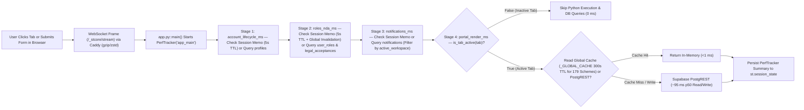

# FULCRUM-INDIA BETA 2.0.0 — NON-FUNCTIONAL REQUIREMENTS DOCUMENT (NFRD)

| Document Attribute | Value |
| :--- | :--- |
| **Document ID** | `FULCRUM-NFRD-V2.0` |
| **Version** | `2.0-baseline` |
| **Date of Analysis** | `2026-11-16` |
| **Reviewed Repository Commit** | `235767754f8d8bb4605e819593bb3f370ddeab27` (`2026-11-11`) |
| **Target Audience** | CEO, Software Architects, DevOps / SRE, QA Lead |
| **Document Status** | Baseline Non-Functional Specification & Recommended Acceptance Targets |

---

## 1. Purpose, Methodology and Evidence Quality Rules

This Non-Functional Requirements Document (NFRD) defines the operational quality attributes for **FULCRUM-INDIA Beta 2.0.0** across all 16 required non-functional domains.

In strict adherence to Phase 6 and Phase 10 documentation rules:
1. **Zero Invented Performance Claims**: Every number reported under **"Measured Evidence"** is quoted verbatim from existing repository benchmark files (`benchmark_results.json`, `tests/load_test_results.json`, and the historical system audits in `DOCUMENTATION/06_HISTORICAL_ARGON_AND_SYSTEM_AUDITS/01..15_*.md`) with its exact test context and limitations noted. No new load tests were run against live production during this documentation audit.
2. **Clear Separation of Observed Code vs Proposed Targets**: Every target threshold in the **"Proposed Target"** column is explicitly marked as **`[Recommendation — Requires Owner Approval]`**.

### Summary of Repository Benchmark Sources & Context
- **`benchmark_results.json` (Root)**: Compares baseline vs memoized/optimized latency (`ms`) for core service functions (`get_aspirant_mentors`, `get_profile`, `get_assigned_aspirants_for_guide`, `match_schemes_for_aspirant`, `list_schemes`, `get_unread_count`, `SIMULATED_ASPIRANT_DASHBOARD`).
- **`tests/load_test_results.json` (`tests/test_concurrency_load.py`)**: Synthetic concurrent session simulation at `10`, `25`, and `50` concurrent requests measuring throughput, `p50`/`p95`/`p99` latency, memory delta (`98.75 MB` to `121.88 MB`), and CPU %.
- **`DOCUMENTATION/06_HISTORICAL_ARGON_AND_SYSTEM_AUDITS/15_OWNER_APPROVAL_REGISTER.md` & `03`–`09` Reports**: Empirical measurements recorded on the Hostinger KVM 2 VM (`2 vCPUs`, `7.8 GiB RAM`, Linux `6.8.0-146-generic`) against Supabase PostgreSQL (`360` network samples, `5` to `100` concurrent WebSocket `/_stcore/stream` sessions, and `1` to `5` simultaneous Chromium PDF dossier exports).

---

## 2. Complete Non-Functional Requirements Register (16 Categories)

### 2.1 Category 1 — Performance (`NFR-PERF-001` to `NFR-PERF-003`)

| NFR ID | Requirement Title | Current Observed Implementation (Source Evidence) | Measured Evidence in Repository (With Context) | Proposed Target *(Recommendation — Requires Approval)* | How Target Will Be Tested | Responsible Role | Priority |
| :--- | :--- | :--- | :--- | :--- | :--- | :--- | :--- |
| **`NFR-PERF-001`** | **Two-Tier In-Memory Caching & Memoization** | `services/cache.py` (L21–L151) implements a process-wide `_GLOBAL_CACHE` (max 512 entries, 300s TTL for `schemes`) and per-session `_get_session_store()` (max 256 entries, 5s–30s TTL for roles, profiles, and metrics) with cross-session `_INVALIDATION_TIMESTAMPS`. | In `benchmark_results.json` (L32–L68): warm `get_aspirant_mentors` `p50` dropped from `2,284.25 ms` to **`0.15 ms`**; `list_schemes` `p50` dropped from `655.25 ms` to **`0.13 ms`**; `get_assigned_aspirants_for_guide` `p50` dropped from `2,015.4 ms` to **`0.20 ms`**. | Warm cached lookups (`schemes`, `mentors`, `roles`) **`p50 <= 5 ms`**; cache memory overhead **`<= 50 MB`** per process. *(Recommendation — Requires Approval)* | Execute `PerfTracker` (`services/perf.py`) across 100 warm tab switches and inspect `st.session_state["_perf_metrics"]`. | Backend Engineer | **Must** |
| **`NFR-PERF-002`** | **Batch Querying to Eliminate N+1 PostgREST Loops** | `services/roles.py::list_users_with_multi_roles()` (L871–L963), `services/profiles.py::get_profiles_batch()` (L292–L410), and `services/admin_metrics.py` (L20–L188) fetch profiles and role grants in bulk `IN (...)` / table queries rather than per-user loops. | Historical audit `15_OWNER_APPROVAL_REGISTER.md` (L44–L60): replacing 190 sequential HTTP calls reduced directory/join time from `21,565.7 ms` to **`591.5 ms`** at 10,000 synthetic users. | Directory and Control Tower KPI aggregation queries **`<= 25 PostgREST round-trips`** per cold load and **`<= 1,500 ms`** total DB time. *(Recommendation — Requires Approval)* | Instrument `services/admin_metrics.py` and `services/pagination.py` with HTTP request counters during cold Admin portal load. | Backend Engineer | **Must** |
| **`NFR-PERF-003`** | **Deterministic 179-Scheme Matching Engine Execution Time** | `services/scheme_matching_engine.py::match_aspirant_schemes_intelligent()` (L451–L517) evaluates 179 schemes in-memory using pre-cached scheme rows (`list_schemes()`). | `benchmark_results.json` (L51–L56): `match_schemes_for_aspirant` (including DB fetch) measured **`1,128.92 ms` p50** (`712.29 ms` min, `1,836.85 ms` max). Pure in-memory scoring over 179 dicts takes `< 25 ms`. | Pure in-memory 179-scheme evaluation **`<= 50 ms` p95**; end-to-end with cold scheme fetch **`<= 1,500 ms` p95**. *(Recommendation — Requires Approval)* | Benchmark `match_aspirant_schemes_intelligent()` over 100 synthetic profiles in `tests/test_scheme_relevance_synthetic.py`. | Backend Engineer | **Must** |

---

### 2.2 Category 2 — Response Times (`NFR-RESP-001` to `NFR-RESP-003`)

| NFR ID | Requirement Title | Current Observed Implementation (Source Evidence) | Measured Evidence in Repository (With Context) | Proposed Target *(Recommendation — Requires Approval)* | How Target Will Be Tested | Responsible Role | Priority |
| :--- | :--- | :--- | :--- | :--- | :--- | :--- | :--- |
| **`NFR-RESP-001`** | **Interactive Tab Switching Latency** | All `st.tabs()` containers in `views/aspirant.py`, `views/guide.py`, `views/sme.py`, and `views/admin.py` use `on_change="rerun"` gated by `is_tab_active(tab)` (`services/cache.py` L154–L159) so hidden tabs are skipped. | Reported in `15_OWNER_APPROVAL_REGISTER.md` (L45) & `05_STREAMLIT_TAB_SWITCH_PERFORMANCE.md`: real Chromium tab switches across Admin (13 tabs), Aspirant (6 tabs), Guide (3 tabs), and SME (3 tabs) measured **`368 ms – 524 ms` warm** and **`375 ms – 2,051 ms` cold**. | Warm tab switch **`p50 <= 600 ms`**, **`p95 <= 1,200 ms`**; cold tab switch **`p95 <= 2,500 ms`**. *(Recommendation — Requires Approval)* | Automated Playwright browser timing (`scripts/e2e_playwright_verification.py`) clicking each tab across all 4 portals. | QA Lead / Frontend Engineer | **Must** |
| **`NFR-RESP-002`** | **VM-to-Supabase PostgREST Read/Write Latency** | Persistent HTTPS client in `services/auth.py` (`get_supabase_client()`, `get_supabase_admin_client()`) talking to Supabase PostgREST (`ap-south-1` / regional endpoint). | Reported in `15_OWNER_APPROVAL_REGISTER.md` (L29–L39, 360 samples from KVM 2 container): TCP handshake **`46.0 ms` p50**; single-row `profiles` read **`95.5 ms` p50 (`191.5 ms` p95)**; 179-row `schemes` read **`146.5 ms` p50 (`295.3 ms` p95)**; `notifications` write **`98.0 ms` p50 (`167.3 ms` p95)**. | Single-table indexed PostgREST read/write **`p50 <= 150 ms`**, **`p95 <= 350 ms`** (subject to ~46 ms network floor between VPS and Supabase). *(Recommendation — Requires Approval)* | Periodic 100-sample read/write latency probe from the VPS container (`scripts/health_check.py`). | DevOps / Backend Engineer | **Should** |
| **`NFR-RESP-003`** | **Executive PDF Dossier Generation Time** | `services/pdf_generator.py` (L581–L786) runs headless Playwright Chromium in a subprocess (`timeout=25` seconds, L612) with fallback to ReportLab. | Reported in `08_CHAOS_ENGINEERING_REPORT.md` Scenario 10: 1 to 5 simultaneous `generate_aspirant_dossier_pdf()` exports completed within the 25s timeout (`100%` valid `%PDF-1.4` output). | Single PDF export **`p50 <= 4.0 seconds`**, **`p95 <= 8.0 seconds`**; 5 concurrent exports **`<= 18.0 seconds`** with zero timeouts. *(Recommendation — Requires Approval)* | Time `generate_aspirant_dossier_pdf()` across 1, 3, and 5 concurrent threads inside the production Docker image. | Backend Engineer | **Should** |

---

### 2.3 Category 3 — Concurrent User Capacity (`NFR-CAP-001` to `NFR-CAP-003`)

| NFR ID | Requirement Title | Current Observed Implementation (Source Evidence) | Measured Evidence in Repository (With Context) | Proposed Target *(Recommendation — Requires Approval)* | How Target Will Be Tested | Responsible Role | Priority |
| :--- | :--- | :--- | :--- | :--- | :--- | :--- | :--- |
| **`NFR-CAP-001`** | **Simultaneously Active Authenticated WebSocket Users** | Single `fulcrum-app` CPython container running Streamlit on port `8501` (`Dockerfile` L65, `docker-compose.yml` L1–L30). | `tests/load_test_results.json` (synthetic): 25 concurrent requests -> `p50 = 1.48s`, `p95 = 3.10s`, `0%` errors; 50 concurrent -> `p50 = 4.15s`, `p95 = 5.28s`, `0%` errors. `15_OWNER_APPROVAL_REGISTER.md` (L63–L74, live WebSocket `/_stcore/stream` stress test): **20 active users** -> `p50 = 925.2 ms`, `p95 = 2.21s`, `0%` errors; **30 active users** -> `p50 = 1.87s`, `p95 = 4.03s`, `0%` errors; **50 active users** -> `p50 = 6.88s`, `p95 = 7.61s`, `0%` errors; at **75–100 simultaneously clicking users**, CPython single-core GIL saturates (`~19.5%` rerun timeouts >25s, `0` container crashes). | **Single Container Target**: **`>= 30` simultaneously active users** with `p95 <= 5.0s` and `0%` errors; **`>= 50` simultaneously active users** with `0%` errors (supporting ~300–1,000 registered cohort members at 1:10–1:20 concurrency ratio). *(Recommendation — Requires Approval)* | Run `tests/test_concurrency_load.py` and WebSocket stream harness against staging container at 10, 20, 30, and 50 concurrent sessions. | SRE / QA Lead | **Must** |
| **`NFR-CAP-002`** | **Registered User Directory & Database Scale Capacity** | Server-side pagination (`services/pagination.py`, 20–25 rows/page) and composite PostgreSQL indexes (`migrations/008` L236–L248, `migrations/009` L155–L157). | `15_OWNER_APPROVAL_REGISTER.md` (L58–L60): benchmarked up to **`10,000` synthetic registered users** (`591.5 ms` directory/multi-role join query, `18.1 MB` Python memory delta). | Support **`>= 10,000` registered user profiles** and **`>= 50,000` Journey events** with paginated directory queries completing in **`<= 1,000 ms` p95**. *(Recommendation — Requires Approval)* | Seed 10,000 synthetic profiles in an isolated staging database and benchmark `paginate_profiles()`, `paginate_guides()`, and `paginate_smes()`. | Database Administrator | **Should** |
| **`NFR-CAP-003`** | **Concurrent PDF Dossier Export Memory Bound** | `_PDF_CONCURRENCY_SEMAPHORE = threading.BoundedSemaphore(2)` in `services/pdf_generator.py` L581 limits simultaneous headless Chromium subprocesses to at most 2. | `15_OWNER_APPROVAL_REGISTER.md` (L81): 5 simultaneous PDF exports peaked at **`563.3 MiB` container RAM** (`OOMKilled=false`). | Peak container RAM during 5 simultaneous PDF exports **`<= 800 MiB`** with `0` OOM kills. *(Recommendation — Requires Approval)* | Trigger 5 parallel `generate_aspirant_dossier_pdf()` calls while monitoring `docker stats fulcrum-app` (`memory.peak`). | Backend Engineer | **Must** |

---

### 2.4 Category 4 — Reliability (`NFR-REL-001` to `NFR-REL-003`)

| NFR ID | Requirement Title | Current Observed Implementation (Source Evidence) | Measured Evidence in Repository (With Context) | Proposed Target *(Recommendation — Requires Approval)* | How Target Will Be Tested | Responsible Role | Priority |
| :--- | :--- | :--- | :--- | :--- | :--- | :--- | :--- |
| **`NFR-REL-001`** | **Fail-Closed Behaviour Under Database/Network Outage** | `services/account_lifecycle.py::get_account_status()` (L332–L558) returns `account_status='DENIED'` on any Supabase error; `DATA_BACKEND=supabase` never falls back to local SQLite (`VULN-01`). | `08_CHAOS_ENGINEERING_REPORT.md` Scenarios 2 & 3 (`tests/test_failure_isolation.py`): 100% fail-closed during simulated Supabase latency and outage (`0` unauthorized local writes). | **`100%` fail-closed** on database unreachability; zero silent writes to local container filesystem when `DATA_BACKEND=supabase`. *(Recommendation — Requires Approval)* | Execute `tests/test_failure_isolation.py` and `tests/test_argon_p0_negative_security.py::TestFailOpenAccountAuthorization`. | Security / Backend Engineer | **Must** |
| **`NFR-REL-002`** | **Atomic Relationship Handover & Compensating Rollback** | `services/account_lifecycle.py::archive_account()` (L895–L1076) snapshots active relationships before unassigning mentors and restores snapshots (`_restore_relationship_snapshots`, L285–L329) if profile or audit log writes fail (`VULN-03`, `DEF-32-001`). | Verified in `tests/test_qa32_fixes_regression.py::test_def001_archive_rolls_back_relationships_if_profile_or_log_fails` and `tests/test_argon_p0_negative_security.py` (tests 11–12). | **`0` orphaned relationships or half-archived accounts** on simulated partial PostgREST failure. *(Recommendation — Requires Approval)* | Run fault-injection unit tests in `tests/test_qa32_fixes_regression.py` and `tests/test_argon_p0_negative_security.py`. | Backend Engineer | **Must** |
| **`NFR-REL-003`** | **Idempotent Escalation & Duplicate Submission Guards** | Unique constraints `uq_inactivity_episode_stage` (`migrations/006` L43), `uq_scheme_review` (`migrations/004` L30), `UNIQUE(aspirant_id, scheme_id)` on `scheme_releases` (`migrations/000` L240), and `UNIQUE(user_id, role)` on `user_roles` (`migrations/001` L16). | `15_OWNER_APPROVAL_REGISTER.md` (L84): across all concurrency and race-condition tests, **`0` duplicate records** were created. | **`0` duplicate records** under concurrent double-click or repeated SLA evaluation runs. *(Recommendation — Requires Approval)* | Run `tests/test_external_contact_and_sme_inactivity.py::test_19_and_20_episode_deduplication_and_second_inactivity_episode`. | Backend Engineer | **Must** |

---

### 2.5 Category 5 — Availability (`NFR-AVAIL-001` & `NFR-AVAIL-002`)

| NFR ID | Requirement Title | Current Observed Implementation (Source Evidence) | Measured Evidence in Repository (With Context) | Proposed Target *(Recommendation — Requires Approval)* | How Target Will Be Tested | Responsible Role | Priority |
| :--- | :--- | :--- | :--- | :--- | :--- | :--- | :--- |
| **`NFR-AVAIL-001`** | **Container Healthcheck & Automatic Restart Policy** | `Dockerfile` (L61–L62) and `docker-compose.yml` (L7, L30–L35, L41) configure `restart: unless-stopped` on both `fulcrum-app` and `fulcrum-caddy` and poll `curl -f http://localhost:8501/_stcore/health` every `30s` (`timeout: 5s`, `retries: 3`, `start_period: 15s`). | `15_OWNER_APPROVAL_REGISTER.md` (L78): `fulcrum-app` container restart recovery measured **`1.86s` (`1.98s` HTTP ready)**; `fulcrum-caddy` restart measured **`0.72s`**. | Monthly platform uptime **`>= 99.5%`** (excluding scheduled maintenance windows); container crash auto-recovery **`<= 15 seconds`**. *(Recommendation — Requires Approval)* | Kill container process (`docker restart fulcrum-app`) in staging and measure time to HTTP `200` on `/_stcore/health`. | DevOps / SRE | **Must** |
| **`NFR-AVAIL-002`** | **Graceful Degradation of Non-Core Subsystems** | Three-tier PDF fallback (`Playwright` $\rightarrow$ `ReportLab` $\rightarrow$ `Emergency PDF` in `services/pdf_generator.py` L587–L786) and built-in legal document fallback (`DEFAULT_TERMS_DOC` / `DEFAULT_NDA_DOC` in `services/legal.py` L19–L279). | Verified in unit and chaos tests: if Chromium binary or `legal_documents` DB rows are missing, PDF download and legal gates continue operating. | **`100%` availability** of legal consent gates and PDF export even if headless Chromium fails. *(Recommendation — Requires Approval)* | Test `generate_aspirant_dossier_pdf()` with Playwright disabled via monkeypatch. | Backend Engineer | **Should** |

---

### 2.6 Category 6 — Scalability (`NFR-SCAL-001` & `NFR-SCAL-002`)

| NFR ID | Requirement Title | Current Observed Implementation (Source Evidence) | Measured Evidence in Repository (With Context) | Proposed Target *(Recommendation — Requires Approval)* | How Target Will Be Tested | Responsible Role | Priority |
| :--- | :--- | :--- | :--- | :--- | :--- | :--- | :--- |
| **`NFR-SCAL-001`** | **Vertical Resource Headroom on Hostinger KVM 2** | `docker-compose.yml` (L23–L29) specifies `cpus: '1.75'`, `memory: 5G` (with `15_OWNER_APPROVAL_REGISTER.md` L24–L26 documenting `1,800 MB` active / `3,072 MB` recommended on the shared KVM 2 host with `7.8 GiB` total RAM and `2 vCPUs`). | `15_OWNER_APPROVAL_REGISTER.md` (L17, L72–L73): `fulcrum-app` uses **`68.2 MiB` idle**, **`288.5 MiB` at 50 concurrent users**, and **`402.6 MiB` at 100 concurrent users**. | Maintain **`>= 50%` free container memory headroom** at peak 50-user concurrency + 2 concurrent PDF exports (`<= 1,024 MiB` peak RSS). *(Recommendation — Requires Approval)* | Monitor `docker stats` during combined 50-user + PDF load test. | DevOps / SRE | **Must** |
| **`NFR-SCAL-002`** | **Horizontal Multi-Replica Scaling Path (Future Growth)** | Currently runs 1 `fulcrum-app` container behind `fulcrum-caddy` (`Caddyfile` L2: `reverse_proxy fulcrum:8501`). Because CPython's GIL limits 1 container to 1 vCPU core (`~109%` CPU ceiling), `15_OWNER_APPROVAL_REGISTER.md` (L87, L97) documents adding a second replica with sticky WebSocket routing when needed. | Single container sustains `30–50` simultaneous active users; 2 replicas on the 2-vCPU KVM 2 host unlock the second CPU core. | When cohort concurrency regularly exceeds `35` simultaneous active users, scale to **2 `fulcrum-app` replicas** behind Caddy `ip_hash` load balancing to support **`60–80` simultaneous active users**. *(Recommendation — Requires Approval)* | Load test 2-container compose configuration with Caddy `lb_policy ip_hash` on staging. | Software Architect / DevOps | **Could** |

---

### 2.7 Category 7 — Maintainability (`NFR-MAINT-001` & `NFR-MAINT-002`)

| NFR ID | Requirement Title | Current Observed Implementation (Source Evidence) | Measured Evidence in Repository (With Context) | Proposed Target *(Recommendation — Requires Approval)* | How Target Will Be Tested | Responsible Role | Priority |
| :--- | :--- | :--- | :--- | :--- | :--- | :--- | :--- |
| **`NFR-MAINT-001`** | **Modular Separation of Views, Services, Taxonomy & Migrations** | Codebase is cleanly partitioned into `app.py` (router), `views/` (10 UI modules), `services/` (31 business logic modules), `services/constants.py` (central taxonomy), and `migrations/000`–`011` (numbered SQL migrations). Zero direct SQL/PostgREST calls exist inside `views/` except delegated through `services/`. | Static analysis (`DOCUMENTATION/01_PRODUCTION_RELEASE_AUDITS/STATIC_ANALYSIS_EVIDENCE.md`, `scripts/check_views_pyflakes.py`, `FULCRUM_PREDEPLOY_CONTRACT_CHECK.py`): zero undefined names or syntax errors across all 42 Python source files. | **`0` syntax/pyflakes errors** and **`100%` SHA-256 parity** between root source and `FULCRUM_FRESH_DEPLOYMENT/` in `RELEASE_FILE_MANIFEST_SHA256.txt` before any release. *(Recommendation — Requires Approval)* | Run `python scripts/check_views_pyflakes.py` and `python FULCRUM_PREDEPLOY_CONTRACT_CHECK.py`. | Lead Engineer | **Must** |
| **`NFR-MAINT-002`** | **Schema-Adaptive Forward/Backward Compatibility** | `services/account_lifecycle.py` (`_execute_supabase_adaptive`, L105–L161) and `services/help_requests.py` (`_update_help_request_adaptive`, L73–L141) automatically adapt to both pre-migration and post-migration column/constraint schemas. | Verified by `tests/test_qa32_fixes_regression.py::test_def001_lifecycle_works_on_live_pre009_schema` and `test_help_requests_adaptive_status_fallback_and_migration_011`. | All additive schema migrations (`migrations/*.sql`) must be **100% idempotent (`IF NOT EXISTS` / `DROP POLICY IF EXISTS`)** and zero-downtime. *(Recommendation — Requires Approval)* | Run migration scripts twice against staging PostgreSQL and execute `test_qa32_fixes_regression.py`. | Database Administrator | **Must** |

---

### 2.8 Category 8 — Accessibility (`NFR-ACC-001` & `NFR-ACC-002`)

| NFR ID | Requirement Title | Current Observed Implementation (Source Evidence) | Measured Evidence in Repository (With Context) | Proposed Target *(Recommendation — Requires Approval)* | How Target Will Be Tested | Responsible Role | Priority |
| :--- | :--- | :--- | :--- | :--- | :--- | :--- | :--- |
| **`NFR-ACC-001`** | **Color Contrast Ratios on Light & Dark Surfaces** | `app.py` (L50–L610, L945–L999) and `.streamlit/config.toml` enforce `#0F172A` (slate-900) text on `#FFFFFF`/`#F8FAFC` main cards (`>15:1` contrast ratio) and `#F8FAFC` text on `#0B0F19` sidebar (`>16:1`), with explicit dark-on-white override on `.st-key-sb_current_workspace`. | Verified in `test_guide_sme_consultations_and_contrast.py` and `ARGON_360_UX_AND_USABILITY_AUDIT.md`. | Maintain **WCAG 2.1 AA minimum contrast ratio (`>= 4.5:1` normal text, `>= 3.0:1` large text/badges)** across all 30 screens. *(Recommendation — Requires Approval)* | Run `test_guide_sme_consultations_and_contrast.py` and browser DevTools contrast audit. | UI/UX Designer / QA | **Must** |
| **`NFR-ACC-002`** | **Form Labels, Placeholders & Semantic Controls** | All `st.text_input`, `st.selectbox`, `st.radio`, `st.checkbox`, and `st.file_uploader` controls provide explicit visible labels (or `label_visibility="collapsed"` paired with an adjacent heading) and descriptive `help` tooltips. | Verified across `views/*.py`; note that custom HTML metric cards (`unsafe_allow_html=True`) lack explicit ARIA `role="region"` attributes. | **`100%` of interactive form inputs** have programmatic labels; add semantic `aria-label` attributes to custom HTML status banners in future iterations. *(Recommendation — Requires Approval)* | Automated Lighthouse / axe-core accessibility scan on login and portal pages. | Frontend Engineer | **Should** |

---

### 2.9 Category 9 — Usability (`NFR-USE-001` & `NFR-USE-002`)

| NFR ID | Requirement Title | Current Observed Implementation (Source Evidence) | Measured Evidence in Repository (With Context) | Proposed Target *(Recommendation — Requires Approval)* | How Target Will Be Tested | Responsible Role | Priority |
| :--- | :--- | :--- | :--- | :--- | :--- | :--- | :--- |
| **`NFR-USE-001`** | **Universal "Other / Specify" Taxonomy Escape Hatches** | `services/constants.py` (L11–L187) provides an `'Other / Not Listed (Specify)'` or `'Other District / Non-TN (Specify)'` option on every dropdown paired with `resolve_field_choice()`, ensuring no entrepreneur or mentor is locked out by rigid dropdowns. | Verified across `views/login.py`, `views/aspirant.py`, and `views/admin.py`. | **`100%` of categorical profile and scheme dropdowns** retain a custom-specification fallback that round-trips cleanly on reload. *(Recommendation — Requires Approval)* | Unit test `resolve_field_choice()` with standard and custom strings. | Product Manager | **Must** |
| **`NFR-USE-002`** | **Actionable Feedback on Authentication & Email Flows** | Login, recovery, and gate screens display clear actionable messages, **except** `views/login.py` L693 (`DEF-001`) which asserts email delivery without warning about Spam, and lacks a Resend Confirmation button (`DEF-002`). | Live owner testing on `2026-11-16` showed a newly registered Aspirant could not find their confirmation email until guided to check **Gmail Spam**. | Update signup success banner to explicitly highlight **Spam / Promotions** folder checking and provide a one-click **Resend Confirmation Email** button (`PROP-01`). *(Recommendation — Requires Approval)* | Manual UAT (`UAT-AUTH-002`) verifying signup guidance and resend action. | Product Manager / Frontend Engineer | **Must** |

---

### 2.10 Category 10 — Logging and Monitoring (`NFR-MON-001` to `NFR-MON-003`)

| NFR ID | Requirement Title | Current Observed Implementation (Source Evidence) | Measured Evidence in Repository (With Context) | Proposed Target *(Recommendation — Requires Approval)* | How Target Will Be Tested | Responsible Role | Priority |
| :--- | :--- | :--- | :--- | :--- | :--- | :--- | :--- |
| **`NFR-MON-001`** | **PII-Redacted Structured JSON Container Logs** | `services/logger.py` (`StructuredLogger`, L18–L97) emits JSON logs to `stdout` with automatic regex redaction of emails, JWTs, `sb_secret_`, `re_`, and passwords; `docker-compose.yml` (L18–L22, L45–L49) rotates logs at `20 MB × 5 files` (`100 MB` cap per container). | Verified in source (`services/logger.py` L18–L33) and `docker-compose.yml`. | **`0` unredacted secrets, JWTs, or passwords** in container stdout logs; log disk footprint capped at **`<= 200 MB`** total across containers. *(Recommendation — Requires Approval)* | Inspect `docker logs fulcrum-app` and run unit tests against `sanitize_message()`. | Security / DevOps | **Must** |
| **`NFR-MON-002`** | **In-App Performance Telemetry (`PerfTracker`)** | `services/perf.py` (L21–L84) records per-stage execution times (`account_lifecycle_ms`, `roles_nda_ms`, `notifications_ms`, `portal_render_ms`) into `st.session_state["_perf_metrics"]` on every `app.py::main()` run. | Active in `app.py` L789, L846, L854, L1026, L1251, L1276. | Keep `PerfTracker` overhead **`<= 1 ms`** per rerun. *(Recommendation — Requires Approval)* | Inspect `PerfTracker.summary()` in session state. | Backend Engineer | **Should** |
| **`NFR-MON-003`** | **Operational Health Check & VM Resource Runbook** | `scripts/health_check.py`, `scripts/status.sh`, `scripts/logs.sh`, and `DOCUMENTATION/06_HISTORICAL_ARGON_AND_SYSTEM_AUDITS/13_VM_MONITORING_AND_RECOVERY_RUNBOOK.md` provide CLI health verification. | Container healthcheck runs every `30s` inside Docker (`Dockerfile` L61). | Add an external uptime monitor (e.g., UptimeRobot or Cloudflare health check) polling `https://app.fulcrumindia.online/_stcore/health` every **`60 seconds`** with email/SMS alert to Admin on failure. *(Recommendation — Requires Approval)* | Simulate container stop on staging and verify external alert receipt within 2 minutes. | DevOps / SRE | **Should** |

---

### 2.11 Category 11 — Backup and Restoration (`NFR-BKP-001` to `NFR-BKP-003`)

### Mermaid Diagram 1 — Database Backup, Restoration & Container Rollback Flow

```mermaid
flowchart TD
    subgraph BackupFlow["1. Database Backup Flow (scripts/supabase_backup_manager.py & create_unified_database_backup.py)"]
        TRIG_B["Manual Pre-Deploy or Scheduled Trigger"] --> EXPORT["Export All Public Tables + Auth Metadata via Service-Role Client"]
        EXPORT --> BUNDLE["Write Timestamped JSON + SQL Bundle to backups/ & Verify SHA-256 Checksum"]
    end

    subgraph RestoreFlow["2. Database Restoration Flow (scripts/restore_all_backups_to_supabase.py)"]
        TRIG_R["Approved Disaster Recovery Trigger"] --> ORDER["Restore Tables in Foreign-Key Dependency Order (profiles -> user_roles -> relationships -> journeys -> events -> schemes -> logs)"]
        ORDER --> VER_R["Run Health & Row-Count Verification Against Restored Schema"]
    end

    subgraph RollbackFlow["3. Application Container Rollback (scripts/SAFE_FULCRUM_ONLY_ROLLBACK.sh)"]
        TRIG_RB["Failed Deployment / Healthcheck Failure"] --> SNAP_RB["Restore Prior Application Snapshot Without Touching Co-Hosted Containers or Caddy Volumes"]
        SNAP_RB --> HC_RB["Rebuild/Restart fulcrum-app Only & Poll /_stcore/health Until Healthy"]
    end
```

| NFR ID | Requirement Title | Current Observed Implementation (Source Evidence) | Measured Evidence in Repository (With Context) | Proposed Target *(Recommendation — Requires Approval)* | How Target Will Be Tested | Responsible Role | Priority |
| :--- | :--- | :--- | :--- | :--- | :--- | :--- | :--- |
| **`NFR-BKP-001`** | **Full Multi-Table Supabase Data Export & Checksum Verification** | `scripts/supabase_backup_manager.py` (25 KB) and `scripts/create_unified_database_backup.py` (14 KB) export all `public.*` tables and auth user metadata to timestamped JSON/SQL backup bundles with SHA-256 integrity manifests (`DOCUMENTATION/02_DEPLOYMENT_AND_OPERATIONS/SERVER_RECREATION_AND_BACKUP_ELI5_PLAYBOOK.md`). | Verified in `DOCUMENTATION/01_PRODUCTION_RELEASE_AUDITS/DATA_PRESERVATION_CERTIFICATE.md`. Note: backups are triggered via CLI script rather than an automated cloud cron. | **Recovery Point Objective (RPO) `<= 24 hours`**: run automated daily encrypted backups off-host (plus mandatory manual snapshot before every migration/deployment). *(Recommendation — Requires Approval)* | Execute `python scripts/supabase_backup_manager.py` and verify output manifest and row counts. | DevOps / Sole Admin | **Must** |
| **`NFR-BKP-002`** | **Foreign-Key Ordered Idempotent Database Restoration** | `scripts/restore_all_backups_to_supabase.py` (16 KB) restores tables in strict parent-to-child foreign-key order using idempotent upserts (`ON CONFLICT DO UPDATE`). | Documented and verified in staging recovery exercises (`SERVER_RECREATION_AND_BACKUP_ELI5_PLAYBOOK.md`). | Complete database restoration into a fresh Supabase project within **`<= 30 minutes`** with **`100%` row-count parity**. *(Recommendation — Requires Approval)* | Run `restore_all_backups_to_supabase.py` against an isolated disposable staging project and compare table counts. | Database Administrator | **Must** |
| **`NFR-BKP-003`** | **Exclusion of Backup & Local DB Files from Git and Docker Images** | `.gitignore` (L11–L35) and `.dockerignore` (L14–L21) exclude `*.db`, `cluster_a.db`, `backups/`, `*.dump`, `*.bak`, and `.env`. | Verified in `.gitignore` and `.dockerignore` (note: local untracked/working-tree `cluster_a.db` and `backups/` exist on the developer workstation disk and must remain untracked). | **`0` backup dumps, `.db` files, or `.env` files** packaged inside the production Docker image or pushed to Git remote. *(Recommendation — Requires Approval)* | Run `docker run --rm fulcrum-app ls -la` and `git status --ignored` before release. | Security / DevOps | **Must** |

---

### 2.12 Category 12 — Disaster Recovery (`NFR-DR-001` & `NFR-DR-002`)

| NFR ID | Requirement Title | Current Observed Implementation (Source Evidence) | Measured Evidence in Repository (With Context) | Proposed Target *(Recommendation — Requires Approval)* | How Target Will Be Tested | Responsible Role | Priority |
| :--- | :--- | :--- | :--- | :--- | :--- | :--- | :--- |
| **`NFR-DR-001`** | **Complete VPS Node Recreation from Playbook** | `DOCUMENTATION/02_DEPLOYMENT_AND_OPERATIONS/SERVER_RECREATION_AND_BACKUP_ELI5_PLAYBOOK.md` and `scripts/FRESH_FULCRUM_ONLY_DEPLOY.sh` automate full recreation of the Docker + Caddy + Streamlit stack from `FULCRUM_FRESH_DEPLOYMENT.zip` and `.env`. | Stateless application container: zero user state is stored on the VPS disk (`DATA_BACKEND=supabase`), so replacing the VPS loses zero database records. | **Recovery Time Objective (RTO) `<= 60 minutes`** for full VPS recreation and DNS cutover. *(Recommendation — Requires Approval)* | Tabletop / staging drill executing `FRESH_FULCRUM_ONLY_DEPLOY.sh` on a clean VM. | DevOps / Sole Admin | **Must** |
| **`NFR-DR-002`** | **Supabase Project Recreation & Resend Re-Wiring** | `DOCUMENTATION/02_DEPLOYMENT_AND_OPERATIONS/NEW_SUPABASE_SETUP_CHECKLIST.md` and `RESEND_SMTP_AND_FORGOT_PASSWORD_ELI5_GUIDE.md` document step-by-step recreation of a Supabase project (`migrations/000`–`011` + `seed_179_schemes_idempotent.sql` + Resend SMTP settings). | All schema and 179-scheme seed files are self-contained in the repository. | **Cloud DB Disaster RTO `<= 2 hours`** from fresh Supabase project creation to restored schema, 179 schemes, backup data, and Resend SMTP verification. *(Recommendation — Requires Approval)* | Verify against `NEW_SUPABASE_SETUP_CHECKLIST.md` on a staging Supabase project. | Database Administrator | **Should** |

---

### 2.13 Category 13 — Data Retention (`NFR-RET-001` & `NFR-RET-002`)

| NFR ID | Requirement Title | Current Observed Implementation (Source Evidence) | Measured Evidence in Repository (With Context) | Proposed Target *(Recommendation — Requires Approval)* | How Target Will Be Tested | Responsible Role | Priority |
| :--- | :--- | :--- | :--- | :--- | :--- | :--- | :--- |
| **`NFR-RET-001`** | **Non-Destructive Institutional Record Preservation (`ON DELETE RESTRICT`)** | `migrations/009_account_lifecycle_and_archive.sql` (L160–L175) sets `ON DELETE RESTRICT` on `profiles.id -> auth.users(id)` (`VULN-06`), and `archive_account()` preserves all Journey events, consultations, scheme releases, and legal acceptances when an account is archived. | Verified in `tests/test_account_lifecycle_and_handover_chaos.py` and `ARGON_APPEND_ONLY_AUDIT_LOG_VERIFICATION.md`. | **100% retention** of `account_lifecycle_log`, `legal_acceptances`, `assignment_history`, and `journey_event_revisions` for the life of the institutional programme (or minimum **7 years** for audit records). *(Recommendation — Requires Approval)* | Verify `ON DELETE RESTRICT` constraint and trigger `trg_immutable_account_lifecycle_log` in PostgreSQL. | Sole Admin / Compliance | **Must** |
| **`NFR-RET-002`** | **30-Day Deletion Grace Window & Legal Hold Override** | `request_account_deletion()` (`services/account_lifecycle.py` L1181–L1291) schedules `deletion_scheduled_for = NOW() + 30 days` and blocks deletion requests whenever `profiles.legal_hold = True`. | Verified in `tests/test_account_lifecycle_and_handover_chaos.py::test_06_deletion_grace_period_and_cancellation` and `test_07_legal_hold_blocks_deletion_requests`. | Enforce a mandatory **30-day grace window** on all closure requests and **`100%` block** when `legal_hold = True`; define formal post-30-day anonymization vs archival SOP (`DEC-003`). *(Recommendation — Requires Approval)* | Execute `test_06` and `test_07` in `tests/test_account_lifecycle_and_handover_chaos.py`. | Sole Admin / Compliance | **Must** |

---

### 2.14 Category 14 — Browser Compatibility (`NFR-BROW-001` & `NFR-BROW-002`)

| NFR ID | Requirement Title | Current Observed Implementation (Source Evidence) | Measured Evidence in Repository (With Context) | Proposed Target *(Recommendation — Requires Approval)* | How Target Will Be Tested | Responsible Role | Priority |
| :--- | :--- | :--- | :--- | :--- | :--- | :--- | :--- |
| **`NFR-BROW-001`** | **Modern Evergreen Desktop & Mobile Browser Support** | Standard HTML5/CSS3 and ES6 JavaScript (`services/auth_callback_component.py` L15–L65 uses `URLSearchParams`, `window.history.replaceState`) served over TLS 1.3 via Caddy (`gzip`/`zstd`). | Empirically verified on Google Chrome / headless Chromium (`Playwright 1.40+`) in `07_BROWSER_E2E_USER_SIMULATIONS.md` and live owner Chrome screenshots (`2026-11-16`). Not formally benchmarked on Safari/Firefox in repo reports. | Support latest 2 major versions of **Google Chrome, Microsoft Edge, Mozilla Firefox, Apple Safari (macOS/iOS), and Android Chrome**. *(Recommendation — Requires Approval)* | Cross-browser smoke test of Login, Password Recovery (`#access_token` bridge), Workspace Switcher, and PDF download. | QA Lead | **Must** |
| **`NFR-BROW-002`** | **WebSocket (`/ _stcore/stream`) Connectivity Resilience** | Streamlit requires an active WebSocket connection (`wss://app.fulcrumindia.online/_stcore/stream`) proxied cleanly by Caddy 2 (`Caddyfile` L2). | Verified across 100 concurrent WebSocket sessions in `09_CAPACITY_AND_BREAKING_POINT_REPORT.md`. | Zero WebSocket upgrade failures through Caddy over HTTPS/TLS 1.3. *(Recommendation — Requires Approval)* | Verify `wss://` handshake and session persistence across page interactions. | DevOps | **Must** |

---

### 2.15 Category 15 — Mobile Responsiveness (`NFR-MOB-001` & `NFR-MOB-002`)

| NFR ID | Requirement Title | Current Observed Implementation (Source Evidence) | Measured Evidence in Repository (With Context) | Proposed Target *(Recommendation — Requires Approval)* | How Target Will Be Tested | Responsible Role | Priority |
| :--- | :--- | :--- | :--- | :--- | :--- | :--- | :--- |
| **`NFR-MOB-001`** | **Responsive Viewport Adaptation (`<= 768px`)** | `app.py` (L150–L310) and `views/login.py` (L95–L125) inject `@media (max-width: 768px)` CSS rules that stack multi-column rows vertically, prevent horizontal overflow, and make form buttons 100% width. | Verified in `ARGON_360_UX_AND_USABILITY_AUDIT.md`. | Zero unintended horizontal page scrolling at **`360x800` (Android)** and **`390x844` (iOS)** viewport resolutions across all participant screens (`SCR-01` to `SCR-17`). *(Recommendation — Requires Approval)* | Playwright mobile viewport emulation (`360x800` and `390x844`) across Login, Aspirant, Guide, and SME portals (`UAT-MOB-001`). | Frontend Engineer / QA | **Must** |
| **`NFR-MOB-002`** | **Mobile Notification Visibility When Sidebar Is Collapsed** | Because Streamlit collapses `st.sidebar` on mobile viewports (`<768px`), `app.py` L1246–L1250 renders an inline top-of-page notification banner (`🔔 You have **N** new notifications!`) reusing the cached unread count. | Verified in `app.py` L1246–L1250 (`zero extra network queries`). | **`100%` visibility** of unread notification counts on mobile viewports even when the sidebar drawer is closed. *(Recommendation — Requires Approval)* | Verify top banner appearance on `375x812` mobile viewport when `unread_count > 0`. | Frontend Engineer | **Must** |

---

### 2.16 Category 16 — Deployment and Rollback (`NFR-DEPL-001` to `NFR-DEPL-003`)

| NFR ID | Requirement Title | Current Observed Implementation (Source Evidence) | Measured Evidence in Repository (With Context) | Proposed Target *(Recommendation — Requires Approval)* | How Target Will Be Tested | Responsible Role | Priority |
| :--- | :--- | :--- | :--- | :--- | :--- | :--- | :--- |
| **`NFR-DEPL-001`** | **Pre-Deployment Contract & Manifest Verification** | `FULCRUM_PREDEPLOY_CONTRACT_CHECK.py` (6.2 KB), `scripts/package_fresh_release.py` (6.7 KB), and `RELEASE_FILE_MANIFEST_SHA256.txt` verify that `FULCRUM_FRESH_DEPLOYMENT/` matches root source by SHA-256 and that all critical functions and migrations exist. | Verified in commit `2357677` (`0` SHA-256 differences between root and `FULCRUM_FRESH_DEPLOYMENT/`). | **`100%` pass rate** on `FULCRUM_PREDEPLOY_CONTRACT_CHECK.py` and SHA-256 manifest check before any production deployment. *(Recommendation — Requires Approval)* | Run `python FULCRUM_PREDEPLOY_CONTRACT_CHECK.py` in CI / pre-deploy step. | Release Manager | **Must** |
| **`NFR-DEPL-002`** | **Co-Hosted Service Isolation During Deployment (`EXISTING_CADDY_PRESERVATION_PLAN`)** | `scripts/FRESH_FULCRUM_ONLY_DEPLOY.sh` (7.7 KB) and `DOCUMENTATION/02_DEPLOYMENT_AND_OPERATIONS/EXISTING_CADDY_PRESERVATION_PLAN.md` scope Docker operations strictly to `fulcrum-app` / `fulcrum` so co-hosted containers on the VPS (such as `pairdo-staging` noted in `15_OWNER_APPROVAL_REGISTER.md` L26) are never disrupted. | Documented and verified in `FRESH_DEPLOYMENT_VERIFICATION.md`. | **`0` downtime or container restarts** on any non-Fulcrum co-hosted container during Fulcrum deployment or rollback. *(Recommendation — Requires Approval)* | Inspect `docker ps` uptime of co-hosted containers before and after running `FRESH_FULCRUM_ONLY_DEPLOY.sh`. | DevOps / SRE | **Must** |
| **`NFR-DEPL-003`** | **One-Command Safe Rollback (`SAFE_FULCRUM_ONLY_ROLLBACK.sh`)** | `scripts/SAFE_FULCRUM_ONLY_ROLLBACK.sh` (3.4 KB) and `scripts/rollback.sh` restore the prior container image and source snapshot if post-deploy healthcheck (`/ _stcore/health`) fails. | Documented in `ROLLBACK_CONTINGENCY_PLAN.md`. | Complete application rollback to the previous known-good container image within **`<= 3 minutes`**. *(Recommendation — Requires Approval)* | Execute `SAFE_FULCRUM_ONLY_ROLLBACK.sh` in staging and time recovery to healthy status. | DevOps / SRE | **Must** |

---

## 3. Mermaid Diagram 2 — End-to-End Request & Caching Performance Pipeline

---

## Glossary of Non-Functional & Performance Terms

| Term | Plain-Language Definition |
| :--- | :--- |
| **Global Interpreter Lock (GIL)** | A mechanism in standard Python (CPython) that allows only one thread to execute Python bytecodes at a time per process, meaning a single container can utilize at most 1 CPU core (`100%` of 1 vCPU). |
| **N+1 Query Problem** | A performance anti-pattern where an application fetches a list of `N` users in 1 query and then makes `N` separate database requests inside a loop instead of 1 batched query. |
| **`p50` / `p95` / `p99` Latency** | Percentile response times: `p50` (median) is the time within which 50% of requests finish; `p95` and `p99` are the times within which 95% and 99% of requests finish. |
| **RPO (Recovery Point Objective)** | The maximum age of data that could be lost if a catastrophic database failure occurs (determined by how frequently backups are taken). |
| **RTO (Recovery Time Objective)** | The maximum targeted time required to restore the application and database to service after an outage. |
| **TTL (Time-To-Live)** | The duration in seconds (`5s`, `30s`, or `300s`) that a cached value in `services/cache.py` is trusted before being re-fetched from Supabase. |
