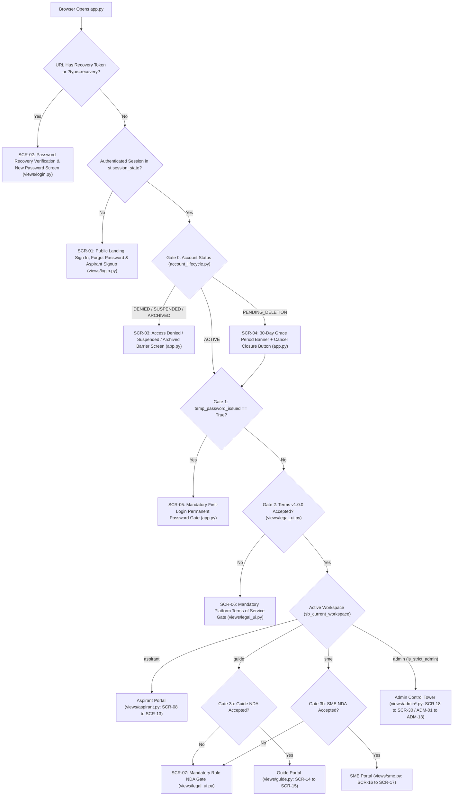
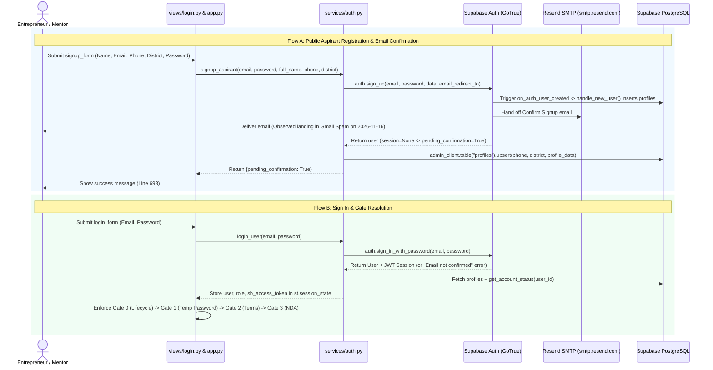
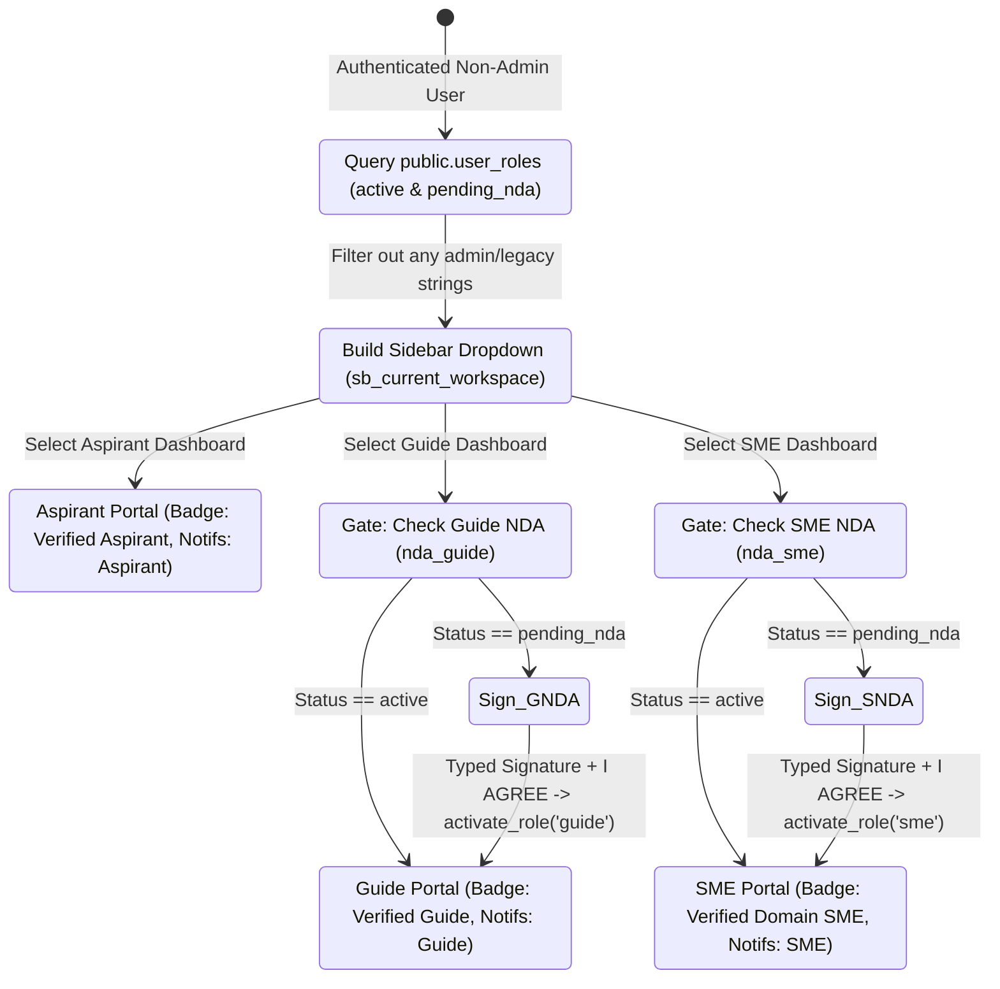
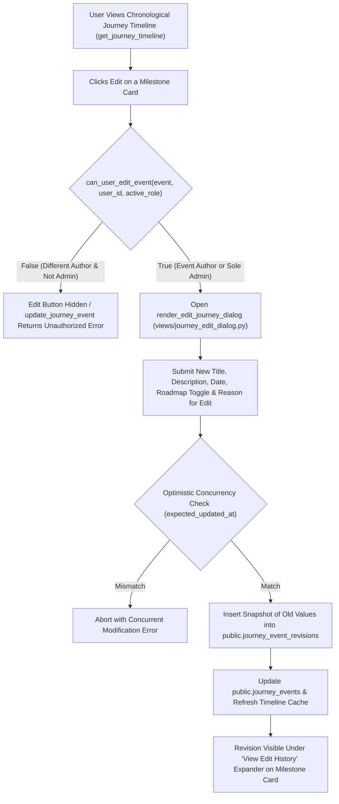
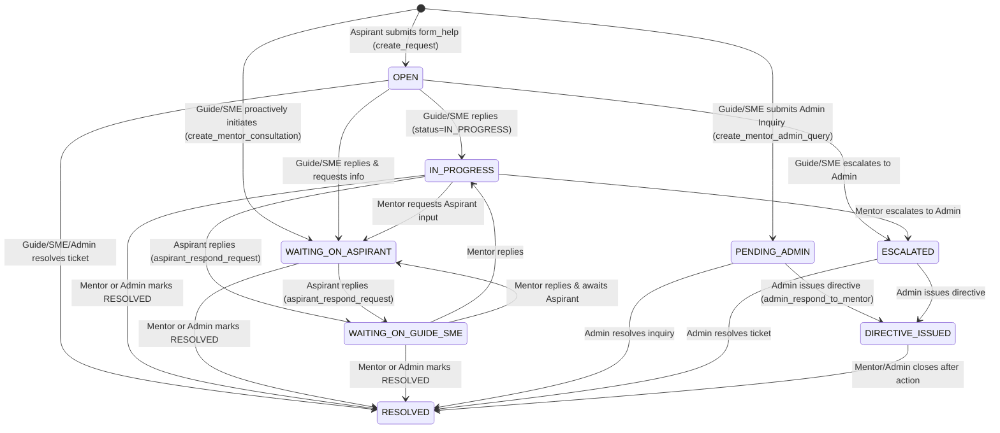
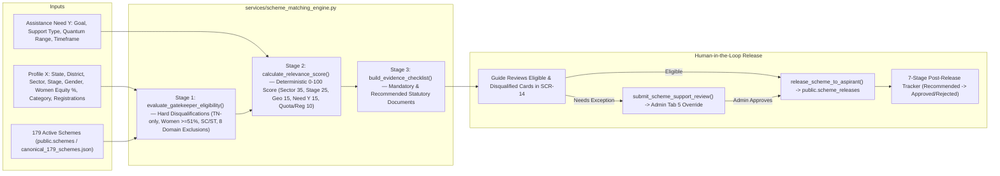
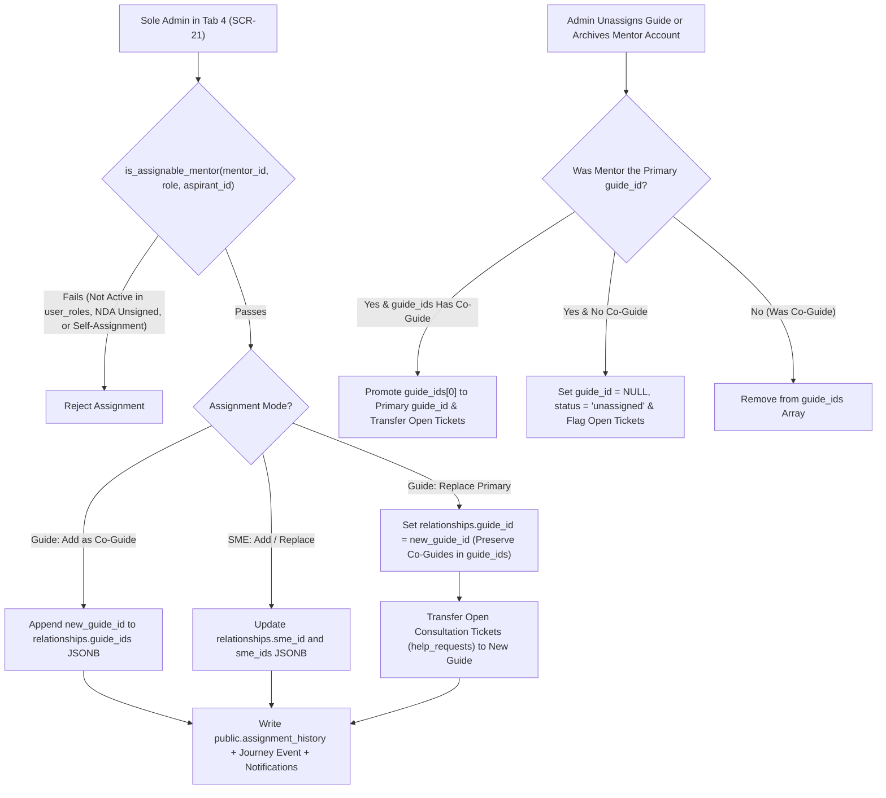
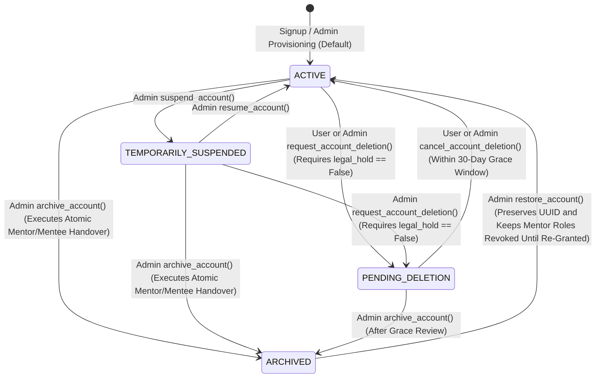
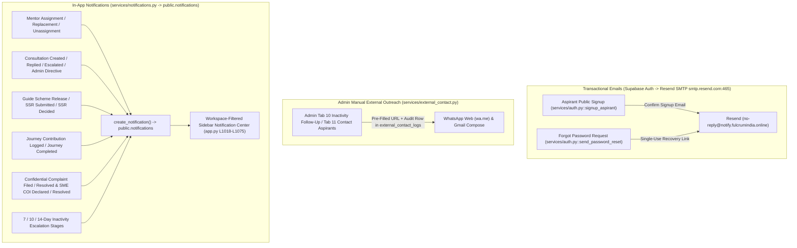

# FULCRUM-INDIA BETA 2.0.0 — PRODUCT REQUIREMENTS DOCUMENT (PRD)

| Document Attribute | Value |
| :--- | :--- |
| **Document ID** | `FULCRUM-PRD-V2.0` |
| **Version** | `2.0-baseline` |
| **Date of Analysis** | `2026-11-16` |
| **Reviewed Repository Commit** | `235767754f8d8bb4605e819593bb3f370ddeab27` (`2026-11-11`) |
| **Target Audience** | Product Managers, UI/UX Designers, Frontend & Backend Engineers, QA Lead |
| **Document Status** | Baseline Functional Inventory of Implemented Beta 2.0.0 Application |

---

## 1. Product Overview

**FULCRUM-INDIA Beta 2.0.0** is a multi-portal web application built with **Python 3.11+ / Streamlit (`>=1.55.0,<=1.56.0`)** and backed by **Supabase (PostgreSQL, GoTrue Authentication, and Private Object Storage)** with a local **SQLite (`cluster_a.db`)** development/testing mirror (`app.py` L1–L1279, `requirements.txt` L1–L14, `services/local_db.py` L1–L2832).

The product provides four role-specific portals within a single application shell (`app.py` L1251–L1275):
1. **Aspirant Portal (`views/aspirant.py`)**: 6 tabs for entrepreneur onboarding, 4-part enterprise profiling, private identity photograph management, chronological Enterprise Journey tracking, assigned mentor interaction, Guide-released government scheme tracking, and consultation ticketing.
2. **Guide Portal (`views/guide.py`)**: 3 main tabs and 6 per-mentee pill subtabs for general business mentors to inspect assigned Aspirants, log Journey mentorship milestones, evaluate 179 deterministic scheme matches, release schemes or request Admin Scheme Support Reviews, respond to consultations, and post case collaboration notes.
3. **SME Portal (`views/sme.py`)**: 3 main tabs and 4 per-mentee pill subtabs for Subject Matter Experts to deliver domain-specific consultations, log specialist Journey milestones, collaborate with Guides, and declare Conflicts of Interest (without scheme-matching duties).
4. **Administrator Control Tower (`views/admin.py`, `views/admin_governance.py`, `views/admin_account_lifecycle.py`)**: **13 operational tabs** reserved exclusively for the Sole Institutional Administrator (`<SOLE_ADMIN_EMAIL>`) to manage the entire entrepreneur and mentor lifecycle.

---

## 2. Product Objectives

The functional design of Fulcrum-Beta 2.0.0 fulfills the eight institutional objectives defined in [`FULCRUM_BRD_V2.md`](./FULCRUM_BRD_V2.md) (`BO-01` through `BO-08`):
- **Single-Page Reactive Workspace with Lazy Tab Rendering**: Eliminate redundant database queries on tab switches by binding `st.tabs(..., on_change="rerun")` to `services.cache.is_tab_active()` (`services/cache.py` L154–L159).
- **Strict Sequential Onboarding Gates**: Enforce Account Lifecycle Status Gate $\rightarrow$ First-Login Permanent Password Gate $\rightarrow$ Universal Terms of Service Gate $\rightarrow$ Role-Specific NDA Gate before rendering any workspace (`app.py` L1088–L1245).
- **Workspace-Scoped Multi-Role Experience**: Allow a single authenticated user holding multiple non-admin roles (`user_roles`) to switch cleanly between Aspirant, Guide, and SME workspaces via `sb_current_workspace` (`app.py` L1003–L1015).
- **Human-in-the-Loop Scheme Curation**: Prevent raw algorithmic matches from overwhelming founders by routing all 179 scheme evaluations through the assigned Guide (`views/guide.py` L495–L850) before surfacing approved schemes in the Aspirant's **Scheme Matches** tab (`views/aspirant.py` L791–L847).

---

## 3. Current Architecture Summary

*(For full technical specifications, database constraints, and sequence diagrams, see [`FULCRUM_SRS_V2.md`](./FULCRUM_SRS_V2.md).)*

- **Presentation & Routing Layer**: `app.py` (1,279 lines) injects responsive CSS design tokens, manages `st.session_state`, renders the authenticated sidebar (user badge, workspace switcher, workspace-filtered notification center, logout), executes the four security/legal gates, and dispatches to `views/login.py`, `views/aspirant.py`, `views/guide.py`, `views/sme.py`, or `views/admin.py`.
- **Custom Browser Bridge Component**: `services/auth_callback_component.py` (98 lines) uses Streamlit Components v2 (`st.components.v2.component`) to read URL fragment tokens (`#access_token=...&refresh_token=...&type=recovery`) in browser JavaScript, scrub the URL bar via `history.replaceState`, and pass tokens over WebSocket to Python.
- **Service Layer**: 31 Python modules in `services/` encapsulating authentication (`auth.py`), RBAC (`roles.py`), legal/NDA (`legal.py`), profiles (`profiles.py`), photos (`aspirant_photos.py`, `professional_photos.py`), relationships (`relationships.py`), journeys (`journey.py`), PDF dossiers (`pdf_generator.py`, `html_to_pdf_worker.py`), schemes (`schemes.py`, `scheme_matching_engine.py`, `scheme_rules.py`, `scheme_reviews.py`, `schemes_ui.py`), consultations (`help_requests.py`, `collaboration.py`), governance (`governance.py`, `inactivity.py`, `external_contact.py`, `account_lifecycle.py`, `admin_metrics.py`), and infrastructure (`cache.py`, `pagination.py`, `logger.py`, `perf.py`, `local_db.py`).
- **Persistence Layer**: 18 PostgreSQL tables in `public` schema + 2 private Supabase Storage buckets (`aspirant-profile-photos`, `professional-headshots`) defined across `migrations/000` through `011`.

---

## 4. User Personas and Roles

| Persona ID | Persona & Role | Provisioning Path | Active Workspaces Allowed | Key Product Needs |
| :--- | :--- | :--- | :--- | :--- |
| **`PER-ASP`** | **Founder / Entrepreneur (`aspirant`)** | Public signup (`views/login.py` L642) or base role on any non-admin account. | `🌱 Aspirant Dashboard` | Build enterprise profile, discover verified government schemes, get timely mentorship from Guide and SME, export PDF business dossier, and report Guide issues confidentially. |
| **`PER-GUIDE`** | **General Business Mentor (`guide`)** | Admin Tab 2 (`views/admin.py` L569) or Admin Tab 7 Multi-Role Grant (`views/admin_governance.py` L75). | `🧭 Guide Dashboard` (plus `🌱 Aspirant` / `🔬 SME` if multi-role) | View assigned mentees' full context and Journey, evaluate and release scheme matches, answer consultations within 7-day SLA, coordinate with Co-Guides/SMEs. |
| **`PER-SME`** | **Domain Specialist (`sme`)** | Admin Tab 3 (`views/admin.py` L715) or Admin Tab 7 Multi-Role Grant (`views/admin_governance.py` L75). | `🔬 SME Dashboard` (plus `🌱 Aspirant` / `🧭 Guide` if multi-role) | Provide targeted domain advice (GST, legal, FSSAI, patents, debt), log specialist Journey milestones, declare Conflicts of Interest when necessary. |
| **`PER-HYB`** | **Hybrid Participant (7 Non-Admin Combos)** | Granted additional roles in `public.user_roles` by Sole Admin. | Any combination of `aspirant`, `guide`, `sme` | Switch workspaces seamlessly without cross-contaminating notifications, badges, or SLA clocks; prevented from mentoring own enterprise. |
| **`PER-ADM`** | **Sole Institutional Administrator (`admin`)** | Locked to `<SOLE_ADMIN_EMAIL>` / `<SOLE_ADMIN_UUID>` (`migrations/008` L14–L43). | `🏛️ Admin Dashboard` only | Single pane of glass across 13 tabs to govern users, roles, assignments, schemes, legal records, complaints, COI, inactivity SLAs, and account archival. |

---

## 5. Complete Navigation and Screen Inventory

### Mermaid Diagram 1 — Product Navigation Map

### 5.1 Master Screen Inventory Table (`SCR-01` to `SCR-30`)

| Screen ID | Screen / View Name | Source File & Lines | Navigation Route / State Key | Authorized Roles |
| :--- | :--- | :--- | :--- | :--- |
| **`SCR-01`** | Public Landing, Sign In, Forgot Password & Aspirant Signup | `views/login.py` L36–L706 | Unauthenticated root (`is_logged_in == False`) | Public / Unauthenticated |
| **`SCR-02`** | Password Recovery Verification & New Password Screen | `views/login.py` L375–L558 | `?type=recovery` or `#access_token` via `read_auth_callback()` | Unauthenticated (with valid recovery token) |
| **`SCR-03`** | Account Denied / Suspended / Archived Barrier Screen | `app.py` L1095–L1150 | `acc_status in ('DENIED','TEMPORARILY_SUSPENDED','ARCHIVED')` | Blocked Authenticated Users |
| **`SCR-04`** | Account Pending Deletion Grace-Period Banner & Cancellation | `app.py` L1151–L1188 | `acc_status == 'PENDING_DELETION'` | Authenticated Non-Admin Users |
| **`SCR-05`** | Mandatory First-Login Permanent Password Gate | `app.py` L1198–L1232 | `profile_data.temp_password_issued == True` | Provisioned Guides & SMEs |
| **`SCR-06`** | Mandatory Platform Terms & Conditions Gate | `views/legal_ui.py` L19–L90 | `check_user_terms_accepted(user_id) == False` | Aspirant, Guide, SME |
| **`SCR-07`** | Mandatory Role Non-Disclosure Agreement (NDA) Gate | `views/legal_ui.py` L93–L229 | `active_role in ('guide','sme')` & `check_user_nda_accepted == False` | Guide, SME |
| **`SCR-08`** | Aspirant Tab 1: Overview & Executive Dossier Export | `views/aspirant.py` L100–L218 | `aspirant_nav_tabs[0]` (`📊 Overview`) | Aspirant |
| **`SCR-09`** | Aspirant Tab 2: My Profile (4-Part Form, Photo & Needs) | `views/aspirant.py` L220–L454 | `aspirant_nav_tabs[1]` (`👤 My Profile`) | Aspirant |
| **`SCR-10`** | Aspirant Tab 3: My Journey & Milestone Editor | `views/aspirant.py` L456–L644, `views/journey_edit_dialog.py` | `aspirant_nav_tabs[2]` (`🎬 My Journey`) | Aspirant |
| **`SCR-11`** | Aspirant Tab 4: My Mentors & Confidential Guide Complaint | `views/aspirant.py` L646–L789 | `aspirant_nav_tabs[3]` (`🤝 My Mentors`) | Aspirant |
| **`SCR-12`** | Aspirant Tab 5: Scheme Matches (Guide-Released Schemes) | `views/aspirant.py` L791–L847 | `aspirant_nav_tabs[4]` (`🏦 Scheme Matches`) | Aspirant |
| **`SCR-13`** | Aspirant Tab 6: Consult a Guide or SME & Case Discussions | `views/aspirant.py` L849–L1104 | `aspirant_nav_tabs[5]` (`🤝 Consult a Guide or SME`) | Aspirant |
| **`SCR-14`** | Guide Tab 1: My Aspirants (with 6 Pill Subtabs: Profile, Journey, Guidance Team, Schemes, Consultations, Collaboration) | `views/guide.py` L104–L1099 | `guide_main_tabs[0]` (`👥 My Aspirants`) + `guide_subtab_<id>` | Guide |
| **`SCR-15`** | Guide Tab 2 & Tab 3: All Consultations Overview & Guide Profile/Headshot | `views/guide.py` L1102–L1379 | `guide_main_tabs[1]` & `guide_main_tabs[2]` | Guide |
| **`SCR-16`** | SME Tab 1: My Assigned Cases (with 4 Pill Subtabs: Profile, Journey, Guidance Team, Consultations + COI Form) | `views/sme.py` L84–L695 | `sme_nav_tabs[0]` (`👥 My Assigned Cases`) + `sme_subtab_<id>` | SME |
| **`SCR-17`** | SME Tab 2 & Tab 3: All Consultations Overview & SME Profile/Headshot | `views/sme.py` L697–L952 | `sme_nav_tabs[1]` & `sme_nav_tabs[2]` | SME |
| **`SCR-18`** | Admin Tab 1 (`ADM-01`): Aspirants & Journeys Directory | `views/admin.py` L271–L566 | `admin_main_tabs[0]` (`👥 Aspirants & Journeys`) | Sole Admin |
| **`SCR-19`** | Admin Tab 2 (`ADM-02`): Guides Management & Provisioning | `views/admin.py` L569–L712 | `admin_main_tabs[1]` (`🧭 Guides Management`) | Sole Admin |
| **`SCR-20`** | Admin Tab 3 (`ADM-03`): SMEs Management & Provisioning | `views/admin.py` L715–L860 | `admin_main_tabs[2]` (`🔬 SMEs Management`) | Sole Admin |
| **`SCR-21`** | Admin Tab 4 (`ADM-04`): Mentor Assignments & Roster Matrix | `views/admin.py` L863–L1098 | `admin_main_tabs[3]` (`🎯 Mentor Assignments`) | Sole Admin |
| **`SCR-22`** | Admin Tab 5 (`ADM-05`): Mentor Inquiries & Scheme Support Reviews | `views/admin.py` L1101–L1296 | `admin_main_tabs[4]` (`🏛️ Mentor Inquiries & Directives`) | Sole Admin |
| **`SCR-23`** | Admin Tab 6 (`ADM-06`): Scheme Catalogue (CRUD & Delegation) | `views/admin.py` L1299–L1494, `services/schemes_ui.py` | `admin_main_tabs[5]` (`🏦 Scheme Catalogue (CRUD)`) | Sole Admin |
| **`SCR-24`** | Admin Tab 7 (`ADM-07`): Multi-Role Grants & Identity | `views/admin_governance.py` L75–L287 | `admin_main_tabs[6]` (`🔑 Multi-Role Grants`) | Sole Admin |
| **`SCR-25`** | Admin Tab 8 (`ADM-08`): Legal & NDA Records | `views/admin_governance.py` L293–L325 | `admin_main_tabs[7]` (`📜 Legal & NDA Records`) | Sole Admin |
| **`SCR-26`** | Admin Tab 9 (`ADM-09`): Confidential Guide Complaints | `views/admin_governance.py` L331–L386 | `admin_main_tabs[8]` (`🛡️ Confidential Complaints`) | Sole Admin |
| **`SCR-27`** | Admin Tab 10 (`ADM-10`): Caseload Inactivity Monitor | `views/admin_governance.py` L392–L680 | `admin_main_tabs[9]` (`⏱️ Inactivity Monitor`) | Sole Admin |
| **`SCR-28`** | Admin Tab 11 (`ADM-11`): Contact Aspirants (WhatsApp & Gmail) | `views/admin_governance.py` L806–L994 | `admin_main_tabs[10]` (`💬 Contact Aspirants`) | Sole Admin |
| **`SCR-29`** | Admin Tab 12 (`ADM-12`): SME Conflict Governance | `views/admin_governance.py` L686–L800 | `admin_main_tabs[11]` (`⚖️ SME Conflict Governance`) | Sole Admin |
| **`SCR-30`** | Admin Tab 13 (`ADM-13`): Account Lifecycle & Archive (4 Subtabs) | `views/admin_account_lifecycle.py` L43–L395 | `admin_main_tabs[12]` (`🗄️ Account Lifecycle & Archive`) | Sole Admin |

### 5.2 Screen-by-Screen Detail Cards (Public, Auth & Gate Screens `SCR-01` to `SCR-07`)

#### `SCR-01` — Public Landing, Sign In, Forgot Password & Aspirant Signup

| Screen Attribute | Specification |
| :--- | :--- |
| **Screen ID & Name** | `SCR-01` — Public Landing, Sign In, Forgot Password & Aspirant Signup |
| **Page Purpose** | Present institutional branding and value proposition on the left column and provide tabbed Sign In, Forgot Password, and Public Aspirant Registration forms on the right column. |
| **Navigation Route** | Root URL `/` when `is_logged_in == False` (`app.py` L1084–L1086 -> `views/login.py` L29–L706). |
| **Authorized Roles** | Public / Unauthenticated users. |
| **Visible Information** | Left column: FULCRUM-INDIA badge, headline ('Accelerating Entrepreneurial Journeys Across India'), 3 feature callouts (Chronological Enterprise Journey, Dedicated Guide & SME Mentorship, 179+ Verified Schemes), Tamil Nadu focus banner. Right column: `Sign In` and `Create Aspirant Account` tabs (`st.tabs`, L563), plus `🔑 Forgot Password?` expander (L599) and system maintenance contact link (`<SOLE_ADMIN_EMAIL>`, L635). |
| **Forms & Controls** | 1. `login_form` (`input_login_email`, `input_login_pwd`, L571–L585); 2. `forgot_pwd_form` (`input_fp_email`, L602–L609); 3. `signup_form` (`signup_name`, `signup_email`, `signup_phone`, `signup_district` selectbox of 38 TN districts + `Other District / Non-TN (Specify)` default index 13 = Madurai, `signup_other_district`, `signup_pwd`, `signup_pwd2`, L645–L668). |
| **Required Fields** | Sign In: Email, Password. Forgot Password: Registered Email. Signup: Full Name, Email, Password, Confirm Password, plus custom District/State if `Other District / Non-TN (Specify)` is chosen (Mobile Number is optional in validation at L675). |
| **Validation Messages (Exact Code Strings)** | - Login empty: `Please enter your email and password.` (L594)
- Login failure: `Invalid credentials. Please verify your email and password.` or `Email not confirmed. Please check your inbox for the verification link.` (`services/auth.py` L380)
- Forgot password empty: `Please enter your email.` (L619)
- Signup missing fields: `Please fill in all mandatory fields.` (L676)
- Signup password mismatch: `Passwords do not match.` (L678)
- Signup short password: `Password must be at least 6 characters long.` (L680)
- Signup missing custom district: `Please specify your district / city / state.` (L682) |
| **Buttons & Their Effects** | - `LOGIN`: calls `login_user()`, populates `st.session_state.user`/`role` and calls `st.rerun()`.
- `Send Reset Link`: calls `send_password_reset()` via ephemeral Supabase client.
- `CREATE ASPIRANT ACCOUNT`: calls `signup_aspirant()`, pre-seeds `profiles` row if `res.session is None`, displays confirmation banner (L693). |
| **Loading Behaviour** | Synchronous form submission; Streamlit top-right running indicator. |
| **Empty States** | Default clean form inputs with placeholders (`name@domain.in`, `Ravi Kumar`, `9876543210`). |
| **Error States** | Displays `st.error()` boxes for invalid credentials, unconfirmed email, rate limits, or duplicate email (`An account with this email already exists. Please sign in.`, `services/auth.py` L595). |
| **Role-Specific Differences** | Public signup creates `aspirant` accounts only; footer explicitly states: `Note: Mentors (Guides and Subject Matter Experts) are provisioned exclusively by Program Administration.` (L702). In `sqlite` dev mode, Forgot Password shows `🔑 Reset Local Dev Password` button (L628). |
| **Mobile Considerations** | Responsive 2-column layout (`[1.15, 1]`) stacks vertically on mobile viewports (`<768px`) via CSS media queries in `views/login.py` L95–L125. |
| **Existing UX Defects** | 1. **Misleading Email Delivery Confirmation (`DEF-001`)**: Line 693 displays `🎉 Account created successfully for **<email>**! A confirmation link has been sent to your email. Please check your inbox and verify your email before signing in.` based solely on `pending_confirmation=True` (`res.session is None`), without checking delivery or warning users to check **Spam/Promotions**.
2. **No Resend Confirmation Button (`DEF-002`)**: Unconfirmed users who miss or expire their signup email have no in-app button to call `client.auth.resend()`.
3. **Password Minimum Length Discrepancy (`DEF-003`)**: Public signup allows `>= 6` characters (`views/login.py` L679), whereas Password Recovery (`views/login.py` L489) and First-Login Password Change (`app.py` L1220) enforce `>= 8` characters.
4. **Minor Typo in Footer (`DEF-004`)**: Line 635 spells `Maintainence` instead of `Maintenance`. |

#### `SCR-02` — Password Recovery Verification & New Password Screen

| Screen Attribute | Specification |
| :--- | :--- |
| **Screen ID & Name** | `SCR-02` — Password Recovery Verification & New Password Screen |
| **Page Purpose** | Verify incoming Supabase password recovery links (`#access_token` or `?token_hash`) and allow the user to set a new password. |
| **Navigation Route** | Triggered when `in_recovery_flow == True` (`app.py` L803–L810 -> `views/login.py` L375–L558). |
| **Authorized Roles** | Unauthenticated user arriving from a single-use password reset email link. |
| **Visible Information** | State 1 (Error): `Recovery Link Expired or Invalid` card with troubleshooting guidance and `Request a New Password Reset Link` button (L405–L452). State 2 (Verified): `🔑 Set New Password` card displaying `Verified Account: <email>` and green `✓ Cryptographically Verified` pill (L465–L476). |
| **Forms & Controls** | `form_set_new_password` (`rec_pwd1`, `rec_pwd2`, `UPDATE PASSWORD` submit button, L479–L482) and `← Cancel & Back to Sign In` button (L534). |
| **Required Fields** | `New Password` and `Confirm New Password` (both required, `>= 8` characters). |
| **Validation Messages (Exact Code Strings)** | - `Please enter and confirm your new password.` (L486)
- `Passwords do not match.` (L488)
- `Password must be at least 8 characters long.` (L490)
- Admin lock: `Security Notice: Platform Administrator credentials cannot be reset through self-service recovery. Contact system maintenance.` (L492)
- Same password: `New password must be different from your current password.` (L522) |
| **Buttons & Their Effects** | - `UPDATE PASSWORD`: calls `complete_password_reset()`, signs out temporary recovery session, sets `password_reset_success = True`, clears query params, and reruns to Sign In tab.
- `← Cancel & Back to Sign In`: signs out recovery session, clears tokens, returns to Sign In. |
| **Loading Behaviour** | While `read_auth_callback(expect_hash=True)` bridges `#access_token` from browser JS over WebSocket (`views/login.py` L342–L373), displays spinner/info state before verifying tokens. |
| **Empty States** | N/A (always renders either Verification In Progress, Recovery Error card, or Set New Password form). |
| **Error States** | Classifies expired/used links, network timeouts, and missing tokens via `_classify_recovery_error()` (`services/auth.py` L212–L261). |
| **Role-Specific Differences** | Blocks self-service password reset if `verified_email` matches `<SOLE_ADMIN_EMAIL>` (L491). |
| **Mobile Considerations** | Centered card container (`max-width: 520px`) adapts cleanly to mobile screens. |
| **Existing UX Defects** | None identified in current source (previous `#access_token` race condition was remediated via `services/auth_callback_component.py`). |

#### `SCR-03 & SCR-04` — Account Lifecycle Barrier Screens & 30-Day Deletion Grace Banner

| Screen Attribute | Specification |
| :--- | :--- |
| **Screen ID & Name** | `SCR-03 & SCR-04` — Account Lifecycle Barrier Screens & 30-Day Deletion Grace Banner |
| **Page Purpose** | Enforce fail-closed access control for `DENIED`, `TEMPORARILY_SUSPENDED`, and `ARCHIVED` accounts (`SCR-03`), or display a 30-day closure countdown with one-click cancellation for `PENDING_DELETION` accounts (`SCR-04`). |
| **Navigation Route** | `app.py` L1088–L1188 immediately after authentication check. |
| **Authorized Roles** | All authenticated users. |
| **Visible Information** | `SCR-03`: Red-bordered security card showing `🚫 Access Denied` or `🔒 Account Suspended` / `Account Archived`, the `Reason on Record`, institutional preservation notice, support email link, and `🚪 Sign Out` button. `SCR-04`: Amber banner showing `⏳ Account Scheduled for Closure (30-Day Grace Period Active)`, `Requested On`, `Scheduled Review Date`, `Legal Hold` status, reason, and `↩️ Cancel Closure Request` button. |
| **Forms & Controls** | `btn_denied_logout` (L1117), `btn_suspended_logout` (L1146), `btn_cancel_deletion_banner` (L1181). |
| **Required Fields** | None (single-click action buttons). |
| **Validation Messages (Exact Code Strings)** | - Cancellation success: `Account closure cancelled! Your account remains active.` (L1184)
- Cancellation error: `Failed to cancel closure.` (L1187) |
| **Buttons & Their Effects** | - `🚪 Sign Out`: calls `logout_user()` and `st.rerun()`.
- `↩️ Cancel Closure Request`: calls `cancel_account_deletion(user['id'], actor_id=user['id'])` (`services/account_lifecycle.py` L1294–L1383), restoring `account_status = 'ACTIVE'`. |
| **Loading Behaviour** | Reuses `acc_lifecycle` evaluated in the sidebar (`app.py` L847, L1090) so zero duplicate database queries occur. |
| **Empty States** | N/A. |
| **Error States** | Fail-closed: if `get_account_status()` encounters a missing profile or database error in Supabase mode, it returns `DENIED` (`services/account_lifecycle.py` L332–L558). |
| **Role-Specific Differences** | Sidebar hides workspace switcher and notifications when `is_blocked_sb == True` (`app.py` L936–L941). |
| **Mobile Considerations** | Centered responsive cards (`max-width: 620px` / `760px`) with `flex-wrap: wrap`. |
| **Existing UX Defects** | While `create_request()` in `services/help_requests.py` explicitly blocks new consultation submissions during `PENDING_DELETION`, some secondary forms (such as profile edits) rely on the UI banner warning unless gated at the service level. |

#### `SCR-05, SCR-06 & SCR-07` — Sequential Onboarding Gates: First-Login Password, Terms of Service & Role NDA

| Screen Attribute | Specification |
| :--- | :--- |
| **Screen ID & Name** | `SCR-05, SCR-06 & SCR-07` — Sequential Onboarding Gates: First-Login Password, Terms of Service & Role NDA |
| **Page Purpose** | Enforce permanent password creation for admin-provisioned mentors (`SCR-05`), universal Terms of Service acceptance (`SCR-06`), and role-specific NDA execution (`SCR-07`) before any portal renders. |
| **Navigation Route** | `app.py` L1198–L1245 -> `views/legal_ui.py` L19–L229. |
| **Authorized Roles** | `SCR-05`: Admin-provisioned Guides/SMEs. `SCR-06`: All non-admin users. `SCR-07`: Users entering `guide` or `sme` workspace. |
| **Visible Information** | `SCR-05`: `🔐 Action Required: Set Permanent Password` card + `form_first_login_pw`. `SCR-06`: Scrollable Markdown box with `Platform Terms of Service & User Agreement v1.0.0` + checkbox + `Accept & Continue`. `SCR-07`: Scrollable Markdown box with `Mentor & SME Non-Disclosure Agreement v1.0.0`, SHA-256 document hash, checkbox, typed full name input, and typed confirmation phrase (`I AGREE`). |
| **Forms & Controls** | `form_first_login_pw` (`app.py` L1216); `form_accept_terms` (`views/legal_ui.py` L62); `form_sign_nda_{role}` (`views/legal_ui.py` L201). |
| **Required Fields** | `SCR-05`: New Password & Confirm (`>= 8` chars). `SCR-06`: Agreement checkbox. `SCR-07`: Agreement checkbox, Typed Full Legal Name (`>= 2` chars), Confirmation Phrase (`I AGREE`, case-insensitive). |
| **Validation Messages (Exact Code Strings)** | - `SCR-05`: `Password must be at least 8 characters long.` (L1221), `Passwords do not match. Please re-enter.` (L1223)
- `SCR-06`: `You must check the agreement box to accept the Terms & Conditions.` (`views/legal_ui.py` L72)
- `SCR-07`: `Please check the confirmation box, enter your full legal name, and type 'I AGREE'.` (`services/legal.py` L415) |
| **Buttons & Their Effects** | - `SET PERMANENT PASSWORD & ENTER`: calls `complete_first_login_password_change()`, clears `temp_password_issued`, reruns.
- `Accept & Continue`: calls `record_legal_acceptance(..., doc_type='terms_and_conditions')`.
- `Sign NDA & Activate Workspace`: calls `record_legal_acceptance(..., doc_type='nda_guide'/'nda_sme')` and `activate_role(user_id, role)`. |
| **Loading Behaviour** | Memoized legal acceptance checks (`services/legal.py` L282–L357). |
| **Empty States** | If `legal_documents` table has no row in DB, falls back to built-in `DEFAULT_TERMS_DOC` / `DEFAULT_NDA_DOC` constants (`services/legal.py` L246–L279). |
| **Error States** | Displays `st.error()` if validation or DB insert fails. |
| **Role-Specific Differences** | Sole Admin bypasses Terms/NDA gates (`is_strict_admin` check in `services/legal.py` L286, L318). Hybrid user can use Aspirant workspace without signing Guide/SME NDA, and only hits `SCR-07` when switching to Guide/SME workspace (`app.py` L1242). |
| **Mobile Considerations** | Scrollable legal text container (`height: 360px`) works on mobile touch screens. |
| **Existing UX Defects** | IP address and User-Agent fields in `record_legal_acceptance()` default to `'streamlit-client'` unless passed (`services/legal.py` L367–L368) because Streamlit does not expose raw client IP headers by default. |

---

## 6. Authentication and Onboarding Requirements (`FR-AUTH-*`, `FR-ONB-*`)

### Mermaid Diagram 2 — Registration, Email Confirmation, Login & Password Recovery Journey

#### `FR-AUTH-001` — Public Aspirant Account Registration

| Field | Specification |
| :--- | :--- |
| **Requirement ID** | `FR-AUTH-001` |
| **Feature Name** | Public Aspirant Account Registration |
| **Business Purpose** | Allow prospective entrepreneurs to self-register for an Aspirant account with their contact and location details. |
| **User Role** | Public / Unauthenticated User (prospective Aspirant). |
| **Preconditions** | `DATA_BACKEND=supabase` configured (or `local` for SQLite dev); user is on `SCR-01` `Create Aspirant Account` tab. |
| **Trigger** | User clicks `CREATE ASPIRANT ACCOUNT` in `signup_form` (`views/login.py` L668). |
| **Normal Workflow** | 1. UI validates mandatory fields (`s_name`, `s_email`, `s_pwd`), password match, password length `>= 6`, and custom district if `Other District / Non-TN (Specify)` is selected (`views/login.py` L675–L682).
2. Calls `signup_aspirant()` (`services/auth.py` L521–L672).
3. `signup_aspirant()` calls `client.auth.sign_up()` with `data={full_name, role:'aspirant', district, phone}` and `email_redirect_to=get_app_base_url()` (L579–L591).
4. PostgreSQL trigger `on_auth_user_created` executes `handle_new_user()` (`migrations/008` L45–L70), inserting a row in `public.profiles`.
5. When email confirmation is enabled in Supabase (`res.session is None`), `signup_aspirant()` uses `get_supabase_admin_client()` to upsert `public.profiles` with `phone`, `district`, and initial `profile_data` (L604–L630) and returns `{'pending_confirmation': True}`.
6. UI displays the green confirmation message at `views/login.py` L693. |
| **Alternative Workflow** | If email confirmation is disabled in Supabase (`res.session` is returned) or in `local` SQLite mode, `signup_aspirant()` immediately creates `profiles`, `journeys`, and `relationships` rows, sets `st.session_state.user`, and logs the user in (`services/auth.py` L540–L570, L632–L672). |
| **Error & Failure Conditions** | - Missing fields / password mismatch / `<6` chars: inline `st.error()`.
- Existing email: catches `already registered` / `user already exists` and returns `'An account with this email already exists. Please sign in.'` (L594–L595).
- Supabase client missing: returns `'Supabase client is not available. Please verify credentials.'` (L575). |
| **Input Fields & Validation** | `Full Name` (text, required), `Work / Personal Email` (text, required), `Mobile Number` (text, optional in UI check), `District (Tamil Nadu)` (selectbox of 38 TN districts + `Other District / Non-TN (Specify)`), custom location text (required if Other selected), `Create Password` & `Confirm Password` (`>= 6` chars). |
| **Output / Visible Result** | Displays `🎉 Account created successfully for **<email>**! A confirmation link has been sent to your email. Please check your inbox and verify your email before signing in.` (`views/login.py` L693). |
| **Related Database Records** | Writes `auth.users` (Supabase Auth) and `public.profiles` (pre-seeded via service-role client; plus `public.journeys` and `public.relationships` on first confirmed login). |
| **Authorization Requirements** | Publicly accessible; role is hard-locked to `aspirant` by both `signup_aspirant()` (L585) and DB trigger `handle_new_user()` (`migrations/008` L51–L58). |
| **Acceptance Criteria** | 1. Submitting valid details creates `auth.users` and `public.profiles` with `role='aspirant'`.
2. Attempting to sign in before clicking the email confirmation link is blocked with an unconfirmed-email message.
3. Phone and district are preserved in `public.profiles`. |
| **Related Source Files** | `views/login.py` L642–L704, `services/auth.py` L521–L672, `migrations/008_single_admin_lock_professional_photos_and_workflow_columns.sql` L45–L70. |
| **Related Tests** | `tests/test_single_admin_master_e2e.py::test_01_onboarding_and_registration`, `verify_5_fixes.py::test_problem_4_phone_persistence_self_healing`. |
| **Implementation Status** | **Implemented — verified in source; Tested (UX defects DEF-001, DEF-002, DEF-003 identified)** |

#### `FR-AUTH-002` — Email Confirmation & First Confirmed Sign-In Self-Healing

| Field | Specification |
| :--- | :--- |
| **Requirement ID** | `FR-AUTH-002` |
| **Feature Name** | Email Confirmation & First Confirmed Sign-In Self-Healing |
| **Business Purpose** | Verify the user's email address via Supabase Auth and automatically initialize missing `profiles`, `journeys`, and `relationships` records on first confirmed sign-in. |
| **User Role** | Aspirant, Guide, SME, Sole Admin. |
| **Preconditions** | User has registered in Supabase Auth and clicked the confirmation link delivered via Resend SMTP (`smtp.resend.com:465`). |
| **Trigger** | User submits `login_form` (`views/login.py` L585) after confirming email. |
| **Normal Workflow** | 1. `login_user(email, password)` (`services/auth.py` L312–L519) calls `client.auth.sign_in_with_password()`.
2. Stores `sb_access_token` and `sb_refresh_token` in `st.session_state` (L390–L395).
3. Queries `public.profiles` for `user_id` (L401–L408). If missing (e.g., trigger race condition), self-heals by upserting `public.profiles`, `public.journeys`, and `public.relationships` using `user.user_metadata` (L410–L448).
4. Syncs phone/district from `user_metadata` if missing via `sync_user_phone_if_missing()` (L263–L310, L461).
5. Evaluates `get_account_status(user_id)` (L468): blocks login immediately if `account_status` is `DENIED`, `TEMPORARILY_SUSPENDED`, or `ARCHIVED`.
6. Sets `st.session_state.user`, `st.session_state.user_id`, `st.session_state.role`, and `st.session_state.active_workspace`. |
| **Alternative Workflow** | If the user has not confirmed their email, Supabase raises an `Email not confirmed` exception, which `login_user()` catches at L379–L380 and returns: `'Email not confirmed. Please check your inbox for the verification link.'` |
| **Error & Failure Conditions** | - Unconfirmed email: `'Email not confirmed. Please check your inbox for the verification link.'` (L380)
- Invalid credentials: `'Invalid email or password. Please try again.'` (L382)
- Suspended/Archived/Denied account: returns specific status reason and logs out session (L472–L492). |
| **Input Fields & Validation** | `Email Address` (text, stripped & lowercased), `Password` (password). |
| **Output / Visible Result** | Redirects user into authenticated application shell (`app.py`) or displays specific error message. |
| **Related Database Records** | Reads `auth.users`; reads/upserts `public.profiles`, `public.journeys`, `public.relationships`, `public.user_roles`. |
| **Authorization Requirements** | Requires valid Supabase Auth credentials and confirmed email timestamp (`email_confirmed_at` in `auth.users`). |
| **Acceptance Criteria** | 1. Unconfirmed account cannot sign in.
2. Confirmed account signs in and has valid `profiles`, `journeys`, and `relationships` records.
3. Non-admin account with legacy `admin` string in `profiles.role` is downgraded to `aspirant` on login (L452–L458). |
| **Related Source Files** | `services/auth.py` L263–L519, `views/login.py` L568–L595. |
| **Related Tests** | `tests/test_single_admin_master_e2e.py::test_01_onboarding_and_registration`, `tests/test_argon_p0_negative_security.py`. |
| **Implementation Status** | **Implemented — verified in source; Tested; Requires live verification (for SMTP/Spam inbox placement)** |

#### `FR-AUTH-003` — Cryptographic Password Recovery & WebSocket Token Bridge

| Field | Specification |
| :--- | :--- |
| **Requirement ID** | `FR-AUTH-003` |
| **Feature Name** | Cryptographic Password Recovery & WebSocket Token Bridge |
| **Business Purpose** | Allow non-admin users who forgot their password to request a single-use recovery email and set a new password after cryptographic token verification. |
| **User Role** | Aspirant, Guide, SME (Explicitly blocked for Sole Admin). |
| **Preconditions** | `DATA_BACKEND=supabase`; user has a registered email address. |
| **Trigger** | User submits `forgot_pwd_form` (`views/login.py` L602–L619) or clicks recovery link in email. |
| **Normal Workflow** | 1. **Request Link**: `send_password_reset(email)` (`services/auth.py` L674–L708) creates an isolated ephemeral Supabase client (`_create_ephemeral_supabase_client`, L197–L209) and calls `reset_password_for_email(clean_email, options={'redirect_to': f'{app_base}/?type=recovery'})`.
2. **Browser Callback Bridge**: When the user opens the link (`https://app.fulcrumindia.online/?type=recovery#access_token=...`), `read_auth_callback()` (`services/auth_callback_component.py` L80–L97) reads the URL hash in JavaScript, clears the URL bar via `history.replaceState`, and returns `access_token` and `refresh_token` to Python (`views/login.py` L342–L373).
3. **Token Verification**: `verify_recovery_session_tokens()` (`services/auth.py` L711–L747) or `verify_recovery_token_hash()` (L750–L785, for `?token_hash=` PKCE links) verifies the tokens on a clean temporary Supabase client and sets `st.session_state.recovery_verified = True` and `recovery_verified_email`.
4. **Password Update**: User submits `form_set_new_password` (`views/login.py` L479–L533). `complete_password_reset()` (`services/auth.py` L788–L877) updates the password via `temp_client.auth.update_user({'password': new_password})`, signs out all recovery state, and returns to Sign In with a success banner. |
| **Alternative Workflow** | In `sqlite` dev mode, clicking `🔑 Reset Local Dev Password` opens the recovery form for local testing (`views/login.py` L626–L630). |
| **Error & Failure Conditions** | - Admin email entered in `send_password_reset()` or `complete_password_reset()`: blocked (`views/login.py` L491–L492, `services/auth.py` L801–L803).
- Expired/reused token: `_classify_recovery_error()` (L212–L261) renders `Recovery Link Expired or Invalid` screen (`views/login.py` L405–L452).
- Rate limit (`429` / `over_email_send_rate_limit`): returns friendly cooldown message (L234–L238). |
| **Input Fields & Validation** | `Registered Email` (email), `New Password` (`>= 8` chars, must differ from current password), `Confirm New Password`. |
| **Output / Visible Result** | `Password reset email sent! Check your inbox for the reset link.` (L615), followed by `Set New Password` screen (`SCR-02`) and post-reset confirmation banner. |
| **Related Database Records** | Updates encrypted password in `auth.users` (and clears `temp_password_issued` in `public.profiles.profile_data` if present). |
| **Authorization Requirements** | Requires valid single-use Supabase recovery `access_token` + `refresh_token` or `token_hash`; strictly prohibited for `<SOLE_ADMIN_EMAIL>`. |
| **Acceptance Criteria** | 1. Valid recovery link opens `Set New Password` with verified email badge.
2. Expired or tampered token shows `Recovery Link Expired or Invalid`.
3. Sole Admin email cannot reset password via self-service. |
| **Related Source Files** | `services/auth.py` L197–L261, L674–L877, `services/auth_callback_component.py` L1–L98, `views/login.py` L335–L558, L599–L630. |
| **Related Tests** | `tests/test_password_recovery_suite.py` (all test cases). |
| **Implementation Status** | **Implemented — verified in source; Tested** |

#### `FR-AUTH-004` — Admin Mentor Provisioning & First-Login Forced Password Change

| Field | Specification |
| :--- | :--- |
| **Requirement ID** | `FR-AUTH-004` |
| **Feature Name** | Admin Mentor Provisioning & First-Login Forced Password Change |
| **Business Purpose** | Allow the Sole Administrator to create Guide and SME accounts with a provisional password and force the mentor to set a permanent password on first login. |
| **User Role** | Sole Administrator (provisioning) -> Provisioned Guide or SME (first login). |
| **Preconditions** | Admin is authenticated in Admin Tab 2 (`SCR-19`) or Tab 3 (`SCR-20`). |
| **Trigger** | Admin submits `form_create_guide` (`views/admin.py` L581) or `form_create_sme` (`views/admin.py` L727); mentor subsequently signs in (`app.py` L1198). |
| **Normal Workflow** | 1. Admin fills Mentor Name, Email, Phone, District, Primary Industry/Domain, Bio, Expertise tags, and Provisional Password (auto-generated once per session via `_get_or_init_provisional_password()`, `views/admin.py` L82–L86, to prevent regeneration on rerun `DEF-32-003`).
2. Calls `admin_create_mentor()` (`services/auth.py` L997–L1130), which verifies `require_sole_admin()`, calls `admin_client.auth.admin.create_user({'email_confirm': True, ...})`, upserts `public.profiles` with `profile_data.temp_password_issued = True`, and upserts `public.user_roles` with `status = 'pending_nda'`.
3. When the mentor signs in, `app.py` L1198–L1232 detects `temp_password_issued is True` and renders `SCR-05` (`form_first_login_pw`).
4. Mentor enters a new password (`>= 8` chars); `complete_first_login_password_change()` (`services/auth.py` L880–L995) updates the password in Supabase Auth and sets `temp_password_issued = False` in `public.profiles`. |
| **Alternative Workflow** | If the email already belongs to an existing user, the Admin uses Tab 7 (`🔑 Multi-Role Grants`) to grant `guide` or `sme` to the existing account instead of creating a duplicate user. |
| **Error & Failure Conditions** | - Non-admin caller: rejected by `require_sole_admin()` (`services/auth.py` L1012).
- Password `< 8` chars on provisioning or first login: rejected (`services/auth.py` L1021, `app.py` L1220). |
| **Input Fields & Validation** | Admin form: Full Name, Email, Mobile, Location, Industry, Bio, Expertise, Provisional Password (`>= 8` chars). Mentor form: New Permanent Password & Confirm (`>= 8` chars). |
| **Output / Visible Result** | Admin sees `✅ Guide/SME account created for <Name>!` with copyable provisional credentials; Mentor sees `SCR-05` on first login and `Permanent password set successfully!` upon completion. |
| **Related Database Records** | Writes `auth.users`, `public.profiles` (`temp_password_issued`), and `public.user_roles` (`status='pending_nda'`). |
| **Authorization Requirements** | `admin_create_mentor()` requires Sole Admin (`require_sole_admin()`); `complete_first_login_password_change()` requires authenticated session matching `user_id`. |
| **Acceptance Criteria** | 1. Newly provisioned Guide/SME has `email_confirm=True` and `temp_password_issued=True`.
2. Mentor cannot view dashboard tabs until permanent password (`>=8` chars) is set.
3. After password change, `temp_password_issued` is `False`. |
| **Related Source Files** | `views/admin.py` L82–L86, L569–L860, `app.py` L1198–L1232, `services/auth.py` L880–L1130. |
| **Related Tests** | `tests/test_qa32_fixes_regression.py::test_def003_def008_def009_ui_contracts_and_delegation`. |
| **Implementation Status** | **Implemented — verified in source; Tested** |

#### `FR-AUTH-005` — Session Management & Cross-Session Logout Isolation

| Field | Specification |
| :--- | :--- |
| **Requirement ID** | `FR-AUTH-005` |
| **Feature Name** | Session Management & Cross-Session Logout Isolation |
| **Business Purpose** | Maintain isolated per-browser-tab session state and cleanly purge all authentication tokens, cached clients, and query parameters on logout. |
| **User Role** | All authenticated roles (Aspirant, Guide, SME, Admin). |
| **Preconditions** | User has an active session in `st.session_state`. |
| **Trigger** | User clicks `🚪 Logout` / `🚪 Sign Out` in sidebar or barrier screen (`app.py` L938, L1077, L1117, L1146). |
| **Normal Workflow** | 1. Calls `logout_user()` (`services/auth.py` L1236–L1246).
2. Signs out the per-session `supabase_client` (`client.auth.sign_out()`).
3. Clears `user`, `user_id`, `role`, `active_workspace`, `sb_access_token`, `sb_refresh_token`, `supabase_client`, and `_session_memo_store` from `st.session_state`.
4. Calls `st.rerun()`, returning the browser to `SCR-01`. |
| **Alternative Workflow** | If `get_supabase_client()` (`services/auth.py` L147–L182) detects `sb_access_token` in `st.session_state`, it attaches the user's JWT session to a dedicated per-session Supabase `Client` stored in `st.session_state.supabase_client` so two concurrent browser sessions never share a global mutable user token. |
| **Error & Failure Conditions** | Any exception during `client.auth.sign_out()` is caught and ignored so local session cleanup always completes (`services/auth.py` L1241–L1242). |
| **Input Fields & Validation** | None (button click). |
| **Output / Visible Result** | User is returned to the unauthenticated login page (`SCR-01`). |
| **Related Database Records** | Revokes session in Supabase Auth (`auth.sessions`). |
| **Authorization Requirements** | Any authenticated user may log out their own session. |
| **Acceptance Criteria** | 1. Clicking Logout clears all session keys and tokens.
2. Concurrent sessions for User A and User B in separate browsers do not leak `st.session_state` or Supabase JWTs. |
| **Related Source Files** | `services/auth.py` L147–L182, L1236–L1246, `app.py` L938–L941, L1077–L1079. |
| **Related Tests** | `tests/test_cross_session_isolation.py`. |
| **Implementation Status** | **Implemented — verified in source; Tested** |

---

## 7. Aspirant Workspace Requirements (`FR-ASP-*`, `SCR-08` to `SCR-13`)

### 7.1 Aspirant Workspace Screen Detail Cards (`SCR-08` to `SCR-13`)
#### `SCR-08` — Aspirant Tab 1: Overview & Executive Dossier Export

| Screen Attribute | Specification |
| :--- | :--- |
| **Screen ID & Name** | `SCR-08` — Aspirant Tab 1: Overview & Executive Dossier Export |
| **Page Purpose** | Provide a high-level summary of the entrepreneur's profile readiness, assigned mentors, released schemes count, recent Journey milestones, and one-click Executive PDF Dossier generation. |
| **Navigation Route** | `views/aspirant.py` L100–L218 (`aspirant_nav_tabs[0]`: `📊 Overview`). |
| **Authorized Roles** | Aspirant (active workspace = `aspirant`). |
| **Visible Information** | Top header with private identity photo avatar (`render_aspirant_photo_header`, L60), Enterprise name, District, and Profile Completion progress bar (0–100%). Four KPI cards: `Profile Status` (`Ready for Matching` if `>=60%`), `My Dedicated Guide`, `Domain SME`, and `Released Schemes`. Below: `📄 Generate Executive Business Dossier (PDF)` section and recent 5 Journey milestones preview. |
| **Forms & Controls** | `btn_gen_dossier_pdf` button (`📄 Prepare Executive Dossier PDF`, L176) and `st.download_button` (`📥 Download Official PDF Dossier`, L188). |
| **Required Fields** | None. |
| **Validation Messages (Exact Code Strings)** | If PDF generation fails, falls back from Playwright Chromium -> ReportLab -> minimal valid emergency PDF (`services/pdf_generator.py` L587–L786) so download never crashes. |
| **Buttons & Their Effects** | - `📄 Prepare Executive Dossier PDF`: calls `generate_aspirant_dossier_pdf(user_id)` and stores bytes in `st.session_state[f'dossier_pdf_{user_id}']`.
- `📥 Download Official PDF Dossier`: downloads `Fulcrum_Dossier_<Name>.pdf`. |
| **Loading Behaviour** | Displays `with st.spinner('Compiling your enterprise profile, journey timeline & scheme intelligence into a print-ready PDF...'):` (L177). |
| **Empty States** | If no mentors assigned: shows `Pending Admin Assignment` / `Assigned on Request`. If no Journey events: shows `Your journey starts here! Head to the 'My Journey' tab to add your first milestone.` (L217). |
| **Error States** | Handled gracefully via 3-tier PDF fallback. |
| **Role-Specific Differences** | Aspirant sees only their own overview and dossier. |
| **Mobile Considerations** | 4-column KPI row wraps on mobile. |
| **Existing UX Defects** | None identified. |

#### `SCR-09` — Aspirant Tab 2: My Profile (4-Part Enterprise Profile, Private Photo & Assistance Needs)

| Screen Attribute | Specification |
| :--- | :--- |
| **Screen ID & Name** | `SCR-09` — Aspirant Tab 2: My Profile (4-Part Enterprise Profile, Private Photo & Assistance Needs) |
| **Page Purpose** | Allow the Aspirant to upload/remove their private identity photograph and edit their 4-part enterprise profile and structured Assistance Needs (`Y`). |
| **Navigation Route** | `views/aspirant.py` L220–L454 (`aspirant_nav_tabs[1]`: `👤 My Profile`). |
| **Authorized Roles** | Aspirant. |
| **Visible Information** | 1. **Private Identity Photograph Panel** (L225–L274): current photo preview (or initials avatar), privacy notice (`Visible strictly to you, your assigned Guide/SME (with signed NDA), and Program Administration`), file uploader (`jpg`, `jpeg`, `png`, `webp`, max 5 MB), `Upload / Replace Photo` and `Remove Photo` buttons.
2. **4-Part Enterprise Profile Form (`form_update_profile`, L279–L454)**:
   - **Part 1 — Personal & Contact Details**: Full Name, Mobile Number, Gender (`MASTER_GENDERS`), District (`MASTER_DISTRICTS_TN` + custom), State, LinkedIn/Website.
   - **Part 2 — Education & Professional Background**: Highest Qualification, Institution, Years of Experience, Prior Startup Experience, Key Skills.
   - **Part 3 — Business & Venture Details**: Business/Enterprise Name, Industry Sector (`MASTER_SECTORS` + custom), Sub-Sector/Niche, Business Structure/Type (`MASTER_BUSINESS_TYPES` + custom), Commercial Activity Description, Venture Development Stage (`MASTER_STAGES` + custom), Annual Revenue, Team Size, Incorporation Status.
   - **Part 4 — Demographics, Affirmative Quotas & Statutory Registrations**: Social Category (`MASTER_SOCIAL_CATEGORIES`), Women-Led Enterprise checkbox (`is_women_led`), Women Equity Ownership % (`women_equity_pct`, 0–100%), DPIIT Recognized, StartupTN Registered, UDYAM Registered, GST Registered, FSSAI Licensed, Drug License.
   - **Part 5 — What Assistance Do You Need Right Now? (`assistance_need`)**: Primary Assistance Goal (`ASSISTANCE_GOALS`), Specific Support Type (`SUPPORT_TYPES_BY_GOAL`), Target Funding Quantum (`FUNDING_QUANTUM_RANGES`), Target Timeframe (`TIMEFRAME_OPTIONS`). |
| **Forms & Controls** | Photo uploader + `btn_upload_asp_photo` (L254), `btn_delete_asp_photo` (L267), and `form_update_profile` with `💾 SAVE COMPLETE ENTERPRISE PROFILE` submit button (L437). |
| **Required Fields** | `Full Name` is required; all taxonomy dropdowns have defaults; `women_equity_pct` is numeric `0–100`. |
| **Validation Messages (Exact Code Strings)** | - Photo upload success: `Identity photograph updated and optimized!` (L259)
- Photo removal success: `Photograph removed.` (L270)
- Profile save success: `Profile updated successfully! Your Scheme Matches and Journey have been synchronized.` (L450) |
| **Buttons & Their Effects** | - `Upload / Replace Photo`: calls `upload_aspirant_photo()` (`services/aspirant_photos.py` L375–L542).
- `Remove Photo`: calls `delete_aspirant_photo()` (L545–L595).
- `💾 SAVE COMPLETE ENTERPRISE PROFILE`: calls `update_aspirant_profile()` (`services/profiles.py` L541–L692), preserving any existing `mentor` keys in `profile_data` for hybrid users (`DEF-32-006`). |
| **Loading Behaviour** | Synchronous save with cache invalidation (`invalidate_memo`) and `st.rerun()`. |
| **Empty States** | Pre-populates existing profile values using `resolve_field_choice()` (`services/constants.py` L149–L187). |
| **Error States** | Photo validation rejects non-image magic bytes, corrupt images, or files > 5 MB (`services/aspirant_photos.py` L157–L229). |
| **Role-Specific Differences** | If the Aspirant is also a Guide/SME (`hybrid user`), `update_aspirant_profile()` merges `profile_data` without overwriting `profile_data['mentor']` (`services/profiles.py` L612–L628). |
| **Mobile Considerations** | Multi-column form inputs stack vertically on mobile. |
| **Existing UX Defects** | None identified. |

#### `SCR-10, SCR-11, SCR-12 & SCR-13` — Aspirant Tabs 3–6: My Journey, My Mentors, Scheme Matches & Consultations

| Screen Attribute | Specification |
| :--- | :--- |
| **Screen ID & Name** | `SCR-10, SCR-11, SCR-12 & SCR-13` — Aspirant Tabs 3–6: My Journey, My Mentors, Scheme Matches & Consultations |
| **Page Purpose** | Provide chronological Journey management (`SCR-10`), mentor bios and Confidential Guide Complaint filing (`SCR-11`), Guide-released government scheme tracking (`SCR-12`), and bidirectional Guide/SME consultations + shared case discussions (`SCR-13`). |
| **Navigation Route** | `views/aspirant.py` L456–L1104 (`aspirant_nav_tabs[2..5]`). |
| **Authorized Roles** | Aspirant. |
| **Visible Information** | - `SCR-10 (My Journey)`: `form_add_journey_entry` (Milestone Title, Category, Date, Description), chronological vertical timeline (`get_journey_timeline()`), `Include in Roadmap` toggle checkbox per event, `✏️ Edit` button opening `render_edit_journey_dialog()` (`views/journey_edit_dialog.py`), and `🕓 View Edit History` expander showing `journey_event_revisions`.
- `SCR-11 (My Mentors)`: Cards for Primary Guide, Co-Guides (`mentors['guides']`), and Domain SMEs (`mentors['smes']`) with expertise, bio, and industry. Bottom expander: `🛡️ Report a Confidential Issue with Your Guide` (`confidential_complaint_form`, L743–L789) + history of submitted complaints (`list_aspirant_complaints()`).
- `SCR-12 (Scheme Matches)`: Displays **only** schemes released to the Aspirant by their Guide/Admin (`get_released_schemes_for_aspirant()`, L795). Each card shows Guide Recommendation badge, Guide Advisory Note, full scheme details (`render_fund_explorer_card`), and an interactive **Application Stage Tracker** form (`Recommended` -> `Approved / Sanctioned`, L818–L845).
- `SCR-13 (Consult a Guide or SME)`: `form_help` (Target Role: Dedicated Guide vs Domain SME, Specific Mentor selector if multiple assigned, Category, Priority, Subject, Detailed Question, L905–L975), ticket history list with status pills, `form_asp_reply_{id}` reply boxes (L1058), and shared `Case Collaboration Space` (`form_add_case_msg`, L1092). |
| **Forms & Controls** | `form_add_journey_entry` (L461), `form_edit_event_{id}` (`views/journey_edit_dialog.py` L42), `confidential_complaint_form` (L743), stage update controls (L820), `form_help` (L905), `form_asp_reply_{id}` (L1058), `form_add_case_msg` (L1092). |
| **Required Fields** | - Journey entry: Title & Description.
- Journey edit: Title, Description, Reason for Edit.
- Confidential complaint: Issue Category, Detailed Confidential Description (`>= 15` chars).
- Consultation: Subject & Detailed Message. |
| **Validation Messages (Exact Code Strings)** | - Journey missing fields: `Please provide both a milestone title and description.` (L482)
- Complaint without assigned Guide: `You do not currently have an assigned Guide to report.` (`services/governance.py` L76)
- Complaint short details: `Please provide a clear description (at least 15 characters) so Administration can investigate.` (`services/governance.py` L81)
- Consultation missing fields: `Please provide both a subject and a detailed message.` (L965) |
| **Buttons & Their Effects** | Add Milestone, Edit Milestone, Toggle Roadmap Inclusion, Submit Confidential Complaint, Update Scheme Stage, Submit Consultation Request, Send Reply, Post Case Message. |
| **Loading Behaviour** | Lazy mentor lookup (`if is_tab_active(tabs[0]) or is_tab_active(tabs[3]) or is_tab_active(tabs[5])`, L94). |
| **Empty States** | - `SCR-12` when no schemes released yet: `Your Guide is currently reviewing scheme matches for your enterprise. Once your Guide verifies and releases high-fit schemes, they will appear here with personalized application notes.` (L800–L804). |
| **Error States** | Displays `st.error()` on unauthorized edits or DB errors. |
| **Role-Specific Differences** | Aspirant cannot see private mentor notes (`is_private_mentor_note=True` filtered out in `list_case_messages()`, `services/collaboration.py` L160–L175) and cannot see unreleased scheme matches. |
| **Mobile Considerations** | Timeline cards and scheme cards stack cleanly in single column. |
| **Existing UX Defects** | None identified. |

### 7.2 Aspirant Functional Requirements (`FR-ASP-001` to `FR-ASP-004`)

#### `FR-ASP-001` — Four-Part Enterprise Profile & Assistance Need Management

| Field | Specification |
| :--- | :--- |
| **Requirement ID** | `FR-ASP-001` |
| **Feature Name** | Four-Part Enterprise Profile & Assistance Need Management |
| **Business Purpose** | Capture structured founder, business, demographic, statutory registration, and funding-need data to power deterministic scheme matching and mentor context. |
| **User Role** | Aspirant (and Admin inspecting/updating on behalf of Aspirant). |
| **Preconditions** | User is authenticated and has accepted Terms of Service. |
| **Trigger** | User submits `form_update_profile` in `SCR-09` (`views/aspirant.py` L279–L454). |
| **Normal Workflow** | 1. Collects Personal, Professional, Business, Demographics/Registrations, and Assistance Need (`goal`, `support_type`, `quantum_range`, `timeframe`) fields.
2. Calls `update_aspirant_profile()` (`services/profiles.py` L541–L692).
3. `update_aspirant_profile()` fetches existing `profile_data`, preserves any `mentor` sub-dictionary (for hybrid users, `DEF-32-006`) and existing photo metadata, merges the 5 structured sections, calculates updated completion percentage via `calculate_completion()` (L95–L130), and updates `public.profiles`.
4. Logs a Journey event `'Profile Updated'` if first major completion and invalidates profile/scheme caches. |
| **Alternative Workflow** | If the user selects `'Other / Not Listed (Specify)'` on any taxonomy dropdown, `resolve_field_choice()` stores and restores their custom free-text value (`services/constants.py` L149–L187). |
| **Error & Failure Conditions** | - Missing `user_id` or unauthorized actor (actor is neither the profile owner nor Sole Admin): returns `(False, 'Unauthorized profile update attempt.')` (`services/profiles.py` L558–L566). |
| **Input Fields & Validation** | 30+ structured inputs across Personal, Professional, Business, Demographics (`women_equity_pct` 0–100, boolean registration flags), and Assistance Need (`Y`). |
| **Output / Visible Result** | Updates `Profile Completion: X%` progress bar and displays success banner. |
| **Related Database Records** | Updates `public.profiles` (`full_name`, `phone`, `district`, `state`, `profile_data` JSONB, `updated_at`). |
| **Authorization Requirements** | Owner (`auth.uid() == user_id`) or Sole Admin (`is_strict_admin()`). |
| **Acceptance Criteria** | 1. Saving profile persists all 4 sections + `assistance_need` in `profiles.profile_data`.
2. Saving profile as a hybrid user (`Aspirant + Guide`) does not erase `profile_data['mentor']`.
3. Completion percentage updates deterministically. |
| **Related Source Files** | `views/aspirant.py` L279–L454, `services/profiles.py` L95–L130, L541–L692, `services/constants.py` L1–L187. |
| **Related Tests** | `tests/test_qa32_fixes_regression.py::test_def006_aspirant_save_preserves_existing_mentor_profile_data`, `verify_5_fixes.py::test_problem_1_profile_editor`. |
| **Implementation Status** | **Implemented — verified in source; Tested** |

#### `FR-ASP-002` — Private Aspirant Identity Photograph Upload, Optimization & Access Control

| Field | Specification |
| :--- | :--- |
| **Requirement ID** | `FR-ASP-002` |
| **Feature Name** | Private Aspirant Identity Photograph Upload, Optimization & Access Control |
| **Business Purpose** | Allow Aspirants to upload an identity photograph that is automatically compressed to WebP and visible strictly to themselves, the Sole Admin, and currently assigned NDA-signed mentors. |
| **User Role** | Aspirant (upload/delete/view); Assigned Guide/SME with signed NDA & Sole Admin (view). |
| **Preconditions** | Aspirant is authenticated in `SCR-09`; private storage bucket `aspirant-profile-photos` exists (`migrations/003`, `005`). |
| **Trigger** | Aspirant selects an image file and clicks `Upload / Replace Photo` or `Remove Photo` (`views/aspirant.py` L254, L267). |
| **Normal Workflow** | 1. `validate_and_process_photo(raw_bytes)` (`services/aspirant_photos.py` L157–L229) checks raw size (`<= 5 MB`), verifies magic bytes (`JPEG`, `PNG`, `WEBP`), strips EXIF metadata, center-crops/resizes to max `600x600`, and compresses to WebP (`<= 180 KB`).
2. `upload_aspirant_photo()` (L375–L542) verifies `uploader_id == user_id` (or Sole Admin) and confirms the user holds the `aspirant` role, uploads the WebP binary to `aspirant-profile-photos/{user_id}/profile_{ts}.webp`, and upserts metadata (including `sha256_hash`, dimensions, byte size) in `public.aspirant_photos`.
3. When any user views an Aspirant header (`render_aspirant_photo_header`, L316–L372), `can_view_aspirant_photo(viewer_id, aspirant_id, viewer_role)` (L39–L154) verifies authorization and generates a 300-second signed URL (`SIGNED_URL_EXPIRY_SECONDS = 300`). |
| **Alternative Workflow** | If the Aspirant has no uploaded photo or the viewer is unauthorized, `render_aspirant_photo_header()` renders a styled initials badge. |
| **Error & Failure Conditions** | - File > 5 MB or invalid image format: returns descriptive validation error (`services/aspirant_photos.py` L165–L185).
- Non-aspirant or forged `uploader_id`: rejected with `'Unauthorized: Only the Aspirant owner or Admin can upload an identity photo.'` (L388–L405).
- Cloud storage delete failure during `delete_aspirant_photo()`: surfaces explicit failure (`tests/test_beta_6_audit_security.py`). |
| **Input Fields & Validation** | Image file (`jpg`, `jpeg`, `png`, `webp`, max 5 MB). |
| **Output / Visible Result** | Renders circular identity photo in Aspirant, Guide, SME, and Admin headers for authorized viewers. |
| **Related Database Records** | Writes `storage.objects` (`bucket_id='aspirant-profile-photos'`) and `public.aspirant_photos`. |
| **Authorization Requirements** | Upload/Delete: Owner Aspirant or Sole Admin. View (`can_view_aspirant_photo` + `migrations/005` RLS): Owner Aspirant, Sole Admin, or an active Guide/SME currently assigned to `aspirant_id` in `public.relationships` (`guide_id`, `guide_ids`, `sme_id`, or `sme_ids`) who holds an `active` role in `user_roles` and an `ACCEPTED` NDA in `legal_acceptances`. |
| **Acceptance Criteria** | 1. Unassigned Guide/SME is denied photo access.
2. Unassigning a Guide or revoking an SME's role immediately revokes photo visibility.
3. Mentor with `pending_nda` cannot view the photo until NDA is signed. |
| **Related Source Files** | `services/aspirant_photos.py` L1–L595, `views/aspirant.py` L58–L62, L225–L274, `migrations/003_aspirant_profile_photos.sql`, `migrations/005_tighten_aspirant_photo_security.sql`. |
| **Related Tests** | `tests/test_aspirant_photo_dashboard_visibility.py` (22 E2E tests `test_01` to `test_22`). |
| **Implementation Status** | **Implemented — verified in source; Tested** |

#### `FR-ASP-003` — Executive PDF Business Dossier Generation

| Field | Specification |
| :--- | :--- |
| **Requirement ID** | `FR-ASP-003` |
| **Feature Name** | Executive PDF Business Dossier Generation |
| **Business Purpose** | Compile the Aspirant's complete enterprise profile, assigned mentorship team, Guide-released schemes, and chronological roadmap milestones into a downloadable print-ready PDF dossier. |
| **User Role** | Aspirant (`SCR-08`), Assigned Guide (`SCR-14`), Sole Admin (`SCR-18`). |
| **Preconditions** | Aspirant profile exists. |
| **Trigger** | User clicks `📄 Prepare Executive Dossier PDF` (`views/aspirant.py` L176, `views/guide.py` L238, `views/admin.py` L375). |
| **Normal Workflow** | 1. `generate_aspirant_dossier_pdf(aspirant_id)` (`services/pdf_generator.py` L793–L822) gathers profile, mentors, released schemes, and roadmap-included Journey events via `_gather_aspirant_data()` (L26–L55).
2. Renders styled HTML via `_render_dossier_html()` (L89–L575) with full HTML escaping (`_safe()`, L62–L67).
3. Acquires `_PDF_CONCURRENCY_SEMAPHORE = threading.BoundedSemaphore(2)` (L581) and invokes `services/html_to_pdf_worker.py` in an isolated subprocess using headless Playwright Chromium (`_convert_html_to_pdf_playwright`, L587–L641).
4. Returns `%PDF-1.4` binary bytes for download via `st.download_button`. |
| **Alternative Workflow** | If Playwright Chromium times out or fails, automatically falls back to ReportLab platypus (`_convert_html_to_pdf_reportlab`, L644–L716), and if ReportLab fails, generates a raw PDF binary (`_generate_emergency_pdf`, L719–L786). |
| **Error & Failure Conditions** | Subprocess timeout (25s) or memory pressure triggers automatic fallback to ReportLab without crashing the Streamlit worker. |
| **Input Fields & Validation** | `aspirant_id` (UUID). |
| **Output / Visible Result** | Downloadable PDF file `Fulcrum_Dossier_<Name>.pdf`. |
| **Related Database Records** | Reads `public.profiles`, `public.relationships`, `public.scheme_releases`, `public.schemes`, `public.journeys`, `public.journey_events` (where `included_in_roadmap = True`). |
| **Authorization Requirements** | Accessible to the Aspirant owner, assigned Guide, and Sole Admin. |
| **Acceptance Criteria** | 1. Generated PDF starts with `%PDF` header and contains only `included_in_roadmap=True` milestones.
2. 5 simultaneous PDF exports complete without container OOM under `BoundedSemaphore(2)`. |
| **Related Source Files** | `services/pdf_generator.py` L1–L823, `services/html_to_pdf_worker.py` L1–L75. |
| **Related Tests** | `tests/test_single_admin_master_e2e.py::test_09_journey_lifecycle_and_pdf_dossier`, `08_CHAOS_ENGINEERING_REPORT.md` Scenario 10. |
| **Implementation Status** | **Implemented — verified in source; Tested** |

---

## 8. Guide Workspace Requirements (`FR-GUIDE-*`, `SCR-14` to `SCR-15`)

### 8.1 Guide Workspace Screen Detail Cards (`SCR-14` & `SCR-15`)
#### `SCR-14` — Guide Tab 1: My Aspirants & 6 Mentee Subtabs

| Screen Attribute | Specification |
| :--- | :--- |
| **Screen ID & Name** | `SCR-14` — Guide Tab 1: My Aspirants & 6 Mentee Subtabs |
| **Page Purpose** | Provide a unified caseload workspace for an assigned Guide to inspect a selected entrepreneur across 6 pill subtabs: Profile, Journey, Guidance Team, Scheme Matches, Consultations, and Case Collaboration. |
| **Navigation Route** | `views/guide.py` L104–L1099 (`guide_main_tabs[0]`: `👥 My Aspirants` + `st.pills` key `guide_subtab_<aspirant_id>`). |
| **Authorized Roles** | Guide (with active `guide` role in `user_roles` and signed `nda_guide`). |
| **Visible Information** | Mentee selector dropdown (`guide_asp_select`, sorted with open-ticket mentees first `[🔴 N Open]`). Below selector, 6 pill subtabs (`L169–L199`):
1. `👤 Profile` (L205–L279): Identity photo header (`render_aspirant_photo_header`), 4-part read-only enterprise dossier, and `📄 Prepare Executive Dossier PDF` button.
2. `🎬 Journey` (L281–L425): `form_guide_add_entry` (Mentorship Milestone Title, Topic/Focus Area, Date, Detailed Advisory Notes), `Mark Journey as Completed (Alumni)` expander (L322–L350), and full timeline with `✏️ Edit` on Guide's own events.
3. `🤝 Guidance Team` (L427–L493): Displays Primary Guide, Co-Guides (`guide_ids`), and assigned Domain SMEs (`sme_ids`).
4. `🏦 Scheme Matches` (L495–L850): Top section shows **Admin-Delegated Schemes** (`list_scheme_support_reviews` / notifications) and **Already Released Schemes** (`get_released_schemes_for_aspirant()`) with `Update Application Stage` and `Withdraw Release` buttons. Bottom section runs 3-stage matching across 179 schemes with Assistance Need (`Y`) filter overrides, displaying **Eligible Suggested Matches** (`form_sug_release_*` to release with `HIGH_PRIORITY` / `RECOMMENDED` / `EXPLORATORY` badge and advisory note) and **Disqualified / Hard-Excluded Schemes** (`form_req_ssr_*` to submit a Scheme Support Review justification to Admin).
5. `💬 Consultations` (L852–L1065): `form_guide_init_consult_*` (proactively start a consultation thread with the Aspirant), list of Aspirant consultation tickets with `form_guide_resp_sub_*` (Status selector: `IN_PROGRESS`, `WAITING_ON_ASPIRANT`, `RESOLVED`, `ESCALATED` + response text), and `🏛️ Escalate / Inquire with Program Admin` (`form_guide_admin_query_*`).
6. `🗂️ Case Collaboration` (L1067–L1099): `form_guide_case_msg_*` with `🔒 Private Mentor Note (Visible only to Guides, SMEs & Admin — hidden from Aspirant)` checkbox. |
| **Forms & Controls** | `form_guide_add_entry` (L291), `form_sug_release_*` (L722), `form_req_ssr_*` (L757), `form_guide_init_consult_*` (L873), `form_guide_resp_sub_*` (L962), `form_guide_admin_query_*` (L1031), `form_guide_case_msg_*` (L1083). |
| **Required Fields** | Journey entry: Title & Description. Scheme Release: Recommendation level & Guide Advisory Note. SSR Request: Guide Justification (`>= 15` chars). Consultation reply: Response text. |
| **Validation Messages (Exact Code Strings)** | - Missing Journey fields: `Please enter both a title and mentorship notes.` (L312)
- Missing SSR justification: `Please provide a detailed justification (at least 15 characters) for Administration.` (`services/scheme_reviews.py` L37)
- Missing consultation reply: `Please enter a response message.` (L972) |
| **Buttons & Their Effects** | Release Scheme to Aspirant, Withdraw Scheme Release, Request Admin Override Review (SSR), Log Mentorship Milestone, Mark Journey Completed, Send Consultation Response, Initiate Mentor Consultation, Submit Admin Inquiry, Post Shared/Private Case Note. |
| **Loading Behaviour** | Preserves active pill subtab across form submissions via `st.session_state[f'guide_subtab_pending_{selected_asp_id}']` (L180–L185). |
| **Empty States** | If no Aspirants assigned: `No entrepreneurs are currently assigned to your caseload. Once the Program Administrator assigns mentees to you, their profiles and journeys will appear here.` (L109). |
| **Error States** | Displays `st.error()` if authorization check fails (e.g., if Guide was unassigned in another session). |
| **Role-Specific Differences** | Both Primary Guide (`guide_id`) and Co-Guides (`guide_ids` JSONB array) see the Aspirant in their caseload (`services/relationships.py` L999–L1057). |
| **Mobile Considerations** | `st.pills` horizontal bar wraps cleanly on narrow screens. |
| **Existing UX Defects** | None identified. |

#### `SCR-15` — Guide Tab 2 & Tab 3: All Consultations Overview & Guide Profile / Headshot

| Screen Attribute | Specification |
| :--- | :--- |
| **Screen ID & Name** | `SCR-15` — Guide Tab 2 & Tab 3: All Consultations Overview & Guide Profile / Headshot |
| **Page Purpose** | Provide a cross-caseload inbox of all consultation tickets (`Tab 2`) and allow the Guide to manage their mentor bio, expertise, and private professional headshot (`Tab 3`). |
| **Navigation Route** | `views/guide.py` L1102–L1379 (`guide_main_tabs[1]` & `guide_main_tabs[2]`). |
| **Authorized Roles** | Guide. |
| **Visible Information** | Tab 2: Filter radio (`All Tickets`, `Open / Action Needed`, `Resolved`), ticket cards across all assigned Aspirants with inline `form_guide_resp_{id}` reply form (L1198). Tab 3: Professional Headshot upload/delete panel (`services/professional_photos.py`, `320x320` WebP `<= 150 KB`) + `form_edit_guide_profile` (Full Name, Mobile, District, Primary Industry, Expertise Areas, Mentor Bio, L1330). |
| **Forms & Controls** | `form_guide_resp_{id}` (L1198), headshot file uploader + upload/remove buttons (L1255–L1315), `form_edit_guide_profile` (L1330). |
| **Required Fields** | Profile form: `Full Name`. |
| **Validation Messages (Exact Code Strings)** | - Headshot success: `Professional headshot uploaded and normalized (320x320 WebP)!` (L1292)
- Profile update success: `Guide profile updated successfully!` (L1369) |
| **Buttons & Their Effects** | Reply to Ticket, Upload/Replace Headshot, Remove Headshot, Save Guide Profile. |
| **Loading Behaviour** | Memoized ticket and headshot lookups. |
| **Empty States** | Tab 2 empty state: `No consultation requests match the selected filter.` (L1145). |
| **Error States** | Rejects headshot files > 5 MB or dimensions outside `120px–6000px` (`services/professional_photos.py` L128–L191). |
| **Role-Specific Differences** | Professional headshot is visible only to the Guide and Sole Admin (masked from Aspirants). |
| **Mobile Considerations** | Responsive 2-column profile layout. |
| **Existing UX Defects** | None identified. |

### 8.2 Guide Functional Requirements (`FR-GUIDE-001` to `FR-GUIDE-003`)

#### `FR-GUIDE-001` — Guide Caseload Inspection, Mentorship Milestone Logging & Journey Completion

| Field | Specification |
| :--- | :--- |
| **Requirement ID** | `FR-GUIDE-001` |
| **Feature Name** | Guide Caseload Inspection, Mentorship Milestone Logging & Journey Completion |
| **Business Purpose** | Enable assigned Primary Guides and Co-Guides to inspect mentee dossiers, record chronological mentorship contributions, and mark mature enterprise journeys as completed. |
| **User Role** | Guide (Primary Guide or Co-Guide assigned to the Aspirant). |
| **Preconditions** | Guide holds active `guide` role, has signed `nda_guide`, and is assigned to `aspirant_id` in `public.relationships`. |
| **Trigger** | Guide selects an Aspirant in `SCR-14` and submits `form_guide_add_entry` (`views/guide.py` L291) or clicks `Mark Journey as Completed` (L335). |
| **Normal Workflow** | 1. `get_assigned_aspirants_for_guide(guide_id)` (`services/relationships.py` L999–L1057) returns all active Aspirants where `guide_id` matches either `relationships.guide_id` or `relationships.guide_ids` JSONB array.
2. Submitting `form_guide_add_entry` calls `add_guide_contribution()` (`services/journey.py` L454–L533), inserting a `journey_events` row with `event_type='guide_contribution'`, `actor_id=guide_id`, `actor_role='guide'`, and sending an in-app notification to the Aspirant.
3. Submitting Journey completion calls `mark_journey_completed()` (`services/journey.py` L1116–L1191), updating `journeys.status = 'completed'` and logging a milestone event.
4. Guide interaction automatically updates the Guide's SLA clock in `get_last_interaction_date()` (`services/inactivity.py` L73–L81). |
| **Alternative Workflow** | Guide can also edit their own previously authored Journey events via `render_edit_journey_dialog()`, which writes a revision snapshot to `public.journey_event_revisions`. |
| **Error & Failure Conditions** | Unassigned Guide or Guide without active role/NDA is denied write access (`services/journey.py` L465–L485). |
| **Input Fields & Validation** | `Milestone Title` (text), `Topic / Focus Area` (selectbox), `Session Date` (date), `Mentorship Notes & Action Items` (textarea). |
| **Output / Visible Result** | New event appears in the Aspirant's chronological Journey timeline with `Verified Guide` badge. |
| **Related Database Records** | Reads `public.relationships`, `public.profiles`; writes `public.journey_events`, `public.journeys`, `public.notifications`. |
| **Authorization Requirements** | Caller must be an active Guide assigned to `aspirant_id` (or Sole Admin). |
| **Acceptance Criteria** | 1. Guide sees only assigned Aspirants.
2. Logged contribution appears in Journey and resets only this Guide's inactivity clock.
3. Guide cannot edit events authored by the Aspirant or SME. |
| **Related Source Files** | `views/guide.py` L104–L425, `services/relationships.py` L999–L1057, `services/journey.py` L454–L533, L1116–L1191. |
| **Related Tests** | `tests/test_single_admin_master_e2e.py::test_05_caseload_allocation_and_privacy_isolation`, `tests/test_external_contact_and_sme_inactivity.py::test_07_additional_guide_isolated_from_primary_guide`. |
| **Implementation Status** | **Implemented — verified in source; Tested** |

#### `FR-GUIDE-002` — Guide Scheme Evaluation, Release, Withdrawal & Support Review Escalation

| Field | Specification |
| :--- | :--- |
| **Requirement ID** | `FR-GUIDE-002` |
| **Feature Name** | Guide Scheme Evaluation, Release, Withdrawal & Support Review Escalation |
| **Business Purpose** | Empower the assigned Guide to act as the human-in-the-loop gatekeeper who reviews deterministic scheme matches, releases suitable schemes to the Aspirant, withdraws obsolete releases, or escalates edge cases to the Administrator. |
| **User Role** | Guide. |
| **Preconditions** | Guide is viewing `🏦 Scheme Matches` subtab in `SCR-14` (`views/guide.py` L495–L850). |
| **Trigger** | Guide submits `form_sug_release_*` (L722), clicks `Withdraw Release` (L548), or submits `form_req_ssr_*` (L757). |
| **Normal Workflow** | 1. **Release**: Calls `release_scheme_to_aspirant(guide_id, aspirant_id, scheme_id, guide_recommendation, guide_note)` (`services/schemes.py` L401–L542). Verifies the scheme is not hard-disqualified (unless `allow_disqualified_override=True` from an Admin SSR approval), upserts `public.scheme_releases` with `status='released'` and `application_stage='Recommended'`, logs a Journey event, and notifies the Aspirant.
2. **Withdraw**: Calls `withdraw_scheme_release(guide_id, aspirant_id, scheme_id)` (`services/schemes.py` L544–L620), setting `scheme_releases.status='withdrawn'`.
3. **Escalation (SSR)**: For disqualified or low-score schemes where the Guide believes the Aspirant merits an exception, calls `submit_scheme_support_review()` (`services/scheme_reviews.py` L18–L99), inserting a `PENDING` row in `public.scheme_support_reviews` and notifying the Sole Admin. |
| **Alternative Workflow** | Guide can temporarily adjust the Assistance Need (`Y`) filter dropdowns in `SCR-14` (`views/guide.py` L565–L604) to explore alternative funding goals before releasing a scheme. |
| **Error & Failure Conditions** | - Attempting to directly release a hard-disqualified scheme without Admin override: blocked by `release_scheme_to_aspirant()` (`services/schemes.py` L440–L455).
- Unassigned Guide: rejected. |
| **Input Fields & Validation** | `Recommendation Tier` (`HIGH_PRIORITY`, `RECOMMENDED`, `EXPLORATORY`), `Personalized Guide Advisory Note` (textarea), or `SSR Justification` (`>= 15` chars). |
| **Output / Visible Result** | Released scheme immediately appears in the Aspirant's `🏦 Scheme Matches` tab (`SCR-12`); SSR appears in Admin Tab 5 (`SCR-22`). |
| **Related Database Records** | Writes `public.scheme_releases`, `public.scheme_support_reviews`, `public.journey_events`, `public.notifications`. |
| **Authorization Requirements** | Caller must be an active Guide assigned to `aspirant_id` (or Sole Admin). |
| **Acceptance Criteria** | 1. Aspirant sees zero schemes until Guide releases one.
2. Disqualified scheme cannot be directly released by Guide without Admin SSR approval.
3. Withdrawing a release hides it from the Aspirant. |
| **Related Source Files** | `views/guide.py` L495–L850, `services/schemes.py` L401–L620, `services/scheme_reviews.py` L18–L99. |
| **Related Tests** | `tests/test_single_admin_master_e2e.py::test_08_ai_scheme_matching_and_formal_release`, `test_needed_not_needed_workflow.py`. |
| **Implementation Status** | **Implemented — verified in source; Tested** |

---

## 9. SME Workspace Requirements (`FR-SME-*`, `SCR-16` to `SCR-17`)

### 9.1 SME Workspace Screen Detail Cards (`SCR-16` & `SCR-17`)
#### `SCR-16 & SCR-17` — SME Portal: My Assigned Cases (4 Subtabs + COI Form), Consultations Overview & SME Profile

| Screen Attribute | Specification |
| :--- | :--- |
| **Screen ID & Name** | `SCR-16 & SCR-17` — SME Portal: My Assigned Cases (4 Subtabs + COI Form), Consultations Overview & SME Profile |
| **Page Purpose** | Provide Domain Subject Matter Experts with an isolated advisory portal covering their assigned cases across 4 pill subtabs (`Profile`, `Journey`, `Guidance Team`, `Consultations` — explicitly excluding Scheme Matches), plus Conflict of Interest declaration and profile/headshot management. |
| **Navigation Route** | `views/sme.py` L36–L952 (`sme_nav_tabs[0..2]` + `sme_subtab_<aspirant_id>`). |
| **Authorized Roles** | SME (with active `sme` role in `user_roles` and signed `nda_sme`). |
| **Visible Information** | Tab 1 (`SCR-16`): Entrepreneur selector (`sme_asp_select`, sorted by open SME tickets) and 4 pill subtabs (`L132–L156`):
- `👤 Profile` (L160–L230): Aspirant identity photo header and 4-part enterprise profile.
- `🎬 Journey` (L232–L370): `form_sme_add_entry_sub` (Specialist Contribution Title, Domain Category, Date, Specialist Advisory Notes) and full timeline.
- `🤝 Guidance Team` (L372–L420): Assigned Primary Guide, Co-Guides, and fellow SMEs.
- `💬 Consultations` (L422–L695): Active COI lock banner if `check_sme_has_conflict(sme_id, selected_asp_id)` is `True` (L505–L520), `form_sme_init_consult_*` (proactively initiate domain consultation), domain ticket list with `form_sme_resp_sub_*` reply form, shared/private `Case Collaboration Space` (`form_sme_case_msg_*`), `🏛️ Inquire with Program Admin` (`form_sme_admin_query_*`), and `⚖️ Conflict of Interest (COI) Declaration` (`form_sme_coi_*`, L667–L690).
Tab 2 & Tab 3 (`SCR-17`, L697–L952): Cross-case SME consultation overview (`form_sme_resp_ov_*`) and SME Profile & Professional Headshot editor (`form_edit_sme_profile`). |
| **Forms & Controls** | `form_sme_add_entry_sub` (L241), `form_sme_init_consult_*` (L432), `form_sme_resp_sub_*` (L526), `form_sme_case_msg_*` (L575), `form_sme_admin_query_*` (L636), `form_sme_coi_*` (L667), `form_sme_resp_ov_*` (L765), `form_edit_sme_profile` (L901). |
| **Required Fields** | Journey contribution: Title & Specialist Notes. COI declaration: Radio (`No Conflict of Interest` vs `Declare Conflict of Interest`) + Details if conflict declared. |
| **Validation Messages (Exact Code Strings)** | - COI declared: `⚠️ You have declared a Conflict of Interest for this entrepreneur. Consultation responses are paused pending Administrative review.` (L508)
- Missing COI details: `Please describe the nature of the conflict of interest.` (`services/governance.py` L238) |
| **Buttons & Their Effects** | Log Specialist Contribution, Initiate Domain Consultation, Reply to Domain Ticket, Post Case Note, Submit Admin Inquiry, Submit COI Declaration, Upload/Remove Headshot, Update SME Profile. |
| **Loading Behaviour** | Preserves active subtab via `st.session_state[f'sme_subtab_pending_{selected_asp_id}']` (L141). |
| **Empty States** | If no cases assigned: `No cases currently assigned to you. When the Admin assigns an entrepreneur to your advisory roster, or when an entrepreneur submits a domain consultation query, they will appear here.` (L88). |
| **Error States** | Blocks consultation replies if `check_sme_has_conflict()` returns `True`. |
| **Role-Specific Differences** | SMEs have **4** mentee subtabs (no `Scheme Matches` tab, `views/sme.py` L130–L138). Both primary `sme_id` and additional `sme_ids` array members have full SME access (`services/relationships.py` L1059–L1117). |
| **Mobile Considerations** | Pill subtabs and forms stack cleanly on mobile. |
| **Existing UX Defects** | None identified. |

### 9.2 SME Functional Requirements (`FR-SME-001` & `FR-SME-002`)

#### `FR-SME-001` — SME Domain Advisory, Specialist Journey Contributions & Multi-SME Access

| Field | Specification |
| :--- | :--- |
| **Requirement ID** | `FR-SME-001` |
| **Feature Name** | SME Domain Advisory, Specialist Journey Contributions & Multi-SME Access |
| **Business Purpose** | Allow one or more assigned Domain SMEs to inspect assigned Aspirants, log domain-specific Journey milestones, and respond to domain consultation tickets independently of the Guide. |
| **User Role** | SME. |
| **Preconditions** | SME holds active `sme` role, has signed `nda_sme`, and is assigned to `aspirant_id` via `relationships.sme_id` or `relationships.sme_ids` (or assigned to a specific ticket via `help_requests.assigned_sme_id`). |
| **Trigger** | SME submits `form_sme_add_entry_sub` (`views/sme.py` L241) or `form_sme_resp_sub_*` (L526). |
| **Normal Workflow** | 1. `get_assigned_aspirants_for_sme(sme_id)` (`services/relationships.py` L1059–L1117) resolves all Aspirants assigned to `sme_id` via `sme_id`, `sme_ids` JSONB array, or `help_requests.assigned_sme_id`.
2. `add_sme_contribution()` (`services/journey.py` L595–L676) inserts a `journey_events` row with `event_type='sme_contribution'` and `actor_role='sme'`.
3. `sme_respond_request()` (`services/help_requests.py` L728–L838) verifies `_authorize_mentor_session_role('sme', sme_id)` and checks that no unresolved COI exists, appends the threaded reply, updates `last_interaction_actor_id=sme_id`, `last_interaction_actor_role='sme'`, and `last_mentor_response_at`, and resets **only** that SME's inactivity clock (`services/inactivity.py` L106–L141). |
| **Alternative Workflow** | SME can proactively open a domain consultation with an assigned Aspirant via `create_mentor_consultation()` (`services/help_requests.py` L1163–L1267). |
| **Error & Failure Conditions** | Blocked if `check_sme_has_conflict(sme_id, aspirant_id)` is `True` or if SME is not assigned to the Aspirant/ticket. |
| **Input Fields & Validation** | Domain Category, Specialist Notes, Consultation Response text, Ticket Status (`IN_PROGRESS`, `WAITING_ON_ASPIRANT`, `RESOLVED`, `ESCALATED`). |
| **Output / Visible Result** | Updates Journey timeline and consultation thread; notifies Aspirant. |
| **Related Database Records** | Writes `public.journey_events`, `public.help_requests`, `public.notifications`. |
| **Authorization Requirements** | Active SME assigned to the Aspirant with signed `nda_sme` and zero active COI lock. |
| **Acceptance Criteria** | 1. Multiple SMEs assigned to the same Aspirant (`sme_ids`) each see the case and have independent SLA clocks.
2. SME response does not reset the Guide's inactivity clock. |
| **Related Source Files** | `views/sme.py` L84–L660, `services/relationships.py` L1059–L1117, `services/journey.py` L595–L676, `services/help_requests.py` L651–L838. |
| **Related Tests** | `tests/test_external_contact_and_sme_inactivity.py::test_08_additional_sme_isolated_from_primary_sme`, `verify_multi_sme_and_security.py`. |
| **Implementation Status** | **Implemented — verified in source; Tested** |

#### `FR-SME-002` — Professional Mentor Headshot Vault (Guides & SMEs)

| Field | Specification |
| :--- | :--- |
| **Requirement ID** | `FR-SME-002` |
| **Feature Name** | Professional Mentor Headshot Vault (Guides & SMEs) |
| **Business Purpose** | Allow Guides, SMEs, and the Sole Administrator to upload and manage private 320x320 WebP professional headshots stored in a dedicated private bucket and masked from Aspirants. |
| **User Role** | Guide (`SCR-15`), SME (`SCR-17`), Sole Admin (`SCR-19`, `SCR-20`). |
| **Preconditions** | Bucket `professional-headshots` and table `public.professional_photos` exist (`migrations/008` L123–L197). |
| **Trigger** | Guide, SME, or Admin uploads or deletes a headshot (`views/guide.py` L1255, `views/sme.py` L830, `views/admin.py` L120). |
| **Normal Workflow** | 1. `validate_and_normalize_professional_photo()` (`services/professional_photos.py` L128–L191) validates raw size (`<= 5 MB`), format (`JPEG`, `PNG`, `WEBP`), and dimensions (`120px–6000px`), then center-crops and resizes to exact `320x320` WebP (`<= 150 KB`) and computes SHA-256.
2. `upload_professional_photo()` (L199–L324) checks `can_manage_professional_photo()` (self or Sole Admin) and `_user_holds_mentor_role(subject_user_id)`, uploads to `professional-headshots/{user_id}/headshot_{ts}.webp`, and upserts `public.professional_photos`.
3. `get_professional_photo_url()` (L388–L455) checks `can_view_professional_photo()` (L90–L116: returns `True` **only** if viewer is the subject mentor or Sole Admin) and generates a 300-second signed URL. |
| **Alternative Workflow** | For Aspirants or when no headshot exists, `render_professional_avatar_html()` (L542–L584) renders a clean initials avatar. |
| **Error & Failure Conditions** | Rejects uploads for users who do not hold a `guide` or `sme` role (`services/professional_photos.py` L218–L222). |
| **Input Fields & Validation** | Image file (`jpg`, `jpeg`, `png`, `webp`, max 5 MB, dimensions `120–6000px`). |
| **Output / Visible Result** | Displays `320x320` headshot in Admin Mentor Directories and the Mentor's own Profile tab; displays `Missing Photo` badge to Admin if not uploaded yet. |
| **Related Database Records** | Writes `storage.objects` (`bucket_id='professional-headshots'`) and `public.professional_photos`. |
| **Authorization Requirements** | Manage/View: Subject Guide/SME or Sole Admin (`can_view_professional_photo()` denies Aspirants). |
| **Acceptance Criteria** | 1. Uploaded photo is normalized to `320x320` WebP `<= 150 KB`.
2. Aspirant cannot fetch a Guide/SME headshot URL (`can_view_professional_photo` returns `False`). |
| **Related Source Files** | `services/professional_photos.py` L1–L585, `migrations/008_single_admin_lock_professional_photos_and_workflow_columns.sql` L123–L197. |
| **Related Tests** | `tests/test_single_admin_and_photos.py`. |
| **Implementation Status** | **Implemented — verified in source; Tested** |

---

## 10. Administrator Workspace Requirements — All 13 Sections Documented Separately (`ADM-01` to `ADM-13`)

Code inspection of `views/admin.py` (L252–L266, L271–L1542), `views/admin_governance.py` (L75–L994), and `views/admin_account_lifecycle.py` (L43–L395) confirms that **all 13 Administrator tabs exist and are functionally implemented** behind `is_strict_admin(user_dict=user)` (`app.py` L1262–L1269) and lazy tab rendering (`is_tab_active(tabs[i])`). Above the 13 tabs, the Administrator Control Tower header (`views/admin.py` L160–L250) renders global command metrics (`get_admin_dashboard_metrics(admin_id)`, `services/admin_metrics.py` L20–L188).

### 10.1 Summary Inventory of the 13 Administrator Sections (`ADM-01` to `ADM-13`)

| Admin Section ID | Tab Index & Exact UI Label (`views/admin.py` L252–L266) | Requirement ID | Screen ID | Primary View & Service Implementation | Implementation Status |
| :--- | :--- | :--- | :--- | :--- | :--- |
| **`ADM-01`** | `tabs[0]`: `👥 Aspirants & Journeys` | `FR-ADMIN-001` | `SCR-18` | `views/admin.py` L271–L566; `services/pagination.py`, `services/journey.py`, `services/pdf_generator.py` | **Implemented — verified in source; Tested** |
| **`ADM-02`** | `tabs[1]`: `🧭 Guides Management` | `FR-ADMIN-002` | `SCR-19` | `views/admin.py` L569–L712; `services/auth.py::admin_create_mentor`, `services/profiles.py`, `services/professional_photos.py` | **Implemented — verified in source; Tested** |
| **`ADM-03`** | `tabs[2]`: `🔬 SMEs Management` | `FR-ADMIN-003` | `SCR-20` | `views/admin.py` L715–L860; `services/auth.py::admin_create_mentor`, `services/profiles.py`, `services/professional_photos.py` | **Implemented — verified in source; Tested** |
| **`ADM-04`** | `tabs[3]`: `🎯 Mentor Assignments` | `FR-ADMIN-004` | `SCR-21` | `views/admin.py` L863–L1098; `services/relationships.py::assign_guide`, `assign_sme`, `unassign_guide`, `unassign_sme` | **Implemented — verified in source; Tested** |
| **`ADM-05`** | `tabs[4]`: `🏛️ Mentor Inquiries & Directives` | `FR-ADMIN-005` | `SCR-22` | `views/admin.py` L1101–L1296; `services/help_requests.py::admin_respond_to_mentor`, `services/scheme_reviews.py::decide_scheme_support_review` | **Implemented — verified in source; Tested** |
| **`ADM-06`** | `tabs[5]`: `🏦 Scheme Catalogue (CRUD)` | `FR-ADMIN-006` | `SCR-23` | `views/admin.py` L1299–L1494; `services/schemes.py`, `services/schemes_ui.py`, `services/scheme_reviews.py::delegate_scheme_to_guide` | **Implemented — verified in source; Tested** |
| **`ADM-07`** | `tabs[6]`: `🔑 Multi-Role Grants` | `FR-ADMIN-007` | `SCR-24` | `views/admin.py` L1498–L1500 -> `views/admin_governance.py` L75–L287; `services/roles.py` | **Implemented — verified in source; Tested** |
| **`ADM-08`** | `tabs[7]`: `📜 Legal & NDA Records` | `FR-ADMIN-008` | `SCR-25` | `views/admin.py` L1505–L1507 -> `views/admin_governance.py` L293–L325; `services/legal.py::list_legal_acceptances` | **Implemented — verified in source; Tested** |
| **`ADM-09`** | `tabs[8]`: `🛡️ Confidential Complaints` | `FR-ADMIN-009` | `SCR-26` | `views/admin.py` L1512–L1514 -> `views/admin_governance.py` L331–L386; `services/governance.py`, `services/relationships.py` | **Implemented — verified in source; Tested** |
| **`ADM-10`** | `tabs[9]`: `⏱️ Inactivity Monitor` | `FR-ADMIN-010` | `SCR-27` | `views/admin.py` L1519–L1521 -> `views/admin_governance.py` L392–L680; `services/inactivity.py`, `services/external_contact.py` | **Implemented — verified in source; Tested** |
| **`ADM-11`** | `tabs[10]`: `💬 Contact Aspirants` | `FR-ADMIN-011` | `SCR-28` | `views/admin.py` L1526–L1528 -> `views/admin_governance.py` L806–L994; `services/external_contact.py` | **Implemented — verified in source; Tested** |
| **`ADM-12`** | `tabs[11]`: `⚖️ SME Conflict Governance` | `FR-ADMIN-012` | `SCR-29` | `views/admin.py` L1533–L1535 -> `views/admin_governance.py` L686–L800; `services/governance.py` | **Implemented — verified in source; Tested** |
| **`ADM-13`** | `tabs[12]`: `🗄️ Account Lifecycle & Archive` | `FR-ADMIN-013` | `SCR-30` | `views/admin.py` L1540–L1542 -> `views/admin_account_lifecycle.py` L43–L395; `services/account_lifecycle.py` | **Implemented — verified in source; Tested** |

---

### 10.2 Detailed Specification of Each Administrator Section (`ADM-01` to `ADM-13`)

#### `FR-ADMIN-001` — ADM-01 / SCR-18 — Tab 1: Aspirants & Journeys Directory (`👥 Aspirants & Journeys`)

| Field | Specification |
| :--- | :--- |
| **Requirement ID** | `FR-ADMIN-001` |
| **Feature Name** | ADM-01 / SCR-18 — Tab 1: Aspirants & Journeys Directory (`👥 Aspirants & Journeys`) |
| **Business Purpose** | Allow the Sole Administrator to search, filter, paginate, and inspect every registered entrepreneur's 4-part profile, private identity photo, mentorship team, released schemes, consultations, and chronological Journey, as well as log administrative milestones or export the PDF dossier. |
| **User Role** | Sole Administrator (`<SOLE_ADMIN_EMAIL>`). |
| **Preconditions** | Admin is authenticated in `views/admin.py` L271–L566 (`tabs[0]`). |
| **Trigger** | Admin selects `👥 Aspirants & Journeys` tab, enters search/district filters, or selects an entrepreneur from `adm_sel_asp` (L308). |
| **Normal Workflow** | 1. **Paginated Directory (`L275–L310`)**: Filters by search keyword (`adm_asp_search_input`: Name or Email) and Tamil Nadu District (`adm_asp_district_filter`: `ALL` + `MASTER_DISTRICTS_TN`) at 25 records per page via `paginate_profiles(role='aspirant', page_size=25)` (`services/pagination.py` L28–L162), including hybrid users who hold an active `aspirant` grant in `user_roles` (`DEF-32-004`).
2. **Entrepreneur Dossier Inspection (`L312–L445`)**: Renders Aspirant photo header (`render_aspirant_photo_header`), completion %, assigned Primary Guide, Co-Guides, and SMEs, full 4-part profile JSONB details, and `📄 Prepare Executive Dossier PDF` download button (L375).
3. **Admin Journey Milestone Logging & Editing (`L450–L566`)**: Admin can append an institutional milestone via `form_admin_add_journey_{id}` (`add_admin_journey_entry()`, `services/journey.py` L535–L593), toggle roadmap inclusion on any event, edit any event via `render_edit_journey_dialog()`, or view revision history (`journey_event_revisions`). |
| **Alternative Workflow** | Admin can also resolve open consultations for the selected Aspirant directly from the inspection view. |
| **Error & Failure Conditions** | Empty directory displays `No Aspirants have signed up or match search criteria.` (L291). |
| **Input Fields & Validation** | Search text, District filter, Entrepreneur selector, Milestone Title, Category (`Administrative Milestone`, `Scheme Sanctioned`, `Compliance Check`, `Program Note`), Event Date, Description. |
| **Output / Visible Result** | Paginated entrepreneur selector, full dossier view, downloadable PDF, and interactive Journey timeline. |
| **Related Database Records** | Reads `public.profiles`, `public.user_roles`, `public.aspirant_photos`, `public.relationships`, `public.scheme_releases`; reads/writes `public.journeys`, `public.journey_events`, `public.journey_event_revisions`. |
| **Authorization Requirements** | Enforced by `is_strict_admin()` at portal entry (`app.py` L1263) and inside `add_admin_journey_entry()`. |
| **Acceptance Criteria** | 1. Directory includes both primary `profiles.role='aspirant'` and hybrid `user_roles.role='aspirant'` accounts without duplicates (`DEF-32-004`).
2. Admin can view any Aspirant's private photo and export their PDF dossier.
3. Admin can log or edit Journey milestones with revision tracking. |
| **Related Source Files** | `views/admin.py` L271–L566, `services/pagination.py` L28–L162, `services/journey.py` L535–L593. |
| **Related Tests** | `tests/test_qa32_fixes_regression.py::test_def004_hybrid_aspirants_included_and_deduped_in_directory_and_kpi`. |
| **Implementation Status** | **Implemented — verified in source; Tested** |

#### `FR-ADMIN-002` — ADM-02 / SCR-19 — Tab 2: Guides Management & Provisioning (`🧭 Guides Management`)

| Field | Specification |
| :--- | :--- |
| **Requirement ID** | `FR-ADMIN-002` |
| **Feature Name** | ADM-02 / SCR-19 — Tab 2: Guides Management & Provisioning (`🧭 Guides Management`) |
| **Business Purpose** | Allow the Sole Administrator to provision new Guide accounts with temporary passwords, manage existing Guides' profiles and professional headshots, and inspect each Guide's active mentee caseload and NDA status. |
| **User Role** | Sole Administrator. |
| **Preconditions** | Admin is on `views/admin.py` L569–L712 (`tabs[1]`). |
| **Trigger** | Admin submits `form_create_guide` (L581) or opens `_render_admin_mentor_edit_expander()` (L89–L139) on a Guide card. |
| **Normal Workflow** | 1. **Provision New Guide (`form_create_guide`, L581–L638)**: Admin enters Full Name, Email, Mobile Number, District (default `Chennai`, `DEF-32-008`), Primary Industry (`MASTER_SECTORS`), Expertise tags, Bio, and Provisional Password (cached per session via `_get_or_init_provisional_password('adm_guide_prov_pw')` so form reruns never mutate the displayed password, `DEF-32-003`). Calls `admin_create_mentor(role='guide')` (`services/auth.py` L997–L1130).
2. **Paginated Guide Roster (`L645–L712`)**: Uses `paginate_guides(page_size=20)` (`services/pagination.py` L254–L261) with search and district filters. Renders each Guide's `320x320` professional headshot (`get_professional_photos_batch`) or `Missing Photo` badge, NDA status badge (`Signed` vs `Pending NDA`), assigned Aspirant count, and `_render_admin_mentor_edit_expander()` allowing the Admin to edit the Guide's profile (`update_mentor_profile`) or upload/remove their professional headshot. |
| **Alternative Workflow** | If a Guide was promoted from an existing Aspirant or SME via Tab 7, they automatically appear in this roster via `_paginate_role_holders('guide')` (`services/pagination.py` L165–L251). |
| **Error & Failure Conditions** | Missing name/email or password `< 8` chars displays inline `st.error()`. |
| **Input Fields & Validation** | Full Name, Email, Phone, District, Industry, Expertise, Bio, Provisional Password (`>= 8` chars), Professional Headshot image file. |
| **Output / Visible Result** | Creates Guide account (`temp_password_issued=True`, `user_roles.status='pending_nda'`) and displays paginated Guide roster. |
| **Related Database Records** | Writes `auth.users`, `public.profiles`, `public.user_roles`, `public.professional_photos`, `storage.objects`. |
| **Authorization Requirements** | Sole Admin (`require_sole_admin()`). |
| **Acceptance Criteria** | 1. Provisioned Guide is created with `temp_password_issued=True` and `pending_nda`.
2. Admin can edit Guide bio/phone/expertise and upload/delete their `320x320` headshot. |
| **Related Source Files** | `views/admin.py` L82–L139, L569–L712, `services/auth.py` L997–L1130, `services/pagination.py` L165–L261. |
| **Related Tests** | `tests/test_qa32_fixes_regression.py::test_def003_def008_def009_ui_contracts_and_delegation`. |
| **Implementation Status** | **Implemented — verified in source; Tested** |

#### `FR-ADMIN-003` — ADM-03 / SCR-20 — Tab 3: SMEs Management & Provisioning (`🔬 SMEs Management`)

| Field | Specification |
| :--- | :--- |
| **Requirement ID** | `FR-ADMIN-003` |
| **Feature Name** | ADM-03 / SCR-20 — Tab 3: SMEs Management & Provisioning (`🔬 SMEs Management`) |
| **Business Purpose** | Allow the Sole Administrator to provision new Domain Subject Matter Expert (SME) accounts, manage SME profiles and professional headshots, and inspect SME domain specializations and caseloads. |
| **User Role** | Sole Administrator. |
| **Preconditions** | Admin is on `views/admin.py` L715–L860 (`tabs[2]`). |
| **Trigger** | Admin submits `form_create_sme` (L727) or edits an SME in the paginated roster. |
| **Normal Workflow** | 1. **Provision New SME (`form_create_sme`, L727–L784)**: Captures Full Name, Email, Phone, District (default `Chennai`), Primary Domain/Sector, Specific Domain Expertise (e.g., GST, Patents, FSSAI, Debt), Bio, and session-cached Provisional Password (`_get_or_init_provisional_password('adm_sme_prov_pw')`). Calls `admin_create_mentor(role='sme')`.
2. **Paginated SME Roster (`L786–L860`)**: Uses `paginate_smes(page_size=20)` (`services/pagination.py` L264–L271) with search and district filters, displaying headshot/missing-photo badge, NDA status, assigned case count, and `_render_admin_mentor_edit_expander(sme, 'SME', 'sme')`. |
| **Alternative Workflow** | Includes hybrid users holding an active or pending `sme` grant in `user_roles`. |
| **Error & Failure Conditions** | Missing mandatory fields or duplicate email displays `st.error()`. |
| **Input Fields & Validation** | Full Name, Email, Phone, District, Sector, Domain Expertise, Bio, Provisional Password (`>= 8` chars), Headshot image. |
| **Output / Visible Result** | Creates SME account and renders searchable SME directory. |
| **Related Database Records** | Writes `auth.users`, `public.profiles`, `public.user_roles`, `public.professional_photos`, `storage.objects`. |
| **Authorization Requirements** | Sole Admin (`require_sole_admin()`). |
| **Acceptance Criteria** | 1. Provisioned SME requires first-login password change and `nda_sme` signature before accessing SME portal.
2. Admin can update SME details and headshot inline. |
| **Related Source Files** | `views/admin.py` L89–L139, L715–L860, `services/auth.py` L997–L1130, `services/pagination.py` L264–L271. |
| **Related Tests** | `tests/test_single_admin_and_photos.py`, `tests/test_qa32_fixes_regression.py`. |
| **Implementation Status** | **Implemented — verified in source; Tested** |

#### `FR-ADMIN-004` — ADM-04 / SCR-21 — Tab 4: Mentor Assignments (`🎯 Mentor Assignments`)

| Field | Specification |
| :--- | :--- |
| **Requirement ID** | `FR-ADMIN-004` |
| **Feature Name** | ADM-04 / SCR-21 — Tab 4: Mentor Assignments (`🎯 Mentor Assignments`) |
| **Business Purpose** | Provide the Sole Administrator with exclusive authority to assign, co-assign, selectively replace, or unassign Primary Guides, Co-Guides, and Domain SMEs for any Aspirant, with full assignment history auditing. |
| **User Role** | Sole Administrator. |
| **Preconditions** | Admin is on `views/admin.py` L863–L1098 (`tabs[3]`). |
| **Trigger** | Admin submits `form_assign_guide` (L896), `form_assign_sme` (L931), or clicks `Unassign` on an active mentor chip (L1010–L1055). |
| **Normal Workflow** | 1. **Guide Allocation (`form_assign_guide`, L896–L928)**: Admin selects an Aspirant, an assignable Guide (`is_assignable_mentor(uid, 'guide')` — requires active grant in `user_roles`, signed `nda_guide`, and `uid != aspirant_id`), and chooses `guide_asg_mode` radio (`Replace Primary Guide` vs `Add as Co-Guide (Collaborative)`, `L903`). Calls `assign_guide(aspirant_id, guide_id, admin_id, notes, mode=...)` (`services/relationships.py` L216–L453).
2. **SME Allocation (`form_assign_sme`, L931–L965)**: Admin selects an Aspirant, an assignable SME (`is_assignable_mentor(uid, 'sme')`), and chooses `sme_asg_mode` (`Add to SME Advisory Roster` vs `Replace Primary SME`, `L938`). Calls `assign_sme()` (`services/relationships.py` L455–L673).
3. **Active Relationship Matrix & Unassignment (`L970–L1098`)**: Displays all Aspirants with their Primary Guide, Co-Guides (`guide_ids`), and SMEs (`sme_ids`). Clicking `Unassign` on a Guide or SME calls `unassign_guide()` (L675–L821, promoting the first Co-Guide if the Primary Guide is removed) or `unassign_sme()` (L823–L969), re-routes open tickets, and logs to `public.assignment_history`. |
| **Alternative Workflow** | Selective replacement (`replace_target_id`) replaces a specific mentor while preserving other Co-Guides or SMEs on the team (`tests/test_checkpoint1_defects_and_handover.py::test_04`). |
| **Error & Failure Conditions** | - Mentor with `pending_nda` or revoked/suspended role is excluded from assignable dropdowns (`services/roles.py` L434–L507).
- Self-assignment (`mentor_id == aspirant_id`) is blocked (`services/relationships.py` L238, L478). |
| **Input Fields & Validation** | Aspirant selector, Guide/SME selector, Assignment Mode radio (`replace` vs `add`), Assignment Notes. |
| **Output / Visible Result** | Updates relationship roster, transfers open tickets on replacement/unassignment, logs `assignment_history`, and notifies both Aspirant and Mentor. |
| **Related Database Records** | Writes `public.relationships` (`guide_id`, `guide_ids`, `sme_id`, `sme_ids`, `status`), `public.assignment_history`, `public.help_requests`, `public.journey_events`, `public.notifications`. |
| **Authorization Requirements** | Sole Admin (`require_sole_admin()`). |
| **Acceptance Criteria** | 1. Only mentors with active `user_roles` and signed NDA can be assigned (`VULN-08`).
2. Adding a Co-Guide appends to `guide_ids` without overwriting `guide_id`.
3. Unassigning Primary Guide promotes the first Co-Guide to `guide_id`. |
| **Related Source Files** | `views/admin.py` L863–L1098, `services/relationships.py` L216–L997, `services/roles.py` L434–L507. |
| **Related Tests** | `tests/test_checkpoint1_defects_and_handover.py::test_04_selective_mentor_replacement_preserves_co_mentors`, `test_05_unassign_primary_guide_promotes_co_guide`. |
| **Implementation Status** | **Implemented — verified in source; Tested** |

#### `FR-ADMIN-005` — ADM-05 / SCR-22 — Tab 5: Mentor Inquiries & Scheme Support Reviews (`🏛️ Mentor Inquiries & Directives`)

| Field | Specification |
| :--- | :--- |
| **Requirement ID** | `FR-ADMIN-005` |
| **Feature Name** | ADM-05 / SCR-22 — Tab 5: Mentor Inquiries & Scheme Support Reviews (`🏛️ Mentor Inquiries & Directives`) |
| **Business Purpose** | Provide a two-subtab governance queue where the Sole Administrator (1) responds to Guide/SME escalations and issues institutional directives (optionally co-assigning a Co-Guide or SME in one step) and (2) adjudicates Guide-submitted Scheme Support Review (SSR) override requests. |
| **User Role** | Sole Administrator. |
| **Preconditions** | Admin is on `views/admin.py` L1101–L1296 (`tabs[4]`), which renders two subtabs: `subtab_inq` (`🏛️ Mentor Inquiries & Escalations`) and `subtab_ssr` (`🏦 Scheme Support Review Requests`). |
| **Trigger** | Admin submits `form_admin_dir_{q_id}` (L1188) in Subtab 1 or `form_decide_ssr_{rev_id}` (L1281) in Subtab 2. |
| **Normal Workflow** | 1. **Subtab 1 — Mentor Inquiries & Directives (`L1107–L1225`)**: Lists all `mentor_admin_query` records and `ESCALATED` consultation tickets (`list_mentor_admin_queries()`). Admin enters an Institutional Directive, selects status (`DIRECTIVE_ISSUED` or `RESOLVED`), and can optionally select a **Co-Guide to Assign** or **Domain SME to Assign** directly in the form. Calling `admin_respond_to_mentor()` (`services/help_requests.py` L1056–L1160) records `admin_directive`, `directive_issued_at`, executes any requested Co-Guide/SME assignment, and notifies the mentor.
2. **Subtab 2 — Scheme Support Reviews (`L1227–L1296`)**: Lists Guide requests from `public.scheme_support_reviews` (`list_scheme_support_reviews()`), showing Aspirant, Scheme, Match Score, Failed/Missing Criteria, and Guide Justification. Admin selects `APPROVED` or `REJECTED` and enters decision notes (`decide_scheme_support_review()`, `services/scheme_reviews.py` L156–L247). If `APPROVED`, the system automatically calls `release_scheme_to_aspirant(..., allow_disqualified_override=True)` so the scheme is immediately released to the Aspirant. |
| **Alternative Workflow** | Filter controls allow viewing `Pending / Open` vs `All Historical` inquiries and reviews. |
| **Error & Failure Conditions** | Empty directive or decision note returns validation warning. |
| **Input Fields & Validation** | Subtab 1: Directive text, Status (`DIRECTIVE_ISSUED`, `RESOLVED`), optional Co-Guide UUID, optional SME UUID. Subtab 2: Decision radio (`APPROVED`, `REJECTED`), Admin Decision Notes. |
| **Output / Visible Result** | Updates inquiry/SSR status, triggers automatic scheme release on SSR approval, and notifies the Guide and Aspirant. |
| **Related Database Records** | Reads/writes `public.help_requests`, `public.scheme_support_reviews`, `public.scheme_releases`, `public.relationships`, `public.notifications`. |
| **Authorization Requirements** | Sole Admin (`require_sole_admin()`). |
| **Acceptance Criteria** | 1. Approving an SSR transitions `scheme_support_reviews.status` to `APPROVED` and creates a `released` row in `scheme_releases`.
2. Issuing a directive with a Co-Guide/SME selected assigns the mentor and updates the ticket. |
| **Related Source Files** | `views/admin.py` L1101–L1296, `services/help_requests.py` L1000–L1160, `services/scheme_reviews.py` L102–L247, `migrations/004_consultation_actor_tracking_and_support_reviews.sql`. |
| **Related Tests** | `tests/test_qa32_fixes_regression.py::test_help_requests_adaptive_status_fallback_and_migration_011`, `verify_governance.py`. |
| **Implementation Status** | **Implemented — verified in source; Tested** |

#### `FR-ADMIN-006` — ADM-06 / SCR-23 — Tab 6: Scheme Catalogue CRUD & Guide Delegation (`🏦 Scheme Catalogue (CRUD)`)

| Field | Specification |
| :--- | :--- |
| **Requirement ID** | `FR-ADMIN-006` |
| **Feature Name** | ADM-06 / SCR-23 — Tab 6: Scheme Catalogue CRUD & Guide Delegation (`🏦 Scheme Catalogue (CRUD)`) |
| **Business Purpose** | Allow the Sole Administrator to search, filter, create, edit, archive/unarchive, or delete schemes in the 179-scheme institutional catalogue, and delegate specific schemes to Guides for evaluation. |
| **User Role** | Sole Administrator. |
| **Preconditions** | Admin is on `views/admin.py` L1299–L1494 (`tabs[5]`). |
| **Trigger** | Admin submits `form_add_new_scheme` (L1306), `form_delegate_scheme_guide` (L1400), or clicks `✏️ Edit`, `🗄️ Archive/Unarchive`, or `🗑️ Delete` on a scheme card (`services/schemes_ui.py` L134–L505). |
| **Normal Workflow** | 1. **Add New Scheme (`form_add_new_scheme`, L1306–L1395)**: Captures Scheme Name, Agency, Ministry, Jurisdiction Category (`MASTER_CATEGORY_TYPES`), Funding Type (`MASTER_FUNDING_TYPES`), Stage (`MASTER_STAGES`), Geographic Scope (`MASTER_GEOGRAPHIC_SCOPES`), Amount/Quantum, Sector tags (`MASTER_SECTORS`), Brief, Description, Eligibility bullets, Terms, Process, Timeline, Application URL, and private intelligence fields (`hidden_agenda`, `red_flags`, `application_prompt`). Calls `upsert_scheme()` (`services/schemes.py` L171–L201).
2. **Delegate Scheme to Guide (`form_delegate_scheme_guide`, L1400–L1435)**: Admin selects a Scheme, a target Guide, an optional target Aspirant, Priority, and Delegation Note (`delegate_scheme_to_guide()`, `services/scheme_reviews.py` L250–L359), sending an actionable notification and logging the delegation.
3. **3-Column Playbook Explorer Grid (`L1438–L1494`)**: Searches/filters all 179 schemes (with pagination, 12 cards per page) and renders `render_fund_explorer_card(..., is_admin=True)` (`services/schemes_ui.py` L365–L505) with modal dialogs `open_edit_scheme_dialog()` (L134–L343), `toggle_archive_scheme()`, and `open_delete_scheme_dialog()` (L346–L363). |
| **Alternative Workflow** | Archiving a scheme (`is_active = False`) hides it from new matching evaluations without breaking existing `scheme_releases`. |
| **Error & Failure Conditions** | Missing Scheme Name or Agency returns validation error (`views/admin.py` L1375). |
| **Input Fields & Validation** | 20+ scheme metadata fields; Delegation fields (Scheme, Guide, Aspirant, Priority, Note). |
| **Output / Visible Result** | Updates `public.schemes` catalogue and invalidates global scheme cache (`invalidate_global_cache('schemes')`). |
| **Related Database Records** | Reads/writes `public.schemes`, `public.notifications`, `public.activity_log`. |
| **Authorization Requirements** | Sole Admin (`require_sole_admin()`). |
| **Acceptance Criteria** | 1. Creating, editing, archiving, or deleting a scheme updates `public.schemes` and refreshes the cache.
2. Delegating a scheme notifies the selected Guide. |
| **Related Source Files** | `views/admin.py` L1299–L1494, `services/schemes.py` L32–L265, `services/schemes_ui.py` L134–L505, `services/scheme_reviews.py` L250–L359. |
| **Related Tests** | `tests/test_scheme_card_crash.py`, `tests/test_qa32_fixes_regression.py::test_def003_def008_def009_ui_contracts_and_delegation`. |
| **Implementation Status** | **Implemented — verified in source; Tested** |

#### `FR-ADMIN-007` — ADM-07 / SCR-24 — Tab 7: Multi-Role Grants & Identity (`🔑 Multi-Role Grants`)

| Field | Specification |
| :--- | :--- |
| **Requirement ID** | `FR-ADMIN-007` |
| **Feature Name** | ADM-07 / SCR-24 — Tab 7: Multi-Role Grants & Identity (`🔑 Multi-Role Grants`) |
| **Business Purpose** | Allow the Sole Administrator to grant additional non-admin roles (`aspirant`, `guide`, `sme`) to existing users—enabling all 7 non-admin role combinations—and to suspend, reinstate, cancel, or permanently revoke individual role grants. |
| **User Role** | Sole Administrator. |
| **Preconditions** | Admin is on `views/admin.py` L1498 -> `views/admin_governance.py::render_admin_role_grants_tab()` L75–L287 (`tabs[6]`). |
| **Trigger** | Admin submits `form_grant_role_{user_id}` (L137) or clicks `Suspend Role`, `Reinstate Role`, `Cancel Pending Grant`, or `Revoke Role` on a user's role badge (L190–L280). |
| **Normal Workflow** | 1. **User Search & Multi-Role Matrix (`L85–L135`)**: Lists all non-admin users via `list_users_with_multi_roles()` (`services/roles.py` L871–L963) with their current `active`, `pending_nda`, `suspended`, and `revoked` grants in `public.user_roles`.
2. **Grant Role (`form_grant_role_*`, L137–L185)**: Admin selects a role (`guide`, `sme`, or `aspirant`) to grant. Calls `grant_role(user_id, role, granted_by=admin_id)` (`services/roles.py` L510–L586). For `guide` and `sme`, if the user has not yet accepted the corresponding NDA, the role is created with `status='pending_nda'`; for `aspirant` (or if NDA is already signed), `status='active'`.
3. **Lifecycle Controls per Role Grant (`L190–L280`)**:
   - `Suspend Role`: calls `suspend_role()` (`services/roles.py` L740–L787), setting `status='suspended'`.
   - `Reinstate Role`: calls `reinstate_role()` (L790–L839) — works **only** for `suspended` roles and refuses `revoked` roles (`test_03_reinstate_role_refuses_revoked_roles`).
   - `Cancel Pending Grant`: calls `cancel_grant()` (L842–L868) for `pending_nda` grants.
   - `Revoke Role`: calls `revoke_role()` (L638–L737), setting `status='revoked'`, automatically unassigning the user from all active Guide/SME mentorship relationships, and invalidating cross-session caches. |
| **Alternative Workflow** | Attempting to grant `admin` to any user is blocked by `VALID_GRANTABLE_ROLES = {'aspirant', 'guide', 'sme'}` (`services/roles.py` L17) and DB trigger `trg_enforce_single_admin_user_roles` (`migrations/008` L98–L117). |
| **Error & Failure Conditions** | Granting a role the user already holds active, or reinstating a `revoked` role, returns a descriptive error message. |
| **Input Fields & Validation** | Target User selector, Role to Grant (`guide`, `sme`, `aspirant`), Suspension/Revocation Reason. |
| **Output / Visible Result** | Updates `public.user_roles`, unassigns caseloads on revocation, and immediately updates the user's available workspaces in `app.py`. |
| **Related Database Records** | Reads/writes `public.user_roles`, `public.relationships`, `public.assignment_history`, `public.notifications`. |
| **Authorization Requirements** | Sole Admin (`require_sole_admin()`). |
| **Acceptance Criteria** | 1. Admin can create any of the 7 non-admin role combinations.
2. Revoking a `guide` or `sme` role automatically unassigns their mentees and evicts them from that workspace on next click.
3. `reinstate_role()` refuses to reinstate a `revoked` role. |
| **Related Source Files** | `views/admin_governance.py` L75–L287, `services/roles.py` L510–L963, `migrations/001_multi_role_and_legal.sql`, `migrations/007`, `migrations/008`. |
| **Related Tests** | `tests/test_multi_role_e2e_workflows.py`, `tests/test_checkpoint1_defects_and_handover.py::test_03_reinstate_role_refuses_revoked_roles`. |
| **Implementation Status** | **Implemented — verified in source; Tested** |

#### `FR-ADMIN-008` — ADM-08 / SCR-25 — Tab 8: Legal Agreements & NDA Audit Records (`📜 Legal & NDA Records`)

| Field | Specification |
| :--- | :--- |
| **Requirement ID** | `FR-ADMIN-008` |
| **Feature Name** | ADM-08 / SCR-25 — Tab 8: Legal Agreements & NDA Audit Records (`📜 Legal & NDA Records`) |
| **Business Purpose** | Provide the Sole Administrator with an audit registry of all executed Terms of Service and Guide/SME Non-Disclosure Agreement acceptances, including document version, SHA-256 content hash, typed legal signature, and timestamp. |
| **User Role** | Sole Administrator. |
| **Preconditions** | Admin is on `views/admin.py` L1505 -> `views/admin_governance.py::render_admin_legal_records_tab()` L293–L325 (`tabs[7]`). |
| **Trigger** | Admin opens Tab 8 and optionally filters by Agreement Type. |
| **Normal Workflow** | 1. Calls `list_legal_acceptances(doc_type=...)` (`services/legal.py` L463–L487).
2. Displays filter dropdown (`ALL`, `terms_and_conditions`, `nda_guide`, `nda_sme`) and renders an audit table/cards showing User Email, Typed Legal Name (`typed_name`), Confirmation Phrase (`typed_phrase`), Document Type, Document Version (`1.0.0`), SHA-256 Document Hash (`document_hash`), Status (`ACCEPTED`), and Timestamp (`accepted_at`). |
| **Alternative Workflow** |  Also displays summary counts of total Terms acceptances, Guide NDAs, and SME NDAs. |
| **Error & Failure Conditions** | If no acceptances exist: displays `No legal acceptance records found.` (L308). |
| **Input Fields & Validation** | Document Type filter (`ALL`, `terms_and_conditions`, `nda_guide`, `nda_sme`). |
| **Output / Visible Result** | Read-only compliance audit register of all signed agreements. |
| **Related Database Records** | Reads `public.legal_acceptances` and `public.legal_documents`. |
| **Authorization Requirements** | Sole Admin (`Admin full access legal_acceptances` RLS policy). |
| **Acceptance Criteria** | 1. Every signed Terms and NDA record is listed with its cryptographic SHA-256 hash and timestamp. |
| **Related Source Files** | `views/admin_governance.py` L293–L325, `services/legal.py` L463–L487. |
| **Related Tests** | `tests/test_single_admin_master_e2e.py::test_03_terms_and_legal_acceptance`. |
| **Implementation Status** | **Implemented — verified in source; Tested** |

#### `FR-ADMIN-009` — ADM-09 / SCR-26 — Tab 9: Confidential Guide Complaints (`🛡️ Confidential Complaints`)

| Field | Specification |
| :--- | :--- |
| **Requirement ID** | `FR-ADMIN-009` |
| **Feature Name** | ADM-09 / SCR-26 — Tab 9: Confidential Guide Complaints (`🛡️ Confidential Complaints`) |
| **Business Purpose** | Allow the Sole Administrator to review confidential complaints filed by Aspirants against their Guides, record investigation resolution notes, and optionally reassign the Aspirant to a different Guide in a single action. |
| **User Role** | Sole Administrator. |
| **Preconditions** | Admin is on `views/admin.py` L1512 -> `views/admin_governance.py::render_admin_complaints_tab()` L331–L386 (`tabs[8]`). |
| **Trigger** | Admin inspects a complaint card and submits `form_resolve_comp_{cid}` (L374). |
| **Normal Workflow** | 1. Calls `list_guide_complaints()` (`services/governance.py` L133–L155) and enriches Aspirant and reported Guide names.
2. Displays summary KPIs (`Open Complaints`, `Under Review`, `Resolved`, `DEF-32-008`) and each complaint's Category, Detailed Description, Submitted Timestamp, and Current Status.
3. In `form_resolve_comp_{cid}`, Admin selects new Status (`UNDER_REVIEW`, `RESOLVED`, `DISMISSED`), enters `Resolution / Investigation Notes`, and optionally selects a **Replacement Guide** from a dropdown of active Guides.
4. Submitting calls `resolve_guide_complaint()` (`services/governance.py` L166–L224) and, if a Replacement Guide was chosen, calls `assign_guide(..., mode='replace')` to immediately hand over the Aspirant's caseload away from the reported Guide. |
| **Alternative Workflow** | Admin can filter or inspect resolved historical complaints. |
| **Error & Failure Conditions** | Missing resolution notes returns a validation error. |
| **Input Fields & Validation** | Status (`UNDER_REVIEW`, `RESOLVED`, `DISMISSED`), Resolution Notes (textarea), Optional Replacement Guide selector. |
| **Output / Visible Result** | Updates `public.guide_complaints`, optionally replaces the Guide in `public.relationships`, and notifies the Aspirant that their confidential complaint has been reviewed. |
| **Related Database Records** | Reads/writes `public.guide_complaints`, `public.relationships`, `public.assignment_history`, `public.notifications`. |
| **Authorization Requirements** | Sole Admin only (reported Guides have zero RLS or UI access to `guide_complaints`). |
| **Acceptance Criteria** | 1. Guide cannot see complaints filed against them.
2. Admin can resolve a complaint and replace the Guide in one workflow. |
| **Related Source Files** | `views/admin_governance.py` L331–L386, `services/governance.py` L63–L224. |
| **Related Tests** | `tests/test_confidential_complaints.py`, `verify_governance.py`. |
| **Implementation Status** | **Implemented — verified in source; Tested** |

#### `FR-ADMIN-010` — ADM-10 / SCR-27 — Tab 10: Caseload Inactivity Monitor (`⏱️ Inactivity Monitor`)

| Field | Specification |
| :--- | :--- |
| **Requirement ID** | `FR-ADMIN-010` |
| **Feature Name** | ADM-10 / SCR-27 — Tab 10: Caseload Inactivity Monitor (`⏱️ Inactivity Monitor`) |
| **Business Purpose** | Monitor Guide and SME caseload responsiveness across 7-day, 10-day, and 14-day inactivity thresholds, evaluate live alert statuses, generate pre-filled WhatsApp/Gmail follow-up links, log external outreach, and evaluate overall Aspirant engagement. |
| **User Role** | Sole Administrator. |
| **Preconditions** | Admin is on `views/admin.py` L1519 -> `views/admin_governance.py::render_admin_inactivity_tab()` L392–L680 (`tabs[9]`). |
| **Trigger** | Admin opens Tab 10 (which runs `check_and_process_caseload_inactivity()`), switches `monitor_mode` radio (L417), clicks a WhatsApp/Gmail outreach link, or clicks `✓ Confirm Follow-Up Sent`. |
| **Normal Workflow** | 1. **Mode 1 — Mentor SLA & Inactivity Alerts (`L425–L615`)**:
   - Executes `check_and_process_caseload_inactivity()` (`services/inactivity.py` L157–L334), which evaluates every active Guide (`guide_id` + `guide_ids`) and SME (`sme_id` + `sme_ids`) relationship independently from the mentor's effective assignment date.
   - Logs episode-deduplicated stages in `public.inactivity_logs`: `REMINDER_7D` (>=7 days), `ALERT_10D` (>=10 days), `ESCALATED_14D` (>=14 days).
   - Evaluates live status via `compute_alert_live_status()` (`services/inactivity.py` L470–L569): `Needs Attention`, `Follow-up Initiated`, `Mentor Active Again`, `Resolved`, or `Historical Record`.
   - Provides pre-filled **WhatsApp Web (`wa.me`)** and **Gmail Compose** links (`generate_whatsapp_url`, `generate_gmail_compose_url`, `services/external_contact.py` L107–L187). Opening a draft logs `status='DRAFT_OPENED'`; clicking `Confirm Follow-Up Sent` calls `record_external_contact(..., status='SENT_CONFIRMED')` and `mark_inactivity_followup_sent()`.
2. **Mode 2 — Aspirant Engagement Roster (`L617–L680`)**:
   - Calls `evaluate_aspirant_engagement_roster()` (`services/inactivity.py` L575–L778) to classify Aspirants by profile readiness, days since last founder activity, and mentorship status. |
| **Alternative Workflow** | Filters allow slicing alerts by Mentor Role (`All`, `Guides Only`, `SMEs Only`) and Live Status (`Needs Attention`, `Follow-up Initiated`, `Mentor Active Again`, `All`). |
| **Error & Failure Conditions** | If a mentor has no phone number or invalid email, WhatsApp/Gmail link generation safely disables the button with a tooltip (`test_15_missing_contact_details_rejected_safely`). |
| **Input Fields & Validation** | Monitor Mode radio, Role filter, Status filter, Follow-Up Channel (`whatsapp`, `email`), Follow-Up Notes. |
| **Output / Visible Result** | Renders live SLA dashboard, creates `inactivity_logs` and `external_contact_logs`, and sends 7/10/14-day notifications. |
| **Related Database Records** | Reads/writes `public.inactivity_logs`, `public.external_contact_logs`, `public.notifications`. |
| **Authorization Requirements** | Sole Admin (`require_sole_admin()`). |
| **Acceptance Criteria** | 1. Guide and SME clocks are tracked independently.
2. Aspirant replies never reset a mentor's inactivity clock.
3. Opening a draft (`DRAFT_OPENED`) does not falsely mark an alert as `Follow-up Initiated` until `SENT_CONFIRMED` is recorded. |
| **Related Source Files** | `views/admin_governance.py` L392–L680, `services/inactivity.py` L1–L778, `services/external_contact.py` L1–L388, `migrations/006_mentor_inactivity_and_external_contacts.sql`. |
| **Related Tests** | `tests/test_external_contact_and_sme_inactivity.py` (24 tests `test_01` to `test_24`), `tests/test_inactivity_sla_contamination.py`. |
| **Implementation Status** | **Implemented — verified in source; Tested** |

#### `FR-ADMIN-011` — ADM-11 / SCR-28 — Tab 11: Contact Aspirants — WhatsApp & Gmail Engagement (`💬 Contact Aspirants`)

| Field | Specification |
| :--- | :--- |
| **Requirement ID** | `FR-ADMIN-011` |
| **Feature Name** | ADM-11 / SCR-28 — Tab 11: Contact Aspirants — WhatsApp & Gmail Engagement (`💬 Contact Aspirants`) |
| **Business Purpose** | Allow the Sole Administrator to initiate structured external outreach to any Aspirant via pre-filled WhatsApp or Gmail templates and record an immutable audit trail of all external communications. |
| **User Role** | Sole Administrator. |
| **Preconditions** | Admin is on `views/admin.py` L1526 -> `views/admin_governance.py::render_admin_contact_aspirants_tab()` L806–L994 (`tabs[10]`). |
| **Trigger** | Admin selects an Aspirant and outreach purpose template, opens WhatsApp/Gmail, and clicks `Record Confirmed Outreach` (L915). |
| **Normal Workflow** | 1. Admin searches/selects an Aspirant and chooses an Outreach Purpose (`Onboarding & Profile Completion`, `Mentorship Check-In`, `Scheme Application Follow-Up`, `General Institutional Support`).
2. `get_aspirant_contact_template()` (`services/external_contact.py` L272–L278) pre-fills the message body; `normalize_phone_number()` (L42–L85) normalizes Indian 10-digit numbers to `+91` E.164 format.
3. Renders direct `💬 Open WhatsApp Chat` (`wa.me`) and `✉️ Open Gmail Compose` buttons.
4. Admin records the outreach via `record_external_contact(admin_id, recipient_id=aspirant_id, recipient_role='aspirant', ...)` (L284–L348) and views recent contact history via `list_external_contacts()` (L351–L387). |
| **Alternative Workflow** | If the Aspirant's phone number is missing or invalid, the WhatsApp button is replaced by a warning badge while Gmail remains available. |
| **Error & Failure Conditions** | Unauthorized non-admin calls to `record_external_contact()` are rejected (`is_authorized_admin`, L29–L36). |
| **Input Fields & Validation** | Aspirant selector, Outreach Purpose selector, Custom Message preview, Channel (`whatsapp`, `email`), Status (`DRAFT_OPENED`, `SENT_CONFIRMED`, `ACKNOWLEDGED`), Admin Notes. |
| **Output / Visible Result** | Opens external WhatsApp/Gmail tab and logs row in `public.external_contact_logs`. |
| **Related Database Records** | Reads `public.profiles`; reads/writes `public.external_contact_logs`. |
| **Authorization Requirements** | Sole Admin (`is_authorized_admin()` + RLS policy `Admin full access external_contact_logs`). |
| **Acceptance Criteria** | 1. Valid 10-digit Indian phone numbers normalize to `91XXXXXXXXXX` for `wa.me` links.
2. Every confirmed outreach is persisted in `external_contact_logs`. |
| **Related Source Files** | `views/admin_governance.py` L806–L994, `services/external_contact.py` L29–L388. |
| **Related Tests** | `tests/test_external_contact_and_sme_inactivity.py::test_13` through `test_24`. |
| **Implementation Status** | **Implemented — verified in source; Tested** |

#### `FR-ADMIN-012` — ADM-12 / SCR-29 — Tab 12: SME Conflict Governance (`⚖️ SME Conflict Governance`)

| Field | Specification |
| :--- | :--- |
| **Requirement ID** | `FR-ADMIN-012` |
| **Feature Name** | ADM-12 / SCR-29 — Tab 12: SME Conflict Governance (`⚖️ SME Conflict Governance`) |
| **Business Purpose** | Provide the Sole Administrator with an SME Domain Directory and a Conflict of Interest (COI) adjudication console to either clear reported conflicts or uphold them with automatic SME unassignment. |
| **User Role** | Sole Administrator. |
| **Preconditions** | Admin is on `views/admin.py` L1533 -> `views/admin_governance.py::render_admin_sme_conflicts_tab()` L686–L800 (`tabs[11]`), which renders two subtabs: `tab_dir` (`🔬 SME Domain Directory`) and `tab_conf` (`⚖️ Conflict Declarations & Recusals`). |
| **Trigger** | Admin reviews a COI declaration in `tab_conf` and submits a decision (`UPHOLD_AND_UNASSIGN` / `APPROVED` vs `CLEAR_CONFLICT` / `REJECTED`, L745–L795). |
| **Normal Workflow** | 1. **Subtab 1 — SME Domain Directory (`L699–L710`)**: Displays all active SMEs with their domain expertise, industry, and active caseload count.
2. **Subtab 2 — Conflict Declarations (`L711–L800`)**: Lists declarations from `public.sme_conflict_declarations` (`list_sme_conflicts()`).
3. When Admin adjudicates a conflict via `resolve_sme_conflict(conflict_id, admin_id, decision)` (`services/governance.py` L268–L313):
   - If `decision` is `UPHOLD_AND_UNASSIGN` (or `APPROVED`), status becomes `APPROVED` (conflict upheld / SME recused) and `unassign_sme()` automatically removes the SME from the Aspirant's relationship.
   - If `decision` is `CLEAR_CONFLICT` (or `REJECTED`), status becomes `REJECTED` and `has_conflict` is set to `False` (`DEF-32-005`), lifting the consultation lock so the SME can resume advising the Aspirant. |
| **Alternative Workflow** | Also displays no-conflict attestations (`has_conflict = False`, `status = 'CLEARED'`) for audit completeness. |
| **Error & Failure Conditions** | Non-admin callers are rejected. |
| **Input Fields & Validation** | Conflict Decision (`UPHOLD_AND_UNASSIGN` / `CLEAR_CONFLICT`). |
| **Output / Visible Result** | Updates `public.sme_conflict_declarations` and automatically unassigns the SME if conflict is upheld. |
| **Related Database Records** | Reads/writes `public.sme_conflict_declarations`, `public.relationships`, `public.assignment_history`, `public.notifications`. |
| **Authorization Requirements** | Sole Admin (`require_sole_admin()`). |
| **Acceptance Criteria** | 1. Upholding a COI unassigns the SME from the Aspirant.
2. Rejecting/clearing a COI sets `has_conflict=False` so `check_sme_has_conflict()` returns `False` (`DEF-32-005`). |
| **Related Source Files** | `views/admin_governance.py` L686–L800, `services/governance.py` L228–L359. |
| **Related Tests** | `tests/test_qa32_fixes_regression.py::test_def005_coi_approval_and_clearance_lifecycle`. |
| **Implementation Status** | **Implemented — verified in source; Tested** |

#### `FR-ADMIN-013` — ADM-13 / SCR-30 — Tab 13: Account Lifecycle & Archive (`🗄️ Account Lifecycle & Archive`)

| Field | Specification |
| :--- | :--- |
| **Requirement ID** | `FR-ADMIN-013` |
| **Feature Name** | ADM-13 / SCR-30 — Tab 13: Account Lifecycle & Archive (`🗄️ Account Lifecycle & Archive`) |
| **Business Purpose** | Provide a 4-subtab institutional console to manage account suspensions, resumptions, pre-archive impact previews, safe archival with automated relationship handover, account restoration, 30-day deletion requests, legal holds, and the immutable lifecycle audit log. |
| **User Role** | Sole Administrator. |
| **Preconditions** | Admin is on `views/admin.py` L1540 -> `views/admin_account_lifecycle.py::render_admin_account_lifecycle_tab()` L43–L395 (`tabs[12]`). |
| **Trigger** | Admin navigates across the 4 lazy-rendered subtabs (`sub_active`, `sub_archived`, `sub_pending`, `sub_history`, L64–L97) and executes a lifecycle action. |
| **Normal Workflow** | 1. **Subtab 1 — Active & Suspended Accounts (`render_subtab_active_accounts`, L100–L233)**:
   - Lists `ACTIVE` and `TEMPORARILY_SUSPENDED` non-admin accounts.
   - **Suspend / Resume**: Calls `suspend_account()` (L593–L695) or `resume_account()` (L698–L791) in `services/account_lifecycle.py`.
   - **Pre-Archive Impact Preview & Archive**: Calls `get_archive_impact_preview(user_id)` (L794–L892) showing active mentee/mentor relationships and open tickets. Confirming Archive calls `archive_account()` (L895–L1076), which executes atomic relationship handover (`unassign_guide` / `unassign_sme`), sets `account_status='ARCHIVED'` and `is_active=False`, and rolls back relationship snapshots if profile or audit logging fails (`VULN-03`, `DEF-32-001`).
   - **Legal Hold Toggle**: Calls `set_legal_hold(user_id, enabled, reason, actor_id)` (L1386–L1464).
   - **Schedule 30-Day Closure**: Calls `request_account_deletion()` (L1181–L1291; blocked if `legal_hold=True`).
2. **Subtab 2 — Archived Accounts (`render_subtab_archived_accounts`, L236–L292)**:
   - Lists `ARCHIVED` accounts and allows `restore_account()` (L1079–L1178), which restores `account_status='ACTIVE'` while keeping previously revoked mentor roles inactive until explicitly re-granted (`test_05_restoration_preserves_uuid_and_refuses_automatic_privilege_reactivation`).
3. **Subtab 3 — Pending Deletion (`render_subtab_pending_deletion`, L295–L359)**:
   - Lists accounts in `PENDING_DELETION` with scheduled review dates and allows `cancel_account_deletion()` (L1294–L1383) or transitioning to `ARCHIVED`.
4. **Subtab 4 — Immutable Action History (`render_subtab_action_history`, L362–L395)**:
   - Displays the append-only `public.account_lifecycle_log` (`list_account_lifecycle_logs()`, L1467–L1500). |
| **Alternative Workflow** | Uses schema-adaptive writes (`_execute_supabase_adaptive`, `services/account_lifecycle.py` L105–L161) so operations succeed whether the database has pre-009, 009, or 010 column names (`DEF-32-001`). |
| **Error & Failure Conditions** | - Attempting any lifecycle action on the Sole Admin account: rejected (`Root sole administrator account cannot be suspended/archived/deleted`).
- Attempting `request_account_deletion()` when `legal_hold=True`: rejected (`Cannot schedule deletion while a Legal Hold is active`).
- Missing reason (`< 5` chars): rejected. |
| **Input Fields & Validation** | Target Account selector, Action Reason (`>= 5` chars), Legal Hold toggle. |
| **Output / Visible Result** | Updates `public.profiles` (`account_status`, `is_active`, `legal_hold`, `lifecycle_reason`), hands over relationships/tickets on archive, and appends an immutable row to `public.account_lifecycle_log`. |
| **Related Database Records** | Reads/writes `public.profiles`, `public.account_lifecycle_log`, `public.relationships`, `public.user_roles`, `public.help_requests`. |
| **Authorization Requirements** | Sole Admin (`require_sole_admin()`); users may also self-request or self-cancel their own `PENDING_DELETION` closure (`app.py` L1182). |
| **Acceptance Criteria** | 1. Sole Admin account is immune to suspension/archival/deletion.
2. Archiving a mentor hands over all mentees and rolls back if audit logging fails.
3. `account_lifecycle_log` rejects `UPDATE` and `DELETE` at DB trigger and RLS layers. |
| **Related Source Files** | `views/admin_account_lifecycle.py` L1–L396, `services/account_lifecycle.py` L1–L1528, `migrations/009_account_lifecycle_and_archive.sql`, `migrations/010_align_account_lifecycle_columns.sql`. |
| **Related Tests** | `tests/test_account_lifecycle_and_handover_chaos.py` (all 9 tests), `tests/test_argon_p0_negative_security.py`, `tests/test_qa32_fixes_regression.py::test_def001_lifecycle_works_on_live_pre009_schema`. |
| **Implementation Status** | **Implemented — verified in source; Tested** |

---

## 11. Multi-Role Account Behaviour (`FR-ROLE-*`)

### Mermaid Diagram 3 — Multi-Role Workspace Switching & Gate Flow

### 11.1 The Seven Non-Admin Role Combinations
A participant may hold any non-empty subset of `{aspirant, guide, sme}` in `public.user_roles` (`services/roles.py` L331–L431):
1. **`aspirant` only**: Default for public signups; no workspace dropdown shown (`len(ws_options) == 1`, `app.py` L943).
2. **`guide` only**: Admin-provisioned Guide (if `aspirant` role is not granted).
3. **`sme` only**: Admin-provisioned SME (if `aspirant` role is not granted).
4. **`aspirant + guide`**: Founder who also mentors other entrepreneurs as a Guide.
5. **`aspirant + sme`**: Founder who also advises other entrepreneurs as a Domain SME.
6. **`guide + sme`**: Dual mentor who serves as both a general Guide and a Domain SME.
7. **`aspirant + guide + sme`**: Full hybrid participant holding all three non-admin roles.

*(Note: By default in `services/roles.py` L354–L408, if a user's base `profiles.role` is `'aspirant'` or they have an active grant, `'aspirant'` is included alongside granted mentor roles unless revoked/absent, and the Sole Administrator is strictly isolated to `'admin'` only.)*

#### `FR-ROLE-001` — Workspace Switching, Role Badge Sync & Notification Isolation

| Field | Specification |
| :--- | :--- |
| **Requirement ID** | `FR-ROLE-001` |
| **Feature Name** | Workspace Switching, Role Badge Sync & Notification Isolation |
| **Business Purpose** | Allow multi-role participants to switch cleanly between their authorized workspaces while isolating their sidebar badge, session role, and in-app notifications to the active workspace. |
| **User Role** | Multi-Role Participant (any of combinations 4–7 above). |
| **Preconditions** | User holds `> 1` role in `ws_options` (`app.py` L880–L903). |
| **Trigger** | User selects a workspace in `st.selectbox('Current Workspace', ..., key='sb_current_workspace')` (`app.py` L1003–L1015). |
| **Normal Workflow** | 1. Updates `st.session_state['active_workspace'] = selected_ws` and syncs `st.session_state['role'] = selected_ws` (`app.py` L1012–L1014, `DEF-32-010`).
2. Updates the sidebar badge (`Verified Aspirant`, `Verified Guide`, `Verified Domain SME`, L908–L934).
3. Filters sidebar notifications via `filter_notifications_by_workspace(all_user_notifs, curr_ws)` (`services/notifications.py` L221–L233) unless the user ticks `Include other workspaces` (`sb_notif_show_all_ws`, `app.py` L1041).
4. Evaluates `render_nda_gate(user, active_role)` if switching into `guide` or `sme` (`app.py` L1242–L1244) and dispatches to the selected portal. |
| **Alternative Workflow** | If an Admin revokes the user's currently active role in another session, `get_user_roles()` (5-second memo TTL + global invalidation timestamp, `services/cache.py` L74–L81) drops the role on the next interaction and automatically falls back to `ws_keys[0]` (`app.py` L898–L900). |
| **Error & Failure Conditions** | Unrecognized workspace string renders `Unrecognized workspace` error with `Reset Session` button (`app.py` L1271–L1274). |
| **Input Fields & Validation** | `sb_current_workspace` selectbox (`aspirant`, `guide`, `sme`), `sb_notif_show_all_ws` checkbox. |
| **Output / Visible Result** | Renders the selected role portal, workspace-specific badge, and workspace-filtered notifications. |
| **Related Database Records** | Reads `public.user_roles`, `public.legal_acceptances`, `public.notifications`. |
| **Authorization Requirements** | Requires `status in ('active', 'pending_nda')` in `public.user_roles` for the target workspace. |
| **Acceptance Criteria** | 1. Switching workspace updates badge, portal, and filtered notifications immediately.
2. Hybrid user replying in Aspirant workspace passes `_authorize_mentor_session_role` checks appropriately (`DEF-32-002`). |
| **Related Source Files** | `app.py` L839–L1075, L1234–L1275, `services/roles.py` L331–L431, `services/notifications.py` L172–L233. |
| **Related Tests** | `tests/test_multi_role_e2e_workflows.py`, `tests/test_qa32_fixes_regression.py::test_def002_hybrid_workspace_consultation_replies_and_roadmap_toggle`, `test_def010_workspace_notification_isolation`. |
| **Implementation Status** | **Implemented — verified in source; Tested** |

---

## 12. Business Journeys (`FR-JRN-*`)

### Mermaid Diagram 4 — Journey Edit & Revision Audit Workflow

#### `FR-JRN-001` — Chronological Enterprise Journey Creation, Multi-Actor Contributions & Revision History

| Field | Specification |
| :--- | :--- |
| **Requirement ID** | `FR-JRN-001` |
| **Feature Name** | Chronological Enterprise Journey Creation, Multi-Actor Contributions & Revision History |
| **Business Purpose** | Maintain a single chronological record of an entrepreneur's progress where Aspirants, assigned Guides, assigned SMEs, and the Sole Admin can log milestones, toggle PDF roadmap inclusion, and edit their own entries with an immutable revision history. |
| **User Role** | Aspirant, Assigned Guide, Assigned SME, Sole Admin. |
| **Preconditions** | Aspirant account exists (`get_or_create_journey(aspirant_id)` ensures a `public.journeys` record exists, `services/journey.py` L32–L82). |
| **Trigger** | Actor adds an entry (`add_manual_aspirant_entry`, `add_guide_contribution`, `add_sme_contribution`, `add_admin_journey_entry`), toggles `toggle_event_roadmap_inclusion` (L244–L372), or edits via `update_journey_event` (L883–L1113). |
| **Normal Workflow** | 1. **Sorting (`sort_journey_events`, L122–L154)**: Orders events chronologically (`event_date DESC, created_at DESC`).
2. **Roadmap Toggle (`toggle_event_roadmap_inclusion`, L244–L372)**: Aspirant, assigned Guide, or Admin toggles `included_in_roadmap` boolean (`True`/`False`), controlling whether the event appears in the exported Executive PDF Dossier.
3. **Author-Scoped Editing & Revision Snapshots (`can_user_edit_event` L852–L880, `update_journey_event` L883–L1113)**: Verifies that `editor_id == event['actor_id']` or `is_strict_admin()`. Checks `expected_updated_at` for optimistic concurrency control, inserts the prior state (`previous_title`, `previous_description`, `previous_event_date`, `editor_id`, `editor_role`, `change_reason`) into `public.journey_event_revisions`, and updates `public.journey_events`.
4. **Soft Deletion (`soft_delete_event`, L735–L824)**: Marks `is_deleted=True` in metadata rather than destroying audit rows. |
| **Alternative Workflow** | System events (such as scheme releases and mentor assignments) are automatically logged via `log_meaningful_event()` (L678–L733). |
| **Error & Failure Conditions** | - Editing another actor's event (when not Admin): returns `(False, 'You can only edit milestones that you authored.')`.
- Concurrent edit conflict (`expected_updated_at` mismatch): returns concurrency warning. |
| **Input Fields & Validation** | Milestone Title, Category/Topic/Domain, Event Date, Description, `included_in_roadmap` boolean, `change_reason` text. |
| **Output / Visible Result** | Chronological timeline card with actor role badge, roadmap inclusion status, edit dialog, and expandable revision history. |
| **Related Database Records** | Reads/writes `public.journeys`, `public.journey_events`, `public.journey_event_revisions`. |
| **Authorization Requirements** | View: Aspirant owner, assigned Guide/SME, Sole Admin. Edit: Event author (`actor_id == user_id`) or Sole Admin. Roadmap Toggle: Aspirant owner, assigned Guide, or Sole Admin (`DEF-32-002`). |
| **Acceptance Criteria** | 1. Every edit to a Journey event creates a row in `journey_event_revisions`.
2. Toggling `included_in_roadmap=False` excludes the milestone from the PDF dossier. |
| **Related Source Files** | `services/journey.py` L1–L1191, `views/journey_edit_dialog.py` L1–L87, `migrations/002_journey_event_revisions.sql`. |
| **Related Tests** | `verify_journey_governance_and_ui.py`, `tests/test_qa32_fixes_regression.py::test_def002_hybrid_workspace_consultation_replies_and_roadmap_toggle`. |
| **Implementation Status** | **Implemented — verified in source; Tested** |

---

## 13. Consultations and Communications (`FR-CONS-*`)

### Mermaid Diagram 5 — Consultation Ticket Lifecycle (`public.help_requests`)

*(Note: All 10 status values above—plus legacy compatibility values `ACTION_REQUIRED` and `REPLIED`—are enforced by the PostgreSQL `CHECK` constraint in `migrations/011_expand_help_requests_status_check.sql` L17–L28, with automatic fallback in `_update_help_request_adaptive()` at `services/help_requests.py` L65–L141 if a database has not yet run Migration 011.)*

#### `FR-CONS-001` — Bidirectional Consultations, Threaded Replies, Mentor Inquiries & Private Case Discussions

| Field | Specification |
| :--- | :--- |
| **Requirement ID** | `FR-CONS-001` |
| **Feature Name** | Bidirectional Consultations, Threaded Replies, Mentor Inquiries & Private Case Discussions |
| **Business Purpose** | Enable structured, assignment-isolated communication between Aspirants, Guides, SMEs, and the Sole Administrator across consultation tickets, mentor-to-admin escalations, and shared/private case discussion notes. |
| **User Role** | Aspirant, Guide, SME, Sole Admin. |
| **Preconditions** | Active relationship exists in `public.relationships` for the Aspirant and Mentor. |
| **Trigger** | User submits `create_request()`, `guide_respond_request()`, `sme_respond_request()`, `aspirant_respond_request()`, `create_mentor_consultation()`, `create_mentor_admin_query()`, `admin_respond_to_mentor()`, or `create_case_message()`. |
| **Normal Workflow** | 1. **Aspirant-Initiated Ticket (`create_request`, `services/help_requests.py` L184–L362)**: Verifies account is not in `PENDING_DELETION` (`VULN-07`), resolves target Guide or SME (`target_mentor_id` or primary assigned mentor), inserts `help_requests` row with `status='OPEN'`, `requester_role='aspirant'`, and notifies the mentor.
2. **Mentor Response (`guide_respond_request` L554–L649, `sme_respond_request` L728–L838)**: Verifies session role via `_authorize_mentor_session_role()` (checking `active_workspace` and `user_roles`, `DEF-32-002`), appends timestamped reply via `_append_threaded_reply()`, updates `status`, `last_interaction_actor_id`, `last_interaction_actor_role`, and `last_mentor_response_at`, and notifies the Aspirant.
3. **Aspirant Reply (`aspirant_respond_request`, L1270–L1363)**: Appends Aspirant reply, sets `status='WAITING_ON_GUIDE_SME'`, `last_interaction_actor_role='aspirant'`, and `last_aspirant_response_at` (which `inactivity.py` explicitly ignores when computing mentor SLA clocks).
4. **Case Collaboration Space (`services/collaboration.py` L18–L237)**: `create_case_message()` inserts into `public.case_discussions`. When `is_private_mentor_note=True`, `list_case_messages()` hides the note from `requesting_role='aspirant'`. |
| **Alternative Workflow** | Mentors can also proactively initiate a consultation thread with an assigned Aspirant (`create_mentor_consultation`, L1163–L1267) or submit an inquiry to the Administrator (`create_mentor_admin_query`, L907–L998). |
| **Error & Failure Conditions** | - Account in `PENDING_DELETION`: `create_request()` blocks submission (`VULN-07`).
- Unassigned mentor or unauthenticated caller in `collaboration.py`: blocked (`tests/test_beta_6_audit_security.py`). |
| **Input Fields & Validation** | Subject, Message/Reply text, Category, Priority (`LOW`, `MEDIUM`, `HIGH`, `URGENT`), Target Role (`guide`, `sme`), Status, `is_private_mentor_note` boolean. |
| **Output / Visible Result** | Threaded ticket conversation, status badges, and workspace-filtered notifications. |
| **Related Database Records** | Reads/writes `public.help_requests`, `public.case_discussions`, `public.notifications`. |
| **Authorization Requirements** | Strictly isolated to the Aspirant owner, assigned Guides (`guide_id`/`guide_ids`), assigned SMEs (`sme_id`/`sme_ids`), and Sole Admin. |
| **Acceptance Criteria** | 1. Aspirant cannot view `is_private_mentor_note=True` messages.
2. Unassigned Guide/SME cannot read or reply to another mentor's tickets.
3. Aspirant reply sets `WAITING_ON_GUIDE_SME` without resetting mentor SLA clock. |
| **Related Source Files** | `services/help_requests.py` L1–L1364, `services/collaboration.py` L1–L238, `migrations/004`, `migrations/011_expand_help_requests_status_check.sql`. |
| **Related Tests** | `test_consultation_isolation.py`, `test_guide_sme_consultations_and_contrast.py`, `tests/test_beta_6_audit_security.py`, `tests/test_qa32_fixes_regression.py`. |
| **Implementation Status** | **Implemented — verified in source; Tested** |

---

## 14. Government Scheme Matching (`FR-SCH-*`)

### Mermaid Diagram 6 — Deterministic 3-Stage Scheme Matching & Guide Approval Pipeline

#### `FR-SCH-001` — Deterministic 3-Stage Government Scheme Matching Engine (179 Schemes)

| Field | Specification |
| :--- | :--- |
| **Requirement ID** | `FR-SCH-001` |
| **Feature Name** | Deterministic 3-Stage Government Scheme Matching Engine (179 Schemes) |
| **Business Purpose** | Evaluate an Aspirant's normalized enterprise profile (`X`) and assistance need (`Y`) against 179 curated schemes using deterministic statutory gatekeeper rules, weighted relevance scoring (0–100), and explainable checklists. |
| **User Role** | Guide (`SCR-14`), Sole Admin (`SCR-18`, `SCR-23`); outputs consumed by Aspirant (`SCR-12`) only after Guide release. |
| **Preconditions** | Scheme catalogue (`179` canonical schemes in `public.schemes` / `seed/canonical_179_schemes.json`) and Aspirant profile exist. |
| **Trigger** | `match_schemes_for_aspirant()` (`services/schemes.py` L267–L326) -> `match_aspirant_schemes_intelligent()` (`services/scheme_matching_engine.py` L451–L517). |
| **Normal Workflow** | 1. **Profile Normalization (`normalize_aspirant_profile`, L63–L143)**: Unpacks state, district, sector, subsector, stage, gender, `women_equity_pct` (requires `>= 51.0%` to qualify as `is_women_led`), social category (`SC`, `ST`, `OBC`, etc.), statutory registrations (`is_dpiit`, `is_startuptn`, `is_udyam`, `is_gst`, `is_fssai`, `is_drug_license`), and domain keywords without artificial defaults.
2. **Stage 1 — Gatekeeper Eligibility (`evaluate_gatekeeper_eligibility`, L146–L205)**: Evaluates hard disqualifications: (a) Tamil Nadu state jurisdiction (`is_tn_only`), (b) Women-only schemes (`is_women_only` requiring `>=51%` women equity), (c) SC/ST affirmative schemes (`is_sc_st_only`), and (d) 8 Negative Domain Exclusions (`DOMAIN_NEGATIVE_EXCLUSIONS`: `isro`, `semiconductor`, `aerospace`, `pharma_rd`, `biotech`, `nuclear`, `ev_automotive`, `deeptech_hardware`).
3. **Stage 2 — Relevance Scoring (`calculate_relevance_score`, L208–L388)**: Computes a deterministic `0–100` score across 5 weights: Sector & Domain Alignment (`35 pts`), Venture Stage Alignment (`25 pts`), Geographic Scope (`15 pts`), Assistance Goal & Quantum Fit (`15 pts`), and Affirmative Quota / Registration Readiness (`10 pts`). Hard-disqualified schemes are capped at `<= 25` points.
4. **Stage 3 — Explainable Checklist (`build_evidence_checklist`, L391–L448)**: Generates item-by-item `MET`, `MISSING`, `VERIFY`, or `FAILED` checklist items. |
| **Alternative Workflow** | If `assistance_need` is not passed explicitly, `match_schemes_for_aspirant()` automatically reads the saved `profile_data['assistance_need']` (`services/schemes.py` L280–L288). |
| **Error & Failure Conditions** | Gracefully handles incomplete/empty profiles (`test_incomplete_profile_minimal_baseline`) by issuing verification warnings rather than crashing. |
| **Input Fields & Validation** | Normalized Aspirant `profile` (`X`), optional `assistance_need` (`Y`), `min_score`, `limit`. |
| **Output / Visible Result** | Sorted list of scheme evaluation dictionaries containing `match_score`, `is_eligible`, `disqualifications`, `warnings`, `match_reasons`, and `evidence_checklist`. |
| **Related Database Records** | Reads `public.schemes` and `public.profiles`; writes `public.scheme_releases` and `public.scheme_support_reviews` upon Guide action. |
| **Authorization Requirements** | Guide or Sole Admin can run full matching; Aspirants can read only their own `released` rows in `public.scheme_releases` (`migrations/000` L638). |
| **Acceptance Criteria** | 1. Male founder or female founder with `<51%` equity is disqualified from women-only schemes.
2. Non-TN enterprise is disqualified from Tamil Nadu state schemes.
3. Retail pharmacy or textile trader is excluded from ISRO, semiconductor, and clinical pharma R&D funds. |
| **Related Source Files** | `services/scheme_matching_engine.py` L1–L517, `services/scheme_rules.py` L1–L214, `services/schemes.py` L267–L933. |
| **Related Tests** | `tests/test_scheme_matching_engine.py` (6 tests), `tests/test_scheme_relevance_synthetic.py` (9 domain/quota tests). |
| **Implementation Status** | **Implemented — verified in source; Tested** |

---

## 15. Administrative Assignments (`FR-REL-*`)

*(Note: Core assignment UI and requirements are detailed under `FR-ADMIN-004` in Section 10.2. Diagram 7 below illustrates the complete assignment, Co-Guide promotion, and handover data flow.)*

### Mermaid Diagram 7 — Mentor Assignment, Co-Guide Promotion & Safe Handover Flow

---

## 16. Legal Consent and NDA Workflows (`FR-LEGAL-*`)

#### `FR-LEGAL-001` — Versioned Terms of Service & Role-Specific Non-Disclosure Agreement (NDA) Execution

| Field | Specification |
| :--- | :--- |
| **Requirement ID** | `FR-LEGAL-001` |
| **Feature Name** | Versioned Terms of Service & Role-Specific Non-Disclosure Agreement (NDA) Execution |
| **Business Purpose** | Require all users to accept the Platform Terms of Service (`terms_v1_0`) and require all Guides and SMEs to execute a role-specific NDA (`nda_guide` / `nda_sme`) with SHA-256 content hashing before accessing any caseload data. |
| **User Role** | Aspirant (`terms_and_conditions`), Guide (`terms_and_conditions` + `nda_guide`), SME (`terms_and_conditions` + `nda_sme`). |
| **Preconditions** | User is authenticated and has passed the Lifecycle and First-Login Password gates (`app.py` L1236–L1245). |
| **Trigger** | `render_terms_and_conditions_gate(user)` or `render_nda_gate(user, active_role)` in `views/legal_ui.py` L19–L229. |
| **Normal Workflow** | 1. `get_active_legal_document(doc_type)` (`services/legal.py` L246–L279) fetches the active document from `public.legal_documents` or falls back to `DEFAULT_TERMS_DOC` / `DEFAULT_NDA_DOC` and computes its SHA-256 hash (`_compute_hash`, L237–L239).
2. `check_user_terms_accepted(user_id)` (L282–L310) and `check_user_nda_accepted(user_id, role)` (L313–L357) check `public.legal_acceptances` for an `ACCEPTED` row matching the active version.
3. When the user submits the acceptance form, `record_legal_acceptance()` (L360–L460) validates the checkbox, typed legal name (`>= 2` chars for NDA), and typed confirmation phrase (`'I AGREE'` for NDA), inserts an immutable record into `public.legal_acceptances`, and (for NDAs) calls `activate_role(user_id, role)` (`services/roles.py` L593–L635) to transition `user_roles.status` from `'pending_nda'` to `'active'`. |
| **Alternative Workflow** | If a hybrid user holds both `guide` and `sme` grants, signing the NDA in one workspace activates that role; switching to the second mentor workspace prompts for the second role's NDA (`doc_type = f'nda_{role}'`). |
| **Error & Failure Conditions** | Missing checkbox, short name, or phrase not matching `'I AGREE'` returns `(False, error_msg)`. |
| **Input Fields & Validation** | Agreement Checkbox (bool), Typed Full Legal Name (text), Typed Confirmation Phrase (`'I AGREE'`). |
| **Output / Visible Result** | Unlocks workspace routing and logs verifiable acceptance row visible in Admin Tab 8 (`SCR-25`). |
| **Related Database Records** | Reads `public.legal_documents`; writes `public.legal_acceptances` and updates `public.user_roles` (`status='active'`, `nda_accepted=True`). |
| **Authorization Requirements** | Authenticated user matching `user_id`. |
| **Acceptance Criteria** | 1. Unaccepted Terms blocks all non-admin portals.
2. Unsigned NDA blocks Guide/SME portals and blocks mentor photo access (`migrations/005`).
3. Signing NDA transitions `user_roles.status` from `pending_nda` to `active`. |
| **Related Source Files** | `services/legal.py` L1–L488, `views/legal_ui.py` L1–L230, `app.py` L1236–L1245. |
| **Related Tests** | `tests/test_single_admin_master_e2e.py::test_03_terms_and_legal_acceptance`, `test_04_single_admin_role_promotions_and_nda_activation`. |
| **Implementation Status** | **Implemented — verified in source; Tested** |

---

## 17. Complaints and Conflicts (`FR-CMP-*`)

*(Note: Administrative resolution of complaints and SME conflicts is specified under `FR-ADMIN-009` and `FR-ADMIN-012` in Section 10.2. Below are the participant-facing submission requirements.)*

#### `FR-CMP-001` — Confidential Aspirant Guide Complaint & SME Conflict-of-Interest Declaration

| Field | Specification |
| :--- | :--- |
| **Requirement ID** | `FR-CMP-001` |
| **Feature Name** | Confidential Aspirant Guide Complaint & SME Conflict-of-Interest Declaration |
| **Business Purpose** | Provide Aspirants with a confidential grievance channel against their assigned Guide (`public.guide_complaints`) and provide SMEs with a mandatory conflict-of-interest declaration and recusal lock (`public.sme_conflict_declarations`). |
| **User Role** | Aspirant (`submit_guide_complaint`), SME (`declare_sme_conflict`). |
| **Preconditions** | Aspirant has an assigned Guide (`SCR-11`); SME has an assigned Aspirant (`SCR-16`). |
| **Trigger** | Aspirant submits `confidential_complaint_form` (`views/aspirant.py` L743); SME submits `form_sme_coi_*` (`views/sme.py` L667). |
| **Normal Workflow** | 1. **Confidential Guide Complaint (`submit_guide_complaint`, `services/governance.py` L63–L130)**: Validates that the Aspirant has an assigned Guide and that `details` is at least 15 characters, inserts a row into `public.guide_complaints` with `status='OPEN'`, and notifies **only** the Sole Administrator. RLS policies on `guide_complaints` (`migrations/000` L940–L950) grant access strictly to the submitting Aspirant and Admin—never to Guides.
2. **SME COI Declaration (`declare_sme_conflict`, `services/governance.py` L228–L265)**: SME declares either `No Conflict` (`has_conflict=False`, `status='CLEARED'`) or `Conflict Exists` (`has_conflict=True`, `status='PENDING_REVIEW'`, with mandatory description). When `has_conflict=True`, `check_sme_has_conflict()` (L316–L322) returns `True`, locking the SME out of consultation replies for that Aspirant until Admin review in Tab 12. |
| **Alternative Workflow** | Aspirant can track the status of their submitted complaints (`OPEN`, `UNDER_REVIEW`, `RESOLVED`, `DISMISSED`) and Admin resolution notes at the bottom of `SCR-11` (`list_aspirant_complaints`, L158–L163). |
| **Error & Failure Conditions** | - Submitting a complaint with `< 15` chars or without an assigned Guide: rejected (`services/governance.py` L74–L82).
- Declaring a COI without description: rejected (L236–L239). |
| **Input Fields & Validation** | Complaint: Reason Category + Confidential Description (`>= 15` chars). COI: `has_conflict` boolean + Conflict Details text. |
| **Output / Visible Result** | Creates complaint/COI record, enforces SME reply lock if conflict declared, and alerts Sole Admin. |
| **Related Database Records** | Writes `public.guide_complaints`, `public.sme_conflict_declarations`, `public.notifications`. |
| **Authorization Requirements** | Aspirant owner (for complaints); assigned SME (for COI). |
| **Acceptance Criteria** | 1. Reported Guide cannot read `guide_complaints` via UI or RLS.
2. Declaring `has_conflict=True` immediately disables SME consultation replies for that Aspirant. |
| **Related Source Files** | `views/aspirant.py` L740–L789, `views/sme.py` L505–L520, L665–L695, `services/governance.py` L63–L359. |
| **Related Tests** | `tests/test_confidential_complaints.py`, `tests/test_qa32_fixes_regression.py::test_def005_coi_approval_and_clearance_lifecycle`. |
| **Implementation Status** | **Implemented — verified in source; Tested** |

---

## 18. Monitoring and Alerts (`FR-MON-*`)

*(Detailed under `FR-ADMIN-010` and `FR-ADMIN-011` in Section 10.2. Key SLA rules enforced in `services/inactivity.py` L1–L778: Day 7 gentle mentor reminder, Day 10 Admin alert, Day 14 critical Admin escalation; Guide and SME clocks are independent; Aspirant replies never reset mentor clocks; episode deduplication via `uq_inactivity_episode_stage` allows new alerts if a mentor becomes inactive a second time.)*

---

## 19. Account Lifecycle (`FR-LIFE-*`)

*(Detailed under `FR-ADMIN-013` in Section 10.2 and `SCR-03`/`SCR-04` in Section 5.2. Diagram 8 below illustrates the complete account lifecycle state machine.)*

### Mermaid Diagram 8 — Account Lifecycle State Machine (`services/account_lifecycle.py`)

---

## 20. Notifications and Email (`FR-NOTIF-*`)

### Mermaid Diagram 9 — In-App & Transactional Email Notification Triggers

#### `FR-NOTIF-001` — Workspace-Isolated In-App Notification Center & Transactional Email Delivery

| Field | Specification |
| :--- | :--- |
| **Requirement ID** | `FR-NOTIF-001` |
| **Feature Name** | Workspace-Isolated In-App Notification Center & Transactional Email Delivery |
| **Business Purpose** | Deliver workspace-scoped in-app notifications for all platform workflows (`public.notifications`) while delegating authentication emails (signup confirmation and password recovery) to Supabase Auth over Resend SMTP (`smtp.resend.com:465`). |
| **User Role** | All roles. |
| **Preconditions** | User is authenticated (for in-app notifications) or triggering an Auth flow (for emails). |
| **Trigger** | `create_notification()` (`services/notifications.py` L91–L159), `signup_aspirant()`, or `send_password_reset()`. |
| **Normal Workflow** | 1. **In-App Notifications**: `create_notification()` checks `is_notification_allowed()` (L34–L89) to prevent unauthorized cross-user spam, inserts into `public.notifications`, and invalidates the recipient's notification cache.
2. **Workspace Filtering (`infer_notification_workspace` L172–L218, `filter_notifications_by_workspace` L221–L233)**: Classifies each notification into `'aspirant'`, `'guide'`, `'sme'`, or `'admin'` based on its type/title so a hybrid user in their Aspirant workspace only sees Aspirant notifications by default (`DEF-32-010`).
3. **Transactional Emails**: Fulcrum application code does **not** call an external SMTP library directly; only Supabase GoTrue Auth sends emails via Resend SMTP (`no-reply@notify.fulcrumindia.online`) for signup confirmation and password recovery. All other external outreach uses audited WhatsApp/Gmail links in `services/external_contact.py`. |
| **Alternative Workflow** | Multi-role users can check `Include other workspaces` (`sb_notif_show_all_ws`, `app.py` L1041) in the sidebar to view notifications across all their roles. |
| **Error & Failure Conditions** | Notification creation failures are logged via `StructuredLogger` without aborting the parent business workflow. |
| **Input Fields & Validation** | `user_id`, `title`, `message`, `notification_type`, `actor_id`. |
| **Output / Visible Result** | Unread counter badge `🔔 Notifications (N New)` in sidebar (`app.py` L1038) + mobile info banner at top of page (L1249). |
| **Related Database Records** | Reads/writes `public.notifications`. |
| **Authorization Requirements** | Users can read/mark-read only their own notifications (`user_id == auth.uid()`); `is_notification_allowed()` restricts who can notify whom. |
| **Acceptance Criteria** | 1. Hybrid user in Guide workspace sees only Guide-relevant notifications by default.
2. Clicking `✓ Dismiss` or `Mark all as read` updates `is_read=True`. |
| **Related Source Files** | `services/notifications.py` L1–L418, `app.py` L1018–L1075, L1246–L1250. |
| **Related Tests** | `tests/test_qa32_fixes_regression.py::test_def010_workspace_notification_isolation`, `verify_5_fixes.py::test_problem_2_notifications`. |
| **Implementation Status** | **Implemented — verified in source; Tested** |

---

## 21. Search, Filters and Reporting (`FR-RPT-*`)

| Capability | Location in Code | Search & Filter Controls | Pagination & Output | Status |
| :--- | :--- | :--- | :--- | :--- |
| **Admin Control Tower KPIs** | `services/admin_metrics.py` L20–L188, `views/admin.py` L160–L250 | Real-time aggregation (memoized 30s TTL) | 10 KPI cards & alert pills across Aspirants, Guides, SMEs, Journeys, Open Tickets, SSRs, Complaints, COI, Inactivity. | Implemented — verified in source; Tested |
| **Entrepreneur Directory Search** | `views/admin.py` L275–L310, `services/pagination.py` L28–L162 | Free-text search (`full_name`, `email`) + 38 TN District filter (`adm_asp_district_filter`) | Server/hybrid-aware pagination (25 per page) via `render_pagination_controls()`. | Implemented — verified in source; Tested |
| **Guide & SME Roster Search** | `views/admin.py` L645–L860, `services/pagination.py` L165–L271 | Free-text search + District filter | Paginated (20 per page) union of `profiles` and `user_roles`. | Implemented — verified in source; Tested |
| **179-Scheme Catalogue Explorer** | `views/admin.py` L1438–L1494, `services/schemes.py` L32–L142 | Keyword search + Category Type + Venture Stage + Industry Sector + Active/Archived toggle | 3-column grid paginated at 12 cards per page. | Implemented — verified in source; Tested |
| **Executive PDF Dossier Report** | `services/pdf_generator.py` L793–L822 | Filters Journey events to `included_in_roadmap = True` | Multi-page formatted `%PDF-1.4` report. | Implemented — verified in source; Tested |

---

## 22. Error Handling and Empty States (`FR-ERR-*`)

1. **Production Stack-Trace Suppression**: `.streamlit/config.toml` L18 sets `showErrorDetails = false` so raw Python tracebacks are never exposed to end users in production.
2. **PII-Redacting Structured Logger**: `services/logger.py` L18–L97 (`StructuredLogger`) automatically scrubs emails, JWTs (`eyJ...`), API keys (`sb_secret_...`, `re_...`), and passwords from log messages via `_REDACT_PATTERNS` before writing structured JSON logs to stdout.
3. **Schema-Adaptive PostgREST Error Recovery**: Both `services/account_lifecycle.py` (`_execute_supabase_adaptive`, L105–L161) and `services/help_requests.py` (`_update_help_request_adaptive`, L73–L141) inspect PostgREST `PGRST204` / `42703` missing-column or `23514` constraint errors and automatically retry with compatible column aliases or fallback status values (`DEF-32-001`).
4. **Comprehensive Empty States**: Every list, directory, timeline, scheme tab, and notification drawer renders an explicit, role-appropriate `st.info()` or `st.caption()` guidance banner when zero records are returned (catalogued in `SCR-01` through `SCR-30` above).

---

## 23. Responsive Design and Accessibility (`FR-UX-*`)

1. **Responsive Media Queries (`app.py` L150–L310, `views/login.py` L95–L125)**: Custom CSS injects `@media (max-width: 768px)` rules that stack multi-column Streamlit layouts (`[data-testid="column"] { width: 100% !important; flex: 1 1 100% !important; }`), reduce container padding, and keep buttons full-width for mobile touch targets.
2. **High-Contrast Typography & Scoped Sidebar Selectbox (`app.py` L314–L610, L945–L999)**: Enforces WCAG-friendly high-contrast dark navy text (`#0F172A`) on light surfaces (`#F8FAFC` / `#FFFFFF`) and white text (`#F8FAFC`) on the dark slate sidebar (`#0B0F19`), with explicit CSS scoping on `.st-key-sb_current_workspace` (`#FFFFFF` background with `#0F172A` bold text).
3. **Mobile Unread Notification Banner (`app.py` L1246–L1250)**: Because Streamlit collapses the left sidebar by default on mobile viewports, `app.py` renders an inline `st.info("🔔 You have **N** new notifications! Review them in the sidebar notification center.")` banner at the top of the main viewport whenever `unread_count > 0`.
4. **Accessibility Limitations**: As a Streamlit single-page application, custom HTML cards rendered via `st.markdown(..., unsafe_allow_html=True)` do not carry full ARIA landmark/live-region attributes, and keyboard tab order follows Streamlit's standard DOM sequence (`NFR-ACC-001`).

---

## 24. Security-Sensitive UI Behaviour

*(Cross-referenced with [`FULCRUM_SPRD_V2.md`](./FULCRUM_SPRD_V2.md).)*
- **Password Masking & URL Fragment Scrubbing**: All password inputs use `type="password"`. Password recovery immediately scrubs `#access_token` and `#refresh_token` from the browser address bar using `window.history.replaceState` (`services/auth_callback_component.py` L45–L52).
- **Session-Cached Provisional Passwords**: In Admin Tabs 2 and 3, provisional mentor passwords are generated via `secrets.choice` once and cached in `st.session_state` (`_get_or_init_provisional_password`, `views/admin.py` L82–L86) so UI reruns do not desynchronize the displayed password from the submitted value (`DEF-32-003`).
- **HTML Escaping Against Stored XSS**: User-supplied strings rendered inside custom HTML blocks are escaped using `safe_escape()` / `html.escape()` (`services/constants.py` L22–L26, `views/admin.py` L21–L25, `views/aspirant.py` L18–L22, `views/guide.py` L28–L32, `views/sme.py` L16–L20, `services/pdf_generator.py` L62–L67).
- **Short-Lived Signed Photo URLs**: Private photographs in `aspirant-profile-photos` and `professional-headshots` never use public bucket URLs; they generate signed URLs expiring in **300 seconds** (`services/aspirant_photos.py` L36, `services/professional_photos.py` L43).

---

## 25. Functional Dependencies Matrix

| Dependent Feature | Upstream Dependency | Impact if Upstream Dependency Fails or Is Misconfigured |
| :--- | :--- | :--- |
| **New Aspirant First Login (`FR-AUTH-002`)** | Supabase Auth -> Resend SMTP (`smtp.resend.com:465`) -> Recipient Inbox (`FR-AUTH-001`) | If confirmation email lands in Gmail Spam and user misses it, Supabase blocks sign-in with `Email not confirmed` (`DEF-001`, `DEF-002`). |
| **Password Recovery (`FR-AUTH-003`)** | Supabase URL Configuration (`Site URL` & `Redirect URLs` = `https://app.fulcrumindia.online`) + `auth_callback_component.py` | If Supabase `Site URL` points to `localhost`, recovery links fail to reach production; if JS component is blocked, `#access_token` cannot be read. |
| **Guide/SME Caseload Assignment (`FR-ADMIN-004`)** | Active role in `public.user_roles` (`FR-ADMIN-007`) + Signed NDA in `public.legal_acceptances` (`FR-LEGAL-001`) | `is_assignable_mentor()` (`services/roles.py` L434–L507) excludes the mentor from assignment dropdowns until NDA is signed. |
| **Aspirant Scheme Visibility (`SCR-12`)** | Deterministic Matching (`FR-SCH-001`) + Guide Scheme Release (`FR-GUIDE-002`) or Admin SSR Approval (`FR-ADMIN-005`) | Aspirant sees zero schemes in `🏦 Scheme Matches` until an assigned Guide releases at least one scheme. |
| **Mentor Photo Visibility (`FR-ASP-002`)** | Active relationship in `public.relationships` + Active `user_roles` grant + `ACCEPTED` NDA | `can_view_aspirant_photo()` and Storage RLS (`migrations/005`) immediately deny photo access if any of the 3 conditions is false. |
| **SME Consultation Reply (`FR-SME-001`)** | Zero unresolved Conflict of Interest in `public.sme_conflict_declarations` (`FR-CMP-001`) | Declaring `has_conflict=True` locks the SME out of replying until Admin clears the conflict in Tab 12 (`FR-ADMIN-012`). |
| **Account Archival (`FR-ADMIN-013`)** | Relationship Handover (`unassign_guide` / `unassign_sme`) + Immutable Audit Log (`public.account_lifecycle_log`) | If handover or audit log insert fails, `archive_account()` aborts fail-closed and rolls back relationship snapshots (`VULN-03`). |

---

## 26. Known Defects and Incomplete Flows

### 26.1 Current Verified Defects & Incomplete Flows in Active Source (`DEF-001` to `DEF-008`)

| Defect ID | Severity | Affected File & Lines | Description of Defect or Incomplete Flow | Status |
| :--- | :--- | :--- | :--- | :--- |
| **`DEF-001`** | **High (UX / Trust)** | `views/login.py` L693, `services/auth.py` L604–L630 | **Unverified Email-Sent Success Message & Spam Placement**: When `client.auth.sign_up()` returns `res.session is None`, Fulcrum marks `pending_confirmation=True` and displays `"🎉 Account created successfully for **<email>**! A confirmation link has been sent to your email. Please check your inbox and verify your email before signing in."` without verifying delivery or advising the user to check their **Spam / Promotions** folder (where Gmail placed the Resend email during live testing on `2026-11-16`). | **Defect identified** |
| **`DEF-002`** | **Medium (UX / Onboarding)** | `views/login.py` L568–L704, `services/auth.py` | **No Self-Service "Resend Confirmation Email" Control**: Neither the Signup tab nor the Sign In error state (`"Email not confirmed"`) provides a button calling `client.auth.resend({'type': 'signup', 'email': email})`. Users whose link expires or is lost cannot trigger a new confirmation email without admin intervention. | **Defect identified** |
| **`DEF-003`** | **Low (Validation Consistency)** | `views/login.py` L679 vs `views/login.py` L489 & `app.py` L1220 | **Inconsistent Minimum Password Length**: Public Aspirant signup (`views/login.py` L679) allows passwords of **6 characters** (`len(s_pwd) < 6`), whereas Password Recovery (`views/login.py` L489), First-Login Password Change (`app.py` L1220), and Mentor Provisioning (`services/auth.py` L1021) require **8 characters**. | **Defect identified** |
| **`DEF-004`** | **Low (Cosmetic Copy)** | `views/login.py` L635 | **Typo in Login Support Notice**: Line 635 reads `"Contact System Maintainence in <SOLE_ADMIN_EMAIL> for login issues"` (`Maintainence` misspelled; `in` instead of `at`, whereas line 555 spells `Maintenance at` correctly). | **Defect identified** |
| **`DEF-005`** | **Low (Stubbed Function)** | `services/help_requests.py` L899–L905 | **No-Op Stub in `check_and_escalate_overdue_requests()`**: Function body is `return 0` with comment `"Disabled automatic status mutation to prevent SLA contamination; handled by services/inactivity.py"`. While mentor inactivity is tracked in `inactivity.py`, individual `help_requests` rows do not auto-transition to `ESCALATED` based on age alone. | **Partially implemented** |
| **`DEF-006`** | **Low (Manual Lifecycle Step)** | `services/account_lifecycle.py` L1181–L1291, `views/admin_account_lifecycle.py` L295–L359 | **Manual Review After 30-Day `PENDING_DELETION` Grace Window**: Scheduling deletion sets `deletion_scheduled_for = NOW() + 30 days`, but there is no automated background purge job when the 30 days elapse; the Sole Administrator manually reviews and archives expired requests in Admin Tab 13 Subtab 3 (`DEC-003`). | **Partially implemented** |
| **`DEF-007`** | **Low (Page-Load SLA Trigger)** | `services/inactivity.py` L157–L334, `views/admin_governance.py` L392–L415 | **On-Demand Rather Than Scheduled Inactivity Evaluation**: `check_and_process_caseload_inactivity()` runs when the Administrator opens Admin Tab 10 rather than via an independent daily cron job (`DEC-005`). | **Partially implemented** |
| **`DEF-008`** | **Low (Observability Metadata)** | `services/legal.py` L367–L368, `views/legal_ui.py` L75, L215 | **Placeholder Client IP / User-Agent in Legal Acceptances**: `record_legal_acceptance()` defaults `ip_address="streamlit-client"` and `user_agent="browser"` because Streamlit does not pass reverse-proxy `X-Forwarded-For` headers to the call site. | **Partially implemented** |

### 26.2 Previously Reported 32-User QA Defects — Verified Resolved in Current Source (`DEF-32-001` to `DEF-32-010`)

Inspection of commit `2357677` (`afac6ab` / `36e0275`) and `tests/test_qa32_fixes_regression.py` confirms that all 10 defects from the historical 32-user QA simulation are **remediated in current source**:
- **`DEF-32-001`**: Schema-adaptive Supabase account lifecycle writes (`_execute_supabase_adaptive`) + atomic handover rollback (`_restore_relationship_snapshots`) — **Resolved in current source; Tested**.
- **`DEF-32-002`**: Hybrid `active_workspace` session authorization for consultation replies (`_authorize_mentor_session_role`) and Journey roadmap toggle — **Resolved in current source; Tested**.
- **`DEF-32-003`**: Session-cached provisional password (`_get_or_init_provisional_password`) across Admin Tab 2/3 reruns — **Resolved in current source; Tested**.
- **`DEF-32-004`**: `paginate_profiles('aspirant')` and Control Tower KPI union with `user_roles` grants — **Resolved in current source; Tested**.
- **`DEF-32-005`**: Admin Tab 12 COI `APPROVED`/`REJECTED` transitions and explicit recusal clearance (`has_conflict=False`) — **Resolved in current source; Tested**.
- **`DEF-32-006`**: `update_aspirant_profile()` preserves existing `mentor` keys inside `profile_data` for hybrid users — **Resolved in current source; Tested**.
- **`DEF-32-007`**: Co-Guide array membership (`guide_ids`/`sme_ids`) authorization and co-mentor profile visibility — **Resolved in current source; Tested**.
- **`DEF-32-008`**: Co-Guide additive radio, `Chennai` district default on mentor creation, mentor edit helper, scheme delegation, and complaint summary counters — **Resolved in current source; Tested**.
- **`DEF-32-009`**: `app.py` first-login password UI gate enforces `>= 8` characters matching backend — **Resolved in current source; Tested**.
- **`DEF-32-010`**: Workspace-bound sidebar role pill, `st.session_state['role']` sync, and workspace-scoped notifications — **Resolved in current source; Tested**.

---

## 27. Product Acceptance Criteria

Product acceptance requires every `FR-*` requirement in Sections 6 through 21 to pass its mapped test cases in [`FULCRUM_UATD_V2.md`](./FULCRUM_UATD_V2.md) (`UAT-AUTH-001` through `UAT-BKP-002`), with zero unauthorized cross-user data leaks, 100% deterministic scheme gatekeeper accuracy on synthetic test profiles, and verified email confirmation/recovery end-to-end on the live domain `https://app.fulcrumindia.online`.

---

## 28. Product Roadmap (Separated from Implemented Features)

The items below are **Planned / proposed** enhancements and are **not** part of the active Beta 2.0.0 implementation:
1. **Self-Service Resend Confirmation Email Button & Spam Banner (`PROP-01` — Planned / proposed)**: Add a `"Resend Confirmation Email"` button in `views/login.py` calling `client.auth.resend({"type": "signup", "email": email})` and update line 693 to explicitly instruct users to check their **Spam / Promotions** folder.
2. **Standardize Signup Password Policy to >= 8 Characters (`PROP-07` — Planned / proposed)**: Align `views/login.py` L679 (`>= 6` chars) with the `>= 8`-character requirement used across all other password forms (`DEF-003`).
3. **Scheduled Daily Background SLA Worker (`PROP-02` — Planned / proposed)**: Run `check_and_process_caseload_inactivity()` via a scheduled container cron job so 7/10/14-day reminders fire even on days when the Administrator does not open Tab 10.
4. **Capture Client IP & User-Agent from Caddy Headers (`PROP-08` — Planned / proposed)**: Read `st.context.headers` (`X-Forwarded-For`, `User-Agent`) in `views/legal_ui.py` and pass them into `record_legal_acceptance()` (`DEF-008`).
5. **Future Decoupled Web Frontend (`PROP-06` — Planned / proposed)**: Any potential future migration to React/Next.js + REST/Worker APIs (discussed in `FULCRUM_BETA_FEASIBILITY_REPORT.md`) is a separate future programme and is not part of the Streamlit Beta 2.0.0 baseline.

---

## Glossary of Product & UI Terms

| Term | Definition |
| :--- | :--- |
| **`active_workspace`** | The `st.session_state["active_workspace"]` key in `app.py` that tracks which portal (`aspirant`, `guide`, `sme`, or `admin`) a user is currently operating in. |
| **`is_tab_active()`** | Helper in `services/cache.py` (L154–L159) used with `st.tabs(..., on_change="rerun")` so only the currently selected tab executes database queries and UI rendering. |
| **Pill Subtabs (`st.pills`)** | The horizontal sub-navigation bar inside Guide Tab 1 (`6` subtabs) and SME Tab 1 (`4` subtabs) used to inspect a selected Aspirant's case without losing the selected entrepreneur context. |
| **Playbook Fund Explorer Card** | The reusable UI component (`render_fund_explorer_card` in `services/schemes_ui.py` L365–L505) that renders scheme metadata, eligibility checklists, Guide notes, and Admin CRUD actions. |
| **WebSocket Callback Bridge** | The custom Streamlit v2 component (`services/auth_callback_component.py`) that extracts `#access_token` and `#refresh_token` from browser URL fragments during password recovery. |
