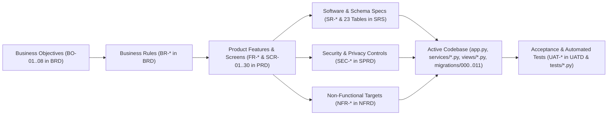

# FULCRUM-INDIA BETA 2.0.0 — REQUIREMENTS TRACEABILITY MATRIX & GAP REGISTER

| Document Attribute | Value |
| :--- | :--- |
| **Document ID** | `FULCRUM-RTM-V2.0` |
| **Version** | `2.0-baseline` |
| **Date of Analysis** | `2026-11-16` |
| **Reviewed Repository Commit** | `235767754f8d8bb4605e819593bb3f370ddeab27` (`2026-11-11`) |
| **Target Audience** | CEO, Product Managers, Software Architects, Security Auditors, QA Lead |
| **Document Status** | Cross-Reference Navigation & Traceability Baseline Across All 6 Core Specifications |

---

## 1. Purpose and Traceability Chain

This document is the central cross-reference and navigation index across the six **FULCRUM-INDIA Beta 2.0.0** requirements specifications (`BRD`, `PRD`, `SRS`, `NFRD`, `SPRD`, and `UATD`). It maps every business objective through to its implementing code, database schema, and verification test case, and consolidates all discovered discrepancies, undocumented code workflows, untested flows, and open business decisions.

### Mermaid Diagram 1 — End-to-End Requirements Traceability Chain

---

## 2. Master Requirements Traceability Matrix (`BO` $\rightarrow$ `BR` $\rightarrow$ `FR` $\rightarrow$ `SR` $\rightarrow$ `DB/Service` $\rightarrow$ `UAT` $\rightarrow$ `Status`)

| Business Obj (`BRD`) | Business Rule (`BRD`) | Product Feature & Screen (`PRD`) | Software Req (`SRS`) | Primary Service & DB Tables (`SRS`) | Acceptance & Automated Test (`UATD`) | Implementation Status |
| :--- | :--- | :--- | :--- | :--- | :--- | :--- |
| **`BO-01`** (Continuous Entrepreneur Record) | `BR-ONB-001` | `FR-AUTH-001`, `SCR-01` (Public Aspirant Signup) | `SR-AUTH-001`, `SR-DATA-001` | `services/auth.py::signup_aspirant` (L521–L672); `auth.users`, `public.profiles` | `UAT-AUTH-001`, `UAT-AUTH-003`; `test_single_admin_master_e2e.py::test_01` | **Implemented — verified in source; Tested** *(UX defects `DEF-001`, `DEF-002`, `DEF-003`)* |
| **`BO-01`** | `BR-ONB-001` | `FR-AUTH-002`, `SCR-01` (Email Confirmation & Login Self-Heal) | `SR-AUTH-001` | `services/auth.py::login_user` (L312–L519); `profiles`, `journeys`, `relationships` | `UAT-AUTH-002`, `UAT-AUTH-004`; `verify_5_fixes.py::test_problem_4` | **Implemented — verified in source; Tested; Requires live verification** *(Gmail Spam placement observed)* |
| **`BO-01`** | `BR-ONB-001` | `FR-AUTH-003`, `SCR-02` (Password Recovery & JS Token Bridge) | `SR-AUTH-002`, `SR-AUTH-003` | `services/auth.py` (L674–L877), `services/auth_callback_component.py` (L1–L98) | `UAT-AUTH-005`, `UAT-AUTH-006`; `tests/test_password_recovery_suite.py` | **Implemented — verified in source; Tested** |
| **`BO-01`** | `BR-PRIV-001` | `FR-ASP-001`, `SCR-09` (4-Part Enterprise Profile & Assistance Need `Y`) | `SR-DATA-001`, `SR-INT-001` | `services/profiles.py::update_aspirant_profile` (L541–L692); `public.profiles` | `UAT-PROF-001`; `tests/test_qa32_fixes_regression.py::test_def006` | **Implemented — verified in source; Tested** |
| **`BO-01`** | `BR-JRN-001` | `FR-JRN-001`, `SCR-10`, `SCR-14`, `SCR-16`, `SCR-18` (Chronological Journey & Revisions) | `SR-DATA-001`, `SR-TXN-001` | `services/journey.py` (L32–L1191), `views/journey_edit_dialog.py`; `journeys`, `journey_events`, `journey_event_revisions` | `UAT-JRN-001`; `verify_journey_governance_and_ui.py` | **Implemented — verified in source; Tested** |
| **`BO-01`** | `BR-JRN-001` | `FR-ASP-003`, `SCR-08`, `SCR-14`, `SCR-18` (Executive PDF Business Dossier) | `SR-ARCH-004` | `services/pdf_generator.py` (L1–L823), `services/html_to_pdf_worker.py` (L1–L75) | `UAT-JRN-001`, `UAT-CONC-001`; `test_single_admin_master_e2e.py::test_09` | **Implemented — verified in source; Tested** |
| **`BO-02`** (Sole Admin Governance) | `BR-GOV-001`, `BR-GOV-002` | `FR-ADMIN-001`, `ADM-01` / `SCR-18` (Admin Tab 1: Aspirants & Journeys Directory) | `SR-AUTHZ-001`, `SR-AUTHZ-002` | `views/admin.py` (L271–L566), `services/pagination.py` (L28–L162), `services/admin_metrics.py` | `UAT-RPT-001`; `tests/test_qa32_fixes_regression.py::test_def004` | **Implemented — verified in source; Tested** |
| **`BO-02`** | `BR-ONB-002` | `FR-AUTH-004`, `FR-ADMIN-002`, `FR-ADMIN-003`, `ADM-02`/`03`, `SCR-05`, `SCR-19`/`20` (Mentor Provisioning & First-Login PW Gate) | `SR-AUTH-004` | `views/admin.py` (L569–L860), `app.py` (L1198–L1232), `services/auth.py::admin_create_mentor` (L997–L1130) | `UAT-ONB-001`; `tests/test_qa32_fixes_regression.py::test_def003_def008_def009` | **Implemented — verified in source; Tested** |
| **`BO-02`** | `BR-REL-001`, `BR-REL-003` | `FR-ADMIN-004`, `ADM-04` / `SCR-21` (Admin Tab 4: Mentor Assignments & Co-Guides) | `SR-FLOW-001` | `views/admin.py` (L863–L1098), `services/relationships.py` (L216–L997); `relationships`, `assignment_history` | `UAT-REL-001`; `tests/test_checkpoint1_defects_and_handover.py::test_04`, `test_05` | **Implemented — verified in source; Tested** |
| **`BO-02`** | `BR-CONS-001`, `BR-SCH-002` | `FR-ADMIN-005`, `ADM-05` / `SCR-22` (Admin Tab 5: Mentor Inquiries & SSR Decisions) | `SR-FLOW-002`, `SR-FLOW-003` | `views/admin.py` (L1101–L1296), `services/help_requests.py` (L1056–L1160), `services/scheme_reviews.py` (L156–L247) | `UAT-CONS-001`, `UAT-SCH-001`; `verify_governance.py` | **Implemented — verified in source; Tested** |
| **`BO-03`** (Human-Verified Scheme Guidance) | `BR-SCH-001` | `FR-SCH-001`, `SCR-14` (3-Stage Deterministic Scheme Matching over 179 Schemes) | `SR-INT-001` | `services/scheme_matching_engine.py` (L1–L517), `services/scheme_rules.py` (L1–L214), `seed/canonical_179_schemes.json` | `UAT-SCH-001`; `tests/test_scheme_matching_engine.py`, `tests/test_scheme_relevance_synthetic.py` | **Implemented — verified in source; Tested** |
| **`BO-03`** | `BR-SCH-002` | `FR-GUIDE-002`, `FR-ADMIN-006`, `ADM-06`, `SCR-12`, `SCR-14`, `SCR-23` (Guide Scheme Release, SSR, Stage Tracker & Admin CRUD) | `SR-FLOW-003`, `SR-DATA-001` | `services/schemes.py` (L32–L933), `services/schemes_ui.py` (L1–L505), `services/scheme_reviews.py` (L18–L359); `schemes`, `scheme_releases`, `scheme_support_reviews` | `UAT-SCH-001`; `tests/test_single_admin_master_e2e.py::test_08`, `tests/test_scheme_card_crash.py` | **Implemented — verified in source; Tested** |
| **`BO-04`** (Multi-Role Participation) | `BR-REL-002` | `FR-ADMIN-007`, `FR-ROLE-001`, `ADM-07` / `SCR-24` (7 Role Combos, Grants, Revocations & Workspace Switching) | `SR-AUTHZ-002`, `SR-SESS-002` | `services/roles.py` (L331–L963), `app.py` (L839–L1016), `views/admin_governance.py` (L75–L287); `user_roles` | `UAT-ROLE-001`; `tests/test_multi_role_e2e_workflows.py`, `tests/test_qa32_fixes_regression.py::test_def002`, `test_def010` | **Implemented — verified in source; Tested** |
| **`BO-05`** (Legal Consent & Privacy) | `BR-LEGAL-001`, `BR-LEGAL-002` | `FR-LEGAL-001`, `FR-ADMIN-008`, `ADM-08`, `SCR-06`, `SCR-07`, `SCR-25` (Terms & Role NDA Gates & Audit) | `SR-AUTHZ-001`, `SR-DATA-001` | `services/legal.py` (L1–L488), `views/legal_ui.py` (L1–L230), `views/admin_governance.py` (L293–L325); `legal_documents`, `legal_acceptances` | `UAT-LEGAL-001`; `tests/test_single_admin_master_e2e.py::test_03`, `test_04` | **Implemented — verified in source; Tested** *(Note `DEF-008`: placeholder IP)* |
| **`BO-05`** | `BR-PRIV-002` | `FR-ASP-002`, `FR-SME-002`, `SCR-09`, `SCR-15`, `SCR-17` (Private Aspirant Photos & Mentor Headshots) | `SR-AUTHZ-003`, `SR-DATA-005` | `services/aspirant_photos.py` (L1–L597), `services/professional_photos.py` (L1–L585); `aspirant_photos`, `professional_photos`, `storage.objects` | `UAT-PHOTO-001`, `UAT-PHOTO-002`; `tests/test_aspirant_photo_dashboard_visibility.py`, `tests/test_single_admin_and_photos.py` | **Implemented — verified in source; Tested** |
| **`BO-06`** (SLA & Inactivity Monitoring) | `BR-MON-001`, `BR-MON-002` | `FR-ADMIN-010`, `FR-ADMIN-011`, `ADM-10`/`11`, `SCR-27`/`28` (7/10/14-Day Inactivity & WhatsApp/Gmail Outreach) | `SR-FLOW-002`, `SR-INT-004` | `services/inactivity.py` (L1–L778), `services/external_contact.py` (L1–L388), `views/admin_governance.py` (L392–L680, L806–L994); `inactivity_logs`, `external_contact_logs` | `UAT-MON-001`; `tests/test_external_contact_and_sme_inactivity.py` (`test_01`–`test_24`), `tests/test_inactivity_sla_contamination.py` | **Implemented — verified in source; Tested** *(Note `DEF-007`: on-demand trigger)* |
| **`BO-07`** (Grievance & COI Governance) | `BR-CMP-001`, `BR-CMP-002` | `FR-CMP-001`, `FR-ADMIN-009`, `FR-ADMIN-012`, `ADM-09`/`12`, `SCR-11`, `SCR-16`, `SCR-26`, `SCR-29` (Confidential Complaints & SME COI) | `SR-AUTHZ-003`, `SR-DATA-001` | `services/governance.py` (L63–L359), `views/admin_governance.py` (L331–L386, L686–L800); `guide_complaints`, `sme_conflict_declarations` | `UAT-CMP-001`; `tests/test_confidential_complaints.py`, `tests/test_qa32_fixes_regression.py::test_def005` | **Implemented — verified in source; Tested** |
| **`BO-08`** (Zero-Data-Loss Lifecycle) | `BR-LIFE-001`, `BR-LIFE-002` | `FR-ADMIN-013`, `ADM-13`, `SCR-03`, `SCR-04`, `SCR-30` (Account Suspension, Archival, Handover, 30-Day Deletion & Legal Hold) | `SR-ARCH-002`, `SR-TXN-001`, `SR-DATA-006` | `services/account_lifecycle.py` (L1–L1528), `views/admin_account_lifecycle.py` (L1–L396), `migrations/009`, `010`; `profiles`, `account_lifecycle_log` | `UAT-LIFE-001`, `UAT-LIFE-002`; `tests/test_account_lifecycle_and_handover_chaos.py`, `tests/test_argon_p0_negative_security.py` | **Implemented — verified in source; Tested** *(Note `DEF-006`: manual post-30d review)* |

---

## 3. Security and Non-Functional Requirements Traceability Summary

| Req Family & Range | Owning Document | Mapped Functional / Software Reqs | Mapped UAT & Automated Verification | Status Summary |
| :--- | :--- | :--- | :--- | :--- |
| **`SEC-IAM-001`, `SEC-CONF-001..002`, `SEC-PWD-001..004`, `SEC-SESS-001`** | `FULCRUM_SPRD_V2.md` Sec. 3 | `FR-AUTH-001..005`, `SR-AUTH-001..004`, `SR-SESS-001` | `UAT-AUTH-001..006`; `test_password_recovery_suite.py`, `test_cross_session_isolation.py` | Implemented & Tested (`SEC-CONF-002` / `DEF-001`,`002` & `SEC-PWD-001` / `DEF-003` identified) |
| **`SEC-ADMIN-001..002`, `SEC-RBAC-001..003`** | `FULCRUM_SPRD_V2.md` Sec. 4 | `FR-ADMIN-004`, `FR-ADMIN-007`, `FR-ROLE-001`, `SR-AUTHZ-001..004` | `UAT-ROLE-001`, `UAT-REL-001`, `UAT-PRIV-001`; `test_argon_p0_negative_security.py` | Implemented — verified in source; Tested |
| **`SEC-RLS-001..002`, `SEC-ISO-001..002`** | `FULCRUM_SPRD_V2.md` Sec. 5 | `FR-ASP-001`, `FR-CONS-001`, `FR-CMP-001`, `SR-AUTHZ-005` | `UAT-PRIV-001`, `UAT-CONS-001`, `UAT-CMP-001`; `test_beta_6_audit_security.py` | Implemented — verified in source; Tested |
| **`SEC-STOR-001..003`, `SEC-FILE-001..002`** | `FULCRUM_SPRD_V2.md` Sec. 6 | `FR-ASP-002`, `FR-SME-002`, `FR-ASP-003`, `SR-ARCH-004` | `UAT-PHOTO-001`, `UAT-PHOTO-002`, `UAT-JRN-001`; `test_aspirant_photo_dashboard_visibility.py` | Implemented — verified in source; Tested |
| **`SEC-AUD-001`, `SEC-SECR-001..002`, `SEC-BKP-001`** | `FULCRUM_SPRD_V2.md` Sec. 7 | `FR-ADMIN-013`, `SR-LOG-001`, `SR-TXN-001` | `UAT-LIFE-002`, `UAT-BKP-001`; `test_checkpoint1_defects_and_handover.py::test_02` | Implemented — verified in source; Tested |
| **`NFR-PERF-001..003`, `NFR-RESP-001..003`, `NFR-CAP-001..003`** | `FULCRUM_NFRD_V2.md` Sec. 2.1–2.3 | `SR-ARCH-001..004`, `SR-SESS-002` | `UAT-CONC-001`, `UAT-RPT-001`; `benchmark_results.json`, `tests/load_test_results.json` | Implemented in code; targets marked as Recommendations |
| **`NFR-REL-001..003`, `NFR-AVAIL-001..002`, `NFR-SCAL-001..002`** | `FULCRUM_NFRD_V2.md` Sec. 2.4–2.6 | `SR-ARCH-002`, `SR-TXN-001`, `SR-DEP-001..003` | `UAT-NET-001`, `UAT-LIFE-002`; `tests/test_failure_isolation.py` | Implemented in code; targets marked as Recommendations |
| **`NFR-MAINT-001..002`, `NFR-ACC-001..002`, `NFR-USE-001..002`, `NFR-MOB-001..002`** | `FULCRUM_NFRD_V2.md` Sec. 2.7–2.9, 2.15 | `FR-UX-001`, `FR-ERR-001`, `SR-DATA-007` | `UAT-MOB-001`, `UAT-NET-001`; `test_guide_sme_consultations_and_contrast.py` | Implemented in code (`NFR-USE-002` linked to `DEF-001`/`002`) |
| **`NFR-MON-001..003`, `NFR-BKP-001..003`, `NFR-DR-001..002`, `NFR-RET-001..002`, `NFR-DEPL-001..003`** | `FULCRUM_NFRD_V2.md` Sec. 2.10–2.13, 2.16 | `SR-LOG-001`, `SR-DEP-001..003` | `UAT-BKP-001`, `UAT-LIFE-002`; `FULCRUM_PREDEPLOY_CONTRACT_CHECK.py` | Implemented in code & operational scripts |

---

## 4. Requirements Without Implementations (Planned / Proposed or Documented Only)

The items below are referenced in legal text, comments, or future roadmaps, and have **no active implementation** in the Beta 2.0.0 codebase:
1. **`PROP-01` (`SEC-CONF-002` / `DEF-001` / `DEF-002`)**: In-app `"Resend Confirmation Email"` button (`client.auth.resend()`) and explicit Spam/Promotions folder warning on signup (`views/login.py` L693) — **Planned / proposed**.
2. **`PROP-02` (`DEF-005` / `DEF-007`)**: Background scheduled cron daemon for daily caseload inactivity calculation (`check_and_process_caseload_inactivity`) and automatic overdue ticket escalation (`check_and_escalate_overdue_requests` in `services/help_requests.py` L899–L905, which currently returns `0`) — **Planned / proposed / Stubbed**.
3. **`PROP-03` (`NFR-SCAL-002`)**: Multi-container horizontal scaling (`2` `fulcrum-app` replicas behind Caddy load balancing) — **Planned / proposed** (for future growth >30–50 concurrent active users).
4. **`PROP-04` (`DEFAULT_TERMS_DOC` Clause 8, `services/legal.py` L89–L96)**: Paid subscription tiers and payment gateway integration — **Documented only** (in legal Terms of Service; zero payment code exists).
5. **`PROP-05` & `PROP-06` (`FULCRUM_BETA_FEASIBILITY_REPORT.md`)**: Generative AI / LLM advisory integration and decoupled React/Cloudflare Workers frontend migration — **Planned / proposed** (discussed in untracked executive feasibility reports; 0% in active Streamlit codebase).

---

## 5. Key Undocumented or Under-Documented Workflows Discovered in Source Code

Reverse-engineering of the Python services and views revealed several important implemented capabilities that are absent from or understated in the root `README.md` and `PRD.md`:
1. **`UNDOC-01` — Schema-Adaptive PostgREST Retry Engine (`services/account_lifecycle.py` L105–L161, `services/help_requests.py` L73–L141)**: Both services catch PostgREST `PGRST204` / `42703` missing-column errors and `23514` constraint errors, parse the offending column/status name via regex (`_extract_missing_col_name`), and automatically retry with legacy aliases (`status_reason` $\leftrightarrow$ `lifecycle_reason`, `old_status` $\leftrightarrow$ `previous_status`, `_LEGACY_STATUS_FALLBACK`) so the application survives even if migrations `009`–`011` are partially applied.
2. **`UNDOC-02` — Guide-to-Admin Scheme Support Review (SSR) Human Override Workflow (`services/scheme_reviews.py` L18–L247, `migrations/004`)**: Guides can submit a structured override request (`public.scheme_support_reviews`) when an Aspirant is disqualified from a scheme by Stage 1 gatekeeper rules, and Admin approval (`decide_scheme_support_review`) automatically releases the scheme with `allow_disqualified_override=True`.
3. **`UNDOC-03` — Admin-to-Guide Scheme Delegation (`services/scheme_reviews.py` L250–L359, `views/admin.py` L1400–L1435)**: In Admin Tab 6, the Administrator can proactively delegate a specific scheme to a Guide (with optional target Aspirant and priority) for evaluation.
4. **`UNDOC-04` — Aspirant Engagement Roster in Admin Tab 10 (`services/inactivity.py::evaluate_aspirant_engagement_roster` L575–L778, `views/admin_governance.py` L617–L680)**: In addition to monitoring mentor inactivity, Admin Tab 10 includes a second radio mode (`🌱 Aspirant Engagement Roster`) that scores founder activity and profile completion health.
5. **`UNDOC-05` — Three-Tier Subprocess PDF Dossier Fallback (`services/pdf_generator.py` L581–L786, `services/html_to_pdf_worker.py`)**: PDF dossier export runs in an isolated subprocess under `BoundedSemaphore(2)` using headless Playwright Chromium, and automatically falls back to `ReportLab` platypus (`_convert_html_to_pdf_reportlab`) and then to a raw emergency PDF generator (`_generate_emergency_pdf`) if Chromium fails.
6. **`UNDOC-06` — Cross-Role Professional Headshot Masking (`services/professional_photos.py::can_view_professional_photo` L90–L116)**: While Guides and SMEs upload `320x320` professional headshots in `professional-headshots`, `can_view_professional_photo()` intentionally returns `False` when the viewer is an Aspirant, restricting mentor headshots strictly to the mentor themselves and the Sole Admin.
7. **`UNDOC-07` — Mentor-Initiated Consultations & One-Step Admin Directive Co-Assignment (`services/help_requests.py` L1056–L1267)**: Guides and SMEs can proactively start consultation threads with Aspirants (`create_mentor_consultation`), and when the Admin responds to a Mentor Inquiry in Tab 5 (`admin_respond_to_mentor`), the Admin can simultaneously assign a Co-Guide or SME in the same form submission.

---

## 6. Critical Flows Without Automated or Live Test Coverage

1. **`UNVER-01` — Live Production Email Confirmation & Inbox Placement (`FR-AUTH-001`, `FR-AUTH-002`, `SEC-MAIL-001`)**: Automated tests mock Supabase Auth or use `DATA_BACKEND=local`. They do not test live SMTP handoff from Supabase to Resend (`smtp.resend.com:465`) or Gmail spam-filter scoring (which required manual live testing on `2026-11-16`).
2. **`UNVER-02` — Live Supabase Database Trigger & RLS Execution for Migrations `009`–`011`**: While `tests/test_qa32_fixes_regression.py` tests Python adaptive fallbacks against `_FakeSupabaseClient`, verifying that `migrations/009`, `010`, and `011` (`trg_immutable_account_lifecycle_log`, `ON DELETE RESTRICT`, `help_requests_status_check`) are active in the live production Supabase database requires checking the live Supabase SQL schema (`DEC-002`).
3. **`UNVER-03` — Multi-Browser Safari / Firefox Compatibility on `#access_token` WebSocket Bridge (`NFR-BROW-001`)**: Automated browser tests (`scripts/e2e_playwright_verification.py`) use headless Chromium; Apple Safari (macOS/iOS) and Mozilla Firefox have not been tested via automated E2E scripts.
4. **`UNVER-04` — Expired 30-Day `PENDING_DELETION` End-of-Grace-Period Transition (`DEF-006`)**: `test_06_deletion_grace_period_and_cancellation` tests scheduling and cancelling deletion within the 30-day window, but there is no automated test or job for what happens after day 30 elapses.

---

## 7. Conflicting Requirements & Documentation-vs-Code Discrepancies (`DISC-001` to `DISC-008`)

| Discrepancy ID | Documentation Source & Claim | Actual Source Code Implementation | Resolution in Baseline |
| :--- | :--- | :--- | :--- |
| **`DISC-001`** | Docstrings in `services/scheme_rules.py` L5, `services/scheme_matching_engine.py` L2, and `tests/test_single_admin_master_e2e.py` L577 refer to `"3-stage AI-based matching"` / `"AI Scheme Matcher"`. | **Zero AI/LLM code exists.** A full-repo scan for `openai`, `gemini`, `anthropic`, `langchain`, `llm`, and `embedding` in `app.py`, `services/`, and `views/` returned **0 matches**. Matching is 100% deterministic rule evaluation. | Documented throughout `BRD`, `PRD`, and `SRS` as **100% deterministic rule-based matching** (`BO-03`, `FR-SCH-001`). |
| **`DISC-002`** | Root `README.md` L26–L30 claims: `"NO Docker / Kubernetes — Zero container orchestration overhead"` and `"Dark mode glassmorphism #0B0F19"`. | Repository contains production `Dockerfile` (74 lines), `docker-compose.yml` (68 lines), and `Caddyfile` (12 lines), and `.streamlit/config.toml` L2 sets `base = "light"` (`#F8FAFC` background with dark `#0B0F19` sidebar only). | `SRS` and `NFRD` document the actual Docker + Caddy + light-theme (`#F8FAFC`) + dark-sidebar (`#0B0F19`) implementation. |
| **`DISC-003`** | Root `README.md` L60 and `seed/schemes.json` refer to `"170 schemes"`. | Canonical seed `seed/canonical_179_schemes.json` and `seed/seed_179_schemes_idempotent.sql` contain **179 schemes** (`seed/schemes.json` is an older 170-scheme snapshot). | Standardized on **179 canonical schemes** (noting the legacy 170-scheme file). |
| **`DISC-004`** | Root `PRD.md` (an early Cluster A specification) describes a basic 4-role single-role model with 6 Admin tabs and no multi-role, NDA, COI, complaint, inactivity, or account lifecycle features. | Active Beta 2.0.0 codebase implements **13 Admin tabs** (`views/admin.py` L252–L266), **7 non-admin multi-role combinations** (`services/roles.py`), versioned Terms/NDAs, complaints, COI, 7/10/14-day inactivity, and account archival (`migrations/000`–`011`). | `FULCRUM_PRD_V2.md` supersedes the legacy root `PRD.md` with the complete 13-tab, multi-role Beta 2.0.0 inventory. |
| **`DISC-005`** | `views/login.py` L679 enforces a **6-character** minimum password on Public Aspirant Signup (`len(s_pwd) < 6`). | `views/login.py` L489 (Password Recovery), `app.py` L1220 (First-Login Password Gate), and `services/auth.py` L1021 (Mentor Provisioning) all enforce an **8-character** minimum (`< 8`). | Recorded as `DEF-003` / `SEC-PWD-001` with recommendation `PROP-07` to standardize on `>= 8` characters. |
| **`DISC-006`** | `docker-compose.yml` L26 in the repository root sets `memory: 5G` (`cpus: '1.75'`). | Historical audit `15_OWNER_APPROVAL_REGISTER.md` L24–L26 and `KVM2_5GB_RESOURCE_CONFIG.md` report that the live staging/production compose file previously enforced `1,800 MB` with a pending approval request (`CR-01`) for `3,072 MB`. | Recorded as `DEC-007` so the owner can confirm the active limit on the VPS. |
| **`DISC-007`** | `15_OWNER_APPROVAL_REGISTER.md` L45 refers to `"Admin (12 tabs)"` (written before Tab 13 was added in Migration `009`). | `views/admin.py` L252–L266 and `PRODUCTION_READINESS_AND_APPROVAL_REGISTER.md` L33 have **13 Admin tabs** (Tab 13 is `🗄️ Account Lifecycle & Archive`). | Verified and documented all **13 Admin tabs** (`ADM-01` to `ADM-13`). |
| **`DISC-008`** | Untracked executive reports in the workspace (`FULCRUM_BETA_FEASIBILITY_REPORT.md`) discuss a proposed React + Cloudflare Workers / API architecture. | Active repository is 100% Python **Streamlit + Supabase PostgreSQL/Auth/Storage** (`app.py`, `services/*.py`, `views/*.py`). | Kept strictly separated under `PROP-06` (Future Opportunities) per Phase 10 Rule 9. |

---

## 8. Unresolved Business Decisions Summary (`DEC-001` to `DEC-008`)

*(Full context and options are detailed in [`FULCRUM_BRD_V2.md`](./FULCRUM_BRD_V2.md) Section 19.)*
- **`DEC-001`**: Approve adding in-app `"Resend Confirmation Email"` button, Spam-folder guidance (`views/login.py` L693), DMARC record (`_dmarc.notify`), and branded Supabase confirmation template (`DEF-001`, `DEF-002`).
- **`DEC-002`**: Confirm execution of `migrations/009`, `010`, and `011` in the live production Supabase SQL Editor.
- **`DEC-003`**: Define post-30-day policy (`ARCHIVED` vs PII anonymization) for accounts completing the `PENDING_DELETION` grace period (`DEF-006`).
- **`DEC-004`**: Confirm whether `check_and_escalate_overdue_requests()` (`services/help_requests.py` L899) should remain a no-op stub (`return 0`) in favor of `inactivity.py` (`DEF-005`).
- **`DEC-005`**: Decide between keeping on-demand Admin Tab 10 inactivity evaluation vs adding a daily background cron (`DEF-007`).
- **`DEC-006`**: Confirm whether mentor professional headshots (`professional_photos.py` L90–L116) should remain masked from assigned Aspirants or be made visible to assigned mentees.
- **`DEC-007`**: Confirm the approved Docker memory limit (`1,800 MB`, `3,072 MB`, or `5G`) on the live Hostinger KVM 2 VPS (`DISC-006`).
- **`DEC-008`**: Confirm staying on the current Streamlit + Supabase architecture for the Beta 2.0.0 cohort (`DISC-008`).
