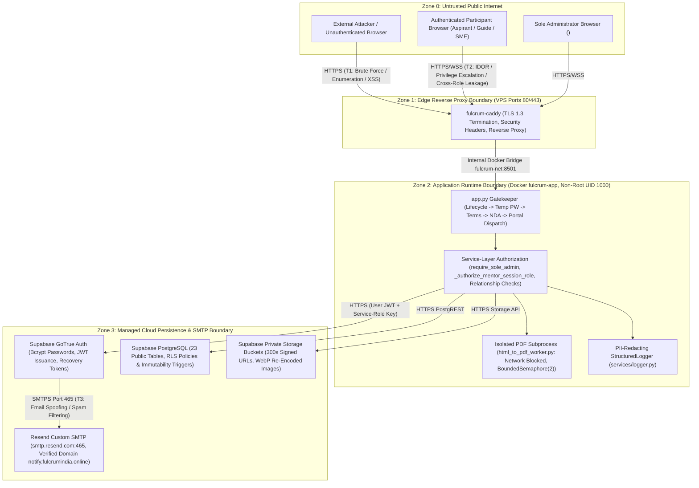
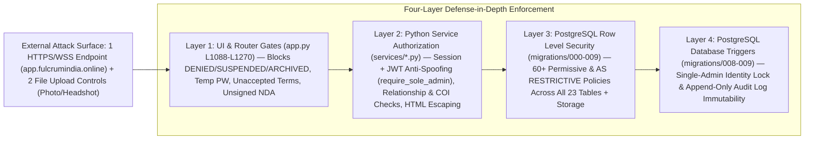
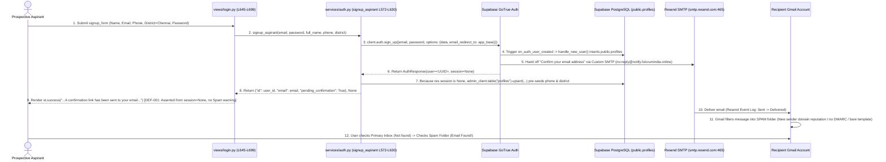

# FULCRUM-INDIA BETA 2.0.0 — SECURITY AND PRIVACY REQUIREMENTS DOCUMENT (SPRD)

| Document Attribute | Value |
| :--- | :--- |
| **Document ID** | `FULCRUM-SPRD-V2.0` |
| **Version** | `2.0-baseline` |
| **Date of Analysis** | `2026-11-16` |
| **Reviewed Repository Commit** | `235767754f8d8bb4605e819593bb3f370ddeab27` (`2026-11-11`) |
| **Target Audience** | Security Architects, Privacy Officers, Backend Engineers, Database Administrators, Auditors |
| **Document Status** | Evidence-Based Security & Privacy Baseline (Zero Unverified Compliance Claims) |

---

## 1. Scope, Methodology and Confidentiality Safeguards

This Security and Privacy Requirements Document (SPRD) establishes the security architecture, access-control boundaries, data-privacy obligations, threat model, historical vulnerability reconciliation, and forensic trace of the production signup confirmation-email incident for **FULCRUM-INDIA Beta 2.0.0**.

### Strict Evidence & Confidentiality Rules Applied
1. **No Unverified Compliance Claims**: This document does **not** claim ISO 27001, SOC 2, CERT-In, or formal statutory certification. All regulatory mappings (such as India's Digital Personal Data Protection Act, 2023) are presented as engineering and operational requirements.
2. **Complete Redaction of Secrets & Personal Identifiers**: No production API keys, passwords, JWTs, service-role keys, personal email addresses, phone numbers, or real user names from screenshots or database backups appear in this document. Institutional placeholders (`<SOLE_ADMIN_EMAIL>`, `<SOLE_ADMIN_UUID>`, `<TEST_ASPIRANT_EMAIL>`, `<SUPABASE_SECRET_KEY>`, `<RESEND_API_KEY>`) are used throughout.

---

## 2. Security Architecture Summary & Threat Model

### Mermaid Diagram 1 — Threat Model & Trust Boundaries Diagram

### Mermaid Diagram 2 — Attack Surface & Four-Layer Defense-in-Depth Architecture

### STRIDE Threat Model Register

| Threat ID | STRIDE Category | Threat Scenario | Mitigating Control in Codebase | Residual Risk & Verification Status |
| :--- | :--- | :--- | :--- | :--- |
| **`THR-01`** | **Spoofing** | Non-admin user passes `admin_id=<SOLE_ADMIN_UUID>` to service functions to execute administrative actions (`VULN-02`). | `is_strict_admin()` and `require_sole_admin()` (`services/roles.py` L57–L309) cross-verify `st.session_state.user`, active non-admin session flags, and the cryptographic Supabase JWT (`client.auth.get_user(token)`). | **Low** — Resolved in current source; Tested (`test_argon_p0_negative_security.py`). |
| **`THR-02`** | **Tampering** | Malicious actor or compromised service attempts to `UPDATE` or `DELETE` rows in `public.account_lifecycle_log` to erase audit history (`VULN-04`). | Triple-layer immutability in `migrations/009` L211–L286: (1) `REVOKE UPDATE, DELETE, TRUNCATE`, (2) `AS RESTRICTIVE USING (FALSE)` RLS policies, and (3) `BEFORE UPDATE OR DELETE` trigger `trg_immutable_account_lifecycle_log`. | **Low** — Resolved in current source; Tested (`ARGON_APPEND_ONLY_AUDIT_LOG_VERIFICATION.md`). |
| **`THR-03`** | **Repudiation** | Mentor or Admin denies having released a scheme, edited a Journey milestone, or signed an NDA. | Every action writes actor UUID and timestamp to `legal_acceptances` (with SHA-256 document hash), `journey_event_revisions` (before/after snapshot), `assignment_history`, `scheme_releases`, and `account_lifecycle_log`. | **Low** — Note `DEF-008`: `ip_address` in `legal_acceptances` defaults to `'streamlit-client'`. |
| **`THR-04`** | **Information Disclosure (IDOR)** | Unassigned Guide/SME or another Aspirant attempts to view an Aspirant's profile, private photo, or confidential Guide complaint. | `can_view_aspirant_photo()` (`services/aspirant_photos.py` L39–L154), `_get_relationship_authorized_ids_supabase()` (`services/profiles.py` L23–L85), and `migrations/005` RLS enforce active assignment + active role + signed NDA. `guide_complaints` RLS (`migrations/000` L940–L950) excludes Guides completely. | **Low** — Resolved in current source; Tested (`test_aspirant_photo_dashboard_visibility.py`). |
| **`THR-05`** | **Denial of Service (DoS)** | Attacker or burst of users triggers simultaneous Chromium PDF dossier renders to exhaust container RAM. | `_PDF_CONCURRENCY_SEMAPHORE = threading.BoundedSemaphore(2)` (`services/pdf_generator.py` L581) caps concurrent Chromium subprocesses at 2 with a 25s timeout (`L612`). | **Low** — Verified at 563.3 MiB peak RAM (`08_CHAOS_ENGINEERING_REPORT.md` Scenario 10). |
| **`THR-06`** | **Elevation of Privilege** | Attacker injects `role='admin'` in signup metadata or updates `profiles.role` / `user_roles.role` to `'admin'`. | Blocked at 3 independent layers: `signup_aspirant()` hardcodes `'aspirant'` (`services/auth.py` L585), `handle_new_user()` checks email (`migrations/008` L51–L58), and triggers `trg_enforce_single_admin_profile` / `trg_enforce_single_admin_user_roles` (`migrations/008` L72–L117) strip or abort any non-owner admin role. | **Low** — Resolved in current source; Tested (`test_single_admin_and_photos.py`). |

---

## 3. Identity, Authentication, Confirmation & Password Security (`SEC-IAM-*`, `SEC-CONF-*`, `SEC-PWD-*`, `SEC-SESS-*`)

| Req ID | Security Domain | Requirement Specification & Source Evidence | Status |
| :--- | :--- | :--- | :--- |
| **`SEC-IAM-001`** | **Password Hashing & Credential Storage** | In production (`DATA_BACKEND=supabase`), plaintext passwords are never stored by Fulcrum; authentication delegates to Supabase GoTrue (`bcrypt`). In local dev mode (`services/local_db.py` L225–L245), passwords use salted SHA-256 hashing (`hash_pw`). | Implemented — verified in source; Tested |
| **`SEC-CONF-001`** | **Mandatory Email Confirmation Gate on Public Signups** | When Supabase `Confirm email` is enabled, `signup_aspirant()` (`services/auth.py` L604–L630) returns `pending_confirmation: True` when `res.session is None`, and `login_user()` (L379–L380) rejects unconfirmed sign-in attempts with `'Email not confirmed. Please check your inbox for the verification link.'`. | Implemented — verified in source; Requires live verification |
| **`SEC-CONF-002`** | **Honest Email-Delivery Feedback & Resend Control** | The UI must not claim that an email has arrived in the user's inbox based solely on `res.session is None`; it must instruct users to check **Spam / Promotions** and provide a rate-limited `client.auth.resend()` button (`DEF-001`, `DEF-002`). | **Defect identified** (Remediation proposed in `PROP-01`) |
| **`SEC-PWD-001`** | **Minimum Password Complexity & Length Policy** | Password Recovery (`views/login.py` L489), First-Login Password Change (`app.py` L1220), and Mentor Provisioning (`services/auth.py` L1021) enforce `>= 8` characters. However, Public Signup (`views/login.py` L679) currently checks `len(s_pwd) < 6` (`DEF-003`). All password surfaces should enforce `>= 8` characters. | **Partially implemented / Defect identified (`DEF-003`)** |
| **`SEC-PWD-002`** | **Cryptographic Single-Use Password Recovery & URL Scrubbing** | Recovery links use single-use tokens verified via `_create_ephemeral_supabase_client()` (`services/auth.py` L197–L209, L711–L785). Browser fragment tokens (`#access_token`) are scrubbed immediately via `window.history.replaceState` (`services/auth_callback_component.py` L45–L52), and `complete_password_reset()` signs out the recovery session immediately after updating the password (`views/login.py` L501–L518). | Implemented — verified in source; Tested |
| **`SEC-PWD-003`** | **Prohibition of Self-Service Admin Password Reset** | Both `views/login.py` (L491–L492) and `services/auth.py` (`complete_password_reset`, L801–L803) block self-service password recovery for `<SOLE_ADMIN_EMAIL>`. | Implemented — verified in source; Tested |
| **`SEC-PWD-004`** | **Mandatory First-Login Password Rotation for Provisioned Mentors** | Guides and SMEs provisioned by the Admin have `profile_data.temp_password_issued = True` (`services/auth.py` L1095) and are blocked by Gate 1 (`app.py` L1198–L1232) until they set a permanent password (`complete_first_login_password_change`, L880–L995). | Implemented — verified in source; Tested |
| **`SEC-SESS-001`** | **Per-Session Client Isolation & CSRF/XSRF Protection** | `get_supabase_client()` (`services/auth.py` L147–L182) binds each browser tab's JWT to `st.session_state.supabase_client` rather than a shared global client. Streamlit server runs with `--server.enableXsrfProtection=true` (`Dockerfile` L69, `.streamlit/config.toml` L13). | Implemented — verified in source; Tested (`test_cross_session_isolation.py`) |

---

## 4. Multi-Role RBAC, Least Privilege & Sole Admin Protection (`SEC-RBAC-*`, `SEC-ADMIN-*`)

| Req ID | Security Domain | Requirement Specification & Source Evidence | Status |
| :--- | :--- | :--- | :--- |
| **`SEC-ADMIN-001`** | **Four-Layer Sole Administrator Identity Lock** | Only `<SOLE_ADMIN_EMAIL>` / `<SOLE_ADMIN_UUID>` can hold the `admin` role, enforced by: (1) `app.py` L855–L866, (2) `services/roles.py::is_strict_admin()` & `require_sole_admin()` L57–L309, (3) `public.is_admin()` SQL function (`migrations/008` L35–L43), and (4) PostgreSQL triggers `trg_enforce_single_admin_profile` and `trg_enforce_single_admin_user_roles` (`migrations/008` L72–L117). | Implemented — verified in source; Tested |
| **`SEC-ADMIN-002`** | **Root Administrator Immunity from Suspension/Archival/Deletion** | `suspend_account()` (L607), `archive_account()` (L910), and `request_account_deletion()` (L1195) in `services/account_lifecycle.py` explicitly reject any attempt to suspend, archive, or delete the Sole Administrator account (`test_02_root_sole_admin_account_immunity`). | Implemented — verified in source; Tested |
| **`SEC-RBAC-001`** | **Elimination of Legacy Profile Role Fallbacks for Mentors** | `is_assignable_mentor()` (`services/roles.py` L434–L507) requires an explicit `status='active'` grant in `public.user_roles` and an `ACCEPTED` NDA in `public.legal_acceptances` (`VULN-08`). Missing `user_roles` rows default strictly to `['aspirant']`. | Implemented — verified in source; Tested |
| **`SEC-RBAC-002`** | **Cross-Session Role Revocation Eviction (`<= 5s` TTL)** | When the Admin revokes or suspends a role (`revoke_role` / `suspend_role`, `services/roles.py` L638–L787), `_invalidate_role_caches()` updates `_INVALIDATION_TIMESTAMPS` in `services/cache.py` so an open browser session is evicted from the revoked workspace on its next click (`15_OWNER_APPROVAL_REGISTER.md` L80). | Implemented — verified in source; Tested |
| **`SEC-RBAC-003`** | **Anti-Self-Mentoring Invariant for Hybrid Accounts** | `is_assignable_mentor()` (`services/roles.py` L446–L448), `assign_guide()` (`services/relationships.py` L238), and `assign_sme()` (L478) block any assignment where `str(mentor_id) == str(aspirant_id)`. | Implemented — verified in source; Tested |

---

## 5. Database Authorization, Row Level Security & Data Isolation (`SEC-RLS-*`, `SEC-ISO-*`)

| Req ID | Security Domain | Requirement Specification & Source Evidence | Status |
| :--- | :--- | :--- | :--- |
| **`SEC-RLS-001`** | **Universal Row Level Security Across All 23 Public Tables** | `ALTER TABLE ... ENABLE ROW LEVEL SECURITY` is applied to all 23 tables in `public` (`migrations/000` L414–L421, L668, L697, L900–L906, L1012, L1050; `004` L38; `006` L74; `008` L154; `009` L217) plus `storage.objects`. | Implemented — verified in source; Tested |
| **`SEC-RLS-002`** | **Service-Role (`get_supabase_admin_client`) Authorization Guarding** | Because 18 service modules use `get_supabase_admin_client()` for cross-table operations (which bypasses PostgreSQL RLS), every mutating or cross-user read function in `services/*.py` must enforce explicit Python-level caller authorization (`require_sole_admin`, `_get_relationship_authorized_ids_supabase`, `can_view_aspirant_photo`, `can_view_professional_photo`, `_authorize_mentor_session_role`) before executing a service-role query. | Implemented — verified in source; Tested |
| **`SEC-ISO-001`** | **Aspirant-to-Aspirant & Unassigned-Mentor Data Isolation** | `services/profiles.py::_get_relationship_authorized_ids_supabase()` (L23–L85) restricts profile reads so an Aspirant can never read another Aspirant's profile, and a Guide or SME can read only Aspirants where `relationships.status == 'active'` and their UUID is in `guide_id`, `guide_ids`, `sme_id`, or `sme_ids`. | Implemented — verified in source; Tested |
| **`SEC-ISO-002`** | **Confidentiality of Aspirant Guide Complaints & Private Mentor Notes** | `public.guide_complaints` RLS (`migrations/000` L940–L950) and `services/governance.py` (L133–L163) hide complaints from Guides. `services/collaboration.py::list_case_messages()` (L124–L237) filters out `is_private_mentor_note=True` rows when `requesting_role == 'aspirant'`. | Implemented — verified in source; Tested |

---

## 6. Protected Storage, Private Photographs & Secure File Handling (`SEC-STOR-*`, `SEC-FILE-*`)

| Req ID | Security Domain | Requirement Specification & Source Evidence | Status |
| :--- | :--- | :--- | :--- |
| **`SEC-STOR-001`** | **Private Storage Buckets & 300-Second Signed URLs** | Both `aspirant-profile-photos` (`migrations/003` L51) and `professional-headshots` (`migrations/008` L123) buckets are configured with `public = FALSE` and `file_size_limit = 5242880` (5 MB). Image access uses signed URLs expiring in **300 seconds** (`SIGNED_URL_EXPIRY_SECONDS = 300`, `services/aspirant_photos.py` L36; `SIGNED_URL_TTL_SECONDS = 300`, `services/professional_photos.py` L43). | Implemented — verified in source; Tested |
| **`SEC-STOR-002`** | **Assignment + Active Role + Signed NDA Gate on Aspirant Photos** | Both `services/aspirant_photos.py::can_view_aspirant_photo()` (L39–L154) and `migrations/005_tighten_aspirant_photo_security.sql` (L10–L71) require a mentor viewer to simultaneously have: (1) an `active` assignment to the Aspirant in `public.relationships` (`guide_id`/`guide_ids`/`sme_id`/`sme_ids`), (2) an `active` role grant in `public.user_roles`, and (3) an `ACCEPTED` NDA in `public.legal_acceptances`. | Implemented — verified in source; Tested (`test_aspirant_photo_dashboard_visibility.py`) |
| **`SEC-STOR-003`** | **Cross-Role Masking of Professional Mentor Headshots** | `services/professional_photos.py::can_view_professional_photo()` (L90–L116) permits viewing a mentor's `320x320` headshot **only** by the subject mentor themselves or the Sole Administrator, masking headshots from Aspirants (`PRODUCTION_READINESS_AND_APPROVAL_REGISTER.md` L32). | Implemented — verified in source; Tested (`test_single_admin_and_photos.py`) |
| **`SEC-FILE-001`** | **Image Magic-Byte Verification, EXIF Stripping & WebP Re-Encoding** | `validate_and_process_photo()` (`services/aspirant_photos.py` L157–L229) and `validate_and_normalize_professional_photo()` (`services/professional_photos.py` L128–L191) validate file size (`<= 5 MB`), inspect binary magic bytes (`JPEG`, `PNG`, `WEBP`), decode pixels via Pillow (`PIL.Image.open`) and re-encode into a fresh RGB WebP buffer (`<= 180 KB` / `<= 150 KB`), stripping all EXIF/GPS metadata and neutralizing polyglot/embedded-script payloads. | Implemented — verified in source; Tested |
| **`SEC-FILE-002`** | **SSRF Prevention in Subprocess HTML-to-PDF Worker** | `services/html_to_pdf_worker.py` (L13–L52) intercepts and aborts external network requests during headless Chromium PDF rendering and escapes all user strings via `_safe()` (`services/pdf_generator.py` L62–L67) before HTML synthesis, preventing Server-Side Request Forgery (SSRF) and local file inclusion. | Implemented — verified in source; Tested |

---

## 7. Auditability, Secrets Management & Backup Protection (`SEC-AUD-*`, `SEC-SECR-*`, `SEC-BKP-*`)

| Req ID | Security Domain | Requirement Specification & Source Evidence | Status |
| :--- | :--- | :--- | :--- |
| **`SEC-AUD-001`** | **Triple-Layer Immutable Account Lifecycle Audit Log** | `public.account_lifecycle_log` (`migrations/009` L180–L286) enforces append-only immutability via: (A) `REVOKE UPDATE, DELETE, TRUNCATE` from `authenticated, anon, public`, (B) `AS RESTRICTIVE` RLS policies `Restrictive deny update/delete on account_lifecycle_log` (`USING (FALSE)`), and (C) `BEFORE UPDATE OR DELETE` trigger `trg_immutable_account_lifecycle_log`. | Implemented — verified in source; Tested |
| **`SEC-SECR-001`** | **Exclusion of `.env`, Keys, Databases & Backups from Git and Docker** | `.gitignore` (L1–L35) and `.dockerignore` (L8–L21) exclude `.env`, `.env.*`, `.streamlit/secrets.toml`, `*.key`, `*.pem`, `*.db`, `cluster_a.db`, and `backups/`. Verified via `git ls-files` that `.env`, `cluster_a.db`, and `backups/` are untracked. | Implemented — verified in source |
| **`SEC-SECR-002`** | **Automated Secret & PII Redaction in Application Logs** | `services/logger.py` (`_REDACT_PATTERNS`, L18–L33) scrubs bearer tokens, `eyJ...` JWTs, `sb_secret_...`, `re_...`, passwords, and email addresses before emitting log lines. | Implemented — verified in source |
| **`SEC-BKP-001`** | **Quarantine of Destructive Ad-Hoc Maintenance Scripts** | `scripts/remove_requested_accounts.py` is hard-quarantined (`sys.exit(1)` at top of file, `VULN-09`) so it cannot be accidentally executed against production (`test_02_quarantined_script_cannot_execute`). | Implemented — verified in source; Tested |

---

## 8. OWASP Top 10 (2021) Security Assessment Against Active Codebase (`SEC-OWASP-*`)

| OWASP Category | Fulcrum-Beta 2.0.0 Code Evidence & Controls | Assessment & Status |
| :--- | :--- | :--- |
| **A01:2021 — Broken Access Control** | Enforced via 4-layer architecture (`app.py` gates, `require_sole_admin` anti-spoofing, relationship-scoped checks in `profiles.py`/`aspirant_photos.py`/`help_requests.py`, and PostgreSQL RLS + triggers). All 10 historical P0/P1 access-control findings (`VULN-01`..`VULN-10`) are remediated in code. | **Mitigated in source; Tested** (`SEC-OWASP-001`) |
| **A02:2021 — Cryptographic Failures** | TLS 1.3 enforced by Caddy (`Caddyfile`), passwords hashed by Supabase GoTrue (`bcrypt`), legal acceptances hashed with SHA-256 (`services/legal.py` L237), photo binaries hashed with SHA-256 (`services/aspirant_photos.py`). | **Mitigated in source** (`SEC-OWASP-002`) |
| **A03:2021 — Injection (SQL / HTML / XSS)** | All PostgreSQL queries use parameterized PostgREST builders (`supabase-py`) or parameterized SQLite (`?` placeholders in `services/local_db.py`). Custom HTML rendering uses `safe_escape()` / `html.escape()` (`services/constants.py` L22–L26). *(Note: Two minor places in `app.py` L920–L923 and L1066–L1067 interpolate `user.get('full_name')` / `n.get('title')` into sidebar HTML; while notification titles are system-generated, wrapping `full_name` in `safe_escape()` in `app.py` L920 is recommended as defense-in-depth.)* | **Mitigated in views; Minor hardening recommended in `app.py` L920** (`SEC-OWASP-003`) |
| **A04:2021 — Insecure Design** | Fail-closed account lifecycle gating (`VULN-01`), mandatory NDA gates before mentor assignment (`VULN-08`), atomic relationship handover rollback (`VULN-03`), and SME COI recusal locks are built into the domain model. | **Mitigated in source; Tested** (`SEC-OWASP-004`) |
| **A05:2021 — Security Misconfiguration** | `.streamlit/config.toml` sets `showErrorDetails = false`, `enableXsrfProtection = true`, `maxUploadSize = 5`. `Dockerfile` runs as non-root `appuser` (`UID 1000`). `Caddyfile` sets `X-Content-Type-Options: nosniff`, `X-XSS-Protection`, and `Referrer-Policy`. *(Recommendation: Add `Strict-Transport-Security` (HSTS) and `X-Frame-Options: SAMEORIGIN` headers to `Caddyfile`.)* | **Implemented; Header hardening optional** (`SEC-OWASP-005`) |
| **A06:2021 — Vulnerable and Outdated Components** | `requirements.txt` pins `streamlit>=1.55.0,<=1.56.0` and sets minimum versions (`>=`) on other packages (`supabase>=2.3.0`, `playwright>=1.40.0`). Generating a locked `requirements.lock` with exact hashes is recommended for supply-chain reproducibility (`SEC-SUPPLY-001`). | **Partially implemented (range pins)** (`SEC-SUPPLY-001`) |
| **A07:2021 — Identification and Authentication Failures** | JWT session validation in `is_strict_admin()`, single-use recovery tokens, forced first-login password change for mentors. Public signup password minimum length (`>= 6` chars at `views/login.py` L679) should be raised to `>= 8` chars to match recovery/first-login forms (`DEF-003`). | **Implemented; Align signup min length (`DEF-003`)** (`SEC-PWD-001`) |
| **A08:2021 — Software and Data Integrity Failures** | `RELEASE_FILE_MANIFEST_SHA256.txt` and `FULCRUM_PREDEPLOY_CONTRACT_CHECK.py` verify file hashes and schema contracts before deployment. | **Mitigated in source** (`SEC-OWASP-008`) |
| **A09:2021 — Security Logging and Monitoring Failures** | `StructuredLogger` (`services/logger.py`) redacts PII/secrets and writes JSON logs; `account_lifecycle_log` is append-only. | **Mitigated in source; Tested** (`SEC-AUD-001`) |
| **A10:2021 — Server-Side Request Forgery (SSRF)** | `services/html_to_pdf_worker.py` renders local HTML strings with external network requests blocked; `external_contact.py` only constructs client-side `https://wa.me/` and `https://mail.google.com/` links without making server-side HTTP requests to user URLs. | **Mitigated in source** (`SEC-FILE-002`) |

---

## 9. Applicable Indian Privacy and Data-Protection Considerations (`SEC-PRIV-*`)

*(Note: The table below maps Fulcrum's technical controls to principles under India's **Digital Personal Data Protection Act, 2023 (DPDP Act)** and the **Information Technology Act, 2000 / SPDI Rules, 2011**. It does not constitute formal legal advice or compliance certification.)*

| Statutory Principle (DPDP Act 2023 / IT Act) | How Fulcrum-Beta 2.0.0 Addresses It in Code | Gap / Operational Action Required |
| :--- | :--- | :--- |
| **Notice & Verifiable Consent (`DPDP Sec. 5–6`)** | `views/legal_ui.py` (`SCR-06`, `SCR-07`) and `services/legal.py` (`DEFAULT_TERMS_DOC` Clause 11) require explicit affirmative checkbox consent before any portal access, recording version, SHA-256 hash, and timestamp in `public.legal_acceptances`. | Publish the standalone **Privacy Notice** referenced in Terms Clause 11.1 (`services/legal.py` L114) if not already hosted on the institutional main site. |
| **Purpose Limitation & Need-to-Know Access** | Aspirant personal data, phone numbers, and private photographs are restricted by `services/profiles.py` and `services/aspirant_photos.py` strictly to assigned active mentors with signed NDAs (`migrations/005`). Affirmative category (`SC`/`ST`/`OBC`) and women equity % are used solely for statutory scheme eligibility matching (Terms Clause 6.5). | Implemented — verified in source. |
| **Right to Correction & Erasure / Closure (`DPDP Sec. 12`)** | Aspirants can update their profile at any time (`SCR-09`), delete their private photograph (`delete_aspirant_photo`), and request account closure (`request_account_deletion` -> 30-day `PENDING_DELETION` grace period with self-service cancellation in `SCR-04`). | Formalize owner decision `DEC-003` on whether expired 30-day `PENDING_DELETION` accounts undergo PII anonymization or compliance archival when no `legal_hold` applies. |
| **Grievance Redressal Mechanism (`DPDP Sec. 13`)** | Aspirants have an in-app **Confidential Guide Complaint** workflow (`SCR-11` -> Admin Tab 9 `SCR-26`), and login/barrier screens display the institutional support contact (`<SOLE_ADMIN_EMAIL>`). | Designate a named Grievance Officer contact in the published Privacy Notice. |
| **Reasonable Security Safeguards (`DPDP Sec. 8(5)`)** | TLS 1.3 transport, private storage buckets with 300s signed URLs, EXIF stripping, RLS across all 23 tables, single-admin lock triggers, and PII-redacted logs. | Rotate keys per `ARGON_GATE0_SECRET_ROTATION_OWNER_CHECKLIST.md` whenever personnel or environments change. |

---

## 10. Historical Security Findings Reconciliation (`VULN-01` to `VULN-10`)

Inspection of `DOCUMENTATION/03_SECURITY_AND_GOVERNANCE/ARGON_SECURITY_VULNERABILITY_CLOSURE_MATRIX.md`, `tests/test_argon_p0_negative_security.py`, `tests/test_beta_6_audit_security.py`, and current active source files confirms the status of all 10 historical security findings:

| Finding ID | Historical Vulnerability Title | Source Report | Current Active Code Evidence | Classification |
| :--- | :--- | :--- | :--- | :--- |
| **`VULN-01`** | Fail-Open Account Gating on Missing/Error Status | `ARGON_SECURITY_VULNERABILITY_CLOSURE_MATRIX.md` L12 | `services/account_lifecycle.py::get_account_status()` L332–L558 returns `account_status: "DENIED"`, `is_active: False` on any error or missing profile in `supabase` mode. | **Resolved in current source; Tested** |
| **`VULN-02`** | Sole Admin Identity Spoofing via `admin_id` Parameter | `CLOSURE_MATRIX.md` L13 | `services/roles.py::is_strict_admin()` & `require_sole_admin()` L57–L309 validate active Streamlit session context and verify Supabase JWT token. | **Resolved in current source; Tested** |
| **`VULN-03`** | Unchecked Mentor Handover During Account Archival | `CLOSURE_MATRIX.md` L14 | `services/account_lifecycle.py::archive_account()` L895–L1076 checks `(ok, err)` on every `unassign_guide`/`unassign_sme` call and restores snapshots via `_restore_relationship_snapshots()` (L285–L329) on failure. | **Resolved in current source; Tested** |
| **`VULN-04`** | Permissive RLS `OR` Logic Flaw on `account_lifecycle_log` | `CLOSURE_MATRIX.md` L15 | `migrations/009_account_lifecycle_and_archive.sql` L211–L286 revokes `UPDATE/DELETE`, uses `AS RESTRICTIVE USING (FALSE)` policies, and adds `trg_immutable_account_lifecycle_log`. | **Resolved in current source; Requires live verification** (that `009` is applied on live DB) |
| **`VULN-05`** | Default `'ACTIVE'` Backfill Masking Inactive Accounts | `CLOSURE_MATRIX.md` L16 | `migrations/009` L45–L140 adds `account_status` without default, backfills `is_active=FALSE` as `'TEMPORARILY_SUSPENDED'`, and then sets future default `'ACTIVE'`. | **Resolved in current source; Tested** |
| **`VULN-06`** | `ON DELETE CASCADE` on `profiles.id -> auth.users(id)` | `CLOSURE_MATRIX.md` L17 | `migrations/009` L160–L175 replaces `ON DELETE CASCADE` with `ON DELETE RESTRICT`. | **Resolved in current source; Requires live verification** |
| **`VULN-07`** | `PENDING_DELETION` Route Mutation Bypass | `CLOSURE_MATRIX.md` L18 | `services/help_requests.py::create_request()` L200–L212 blocks ticket creation when account is in `PENDING_DELETION`; `app.py` L1151–L1188 renders grace-period banner. | **Resolved in current source; Tested** |
| **`VULN-08`** | Mentor Eligibility Legacy `profiles.role` Fallback | `CLOSURE_MATRIX.md` L19 | `services/roles.py::is_assignable_mentor()` L434–L507 requires explicit `status='active'` in `user_roles` and signed NDA in `legal_acceptances`. | **Resolved in current source; Tested** |
| **`VULN-09`** | Destructive Script Hazard (`scripts/remove_requested_accounts.py`) | `CLOSURE_MATRIX.md` L20 | `scripts/remove_requested_accounts.py` L1–L35 exits immediately with `sys.exit(1)` quarantine guard. | **Resolved in current source; Tested** |
| **`VULN-10`** | Admin Tab 13 Eager Subtab Query Thrash | `CLOSURE_MATRIX.md` L21 | `views/admin_account_lifecycle.py` L64–L97 gates all 4 subtabs with `is_tab_active()` and memoizes directory queries. | **Resolved in current source; Tested** |

---

## 11. Forensic Investigation of the Production Signup Confirmation-Email Incident (2026-11-16)

### 11.1 Incident Overview
On `2026-11-16`, a new Aspirant registered on the live production portal (`https://app.fulcrumindia.online`). The application displayed a green success banner stating that a confirmation link had been sent, and the user record appeared in **Supabase Dashboard $\rightarrow$ Authentication $\rightarrow$ Users** (`Providers: Email`), but the user did not initially see the confirmation email in their primary Gmail inbox. Subsequent live inspection of **Supabase SMTP Settings**, **Resend Domain & Email Logs**, and the recipient's **Gmail Spam folder** established the complete end-to-end chain.

### Mermaid Diagram 3 — Forensic Sequence Diagram of the Signup Confirmation-Email Flow

### 11.2 Step-by-Step Forensic Trace & Evidence Classification

| Pipeline Stage | Technical Behaviour & Evidence | Evidence Source | Verification Status |
| :--- | :--- | :--- | :--- |
| **1. Fulcrum Signup Request (`views/login.py` L670–L690 -> `services/auth.py` L578–L591)** | `views/login.py` validates inputs (`len(s_pwd) >= 6`) and calls `signup_aspirant()`. `services/auth.py` resolves `app_base = get_app_base_url()` (`https://app.fulcrumindia.online`) and calls `client.auth.sign_up({"email": email, "password": password, "options": {"data": {"full_name": full_name, "role": "aspirant", "district": district, "phone": phone}, "email_redirect_to": app_base}})`. | Repository source code (`views/login.py` L670–L690, `services/auth.py` L578–L591). | **Established by source inspection** |
| **2. Supabase Auth Signup Response & Profile Pre-Seeding (`services/auth.py` L598–L630)** | Supabase creates the user in `auth.users` (`Providers: Email`). Because `Confirm email` is enabled in Supabase Auth settings, `res.session` is `None`. `signup_aspirant()` detects `if not res.session:` (L604), uses `get_supabase_admin_client()` to upsert `public.profiles` with `phone`, `district`, and initial `profile_data`, and returns `{"id": user_id, "email": email, "pending_confirmation": True}`. | Repository source (`services/auth.py` L598–L630) + Owner screenshot of Supabase `Authentication -> Users`. | **Established by source inspection & owner live evidence** |
| **3. User-Facing Success Message (`views/login.py` L691–L693 — `DEF-001`)** | When `profile.get("pending_confirmation")` is `True`, `views/login.py` L693 immediately renders: `st.success(f"🎉 Account created successfully for **{s_email}**! A confirmation link has been sent to your email. Please check your inbox and verify your email before signing in.")`. The application has **no visibility** into whether SMTP handoff succeeded or whether the email landed in Spam, and provides **no "Resend Confirmation Email" button** (`DEF-002`). | Repository source (`views/login.py` L691–L693) + Owner screenshot of `app.fulcrumindia.online`. | **Defect identified in source (`DEF-001`, `DEF-002`)** |
| **4. Supabase Custom SMTP Configuration** | Supabase `Authentication -> Emails -> SMTP Settings` has **Enable custom SMTP = ON**, Sender email = `no-reply@notify.fulcrumindia.online`, Sender name = `FULCRUM-INDIA`, Host = `smtp.resend.com`, Port = `465`, Username = `resend`, matching `RESEND_SMTP_AND_FORGOT_PASSWORD_ELI5_GUIDE.md` L79–L92. | Owner screenshot of Supabase `Authentication -> Emails -> SMTP Settings` (`2026-11-16`). | **Established by owner live evidence** |
| **5. Resend Domain Verification & SMTP Delivery** | Resend `Domains` shows `notify.fulcrumindia.online` status = **Verified** (`DNS verified`, `Domain verified`, `Resend Forge: Ready`). Resend `Emails` log for the signup event shows `FROM: "FULCRUM-INDIA" <no-reply@notify.fulcrumindia.online>`, `SUBJECT: Confirm your email address`, and events **`Sent` $\rightarrow$ `Delivered`**. | Owner screenshots of Resend `Domains` and `Emails` log (`2026-11-16`). | **Established by owner live evidence** |
| **6. Recipient Inbox Placement (Gmail Spam Folder)** | Despite `Delivered` status at the SMTP boundary, Gmail placed the message in the recipient's **Spam** folder (confirmed by owner: *"yes saw these in the spam"*). This occurs when a newly registered subdomain (`notify.fulcrumindia.online`, created 6 days prior) sends Supabase's default minimal confirmation template without established sender reputation or DMARC alignment. | Owner confirmation (`2026-11-16`) + Resend `Insights (2)` indicator on email log. | **Established by owner live evidence** |
| **7. Items Still Requiring Live Verification** | (a) Exact contents of the Resend `Insights (2)` tab on the email log (e.g., missing DMARC `_dmarc.notify` TXT record); (b) Supabase `Authentication -> URL Configuration` (`Site URL` and `Redirect URLs` matching `https://app.fulcrumindia.online`); (c) Supabase `Authentication -> Rate Limits` email send ceiling. | Live Supabase & Resend dashboards. | **Requires live verification** |

### 11.3 Required Remediations for Email Deliverability & UX (`SEC-MAIL-001`, `SEC-MAIL-002`, `SEC-CONF-002`)
1. **DNS Deliverability Hardening (`SEC-MAIL-001` — External DNS/Supabase Config)**: Publish a DMARC TXT record (`_dmarc.notify.fulcrumindia.online` $\rightarrow$ `v=DMARC1; p=none;`) in Hostinger DNS, keep Resend click/open link-rewriting disabled, and replace Supabase's bare default `Confirm signup` template with branded institutional HTML + plain-text context while preserving `{{ .ConfirmationURL }}`.
2. **In-App Spam Warning & Resend Confirmation Button (`SEC-CONF-002` / `PROP-01` — Planned Code Update)**: Update `views/login.py` L693 to explicitly advise checking **Spam / Promotions** folders and add a rate-limited `"Resend Confirmation Email"` button calling `client.auth.resend({"type": "signup", "email": email})`.

---

## Glossary of Security & Privacy Terms

| Term | Plain-Language Definition |
| :--- | :--- |
| **DKIM / SPF / DMARC** | Three DNS email-authentication standards that prove to Gmail and other providers that `notify.fulcrumindia.online` is legitimately authorized to send emails via Resend and is not a phishing spoof. |
| **EXIF Metadata** | Hidden information embedded inside smartphone/camera photos (such as GPS coordinates, device model, and timestamps) that Fulcrum strips when re-encoding uploads to WebP. |
| **Fail-Closed Authorization** | A security design where any database error, missing record, or network timeout defaults to denying access (`DENIED`) rather than granting access. |
| **IDOR (Insecure Direct Object Reference)** | A vulnerability where a user changes an ID (like `aspirant_id`) to view another person's private records; prevented in Fulcrum by relationship checks and PostgreSQL RLS. |
| **Signed Storage URL** | A temporary, cryptographically signed link generated by Supabase Storage (`300` seconds TTL) that grants one-time browser read access to a private photo without making the storage bucket public. |
| **SSRF (Server-Side Request Forgery)** | An attack where user input tricks the server (or headless Chromium during PDF generation) into fetching internal server resources; prevented by HTML escaping and network blocking in `html_to_pdf_worker.py`. |
