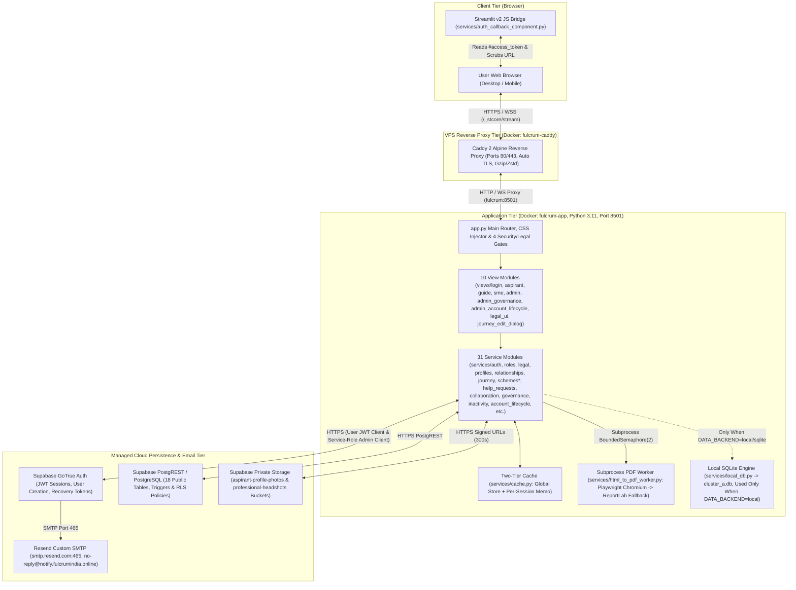
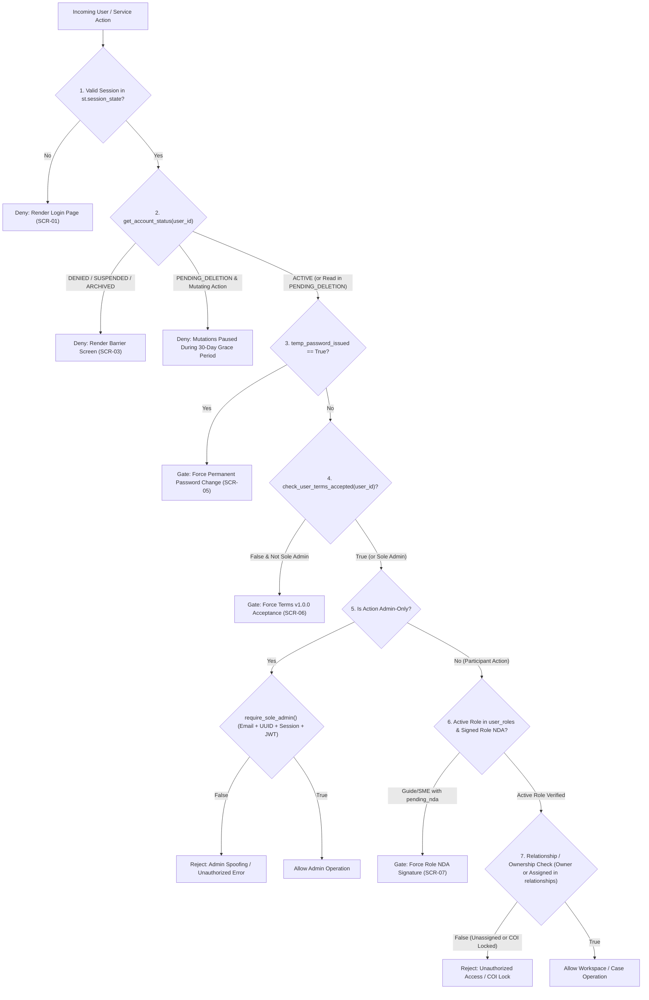
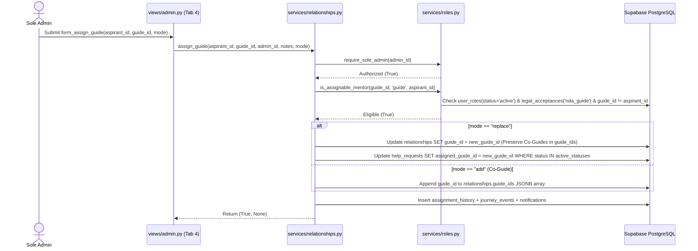
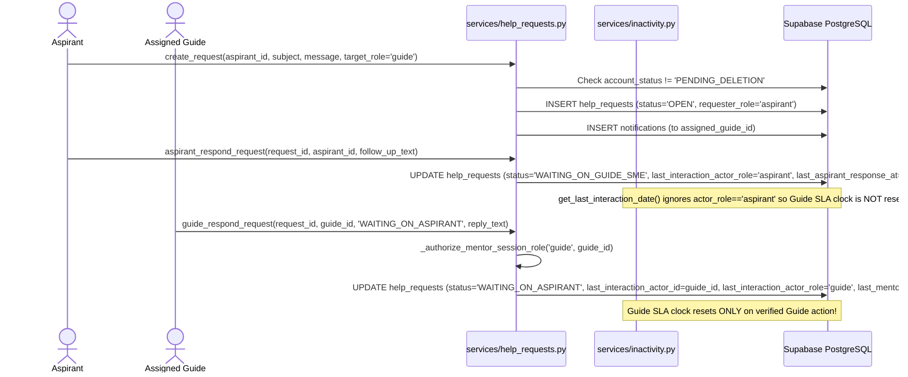
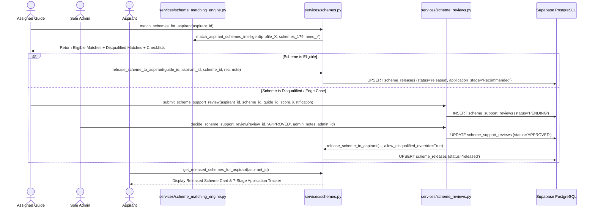
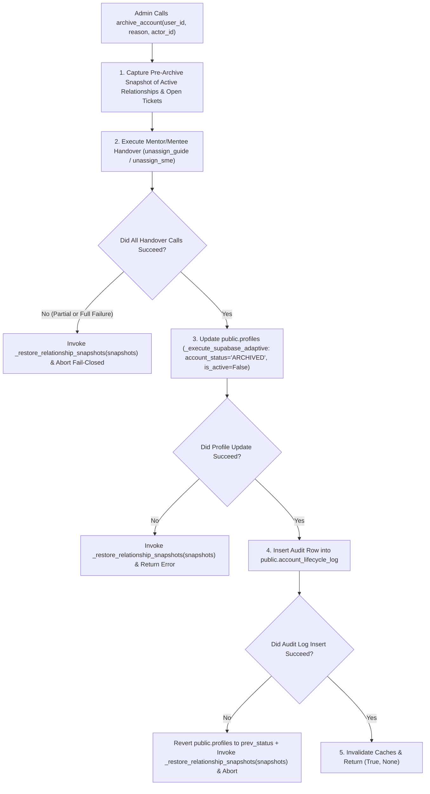
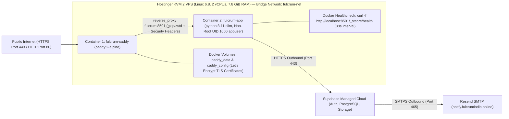

# FULCRUM-INDIA BETA 2.0.0 — SOFTWARE REQUIREMENTS SPECIFICATION (SRS)

| Document Attribute | Value |
| :--- | :--- |
| **Document ID** | `FULCRUM-SRS-V2.0` |
| **Version** | `2.0-baseline` |
| **Date of Analysis** | `2026-11-16` |
| **Reviewed Repository Commit** | `235767754f8d8bb4605e819593bb3f370ddeab27` (`2026-11-11`) |
| **Target Audience** | Software Architects, Backend & Frontend Engineers, Database Administrators, Security Auditors |
| **Document Status** | Baseline Technical Specification (Derived from Reverse-Engineering of Existing Codebase) |

---

## 1. Introduction and Scope

This Software Requirements Specification (SRS) documents the actual technical implementation of **FULCRUM-INDIA Beta 2.0.0**. All architectural descriptions, module boundaries, service contracts, database schemas, Row Level Security (RLS) policies, and deployment topologies are derived directly from the repository at commit `235767754f8d8bb4605e819593bb3f370ddeab27`.

> [!IMPORTANT]
> **Architectural Reality Invariant**: Fulcrum-Beta 2.0.0 is a **monolithic Python Streamlit server application** communicating over HTTPS with **Supabase (PostgreSQL, GoTrue Auth, and Storage)** and backed by an optional local **SQLite (`cluster_a.db`)** engine for offline testing (`README.md` L15–L35, `app.py`, `services/auth.py`). It does **not** expose custom REST/GraphQL API endpoints, does **not** use FastAPI, Celery, Redis, or Kafka, and does **not** use microservices.

---

## 2. Actual Application Architecture (`SR-ARCH-001` to `SR-ARCH-004`)

### Mermaid Diagram 1 — System Architecture Diagram

### Software Architecture Requirements (`SR-ARCH-*`)

| Req ID | Technical Requirement | Implementation Evidence | Status |
| :--- | :--- | :--- | :--- |
| **`SR-ARCH-001`** | **Single-Process Reactive Web Server**: The application executes as a Streamlit server (`streamlit run app.py --server.port=8501`) where each browser tab maintains a WebSocket connection (`/_stcore/stream`) and triggers top-to-bottom Python script reruns on widget interaction. | `Dockerfile` L65–L74, `app.py` L788–L1279 | Implemented — verified in source |
| **`SR-ARCH-002`** | **Strict Fail-Closed Cloud Backend in Production**: When `DATA_BACKEND=supabase` (default in `docker-compose.yml` L9), services must connect exclusively to Supabase and must never silently fall back to writing or authorizing against local SQLite (`cluster_a.db`) on network or database errors. | `services/auth.py` L73–L94, `services/account_lifecycle.py` L332–L558 (`VULN-01`) | Implemented — verified in source; Tested |
| **`SR-ARCH-003`** | **State-Safe Lazy Tab Evaluation**: All multi-tab portals (`views/aspirant.py`, `views/guide.py`, `views/sme.py`, `views/admin.py`, `views/admin_governance.py`, `views/admin_account_lifecycle.py`) must bind `st.tabs(..., on_change="rerun")` to `services.cache.is_tab_active()` so inactive tabs do not execute database queries during reruns. | `services/cache.py` L154–L159, `views/admin.py` L252–L272 (`VULN-10`, `DEC-01`) | Implemented — verified in source; Tested |
| **`SR-ARCH-004`** | **Subprocess-Isolated PDF Rendering with Bounded Concurrency**: HTML-to-PDF dossier generation must run in a separate child process (`services/html_to_pdf_worker.py`) gated by `threading.BoundedSemaphore(2)` with automatic fallback to `ReportLab` and raw PDF generation if Chromium fails. | `services/pdf_generator.py` L581–L786, `services/html_to_pdf_worker.py` L1–L75 | Implemented — verified in source; Tested |

---

## 3. Frameworks, Programming Languages and Dependencies (`SR-CFG-001`)

| Layer / Package | Version Constraint | Source File | Technical Role in Fulcrum-Beta 2.0.0 |
| :--- | :--- | :--- | :--- |
| **Python** | `3.11-slim` (Docker) / `3.11+` | `Dockerfile` L4, `.python-version` | Core application runtime language (`24,343` lines in `services/` + `views/`, `1,279` lines in `app.py`). |
| **`streamlit`** | `>=1.55.0,<=1.56.0` | `requirements.txt` L5 | Web UI framework, reactive state (`st.session_state`), native tab state tracking (`on_change="rerun"`), and Components v2 API. |
| **`supabase`** | `>=2.3.0` | `requirements.txt` L6 | Python client for Supabase GoTrue Auth, PostgREST database queries, and Storage buckets. |
| **`pandas`** | `>=2.0.0` | `requirements.txt` L7 | Tabular data formatting in admin views and analytics. |
| **`plotly`** | `>=5.18.0` | `requirements.txt` L8 | Visual charting dependency available for dashboard rendering. |
| **`python-dotenv`** | `>=1.0.0` | `requirements.txt` L9 | Loads `.env` environment variables in local/container startup (`services/auth.py` L16–L21). |
| **`requests`** | `>=2.31.0` | `requirements.txt` L10 | HTTP client utilities and health verification scripts. |
| **`reportlab`** | `>=4.0.0` | `requirements.txt` L11 | Secondary PDF generation engine when headless Chromium is unavailable (`services/pdf_generator.py` L644–L716). |
| **`playwright`** | `>=1.40.0` (+ Chromium) | `requirements.txt` L12, `Dockerfile` L51 | Headless Chromium browser for primary HTML-to-PDF dossier rendering (`services/html_to_pdf_worker.py`) and E2E tests. |
| **`psutil`** | `>=5.9.0` | `requirements.txt` L13 | Process and memory telemetry in load/benchmark scripts. |
| **Pillow (`PIL`)** | Transitive via `streamlit`/`reportlab` | `services/aspirant_photos.py` L17, `services/professional_photos.py` L23 | Image decoding, EXIF stripping, center-cropping, resizing (`600x600` / `320x320`), and WebP compression. |

---

## 4. Module Boundaries (`app.py`, `views/*`, `services/*`)

### 4.1 Entry Point and View Modules (`11` Modules)

| Module Path | Lines | Primary Functions | Responsibility & Boundary |
| :--- | :---: | :--- | :--- |
| `app.py` | 1,279 | `inject_global_styles()`, `main()` | Application entry point, CSS token injection, sidebar workspace switcher, workspace-filtered notification drawer, 4 security/legal gates, and portal dispatch. |
| `views/login.py` | 706 | `render_login_page()`, `_render_login_page_impl()` | Public landing page, Sign In form, Forgot Password expander, WebSocket recovery callback handling, Set New Password form, and Public Aspirant Signup form. |
| `views/legal_ui.py` | 230 | `render_terms_and_conditions_gate()`, `render_nda_gate()` | Blocking UI gates for Platform Terms of Service (`terms_v1_0`) and role-specific NDAs (`nda_guide`, `nda_sme`). |
| `views/aspirant.py` | 1,104 | `render_aspirant_portal()` | 6-tab Aspirant workspace (Overview/PDF, 4-Part Profile & Photo, Journey, Mentors & Confidential Complaint, Released Schemes, Consultations & Case Discussions). |
| `views/guide.py` | 1,379 | `render_guide_portal()`, `_render_suggested_card()` | 3-tab Guide workspace with 6 per-mentee pill subtabs (Profile, Journey, Guidance Team, 179-Scheme Matcher & Release/SSR UI, Consultations, Case Collaboration) + Guide Profile & Headshot. |
| `views/sme.py` | 952 | `render_sme_portal()` | 3-tab SME workspace with 4 per-mentee pill subtabs (Profile, Journey, Guidance Team, Consultations & COI Declaration) + SME Profile & Headshot. |
| `views/admin.py` | 1,542 | `render_admin_portal()`, `_render_admin_mentor_edit_expander()` | Admin Control Tower KPI header + Tabs 1–6 (Aspirants & Journeys, Guides, SMEs, Mentor Assignments, Mentor Inquiries & SSRs, Scheme Catalogue CRUD) + delegation to Tabs 7–13. |
| `views/admin_governance.py` | 996 | `render_admin_role_grants_tab()`, `render_admin_legal_records_tab()`, `render_admin_complaints_tab()`, `render_admin_inactivity_tab()`, `render_admin_sme_conflicts_tab()`, `render_admin_contact_aspirants_tab()` | Admin Tabs 7–12 (Multi-Role Grants, Legal/NDA Audit, Confidential Complaints, 7/10/14-Day Inactivity Monitor, Contact Aspirants, SME COI Governance). |
| `views/admin_account_lifecycle.py` | 396 | `render_admin_account_lifecycle_tab()`, `render_subtab_*()` (4 subtabs) | Admin Tab 13 (Active/Suspended Accounts, Archived Accounts, Pending Deletion, Immutable Action History). |
| `views/journey_edit_dialog.py` | 87 | `render_edit_journey_dialog()` | Modal/inline form for editing a Journey event with mandatory `change_reason` and optimistic concurrency check. |
| `views/__init__.py` | 3 | Package marker | Namespace initialization. |

### 4.2 Service Layer Modules (`31` Modules)

| Service Module | Lines | Core Responsibilities | Primary Tables Touched |
| :--- | :---: | :--- | :--- |
| `services/auth.py` | 1,246 | Supabase/SQLite backend selection, user & admin client creation, login, public signup, password reset request, recovery token verification, first-login password change, admin mentor creation, logout. | `auth.users`, `profiles`, `user_roles`, `journeys`, `relationships` |
| `services/auth_callback_component.py` | 98 | Custom Streamlit v2 JavaScript bridge (`read_auth_callback`) extracting `#access_token` and `#refresh_token` from URL hash fragments. | Browser DOM / WebSocket |
| `services/roles.py` | 1,011 | Sole Admin identity verification (`is_strict_admin`, `require_sole_admin`), multi-role grants, activation, suspension, reinstatement, cancellation, revocation with automatic unassignment, mentor eligibility checks (`is_assignable_mentor`). | `user_roles`, `profiles`, `legal_acceptances`, `relationships` |
| `services/legal.py` | 488 | Versioned Terms & NDA retrieval, SHA-256 content hashing, acceptance verification, and signature recording (`record_legal_acceptance`). | `legal_documents`, `legal_acceptances`, `user_roles` |
| `services/account_lifecycle.py` | 1,528 | Fail-closed account status evaluation (`get_account_status`), suspension, resumption, pre-archive impact preview, atomic archival with handover & rollback, restoration, 30-day deletion scheduling/cancellation, legal holds, audit log queries. | `profiles`, `account_lifecycle_log`, `relationships`, `help_requests`, `user_roles` |
| `services/profiles.py` | 813 | Relationship-authorized profile reads (`get_profile`, `get_profiles_batch`), completion % calculation, 4-part Aspirant profile update (preserving hybrid mentor data), Mentor profile update. | `profiles`, `relationships`, `user_roles` |
| `services/aspirant_photos.py` | 597 | Private Aspirant photo authorization (`can_view_aspirant_photo`), PIL validation/WebP compression (`600x600`, `<=180 KB`), storage upload/delete, 300s signed URL generation, header rendering. | `aspirant_photos`, `storage.objects` (`aspirant-profile-photos`), `relationships`, `user_roles`, `legal_acceptances` |
| `services/professional_photos.py` | 585 | Guide/SME professional headshot authorization (`can_view_professional_photo` — masked from Aspirants), PIL normalization (`320x320` WebP, `<=150 KB`), upload/delete, batch signed URL lookup. | `professional_photos`, `storage.objects` (`professional-headshots`), `profiles`, `user_roles` |
| `services/relationships.py` | 1,117 | Mentor lookup (`get_aspirant_mentors`), Guide/Co-Guide assignment (`assign_guide`), SME assignment (`assign_sme`), unassignment with Co-Guide promotion and ticket transfer (`unassign_guide`, `unassign_sme`), caseload queries. | `relationships`, `assignment_history`, `help_requests`, `profiles`, `notifications`, `journey_events` |
| `services/journey.py` | 1,191 | Journey creation, chronological sorting, multi-actor milestone creation, roadmap inclusion toggle, author-scoped editing with optimistic locking and revision logging, soft delete, case completion. | `journeys`, `journey_events`, `journey_event_revisions`, `notifications` |
| `services/pdf_generator.py` | 823 | Dossier data aggregation, HTML synthesis, `BoundedSemaphore(2)` subprocess Playwright PDF conversion, ReportLab fallback, emergency raw PDF fallback. | Reads `profiles`, `relationships`, `scheme_releases`, `schemes`, `journeys`, `journey_events` |
| `services/html_to_pdf_worker.py` | 75 | Standalone CLI worker launched by `pdf_generator.py` to render local HTML to PDF via headless Chromium with network request blocking. | Local temp files |
| `services/schemes.py` | 933 | Scheme catalogue queries & CRUD (`list_schemes`, `upsert_scheme`, `toggle_archive_scheme`, `delete_scheme`), Aspirant scheme matching wrapper, Guide scheme release/withdrawal, 7-stage application progress tracking. | `schemes`, `scheme_releases`, `journey_events`, `notifications` |
| `services/scheme_matching_engine.py` | 517 | 3-stage deterministic scheme matcher: profile normalization (`X`), Stage 1 hard gatekeeper disqualifications, Stage 2 weighted scoring (`0–100`), Stage 3 evidence checklist. | Pure deterministic computation |
| `services/scheme_rules.py` | 214 | Assistance Need (`Y`) taxonomies, INR Lakh/Crore regex quantum parser (`parse_quantum_limits`), structured rule extraction (`get_scheme_structured_rules`). | Pure deterministic computation |
| `services/scheme_reviews.py` | 360 | Guide-to-Admin Scheme Support Review (SSR) submission, listing, Admin approval/rejection (auto-releasing scheme on approval), and Admin-to-Guide scheme delegation. | `scheme_support_reviews`, `scheme_releases`, `notifications` |
| `services/schemes_ui.py` | 505 | Reusable scheme card renderer (`render_fund_explorer_card`) and Admin modal edit/delete dialogs (`open_edit_scheme_dialog`, `open_delete_scheme_dialog`). | Calls `services/schemes.py` |
| `services/help_requests.py` | 1,364 | Aspirant consultation creation, Guide/SME/Aspirant threaded responses with adaptive schema fallback, mentor-initiated consultations, mentor-to-admin inquiries, Admin directives (with optional Co-Guide/SME assignment). | `help_requests`, `relationships`, `notifications`, `journey_events` |
| `services/collaboration.py` | 238 | Case Collaboration Space message creation and role-filtered retrieval (`is_private_mentor_note` hidden from Aspirants). | `case_discussions`, `relationships`, `notifications` |
| `services/governance.py` | 360 | Actor name masking, Confidential Guide Complaint submission/listing/resolution, SME Conflict of Interest declaration/check/adjudication. | `guide_complaints`, `sme_conflict_declarations`, `relationships`, `notifications` |
| `services/inactivity.py` | 778 | Independent Guide & SME last-interaction computation (ignoring Aspirant replies), 7/10/14-day episode-deduplicated escalation logging, live alert status computation, Aspirant engagement roster evaluation. | `inactivity_logs`, `relationships`, `help_requests`, `journey_events`, `case_discussions`, `scheme_releases`, `notifications` |
| `services/external_contact.py` | 388 | Indian phone normalization (`+91`), WhatsApp (`wa.me`) and Gmail compose URL builders, outreach templates, and immutable `external_contact_logs` recording. | `external_contact_logs`, `inactivity_logs` |
| `services/notifications.py` | 418 | Authorization-checked notification creation (`is_notification_allowed`), workspace inference and filtering (`filter_notifications_by_workspace`), read/dismiss updates. | `notifications`, `relationships`, `profiles` |
| `services/admin_metrics.py` | 194 | Bulk-queried, memoized (30s TTL) Control Tower KPIs uniting `profiles` and `user_roles`. | Reads `profiles`, `user_roles`, `relationships`, `journeys`, `help_requests`, `scheme_support_reviews`, `guide_complaints`, `sme_conflict_declarations` |
| `services/pagination.py` | 448 | Server-side and hybrid-union pagination (`paginate_profiles`, `paginate_guides`, `paginate_smes`, `paginate_accounts`, `render_pagination_controls`). | Reads `profiles`, `user_roles`, `journey_events`, `notifications` |
| `services/cache.py` | 160 | Process-wide TTL cache (`_GLOBAL_CACHE` with cross-session `_INVALIDATION_TIMESTAMPS`), per-session memo store (`_get_session_store`), and `is_tab_active()`. | In-memory |
| `services/constants.py` | 187 | Master taxonomies (16 sectors, 6 stages, 38 TN districts + non-TN, business types, social categories, genders, funding types) and `safe_escape()` / `resolve_field_choice()`. | Pure constants/helpers |
| `services/logger.py` | 100 | `StructuredLogger` writing JSON logs to stdout with regex redaction of emails, JWTs, API keys, and passwords. | `stdout` |
| `services/perf.py` | 85 | `PerfTracker` context-manager stage timer stored in `st.session_state["_perf_metrics"]`. | In-memory |
| `services/local_db.py` | 2,832 | Complete SQLite (`cluster_a.db`) relational mirror of all 18 tables used only when `DATA_BACKEND=local`/`sqlite`. | Local SQLite file |
| `services/__init__.py` | 3 | Package marker | Namespace initialization |

---

## 5. Internal Service Contracts (`SR-INT-001`)

Because Fulcrum-Beta 2.0.0 does not expose HTTP REST endpoints, views invoke Python service functions directly in-process. Almost all mutating service functions follow a uniform **Tuple Return Contract**:
- **Signature Pattern**: `def action_name(...) -> Tuple[bool, Optional[str]]` (or `Tuple[Optional[Dict], Optional[str]]` for creation/auth functions).
- **Success**: Returns `(True, None)` or `(result_dict, None)`.
- **Failure**: Never raises unhandled exceptions to the UI; catches PostgREST/validation errors, logs sanitized details via `StructuredLogger`, performs any compensating rollback, and returns `(False, "Human-readable error message")`.

---

## 6. Authentication Mechanisms (`SR-AUTH-001` to `SR-AUTH-004`)

| Req ID | Mechanism | Technical Specification & Source Evidence | Status |
| :--- | :--- | :--- | :--- |
| **`SR-AUTH-001`** | **Supabase GoTrue Email+Password Authentication** | `login_user()` (`services/auth.py` L312–L519) authenticates via `client.auth.sign_in_with_password({"email": clean_email, "password": password})`. Access and refresh JWTs are stored in `st.session_state.sb_access_token` and `st.session_state.sb_refresh_token` and bound to a per-session `st.session_state.supabase_client` via `client.auth.set_session(access_token, refresh_token)` (`services/auth.py` L162–L177). | Implemented — verified in source; Tested |
| **`SR-AUTH-002`** | **Ephemeral Client Isolation for Password Recovery** | Both `send_password_reset()` (L674–L708) and `verify_recovery_session_tokens()` / `complete_password_reset()` (L711–L877) instantiate disposable Supabase clients via `_create_ephemeral_supabase_client()` (L197–L209) so recovery token verification never mutates or hijacks another user's active session state. | Implemented — verified in source; Tested |
| **`SR-AUTH-003`** | **Browser URL Fragment Token Bridge** | Because HTTP servers never receive URL hash fragments (`#access_token=...`), `services/auth_callback_component.py` (L15–L97) registers a Streamlit v2 component (`fulcrum_auth_callback_bridge`) that reads `window.location.hash` and `window.location.search`, strips tokens from the browser URL bar via `window.history.replaceState`, and transmits them over Streamlit's WebSocket to `views/login.py` (L342–L373). | Implemented — verified in source; Tested |
| **`SR-AUTH-004`** | **Admin Provisioning via Service-Role Auth API** | `admin_create_mentor()` (`services/auth.py` L997–L1130) uses `admin_client.auth.admin.create_user({"email": clean_email, "password": temp_password, "email_confirm": True, ...})` to provision Guides and SMEs with pre-confirmed emails and `profile_data.temp_password_issued = True`. | Implemented — verified in source; Tested |

---

## 7. Authorization Mechanisms & Service-Role Usage Analysis (`SR-AUTHZ-001` to `SR-AUTHZ-005`)

Fulcrum enforces authorization across **four defense-in-depth layers**:

1. **Layer 1 — Router & UI Gating (`app.py` L838–L1275)**: Resolves account lifecycle status (`Gate 0`), temporary password state (`Gate 1`), Terms acceptance (`Gate 2`), and role NDA acceptance (`Gate 3`), and restricts `render_admin_portal()` strictly to `is_strict_admin(user_dict=user)`.
2. **Layer 2 — Service-Layer Session & Anti-Spoofing Verification**:
   - **`is_strict_admin()` & `require_sole_admin()` (`services/roles.py` L57–L309)**: Validates not only the passed `actor_id`/`email` against `SOLE_ADMIN_EMAIL` (`<SOLE_ADMIN_EMAIL>`) and `SOLE_ADMIN_UUID`, but also cross-checks `st.session_state.user` and verifies the Supabase JWT token (`client.auth.get_user(token)`) so a non-admin session passing `admin_id=SOLE_ADMIN_UUID` is flagged as spoofing and rejected (`VULN-02`).
   - **`_authorize_mentor_session_role()` (`services/help_requests.py` L524–L551)**: Verifies that the active session holds the required mentor role in `user_roles` and that `active_workspace` matches before permitting Guide/SME ticket replies (`DEF-32-002`).
   - **Relationship-Scoped Profile & Photo Gating (`services/profiles.py` L23–L85, `services/aspirant_photos.py` L39–L154, `services/professional_photos.py` L90–L125)**: Explicitly checks `public.relationships` (`guide_id`, `guide_ids`, `sme_id`, `sme_ids`), `user_roles`, and `legal_acceptances` in Python before returning profile data or generating signed storage URLs.
3. **Layer 3 — PostgreSQL Row Level Security (RLS)**: Enabled on all **18 `public` tables** and `storage.objects` (`migrations/000`–`009`).
4. **Layer 4 — PostgreSQL Database Triggers**:
   - `trg_enforce_single_admin_profile` (`migrations/008` L94–L96) and `trg_enforce_single_admin_user_roles` (`migrations/008` L115–L117) prevent privilege escalation even if executed via a privileged client.
   - `trg_immutable_account_lifecycle_log` (`migrations/009` L283–L286) aborts any `UPDATE` or `DELETE` on `public.account_lifecycle_log` even if executed by the `service_role` key.

### 7.1 Security-Critical Analysis of `get_supabase_admin_client()` (Service-Role Bypass)
Static analysis across `services/*.py` identified **18 service modules** that call `get_supabase_admin_client()` (which uses `SUPABASE_SECRET_KEY`, bypassing PostgreSQL RLS):
- **Why It Is Used**: In Streamlit's server-side architecture, cross-entity operations—such as pre-seeding a profile during unconfirmed signup (`services/auth.py` L606), enriching mentor names on Aspirant tickets (`services/help_requests.py` L394), computing cross-table inactivity clocks (`services/inactivity.py` L374), or executing multi-table mentor handovers (`services/relationships.py` L294)—require reading or updating rows across users.
- **Architectural Implication (`SR-AUTHZ-005`, `SEC-RLS-002`)**: Because `get_supabase_admin_client()` bypasses PostgreSQL RLS for those queries, **Python service-layer authorization checks (`require_sole_admin`, `_get_relationship_authorized_ids_supabase`, `can_view_aspirant_photo`, `can_view_professional_photo`, `_authorize_mentor_session_role`) are the primary enforcement boundary** for service-role queries, while PostgreSQL RLS acts as a secondary backstop for user-client queries and direct PostgREST access.

### Mermaid Diagram 2 — Role and Permission Decision Flow

---

## 8. Complete Role-Permission Matrix (All 8 Role Combinations × Lifecycle States)

In the table below:
- **Roles**: `A` = Aspirant, `G` = Guide, `S` = SME, `A+G`, `A+S`, `G+S`, `A+G+S` (the 7 non-admin combinations), and `ADM` = Sole Administrator (`<SOLE_ADMIN_EMAIL>`).
- **Enforcement Layers**: `[UI]` = `app.py` / `views/*.py`, `[SVC]` = `services/*.py` check, `[RLS]` = PostgreSQL RLS policy, `[TRG]` = PostgreSQL Trigger.

| Capability / Operation | `A` (Active) | `G` (Active + NDA) | `S` (Active + NDA) | `A+G` (Active) | `A+S` (Active) | `G+S` (Active) | `A+G+S` (Active) | `ADM` (Sole Admin) | Unconfirmed / Temp-PW / No-Terms | Role `pending_nda` | `PENDING_DELETION` | `SUSPENDED` / `ARCHIVED` / `DENIED` |
| :--- | :---: | :---: | :---: | :---: | :---: | :---: | :---: | :---: | :---: | :---: | :---: | :---: |
| **Access Aspirant Workspace (`SCR-08`..`13`)** | ✅ `[UI,SVC]` | ❌ | ❌ | ✅ (in `A` ws) | ✅ (in `A` ws) | ❌ | ✅ (in `A` ws) | ❌ `[UI,SVC]` | ❌ Blocked by Gate | ✅ (in `A` ws) | ⚠️ Read + Cancel only | ❌ Blocked (`SCR-03`) |
| **Edit Own 4-Part Profile & Upload Aspirant Photo** | ✅ `[SVC,RLS]` | ❌ | ❌ | ✅ (own `A`) | ✅ (own `A`) | ❌ | ✅ (own `A`) | ✅ (inspect/admin) | ❌ | ✅ (own `A`) | ❌ Paused | ❌ |
| **View Aspirant Private Photo (`aspirant_photos`)** | ✅ (Self) | ✅ (Assigned) `[SVC,RLS]` | ✅ (Assigned) `[SVC,RLS]` | ✅ (Self or Assigned) | ✅ (Self or Assigned) | ✅ (Assigned) | ✅ (Self or Assigned) | ✅ (All) `[SVC,RLS]` | ❌ | ❌ (`migrations/005`) | ⚠️ Self read | ❌ |
| **Upload/View Mentor Headshot (`professional_photos`)** | ❌ Masked `[SVC,RLS]` | ✅ (Self) `[SVC,RLS]` | ✅ (Self) `[SVC,RLS]` | ✅ (Self `G` photo) | ✅ (Self `S` photo) | ✅ (Self) | ✅ (Self) | ✅ (All) `[SVC,RLS]` | ❌ | ❌ | ❌ | ❌ |
| **Access Guide Workspace (`SCR-14`..`15`)** | ❌ | ✅ `[UI,SVC]` | ❌ | ✅ (in `G` ws) | ❌ | ✅ (in `G` ws) | ✅ (in `G` ws) | ❌ | ❌ | ❌ Blocked (`SCR-07`) | ⚠️ Read only | ❌ |
| **Evaluate & Release Schemes (`scheme_releases`)** | ❌ (Read released) | ✅ (Assigned) `[SVC,RLS]` | ❌ (No scheme tab) | ✅ (Assigned `G`, not self) | ❌ | ✅ (Assigned `G`) | ✅ (Assigned `G`, not self) | ✅ (All / SSR) `[SVC,RLS]` | ❌ | ❌ | ❌ | ❌ |
| **Submit Scheme Support Review (`scheme_support_reviews`)** | ❌ | ✅ (Assigned) `[SVC,RLS]` | ❌ | ✅ (in `G` ws) | ❌ | ✅ (in `G` ws) | ✅ (in `G` ws) | ✅ (Decide) `[SVC,RLS]` | ❌ | ❌ | ❌ | ❌ |
| **Access SME Workspace (`SCR-16`..`17`)** | ❌ | ❌ | ✅ `[UI,SVC]` | ❌ | ✅ (in `S` ws) | ✅ (in `S` ws) | ✅ (in `S` ws) | ❌ | ❌ | ❌ Blocked (`SCR-07`) | ⚠️ Read only | ❌ |
| **Declare SME Conflict of Interest (`sme_conflict_declarations`)** | ❌ | ❌ | ✅ (Assigned) `[SVC,RLS]` | ❌ | ✅ (in `S` ws) | ✅ (in `S` ws) | ✅ (in `S` ws) | ✅ (Resolve) `[SVC,RLS]` | ❌ | ❌ | ❌ | ❌ |
| **Reply to SME Consultation When COI `has_conflict=True`** | N/A | N/A | ❌ Locked `[UI,SVC]` | N/A | ❌ Locked | ❌ Locked | ❌ Locked | ✅ (Override/Unassign) | ❌ | ❌ | ❌ | ❌ |
| **Add Journey Event & Edit Own Event (`journey_events`)** | ✅ (Self) `[SVC,RLS]` | ✅ (Assigned) `[SVC,RLS]` | ✅ (Assigned) `[SVC,RLS]` | ✅ (Context ws) | ✅ (Context ws) | ✅ (Assigned) | ✅ (Context ws) | ✅ (All) `[SVC,RLS]` | ❌ | ❌ | ❌ Paused | ❌ |
| **Read/Write Private Mentor Notes (`case_discussions`)** | ❌ Hidden `[SVC]` | ✅ (Assigned) `[SVC,RLS]` | ✅ (Assigned) `[SVC,RLS]` | ✅ (Only in `G` ws for mentees) | ✅ (Only in `S` ws for mentees) | ✅ (Assigned) | ✅ (In `G`/`S` ws for mentees) | ✅ (All) `[SVC,RLS]` | ❌ | ❌ | ❌ | ❌ |
| **File Confidential Guide Complaint (`guide_complaints`)** | ✅ (Own Guide) `[SVC,RLS]` | ❌ Hidden `[SVC,RLS]` | ❌ | ✅ (In `A` ws vs own Guide) | ✅ (In `A` ws vs own Guide) | ❌ | ✅ (In `A` ws vs own Guide) | ✅ (Resolve) `[SVC,RLS]` | ❌ | ❌ | ❌ | ❌ |
| **Be Assigned as Mentor to Own Aspirant Profile** | ❌ | N/A | N/A | ❌ Blocked `[SVC]` | ❌ Blocked `[SVC]` | N/A | ❌ Blocked `[SVC]` | N/A | ❌ | ❌ | ❌ | ❌ |
| **Access 13 Admin Tabs (`SCR-18`..`30`) & Lifecycle Actions** | ❌ `[UI,SVC,RLS,TRG]` | ❌ | ❌ | ❌ | ❌ | ❌ | ❌ | ✅ Exclusive `[UI,SVC,RLS,TRG]` | ❌ | ❌ | ❌ | ❌ |
| **Modify or Delete `account_lifecycle_log` Rows** | ❌ `[RLS,TRG]` | ❌ `[RLS,TRG]` | ❌ `[RLS,TRG]` | ❌ `[RLS,TRG]` | ❌ `[RLS,TRG]` | ❌ `[RLS,TRG]` | ❌ `[RLS,TRG]` | ❌ Append-Only `[RLS,TRG]` | ❌ | ❌ | ❌ | ❌ |

---

## 9. Database Structure and Constraints (`SR-DATA-001` to `SR-DATA-006`)

### 9.1 Complete Inventory of the 18 `public` PostgreSQL Tables (`migrations/000`–`011`)

| # | Table Name (`public.*`) | Introduced / Modified In | Primary Key & Foreign Keys | Key Columns, `CHECK` / `UNIQUE` Constraints & Triggers | RLS Enabled? |
| :-: | :--- | :--- | :--- | :--- | :-: |
| **1** | `profiles` | `000`, `008`, `009`, `010` | `id UUID PK` -> `REFERENCES auth.users(id) ON DELETE RESTRICT` (`009` L170) | `email TEXT UNIQUE`, `full_name TEXT`, `phone TEXT`, `role TEXT` (`aspirant`,`guide`,`sme`,`admin`), `district TEXT`, `state TEXT`, `profile_data JSONB`, `is_active BOOL`, `account_status VARCHAR(30) CHECK IN ('ACTIVE','TEMPORARILY_SUSPENDED','ARCHIVED','PENDING_DELETION')`, `legal_hold BOOL`, `lifecycle_reason TEXT`, `status_reason TEXT`, `deletion_requested_at TIMESTAMPTZ`, `deletion_scheduled_for TIMESTAMPTZ`, `retention_notes TEXT`. Trigger: `trg_enforce_single_admin_profile` (`008`). | ✅ Yes (6 policies) |
| **2** | `user_roles` | `000`, `001`, `007`, `008` | `id UUID PK`; `user_id UUID FK -> profiles(id) ON DELETE CASCADE` | `role TEXT CHECK IN ('aspirant','guide','sme','admin')`, `status TEXT CHECK IN ('active','pending_nda','suspended','revoked')`, `granted_by UUID`, `nda_accepted BOOL`, `nda_accepted_at TIMESTAMPTZ`, `UNIQUE(user_id, role)`. Trigger: `trg_enforce_single_admin_user_roles` (`008`). | ✅ Yes (2 policies) |
| **3** | `legal_documents` | `000`, `001` | `id TEXT PK` | `doc_type TEXT CHECK IN ('terms_and_conditions','nda_guide','nda_sme')`, `version TEXT`, `title TEXT`, `content TEXT`, `is_active BOOL`. | ✅ Yes (2 policies) |
| **4** | `legal_acceptances` | `000`, `001` | `id UUID PK`; `user_id UUID FK -> profiles(id) ON DELETE CASCADE` | `user_email TEXT`, `doc_type TEXT`, `doc_version TEXT`, `document_hash TEXT` (SHA-256), `typed_name TEXT`, `typed_phrase TEXT`, `status TEXT DEFAULT 'ACCEPTED'`, `ip_address TEXT`, `user_agent TEXT`, `accepted_at TIMESTAMPTZ`. | ✅ Yes (3 policies) |
| **5** | `relationships` | `000`, `008` | `id UUID PK`; `aspirant_id UUID UNIQUE FK -> profiles(id) ON DELETE CASCADE`; `guide_id UUID FK -> profiles(id)`; `sme_id UUID FK -> profiles(id)` | `guide_ids JSONB DEFAULT '[]'` (Co-Guides array), `sme_ids JSONB DEFAULT '[]'` (Multi-SME array), `status TEXT CHECK IN ('active','unassigned','completed','paused')`, `assigned_by UUID`, `notes TEXT`. | ✅ Yes (4 policies) |
| **6** | `assignment_history` | `000` | `id UUID PK`; `aspirant_id UUID FK -> profiles(id)`; `mentor_id UUID FK -> profiles(id)` | `mentor_role TEXT CHECK IN ('guide','sme')`, `action TEXT CHECK IN ('assigned','unassigned','reassigned')`, `assigned_by UUID`, `notes TEXT`, `assigned_at TIMESTAMPTZ`. | ✅ Yes (3 policies) |
| **7** | `journeys` | `000` | `id UUID PK`; `aspirant_id UUID UNIQUE FK -> profiles(id) ON DELETE CASCADE` | `title TEXT`, `status TEXT CHECK IN ('active','paused','completed')`, `created_at`, `updated_at`. | ✅ Yes (4 policies) |
| **8** | `journey_events` | `000` | `id UUID PK`; `journey_id UUID FK -> journeys(id) ON DELETE CASCADE`; `aspirant_id UUID FK -> profiles(id)` | `actor_id UUID FK -> profiles(id)`, `actor_role TEXT`, `event_type TEXT`, `title TEXT`, `description TEXT`, `event_date DATE`, `included_in_roadmap BOOL DEFAULT TRUE`, `metadata JSONB`. | ✅ Yes (11 policies) |
| **9** | `journey_event_revisions` | `000`, `002` | `id UUID PK`; `journey_event_id UUID FK -> journey_events(id) ON DELETE CASCADE`; `editor_id UUID FK -> profiles(id)` | `editor_role TEXT`, `previous_title TEXT`, `previous_description TEXT`, `previous_link TEXT`, `previous_event_date TEXT`, `change_reason TEXT`, `created_at TIMESTAMPTZ`. | ✅ Yes (2 policies) |
| **10** | `help_requests` | `000`, `004`, `011` | `id UUID PK`; `aspirant_id UUID FK -> profiles(id) ON DELETE CASCADE` | `assigned_guide_id UUID`, `assigned_sme_id UUID`, `requester_id UUID`, `requester_role TEXT`, `request_type TEXT`, `target_role TEXT`, `category TEXT`, `priority TEXT`, `subject TEXT`, `message TEXT`, `guide_response TEXT`, `sme_response TEXT`, `admin_response TEXT`, `admin_directive TEXT`, `status TEXT CHECK IN ('OPEN','IN_PROGRESS','WAITING_ON_ASPIRANT','WAITING_ON_GUIDE_SME','ACTION_REQUIRED','REPLIED','RESOLVED','ESCALATED','PENDING_ADMIN','DIRECTIVE_ISSUED')` (`011`), `last_interaction_actor_id UUID`, `last_interaction_actor_role TEXT`, `last_mentor_response_at TIMESTAMPTZ`, `last_aspirant_response_at TIMESTAMPTZ`. | ✅ Yes (7 policies) |
| **11** | `case_discussions` | `000`, `001` | `id UUID PK`; `aspirant_id UUID FK -> profiles(id) ON DELETE CASCADE`; `author_id UUID FK -> profiles(id)` | `author_role TEXT`, `title TEXT`, `message TEXT`, `is_private_mentor_note BOOL DEFAULT FALSE`, `attachments JSONB`. | ✅ Yes (3 policies) |
| **12** | `schemes` | `000` | `id TEXT PK` | `source_id TEXT`, `name TEXT`, `agency TEXT`, `ministry TEXT`, `scheme_type TEXT`, `category_type TEXT`, `funding_type TEXT`, `stage TEXT`, `amount TEXT`, `brief TEXT`, `description TEXT`, `sectors JSONB`, `eligibility JSONB`, `terms JSONB`, `hidden_agenda TEXT`, `red_flags JSONB`, `process JSONB`, `timeline TEXT`, `state_scope TEXT`, `geography TEXT`, `application_url TEXT`, `is_active BOOL DEFAULT TRUE`, `display_order INT`. | ✅ Yes (3 policies) |
| **13** | `scheme_releases` | `000`, `008` | `id UUID PK`; `aspirant_id UUID FK -> profiles(id) ON DELETE CASCADE`; `scheme_id TEXT FK -> schemes(id) ON DELETE CASCADE`; `guide_id UUID FK -> profiles(id)` | `status TEXT CHECK IN ('released','withdrawn')`, `guide_recommendation TEXT`, `guide_note TEXT`, `application_stage TEXT DEFAULT 'Recommended'` (`008`), `application_note TEXT`, `stage_updated_at TIMESTAMPTZ`, `stage_updated_by UUID`, `UNIQUE(aspirant_id, scheme_id)`. | ✅ Yes (4 policies) |
| **14** | `scheme_support_reviews` | `004` | `id UUID PK`; `aspirant_id UUID FK -> profiles(id)`; `scheme_id TEXT FK -> schemes(id)`; `guide_id UUID FK -> profiles(id)` | `match_score INT`, `guide_justification TEXT`, `failed_criteria TEXT[]`, `missing_criteria TEXT[]`, `status TEXT CHECK IN ('PENDING','APPROVED','REJECTED')`, `admin_decision_notes TEXT`, `reviewed_by UUID`, `UNIQUE(aspirant_id, scheme_id, guide_id)`. | ✅ Yes (3 policies) |
| **15** | `guide_complaints` | `000`, `001` | `id UUID PK`; `aspirant_id UUID FK -> profiles(id)`; `guide_id UUID FK -> profiles(id)` | `reason TEXT`, `details TEXT`, `status TEXT CHECK IN ('OPEN','UNDER_REVIEW','RESOLVED','DISMISSED')`, `resolution_notes TEXT`, `resolved_by UUID`. | ✅ Yes (3 policies; Guides have 0 access) |
| **16** | `sme_conflict_declarations` | `000`, `001` | `id UUID PK`; `sme_id UUID FK -> profiles(id)`; `aspirant_id UUID FK -> profiles(id)` | `has_conflict BOOL`, `conflict_details TEXT`, `status TEXT CHECK IN ('CLEARED','PENDING_REVIEW','RESOLVED','APPROVED','REJECTED')`, `reviewed_by UUID`, `UNIQUE(sme_id, aspirant_id)`. | ✅ Yes (2 policies) |
| **17** | `inactivity_logs` | `000`, `001`, `006` | `id UUID PK`; `relationship_id UUID FK -> relationships(id)`; `guide_id UUID FK -> profiles(id)`; `aspirant_id UUID FK -> profiles(id)` | `mentor_id UUID FK -> profiles(id)` (`006`), `mentor_role TEXT DEFAULT 'guide'`, `inactivity_days INT`, `escalation_stage TEXT CHECK IN ('REMINDER_7D','ALERT_10D','ESCALATED_14D')`, `inactivity_episode TEXT`, `status TEXT DEFAULT 'ACTIVE'`, `follow_up_channel TEXT`, `follow_up_sent_at TIMESTAMPTZ`, `follow_up_notes TEXT`. Unique Index: `uq_inactivity_episode_stage(mentor_id, aspirant_id, mentor_role, inactivity_episode, escalation_stage)`. | ✅ Yes (2 policies) |
| **18** | `external_contact_logs` | `006` | `id UUID PK`; `admin_id UUID FK -> profiles(id)`; `recipient_id UUID FK -> profiles(id)`; `aspirant_id UUID FK -> profiles(id)` | `recipient_role TEXT CHECK IN ('guide','sme','aspirant')`, `inactivity_record_id UUID FK -> inactivity_logs(id)`, `channel TEXT CHECK IN ('whatsapp','email')`, `purpose TEXT`, `status TEXT CHECK IN ('DRAFT_OPENED','SENT_CONFIRMED','ACKNOWLEDGED')`, `notes TEXT`. | ✅ Yes (1 Admin-only policy) |
| **19** | `aspirant_photos` | `000`, `003`, `005` | `id UUID PK`; `user_id UUID UNIQUE FK -> profiles(id) ON DELETE CASCADE` | `storage_path TEXT`, `mime_type TEXT`, `file_size_bytes INT`, `width INT`, `height INT`, `sha256_hash TEXT`, `uploaded_by UUID`. | ✅ Yes (3 policies, tightened in `005`) |
| **20** | `professional_photos` | `008` | `id UUID PK`; `user_id UUID UNIQUE FK -> profiles(id) ON DELETE CASCADE` | `storage_bucket TEXT DEFAULT 'professional-headshots'`, `storage_path TEXT`, `mime_type TEXT DEFAULT 'image/webp'`, `byte_size INT CHECK (byte_size > 0 AND byte_size <= 153600)`, `width INT CHECK (width = 320)`, `height INT CHECK (height = 320)`, `sha256_hash TEXT`, `uploaded_by UUID`. | ✅ Yes (2 policies) |
| **21** | `account_lifecycle_log` | `009`, `010` | `id UUID PK`; `user_id UUID NOT NULL`; `actor_id UUID NOT NULL` | `action VARCHAR(50) CHECK IN ('SUSPEND','RESUME','ARCHIVE','RESTORE','REQUEST_DELETION','CANCEL_DELETION','APPLY_LEGAL_HOLD','RELEASE_LEGAL_HOLD')`, `previous_status VARCHAR(30)`, `old_status TEXT`, `new_status VARCHAR(30)`, `reason TEXT NOT NULL`, `metadata JSONB`, `details JSONB`. Trigger: `trg_immutable_account_lifecycle_log` (`009`). | ✅ Yes (3 permissive + 2 `AS RESTRICTIVE` deny update/delete) |
| **22** | `notifications` | `000` | `id UUID PK`; `user_id UUID FK -> profiles(id) ON DELETE CASCADE` | `title TEXT`, `message TEXT`, `notification_type TEXT`, `is_read BOOL DEFAULT FALSE`, `link TEXT`, `created_at TIMESTAMPTZ`. | ✅ Yes (4 policies) |
| **23** | `activity_log` | `000` | `id UUID PK`; `user_id UUID FK -> profiles(id) ON DELETE SET NULL` | `action TEXT`, `details JSONB`, `created_at TIMESTAMPTZ`. | ✅ Yes (2 policies) |

*(Note: Including `notifications`, `activity_log`, `aspirant_photos`, `professional_photos`, and `account_lifecycle_log`, there are **23 tables in the `public` schema** across `migrations/000`–`011`, plus `auth.users` and `storage.objects`/`storage.buckets`.)*

### 9.2 PostgreSQL Functions & Triggers (`migrations/000`, `008`, `009`)
1. **`public.is_admin()` (`migrations/008` L35–L43)**: `SECURITY DEFINER STABLE` SQL function returning `TRUE` iff `auth.uid()` has `lower(email) = '<SOLE_ADMIN_EMAIL>'` and `role = 'admin'` in `public.profiles`.
2. **`public.current_role()` (`migrations/000` L322–L329)**: `SECURITY DEFINER` SQL function returning `profiles.role` for `auth.uid()`.
3. **`public.handle_new_user()` & Trigger `on_auth_user_created` (`migrations/008` L45–L70)**: `AFTER INSERT ON auth.users` trigger that automatically inserts a row into `public.profiles`, assigning `'admin'` only if `lower(NEW.email) = '<SOLE_ADMIN_EMAIL>'` and defaulting any unauthorized admin strings to `'aspirant'`.
4. **`public.enforce_single_admin_profile_guard()` & Trigger `trg_enforce_single_admin_profile` (`migrations/008` L72–L96)**: `BEFORE INSERT OR UPDATE ON public.profiles` trigger that strips `'admin'`, `'district_admin'`, or `'operational_admin'` from any row whose email is not `<SOLE_ADMIN_EMAIL>`, and prevents non-admins from altering `OLD.role`.
5. **`public.enforce_single_admin_user_roles_guard()` & Trigger `trg_enforce_single_admin_user_roles` (`migrations/008` L98–L117)**: `BEFORE INSERT OR UPDATE ON public.user_roles` trigger raising `'Security Violation: Only <SOLE_ADMIN_EMAIL> may hold the admin role.'` if any other user is granted an admin role.
6. **`public.enforce_account_lifecycle_log_immutability()` & Trigger `trg_immutable_account_lifecycle_log` (`migrations/009` L274–L286)**: `BEFORE UPDATE OR DELETE ON public.account_lifecycle_log` trigger raising `'ACCOUNT_LIFECYCLE_LOG IS STRICTLY APPEND-ONLY'` (`ERRCODE = 'integrity_constraint_violation'`).

---

## 10. Entity Relationship Diagram (`erDiagram`)

### Mermaid Diagram 3 — Complete PostgreSQL Entity Relationship Diagram

```mermaid
erDiagram
    AUTH_USERS ||--|| PROFILES : "id (ON DELETE RESTRICT)"
    PROFILES ||--o{ USER_ROLES : "user_id"
    PROFILES ||--o{ LEGAL_ACCEPTANCES : "user_id"
    LEGAL_DOCUMENTS ||--o{ LEGAL_ACCEPTANCES : "doc_type"
    PROFILES ||--o| ASPIRANT_PHOTOS : "user_id"
    PROFILES ||--o| PROFESSIONAL_PHOTOS : "user_id"
    PROFILES ||--o{ ACCOUNT_LIFECYCLE_LOG : "user_id"
    PROFILES ||--o| RELATIONSHIPS : "aspirant_id"
    PROFILES ||--o{ RELATIONSHIPS : "guide_id / sme_id"
    PROFILES ||--o{ ASSIGNMENT_HISTORY : "aspirant_id / mentor_id"
    PROFILES ||--o| JOURNEYS : "aspirant_id"
    JOURNEYS ||--o{ JOURNEY_EVENTS : "journey_id"
    JOURNEY_EVENTS ||--o{ JOURNEY_EVENT_REVISIONS : "journey_event_id"
    PROFILES ||--o{ HELP_REQUESTS : "aspirant_id"
    PROFILES ||--o{ CASE_DISCUSSIONS : "aspirant_id"
    SCHEMES ||--o{ SCHEME_RELEASES : "scheme_id"
    PROFILES ||--o{ SCHEME_RELEASES : "aspirant_id / guide_id"
    SCHEMES ||--o{ SCHEME_SUPPORT_REVIEWS : "scheme_id"
    PROFILES ||--o{ SCHEME_SUPPORT_REVIEWS : "aspirant_id / guide_id"
    PROFILES ||--o{ GUIDE_COMPLAINTS : "aspirant_id / guide_id"
    PROFILES ||--o{ SME_CONFLICT_DECLARATIONS : "sme_id / aspirant_id"
    RELATIONSHIPS ||--o{ INACTIVITY_LOGS : "relationship_id"
    INACTIVITY_LOGS ||--o{ EXTERNAL_CONTACT_LOGS : "inactivity_record_id"
    PROFILES ||--o{ NOTIFICATIONS : "user_id"
    PROFILES ||--o{ ACTIVITY_LOG : "user_id"

    PROFILES {
        uuid id PK
        text email UK
        text full_name
        text phone
        text role
        text district
        text state
        jsonb profile_data
        bool is_active
        text account_status
        bool legal_hold
        text lifecycle_reason
        timestamptz deletion_scheduled_for
    }
    USER_ROLES {
        uuid id PK
        uuid user_id FK
        text role
        text status
        bool nda_accepted
    }
    LEGAL_ACCEPTANCES {
        uuid id PK
        uuid user_id FK
        text doc_type
        text doc_version
        text document_hash
        text typed_name
        text typed_phrase
        timestamptz accepted_at
    }
    RELATIONSHIPS {
        uuid id PK
        uuid aspirant_id FK
        uuid guide_id FK
        uuid sme_id FK
        jsonb guide_ids
        jsonb sme_ids
        text status
    }
    JOURNEYS {
        uuid id PK
        uuid aspirant_id FK
        text title
        text status
    }
    JOURNEY_EVENTS {
        uuid id PK
        uuid journey_id FK
        uuid aspirant_id FK
        uuid actor_id FK
        text actor_role
        text event_type
        text title
        date event_date
        bool included_in_roadmap
    }
    JOURNEY_EVENT_REVISIONS {
        uuid id PK
        uuid journey_event_id FK
        uuid editor_id FK
        text previous_title
        text previous_description
        text change_reason
    }
    HELP_REQUESTS {
        uuid id PK
        uuid aspirant_id FK
        uuid assigned_guide_id FK
        uuid assigned_sme_id FK
        text status
        text request_type
        uuid last_interaction_actor_id
        text last_interaction_actor_role
        timestamptz last_mentor_response_at
    }
    SCHEMES {
        text id PK
        text name
        text agency
        text funding_type
        text stage
        jsonb sectors
        text state_scope
        bool is_active
    }
    SCHEME_RELEASES {
        uuid id PK
        uuid aspirant_id FK
        text scheme_id FK
        uuid guide_id FK
        text status
        text application_stage
    }
    SCHEME_SUPPORT_REVIEWS {
        uuid id PK
        uuid aspirant_id FK
        text scheme_id FK
        uuid guide_id FK
        int match_score
        text status
    }
    INACTIVITY_LOGS {
        uuid id PK
        uuid relationship_id FK
        uuid mentor_id FK
        uuid aspirant_id FK
        text mentor_role
        text escalation_stage
        text inactivity_episode
        text status
    }
    EXTERNAL_CONTACT_LOGS {
        uuid id PK
        uuid admin_id FK
        uuid recipient_id FK
        uuid aspirant_id FK
        text channel
        text status
    }
    ACCOUNT_LIFECYCLE_LOG {
        uuid id PK
        uuid user_id
        uuid actor_id
        text action
        text previous_status
        text new_status
        text reason
    }
```

---

## 11. Critical Operation Sequence Diagrams (`SR-FLOW-*`)

### Mermaid Diagram 4 — Sequence Diagram: Admin Guide Assignment & Co-Guide Handover

### Mermaid Diagram 5 — Sequence Diagram: Consultation Submission, Mentor Reply & SLA Clock Isolation

### Mermaid Diagram 6 — Sequence Diagram: Guide Scheme Evaluation, SSR Escalation & Admin Override Release

---

## 12. External Integrations (`SR-INT-002` to `SR-INT-004`)

1. **Supabase Cloud (`SUPABASE_URL`)**:
   - **GoTrue Auth (`/auth/v1`)**: Handles user registration, email confirmation tokens, JWT session issuance/refresh, password recovery tokens, and service-role admin user creation.
   - **PostgREST (`/rest/v1`)**: Exposes the 23 `public` PostgreSQL tables over HTTPS REST with Row Level Security.
   - **Supabase Storage (`/storage/v1`)**: Hosts the two private object buckets (`aspirant-profile-photos` and `professional-headshots`) accessed via 300-second signed URLs.
2. **Resend Transactional Email Service (`smtp.resend.com:465`)**:
   - Connected directly to **Supabase Auth Custom SMTP** (not called by Python application code). Sends from verified sender `FULCRUM-INDIA <no-reply@notify.fulcrumindia.online>` over TLS port `465` using username `resend` and a private `re_...` API key (`DOCUMENTATION/02_DEPLOYMENT_AND_OPERATIONS/RESEND_SMTP_AND_FORGOT_PASSWORD_ELI5_GUIDE.md` L79–L92; verified active in owner screenshots on `2026-11-16`).
3. **External WhatsApp Web (`https://wa.me/`) & Gmail Compose (`https://mail.google.com/mail/?view=cm`) URLs**:
   - Generated deterministically by `services/external_contact.py` (L107–L142) as browser hyperlinks opened by the Administrator in a new tab; no third-party WhatsApp or Gmail API keys are required.

---

## 13. Session Handling & Caching Architecture (`SR-SESS-001` to `SR-SESS-003`)

1. **Per-Browser-Tab Session Dictionary (`st.session_state`)**:
   - Key state variables: `user` (dict), `user_id` (UUID str), `role` (`aspirant`/`guide`/`sme`/`admin`), `active_workspace` (`aspirant`/`guide`/`sme`/`admin`), `sb_access_token`, `sb_refresh_token`, `supabase_client` (isolated `supabase.Client` instance), `recovery_verified` (bool), `recovery_verified_email` (str), `_session_memo_store` (dict).
2. **Two-Tier Cache with Cross-Session Invalidation (`services/cache.py` L1–L160)**:
   - **Global Cache (`_GLOBAL_CACHE`, max 512 entries)**: Stores shared read-mostly data such as the 179-scheme catalogue (`ttl_seconds=300`) and `_INVALIDATION_TIMESTAMPS` (`INVALIDATION_TTL_SECONDS = 5`).
   - **Per-Session Memo (`_get_session_store()`, max 256 entries)**: Caches per-user role grants (`ttl_seconds=5`), profile lookups, and dashboard metrics (`ttl_seconds=30`). When an Admin revokes a role or changes an account status in their own session, `invalidate_global_cache(f"roles_{user_id}")` records a global timestamp that forces the target user's session memo to evict stale permissions within `<= 5` seconds (`15_OWNER_APPROVAL_REGISTER.md` L80, L93).

---

## 14. Transactions and Compensating Error Recovery (`SR-TXN-001`)

Because the Supabase PostgREST HTTP client executes individual table operations over HTTP rather than a single multi-statement SQL transaction, `services/account_lifecycle.py` implements **explicit compensating rollback logic** for multi-table operations (`VULN-03`, `DEF-32-001`):

### Mermaid Diagram 7 — Database Write & Compensating Rollback Flow (`archive_account`)

---

## 15. Database Migration Dependencies (`SR-DATA-007`)

The SQL files in the repository have the following canonical execution order and relationships:
1. **`migrations/000_complete_beta_setup.sql` (1,102 lines)**: Consolidated baseline schema containing the original `supabase_setup.sql` (712 lines) plus Migrations `001` (multi-role, legal, complaints, COI, case discussions, inactivity), `002` (journey revisions), and `003` (aspirant photos).
2. **`migrations/004_consultation_actor_tracking_and_support_reviews.sql` (73 lines)**: Adds actor attribution columns to `help_requests` and creates `public.scheme_support_reviews`.
3. **`migrations/005_tighten_aspirant_photo_security.sql` (95 lines)**: Replaces `Mentors view assigned aspirant photo` and storage policies to require `relationships.status='active'`, `guide_ids`/`sme_ids` JSONB support, `user_roles.status='active'`, and `legal_acceptances.status='ACCEPTED'`.
4. **`migrations/006_mentor_inactivity_and_external_contacts.sql` (92 lines)**: Extends `inactivity_logs` for SMEs and episode deduplication (`uq_inactivity_episode_stage`) and creates `public.external_contact_logs`.
5. **`migrations/007_create_missing_user_roles_and_multi_role.sql` (69 lines)**: Idempotent reconciliation of `public.user_roles`.
6. **`migrations/008_single_admin_lock_professional_photos_and_workflow_columns.sql` (252 lines)**: Reconciles and locks the single Admin identity (`trg_enforce_single_admin_profile`, `trg_enforce_single_admin_user_roles`), creates `professional-headshots` bucket and `public.professional_photos`, adds `application_stage` columns to `scheme_releases`, and adds composite performance indexes.
7. **`migrations/009_account_lifecycle_and_archive.sql` (293 lines)**: Adds lifecycle and `legal_hold` columns to `profiles`, backfills `is_active=FALSE` as `TEMPORARILY_SUSPENDED`, changes `profiles_id_fkey` from `ON DELETE CASCADE` to `ON DELETE RESTRICT`, and creates `public.account_lifecycle_log` with triple-layer append-only immutability. *(Note: Root files `ARGON_MIGRATION_009_FINAL_REVIEW.sql` and `MIGRATION_009_REVISED.sql` are historical review copies of `migrations/009_account_lifecycle_and_archive.sql`.)*
8. **`migrations/010_align_account_lifecycle_columns.sql` (44 lines)**: Idempotently adds and backfills both legacy (`status_reason`, `old_status`, `details`) and 009 (`lifecycle_reason`, `previous_status`, `metadata`) column aliases.
9. **`migrations/011_expand_help_requests_status_check.sql` (32 lines)**: Expands `help_requests_status_check` to allow all 10 bidirectional consultation and directive statuses.
10. **`seed/seed_179_schemes_idempotent.sql` (720 KB) / `import_schemes.py`**: Idempotently upserts the **179 canonical schemes** (`seed/canonical_179_schemes.json`) into `public.schemes`. *(Note: `seed/schemes.json` is an earlier 170-scheme snapshot.)*

---

## 16. Logging and Event Handling (`SR-LOG-001`)

1. **Structured JSON Application Logger (`services/logger.py` L1–L100)**: Writes JSON objects (`timestamp`, `level`, `module`, `event`, `message`, `context`) to container `stdout` (captured by Docker's `json-file` log driver with `max-size: "20m"`, `max-file: "5"`, `docker-compose.yml` L18–L22).
2. **Database Audit Tables**:
   - `public.account_lifecycle_log`: Append-only record of all account status and legal-hold changes (`migrations/009`).
   - `public.legal_acceptances`: Append-only record of all signed Terms and NDAs (`migrations/001`).
   - `public.assignment_history`: Chronological log of all Guide/SME assignments, replacements, and unassignments (`migrations/000`).
   - `public.journey_event_revisions`: Immutable before/after snapshots of all Journey milestone edits (`migrations/002`).
   - `public.external_contact_logs`: Audit log of all Admin WhatsApp/Gmail outreach (`migrations/006`).
   - `public.activity_log`: General operational activity log (`migrations/000`).

---

## 17. Deployment Architecture (`SR-DEP-001` to `SR-DEP-003`)

### Mermaid Diagram 8 — Production Deployment Architecture (Hostinger KVM 2 VPS)

### Key Deployment Specifications (`Dockerfile`, `docker-compose.yml`, `Caddyfile`)
- **Non-Root Container Execution (`Dockerfile` L44–L58)**: Creates dedicated Linux user `appuser` (`UID 1000`), installs Playwright Chromium into `/ms-playwright`, and runs `streamlit run app.py` as `USER appuser`.
- **Reverse Proxy & Security Headers (`Caddyfile` L1–L12)**: Proxies `{$DOMAIN:app.fulcrumindia.online}` to `fulcrum:8501`, enables `gzip` and `zstd` compression, automatically provisions/renews Let's Encrypt TLS certificates, and sets `X-Content-Type-Options: nosniff`, `X-XSS-Protection: "1; mode=block"`, and `Referrer-Policy: strict-origin-when-cross-origin`.
- **Container Resource Limits (`docker-compose.yml` L23–L30)**: Sets `cpus: '1.75'`, `memory: 5G` (reservations: `cpus: '0.25'`, `memory: 1G`), `restart: unless-stopped`, and `depends_on: fulcrum: condition: service_healthy`. *(Note: Historical audit `15_OWNER_APPROVAL_REGISTER.md` L24–L26 noted that the live staging/production compose file previously enforced `1,800 MB` with a recommended patch `CR-01` to `3,072 MB`, whereas the repository's `docker-compose.yml` L26 specifies `5G` — recorded as `DISC-003` / `DEC-007`.)*

---

## 18. Environment Configuration (`SR-CFG-002`)

From `.env.example` (L1–L9), `docker-compose.yml` (L8–L16), and `services/auth.py` (L26–L111), the application reads the following environment variable names (values omitted for security):

| Environment Variable Name | Required in Prod? | Purpose in Code |
| :--- | :---: | :--- |
| `DATA_BACKEND` | Yes (`supabase`) | Selects persistence backend: `supabase` (production fail-closed cloud mode) vs `local` / `sqlite` (`services/auth.py` L73–L94). |
| `SUPABASE_URL` | Yes | Base HTTPS URL of the Supabase project (`services/auth.py` L48, L119). |
| `SUPABASE_PUBLISHABLE_KEY` | Yes (or `SUPABASE_ANON_KEY`) | Public anon/publishable key used to initialize user-scoped Supabase clients (`services/auth.py` L49–L55). |
| `SUPABASE_SECRET_KEY` | Yes (or `SUPABASE_SERVICE_ROLE_KEY`) | Privileged service-role key used by `get_supabase_admin_client()` (`services/auth.py` L56–L62, L185–L194). |
| `SOLE_ADMIN_UUID` | Optional (has fallback) | Overrides the default UUID for the Sole Administrator (`services/roles.py` L32–L53, `docker-compose.yml` L13). |
| `DOMAIN` | Yes (`app.fulcrumindia.online`) | Public domain used by Caddy for automatic HTTPS and by `get_app_base_url()` (`docker-compose.yml` L14, `Caddyfile` L1). |
| `APP_URL` / `PUBLIC_APP_URL` | Optional (derived from `DOMAIN`) | Canonical base URL (`https://app.fulcrumindia.online`) passed as `email_redirect_to` / `redirect_to` in Supabase Auth signup and recovery calls (`services/auth.py` L96–L111). |

---

## 19. Technical Constraints & Dual-Backend Behaviour (`SR-DATA-008`)

1. **Dual-Backend Parity (`Supabase` vs `LocalDatabase`)**: Every service module checks `if get_data_backend() in ("local", "sqlite"):` and delegates to `services/local_db.py` (`LocalDatabase`, 2,832 lines). This enables fast, offline unit/regression testing (`pytest` runs in seconds against temporary SQLite databases) while production runs against Supabase PostgreSQL.
2. **Differences Between SQLite Mode and Supabase Mode**:
   - **Email Delivery**: SQLite mode does not send signup confirmation or password reset emails; accounts are immediately active upon creation (`services/auth.py` L540–L570) and password reset uses a local dev button (`views/login.py` L626–L630).
   - **Row Level Security**: SQLite has no database-level RLS policies or PostgreSQL triggers; in SQLite mode, authorization is enforced 100% by the Python service layer (`services/*.py`).
   - **Photo Storage**: In SQLite mode, `aspirant_photos.py` and `professional_photos.py` store base64 `data:image/webp;base64,...` data URLs in local SQLite rows instead of uploading to Supabase Storage buckets (`services/aspirant_photos.py` L250–L268).

---

## Glossary of Technical & Architectural Terms

| Term | Technical Definition |
| :--- | :--- |
| **GoTrue** | Supabase's open-source authentication server that manages `auth.users`, password hashing (bcrypt), email verification tokens, and JWT issuance. |
| **Optimistic Concurrency Control** | The check in `update_journey_event()` (`services/journey.py` L935–L950) that compares `expected_updated_at` against the current database `updated_at` timestamp before overwriting a milestone. |
| **PostgREST** | The service in Supabase that turns the `public` PostgreSQL schema into a RESTful API enforcing PostgreSQL Row Level Security policies on every request. |
| **RESTRICTIVE RLS Policy (`AS RESTRICTIVE`)** | A PostgreSQL policy combined via boolean `AND` (rather than `OR`) with permissive policies. Used on `public.account_lifecycle_log` (`USING (FALSE)`) so no role can update or delete audit logs (`migrations/009` L256–L270). |
| **`SECURITY DEFINER`** | A PostgreSQL function modifier (`is_admin()`, `handle_new_user()`) that executes the function with the privileges of the function creator rather than the invoking user, preventing infinite RLS recursion on `public.profiles`. |
| **Service-Role Client (`get_supabase_admin_client`)** | The Supabase client initialized with `SUPABASE_SECRET_KEY` (`services/auth.py` L185–L194) that bypasses PostgreSQL RLS for privileged server-side operations. |
