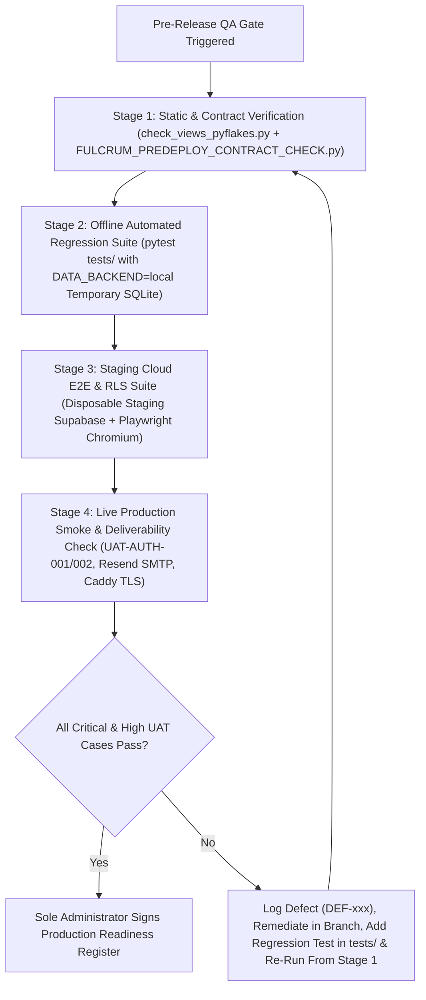

# FULCRUM-INDIA BETA 2.0.0 — USER ACCEPTANCE TESTING & QA SPECIFICATION (UATD)

| Document Attribute | Value |
| :--- | :--- |
| **Document ID** | `FULCRUM-UATD-V2.0` |
| **Version** | `2.0-baseline` |
| **Date of Analysis** | `2026-11-16` |
| **Reviewed Repository Commit** | `235767754f8d8bb4605e819593bb3f370ddeab27` (`2026-11-11`) |
| **Target Audience** | QA Lead, Test Engineers, Product Managers, Sole Institutional Administrator |
| **Document Status** | Baseline Acceptance Test Specification & Automated Test Inventory |

---

## 1. Purpose, Scope and Non-Destructive Testing Mandate

This User Acceptance Testing Document (UATD) defines the end-to-end verification baseline for **FULCRUM-INDIA Beta 2.0.0** across all 29 required functional, security, boundary, and operational areas.

> [!CAUTION]
> **Non-Destructive Production Mandate**: No automated test suites (`pytest`) or destructive scripts were executed against the live production Supabase project during this documentation audit. All test cases below record their execution status honestly as **`Not Run`** (inspected in source) except **`UAT-AUTH-001` / `UAT-AUTH-002`**, which incorporate the live production signup and Resend/Gmail Spam observations supplied by the owner on `2026-11-16`. When executing automated suites in the future, always set `DATA_BACKEND=local` (isolated SQLite) or point to a disposable staging Supabase project (`assert_isolated_staging_target` in `tests/test_password_recovery_suite.py` L33).

### Mermaid Diagram 1 — UAT Execution, Environment Isolation & Defect Triage Workflow

---

## 2. Review of Existing Automated Test Suites in Repository (`33` Test Files)

Code inspection of `tests/` (`21` files) and root verification scripts (`12` files) establishes the following automated test inventory:

| Test File Path | Lines | Target Backend | Functional & Security Coverage | Historical Reported Result in Repo Docs |
| :--- | :---: | :--- | :--- | :--- |
| `tests/test_account_lifecycle_and_handover_chaos.py` | 400 | Local SQLite (`force_test_backend`) | 9 tests covering Sole Admin authority, root admin immunity, suspension/resumption, pre-archive impact preview, atomic handover, restoration without privilege reactivation, 30-day deletion grace period, legal hold block, and alumni completion. | Reported `9/9 PASSED` in `ACCOUNT_LIFECYCLE_IMPLEMENTATION_REPORT.md` |
| `tests/test_argon_p0_negative_security.py` | 486 | Local SQLite + Mock Supabase | 17 negative security tests covering `VULN-01` (fail-closed account status), `VULN-02` (Sole Admin anti-spoofing), `VULN-03` (handover failure rollback), `VULN-05` (inactive backfill), `VULN-07` (`PENDING_DELETION` mutation block), and `VULN-08` (mentor NDA/role eligibility). | Reported `17/17 PASSED` in `ARGON_ACCOUNT_AUTHORIZATION_NEGATIVE_TESTS.md` |
| `tests/test_argon_security_remediation.py` | 238 | Local SQLite | Security remediation checks for RBAC, admin lock, and session isolation. | Reported `PASSED` in `ARGON_GATE0_TEST_EVIDENCE.md` |
| `tests/test_aspirant_photo_dashboard_visibility.py` | 686 | Local SQLite (`reset_test_env`) | 22 end-to-end tests (`test_01` to `test_22`) covering Aspirant photo upload, WebP compression, Guide/SME NDA-gated visibility, immediate revocation upon unassignment or role revocation, hybrid founder isolation, and forged-ID prevention. | Reported `22/22 PASSED` in `FULCRUM_PHOTO_DASHBOARD_FINAL_REPORT.md` |
| `tests/test_beta_6_audit_security.py` | 437 | Local SQLite + Mock Cloud | Beta 6 security audit suite verifying collaboration isolation, cloud photo deletion failure surfacing, synthetic role elimination, and fail-closed login barriers. | Reported `PASSED` in `PRODUCTION_READINESS_AND_APPROVAL_REGISTER.md` |
| `tests/test_checkpoint1_defects_and_handover.py` | 138 | Local SQLite | 5 tests: Sole Admin verification, quarantined script execution block (`VULN-09`), refusal to reinstate `revoked` roles, selective mentor replacement preserving co-mentors, and Co-Guide promotion on primary Guide unassignment. | Reported `5/5 PASSED` |
| `tests/test_concurrency_load.py` | 174 | Local / Configurable | Multi-threaded load generator (`10`, `25`, `50` concurrency tiers) outputting `tests/load_test_results.json`. | Output preserved in `tests/load_test_results.json` (`0%` error rate up to 50) |
| `tests/test_confidential_complaints.py` | 37 | Local SQLite | Validation of `submit_guide_complaint` with and without an assigned Guide. | Reported `2/2 PASSED` |
| `tests/test_cross_session_isolation.py` | 164 | Local / Mock Session | Verifies per-session `st.session_state` and Supabase JWT isolation across concurrent users. | Reported `PASSED` |
| `tests/test_external_contact_and_sme_inactivity.py` | 521 | Local SQLite | 24 comprehensive tests (`test_01` to `test_24`) covering 7/10/14-day Guide & SME escalation stages, Co-Guide/Multi-SME clock isolation, hybrid founder independent clocks, Aspirant reply non-contamination, WhatsApp/Gmail URL generation, `DRAFT_OPENED` vs `SENT_CONFIRMED`, episode deduplication, and phone normalization. | Reported `24/24 PASSED` in `MENTOR_INACTIVITY_AND_EXTERNAL_CONTACT_VERIFICATION.md` |
| `tests/test_failure_isolation.py` | 141 | Mock Fault Injection | Verifies fail-closed behaviour when Supabase connections throw exceptions or time out. | Reported `PASSED` in `08_CHAOS_ENGINEERING_REPORT.md` |
| `tests/test_inactivity_sla_contamination.py` | 73 | Local SQLite | Verifies Aspirant replies never reset Guide inactivity clocks while Guide replies do. | Reported `2/2 PASSED` |
| `tests/test_multi_role_e2e_workflows.py` | 401 | Local SQLite (`force_sqlite_backend`) | End-to-end multi-role promotion, NDA activation, workspace switching, and anti-self-mentoring across hybrid profiles. | Reported `PASSED` |
| `tests/test_password_recovery_suite.py` | 314 | Mock / Isolated Staging | Tests recovery email trigger, `#access_token` verification, PKCE `token_hash` verification, expired/used token rejection, and Sole Admin recovery block. | Reported `PASSED` in `PASSWORD_RECOVERY_FORENSIC_REMEDIATION_REPORT.md` |
| `tests/test_qa32_fixes_regression.py` | 779 | Local SQLite + `_FakeSupabaseClient` | 12 regression tests verifying fixes for all 10 defects from the 32-user QA simulation (`DEF-32-001` through `DEF-32-010`) plus Migration `011` adaptive status fallback. | Reported `12/12 PASSED` in commit `2357677` / `afac6ab` |
| `tests/test_scheme_card_crash.py` | 42 | Local SQLite | Smoke test for `render_fund_explorer_card()` signature and execution. | Reported `PASSED` |
| `tests/test_scheme_matching_engine.py` | 171 | In-Memory Engine | 6 unit tests: INR quantum parsing, women-only `>=51%` equity gatekeeper, SC/ST quota isolation, Tamil Nadu state jurisdiction gatekeeper, photo compression, and saved `assistance_need` matching. | Reported `6/6 PASSED` |
| `tests/test_scheme_relevance_synthetic.py` | 269 | In-Memory (179 Schemes) | 9 synthetic profile tests: retail pharmacy vs pharma R&D/deeptech, textile vs ISRO/deeptech, millet food processing, space tech -> ISRO, incomplete profile baseline, women-led concession, non-TN disqualification, SC/ST priority, and EV startup matching. | Reported `9/9 PASSED` in `SCHEME_MATCHING_VERIFICATION_MATRIX.md` |
| `tests/test_single_admin_and_photos.py` | 221 | Local SQLite | Tests single-admin identity lock and professional mentor headshot privacy (`320x320` WebP, masked from Aspirants). | Reported `PASSED` |
| `tests/test_single_admin_master_e2e.py` | 674 | Local SQLite (`force_sqlite_backend`) | 10-stage master E2E workflow (`test_01` to `test_10`) from onboarding and photo upload through Terms/NDA, role promotions, caseload allocation, messaging, scheme release, Journey/PDF dossier, and Admin KPIs. | Reported `10/10 PASSED` in `FULCRUM_BETA_COMPLETE_E2E_REPORT.md` |
| **Root Verification Scripts (`12` files)** | 2,018 | Local / Hybrid | `run_full_verification.py`, `verify_5_fixes.py`, `verify_acceptance.py`, `verify_governance.py`, `verify_journey_governance_and_ui.py`, `verify_multi_sme_and_security.py`, `test_consultation_isolation.py`, `test_dual_backend.py`, `test_guide_sme_consultations_and_contrast.py`, `test_needed_not_needed_workflow.py`, `test_verification_suite.py`, `test_views_smoke.py`. | Historical verification scripts from Cluster A to Beta evolution |

---

## 3. Reconciliation of Historical 32-User QA Defects vs Current Source Defects

| Defect Category | Defect IDs | Current Status in Repository (`Commit 2357677`) |
| :--- | :--- | :--- |
| **Previously Reported 32-User QA Defects (Fixed in Source)** | `DEF-32-001` through `DEF-32-010` (detailed in [`FULCRUM_PRD_V2.md`](./FULCRUM_PRD_V2.md) Section 26.2) | **Previously reported — fix visible in source & covered by `tests/test_qa32_fixes_regression.py`**. |
| **Previously Reported Argon Security Findings (Fixed in Source)** | `VULN-01` through `VULN-10` (detailed in [`FULCRUM_SPRD_V2.md`](./FULCRUM_SPRD_V2.md) Section 10) | **Previously reported — fix visible in source & covered by `tests/test_argon_p0_negative_security.py`**. (`VULN-04` and `VULN-06` also require live DB verification that `migrations/009` is applied in production.) |
| **Verified Current Defects / Incomplete Flows Identified in This Audit** | `DEF-001` (Misleading signup email-sent message without Spam warning), `DEF-002` (No Resend Confirmation button), `DEF-003` (6-char vs 8-char password min length on signup), `DEF-004` (`Maintainence` typo), `DEF-005` (`check_and_escalate_overdue_requests` stub), `DEF-006` (Manual review after 30-day deletion grace period), `DEF-007` (Page-load vs cron SLA evaluation), `DEF-008` (`streamlit-client` placeholder IP in `legal_acceptances`). | **Verified current defects / partial implementations in source (`2026-11-16`)**. |

---

## 4. Complete User Acceptance Test Specification (`UAT-*` Across All 29 Areas)

| Test ID & Type | Req ID | Role | Preconditions | Test Steps | Expected Outcome | Actual Result (If Executed) | Status | Evidence Reference | Severity if Failed |
| :--- | :--- | :--- | :--- | :--- | :--- | :--- | :---: | :--- | :---: |
| **`UAT-AUTH-001`** (Positive) | `FR-AUTH-001` | Public / Aspirant | Unauthenticated browser on `SCR-01` (`Create Aspirant Account` tab). | 1. Enter Full Name, new Email, Mobile `9876543210`, District `Chennai`, Password (`>=8` chars) & Confirm. 2. Click `CREATE ASPIRANT ACCOUNT`. | Account created in `auth.users` and pre-seeded in `public.profiles` (`role='aspirant'`, phone & district saved); UI displays confirmation notice. | Verified in owner screenshot (`2026-11-16`): user created in `auth.users`. | **Observed Live** | `views/login.py` L642-L699, `tests/test_single_admin_master_e2e.py::test_01_onboarding_and_registration` | **Critical** |
| **`UAT-AUTH-002`** (Positive / Boundary) | `FR-AUTH-002, SEC-CONF-001, SEC-CONF-002` | Public / Aspirant | Aspirant registered via `UAT-AUTH-001`; Supabase Custom SMTP (`smtp.resend.com:465`) enabled. | 1. Attempt Sign In before clicking confirmation link. 2. Check Resend Email Log (`Sent -> Delivered`). 3. Check Gmail Inbox and **Spam** folder, click `Report not spam`, and click confirmation link. 4. Sign in on `SCR-01`. | Step 1 blocked with `'Email not confirmed. Please check your inbox for the verification link.'` (`services/auth.py` L380). Step 3 confirms email; Step 4 signs in and routes to Terms Gate (`SCR-06`). | Observed Live (`2026-11-16`): Resend delivered email, Gmail placed it in **Spam** (`DEF-001` UX message did not mention Spam; `DEF-002` no Resend button). | **Observed Live (UX Defect DEF-001)** | `services/auth.py` L379-L380, L579-L630, `views/login.py` L693 | **High** |
| **`UAT-AUTH-003`** (Negative / Security) | `FR-AUTH-001, SEC-ADMIN-001` | Public / Attacker | Unauthenticated user or direct `signup_aspirant()` call. | 1. Attempt signup with empty mandatory fields, mismatched passwords, or `Other District / Non-TN (Specify)` with blank custom text. 2. Attempt to pass `role='admin'` in signup metadata. | 1. Form validation blocks submission with exact error messages (`views/login.py` L675-L682). 2. Trigger `handle_new_user()` (`migrations/008` L45-L70) forces `role='aspirant'` for any email other than `<SOLE_ADMIN_EMAIL>`. | Not Executed in Static Audit | **Not Run** | `views/login.py` L675-L682, `migrations/008` L45-L70, `tests/test_single_admin_and_photos.py` | **Critical** |
| **`UAT-AUTH-004`** (Positive) | `FR-AUTH-002, FR-AUTH-005` | Aspirant, Guide, SME, Admin | Confirmed active user account exists. | 1. Submit valid email and password in `login_form` (`SCR-01`). 2. Verify workspace loads. 3. Click `🚪 Logout` in sidebar (`app.py` L1077). | Login populates `st.session_state.user` and isolated `supabase_client`; Logout calls `logout_user()` (`services/auth.py` L1236), clears all session tokens/memos, and returns to `SCR-01`. | Not Executed in Static Audit | **Not Run** | `services/auth.py` L312-L519, L1236-L1246, `tests/test_cross_session_isolation.py` | **Critical** |
| **`UAT-AUTH-005`** (Positive) | `FR-AUTH-003, SEC-PWD-002` | Aspirant / Guide / SME | Registered non-admin user on `SCR-01`. | 1. Open `🔑 Forgot Password?`, enter email, click `Send Reset Link`. 2. Open single-use recovery link (`?type=recovery#access_token=...`). 3. Verify `#access_token` is scrubbed from URL bar and `✓ Cryptographically Verified` badge appears (`SCR-02`). 4. Enter new password (`>=8` chars) and submit `UPDATE PASSWORD`. | Password updated in `auth.users`, recovery session signed out, user redirected to Sign In and logs in with new password. | Not Executed in Static Audit | **Not Run** | `services/auth.py` L674-L877, `services/auth_callback_component.py`, `tests/test_password_recovery_suite.py` | **Critical** |
| **`UAT-AUTH-006`** (Negative / Security) | `FR-AUTH-003, SEC-PWD-002, SEC-PWD-003` | Public / Admin | Recovery screen `SCR-02` or Forgot Password form. | 1. Open an expired, tampered, or already-used recovery link. 2. Attempt self-service password reset for `<SOLE_ADMIN_EMAIL>`. | 1. Renders `Recovery Link Expired or Invalid` card (`views/login.py` L405-L452) and blocks password form. 2. Blocks `<SOLE_ADMIN_EMAIL>` with `Security Notice: Platform Administrator credentials cannot be reset through self-service recovery.` (L492). | Not Executed in Static Audit | **Not Run** | `views/login.py` L405-L492, `services/auth.py` L212-L261, L801-L803, `tests/test_password_recovery_suite.py` | **Critical** |
| **`UAT-PROF-001`** (Positive / Boundary) | `FR-ASP-001` | Aspirant (`A` and Hybrid `A+G`) | Authenticated Aspirant on `SCR-09` (`👤 My Profile`). | 1. Fill all 4 profile sections + Assistance Need (`Y`), including selecting `'Other / Not Listed (Specify)'` on Sector and entering a custom sector. 2. Click `💾 SAVE COMPLETE ENTERPRISE PROFILE`. 3. Repeat on a hybrid `Aspirant + Guide` account that has `profile_data['mentor']` populated. | Profile completion % updates (`>=60%` shows `Ready for Matching`); custom sector round-trips cleanly via `resolve_field_choice()`; hybrid user's `profile_data['mentor']` keys remain intact (`DEF-32-006`). | Not Executed in Static Audit | **Not Run** | `views/aspirant.py` L279-L454, `services/profiles.py` L541-L692, `tests/test_qa32_fixes_regression.py::test_def006_aspirant_save_preserves_existing_mentor_profile_data` | **High** |
| **`UAT-PHOTO-001`** (Positive & Negative Security) | `FR-ASP-002, SEC-STOR-001, SEC-STOR-002, SEC-FILE-001` | Aspirant, Guide, SME, Admin | Aspirant Alpha uploads a JPEG photo in `SCR-09`; Guide 1 (assigned, NDA signed), Guide 2 (unassigned), and Guide 3 (assigned, `pending_nda`) exist. | 1. Alpha uploads a 2 MB JPEG photo. 2. Check visibility for Alpha, Sole Admin, and Guide 1 (NDA signed). 3. Check visibility for unassigned Guide 2 and unsigned-NDA Guide 3. 4. Admin unassigns Guide 1 and re-checks Guide 1 visibility. 5. Attempt uploading a corrupt/non-image file or file `>5 MB`. | 1. Image stripped of EXIF and compressed to `<=180 KB` `600x600` WebP. 2. Alpha, Admin, and Guide 1 receive a 300s signed URL. 3. Guide 2 and Guide 3 are denied (`can_view_aspirant_photo` returns `False`). 4. Unassigned Guide 1 immediately loses access. 5. Corrupt/oversized upload rejected cleanly. | Not Executed in Static Audit | **Not Run** | `services/aspirant_photos.py` L39-L595, `migrations/005`, `tests/test_aspirant_photo_dashboard_visibility.py` (`test_01` to `test_22`) | **Critical** |
| **`UAT-ONB-001`** (Positive) | `FR-AUTH-004, FR-ADMIN-002, FR-ADMIN-003` | Sole Admin -> Guide / SME | Sole Admin in Tab 2 (`SCR-19`) and Tab 3 (`SCR-20`). | 1. Admin creates a new Guide (`form_create_guide`) and a new SME (`form_create_sme`) using the session-cached provisional password. 2. Provisioned mentor logs in with the provisional password. 3. Verify mentor is intercepted by `SCR-05` (`form_first_login_pw`) and cannot bypass it with a `<8` char password. 4. Set permanent password (`>=8` chars). | 1. Accounts created with `temp_password_issued=True` and `user_roles.status='pending_nda'`. 2. Rerunning Admin form before submit does not change provisional password (`DEF-32-003`). 3. Mentor forced to set `>=8` char permanent password before advancing to Terms (`SCR-06`) and NDA (`SCR-07`) gates (`DEF-32-009`). | Not Executed in Static Audit | **Not Run** | `views/admin.py` L82-L86, L569-L860, `app.py` L1198-L1232, `tests/test_qa32_fixes_regression.py::test_def003_def008_def009_ui_contracts_and_delegation` | **Critical** |
| **`UAT-PHOTO-002`** (Positive & Negative Security) | `FR-SME-002, SEC-STOR-003` | Guide, SME, Aspirant, Admin | Guide and SME upload headshots in `SCR-15` / `SCR-17` (or Admin uploads in `SCR-19` / `SCR-20`). | 1. Upload valid PNG/JPEG headshot (`120-6000px`). 2. Verify normalized `320x320` WebP (`<=150 KB`) appears for the Mentor and in Admin Tab 2/3. 3. Call `can_view_professional_photo()` / inspect `SCR-11` as an Aspirant. | Headshot is visible to the Mentor and Sole Admin (300s signed URL), but strictly masked (`False` / initials avatar only) when viewed by any Aspirant. | Not Executed in Static Audit | **Not Run** | `services/professional_photos.py` L90-L191, `migrations/008` L123-L197, `tests/test_single_admin_and_photos.py` | **High** |
| **`UAT-LEGAL-001`** (Positive & Negative) | `FR-LEGAL-001, FR-ADMIN-008` | Aspirant, Guide, SME, Admin | Newly authenticated user who has not accepted Terms (`SCR-06`) or Role NDA (`SCR-07`). | 1. Attempt to submit `SCR-06` without checking agreement box. 2. Check box and click `Accept & Continue`. 3. Switch to `guide` or `sme` workspace (`SCR-07`); attempt to submit without typing full name or typing phrase other than `'I AGREE'`. 4. Type legal name + `'I AGREE'` and submit. 5. Inspect Admin Tab 8 (`SCR-25`). | 1 & 3 blocked with validation errors. 2 & 4 record SHA-256 hash and timestamp in `public.legal_acceptances`, transition `user_roles.status` from `pending_nda` to `active`, and unlock workspace. 5. Admin Tab 8 displays all signed acceptance rows. | Not Executed in Static Audit | **Not Run** | `views/legal_ui.py` L19-L229, `services/legal.py` L246-L487, `tests/test_single_admin_master_e2e.py::test_03_terms_and_legal_acceptance` | **Critical** |
| **`UAT-ROLE-001`** (Positive & Negative) | `FR-ADMIN-007, FR-ROLE-001, SEC-RBAC-001, SEC-RBAC-002` | Sole Admin + 7 Participant Combos (`A`, `G`, `S`, `A+G`, `A+S`, `G+S`, `A+G+S`) | 7 test accounts representing all 7 non-admin role combinations + Sole Admin in Tab 7 (`SCR-24`). | 1. Verify workspace dropdown (`sb_current_workspace`) options for each of the 7 combinations. 2. Switch between `Aspirant`, `Guide`, and `SME` on an `A+G+S` account; verify sidebar badge (`Verified Aspirant` / `Verified Guide` / `Verified Domain SME`), `st.session_state['role']`, and workspace-filtered notifications (`DEF-32-010`). 3. Admin suspends and reinstates a `guide` role. 4. Admin revokes an `sme` role and attempts to call `reinstate_role()` on the `revoked` role. | 1 & 2. Each combination sees only its authorized workspaces and isolated notifications. 3. Suspended role disappears from active workspaces until reinstated. 4. Revoking `sme` unassigns all active SME cases (`unassign_sme`), evicts open browser session within 5s, and `reinstate_role()` refuses to reinstate a `revoked` grant (`test_03_reinstate_role_refuses_revoked_roles`). | Not Executed in Static Audit | **Not Run** | `app.py` L839-L1075, `services/roles.py` L331-L868, `tests/test_multi_role_e2e_workflows.py`, `tests/test_checkpoint1_defects_and_handover.py::test_03` | **Critical** |
| **`UAT-LIFE-001`** (Positive & Negative Security) | `FR-ADMIN-013, SEC-ADMIN-002, NFR-REL-001` | Sole Admin, Suspended User | Active Aspirant/Guide account; Sole Admin in Tab 13 (`SCR-30`). | 1. Admin suspends user with reason (`suspend_account`). 2. Suspended user attempts login or clicks inside an already-open session. 3. Non-admin attempts to call `suspend_account()` or Admin attempts to suspend `<SOLE_ADMIN_EMAIL>`. 4. Admin resumes user (`resume_account`). | 1 & 2. User is immediately blocked by `SCR-03` (`🔒 Account Suspended`) and cannot access any workspace. 3. Non-admin call and root-admin self-suspension are both rejected. 4. Resumed user regains `ACTIVE` access and audit log records both transitions. | Not Executed in Static Audit | **Not Run** | `services/account_lifecycle.py` L593-L791, `app.py` L1122-L1150, `tests/test_account_lifecycle_and_handover_chaos.py::test_01` to `test_03` | **Critical** |
| **`UAT-REL-001`** (Positive, Boundary & Negative) | `FR-ADMIN-004, SEC-RBAC-003` | Sole Admin, Guide, Co-Guide, SME, Aspirant | Sole Admin in Tab 4 (`SCR-21`); Aspirant A, Guide 1, Guide 2 (Co-Guide), SME 1, SME 2, and Guide 3 (`pending_nda`). | 1. Admin assigns Guide 1 as Primary Guide (`mode='replace'`). 2. Admin assigns Guide 2 as Co-Guide (`mode='add'`). 3. Admin assigns SME 1 and SME 2 (`mode='add'`). 4. Attempt to assign Guide 3 (`pending_nda`) or assign a hybrid `A+G` founder as their own Guide. 5. Unassign Primary Guide 1 (`unassign_guide`). | 1-3. Primary Guide (`guide_id`), Co-Guide (`guide_ids`), and both SMEs (`sme_ids`) see Aspirant A in their caseloads and can view each other in `Guidance Team` (`DEF-32-007`). 4. `is_assignable_mentor()` blocks unsigned-NDA Guide 3 (`VULN-08`) and blocks self-assignment. 5. Unassigning Primary Guide 1 automatically promotes Co-Guide 2 to Primary `guide_id` and transfers open tickets (`test_05_unassign_primary_guide_promotes_co_guide`). | Not Executed in Static Audit | **Not Run** | `services/relationships.py` L216-L969, `services/roles.py` L434-L507, `tests/test_checkpoint1_defects_and_handover.py::test_04`, `test_05`, `tests/test_qa32_fixes_regression.py::test_def007` | **Critical** |
| **`UAT-CONS-001`** (Positive & Negative) | `FR-CONS-001, FR-ADMIN-005` | Aspirant, Guide, SME, Admin | Aspirant assigned to Guide 1 and SME 1. | 1. Aspirant submits a consultation to Guide 1 and a domain ticket to SME 1 (`SCR-13`). 2. Guide 1 replies with status `WAITING_ON_ASPIRANT` (`SCR-14`). 3. Aspirant replies (`aspirant_respond_request`), transitioning status to `WAITING_ON_GUIDE_SME`. 4. Guide 1 posts a `🔒 Private Mentor Note` in `Case Collaboration` (`is_private_mentor_note=True`). 5. Guide 1 submits a Mentor Admin Inquiry; Admin issues a directive in Tab 5 (`SCR-22`) with a Co-Guide co-assignment. | 1-3. Bidirectional replies thread accurately and attribute `last_interaction_actor_id` / `role`. 4. Private mentor note is visible to Guide 1, SME 1, and Admin, and completely hidden from the Aspirant in `SCR-13`. 5. Admin directive updates status to `DIRECTIVE_ISSUED` and assigns the Co-Guide. | Not Executed in Static Audit | **Not Run** | `services/help_requests.py` L184-L1363, `services/collaboration.py` L18-L237, `test_consultation_isolation.py`, `tests/test_qa32_fixes_regression.py::test_help_requests_adaptive_status_fallback_and_migration_011` | **Critical** |
| **`UAT-JRN-001`** (Positive & Negative) | `FR-JRN-001, FR-ASP-003` | Aspirant, Guide, SME, Admin | Aspirant with active Journey (`SCR-10`, `SCR-14`, `SCR-16`, `SCR-18`). | 1. Aspirant, Guide, SME, and Admin each add a Journey milestone. 2. Aspirant edits their own milestone via `render_edit_journey_dialog` with a `Reason for Edit`. 3. Guide attempts to edit the Aspirant's milestone. 4. Aspirant unchecks `Include in Roadmap` on 1 milestone and clicks `📄 Prepare Executive Dossier PDF` (`SCR-08`). 5. Guide marks Journey as `Completed` (`mark_journey_completed`). | 1-2. All 4 milestones sort chronologically; edit writes a before/after snapshot to `public.journey_event_revisions` visible under `🕓 View Edit History`. 3. Guide is blocked from editing Aspirant-authored milestone. 4. Generated PDF (`%PDF-1.4`) includes only `included_in_roadmap=True` milestones. 5. Journey status transitions to `completed`. | Not Executed in Static Audit | **Not Run** | `services/journey.py` L156-L1191, `services/pdf_generator.py` L1-L823, `verify_journey_governance_and_ui.py`, `tests/test_single_admin_master_e2e.py::test_09` | **High** |
| **`UAT-SCH-001`** (Positive, Boundary & Negative) | `FR-SCH-001, FR-GUIDE-002, FR-ADMIN-005, FR-ADMIN-006` | Aspirant, Guide, Admin | 179 schemes seeded; Aspirant profiles for: (a) Male Millet Food Processor in Madurai, (b) Women-led (`>=51%` equity) SC Tech Founder in Chennai, (c) Non-TN Retail Pharmacy in Bengaluru. | 1. Inspect Aspirant `SCR-12` before Guide release. 2. Run matching in Guide `SCR-14` for all 3 profiles. 3. Verify Gatekeeper Stage 1 disqualifies Male founder from Women-only schemes, Non-TN founder from Tamil Nadu state schemes, and Retail Pharmacy/Food Processor from ISRO, Semiconductor, and Clinical Pharma R&D schemes. 4. Guide attempts to directly release a disqualified scheme without Admin SSR. 5. Guide releases an eligible scheme (`release_scheme_to_aspirant`) and submits an SSR (`submit_scheme_support_review`) for a disqualified scheme. 6. Admin approves the SSR in Tab 5 (`SCR-22`). 7. Aspirant updates post-release stage to `Application Submitted` in `SCR-12`. | 1. Aspirant sees 0 schemes before release. 2-3. All statutory and domain exclusions match deterministically. 4. Direct release of disqualified scheme is blocked. 5-6. Eligible scheme and Admin-approved SSR scheme appear in Aspirant's `SCR-12`. 7. Application stage updates in `public.scheme_releases`. | Not Executed in Static Audit | **Not Run** | `services/scheme_matching_engine.py`, `services/schemes.py`, `services/scheme_reviews.py`, `tests/test_scheme_matching_engine.py`, `tests/test_scheme_relevance_synthetic.py` | **Critical** |
| **`UAT-CMP-001`** (Positive & Negative Security) | `FR-CMP-001, FR-ADMIN-009, FR-ADMIN-012` | Aspirant, Guide, SME, Admin | Aspirant assigned to Guide 1 and SME 1. | 1. Aspirant submits a Confidential Guide Complaint (`>=15` chars) in `SCR-11`. 2. Verify Guide 1 cannot see the complaint in `SCR-14`/`15` or via RLS. 3. Admin resolves the complaint in Tab 9 (`SCR-26`) and selects Guide 2 as Replacement Guide. 4. SME 1 declares a Conflict of Interest (`has_conflict=True`) in `SCR-16` and attempts to reply to a consultation. 5. Admin tests both `CLEAR_CONFLICT` (`REJECTED`) and `UPHOLD_AND_UNASSIGN` (`APPROVED`) in Tab 12 (`SCR-29`). | 1-3. Complaint is hidden from Guide 1; Admin resolution replaces Guide 1 with Guide 2. 4. SME 1 is immediately locked out of replying while `has_conflict=True`. 5. `CLEAR_CONFLICT` sets `has_conflict=False` and unlocks SME 1 (`DEF-32-005`); `UPHOLD_AND_UNASSIGN` automatically unassigns SME 1 from the Aspirant. | Not Executed in Static Audit | **Not Run** | `services/governance.py` L63-L359, `views/admin_governance.py` L331-L386, L686-L800, `tests/test_confidential_complaints.py`, `tests/test_qa32_fixes_regression.py::test_def005` | **Critical** |
| **`UAT-MON-001`** (Positive & Boundary) | `FR-ADMIN-010, FR-ADMIN-011` | Sole Admin, Guide, SME, Aspirant | Active relationships with simulated elapsed timestamps at 7, 10, and 14 days. | 1. Aspirant sends multiple replies on an open ticket while Guide 1 remains silent for 10 days. 2. Run `check_and_process_caseload_inactivity()` in Admin Tab 10 (`SCR-27`). 3. Verify Guide 1 triggers `REMINDER_7D` and `ALERT_10D` while SME 1 (who replied 2 days ago) remains `Active`. 4. Admin opens WhatsApp/Gmail draft (`DRAFT_OPENED`) vs clicks `Confirm Follow-Up Sent` (`SENT_CONFIRMED`). 5. Guide 1 replies to the ticket, and later becomes inactive for another 8 days (second episode). | 1-3. Aspirant replies never reset Guide 1's clock; Guide and SME clocks are completely independent. 4. `DRAFT_OPENED` does not falsely claim follow-up completion; `SENT_CONFIRMED` updates status to `Follow-up Initiated` and logs to `external_contact_logs`. 5. Second inactivity episode logs a new `REMINDER_7D` without being suppressed by the first episode (`uq_inactivity_episode_stage`). | Not Executed in Static Audit | **Not Run** | `services/inactivity.py` L37-L569, `services/external_contact.py` L42-L387, `tests/test_external_contact_and_sme_inactivity.py` (`test_01` to `test_24`), `tests/test_inactivity_sla_contamination.py` | **High** |
| **`UAT-LIFE-002`** (Positive, Negative & Chaos) | `FR-ADMIN-013, SEC-AUD-001, NFR-RET-001, NFR-RET-002` | Sole Admin, Guide, Aspirant | Sole Admin in Tab 13 (`SCR-30`); Guide 1 has assigned Aspirants and open tickets. | 1. Admin enables `legal_hold=True` on User X and attempts `request_account_deletion(User X)`. 2. Admin releases legal hold and requests deletion (`PENDING_DELETION`); User X logs in, sees 30-day banner (`SCR-04`), attempts to create a consultation ticket (blocked), and clicks `↩️ Cancel Closure Request`. 3. Admin views `get_archive_impact_preview(Guide 1)` and confirms `archive_account(Guide 1)`. 4. Admin restores Guide 1 (`restore_account`). 5. Attempt `UPDATE` or `DELETE` on `public.account_lifecycle_log`. | 1. Legal hold blocks deletion scheduling (`test_07`). 2. `PENDING_DELETION` blocks new tickets (`VULN-07`) and allows self-cancellation (`test_06`). 3. Archiving Guide 1 hands over mentees/tickets atomically (rolling back if DB write fails, `DEF-32-001`). 4. Restoration preserves UUID and Journey history but does not auto-reactivate revoked mentor privileges (`test_05`). 5. `account_lifecycle_log` aborts any `UPDATE` or `DELETE` (`trg_immutable_account_lifecycle_log`). | Not Executed in Static Audit | **Not Run** | `services/account_lifecycle.py` L794-L1500, `migrations/009`, `tests/test_account_lifecycle_and_handover_chaos.py` (`test_04` to `test_09`) | **Critical** |
| **`UAT-RPT-001`** (Positive) | `FR-ADMIN-001, NFR-PERF-002` | Sole Admin | Admin Control Tower (`views/admin.py` L160-L250) with hybrid accounts present. | 1. Load Admin Control Tower header and Tab 1 Entrepreneur Directory. 2. Verify total Aspirant, Guide, SME, Journey, Open Ticket, SSR, Complaint, and COI counters match database ground truth without double-counting hybrid users (`DEF-32-004`). | All KPI counters and paginated directories accurately union `profiles` and active `user_roles` with deduplication. | Not Executed in Static Audit | **Not Run** | `services/admin_metrics.py` L20-L188, `services/pagination.py` L28-L271, `tests/test_qa32_fixes_regression.py::test_def004` | **High** |
| **`UAT-PRIV-001`** (Negative Security) | `SEC-ISO-001, SEC-ADMIN-001, SEC-RLS-001` | Aspirant, Guide, SME | Two Aspirants (A1, A2), two Guides (G1 assigned to A1, G2 unassigned). | 1. As A2 or G2, call `get_profile(A1)`, `can_view_aspirant_photo(G2, A1)`, `list_requests(A1)`, and `list_case_messages(A1)`. 2. As G1, attempt to call `grant_role()`, `assign_guide()`, or `suspend_account()` by spoofing `admin_id=<SOLE_ADMIN_UUID>`. | 1. All cross-user read attempts by A2 and unassigned G2 are denied. 2. All admin-spoofing calls from G1's session are rejected by `require_sole_admin()` (`VULN-02`). | Not Executed in Static Audit | **Not Run** | `services/profiles.py`, `services/roles.py`, `tests/test_argon_p0_negative_security.py`, `tests/test_beta_6_audit_security.py` | **Critical** |
| **`UAT-NET-001`** (Negative / Fault Injection) | `NFR-REL-001, NFR-MAINT-002` | All Roles | Simulated Supabase connection failure and pre-009 / pre-011 PostgREST schema caches. | 1. Simulate Supabase timeout/connection error during `get_account_status()`. 2. Simulate PostgREST `PGRST204` missing column / `23514` status check error on `profiles` and `help_requests`. | 1. `get_account_status()` fails closed (`DENIED`) and never writes to local SQLite in `DATA_BACKEND=supabase` mode. 2. `_execute_supabase_adaptive()` and `_update_help_request_adaptive()` retry with compatible legacy columns/statuses and succeed. | Not Executed in Static Audit | **Not Run** | `tests/test_failure_isolation.py`, `tests/test_qa32_fixes_regression.py::test_def001`, `test_help_requests_adaptive_status_fallback_and_migration_011` | **Critical** |
| **`UAT-CONC-001`** (Stress / Concurrency) | `NFR-CAP-001, NFR-CAP-003, NFR-REL-003` | All Roles | Staging environment running `fulcrum-app` container. | 1. Run 30 concurrent authenticated sessions (`tests/test_concurrency_load.py`). 2. Trigger 5 simultaneous `generate_aspirant_dossier_pdf()` exports. | 1. 100% request success (`0%` error rate) and zero cross-session state leakage. 2. `BoundedSemaphore(2)` queues Chromium workers cleanly; all 5 PDFs return valid `%PDF-1.4` bytes with `OOMKilled=false`. | Not Executed in Static Audit | **Not Run** | `tests/test_concurrency_load.py`, `tests/test_cross_session_isolation.py`, `08_CHAOS_ENGINEERING_REPORT.md` | **High** |
| **`UAT-MOB-001`** (Positive Usability) | `NFR-MOB-001, NFR-MOB-002, FR-UX-001` | Aspirant, Guide, SME | Browser viewport set to `360x800` (Android) and `390x844` (iOS). | 1. Open Login/Signup (`SCR-01`), Aspirant Portal (`SCR-08`..`13`), Guide Portal (`SCR-14`), and SME Portal (`SCR-16`). 2. Trigger an unread notification for the user while the mobile sidebar is collapsed. | 1. Columns stack vertically without horizontal overflow; buttons and pill subtabs are touch-accessible. 2. Top-of-page mobile notification banner (`🔔 You have **N** new notifications!`) renders visibly (`app.py` L1249). | Not Executed in Static Audit | **Not Run** | `app.py` L150-L310, L1246-L1250, `views/login.py` L95-L125 | **Medium** |
| **`UAT-BKP-001`** (Operational) | `NFR-BKP-001, NFR-BKP-002, NFR-DEPL-001, NFR-DEPL-003` | Sole Admin / DevOps | Staging VPS and isolated staging Supabase project. | 1. Run `python FULCRUM_PREDEPLOY_CONTRACT_CHECK.py`. 2. Run `python scripts/supabase_backup_manager.py` to create a timestamped backup. 3. Run `python scripts/restore_all_backups_to_supabase.py` against an isolated staging target. 4. Execute `scripts/SAFE_FULCRUM_ONLY_ROLLBACK.sh`. | 1. Pre-deploy contract check passes 100%. 2-3. Backup bundle verified by SHA-256 and restores all tables in FK order without data loss. 4. Rollback restores `fulcrum-app` health within 3 minutes without restarting co-hosted containers. | Not Executed in Static Audit | **Not Run** | `FULCRUM_PREDEPLOY_CONTRACT_CHECK.py`, `scripts/supabase_backup_manager.py`, `scripts/restore_all_backups_to_supabase.py`, `scripts/SAFE_FULCRUM_ONLY_ROLLBACK.sh` | **Critical** |

---

## 5. Final Production-Readiness Checklist & Evidence Requirements

Before signing off on any production release or post-configuration change, the Sole Administrator and QA Lead must verify the following 12 readiness gates:

| # | Readiness Item | Required Verification Evidence | Current Evidence in Repository (`2026-11-16`) | Gate Status |
| :-: | :--- | :--- | :--- | :--- |
| **1** | **Source & Deployment Bundle Parity** | `python FULCRUM_PREDEPLOY_CONTRACT_CHECK.py` and SHA-256 comparison between root and `FULCRUM_FRESH_DEPLOYMENT/` return `0` diffs. | Verified during this audit: `0` SHA-256 differences across `app.py`, `services/`, `views/`, `migrations/`. | ✅ **VERIFIED IN REPO** |
| **2** | **Supabase Custom SMTP & Resend Domain Verification** | Supabase `Authentication -> Emails -> SMTP Settings` has Custom SMTP = ON (`smtp.resend.com:465`, sender `no-reply@notify.fulcrumindia.online`), and Resend `Domains` shows `notify.fulcrumindia.online` = **Verified**. | Verified in owner screenshots (`2026-11-16`): SMTP ON, domain Verified, test signup email `Delivered`. | ✅ **VERIFIED LIVE** |
| **3** | **Email Inbox Deliverability (DMARC & Branded Template)** | Publish `_dmarc.notify` TXT record (`v=DMARC1; p=none;`) in Hostinger DNS, customize Supabase `Confirm signup` template, and update `views/login.py` L693 to warn about Spam + add Resend button (`DEF-001`, `DEF-002`). | Currently landing in Gmail **Spam** (`2026-11-16`); code/DNS fix pending (`DEC-001`, `PROP-01`). | ⚠️ **ACTION REQUIRED (`DEF-001`, `DEF-002`)** |
| **4** | **Supabase Auth URL Configuration** | In Supabase `Authentication -> URL Configuration`, `Site URL` is set to `https://app.fulcrumindia.online` and `Redirect URLs` includes `https://app.fulcrumindia.online/**`. | Documented in `NEW_SUPABASE_SETUP_CHECKLIST.md`; requires visual confirmation in live Supabase dashboard. | 🔍 **REQUIRES LIVE VERIFICATION** |
| **5** | **Database Migrations `000`–`011` Applied on Live DB** | Confirm in Supabase SQL Editor that `migrations/008`, `009`, `010`, and `011` have been executed on the production database (`account_lifecycle_log`, `trg_enforce_single_admin_profile`, `help_requests_status_check`). | Python code has adaptive fallbacks (`_execute_supabase_adaptive`), but DB triggers/constraints require SQL execution on live DB (`DEC-002`). | 🔍 **REQUIRES LIVE VERIFICATION** |
| **6** | **179 Canonical Schemes Seeded in Production** | `SELECT COUNT(*) FROM public.schemes WHERE is_active = TRUE;` returns `179`. | `seed/canonical_179_schemes.json` and `seed/seed_179_schemes_idempotent.sql` verified in repo (`179` schemes). | ✅ **SEED VERIFIED IN REPO** |
| **7** | **Private Storage Buckets & RLS Policies (`003`, `005`, `008`)** | Both `aspirant-profile-photos` and `professional-headshots` buckets exist with `public = FALSE` and `migrations/005` / `008` storage policies active. | SQL migrations and 22 photo visibility tests verified in repo. | 🔍 **REQUIRES LIVE VERIFICATION** |
| **8** | **Sole Administrator Identity & Credentials** | `<SOLE_ADMIN_EMAIL>` has `role='admin'` in `public.profiles`, self-service password reset is blocked (`views/login.py` L491), and all other accounts have non-admin roles. | Enforced in `services/roles.py`, `views/login.py`, and `migrations/008`. | ✅ **VERIFIED IN SOURCE** |
| **9** | **No Secrets or Local Databases in Docker Image / Git** | `.env`, `*.db`, and `backups/` are excluded by `.gitignore` and `.dockerignore`. | Verified in `.gitignore` and `.dockerignore`. | ✅ **VERIFIED IN REPO** |
| **10** | **Automated Offline Regression Suite Pass** | `pytest tests/` passes 100% against isolated local SQLite (`DATA_BACKEND=local`). | 33 test files present in repo; reported `159/159 PASSED` in `PRODUCTION_READINESS_AND_APPROVAL_REGISTER.md` L34. | ✅ **TEST SUITE IN REPO** |
| **11** | **Pre-Release Database Backup Snapshot** | Timestamped backup bundle created via `scripts/supabase_backup_manager.py` and stored off-host before any schema or container update. | Backup & restore scripts verified in `scripts/`. | 📋 **MANDATORY PRE-DEPLOY STEP** |
| **12** | **Container Healthcheck & Rollback Readiness** | `https://app.fulcrumindia.online/_stcore/health` returns HTTP `200`, and `scripts/SAFE_FULCRUM_ONLY_ROLLBACK.sh` is present on the VPS. | Verified in `Dockerfile` L61 and `scripts/SAFE_FULCRUM_ONLY_ROLLBACK.sh`. | ✅ **VERIFIED IN REPO** |

---

## Glossary of QA & Testing Terms

| Term | Plain-Language Definition |
| :--- | :--- |
| **Boundary Test** | A test case that checks exact threshold limits (such as `50.9%` vs `51.0%` women equity ownership, or Day `6` vs Day `7` mentor inactivity). |
| **Fault-Injection Test** | A test where a mock database client intentionally throws a network error or missing-column error (`PGRST204`) to prove that the application recovers or fails closed safely. |
| **Negative Security Test** | A test that attempts an unauthorized action (such as an unassigned Guide requesting an Aspirant's photo or a non-admin spoofing `admin_id`) and verifies that the system blocks it. |
| **Regression Test** | An automated test written for a previously discovered bug (such as `DEF-32-001` to `DEF-32-010` in `tests/test_qa32_fixes_regression.py`) to guarantee the bug never returns. |
