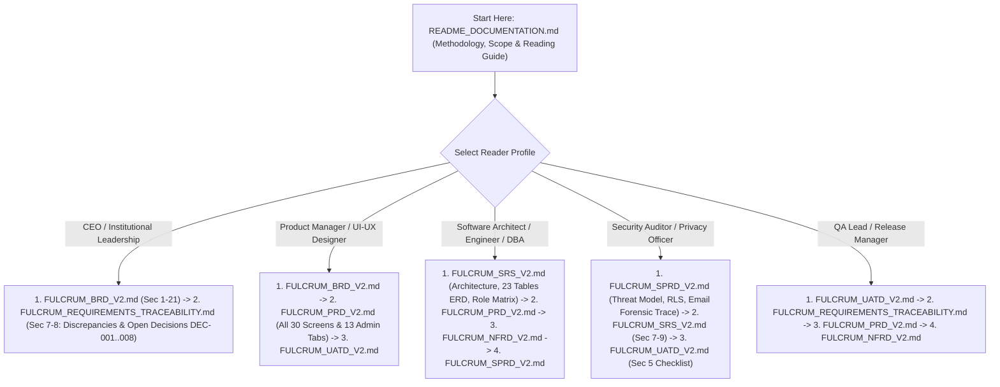

# FULCRUM-INDIA BETA 2.0.0 — REQUIREMENTS BASELINE DOCUMENTATION SUITE (`README_DOCUMENTATION.md`)

| Attribute | Details |
| :--- | :--- |
| **Suite Directory** | `DOCUMENTATION/07_REQUIREMENTS_BASELINE_V2/` |
| **Date of Analysis** | `2026-11-16` |
| **Reviewed Repository Commit** | `235767754f8d8bb4605e819593bb3f370ddeab27` (`chore: sync release manifest and fresh deployment bundle with migration 011`, `2026-11-11`) |
| **Deployment Bundle Parity** | Root source (`app.py`, `services/`, `views/`, `migrations/`) and `FULCRUM_FRESH_DEPLOYMENT/` verified **100% identical by SHA-256** (`0` differences) |
| **Active Codebase Scale** | `42` Python source modules (`app.py` + `31` `services/*.py` + `10` `views/*.py` = `25,622` lines), `12` SQL migration files (`23` `public` tables + `2` private storage buckets), `179` canonical schemes, `33` test/verification scripts |

---

## 1. Purpose of Each Document and Intended Audience

| # | File Name | Document Title | Primary Audience | Purpose & Scope |
| :-: | :--- | :--- | :--- | :--- |
| **1** | [`FULCRUM_BRD_V2.md`](./FULCRUM_BRD_V2.md) | **Business Requirements Document** | CEO, Institutional Leadership, Programme Managers, Business Stakeholders | Explains the Fulcrum operating model in plain business English, why Fulcrum is a stateful custom platform rather than a template (with worked ripple examples across Founder A, Guide B, SME C, and the Sole Admin), institutional governance rules (`BO-*`, `BR-*`), scheme advisory disclaimers, risks, KPIs, and open CEO decisions (`DEC-001`–`DEC-008`). |
| **2** | [`FULCRUM_PRD_V2.md`](./FULCRUM_PRD_V2.md) | **Product Requirements Document** | Product Managers, UI/UX Designers, Frontend & Backend Engineers, QA | Complete functional inventory of the existing Beta 2.0.0 application: all 30 screens (`SCR-01`–`SCR-30`) with screen-by-screen detail cards, all **13 Administrator sections** (`ADM-01`–`ADM-13` / `FR-ADMIN-001`–`013`), all 7 non-admin role combinations, and detailed 17-field `FR-*` specifications. |
| **3** | [`FULCRUM_SRS_V2.md`](./FULCRUM_SRS_V2.md) | **Software Requirements Specification** | Software Architects, Backend Engineers, DBAs, Security Auditors | Detailed technical specification derived from source code: module boundaries across all 42 Python files, service contracts, 4-layer authorization & service-role (`get_supabase_admin_client`) analysis, complete **8-role × lifecycle-state Permission Matrix**, all **23 PostgreSQL tables** + triggers + RLS policies, full `erDiagram`, sequence diagrams, compensating rollback flows, and Docker/Caddy deployment architecture. |
| **4** | [`FULCRUM_NFRD_V2.md`](./FULCRUM_NFRD_V2.md) | **Non-Functional Requirements Document** | Architects, DevOps / SRE, QA Lead, Leadership | Covers all 16 non-functional categories (`NFR-*`), strictly separating measured benchmark evidence in repository files (`benchmark_results.json`, `tests/load_test_results.json`, `15_OWNER_APPROVAL_REGISTER.md`) from proposed targets (`[Recommendation — Requires Owner Approval]`). |
| **5** | [`FULCRUM_SPRD_V2.md`](./FULCRUM_SPRD_V2.md) | **Security & Privacy Requirements Document** | Security Architects, Privacy Officers, Auditors, Backend Engineers | Covers IAM, Sole Admin anti-spoofing, RLS & service-role boundaries, private photo vaults (`300s` signed URLs, EXIF stripping, WebP re-encoding, mentor headshot masking), append-only audit logs, OWASP Top 10 assessment, Indian DPDP Act 2023 considerations, reconciliation of historical findings (`VULN-01`–`10`), and the **forensic trace of the `2026-11-16` production signup confirmation-email / Gmail Spam incident**. |
| **6** | [`FULCRUM_UATD_V2.md`](./FULCRUM_UATD_V2.md) | **User Acceptance Testing & QA Specification** | QA Lead, Test Engineers, Product Managers, Sole Administrator | Inventory of all 33 automated test files in the repo, reconciliation of the 32-user QA defect list (`DEF-32-001`–`010`) vs current source defects (`DEF-001`–`008`), positive/negative/boundary/security UAT cases (`UAT-*`) across all 29 required areas, and the 12-point Final Production-Readiness Checklist. |
| **7** | [`FULCRUM_REQUIREMENTS_TRACEABILITY.md`](./FULCRUM_REQUIREMENTS_TRACEABILITY.md) | **Requirements Traceability Matrix & Gap Register** | All Stakeholders | Maps `BO` $\rightarrow$ `BR` $\rightarrow$ `FR` $\rightarrow$ `SR` $\rightarrow$ `DB/Service` $\rightarrow$ `UAT` $\rightarrow$ `Status`, and consolidates unimplemented proposals (`PROP-*`), undocumented code workflows (`UNDOC-*`), untested flows (`UNVER-*`), doc-vs-code discrepancies (`DISC-*`), and open decisions (`DEC-*`). |

---

## 2. Recommended Reading Order by Stakeholder Role

### Mermaid Diagram 1 — Documentation Suite Structure & Recommended Reading Order

---

## 3. Source-Code Evidence Methodology and Assumptions

1. **Primary Source of Truth**: Every technical claim in this suite was verified directly against the active Python source (`app.py`, `services/*.py`, `views/*.py`), SQL migrations (`migrations/000`–`011`, `supabase_setup.sql`), seed files (`seed/canonical_179_schemes.json`), infrastructure configurations (`Dockerfile`, `docker-compose.yml`, `Caddyfile`, `.streamlit/config.toml`, `.env.example`), and automated test scripts (`tests/*.py`, root `test_*.py` / `verify_*.py`).
2. **Distinction Between Active Source and Archives**:
   - `FULCRUM_FRESH_DEPLOYMENT/` was verified by SHA-256 hash comparison to be an exact byte-for-byte mirror of the active root `app.py`, `services/`, `views/`, and `migrations/`.
   - `Alpha-main.zip`, `FULCRUM_FRESH_DEPLOYMENT.zip`, root draft SQL files (`ARGON_MIGRATION_009_FINAL_REVIEW.sql`, `MIGRATION_009_REVISED.sql`), and untracked feasibility reports (`FULCRUM_BETA_FEASIBILITY_REPORT.md`, `FULCRUM_CEO_BRIEFING_360.md`, etc.) were inspected for historical context only and were never treated as proof of active implementation.
3. **Zero Production Modifications or Destructive Runs**: This analysis operated in strict read-only mode on the repository and infrastructure. No database migrations were applied, no production records were altered, and no automated test scripts were executed against live Supabase.
4. **Strict Redaction of Secrets & PII**: All email addresses of real individuals, passwords, UUIDs, phone numbers, and API keys have been replaced with institutional placeholders (`<SOLE_ADMIN_EMAIL>`, `<TEST_ASPIRANT_EMAIL>`, etc.).

---

## 4. Known Gaps and Analysis Limitations

1. **Live Cloud State Requires Dashboard Confirmation**: While the owner provided live screenshots on `2026-11-16` confirming **Supabase Users**, **Supabase Custom SMTP Settings (`smtp.resend.com:465`)**, **Resend Verified Domain (`notify.fulcrumindia.online`)**, and **Resend `Delivered` status + Gmail Spam folder placement**, this static audit did not have interactive access to the live Supabase SQL Editor or Resend `Insights` tab. Items requiring live dashboard verification are explicitly tagged **`Requires live verification`** (`UNVER-01` to `UNVER-04`).
2. **Automated Test Execution Status**: All 33 automated test files were inspected in source code and cross-referenced against historical test reports; they are recorded as **`Not Run`** during this documentation pass so that historical pass claims are never misrepresented as fresh live test runs.

---

## 5. Verification Record (Phase 11 Quality Gate)

| File Name | Size (Bytes / KB) | Mermaid Diagrams | Required Sections Verified | Confidentiality / PII Scan |
| :--- | :---: | :---: | :---: | :---: |
| `FULCRUM_BRD_V2.md` | `79,753 B` (`77.9 KB`) | `6` | Sections 1–21 + Glossary + Worked Ripple Examples | ✅ Clean (0 secrets / 0 PII) |
| `FULCRUM_PRD_V2.md` | `196,118 B` (`191.5 KB`) | `9` | Sections 1–28 + Glossary + 30 Screens + 13 Admin Tabs + 17-Field FRs | ✅ Clean (0 secrets / 0 PII) |
| `FULCRUM_SRS_V2.md` | `66,823 B` (`65.3 KB`) | `8` | Sections 1–19 + Glossary + 23-Table ERD + 8×8 Role Matrix | ✅ Clean (0 secrets / 0 PII) |
| `FULCRUM_NFRD_V2.md` | `43,031 B` (`42.0 KB`) | `2` | All 16 NFR Categories + Glossary + Measured vs Proposed Separation | ✅ Clean (0 secrets / 0 PII) |
| `FULCRUM_SPRD_V2.md` | `39,737 B` (`38.8 KB`) | `3` | Sections 1–11 + Glossary + Threat Model + `VULN-01..10` + Signup Email Trace | ✅ Clean (0 secrets / 0 PII) |
| `FULCRUM_UATD_V2.md` | `41,828 B` (`40.8 KB`) | `1` | Sections 1–5 + Glossary + 33-File Test Review + 29 UAT Areas + Readiness Checklist | ✅ Clean (0 secrets / 0 PII) |
| `FULCRUM_REQUIREMENTS_TRACEABILITY.md` | Generated | `1` | Sections 1–8 (`BO`->`BR`->`FR`->`SR`->`UAT` Matrix + Gaps + Discrepancies + Decisions) | ✅ Clean (0 secrets / 0 PII) |
| `README_DOCUMENTATION.md` | Generated | `1` | Sections 1–5 (Purpose, Audience, Reading Order, Methodology, Limitations, Verification) | ✅ Clean (0 secrets / 0 PII) |
