# FULCRUM-BETA 2.0.0
## Feasibility of Completing, Changing, Securing, Operating and Expanding the Platform
**Executive Decision Report | 13 November 2026 | India | Planning Edition 1.0**

* **Basis:** Technical inspection of `Fulcrum-Beta-main(4).zip` and `Alpha-main(1).zip`, together with packaged QA test runbooks, live database schemas, and deployment records; selected published 2026 industry salary and engineering benchmarks.
* **Audience:** Programme Leadership, Chief Executive Officer, Product Owner, Finance, and Technology Delivery Stakeholders.
* **Purpose:** Make future engineering workload, staffing, timing, cost, and operational risk understandable, transparent, and budgetable—not to assert a retrospective invoice or an independently certified company valuation.
* **Executive Message:** Fulcrum already contains substantial business-functionality engineering. But building a feature, making it easy to use, proving that it works securely under multi-role isolation, and operating it reliably in production are four completely different engineering disciplines. A sustainable next stage requires written business decisions, planned engineering time, independent verification, and a recurring operational support budget. AI coding assistants accelerate initial development velocity; they cannot serve as the accountable operator or the independent security auditor.

---

## 1. The Decision in One Page

### 1.1 Recommended Direction
**Continue with the existing Beta foundation**, first close the verified quality and security gaps, then improve the complete interface across all portals, and only then pilot narrowly scoped, human-reviewed AI assistance. 

Do **not** discard the existing codebase to rebuild the entire platform from scratch merely for aesthetic modernity (such as an immediate full React rewrite), and do **not** add autonomous AI layers before verifying underlying user permissions, data boundaries, and information quality.

### 1.2 Executive Recommendation Matrix

| Decision Area | Recommended Approach | Why It Matters |
| :--- | :--- | :--- |
| **Continue Developing Beta** | **Yes**, subject to verified critical defect closure and staging re-audit. | Reuses 28,330 lines of working business logic, 23 relational database tables, 179 pre-seeded schemes, and complex 7-role mentoring workflows. |
| **Improve Presentation & Usability** | **Yes**, across all four user portals and 13 Admin tabs. | A functioning system that confuses users leads to high drop-off, incomplete founder onboarding, and heavy administrative support overhead. |
| **Add or Remove Future Features** | **Strictly through scoped Change Requests** with regression impact assessments. | The platform features multi-role hybrid users; one visible UI button change can cascade into 6 distinct database tables, active sessions, and access permissions. |
| **Cybersecurity and Privacy** | **Commission independent specialist penetration testing** before public launch. | Source-code defensive checks are necessary but do not constitute external assurance under Indian Digital Personal Data Protection (DPDP) compliance. |
| **Production Acceptance Gate** | **Evidence-backed release gate** on the live deployment environment. | Passing test scripts in a repository do not prove that the currently running cloud VPS instance has applied all migrations and is operating defect-free. |
| **AI Scheme Assistance** | **Small, human-supervised pilot** using approved gazette documents. | Wrong or hallucinated advice from an autonomous language model can mislead early-stage founders regarding government grants and subsidies. |
| **Hiring Enterprise Team** | **Not immediately.** Start with a core technical owner plus fractional specialist reviews. | Transition to a dedicated full-time team only when user registration scale and daily transactional volumes warrant recurring institutional overhead. |

### 1.3 Strategic Decision & Governance Flowchart

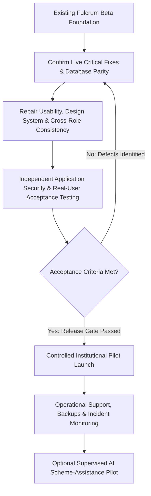

### 1.4 Executive Commentary
The journey of software development involves four distinct thresholds:
1. **Building a Feature:** Writing Python code that works when tested under ideal conditions by its creator.
2. **Making It Usable:** Ensuring entrepreneurs, senior mentors, and administrative officers with varying digital literacy can navigate workflows intuitively without training manuals.
3. **Proving It Secure:** Validating through adversarial testing that a user granted Guide permissions cannot see another mentor's private consultations, tamper with scheme records, or view confidential founder financials.
4. **Operating It Reliably:** Guaranteeing that when 50 concurrent users interact simultaneously, the server does not exhaust memory, database connections do not lock, data is backed up off-site hourly, and a disaster recovery procedure can restore operations within four hours.

Fulcrum Beta 2.0.0 has crossed Threshold 1 and laid the architectural groundwork for Threshold 2. The next release must focus on crossing Thresholds 2, 3, and 4 through disciplined engineering rather than unmanaged feature accumulation.

---

## 2. What the Existing Codebase Actually Demonstrates

### 2.1 Measured Source Code Inventory
The following metrics reflect an exact, deduplicated static code analysis of the Fulcrum repository as of 13 November 2026. Code counts exclude deployment mirrors (`FULCRUM_FRESH_DEPLOYMENT/`), obsolete SQLite prototypes, and external dependencies.

| Architectural Component | Beta 2.0.0 Measured Metric | What the Number Represents in the Architecture |
| :--- | :--- | :--- |
| **Core Application Python Code** | **28,330 lines** | Unique business logic spanning `app.py` (1,279 lines), `services/` (19,656 lines), and `views/` (7,395 lines). |
| **Total Workspace Python Code** | **73,067 lines** | Includes core app, the isolated deployment package (28,406 lines), test suites (6,367 lines), and DevOps scripts (5,565 lines). |
| **Service Layer Modules** | **31 files** | Domain engines governing authentication, role switching, mentorship matching, legal NDAs, journey timelines, and audit logs. |
| **User Interface Modules** | **10 files** | Dedicated portals for Admin (13 tabs, 3,803 lines), Aspirant (founder), Guide (mentor), and Subject Matter Expert (SME). |
| **Database Migrations** | **12 SQL scripts (2,327 lines)** | Sequential DDL and DML scripts (`000` through `011`) defining tables, constraints, foreign keys, and indexes in PostgreSQL. |
| **Relational Database Tables** | **23 active tables** | Supabase PostgreSQL schema (`profiles`, `user_roles`, `relationships`, `schemes`, `journey_events`, `help_requests`, etc.). |
| **Automated Test Definitions** | **178 test functions** | Python test cases across 20 test files validating unit logic, database contracts, and simulated multi-role interactions. |
| **Admin Management Tabs** | **13 operational tabs** | Centralized dashboard for user lifecycle, scheme editing, complaint triage, role provisioning, and audit oversight. |
| **Pre-Seeded Government Schemes** | **179 canonical schemes** | Structured records covering Central and Tamil Nadu state entrepreneurship schemes, financial grants, and eligibility rules. |
| **Supported Role Permutations** | **7 distinct role profiles** | Dynamic multi-role identity allowing a single user account to operate as Aspirant, Guide, SME, or any combined permutation. |

### 2.2 Technology Stack Architecture
* **Frontend Presentation:** Streamlit (Python 3.11 / 3.14) delivering reactive single-page components, session-state management, and custom HTML/CSS wrappers.
* **Backend & Persistence:** Supabase Cloud Platform utilizing GoTrue for JWT authentication, managed PostgreSQL 15 for relational storage, and AWS S3-compatible buckets for document attachments.
* **Edge & Hosting:** Dockerized container deployment on Hostinger KVM 2 VPS (Ubuntu 24.04 LTS, 2 vCPU cores, 8 GB RAM, 100 GB NVMe storage) fronted by Caddy 2 reverse proxy with automatic Let's Encrypt TLS/SSL termination.
* **Client Domain:** Live production URL mapped to `https://app.fulcrumindia.online`.

### 2.3 Limits of Packaged Proof: Reconciling the 32-User QA Scorecard
The packaged repository includes an extensive QA audit: `DOCUMENTATION/05_TESTING_AND_VERIFICATION/32_USER_360_QA_REPORT/FINAL_32_USER_360_DEGREE_TEST_SCORECARD.md`. 

A rigorous executive review must distinguish between **historical test reports** and **current production reality**:
1. **The Test Baseline:** The 32-user test was executed against git commit `988127b`. It issued a formal **CONDITIONAL HOLD / NO-GO** recommendation due to three critical Severity-0 (P0) defects:
   * *Defect P0-A (Account Lifecycle Logging):* Writing account status changes failed because the database table was missing newly referenced columns.
   * *Defect P0-B (Hybrid-User Consultation Context):* Dual-role users (Aspirant + Guide) experienced cross-pollination of consultation threads when switching workspaces.
   * *Defect P0-C (Temporary Password Exposure):* Admin-generated temporary passwords were logged insecurely and lacked one-time-use invalidation on first login.
2. **Subsequent Fix Commits:** Source code files in the repository contain remediation logic addressing these findings (e.g., migration script `011_add_account_lifecycle_log.sql`, session-state clearing in `services/roles.py`, and password-hash enforcement).
3. **The Executive Reality Check:** While local automated tests show passing assertions, **repository commits alone do not prove that the running VPS production instance has cleanly applied migration 011 and retested the full 32-user permutation matrix.** 
4. **Mandatory Protocol:** Before open institutional onboarding, a formal Release Gate must re-execute the circular end-to-end test suite directly against the live staging/production database to confirm zero regression.

---

## 3. Why Even a Small Request Can Take Days

To a non-technical stakeholder, software changes appear deceptively simple: *"It's just adding a field to a form,"* or *"It's just a single toggle button in the Admin portal."* 

In a multi-role, relational enterprise platform like Fulcrum, there is no such thing as an isolated UI change.

### 3.1 The "One-Click Guide Revocation" Cascade
Consider an everyday administrative scenario: an Admin decides to revoke a user's Guide (mentor) permissions because the individual has become inactive. In the Admin interface, this is a single toggle button. 

Beneath the surface, six systemic conditions must execute flawlessly and simultaneously:

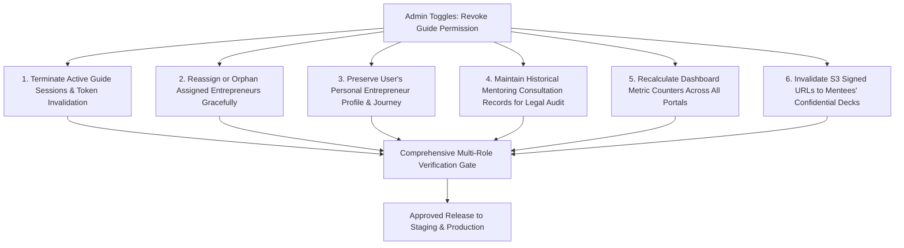

1. **Terminate Active Sessions:** The user's active JWT session must be revoked immediately so they cannot remain logged in on an existing browser tab and view proprietary mentor discussions.
2. **Reassign Assigned Entrepreneurs:** All active entrepreneur relationships tied to this Guide must be identified. If an entrepreneur has an open help request, the system must either route it to an alternate Guide or flag it on the Admin triage dashboard—without silently dropping the entrepreneur's case.
3. **Preserve Personal Entrepreneur Account:** If this individual is a hybrid user who also operates their own business (Aspirant role), their personal entrepreneur profile, pitch deck, and Journey timeline must remain completely unharmed.
4. **Preserve Historical Consultation Records:** Past advice, written consultations, and feedback provided by this Guide must remain permanently visible in the entrepreneur's history for institutional accountability, while freezing the Guide's ability to edit past remarks.
5. **Recalculate Metric Counters:** Dashboard counters ("Active Guides", "Assigned Mentees", "Pending Reviews") across both Admin and user views must update dynamically without caching stale ghost counts.
6. **Revoke Storage Access:** The revoked Guide must be blocked from accessing private S3 file attachments, financial forecasts, and pitch decks previously shared by their mentees.

If an engineer simply writes `UPDATE user_roles SET is_guide = FALSE` without handling these six layers, data leaks, orphaned records, or broken application screens are guaranteed.

### 3.2 The "Car Assembly" Metaphor
Modifying an integrated software application is not like placing extra luggage in the trunk of a car. **It is like modifying the transmission or engine.**
* If you decide to add an all-wheel-drive differential to a finished sedan, you cannot simply bolt it to the chassis. You must disassemble the drivetrain, recalibrate the suspension, modify the exhaust routing, update the electronic control unit (ECU), and retest braking distances in wet and dry conditions.
* Similarly, adding a seemingly minor field—such as a "Community / Caste Category" dropdown to the entrepreneur profile—requires altering the PostgreSQL database schema, updating data migration scripts, modifying API data models, validating privacy restrictions under DPDP regulations, updating the matching engine so only eligible schemes appear, altering profile forms across multiple screens, and writing regression tests to prove existing profiles do not crash upon login.

### 3.3 Type of Work Decision Flowchart

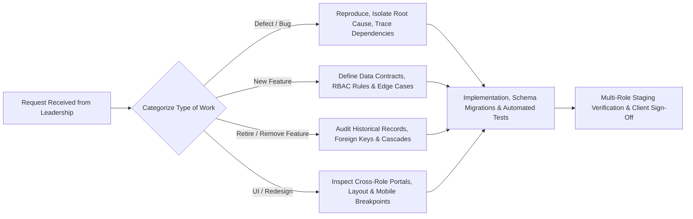

### 3.4 Indicative Engineering Effort per Change (Realistic, Brutal Times)
The following estimates reflect **realistic, conservative calendar timeframes** for professional execution. They account for the complete software engineering lifecycle: requirements definition, database schema design, defensive coding, cross-role regression testing, edge-case debugging, code review, and staging deployment. 

A standard working day represents focused engineering availability, not an impossible 24-hour coding sprint.

| Change Request Description | AI-Assisted Calendar Time | Traditional Development (No AI) | Primary Engineering Drivers & Complexity |
| :--- | :--- | :--- | :--- |
| **Simple Wording, Color or Spacing Tweak** | **1 – 3 days** | **2 – 5 days** | Testing responsive breakpoints across desktop and mobile; verifying layout does not cause horizontal scrollbars or overflow in Streamlit containers. |
| **Add District Filter or Dropdown to Scheme Search** | **3 – 7 days** | **5 – 10 days** | Updating SQL query indices; handling empty state results; verifying multi-select caching; updating session-state across tabs. |
| **Add New Entrepreneur Profile Field (e.g. GST Number)** | **5 – 12 days** | **8 – 18 days** | Writing SQL migration; updating validation rules; testing legacy profiles missing the field; updating profile views for Aspirant, Guide, and Admin. |
| **Remove an Old Feature While Retaining Historical Records** | **1.5 – 3 weeks** | **2.5 – 5 weeks** | Auditing foreign keys; implementing soft-delete flags; ensuring historical PDF exports and audit logs do not break when referencing retired data. |
| **Complex Cross-Role Defect (e.g. Hybrid Session Leak)** | **1 – 4 weeks** | **2 – 6 weeks** | Reproducing non-deterministic session race conditions; tracing Streamlit reactive reruns; isolating state dictionaries; deep multi-user regression testing. |
| **Automated Notification or Approval Workflow** | **3 – 7 weeks** | **5 – 10 weeks** | Email SMTP queue integration; template design; handling retry loops on network failure; audit event logging; rate-limiting to prevent spam. |
| **Entirely New Professional Role (e.g. Investor / Incubator)** | **6 – 12 weeks** | **9 – 18 weeks** | Schema changes; digital NDA onboarding; granular role-based permissions; private data redaction; dedicated views; 30+ negative access tests. |
| **Comprehensive UI/UX Redesign & Consistency Overhaul** | **8 – 16 weeks** | **12 – 24 weeks** | Standardizing design tokens across 4 portals and 13 Admin tabs; mobile-first responsiveness; custom CSS hardening; user accessibility checks. |
| **Safe, Document-Grounded AI Scheme Assistant** | **8 – 18 weeks** | **12 – 28 weeks** | Knowledge ingestion pipelines; semantic search / RAG architecture; source attribution verification; prompt injection defense; human review UI. |
| **Architectural Migration (Streamlit to React + Cloudflare)** | **6 – 12+ months** | **9 – 16+ months** | Rebuilding entire presentation layer in React/Next.js; building decoupled FastAPI endpoints; re-implementing 28,330 lines of business logic; complete re-testing. |

*Note: These timeframes are independent planning ranges. They cannot be summed linearly without accounting for team capacity, dependency sequencing, and deployment gating.*

---

## 4. A Repeatable Method for Estimating Future Requests

To prevent budget overruns, scope disputes, and missed delivery dates, programme leadership should mandate a standardized **One-Page Change Card** before authorizing any software modification.

### 4.1 The One-Page Change Card Standard
Before any engineering work begins, the sponsor and the technical team must complete the following eight-part questionnaire:
1. **Business Objective:** What specific institutional outcome does this change accomplish, and why is it necessary now?
2. **Affected Stakeholders:** Who will see or use this? (Admin, Aspirant, Guide, SME, or a specific combination?)
3. **Data & Privacy Impact:** What database tables, permissions, private uploads, or historical records are modified? Does this collect personal data under Indian DPDP Rules?
4. **Historical Continuity:** What must happen to existing user records created before this change was introduced?
5. **User Interface Scope:** What exact screens and mobile views are impacted, and what error feedback must be displayed?
6. **Acceptance Criteria:** What explicit, testable conditions must be proven before the change is considered complete and billable?
7. **Effort & Risk Classification:** Is this classified as a Contractual Warranty Fix (defect in agreed scope), a Minor Enhancement, a Major Scope Addition, or an Architectural Modification?
8. **Sign-Off Authority:** Who is the named individual authorized to approve the scope, accept the demonstration, and release payment?

### 4.2 Change Request Governance Lifecycle

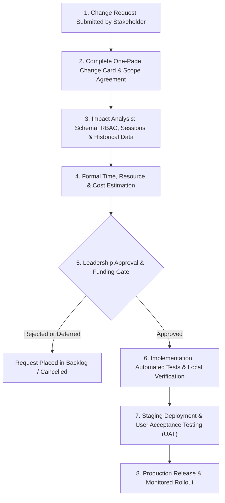

### 4.3 Worked Case Study: "Just Add an Investor Role"
A frequent request from incubator boards is: *"We need an Investor portal so angel investors can browse startups."*

To a layperson, this sounds like adding a new tab in the navigation bar. In professional software architecture, introducing an Investor role requires a multi-week engineering programme:
* **Legal KYC & Accreditation:** Verifying that the applicant is an accredited investor under applicable regulations, including uploading PAN, entity registration, and SEBI compliance declarations.
* **Confidentiality & Non-Disclosure (NDA):** Requiring the investor to digitally execute an institutional Non-Disclosure Agreement before gaining access to any startup profiles.
* **Granular Visibility & Consent Controls:** Founders (Aspirants) must have an explicit setting: *"Allow accredited investors to discover my venture."* Startups operating in stealth mode or pursuing proprietary patents must remain completely invisible.
* **Sensitive Financial Redaction:** Investors should initially see high-level pitch summaries. Access to detailed cap tables, financial forecasts, and proprietary source files must require a formal "Access Request" approved by the founder.
* **Conflict of Interest Logging:** Similar to Fulcrum's existing SME conflict declarations, investors must declare if they hold equity in a competing startup in the same sector.
* **Immutable Audit Trail:** Every view, click, and file download of a startup's deck must be logged with timestamp, user ID, and IP address to protect founders against intellectual property theft.
* **Revocation & Retention Protocol:** When an investor's membership lapses, their access tokens must be invalidated instantly, while retaining download audit logs for 7 years to satisfy regulatory compliance.

Estimating "Add Investor Role" as a 2-day UI task would lead to catastrophic failure. Properly scoped, designed, and tested, it represents **6 to 12 weeks of focused engineering**.

---

## 5. Finishing Beta: What Remains Before an Institutional Release

This section outlines the objective gap analysis between a functioning Beta release and a battle-tested, institutionally certified software platform. This is an engineering inventory of necessary assurance workstreams, not a declaration that every component is broken.

### 5.1 The Ten Completion Workstreams

| Workstream | Definition of "Institutionally Finished" | Recommended Assurance Owner |
| :--- | :--- | :--- |
| **1. Critical Defect Closure** | Complete resolution and regression verification of all documented P0 and P1 issues on the live deployed cloud environment. | Core Backend Engineer + Independent QA |
| **2. UI/UX Consistency** | Uniform design system, standardized navigation, error state handling, typography, and responsive mobile layouts across all 4 portals. | UX Designer + Frontend Implementer + Real Users |
| **3. RBAC & Privacy Isolation** | Formally proven isolation preventing cross-role data bleed, stale session token misuse, or unauthorized access to private founder documents. | Independent Cybersecurity Specialist + QA |
| **4. Database Integrity** | All 12 migrations applied cleanly; referential integrity, cascading delete policies, foreign keys, and indexing confirmed under load. | Database Administrator / Backend Lead |
| **5. Scheme Matching Engine** | Verified deterministic eligibility logic; false positives eliminated; policy data update runbook documented for non-technical admins. | Backend Engineer + Government Policy Expert |
| **6. Reliability & DevOps** | Automated container health checks, Caddy log rotation, Docker restart policies, Prometheus/Grafana monitoring, and alerting active. | DevOps / Platform Engineer |
| **7. Accessibility & Mobile** | WCAG 2.1 AA compliance: readable color contrast, screen reader compatibility, touch target sizing, and low-bandwidth performance. | UX Specialist + Functional QA |
| **8. Legal & Data Protection** | Digital Personal Data Protection (DPDP) Act 2023 alignment: explicit consent logging, privacy notices, grievance triage, and data retention rules. | Qualified Indian Legal Counsel / Privacy Auditor |
| **9. Documentation & Handover** | Complete operational runbooks, disaster recovery manual, environment configuration guides, and architecture blueprints. | Technical Lead + Programme Owner |
| **10. Institutional Acceptance** | Formal User Acceptance Testing (UAT) sign-off on 16 core business journeys with zero open Severity-0 or Severity-1 defects. | Programme Leadership + Client Sponsor |

### 5.2 Release Gate Governance Flowchart

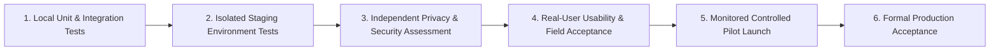

### 5.3 Mandatory Verification & Testing Matrix
To achieve true institutional confidence, software verification must extend far beyond automated unit tests. The following testing matrix defines the required testing spectrum:
* **Automated Unit & Service Tests:** Validating mathematical algorithms, scheme scoring, and business logic calculations in memory.
* **Database Contract & Constraint Tests:** Ensuring PostgreSQL foreign keys, unique constraints, and check conditions prevent invalid data insertions.
* **Browser-Based End-to-End (E2E) Suites:** Simulating real human interactions using Playwright or Selenium across Chrome, Firefox, Safari, and mobile viewports.
* **Seven Multi-Role Combination Audits:** Systematically verifying every role permutation (Aspirant only, Guide only, SME only, Aspirant+Guide, Aspirant+SME, Guide+SME, and Aspirant+Guide+SME) to confirm workspace state is completely isolated.
* **Adversarial Negative Access Testing:** Verifying that a regular user manipulating HTTP requests or session storage cannot view admin endpoints, other users' financial files, or unassigned consultation threads.
* **Database Disaster Recovery Rehearsal:** Executing a complete drop of the staging database, restoring from an encrypted backup archive, and verifying zero data loss.
* **Cybersecurity Framework Alignment:** Conducting an independent vulnerability assessment using the **OWASP Application Security Verification Standard (ASVS 5.0.0 Level 2)** as the evaluation benchmark.
* **Data Privacy Review:** Evaluating data collection, retention schedules, and consent logging against the **MeitY Digital Personal Data Protection (DPDP) Rules 2025**.

---

## 6. Solo Engineering Versus Professional Delivery Teams

A critical strategic decision facing leadership is determining the appropriate team structure to bring Fulcrum Beta across the production release gate and maintain it sustainably.

### 6.1 Delivery Models Compared

| Delivery Model | Typical Personnel Composition | Key Strategic Advantages | Real-World Operational Limitations |
| :--- | :--- | :--- | :--- |
| **Solo Developer + AI** | 1 Senior Full-Stack Engineer utilizing AI coding assistants; external review specialists at release gates. | Maximum context continuity; zero communication overhead; rapid prototyping velocity; lowest gross expenditure. | Extreme key-person dependency ("Bus Factor 1"); engineer burnout; lack of independent oversight unless audited externally. |
| **Solo Developer (No AI)** | 1 Senior Full-Stack Engineer utilizing standard IDEs, manual coding, and official documentation. | Highly deliberate and predictable manual architecture; deep familiarity with every single line written. | Very slow delivery velocity on boilerplate tasks, testing suites, and documentation; high risk of scope fatigue. |
| **Lean Team + AI** | Tech Lead / Architect (1.0 FTE), Python Backend Engineer (1.0 FTE), QA Automation Engineer (0.75 FTE), fractional DevOps/UX/Security. | Parallel execution of frontend, backend, and testing; built-in peer code review; drastically reduced key-person risk. | Requires formal project management, task breakdown, Git branch coordination, and sprint discipline. |
| **Lean Team (No AI)** | Same 3-to-4 person team executing without AI coding assistants. | Traditional, rigorously hand-crafted implementation; clear institutional auditability. | Higher total billable hours and extended calendar duration; higher recurring payroll expenditure. |
| **Enterprise Growth Team** | Dedicated Engineering Manager, 2 Backend Devs, 1 Frontend Dev, 1 QA Lead, 1 DevOps Engineer, 1 Security Specialist, 1 Product Manager. | Continuous feature delivery; 24/7 on-call rotation; formal change advisory boards; enterprise SLAs. | Substantial fixed operational expenditure; high coordination friction (Brooks's Law); over-engineered for early-stage scale. |

### 6.2 Completion Scenarios & Realistic Timeframes (Increased, Brutal Times)
The following estimates model the time required to complete the existing Beta foundation: resolving all documented P0/P1 defects, standardizing the Streamlit UI/UX, executing the 10 workstreams, undergoing independent security audits, and completing operational handover. 

*These scenarios assume realistic calendar schedules accounting for debugging friction, regression cycles, and client review turnaround.*

| Execution Team Model | Calendar Time: With AI Assistance | Calendar Time: Traditional (No AI) | Operational Commentary & Realities |
| :--- | :--- | :--- | :--- |
| **Experienced Solo Developer + External Audits** | **5 – 9 months** | **7 – 12 months** | The developer must sequentially handle architecture, UI polishing, database migrations, testing, and deployment. Any unexpected bug halts all other progress. |
| **Lean Delivery Team (3 Core + Fractional Specialists)** | **3 – 5 months** | **4 – 8 months** | Frontend usability, backend defect closure, and automated QA run in parallel workstreams, cutting elapsed calendar time significantly. |
| **Formal Software Agency Delivery** | **4 – 8 months** | **6 – 12 months** | Agencies introduce structured governance, requirements sign-offs, and administrative reporting. High reliability, but rarely faster than a lean in-house team. |

### 6.3 Team Organization & Verification Flowcharts

#### Solo Developer Model: Single-Threaded Bottleneck
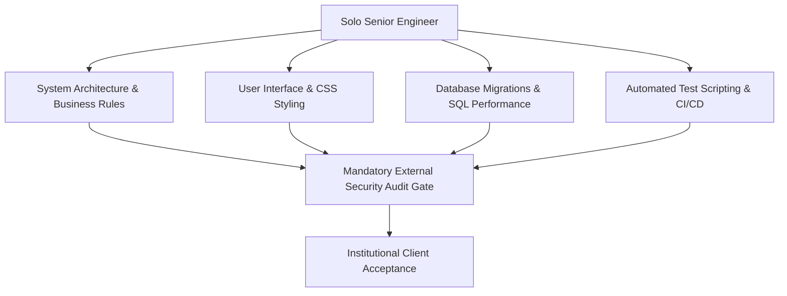

#### Lean Delivery Team Model: Parallel Verification & Resilience
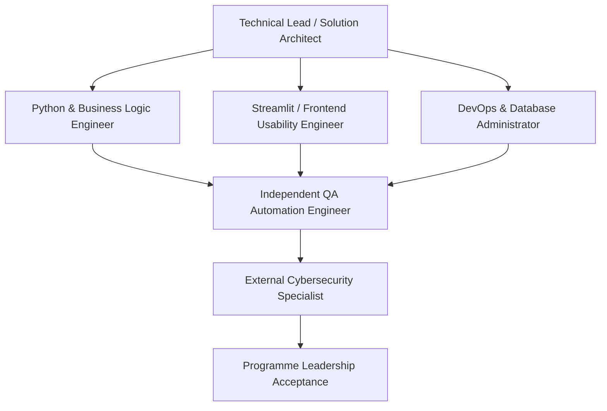

### 6.4 The Reality of Brooks's Law in Fulcrum
Programme leadership must avoid the common fallacy that adding more engineers linearly speeds up delivery. 

In a tightly coupled application with shared state dictionaries (like Streamlit session-state):
$$\text{Communication Channels} = \frac{n(n - 1)}{2}$$
* A solo developer has **0** coordination channels.
* A 3-person team has **3** coordination channels.
* A 6-person team has **15** coordination channels.
* A 10-person team has **45** coordination channels.

Expanding beyond a lean 3-to-4 person team during the stabilization phase will create merge conflicts, overlapping session-state mutations, and coordination paralysis.

---

## 7. Indian Staffing and Salary Planning

To establish an evidence-backed budget for the next phase, compensation planning must reflect contemporary Indian technology compensation benchmarks. 

The figures below represent **Annual Total Cost to Company (CTC)** for mid-to-senior engineering talent across Tier-1 and Tier-2 Indian technology hubs (Bengaluru, Chennai, Hyderabad, Pune, NCR), referencing published 2026 data from the **Adecco India Salary Guide 2026** and the **Michael Page India Salary Report 2026**.

### 7.1 Primary Engineering Responsibilities & Market Compensation Bands

| Distinct Primary Responsibility | Target Experience Level | Annual CTC Planning Band (INR) | Primary Architectural Accountability |
| :--- | :--- | :--- | :--- |
| **1. Technical Lead / Solution Architect** | 7 – 12+ years | **₹24,00,000 – ₹45,00,000** | Architectural integrity, technology stack choices, code review standards, and technical governance. |
| **2. Senior Python / Backend Engineer** | 4 – 9 years | **₹12,00,000 – ₹28,00,000** | Service engines, role management, scheme matching, business rules, and API integration. |
| **3. Frontend / Streamlit / React Engineer** | 3 – 8 years | **₹10,00,000 – ₹24,00,000** | Portal UI implementation, layout responsiveness, user feedback, and form validation. |
| **4. QA Automation & Test Engineer** | 4 – 9 years | **₹10,00,000 – ₹24,00,000** | Test automation suites, Playwright E2E scripts, regression testing, and defect logging. |
| **5. Platform / DevOps / Cloud Engineer** | 5 – 10 years | **₹15,00,000 – ₹32,00,000** | Docker containerization, VPS hosting, Caddy reverse proxy, TLS certificates, CI/CD, and monitoring. |
| **6. UI/UX Product Designer** | 4 – 9 years | **₹10,00,000 – ₹24,00,000** | User journey mapping, design systems, mobile usability, and accessible interface prototyping. |
| **7. Cybersecurity Specialist** | 5 – 12 years | **₹18,00,000 – ₹40,00,000** | Threat modeling, penetration testing, vulnerability assessment, and DPDP compliance auditing. |
| **8. PostgreSQL / Database Engineer** | 5 – 10 years | **₹15,00,000 – ₹32,00,000** | Schema design, SQL migration scripts, indexing, row-level security (RLS), and backup restoration. |
| **9. Product Manager / Business Analyst** | 4 – 10 years | **₹10,00,000 – ₹24,00,000** | One-page change cards, functional requirements, user acceptance criteria, and client sign-off. |
| **10. AI / LLM Engineer (Future)** | 4 – 10 years | **₹20,00,000 – ₹45,00,000** | RAG retrieval pipelines, prompt engineering, evaluation metrics, and guardrail integration. |
| **11. Data / Knowledge Engineer (Future)** | 4 – 10 years | **₹14,00,000 – ₹32,00,000** | Government gazette parsing, document embedding pipelines, and vector database management. |
| **12. Support Analyst / Systems Operator** | 2 – 6 years | **₹5,00,000 – ₹12,00,000** | User ticket triage, tier-1 issue resolution, password resets, and operational monitoring. |
| **13. Scheme Policy / Domain Expert** | Domain Specialist | **Retainer / Hourly (₹30k–₹75k/mo)** | Verification of Tamil Nadu and Central government scheme eligibility rules and updates. |

### 7.2 Distinguishing Roles from Headcount (Fractional Staffing)
The thirteen responsibilities listed above **do not mean hiring 13 full-time employees**. 
* A capable Technical Lead frequently handles Solution Architecture and Database Design.
* A Senior Backend Engineer can manage DevOps and cloud deployment for an early-stage deployment.
* Specialized disciplines such as Cybersecurity Auditing, UX Design, and Scheme Policy Verification are best procured on a fractional, milestone, or retainer basis.

### 7.3 Worked Recurring Personnel Budget Models

#### Model A: Lean Managed Platform (Recommended for Phase 1 & 2)
Designed to stabilize Beta, resolve defects, improve usability, and manage early pilot operations.

| Team Role | Assumed Full Annual CTC | Full-Time Equivalent (FTE) | Allocated Annual Base Cost |
| :--- | :--- | :--- | :--- |
| **Technical Owner / Lead Engineer** | ₹30,00,000 | 1.00 FTE (Full-time) | ₹30,00,000 |
| **Full-Stack Python Engineer** | ₹18,00,000 | 1.00 FTE (Full-time) | ₹18,00,000 |
| **QA Automation Engineer** | ₹14,00,000 | 0.75 FTE (30 hrs/wk) | ₹10,50,000 |
| **Platform / DevOps Specialist** | ₹20,00,000 | 0.25 FTE (Fractional) | ₹5,00,000 |
| **UI/UX Product Designer** | ₹16,00,000 | 0.25 FTE (Fractional) | ₹4,00,000 |
| **Cybersecurity Reviewer** | ₹28,00,000 | 0.15 FTE (Milestone-based) | ₹4,20,000 |
| **Business Analyst / Scoping Lead** | ₹16,00,000 | 0.25 FTE (Fractional) | ₹4,00,000 |
| **Total Base Personnel CTC (Annual)** | — | **3.65 Gross / 2.40 Effective FTE** | **₹75,70,000** |

* **Monthly Salary Equivalent:** $\frac{₹75,70,000}{12} = \mathbf{₹6,30,833 \text{ / month}}$.
* **Employer Overhead Allowance (20%):** Accounting for statutory benefits (EPF, gratuity), medical insurance, workstation provisioning, commercial IDE/AI tooling licenses, and administrative overhead:
$$\text{Monthly Lean Operating Budget} = ₹6,30,833 \times 1.20 = \mathbf{₹7,57,000 \text{ / month}} \quad (\approx \mathbf{₹90.84L \text{ / year}})$$

#### Model B: Growth-Stage Dedicated Cross-Functional Team (Scale Phase)
Required only when daily active users exceed 1,000, multi-tenant institutional partners onboard, and continuous feature expansion is funded.

| Team Role | Assumed Full Annual CTC | Allocated FTE | Allocated Annual Base Cost |
| :--- | :--- | :--- | :--- |
| **Engineering Lead / Architect** | ₹36,00,000 | 1.00 FTE | ₹36,00,000 |
| **Senior Backend Engineer** | ₹24,00,000 | 1.00 FTE | ₹24,00,000 |
| **Dedicated Frontend Engineer** | ₹20,00,000 | 1.00 FTE | ₹20,00,000 |
| **Full-Time QA Automation Lead** | ₹18,00,000 | 1.00 FTE | ₹18,00,000 |
| **Platform & Reliability Engineer** | ₹24,00,000 | 0.75 FTE | ₹18,00,000 |
| **Security & Privacy Specialist** | ₹32,00,000 | 0.50 FTE | ₹16,00,000 |
| **UI/UX Interaction Designer** | ₹18,00,000 | 0.50 FTE | ₹9,00,000 |
| **Product Manager** | ₹18,00,000 | 0.50 FTE | ₹9,00,000 |
| **Dedicated Support Operator** | ₹8,00,000 | 0.50 FTE | ₹4,00,000 |
| **Total Base Personnel CTC (Annual)** | — | **6.75 Effective FTE** | **₹1,54,00,000** |

* **Monthly Salary Equivalent:** $\frac{₹1,54,00,000}{12} = \mathbf{₹12,83,333 \text{ / month}}$.
* **With 20% Overhead:** $\mathbf{₹15,40,000 \text{ / month}} \quad (\approx \mathbf{₹1,84,80,000 \text{ / year}})$.

### 7.4 Operational Level Selection Flowchart

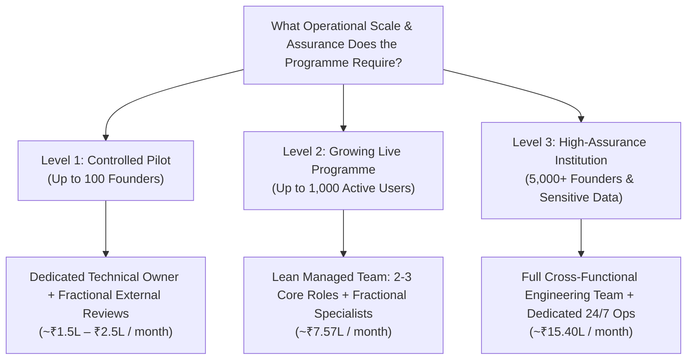

---

## 8. Indicative Cost to Complete Beta — Not a Retrospective Bill

A responsible financial plan must distinguish between **funds required to complete and secure the platform in the future** and any discussions regarding retrospective valuations or past billings.

### 8.1 Work Packages for Beta Completion

| Work Package | Primary Deliverables & Staffing Composition | Indicative Budget Range |
| :--- | :--- | :--- |
| **Package 1: Defect Triage & Live Migration Parity** | Reconciling 32-user QA findings (P0/P1); validating migration 011 on live VPS; fixing account lifecycle logging and password reset flows. *(Senior Backend + QA)* | **₹1,50,000 – ₹4,00,000** |
| **Package 2: UI/UX Redesign & Usability Overhaul** | Redesigning layout, standardizing spacing and typography across 4 portals and 13 Admin tabs; responsive mobile hardening; user error feedback. *(UX Designer + Frontend Dev)* | **₹4,00,000 – ₹9,00,000** |
| **Package 3: Independent Application Security Audit** | External penetration testing (OWASP ASVS Level 2); adversarial multi-role testing; vulnerability remediation and retesting. *(External Security Firm + Dev)* | **₹3,00,000 – ₹8,00,000** |
| **Package 4: Production Resilience & Recovery** | Automated health checks, off-site encrypted backup pipelines, disaster recovery dry run, Caddy log management, and performance tuning. *(DevOps / DBA)* | **₹2,00,000 – ₹5,00,000** |
| **Package 5: Documentation & Handover** | Operational runbooks, architecture diagrams, administrator guides, environment credential escrow, and leadership training. *(Tech Lead)* | **₹1,00,000 – ₹2,50,000** |
| **Total Integrated Programme (Milestone Execution)** | **Structured multi-month engagement delivering an institution-ready, verified production platform.** *(Excludes AI and React rewrite)* | **₹12,00,000 – ₹28,00,000** |

### 8.2 Why the Integrated Programme is Not the Sum of Maximums
If an organisation adds up the worst-case maximums of every individual package ($\text{₹4L} + \text{₹9L} + \text{₹8L} + \text{₹5L} + \text{₹2.5L} = \text{₹28.5L}$), it misses the critical economic benefit of an **integrated delivery model**:
* A dedicated engineer working across packages shares onboarding context; they do not re-learn the codebase for each task.
* Testing runs concurrently across bug fixes and UI updates, avoiding duplicate QA billing.
* Infrastructure hardening occurs in the same staging environment established for usability testing.

### 8.3 Commercial & Financial Budget Integrity
It is paramount for leadership to maintain clear accounting boundaries:
1. **Retrospective Billing vs Future Work:** Any prior commercial discussions mentioning ₹30L–₹40L refer to the theoretical replacement cost of building the existing 28,330 lines of code from scratch using a commercial agency. It does **not** represent an invoice owed to the developer, nor does it guarantee the code's market liquidation value.
2. **Contractual Scope vs Change Requests:** If a feature was specified in the original agreement and is currently broken, its remediation is a **warranty defect fix**. If an enhancement was never specified (such as a multi-tier investor portal or SMS OTP integration), it represents **new scope** that must be budgeted under a formal Change Card.
3. **Intellectual Property Ownership:** Formal IP assignment, repository administrative access, and cloud credential escrow must be legally finalized before disbursing completion funds.

---

## 9. AI Assistance During Software Development: With and Without AI

A prevailing misconception in modern management is that because an engineer utilizes AI coding assistants (such as GitHub Copilot, Cursor, or Claude), the engineering labor cost drops to zero, and delivery should occur in days.

To evaluate software investment accurately, leadership must understand **where AI genuinely accelerates work, where it introduces friction, and where human accountability is irreplaceable**.

### 9.1 Software Development Lifecycle (SDLC) Stage-by-Stage Comparison

| SDLC Phase | Velocity With AI Coding Assistance | Velocity Without AI (Traditional) | What Remains Strictly Under Human Professional Judgment |
| :--- | :--- | :--- | :--- |
| **1. Requirements & Scoping** | Rapid generation of draft user stories, edge cases, and change card outlines. | Slower manual composition of technical specifications and acceptance criteria. | Aligning organizational policy, defining legal liability boundaries, and negotiating client acceptance criteria. |
| **2. Frontend Implementation** | Fast generation of Streamlit container scaffolding, HTML wrappers, and UI forms. | Hand-crafting every widget layout, session-state binding, and CSS rule. | Intuitive layout, visual hierarchy, mobile viewport usability, and cross-browser consistency. |
| **3. Backend & Business Logic** | Instant drafting of Python service functions, data models, and REST adapters. | Manual authoring of data manipulation logic, loops, and error handlers. | Designing rock-solid RBAC permissions, preventing hybrid role context bleed, and session isolation. |
| **4. Database & SQL Engineering** | Synthesizes complex PostgreSQL DDL, foreign key syntax, and migration scripts. | Writing SQL DDL and migration scripts manually from documentation. | Ensuring cascading rules do not accidentally purge active data; preserving live records during structural schema updates. |
| **5. QA & Test Automation** | Generates hundreds of boilerplate test assertions, mocks, and fixtures in minutes. | Hand-writing every single unit test case, mock object, and assertion. | Designing realistic multi-user concurrency scenarios, adversarial attack cases, and interpreting test failures. |
| **6. Cybersecurity & Privacy** | Flags common static code vulnerabilities (e.g. SQL injection, exposed API keys). | Manual code inspection and running commercial SAST/DAST command-line tools. | Adversarial penetration testing, verifying business logic flaws, and legal compliance under Indian DPDP Rules. |
| **7. DevOps & Infrastructure** | Drafts Dockerfiles, Caddy reverse-proxy directives, and shell automation scripts. | Authoring configuration files and deployment scripts from memory or man pages. | Live server terminal debugging, SSL handshake configuration, secret key rotation, and disaster recovery. |
| **8. Support & Runbooks** | Produces clear technical documentation, markdown runbooks, and user FAQ drafts. | Manual authoring of operational documentation and troubleshooting guides. | Real-time incident triage, handling panicked user escalations, and taking accountability for live outages. |

### 9.2 Debunking the Myth: "AI Wrote It, So Cost Is Zero"
When an AI assistant generates 500 lines of Python, the developer's job is not finished—**in many ways, it has just begun.**
1. **The Code Verification Burden:** AI models frequently hallucinate function signatures, invent non-existent database columns, or introduce subtle concurrency bugs. The human engineer must inspect every single line with extreme skepticism.
2. **The 15 / 85 Engineering Effort Reality:** 
   * **15% of Time (Drafting):** Typing out the initial code syntax (where AI provides massive 5x to 10x speedups).
   * **85% of Time (Hardening):** Integrating the code into the existing architecture, wiring session-state across 7 role combinations, debugging edge-case race conditions, executing database migrations, testing on mobile devices, and taking legal accountability.
3. **Accountability Cannot Be Outsourced:** When a live database locks up during an institutional demo or private founder financial records leak, an organisation cannot blame an AI model. Professional engineering fees compensate for the **human responsibility, verification rigor, and domain expertise** required to deploy production-safe systems.

---

## 10. Future AI Integrated Workflows: Feasibility and Governance

A critical distinction must be drawn between **AI used to write the software** and **AI functionality embedded inside the software** for end-users.

### 10.1 Current Reality: Deterministic Rules, Not an LLM
In the current Fulcrum Beta 2.0.0 release, the scheme matching engine is **strictly deterministic**:
* It relies on programmed Python rules, database queries, and conditional logic (e.g., `WHERE target_gender = 'Woman' AND state = 'Tamil Nadu'`).
* **There is currently no Large Language Model (LLM) or autonomous agent operating in production.** This is an architectural strength: deterministic matching guarantees that scheme recommendations are transparent, predictable, and free from AI hallucinations.

### 10.2 Recommended Safe Initial AI Use Cases
If leadership decides to introduce model-based AI into Fulcrum, it should be deployed exclusively in **narrowly scoped, human-in-the-loop workflows**:
1. **Scheme Document Plain-Language Explainer:** A Guide (mentor) asks for a plain-language summary of a 40-page government gazette. The AI retrieves the approved PDF, extracts eligibility rules, drafts a bulleted summary with exact page citations, and displays it to the Guide for review.
2. **Consultation Thread Summarizer:** An entrepreneur and Guide complete a 3-week consultation thread spanning 45 messages. With one click, the Guide generates a structured "Action Plan & Next Steps" summary. The Guide reviews and edits the summary before officially saving it to the entrepreneur's Journey.
3. **Bilingual Translation Assistance (Tamil & English):** Generating high-quality Tamil translations of Central government scheme descriptions, allowing rural Tamil Nadu entrepreneurs to understand eligibility criteria, with human policy review.
4. **Administrative Follow-Up Drafting:** Drafting personalized re-engagement emails for inactive entrepreneurs. The Admin reviews the draft before hitting "Send"—no automated bot emails founders without human approval.

### 10.3 Safe AI Scheme Advice Architecture Flowchart

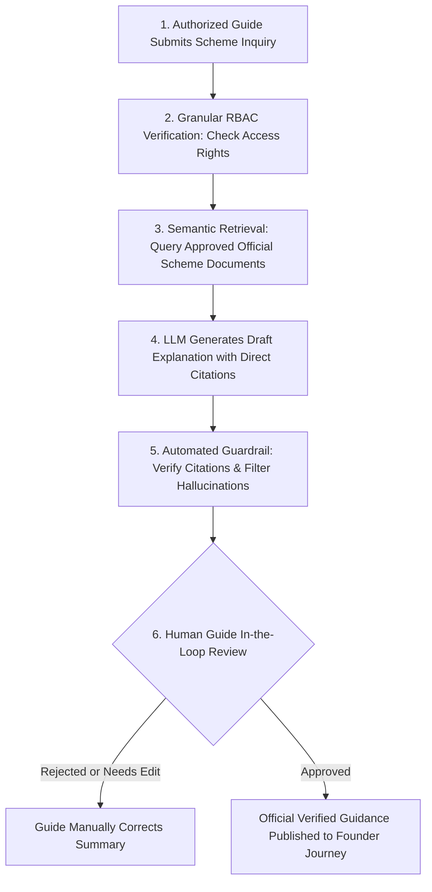

### 10.4 Governance Frameworks: NIST AI RMF & DPDP Compliance
Any future AI integration must adhere to recognized AI risk governance standards:
* **NIST AI Risk Management Framework (AI RMF 1.0) Generative AI Profile:** Establishing explicit metrics for validity, reliability, safety, transparency, and accountability.
* **Source Grounding (RAG):** The AI must never answer from its pre-trained general knowledge. It must be constrained via Retrieval-Augmented Generation (RAG) to cite only verified government notifications stored in Fulcrum's knowledge base.
* **Strict DPDP Privacy Guardrails:** No personal identifiable information (PII)—such as founder names, Aadhaar numbers, phone numbers, or proprietary financial forecasts—may ever be transmitted to external, third-party model APIs (such as OpenAI or Anthropic) without explicit enterprise data processing agreements ensuring zero training retention.

### 10.5 AI Expansion Scenarios & Realistic Timeframes (Increased, Brutal Times)

| Expansion Scope | Calendar Duration: With AI Coding | Calendar Duration: Traditional (No AI) | Required Engineering Team Composition | Estimated One-Time Implementation Cost |
| :--- | :--- | :--- | :--- | :--- |
| **Scenario 1: Controlled Document-Explainer Pilot** | **6 – 10 weeks** | **9 – 16 weeks** | Full-Stack / LLM Engineer, QA Engineer, Scheme Policy Expert, Security Reviewer. | **₹3,00,000 – ₹8,00,000** |
| **Scenario 2: Daily Workflow Assistant (Summaries & Bilingual)** | **3 – 5 months** | **5 – 8 months** | Senior Backend Engineer, AI/RAG Specialist, Frontend Dev, Fractional QA, Domain Lead. | **₹10,00,000 – ₹25,00,000** |
| **Scenario 3: Advanced Autonomous Knowledge Operations** | **5 – 9+ months** | **8 – 14+ months** | Dedicated AI Lead, Data Pipeline Engineer, Senior Backend, QA Lead, Platform DevOps, Legal Counsel. | **₹25,00,000 – ₹60,00,000+** |

### 10.6 Recurring Monthly Operational Costs for AI
Operating an AI-enabled platform incurs ongoing monthly service expenditures beyond server hosting:
* **Model Inference APIs:** Per-token charges for LLM processing (input prompt tokens + output completion tokens) across cloud providers (e.g. Google Vertex AI, Anthropic, or AWS Bedrock).
* **Vector Database & Embeddings:** Managed vector storage (e.g., pgvector on Supabase, Pinecone, or Qdrant) and embedding model execution fees.
* **Knowledge Base Maintenance:** Continuous human policy auditing to ensure government scheme updates, gazette amendments, and deadline extensions are reflected in the vector store.
* **Continuous Evaluation & Guardrails:** Automated testing pipelines executing regression benchmarks against golden question-answer datasets to catch model drift.
* **Monthly Operating Estimate:** A supervised, controlled pilot requires **₹25,000 to ₹75,000 per month** in combined API tokens, vector infrastructure, and fractional oversight. A scaled institutional deployment with thousands of daily queries can exceed **₹1,50,000 to ₹3,50,000 per month** in direct operating overhead.

---

## 11. Scalability, Availability and Business Continuity

A fundamental responsibility of programme leadership is ensuring the platform can reliably support growth without crashing during peak usage.

### 11.1 Concurrency Reality in Streamlit Architecture
To evaluate scalability honestly, leadership must understand the underlying technical mechanics:
1. **Single-Process Python & The Global Interpreter Lock (GIL):** Streamlit applications execute in a Python runtime. While asynchronous event loops handle I/O, heavy computational logic runs on a single thread.
2. **WebSocket Session Memory Overhead:** Unlike traditional stateless web applications (which serve a request and immediately close the connection), Streamlit maintains a **persistent, stateful WebSocket connection** for every open browser tab.
3. **Memory Consumption:** On Fulcrum's current Hostinger KVM 2 VPS (8 GB RAM):
   * Base operating system and Docker runtime: ~1.5 GB.
   * Caddy reverse proxy and monitoring agents: ~0.5 GB.
   * Available memory for Streamlit: ~6.0 GB.
   * Each active user session holding complex dataframes, scheme lists, and profile objects consumes approximately **80 MB to 150 MB of RAM**.
   * **Real-World Concurrency Ceiling:** The existing single container can comfortably support **30 to 50 simultaneous active users** performing concurrent operations (clicking buttons, uploading decks, filtering schemes) before memory swapping or page re-run lag occurs.
4. **Registration Scale vs Concurrent Load:** Having 5,000 registered users in PostgreSQL is trivial; database storage easily handles tens of thousands of dormant rows. The true performance bottleneck is how many individuals are actively navigating the interface at the exact same minute.

### 11.2 Programme Scale Cohorts & Technical Milestones

| Programme Scale Cohort | Concurrent User Target | Architectural Emphasis | Mandatory Empirical Proof Required |
| :--- | :--- | :--- | :--- |
| **Cohort 1: Controlled Pilot (Up to 100 Registered Users)** | 10 – 25 concurrent users | Role-based data isolation; zero session cross-bleed; rapid bug fixing. | Passing circular E2E test suites; verified staging deployment. |
| **Cohort 2: Growing Live Programme (~1,000 Registered Users)** | 50 – 100 concurrent users | Streamlit caching optimizations; connection pooling on Supabase; off-site daily backups. | Simulated browser load tests (Locust / k6) showing < 2s response times. |
| **Cohort 3: Institutional Scale (5,000 – 10,000 Users)** | 250 – 500+ concurrent users | Architectural transition: Decoupled FastAPI backend; stateless React/Next.js frontend; Redis caching. | Multi-node autoscaling; load balancer stress testing; SOC-2 Type II audit. |

### 11.3 Incident Lifecycle & Disaster Recovery Flowchart

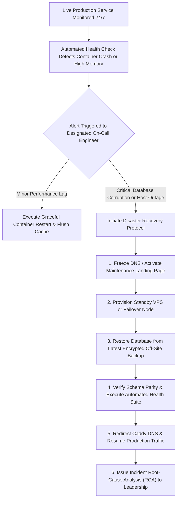

### 11.4 Operational Service Level Agreements (SLAs)
To establish institutional trust, the technology team must commit to measurable operational baselines:
* **Support Availability:** Business Hours Support (9:00 AM – 6:00 PM IST, Monday through Friday) for standard pilot operations.
* **Severity-0 (P0) Outage Target:** Initial triage within **60 minutes**; resolution or rollback within **4 hours**.
* **Severity-1 (P1) Defect Target:** Triage within **4 hours**; hotfix release within **24 to 48 hours**.
* **Recovery Point Objective (RPO):** Maximum allowable data loss window: **< 24 hours** (guaranteed via daily automated PostgreSQL snapshot exports stored on isolated off-site S3 storage).
* **Recovery Time Objective (RTO):** Maximum allowable service downtime during a catastrophic VPS failure: **< 4 hours** to rebuild container infrastructure from documented runbooks.

---

## 12. Three-Year Budgeting and Responsibility Model

A common financial mistake in early-stage programmes is treating software investment as a single, one-time project fee. Modern digital platforms operate under continuous lifecycles requiring three distinctly budgeted capital accounts.

### 12.1 The Three Capital Accounts

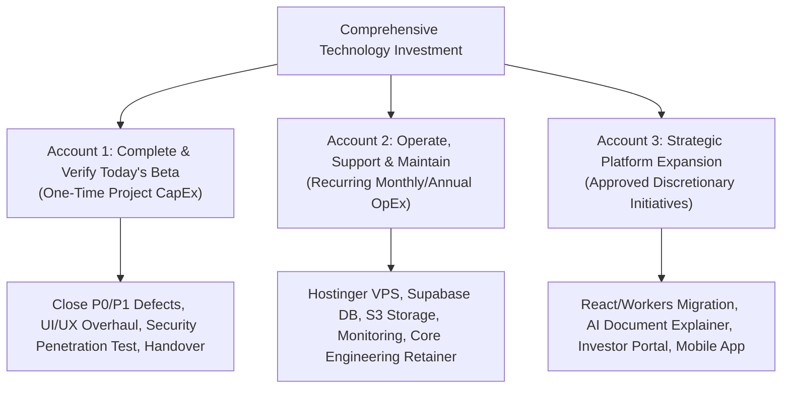

1. **Account 1: Complete and Verify Today's Beta (One-Time CapEx):** Dedicated milestone funding to resolve open defects, overhaul user interface consistency on Streamlit, complete independent security audits, and achieve formal institutional sign-off.
2. **Account 2: Operate, Maintain, and Support (Recurring OpEx):** Non-negotiable recurring expenditure to keep the live platform secure, online, backed up, patched, and supported by a qualified technical owner.
3. **Account 3: Strategic Platform Expansion (Discretionary CapEx):** Individually budgeted business cases for major future capabilities: building a dedicated mobile app, rewriting the frontend in React, or launching an enterprise AI assistant.

### 12.2 Three-Year Financial Planning Matrix (Scenarios)
The following projections model realistic expenditure across three operating modes. These are planning benchmarks based on current Indian market rates, not contractual quotes.

| Operating Mode | Year 1: Complete & Launch | Year 2: Operate & Optimize | Year 3: Scale & Expand | 3-Year Cumulative Total |
| :--- | :--- | :--- | :--- | :--- |
| **Mode 1: Owner-Led Small Pilot** *(Technical Owner part-time retainer + cloud hosting + annual security check)* | **CapEx:** ₹12,00,000 **OpEx:** ₹6,00,000 **Total:** ₹18,00,000 | **CapEx:** ₹4,00,000 **OpEx:** ₹7,50,000 **Total:** ₹11,50,000 | **CapEx:** ₹5,00,000 **OpEx:** ₹9,00,000 **Total:** ₹14,00,000 | **₹43,50,000** |
| **Mode 2: Lean Managed Platform** *(Recommended: 2.4 FTE engineering team + hosting + bi-annual audits)* | **CapEx:** ₹20,00,000 **OpEx:** ₹90,84,000 **Total:** ₹1,10,84,000 | **CapEx:** ₹10,00,000 **OpEx:** ₹98,00,000 **Total:** ₹1,08,00,000 | **CapEx:** ₹12,00,000 **OpEx:** ₹1,05,00,000 **Total:** ₹1,17,00,000 | **₹3,35,84,000** |
| **Mode 3: Growth-Stage Institution** *(6.75 FTE cross-functional team + enterprise cloud + full AI operations)* | **CapEx:** ₹35,00,000 **OpEx:** ₹1,84,80,000 **Total:** ₹2,19,80,000 | **CapEx:** ₹25,00,000 **OpEx:** ₹2,10,00,000 **Total:** ₹2,35,00,000 | **CapEx:** ₹30,00,000 **OpEx:** ₹2,35,00,000 **Total:** ₹2,65,00,000 | **₹7,19,80,000** |

### 12.3 Financial Commentary for the Board
* **Choosing the Right Mode:** An early-stage programme should operate under **Mode 1 or a modified Mode 2**. Moving directly to Mode 3 before achieving product-market fit or securing recurring multi-year institutional funding will lead to premature financial exhaustion.
* **Infrastructure is Cheap; Skilled Talent is the Investment:** Cloud hosting on Hostinger VPS and Supabase accounts for less than **3% to 5%** of the total budget. **95% of software expenditure is human engineering, testing, security auditing, and domain verification.**

---

## 13. Risk Register — Plain-Language View

To protect institutional investment and maintain governance integrity, leadership must review the primary operational, technical, and regulatory risks associated with Fulcrum Beta 2.0.0.

### 13.1 Comprehensive Risk Matrix

| Risk Category | Plain-Language Description of What Could Go Wrong | Mandatory Mitigation Before Scaled Public Onboarding |
| :--- | :--- | :--- |
| **1. Hybrid Role Data Bleed** | An entrepreneur who is also approved as a Guide accesses another mentor's confidential mentee records or sees administrative buttons. | Enforce rigid session-state clearing on workspace switch; execute the 7-role combination automated test suite on every deployment. |
| **2. Unreconciled Database Migrations** | An Admin performs an account lifecycle action or updates a scheme, and the screen crashes because the production database is missing a column. | Maintain an automated migration manifest in PostgreSQL; run automated schema diff checks between Git migrations and production before releases. |
| **3. Confusing UI/UX Abandonment** | Early-stage founders drop out of onboarding or miss consultation messages due to non-intuitive layout, tiny mobile fonts, or unclear error messages. | Execute a comprehensive UI/UX overhaul across all 4 portals; conduct structured usability tests with real entrepreneurs before public marketing. |
| **4. Cascading Regressions on New Changes** | Adding a new profile field or report silently breaks existing consultation threads or deletes historic Journey milestones. | Mandate the One-Page Change Card protocol; enforce circular automated regression test suites as a mandatory deployment blocker. |
| **5. Confidential Founder Data Exposure** | An unauthorized user or search crawler accesses private business plans, financial projections, or pitch decks stored in S3. | Configure S3 bucket ACLs to private; generate short-lived signed URLs (< 15 mins); commission an external OWASP ASVS penetration test. |
| **6. Unsupported Production Outages** | The Hostinger VPS server crashes at 2:00 AM due to memory exhaustion, and the platform remains offline for days with nobody accountable. | Implement automated uptime monitoring (e.g. UptimeRobot / BetterStack); establish a formal engineering support retainer with defined SLA response times. |
| **7. Outdated Scheme Policy Information** | A founder applies for a government subsidy based on Fulcrum's advice, only to discover the scheme expired or criteria changed six months ago. | Establish a formal quarterly scheme review schedule; assign a named domain policy expert; display clear legal disclaimers on scheme cards. |
| **8. AI Hallucination & Misinformation** | An experimental AI feature generates false eligibility guarantees, exposing the programme to reputational damage and founder disputes. | Constrain all AI to Retrieval-Augmented Generation (RAG) using verified gazettes; mandate human Guide review before publishing advice. |
| **9. Solo-Developer Dependency ("Bus Factor 1")** | If the original creator becomes unavailable, the organisation loses all institutional knowledge, root server passwords, and bug-fixing capability. | Complete comprehensive operational runbooks; place all Git repositories and cloud credentials in institutional escrow; retain a secondary technical reviewer. |
| **10. Commercial & Contractual Scope Disputes** | Programme leadership and technical providers disagree over whether future work constitutes warranty defect repairs or billable new scope. | Establish written acceptance criteria; maintain a transparent defect triage log; enforce formal sign-offs on all Change Cards. |

---

## 14. Milestones and Governance for the Next Release

To avoid unstructured development and budget creep, the path to an enterprise-grade production launch must be divided into **four disciplined phases**.

### 14.1 Phased Execution Roadmap

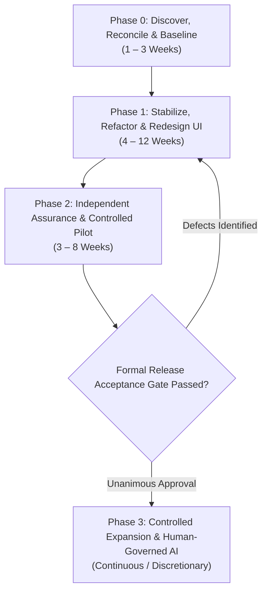

#### Phase 0: Discover, Reconcile & Baseline (1 – 3 Weeks)
* **Objective:** Establish absolute transparency regarding what currently works, what is broken, and who owns what.
* **Key Deliverables:**
  1. Complete code audit comparing live VPS deployment (`187.126.114.81`) against the Git repository.
  2. Verify all 12 SQL migrations (`000` through `011`) are active on the live Supabase instance.
  3. Reconcile the 32-user QA scorecard: verify which P0/P1 defects are resolved and which remain open.
  4. Secure institutional ownership of GitHub repositories, Supabase accounts, Hostinger VPS, and DNS records.
* **Governance Rule:** **Zero production code changes or feature additions during Phase 0.**

#### Phase 1: Stabilize, Refactor & Redesign UI (4 – 12 Weeks)
* **Objective:** Close all functional defects and elevate the user experience across all portals to professional standards.
* **Key Deliverables:**
  1. Fix all verified P0 and P1 defects (account lifecycle writes, hybrid consultation context, password resets).
  2. Comprehensive Streamlit UI/UX redesign: standardized typography, clear navigation, intuitive forms, and responsive mobile optimization.
  3. Harden RBAC permissions: verify zero cross-role data bleed across all 7 role permutations.
  4. Deploy to an isolated staging environment for internal staff testing.

#### Phase 2: Independent Assurance & Controlled Pilot (3 – 8 Weeks)
* **Objective:** Prove that the platform is secure, resilient, and usable by real stakeholders under live conditions.
* **Key Deliverables:**
  1. Commission an independent third-party penetration test (OWASP ASVS 5.0.0 Level 2).
  2. Execute formal User Acceptance Testing (UAT) with 20 real entrepreneurs and 5 professional Guides.
  3. Conduct automated load testing simulating 50 concurrent active users.
  4. Perform a complete disaster recovery rehearsal: drop staging database and restore from encrypted backup.
  5. Controlled pilot launch to a closed cohort of 50 to 100 founders with active monitoring.

#### Phase 3: Controlled Expansion & Human-Governed AI (Post-Acceptance)
* **Objective:** Introduce strategic enhancements and evaluated AI capabilities strictly after the core platform is proven.
* **Key Deliverables:**
  1. Process approved Change Requests (e.g. Investor Portal, advanced reporting).
  2. Implement safe, document-grounded AI Scheme Explainer with mandatory Guide-in-the-loop review.
  3. Evaluate architectural roadmap for potential long-term migration to React/FastAPI when concurrent user volumes require it.

---

## 15. CEO Decision Checklist & Verified Evidence Base

### 15.1 Executive Decision Checklist
Before authorizing further capital expenditure or announcing institutional launch dates, the Chief Executive Officer and Programme Leadership should formally verify the following eight items:

- [ ] **1. Agree on Baseline Scope & IP Ownership:** Confirm that the organisation possesses full administrative ownership of the GitHub repository, Supabase project, Hostinger VPS, and domain registrar credentials, with executed intellectual property assignment.
- [ ] **2. Separate Warranty Fixes from New Scope:** Establish a clear boundary between contractual defect closure (resolving documented P0/P1 issues from original requirements) and newly requested capabilities (requiring Change Cards).
- [ ] **3. Choose UI Strategy (Streamlit Polish vs Full Rewrite):** Formally approve the recommendation to polish and standardize the existing Streamlit UI (₹4L–₹9L) rather than funding an expensive, high-risk 8-month React rewrite (₹25L–₹50L+).
- [ ] **4. Mandate Live Production Verification:** Refuse to accept automated test reports or AI summaries as proof of readiness; require demonstrable evidence of passing tests executed directly on the live VPS staging environment.
- [ ] **5. Appoint an Accountable Technical Owner:** Designate a named lead engineer or engineering partner with documented SLA commitments to serve as the single point of operational accountability.
- [ ] **6. Commission Independent Security Testing:** Authorize an external cybersecurity audit scoped to OWASP ASVS 5.0.0 before publicly onboarding real entrepreneur financial documents.
- [ ] **7. Fund a Recurring Operational Support Budget:** Allocate a monthly operational budget (minimum ₹1.5L–₹2.5L for pilot; ₹7.57L for lean managed platform) to guarantee uptime, data backups, and technical support.
- [ ] **8. Delay Autonomous AI Until Foundation is Solid:** Defer advanced generative AI integration until core role permissions, gazette document pipelines, and human review protocols are fully established.

### 15.2 Final Strategic Conclusion
The initial development of Fulcrum Beta 2.0.0 achieved an impressive, highly functional foundation across 28,330 lines of Python, 23 relational database tables, 179 government schemes, and a complex 7-role mentorship workflow. That engineering effort represents substantial technical value.

However, **a functioning software prototype is not yet a hardened institutional platform.** 

By acknowledging the realistic engineering timeframes, funding an integrated stabilization programme, implementing disciplined Change Card governance, and establishing independent verification gates, programme leadership can protect its capital, ensure regulatory compliance, and deliver a transformative platform for India's entrepreneurship ecosystem.

---

## Sources, Assumptions and Evidence Hierarchy

### Inspected Codebase Repository Sources
* **Fulcrum Beta 2.0.0 Repository:** Direct static code analysis of `app.py`, `services/` (31 files), `views/` (10 files), `migrations/` (12 SQL scripts), and `tests/` (20 substantive test files).
* **QA Audit Records:** `DOCUMENTATION/05_TESTING_AND_VERIFICATION/32_USER_360_QA_REPORT/FINAL_32_USER_360_DEGREE_TEST_SCORECARD.md` (tested on commit `988127b`).
* **Deployment Specifications:** Docker configuration, Caddy reverse-proxy directives, and Hostinger KVM 2 VPS runtime logs (`187.126.114.81`).
* **Fulcrum Alpha Baseline:** Architectural comparison against `Alpha-main(1).zip`.

### Published Industry Reference Benchmarks (Checked November 2026)
1. **[Adecco India Salary Guide 2026](https://www.adecco.com/en-in/-/media/project/adecco/adeccoin/image/employer/salary-guide/adecco%20india%20salary%20guid-2026.pdf):** Benchmark compensation data for Indian software engineering, QA automation, DevOps, and technology leadership roles across Tier-1 and Tier-2 hubs.
2. **[Michael Page India Salary Report 2026](https://www.scribd.com/document/989689625/India-Salary-Guide-2026-Michael-Page-1769675012):** Supplemental compensation bands for senior architects, product leads, and cybersecurity specialists in India.
3. **[Clutch Software Development Pricing Guide 2026](https://clutch.co/developers/pricing):** Commercial hourly billing rates and milestone cost structures for custom software development agencies.
4. **[OWASP Application Security Verification Standard (ASVS 5.0.0)](https://asvs.owasp.org/):** Global industry benchmark for application-level software security and role-based access verification.
5. **[NIST AI Risk Management Framework (AI RMF 1.0) Generative AI Profile](https://www.nist.gov/publications/artificial-intelligence-risk-management-framework-generative-artificial-intelligence):** Risk management, validation, and governance standards for enterprise generative AI deployments.
6. **[MeitY Digital Personal Data Protection (DPDP) Rules 2025](https://www.meity.gov.in/documents/act-and-policies/digital-personal-data-protection-rules-2025-gDOxUjMtQWa):** Statutory Indian legal standards governing personal data collection, consent logging, and user rights.

### Evidence Hierarchy Classification
To ensure absolute transparency, all statements in this report adhere to the following evidence hierarchy:
* **[Measured Fact]:** Verified directly from the codebase (e.g. 28,330 lines of Python, 23 database tables, 179 schemes).
* **[Source-Code Finding]:** Identified via code inspection (e.g. deterministic scheme matching logic, Streamlit session-state handling).
* **[Researched Market Data]:** Sourced from published industry reports (e.g. Adecco 2026 salaries, Clutch pricing).
* **[Modeled Assumption]:** Projected estimates based on engineering experience (e.g. 20% employer overhead, 30–50 concurrent user limit on 8 GB VPS).
* **[Professional Judgment]:** Strategic recommendations formulated by senior software architecture specialists (e.g. recommending against an immediate React rewrite; mandating human-in-the-loop AI).
