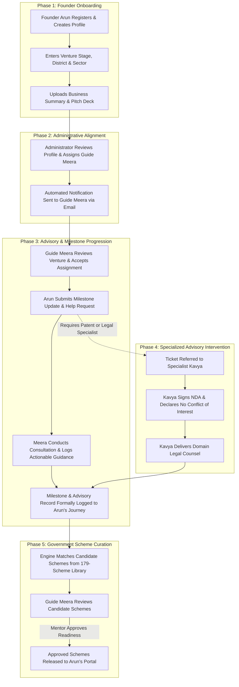
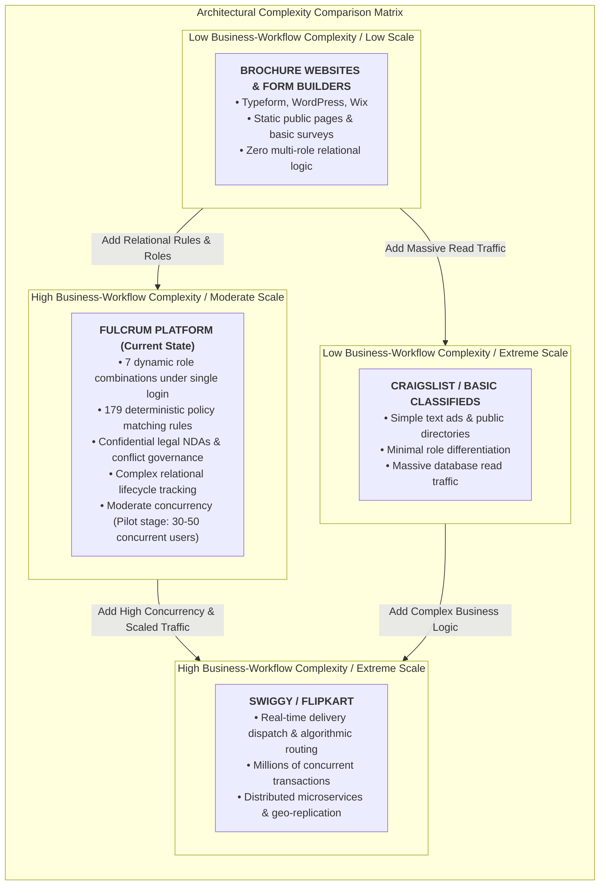
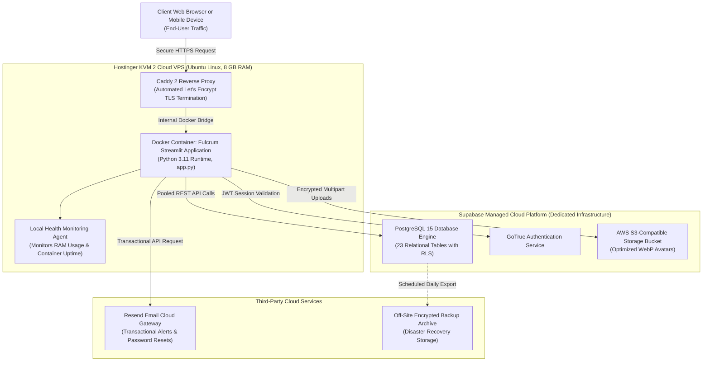
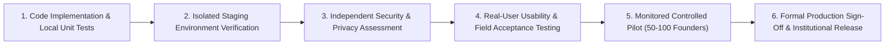

# Executive Briefing: The Fulcrum Platform
## Comprehensive Assessment of Capabilities, Architectural Scope, Operational Model, and Strategic Decisions
**Consolidated Briefing for Executive Leadership and Board Review | November 2026**

---

## 1. Executive Summary: The Decision in One Page

This briefing presents an independent, unified assessment of the Fulcrum digital platform. It synthesizes technical inspections of the codebase (Beta Version 2.0.0, referencing the initial Alpha version), packaged quality assurance records, and contemporary technology benchmarks into a single, decision-oriented document.

The primary objective is to give executive leadership complete clarity on **what has been built, why the business logic is complex, what remains to be verified, and what resources and decisions are required to move forward responsibly.**

### 1.1 Core Executive Takeaways
1. **A Custom Relational Asset:** Fulcrum is not a generic template, brochure website, or simple form builder. It is a specialized, multi-role entrepreneurship guidance platform with 28,330 lines of verified core Python application logic, 23 relational database tables, 179 pre-seeded policy schemes, and a multi-tiered permission engine.
2. **Substantial Foundational Engineering:** The repository establishes working operational logic connecting founders, mentors, technical specialists, and administrative leadership. Building this breadth of functionality independently established a valuable asset at a fraction of standard commercial agency expenditure.
3. **Complexity Profile:** 
   * **Business-Workflow Complexity is High (~8/10):** Intricate multi-role permissions, dynamic workspace switching across seven role combinations, and deterministic scheme evaluations.
   * **Engineering Infrastructure Complexity is Moderate (~5 to 6/10):** A clean, single-container Python/Streamlit deployment running on a virtual private server with managed PostgreSQL.
   * **Production Readiness is In Progress (~6/10):** Substantial business functionality is written, but formal verification on the live cloud environment, independent security audits, and user experience refinement remain essential before broad public launch.
4. **The Strategic Recommendation:** **Continue developing the established Beta foundation.** Do not discard the existing codebase for an expensive full-stack rewrite, and do not introduce autonomous artificial intelligence features before core permissions and data workflows are independently verified.

---

## 2. The Platform in Practice: A Real-World Operational Journey

To evaluate the software, leadership must first understand what the platform actually does for the human participants in an entrepreneurship programme. 

In traditional incubation environments, startup guidance is fragmented across spreadsheets, personal WhatsApp threads, lost email attachments, and manual paper applications. Fulcrum coordinates this entire operational lifecycle in one secure, audited system.

### 2.1 The Four Primary Stakeholders in Action

Consider a practical, everyday operational scenario:

* **Arun (The Aspirant / Founder):** Arun is an early-stage entrepreneur who has developed an agro-tech prototype in Coimbatore. He creates an account on Fulcrum, completes his venture profile (stage, capital needed, community, district, educational background), and uploads his pitch summary. He tracks his business progress across sequential journey milestones and submits an advisory help request regarding intellectual property protection.
* **Meera (The Guide / Primary Mentor):** Meera is an experienced business mentor assigned by the programme to guide Arun. When Meera logs into her portal, she sees Arun's progress and pitch deck. She conducts a structured consultation, logs actionable feedback directly into Arun's permanent journey timeline, and acts as an institutional gatekeeper—reviewing candidate government schemes to decide which ones Arun is truly ready to apply for.
* **Kavya (The Subject Matter Expert / Specialist):** Meera realizes that Arun's intellectual property question requires a patent attorney. She refers the ticket to Kavya, a registered specialist. Before Kavya can view Arun's confidential pitch deck, she must digitally sign an institutional Non-Disclosure Agreement (NDA) and formally declare that she has no conflict of interest (e.g., she does not advise a competing agritech startup). Kavya provides legal guidance, which is archived in Arun's journey.
* **The Administrator (Programme Leadership):** Operating from an executive command center, the Administrator monitors ecosystem health across thirteen operational areas. The Administrator approves new mentor credentials, assigns Guides, reallocates mentees if a mentor becomes inactive, reviews confidential grievances, and updates statutory government scheme criteria.

### 2.2 Executive Diagram 1: The Complete Entrepreneur Guidance Journey



### 2.3 Why This Is Custom Software, Not a Website
A public website displays identical content to every visitor. Fulcrum is custom enterprise software because **every single click is governed by strict rules, relationships, and data boundaries**:
* Arun cannot see another founder's financials.
* If Meera also runs her own venture and registers as an entrepreneur, the platform allows her to switch between her "Mentor Workspace" and her "Founder Workspace" with one click, while strictly segregating private records.
* Every administrative action—from resetting a password to reassigning a mentor—is permanently captured in audit logs to ensure institutional governance.

---

## 3. Evaluating Platform Complexity (Separating Workflow, Scale & Production Readiness)

In software evaluations, a common error is confusing the difficulty of the **business rules** with the difficulty of **server scale**. 

Fulcrum must be evaluated across three distinct, objective dimensions:

### 3.1 Business-Workflow Complexity: Rated ~8 out of 10 (High)
The internal business logic of Fulcrum is legitimately intricate:
* **Seven Dynamic Role Permutations:** Supporting users who hold multiple simultaneous responsibilities (e.g., an individual who is simultaneously a Founder, a Mentor, and an SME) without session cross-contamination.
* **Deterministic Matching Across 179 Schemes:** Evaluating founder criteria (age, gender, social category, education, district, revenue stage, capital investment) against complex Central and Tamil Nadu state policy gazettes with zero margin for error.
* **Legal and Governance Safeguards:** Enforcing digital NDAs, conflict-of-interest declarations, and confidential complaint handling before data can be viewed.
* **Cascading Lifecycle Rules:** Ensuring that when a mentor resigns or is suspended, active entrepreneurs are gracefully reallocated, private document URLs are revoked, and historical advice remains permanently preserved for audit.

### 3.2 Engineering & Infrastructure Complexity: Rated 5 to 6 out of 10 (Moderate)
The underlying technical infrastructure is clean and conventional:
* The application runs on a single Python process using the Streamlit framework inside a Docker container on an 8 GB RAM Ubuntu Virtual Private Server (VPS).
* The persistence layer utilizes managed PostgreSQL and cloud authentication provided by Supabase.
* It does not currently require distributed caching, complex microservices, or high-frequency message queues because concurrent traffic is currently modest.

### 3.3 Production Readiness: Rated ~6 out of 10 (Work in Progress)
The core business logic is written and automated unit tests pass in developer environments. However, before the system can be deployed to the general public, it requires:
* Verifying database migration parity directly on the live cloud server.
* Formally closing and retesting issues identified in earlier quality assurance trials.
* Executing an independent cybersecurity assessment (OWASP ASVS Level 2).
* Enhancing the visual user interface across mobile devices.

### 3.4 Executive Diagram 2: Architectural Complexity Quadrant



*Executive Interpretation:* Fulcrum does not require Swiggy's massive infrastructure budget because it is not processing 50,000 food orders per minute. However, it cannot be built with a simple website builder because its **business rules, confidentiality requirements, and multi-role relationships are inherently complex.**

---

## 4. Current Implementation Reality (Verified Codebase Facts)

To establish complete transparency, the following figures reflect a direct, deduplicated static code analysis of the repository as of November 2026.

### 4.1 Measured Inventory vs. Future Potential

| Component | Measured Reality in Repository | What This Means for the Institution |
| :--- | :--- | :--- |
| **Core Application Code** | **28,330 lines of Python** | Unique business logic spanning `app.py` (1,279 lines), `services/` (19,656 lines), and `views/` (7,395 lines). Excludes deployment duplicates and third-party packages. |
| **Service Engine Modules** | **31 files** | Dedicated engines governing authentication, role switching, mentorship matching, legal NDAs, journeys, and audit logging. |
| **User Interface Views** | **10 files** | Portals for Admins (13 management tabs), Founders, Mentors, and Specialists. |
| **Database Migrations** | **12 SQL scripts (2,327 lines)** | Sequential schema blueprints (`000` through `011`) establishing 23 tables, foreign keys, and constraint checks in PostgreSQL. |
| **Automated Test Definitions** | **178 test functions** | Coded test scripts across 20 files verifying unit calculations, schema rules, and simulated role interactions. |
| **Pre-Seeded Policy Schemes** | **179 canonical schemes** | Structured records of Central and Tamil Nadu government schemes with deterministic eligibility criteria. |
| **Production Deployment** | **Live on Cloud VPS** | Containerized on Hostinger KVM 2 VPS fronted by Caddy 2 reverse proxy with Let's Encrypt SSL at `https://app.fulcrumindia.online`. |
| **Future Potential Options** | **Not in Current Build** | A decoupled React/Next.js frontend, autonomous language models, and multi-tenant SaaS capabilities are architectural options for future phases, not present today. |

### 4.2 Reconciling Known Quality Assurance Records
An objective audit must address the formal 32-user quality assurance test record packaged in the repository (tested against git commit `988127b`):
* **Historical Test Outcome:** The 32-user trial identified three critical (Severity-0) blockers: (1) account lifecycle logging failing due to missing database columns, (2) hybrid-user consultation threads cross-pollinating, and (3) temporary password handling gaps. The trial issued a formal conditional hold.
* **Subsequent Code Fixes:** Remediation logic and database migration `011` were subsequently committed to the codebase to address these specific issues.
* **The Production Verification Reality:** Code committed to git does not automatically prove that the running cloud VPS instance has executed the latest database migration and retested the full multi-role matrix. **A formal, evidence-backed Release Gate must retest the running application before public onboarding begins.**

---

## 5. The Role of Artificial Intelligence in Engineering Delivery

A common question in modern boardrooms is how artificial intelligence affects software development time, engineering costs, and operational risk.

### 5.1 Replacing Marketing Myths with an Illustrative Delivery Reality
Popular claims that "AI builds entire SaaS applications in minutes" confuse **typing raw text** with **engineering reliable software systems**.

In custom enterprise software development, artificial intelligence functions primarily as a **productivity accelerator, not an autonomous engineer**:

* **The Illustrative 100-Hour Feature Cycle:**
  * **Initial 15 to 20 Hours (AI Acceleration):** An engineer uses AI tools (e.g., Cursor, Claude, Copilot) to rapidly draft initial code syntax, generate boilerplate test cases, synthesize routine database queries, and format documentation. This accelerates initial drafting by 3x to 5x.
  * **Remaining 80 to 85 Hours (Human Engineering Judgment):** The engineer must inspect the code line by line, catch hallucinated database columns, debug multi-user session state conflicts, write defensive error handlers, ensure database migrations preserve existing historical records, configure network security, and verify responsive mobile layouts.
* **The Essential Principle:** AI generates draft suggestions. **Human software engineers remain 100% accountable for system integration, data security, regression testing, and production outcomes.**

---

## 6. Realistic Reconstruction Time & Effort (Project-Based Modeling)

To plan future budgets accurately, leadership needs realistic reconstruction estimates based on stated staffing and project phases, rather than theoretical formulas.

### 6.1 Estimated Reconstruction Timeframes

If an organisation were to commission the construction of Fulcrum's exact scope today (28,330 lines of business logic, 23 tables, 179 schemes, 7 role combinations, 13 Admin tabs, and test suites):

| Delivery Approach | Estimated Delivery Time | Key Assumptions & Staffing Model |
| :--- | :--- | :--- |
| **Solo Senior Full-Stack Engineer (With AI)** | **5.0 – 7.5 calendar months** | Assumes one experienced full-stack engineer working full-time (45–50 hours/week) handling architecture, database design, backend services, Streamlit UI, automated tests, and VPS deployment sequentially. |
| **Lean Multidisciplinary Team (3 Engineers with AI)** | **3.5 – 5.0 calendar months** | Assumes a Technical Lead / Architect (1.0 FTE), a Backend Developer (1.0 FTE), and a QA/Frontend Engineer (0.75 FTE) running parallel development workstreams. |
| **Formal Software Services Vendor** | **5.0 – 8.0 calendar months** | Reflects standard commercial agency delivery: requirements discovery, formal sprint cycles, project management oversight, multi-tiered QA segregation, and institutional governance. |

---

## 7. A Consistent, Defensible Financial Model

To prevent confusion, leadership must strictly separate **five distinct financial categories** that are frequently conflated:

```
====================================================================================================
THE FIVE DISTINCT FINANCIAL CATEGORIES
====================================================================================================
1. Reconstruction Cost       -> What it would cost in the market to rebuild this from scratch today.
2. Present Software Value   -> The functional business equity currently established in the repository.
3. Contractual Payment       -> Remaining financial balances determined strictly by existing agreements.
4. Operational Maintenance   -> Recurring monthly investment required to keep the live platform safe.
5. Future Feature Scope      -> Discretionary investments for newly approved business modules.
====================================================================================================
```

### 7.1 Reconstruction Cost Benchmark (Market Replacement Value)
The figures below represent comparative market benchmarks based on contemporary Indian technology compensation data (Adecco India 2026, Michael Page India 2026, and Clutch software pricing indices):

* **Solo Senior Contractor Delivery:** **₹16,00,000 – ₹24,00,000** (reflecting 5 to 7 months of senior full-stack development, database architecture, and infrastructure setup at standard professional contractor rates).
* **Lean Multidisciplinary Team Delivery:** **₹32,00,000 – ₹55,00,000** (reflecting an in-house or boutique team of 3 engineers over 4 to 5 months with employer overhead).
* **Formal Enterprise Services Vendor:** **₹75,00,000 – ₹1,40,00,000+** (reflecting standard commercial hourly rates, dedicated project managers, formal QA segregation, corporate overhead, profit margin, and institutional warranty).

*Note on Vendor Comparisons: Large commercial IT vendors cost significantly more because clients pay for dedicated project management, formal legal indemnities, corporate facilities, and multi-tiered quality processes, not just raw developer hours.*

### 7.2 Present Value vs. Contractual Commitments
* **Present Software Value:** The organisation possesses a working functional asset that would cost ₹32 Lakhs to ₹55 Lakhs to recreate through an agency.
* **Contractual Payment:** Any outstanding payments owed to the developer or service providers must be determined strictly from **signed contracts, agreed milestone scopes, and formal legal review**, rather than theoretical replacement valuations.
* **Intellectual Property Ownership:** Ownership, licensing rights, and source code custody must be confirmed through legal review of existing agreements.

### 7.3 Operational Maintenance Models (Annual OpEx)
Software is a live operational service requiring continuous monitoring, security patching, and user support:

* **Model A: Owner-Led Pilot Support Retainer:**
  * Core technical owner on a part-time operational retainer (25–40 hours/month) handling routine bug fixes, dependency updates, and basic uptime monitoring.
  * **Planning Budget:** **₹1,50,000 – ₹2,50,000 per month** (**₹18L – ₹30L annually**).
* **Model B: Lean Managed Platform Team (Recommended for Growth):**
  * Structured operational coverage: 1 Lead Architect (1.0 FTE), 1 Backend Dev (1.0 FTE), QA Engineer (0.75 FTE), plus fractional DevOps and security specialists.
  * **Planning Budget:** **₹7,57,000 per month** (**~₹90.8L annually** including 20% statutory employer overhead).

---

## 8. Cloud Infrastructure & Operational Reliability

Fulcrum's cloud infrastructure footprint is modern, lean, and cost-effective. The cloud hosting bill accounts for less than 5% of total operating expenditure.

### 8.1 Executive Diagram 3: Production Cloud Infrastructure Topology



### 8.2 Infrastructure Running Costs (₹2,000 – ₹6,000 / month)
* **Hostinger KVM 2 VPS:** ₹800 – ₹1,500/month.
* **Supabase Database & Auth:** Currently on Free Tier; ₹2,100/month upon upgrading to Pro for automated backups and zero auto-pause.
* **Resend Transactional Email:** Free tier today; ₹1,700/month at scaled volume.
* **Domain & DNS:** ~₹150/month.
* **Off-Site Encrypted Backup Storage:** ₹300 – ₹800/month.

---

## 9. A Realistic Lean Operating Model

A critical priority for leadership is establishing clear, named operational responsibility so the platform does not depend permanently on a single human mind.

### 9.1 Six Named Operational Responsibilities

| Functional Responsibility | Key Operational Accountability | Recommended Staffing Model |
| :--- | :--- | :--- |
| **1. Engineering & Architecture** | Core Python services, database migrations, bug fixes, and feature integrations. | Lead Technical Architect (Dedicated) |
| **2. Independent Quality Assurance** | Authoring automated regression tests, executing multi-role test matrices, verifying fixes. | QA Automation Engineer (Dedicated / Fractional) |
| **3. Cybersecurity & Data Privacy** | Threat modeling, penetration testing, verifying DPDP Act 2023 compliance. | Third-Party Cybersecurity Specialist (Milestone) |
| **4. Cloud Operations & Site Reliability** | Docker container health, VPS patching, Caddy SSL certificates, off-site backup restoration. | DevOps / Platform Engineer (Fractional) |
| **5. User Experience & Usability** | Navigation clarity, mobile responsiveness, error feedback design, user research. | UI/UX Product Designer (Fractional) |
| **6. Scheme Policy & Accuracy** | Reviewing Central and Tamil Nadu gazettes, ensuring eligibility rules remain legally accurate. | Scheme Policy Domain Expert (Retainer) |

### 9.2 Executive Diagram 4: Quality & Release Governance Gates



---

## 10. Technical Maturity Roadmap vs. Institutional Adoption (GTM)

Leadership must strictly decouple **technical platform maturity** from **business go-to-market (GTM) adoption**.

### 10.1 Decoupling Technology from Market Validation
* **Technical Reality:** Fulcrum has achieved a working **Functional Beta**. The business rules, database schemas, and multi-role portals exist and execute.
* **Market Adoption Reality:** Fulcrum has **NOT yet demonstrated Product-Market Fit (PMF)**. Proving product-market fit requires evidence from real founders and mentors using the platform across complete consultation cycles, successfully securing government funding, and reporting high satisfaction without administrative intervention.

### 10.2 Phased Dual-Track Roadmap

```
====================================================================================================
PHASED DUAL-TRACK EXECUTION ROADMAP
====================================================================================================
Phase & Horizon      | Technical Platform Maturity Track         | Institutional Adoption (GTM) Track
---------------------+-------------------------------------------+----------------------------------
Phase 0: Baseline    | Reconcile live VPS migrations; establish  | Finalize legal agreements; secure
(Weeks 1 – 2)        | clean staging environment; code audit.    | administrative cloud ownership.
---------------------+-------------------------------------------+----------------------------------
Phase 1: Stabilize   | Resolve verified QA defects; standardize  | Conduct internal staff training;
(Weeks 3 – 6)        | Streamlit UI/UX; run regression suite.    | recruit initial 20 pilot founders.
---------------------+-------------------------------------------+----------------------------------
Phase 2: Assure      | External penetration test (OWASP ASVS);   | Launch monitored 50-founder pilot;
(Weeks 7 – 12)       | disaster recovery dry run; load testing.  | collect structured mentor feedback.
---------------------+-------------------------------------------+----------------------------------
Phase 3: Expand      | Supervised AI Scheme Explainer pilot;     | Expand to partner incubators;
(Months 4 – 12)      | evaluate decoupled React architecture.    | evaluate commercial multi-tenancy.
====================================================================================================
```

---

## 11. Strategic Recommendations & Immediate Actions

1. **Protect the Built Asset:** Acknowledge that the initial development successfully established complex, valuable business logic. Ensure contractual clarity, source code custody, and cloud credential escrow are formally completed.
2. **Avoid an Expensive Full Rewrite:** Do not discard the functioning Streamlit engine to build a React application from scratch. Polishing the existing interface costs ₹4L–₹9L; rebuilding in React costs ₹35L–₹65L and introduces 8 months of unnecessary delivery risk.
3. **Execute the Staging Release Gate:** Require an evidence-backed retest of the live cloud environment before authorizing public onboarding, verifying that database migration `011` is active and all earlier QA blockers are closed.
4. **Fund a Lean Operational Retainer:** Establish a formal monthly maintenance contract (₹1.5L–₹2.5L/month for pilot; ₹7.57L/month for a lean managed team) to ensure uptime, backups, and prompt defect resolution.
5. **Enforce Change Card Governance:** Require written business justification, affected-role analysis, and acceptance criteria before authorizing any new software modifications.

---

### Supporting Documentation References
* **Technical Evidence & Full Mermaid Diagrams:** [FULCRUM_EXECUTIVE_EVIDENCE_APPENDIX.md](file:///C:/Users/hp/Desktop/Fulcrum-Alpha/fulcrum-cluster-b/FULCRUM_EXECUTIVE_EVIDENCE_APPENDIX.md)
* **One-Page Release & Risk Scorecard:** [FULCRUM_CEO_DECISION_SCORECARD.md](file:///C:/Users/hp/Desktop/Fulcrum-Alpha/fulcrum-cluster-b/FULCRUM_CEO_DECISION_SCORECARD.md)
