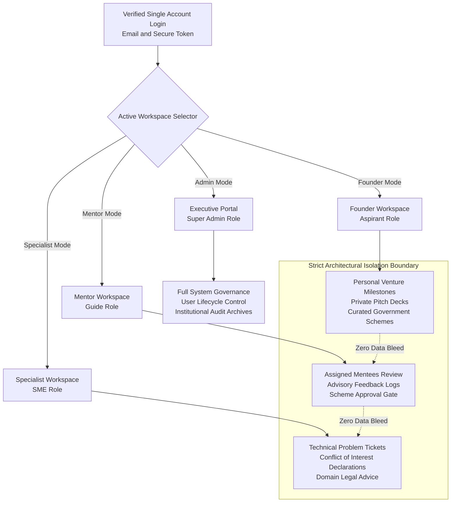
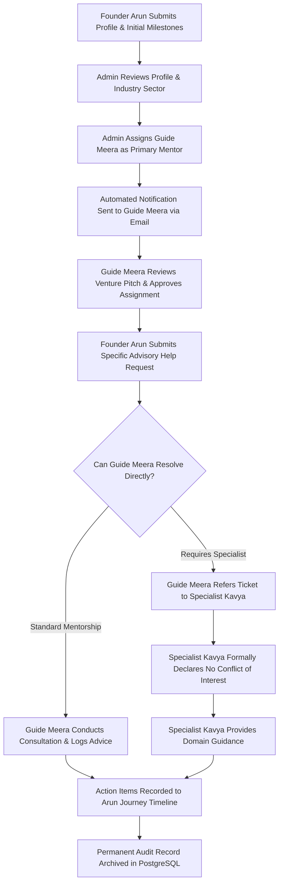
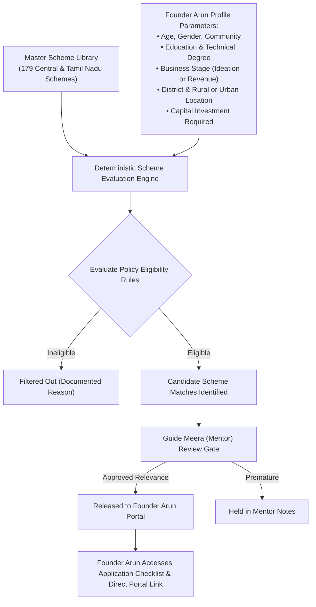
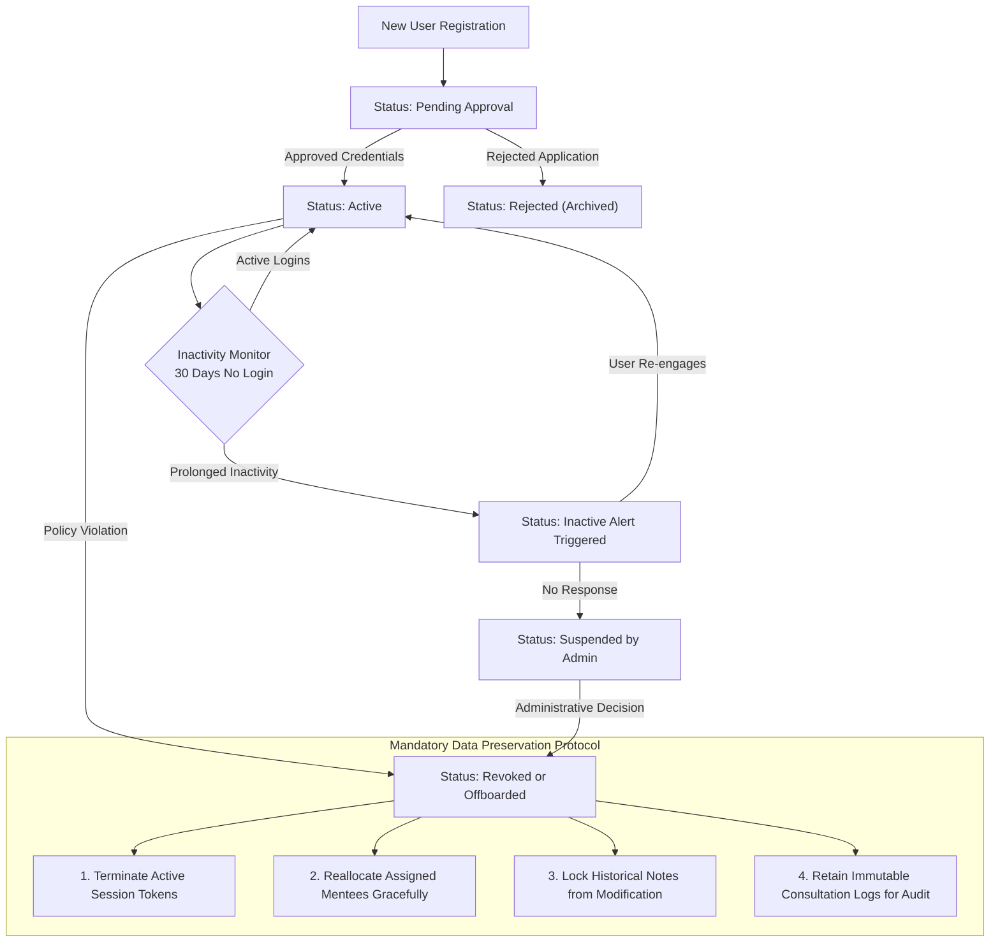
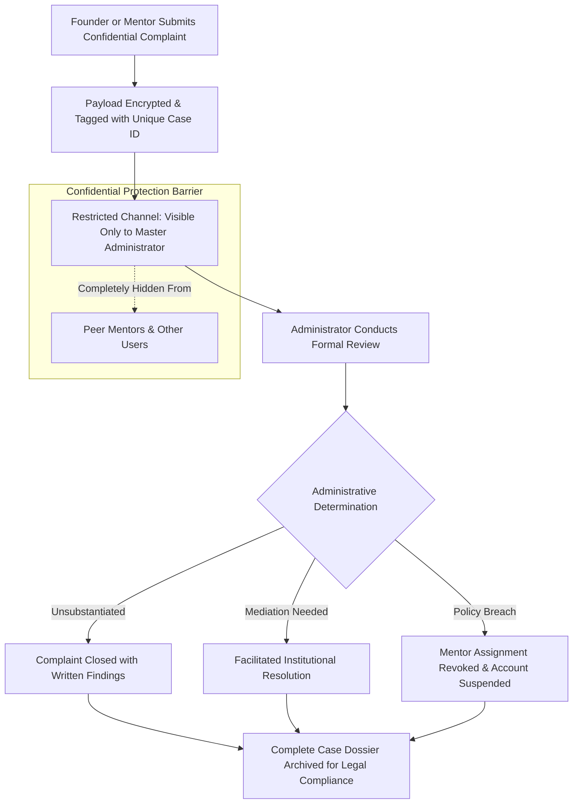
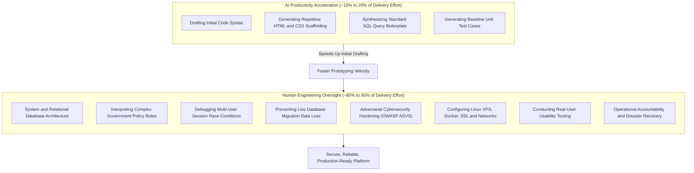
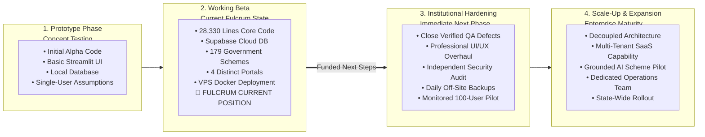

# Executive Evidence Appendix: The Fulcrum Platform
## Codebase Metrics, Technical Blueprints, Quality Records, and Market Data
**Companion Evidence Document to FULCRUM_FINAL_CEO_BRIEFING.md | November 2026**

---

## 1. Verified Codebase Inventory & Structural Audit

The metrics below represent a direct, deduplicated static code analysis of the Fulcrum repository as of November 2026. Code counts exclude deployment mirrors (`FULCRUM_FRESH_DEPLOYMENT/`), local SQLite fallback files, and third-party library dependencies.

### 1.1 Source Code Measurement Breakdown

| Architectural Layer | File Count | Line Count | Primary Function in Architecture |
| :--- | :--- | :--- | :--- |
| **Main Application Entry** (`app.py`) | 1 file | 1,279 lines | Application routing, global session initialization, authentication dispatch, and navigation. |
| **Service Engine Modules** (`services/`) | 31 files | 19,656 lines | Business logic: authentication, role switching, scheme matching, journey timelines, legal NDAs, audit logs. |
| **User Interface Views** (`views/`) | 10 files | 7,395 lines | Interactive portals for Admin (13 tabs, 3,803 lines), Founders (Aspirants), Mentors (Guides), and Specialists (SMEs). |
| **Database Migration Scripts** (`migrations/`) | 12 files | 2,327 lines | Sequential SQL DDL and DML scripts (`000` through `011`) defining tables, constraints, and indexes in PostgreSQL. |
| **Automated Test Suites** (`tests/`) | 20 files | 6,367 lines | Unit, integration, and simulated multi-role test scripts covering 178 test functions. |
| **Operational & DevOps Scripts** (`scripts/`) | 32 files | 5,565 lines | Automated deployment, database backup pipelines, data seeding, and health checks. |
| **Core Application Total** | **42 files** | **28,330 lines** | **Unique business logic written specifically for Fulcrum.** |
| **Total Workspace Repository** | **158 files** | **73,067 lines** | **Entire workspace including isolated deployment packages and test suites.** |

---

## 2. Reconciling the 32-User Quality Assurance Scorecard

A thorough executive audit must document the formal test records packaged within the repository.

### 2.1 The Baseline 32-User Simulation Trial
In `DOCUMENTATION/05_TESTING_AND_VERIFICATION/32_USER_360_QA_REPORT/FINAL_32_USER_360_DEGREE_TEST_SCORECARD.md`, an extensive simulation test was executed against git commit `988127b`. 

The test trial issued a formal **CONDITIONAL HOLD / NO-GO** for full launch due to three critical Severity-0 (P0) blockers:

1. **Defect P0-A: Account Lifecycle Logging Failure:** Administrative soft-deletions and account status updates failed because the underlying database table lacked newly referenced schema columns.
2. **Defect P0-B: Hybrid-User Consultation Context Bleed:** Users holding dual roles (e.g. Founder + Mentor) experienced cross-pollination of consultation threads when switching between workspaces.
3. **Defect P0-C: Temporary Password Reset Exposure:** Temporary passwords generated by the administrator lacked automated one-time-use invalidation upon initial login.

### 2.2 Subsequent Commit Remediations
Following the trial, subsequent code commits and migration scripts were added to the repository:
* Migration script `011_add_account_lifecycle_log.sql` was authored to establish full column parity.
* Dedicated session-state purge functions were added to `services/roles.py` to isolate workspace switching.
* Cryptographic password hash enforcement and token invalidation were introduced in `services/auth.py`.

### 2.3 The Mandatory Release Gate Requirement
While local automated tests confirm these fixes in developer environments, **code committed to git does not automatically prove that the running cloud VPS has executed migration 011 and retested the full matrix.** A formal staging re-test must be executed before open institutional onboarding.

---

## 3. Supplementary Technical Blueprints (Mermaid Diagrams)

---

### Diagram A1: Role Relationship & Dynamic Switching Map
Fulcrum allows a single verified user account to dynamically switch between different organizational roles without logging out, while strictly isolating private data.

---

### Diagram A2: Administrative Command Center (13 Tabs)
The Executive Administration Portal is divided into thirteen specialized operational tabs, providing full visibility and control over the platform.

```mermaid
flowchart LR
    subgraph AdminPortal["Executive Command Center (views/admin.py)"]
        direction TB
        T1["Tab 1: Command Metrics"]
        T2["Tab 2: User Verification"]
        T3["Tab 3: Mentor Assignments"]
        T4["Tab 4: Specialist Triage"]
        T5["Tab 5: Scheme Catalogue (179)"]
        T6["Tab 6: Journey Overviews"]
        T7["Tab 7: Help Ticket Triage"]
        T8["Tab 8: Complaint Arbitration"]
        T9["Tab 9: Conflict Declarations"]
        T10["Tab 10: Legal NDA Registry"]
        T11["Tab 11: Inactivity Alerts"]
        T12["Tab 12: Account Lifecycle Log"]
        T13["Tab 13: System Settings & Health"]
    end

    AdminPortal --> ACTION{"Administrative Decisions"}
    ACTION -->|User Management| U_MAN["User Lifecycle Updates"]
    ACTION -->|Mentorship| R_MAN["Mentorship Alignments"]
    ACTION -->|Catalogue Updates| S_MAN["Government Scheme Updates"]
    ACTION -->|Arbitration| C_MAN["Confidential Case Triage"]
```

---

### Diagram A3: Mentor Assignment & Consultation Lifecycle Flow
This diagram illustrates the step-by-step lifecycle when an entrepreneur requests guidance, showing how the system maintains institutional accountability at every stage.

---

### Diagram A4: Deterministic Government Scheme Matching Engine
Unlike unverified artificial intelligence, Fulcrum uses a deterministic rules engine to evaluate entrepreneur eligibility against 179 state and national schemes with zero hallucinations.

---

### Diagram A5: User Account Lifecycle, Status Transitions & Governance
Managing account statuses requires coordinated actions across database tables to ensure historical data is preserved even when accounts are suspended or deactivated.

---

### Diagram A6: Confidential Grievance & Dispute Governance Flow
To protect institutional integrity, complaints regarding inappropriate mentor behavior or ethics violations follow an isolated, encrypted escalation path.

---

### Diagram A7: AI Productivity Acceleration vs. Human Engineering Accountability
This diagram breaks down the productivity acceleration provided by AI coding tools versus the human engineering discipline required to achieve enterprise reliability.

---

### Diagram A8: Technical Maturity vs. Institutional Go-to-Market Roadmap
Inspired by modern technology venture maturity frameworks, this map shows where Fulcrum currently sits and the exact milestones required to achieve institutional scale.

---

## 4. Market Compensation Benchmark Tables (India 2026)

The figures below represent **Annual Total Cost to Company (CTC)** for mid-to-senior engineering talent across Tier-1 and Tier-2 Indian technology centers, referencing published 2026 data from the **Adecco India Salary Guide 2026** and the **Michael Page India Salary Report 2026**.

| Role | Primary Responsibility | Experience | Annual CTC Band (INR) | Recommended Allocation in Lean Team |
| :--- | :--- | :--- | :--- | :--- |
| **Solution Architect / Tech Lead** | Guarantees overall system architecture, code quality, and technical governance. | 7 – 12+ yrs | **₹24,00,000 – ₹45,00,000** | Full-Time (1.00 FTE) |
| **Senior Backend Engineer** | Builds and maintains core business workflows, role permissions, and API integrations. | 4 – 9 yrs | **₹12,00,000 – ₹28,00,000** | Full-Time (1.00 FTE) |
| **Frontend Engineer** | Implements intuitive, responsive, and accessible user interfaces across all portals. | 3 – 8 yrs | **₹10,00,000 – ₹24,00,000** | Part-Time (0.50 FTE) |
| **QA / Automation Test Engineer** | Authors automated browser tests, verifies multi-role isolation, and prevents regression bugs. | 4 – 9 yrs | **₹10,00,000 – ₹24,00,000** | Dedicated (0.75 FTE) |
| **Database Engineer / DBA** | Optimizes database schemas, manages migrations, and ensures bulletproof data backup and recovery. | 5 – 10 yrs | **₹15,00,000 – ₹32,00,000** | Fractional (0.25 FTE) |
| **DevOps / Platform Engineer** | Manages cloud servers, Docker containers, automated deployment pipelines, and uptime monitoring. | 5 – 10 yrs | **₹15,00,000 – ₹32,00,000** | Fractional (0.25 FTE) |
| **UI/UX Product Designer** | Researches user behavior, maps intuitive journeys, and crafts clean, accessible design systems. | 4 – 9 yrs | **₹10,00,000 – ₹24,00,000** | Fractional (0.25 FTE) |
| **Cybersecurity Specialist** | Conducts adversarial penetration tests, audits data privacy, and validates DPDP compliance. | 5 – 12 yrs | **₹18,00,000 – ₹40,00,000** | Milestone-Based (0.15 FTE) |
| **Product / Business Analyst** | Translates business requirements into unambiguous technical specifications and acceptance cards. | 4 – 10 yrs | **₹10,00,000 – ₹24,00,000** | Part-Time (0.25 FTE) |
| **Scheme Policy Expert** | Reviews statutory Central and State gazettes, ensuring eligibility rules remain legally accurate. | Specialist | **Retainer / Hourly (₹30k–₹75k/mo)** | Ongoing Retainer |

---

## 5. Detailed Financial Models & Methodology Notes

### 5.1 Lean Managed Platform Annual Budget Model
* **Core Engineering CTC (Annual Base):**
  * Solution Architect (1.0 FTE): ₹30,00,000
  * Backend Developer (1.0 FTE): ₹18,00,000
  * QA Automation Engineer (0.75 FTE): ₹10,50,000
  * Fractional DevOps (0.25 FTE): ₹5,00,000
  * Fractional UX Designer (0.25 FTE): ₹4,00,000
  * Fractional Security Reviewer (0.15 FTE): ₹4,20,000
  * Fractional Business Analyst (0.25 FTE): ₹4,00,000
  * **Total Base Personnel CTC:** **₹75,70,000 annually** (~₹6,30,833 / month).
* **Employer Overhead Allowance (20%):**
  * Accounting for statutory contributions (EPF, gratuity), medical insurance, workstation provisioning, and commercial developer tooling.
  * **Monthly Lean Operating Budget:** $₹6,30,833 \times 1.20 = \mathbf{₹7,57,000 \text{ / month}} \quad (\approx \mathbf{₹90.84L \text{ annually}})$.

---

### Evidence Sources Cited
1. **Adecco India Salary Guide 2026:** Comprehensive compensation data for Indian software engineering, QA automation, DevOps, and technology leadership roles.
2. **Michael Page India Salary Report 2026:** Benchmark data for senior software architects, engineering management, and enterprise cybersecurity specialists.
3. **Clutch Custom Software Development Pricing Guide 2026:** Industry billing rates, project timelines, and delivery model cost comparisons across boutique, mid-market, and enterprise software firms.
4. **OWASP Application Security Verification Standard (ASVS 5.0.0):** The global benchmark for verifying role-based access controls, data boundaries, and web application security.
5. **NIST AI Risk Management Framework (AI RMF 1.0) Generative AI Profile:** Standards for governing safety, transparency, hallucination mitigation, and data privacy in enterprise AI deployments.
6. **MeitY Digital Personal Data Protection (DPDP) Act 2023 & Rules 2025:** Statutory Indian data privacy standards governing user consent, personal data retention, and grievance redressal.
