# FULCRUM-INDIA BETA 2.0.0 — MASTER UNIFIED REQUIREMENTS BASELINE & CROSS-PLATFORM HANDOVER BIBLE

| Master Document Attribute | Details |
| :--- | :--- |
| **Document ID** | FULCRUM-MASTER-UNIFIED-V2.0 |
| **Date of Analysis** | 2026-11-16 |
| **Reviewed Repository Commit** | 235767754f8d8bb4605e819593bb3f370ddeab27 (2026-11-11) |
| **Total Included Specifications** | **18 Complete Documents in 1 File** (Part I: 8 Existing Baseline Specs + Part II: 9 Future Handover Specs + Appendix: Full OpenAPI 3.1.0 YAML) |
| **Total Validated Mermaid Diagrams** | **49 Diagrams** (100% Verified in Mermaid 12.1.0) |

---

# PART I — EXISTING SYSTEM REQUIREMENTS BASELINE (BETA 2.0.0 REVERSE-ENGINEERING)

# FULCRUM-INDIA BETA 2.0.0 — BUSINESS REQUIREMENTS DOCUMENT (BRD)

| Document Attribute | Value |
| :--- | :--- |
| **Document ID** | `FULCRUM-BRD-V2.0` |
| **Version** | `2.0-baseline` |
| **Date of Analysis** | `2026-11-16` |
| **Reviewed Repository Commit** | `235767754f8d8bb4605e819593bb3f370ddeab27` (`2026-11-11`) |
| **Deployment Parity** | Root source and `FULCRUM_FRESH_DEPLOYMENT/` verified identical by SHA-256 |
| **Target Audience** | CEO, Institutional Leadership, Programme Managers, Business Stakeholders |
| **Document Status** | Baseline Reference (Derived from Reverse-Engineering of Existing Codebase) |

---

## How to Read This Document & Status Legend

This Business Requirements Document (BRD) establishes the authoritative business baseline for **FULCRUM-INDIA Beta 2.0.0**. It is derived directly from the implemented software, database migrations, and operational documentation in the repository—not from speculative design proposals. Every business capability and rule references its corresponding requirement identifier (`BO-*`, `BR-*`, `FR-*`, `DEC-*`, `DEF-*`, `DISC-*`) for end-to-end traceability in [`FULCRUM_REQUIREMENTS_TRACEABILITY.md`](./FULCRUM_REQUIREMENTS_TRACEABILITY.md).

Throughout this baseline suite, implementation status is classified using eight strict evidence categories:
- **Implemented — verified in source**: Feature logic, UI controls, and database operations are present in active source files.
- **Tested — supported by actual test evidence**: Automated unit, integration, or regression test scripts exist in the repository covering the workflow (note: tests were inspected in source and not re-executed against live production during this documentation audit).
- **Partially implemented**: Core structures exist, but part of the workflow is manual, stubbed, or incomplete.
- **Documented only**: Described in markdown guides or comments, but not present in active code.
- **Planned / proposed**: Future enhancement or architectural proposal outside the active Beta 2.0.0 codebase.
- **Defect identified**: Source inspection or owner-supplied live evidence reveals a functional, UX, or configuration flaw.
- **Requires live verification**: Behaviour depends on external cloud state (Supabase dashboard, Resend DNS/SMTP, Hostinger VPS) that cannot be proven from repository files alone.
- **Not found in the reviewed source**: No implementation evidence exists in the repository.

---

## 1. Executive Summary

**FULCRUM-INDIA** is a specialized, institutional entrepreneurship-support and mentoring management platform built for entrepreneurs ("Aspirants"), general business mentors ("Guides"), domain specialists ("Subject Matter Experts" or "SMEs"), and a single institutional Programme Administrator across Tamil Nadu and India (`services/constants.py` L30–L143, `README.md` L1–L60).

Unlike a public directory or a generic content website, Fulcrum manages stateful, multi-party mentoring relationships around a chronological record of an entrepreneur's progress called the **Enterprise Journey** ("The Movie / Post-Credits" model, `README.md` L15–L17, `services/journey.py` L1–L82). It combines four core pillars under strict institutional governance:
1. **Structured Entrepreneur Profiling & Private Identity Records**: A 4-part enterprise profile covering personal details, professional background, business structure, demographics/statutory registrations, and specific funding/assistance needs (`views/aspirant.py` L220–L454, `services/profiles.py` L541–L692), paired with private, access-controlled profile photographs (`services/aspirant_photos.py` L39–L154).
2. **Admin-Governed Mentorship & Specialist Advisory**: Exclusive administrative assignment of primary Guides, additive Co-Guides, and Domain SMEs (`services/relationships.py` L216–L673), supported by structured consultation tickets, private mentor-only case collaboration notes, and administrative escalation directives (`services/help_requests.py` L184–L1363, `services/collaboration.py` L18–L237).
3. **Rule-Based Government Scheme Discovery & Guide-Gated Release**: A deterministic, 3-stage matching engine across a curated catalogue of **179 central, state, and private schemes** (`seed/canonical_179_schemes.json`, `services/scheme_matching_engine.py` L1–L517) where preliminary matches are evaluated by the assigned Guide before being formally released to the Aspirant (`services/schemes.py` L401–L542) or escalated to the Administrator via a Scheme Support Review when mandatory criteria are missing (`services/scheme_reviews.py` L18–L247).
4. **Institutional Governance, Compliance & Lifecycle Control**: Versioned Terms of Service and role-specific Non-Disclosure Agreements (NDAs) (`services/legal.py` L19–L487), confidential Aspirant complaints against Guides (`services/governance.py` L63–L224), SME conflict-of-interest declarations (`services/governance.py` L228–L359), automated caseload inactivity monitoring at 7, 10, and 14 days (`services/inactivity.py` L1–L334), and an immutable, append-only account lifecycle and archival state machine (`services/account_lifecycle.py` L1–L1527, `migrations/009_account_lifecycle_and_archive.sql` L180–L287).

---

## 2. Business Background and Problem Statement

Entrepreneurship development programmes in Tamil Nadu—spanning 38 revenue districts from Chennai and Coimbatore to emerging hubs such as Madurai, Tiruchirappalli, Salem, and Thoothukudi (`services/constants.py` L70–L80)—face persistent operational challenges when supporting early-stage founders:

1. **Fragmented Mentorship & Lost Context**: Mentorship typically occurs over ad-hoc phone calls, WhatsApp messages, and scattered spreadsheets. When a mentor becomes unavailable or a specialist is brought in for GST, FSSAI, patent, or term-loan advice, the entrepreneur must repeat their entire business story from scratch.
2. **Opaque & Misleading Government Scheme Navigation**: Founders struggle to navigate hundreds of Central Government (e.g., Startup India Seed Fund, PMEGP, CGTMSE, MUDRA) and Tamil Nadu State Government (e.g., TANSEED, NEEDS, UYEGP, PMEGP-TN, TIIC) programmes (`services/scheme_rules.py` L34–L73). Unfiltered lists lead founders to apply for schemes where they are statutorily disqualified (for example, male founders applying for women-only schemes requiring at least 51% female equity, or retail traders applying for deep-tech R&D grants; `services/scheme_matching_engine.py` L146–L205).
3. **Unmonitored Mentor Caseloads**: Programme administrators lack visibility into whether assigned mentors are actively guiding their entrepreneurs or leaving inquiries unanswered for weeks (`services/inactivity.py` L8–L22).
4. **Confidentiality, Conflict of Interest & Grievance Gaps**: Early-stage founders share sensitive commercial plans and personal photographs without formal Non-Disclosure Agreements from mentors, have no confidential channel to report unresponsive or inappropriate mentors without fear of retaliation, and lack protection when a specialist has a commercial conflict of interest (`services/legal.py` L207–L235, `services/governance.py` L63–L359).
5. **Destructive Account Turnover**: When a mentor leaves or an entrepreneur pauses their venture, deleting accounts in conventional tools destroys historical audit trails, consultation threads, and milestone records (`migrations/009_account_lifecycle_and_archive.sql` L160–L175).

---

## 3. Vision and Institutional Objectives

Fulcrum's institutional vision is to provide a **single, auditable, privacy-preserving operating system** for guided entrepreneurship across Tamil Nadu and India, where every founder's progress is preserved chronologically and every mentoring and scheme-advisory action is governed by clear institutional accountability.

### Business Objectives Register (`BO-01` to `BO-08`)

| Objective ID | Institutional Objective | Business Outcome Targeted | Primary Verification Source | Status |
| :--- | :--- | :--- | :--- | :--- |
| **`BO-01`** | **Preserve a Continuous Entrepreneurial Record** | Maintain a single chronological "Enterprise Journey" per Aspirant that survives mentor handovers, role changes, and account archival. | `services/journey.py` L32–L242, `migrations/002_journey_event_revisions.sql` | Implemented — verified in source; Tested |
| **`BO-02`** | **Enforce Sole Administrative Governance** | Centralize all mentor provisioning, role grants, caseload assignments, conflict resolutions, and lifecycle actions under one institutional Administrator. | `services/roles.py` L57–L309, `migrations/008_single_admin_lock_professional_photos_and_workflow_columns.sql` L14–L117 | Implemented — verified in source; Tested |
| **`BO-03`** | **Deliver Accurate, Human-Verified Scheme Guidance** | Combine deterministic rule-based scheme filtering (179 schemes) with mandatory Guide review before releasing recommendations to founders. | `services/scheme_matching_engine.py` L146–L517, `services/schemes.py` L401–L542 | Implemented — verified in source; Tested |
| **`BO-04`** | **Enable Flexible Multi-Role Participation** | Allow experienced entrepreneurs to also serve as Guides or SMEs (7 non-admin role combinations) with strict workspace isolation and anti-self-assignment guards. | `services/roles.py` L331–L868, `app.py` L839–L1016 | Implemented — verified in source; Tested |
| **`BO-05`** | **Guarantee Legal Consent, Confidentiality & Privacy** | Gate platform access on versioned Terms of Service, gate Guide/SME workspaces on signed NDAs, and isolate private photographs and case records to assigned relationships. | `services/legal.py` L246–L460, `services/aspirant_photos.py` L39–L154, `migrations/005_tighten_aspirant_photo_security.sql` | Implemented — verified in source; Tested |
| **`BO-06`** | **Prevent Mentorship Stagnation via SLA Monitoring** | Track Guide and SME responsiveness independently and trigger automated reminders and administrative escalations at 7, 10, and 14 days of inactivity. | `services/inactivity.py` L37–L569, `migrations/006_mentor_inactivity_and_external_contacts.sql` | Implemented — verified in source; Tested |
| **`BO-07`** | **Provide Safe Grievance & Conflict Resolution Channels** | Give Aspirants a confidential complaint channel invisible to their Guide, and give SMEs a formal conflict-of-interest declaration and recusal workflow. | `services/governance.py` L63–L359, `views/admin_governance.py` L331–L800 | Implemented — verified in source; Tested |
| **`BO-08`** | **Ensure Zero-Data-Loss Account Lifecycle Management** | Replace destructive account deletion with a governed state machine (`ACTIVE`, `TEMPORARILY_SUSPENDED`, `PENDING_DELETION`, `ARCHIVED`) and an append-only audit log. | `services/account_lifecycle.py` L332–L1527, `migrations/009_account_lifecycle_and_archive.sql` | Implemented — verified in source; Tested |

---

## 4. Stakeholders and Their Responsibilities

Fulcrum operates a **strict four-role institutional model** (`README.md` L38–L48, `services/roles.py` L17–L22). There are **no** Super Admins, District Admins, or Operational Admins; any legacy references to `district_admin` or `operational_admin` in older database rows are actively stripped and downgraded to `aspirant` by both database triggers and application runtime guards (`migrations/008_single_admin_lock_professional_photos_and_workflow_columns.sql` L14–L27, `app.py` L862–L866).

| Stakeholder Role | How Provisioned | Core Institutional Responsibilities | Key Restrictions |
| :--- | :--- | :--- | :--- |
| **1. Aspirant (Entrepreneur / Founder)** | Public self-registration on the login page (`views/login.py` L642–L699) or automatic base role on account creation (`services/roles.py` L354–L408). | Complete the 4-part enterprise profile and assistance needs; upload optional private identity photo; log business milestones in the Journey; review Guide-released government schemes and update application stage; raise consultation requests to assigned Guide or SME; submit confidential complaints if needed. | Cannot self-assign a Guide or SME; cannot view internal mentor-only collaboration notes; cannot view unreleased scheme intelligence or internal Guide notes; cannot access other Aspirants' profiles or photos. |
| **2. Guide (General Business Mentor)** | Provisioned exclusively by the Administrator (`views/admin.py` L569–L712) or granted via Multi-Role Grants (`views/admin_governance.py` L75–L287). | Sign mandatory Guide NDA; review assigned Aspirants' profiles and Journeys; record mentorship milestones; evaluate deterministic scheme matches, release suitable schemes with guidance notes, or submit Scheme Support Review requests to Admin; respond to Aspirant consultations within SLA (<7 days); collaborate with Co-Guides and SMEs. | Cannot access unassigned Aspirants; cannot view confidential complaints filed against them; cannot self-assign mentees; cannot access the Guide workspace before accepting the NDA. |
| **3. Subject Matter Expert (SME — Domain Specialist)** | Provisioned exclusively by the Administrator (`views/admin.py` L715–L860) or granted via Multi-Role Grants (`views/admin_governance.py` L75–L287). | Sign mandatory SME NDA; provide specialized domain advisory (e.g., GST, legal, patents, food processing, financial structuring) to assigned Aspirants; log specialist Journey contributions; respond to domain consultation tickets within SLA (<7 days); declare whether a Conflict of Interest (COI) exists for each assigned case. | Does **not** evaluate or release government schemes (`views/sme.py` L130–L138); cannot access unassigned Aspirants; if a COI is declared, consultation responses are blocked until cleared by the Administrator (`views/sme.py` L505–L520). |
| **4. Institutional Administrator (Sole Admin)** | Locked to a single configured institutional identity (`<SOLE_ADMIN_EMAIL>` / `<SOLE_ADMIN_UUID>`) enforced by PostgreSQL triggers and session/JWT verification (`services/roles.py` L57–L309). | Provision Guides and SMEs; grant, suspend, reinstate, or revoke non-admin roles; assign, co-assign, replace, or unassign Guides and SMEs; adjudicate Mentor Inquiries and Scheme Support Reviews; manage the 179-scheme catalogue (CRUD & delegation); audit Legal/NDA records; resolve Confidential Complaints and SME Conflicts; monitor mentor inactivity and log external WhatsApp/Gmail outreach; execute account suspensions, archival, restoration, deletion grace periods, and legal holds. | Strictly an institutional governance role—never acts as an Aspirant, Guide, or SME (`app.py` L857–L860); self-service password reset is blocked for the Admin email (`views/login.py` L491–L492). |
| **5. Multi-Role Participant (Hybrid User)** | Any non-admin participant granted additional roles by the Administrator in `public.user_roles` (`services/roles.py` L510–L586). | Can hold any of **7 non-admin role combinations**: (1) Aspirant, (2) Guide, (3) SME, (4) Aspirant + Guide, (5) Aspirant + SME, (6) Guide + SME, (7) Aspirant + Guide + SME. Switches active workspace via the sidebar dropdown (`app.py` L1003–L1015). | Cannot be assigned as a Guide or SME to their own Aspirant profile (`services/roles.py` L446–L448); permissions, badges, and notifications are isolated to the currently selected workspace (`app.py` L907–L915, L1029–L1036). |

### Mermaid Diagram 1 — Institutional Business Ecosystem

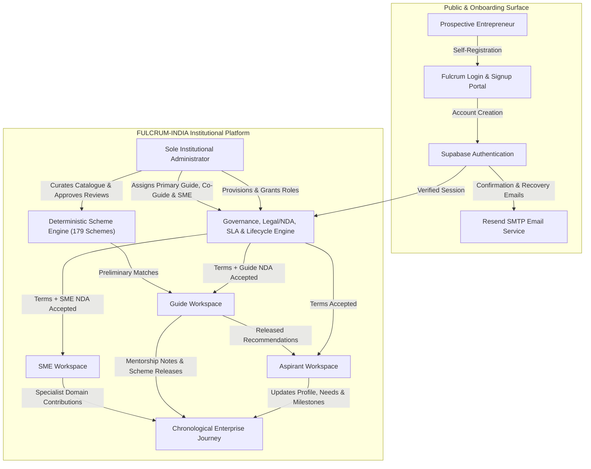

---

## 5. Existing Operational Problems Fulcrum Aims to Solve

| Problem Area | Pre-Fulcrum Operational Failure | How Fulcrum Resolves It in Code | Requirement Ref |
| :--- | :--- | :--- | :--- |
| **Role Confusion & Unauthorized Access** | Shared spreadsheets allowed mentors to browse all founders' data, or allowed multiple uncoordinated admins to overwrite assignments. | Enforces a single-Admin lock (`migrations/008` L35–L117) and restricts Guides and SMEs strictly to their assigned Aspirants in both service logic (`services/profiles.py` L23–L85) and PostgreSQL Row Level Security (`migrations/000` L424–L434). | `BO-02`, `BR-GOV-001`, `BR-PRIV-001` |
| **Generic Scheme Spam** | Entrepreneurs received bulk PDF lists of 100+ government schemes without knowing which ones they were legally barred from applying to. | Evaluates hard gatekeeper rules first (State jurisdiction, >=51% Women equity, SC/ST quota, negative domain exclusions) and requires the assigned Guide to review and explicitly release schemes (`services/scheme_matching_engine.py` L146–L205, `services/schemes.py` L401–L542). | `BO-03`, `BR-SCH-001`, `BR-SCH-002` |
| **Orphaned Mentees During Mentor Turnover** | Removing or suspending an inactive mentor left open consultation tickets and mentees stranded in limbo. | Implements safe mentor handover (`services/relationships.py` L675–L969) and pre-archive impact previews (`services/account_lifecycle.py` L794–L1076) that automatically promote a Co-Guide or flag open tickets for administrative reassignment. | `BO-01`, `BO-08`, `BR-REL-003`, `BR-LIFE-002` |
| **False Activity Reporting** | Mentors appeared "active" on paper simply because the entrepreneur kept sending follow-up messages on a ticket. | `get_last_interaction_date()` explicitly ignores Aspirant replies and counts only verified mentor actions after the mentor's effective assignment date (`services/inactivity.py` L37–L151). | `BO-06`, `BR-MON-001` |
| **Unprotected Founder Photographs & Ideas** | Founder photographs and business descriptions were stored in public folders or shared without confidentiality undertakings. | Stores photos in private Supabase buckets (`aspirant-profile-photos`, `professional-headshots`) with 300-second signed URLs and requires active assignment + signed NDA before a mentor can view an Aspirant's photo (`services/aspirant_photos.py` L36–L154, `migrations/005` L10–L71). | `BO-05`, `BR-PRIV-002`, `BR-LEGAL-002` |

---

## 6. Business Processes Before and After Digitization

| Business Process | Before Fulcrum (Manual / Ad-Hoc) | After Fulcrum (Digitized Beta 2.0.0 Workflow) |
| :--- | :--- | :--- |
| **Entrepreneur Onboarding** | Paper forms or Google Forms; no structured tracking of profile completeness or statutory registrations (UDYAM, DPIIT, StartupTN, GST, FSSAI). | Self-service signup (`views/login.py` L642–L699), mandatory Terms acceptance (`views/legal_ui.py` L19–L90), 4-section structured profile with live completion percentage (`services/profiles.py` L95–L130) and structured Assistance Need (`Y`) selector (`views/aspirant.py` L395–L435). |
| **Mentor Onboarding & NDA** | Informal email invitation; PDF NDAs tracked manually in email attachments or not collected at all. | Admin provisions Guide/SME with a temporary password (`views/admin.py` L569–L860); first login forces permanent password creation (`app.py` L1198–L1232), followed by Terms gate and role-specific NDA gate with cryptographic SHA-256 hash and typed signature (`services/legal.py` L360–L460). |
| **Case Assignment & Team Collaboration** | Admin emails mentor and founder; no shared workspace for primary Guide, Co-Guide, and SME. | Admin assigns primary Guide, optional Co-Guides (`guide_ids`), and multiple Domain SMEs (`sme_ids`) (`services/relationships.py` L216–L673). Mentors collaborate via shared case discussions and private mentor-only notes (`services/collaboration.py` L18–L237). |
| **Scheme Discovery & Advisory** | Founder searches websites or asks mentor verbally; no record of why a scheme was recommended or rejected. | Engine computes 0–100 relevance score and gatekeeper checklist across 179 schemes (`services/scheme_matching_engine.py` L208–L448). Guide reviews matches, releases approved schemes to the Aspirant (`services/schemes.py` L401–L542), or requests an Admin Scheme Support Review (`services/scheme_reviews.py` L18–L99). Post-release stages (`Recommended` → `Preparing` → `Applied` → `Approved`/`Rejected`) are tracked (`services/schemes.py` L731–L876). |
| **Escalations, Complaints & Conflicts** | Founder hesitates to complain about a Guide; SME conflicts handled informally. | Aspirant submits a Confidential Guide Complaint visible **only** to the Administrator (`views/aspirant.py` L740–L789); Admin resolves and can reassign the Guide in one step (`views/admin_governance.py` L331–L386). SMEs log formal COI declarations (`views/sme.py` L665–L695) adjudicated by Admin (`views/admin_governance.py` L686–L800). |
| **Inactivity Follow-Up** | Admin manually checks who has not spoken in weeks. | System calculates days since last mentor action, triggers Day 7/10/14 stages (`services/inactivity.py` L157–L334), and provides pre-filled WhatsApp and Gmail outreach links with an immutable external contact audit log (`services/external_contact.py` L107–L387). |

---

## 7. Business Capabilities Provided by Fulcrum

### Mermaid Diagram 2 — Business Capability Map

```mermaid
flowchart LR
    subgraph Cap1["1. Identity, Consent & Access"]
        C1A["Public Aspirant Registration & Auth"]
        C1B["Admin Mentor Provisioning & Temp Password Gate"]
        C1C["Multi-Role Grants & Workspace Switching (7 Combos)"]
        C1D["Versioned Terms & Role-Specific NDA Signing"]
    end

    subgraph Cap2["2. Entrepreneur Dossier & Journey"]
        C2A["4-Part Enterprise Profile & Assistance Needs"]
        C2B["Private Identity & Professional Headshot Vaults"]
        C2C["Chronological Enterprise Journey & Revision History"]
        C2D["Executive PDF Dossier Generation"]
    end

    subgraph Cap3["3. Mentorship & Specialist Advisory"]
        C3A["Primary Guide, Co-Guide & Multi-SME Assignment"]
        C3B["Bidirectional Consultations & Status Tracking"]
        C3C["Case Collaboration Space & Private Mentor Notes"]
        C3D["Mentor-to-Admin Inquiries & Directives"]
    end

    subgraph Cap4["4. Scheme Intelligence & Release"]
        C4A["179-Scheme Curated Institutional Catalogue"]
        C4B["3-Stage Deterministic Gatekeeper & Scoring Engine"]
        C4C["Guide Scheme Evaluation, Release & Withdrawal"]
        C4D["Admin Scheme Support Reviews & Post-Release Tracking"]
    end

    subgraph Cap5["5. Governance, SLA & Account Lifecycle"]
        C5A["Confidential Guide Complaints & Reassignment"]
        C5B["SME Conflict of Interest Declarations & Recusal"]
        C5C["7/10/14-Day Caseload Inactivity & External Outreach"]
        C5D["Account Suspension, Archival, Legal Hold & Audit Log"]
    end

    Cap1 --> Cap2
    Cap2 --> Cap3
    Cap2 --> Cap4
    Cap3 --> Cap5
    Cap4 --> Cap5
```

### 7.1 Why Fulcrum Is a Custom Business-Management Platform — Not an Ordinary Website or Template

A frequent question from non-technical stakeholders is whether Fulcrum could be replaced by a standard CMS website, a directory template, or a basic ticketing tool. The source code demonstrates why Fulcrum is a **stateful, relational business-management platform** where every role, assignment, legal consent, and lifecycle state is tightly interconnected.

Consider a concrete operational scenario involving four real roles in the system:
- **Founder A** (an Aspirant building a millet food-processing enterprise in Madurai),
- **Guide B** (Founder A's assigned primary Guide, who also has a Co-Guide **Guide D**),
- **SME C** (an assigned Food Processing & FSSAI Subject Matter Expert), and
- **The Sole Administrator** (institutional governance authority).

#### Ripple Effect 1: Administrator Archives or Suspends Guide B
When the Administrator archives **Guide B** in Admin Tab 13 (`views/admin_account_lifecycle.py` L100–L233, `services/account_lifecycle.py` L895–L1076):
1. **Pre-Archive Impact Preview (`get_archive_impact_preview`, L794–L892)**: Before archival executes, the system scans active relationships and open consultation tickets to show the Administrator exactly how many Aspirants (including **Founder A**) and open tickets will be affected.
2. **Automated Relationship Handover (`unassign_guide`, `services/relationships.py` L675–L821)**: In `public.relationships`, Guide B is removed from Founder A's active assignment. Because **Guide D** is registered in Founder A's `guide_ids` array, Guide D is **automatically promoted** to primary `guide_id` so Founder A is never left without a lead mentor (`services/relationships.py` L729–L742). If no Co-Guide existed, Founder A's relationship status would transition to `unassigned`.
3. **Consultation Ticket Re-Routing (`services/relationships.py` L762–L794)**: All open consultation tickets (`OPEN`, `IN_PROGRESS`, `WAITING_ON_GUIDE_SME`, `ACTION_REQUIRED`) between Founder A and Guide B are automatically transferred to the promoted Co-Guide (or unassigned and flagged for Admin attention) with an audit note appended to the thread.
4. **Immediate Revocation of Photo & Dossier Access (`services/aspirant_photos.py` L39–L154, `migrations/005` L11–L71)**: Guide B immediately loses authorization to generate signed URLs for Founder A's private photograph or read Founder A's profile.
5. **Preservation of Historical Contributions (`services/journey.py` L156–L242, `migrations/009` L160–L175)**: Every Journey milestone and scheme release that Guide B previously authored for Founder A remains intact in Founder A's timeline and PDF dossier (`services/pdf_generator.py` L26–L55).
6. **Transactional Rollback Safety (`services/account_lifecycle.py` L221–L329)**: If updating Guide B's profile or writing the immutable `account_lifecycle_log` entry fails, the system automatically restores the relationship snapshot (`_restore_relationship_snapshots`, L285–L329) so Founder A's mentorship team is not left in a half-broken state.

#### Ripple Effect 2: Administrator Revokes SME C's `sme` Role (or SME C Declares a Conflict of Interest)
1. **If SME C declares a Conflict of Interest (`declare_sme_conflict`, `services/governance.py` L228–L265)**:
   - A record is created in `public.sme_conflict_declarations` with `has_conflict = True` and `status = 'PENDING_REVIEW'`.
   - In SME C's workspace for Founder A (`views/sme.py` L505–L520), `check_sme_has_conflict()` returns `True`, **immediately locking SME C out of submitting consultation responses** to Founder A until the Administrator reviews the conflict in Admin Tab 12 (`views/admin_governance.py` L686–L800).
   - If the Administrator upholds the conflict (`decision = "UPHOLD_AND_UNASSIGN"` in `resolve_sme_conflict()`, `services/governance.py` L268–L313), the system automatically invokes `unassign_sme()` to remove SME C from Founder A's `sme_ids` roster and re-routes open SME tickets.
2. **If the Administrator revokes SME C's `sme` role (`revoke_role`, `services/roles.py` L638–L737)**:
   - SME C's grant in `public.user_roles` is set to `revoked` (and cannot be casually "reinstated" without a fresh grant; `services/roles.py` L800–L804).
   - `unassign_sme()` automatically removes SME C from Founder A's `relationships` row (`services/roles.py` L689–L712), invalidates cross-session role caches (`services/cache.py` L74–L81), and evicts SME C from the SME workspace on their next click (`app.py` L867–L904).

#### Ripple Effect 3: Founder A Also Becomes a Guide (`Aspirant + Guide` Hybrid Role)
When the Administrator grants **Founder A** the `guide` role (`services/roles.py` L510–L586):
1. Founder A's `guide` role starts in `pending_nda` status (`services/roles.py` L536). Founder A can continue using their **Aspirant Dashboard** normally (`app.py` L880–L885).
2. When Founder A switches the sidebar workspace selector to `🧭 Guide Dashboard (Pending NDA)` (`app.py` L884, L1003–L1015), the application intercepts routing with `render_nda_gate()` (`app.py` L1242–L1244, `views/legal_ui.py` L93–L229) and blocks access to mentee data until Founder A signs the Guide NDA.
3. Once signed, `activate_role()` transitions the grant to `active` (`services/roles.py` L593–L635).
4. **Anti-Self-Assignment Guard (`is_assignable_mentor`, `services/roles.py` L446–L448)**: Even as an active Guide, Founder A is blocked from ever being assigned as a Guide or Co-Guide to their own Aspirant profile (`str(user_id) == str(aspirant_id)` returns `False`).
5. **Independent SLA Clocks (`services/inactivity.py` L37–L151)**: Founder A's actions in their Aspirant workspace never reset their inactivity clock as a Guide for other entrepreneurs, and notifications in the sidebar are filtered by the currently active workspace (`services/notifications.py` L221–L233).

---

## 8. End-to-End Entrepreneurship-Support Lifecycle

### Mermaid Diagram 3 — End-to-End Aspirant Journey

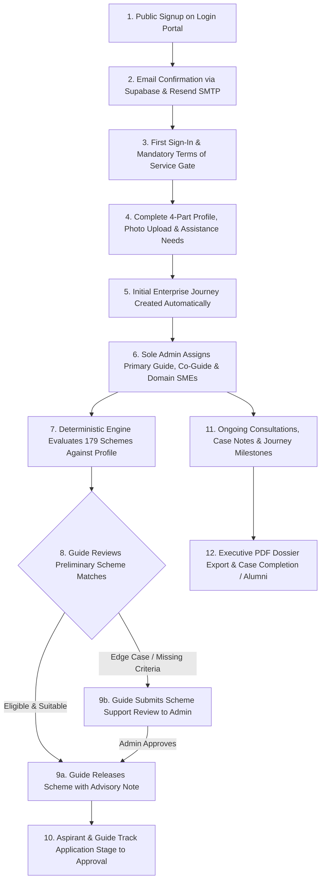

The end-to-end lifecycle comprises twelve governed stages in code:
1. **Registration (`views/login.py` L642–L699, `services/auth.py` L521–L672)**: The entrepreneur registers with Full Name, Email, Mobile Number, District (all 38 Tamil Nadu districts or custom Non-TN state/city), and Password.
2. **Email Confirmation & Profile Pre-Seeding (`services/auth.py` L579–L630)**: Supabase creates the `auth.users` identity and triggers a confirmation email via Resend SMTP (`smtp.resend.com:465`), while Fulcrum pre-seeds `public.profiles` so phone and district metadata are never lost.
3. **Terms of Service Acceptance (`app.py` L1237–L1239, `views/legal_ui.py` L19–L90)**: Upon first authenticated login, the Aspirant must read and accept `Platform Terms of Service & User Agreement v1.0.0` before any portal tab loads.
4. **Enterprise Profiling (`views/aspirant.py` L220–L454, `services/profiles.py` L541–L692)**: The Aspirant completes Personal details, Education/Professional background, Business details (sector, stage, structure, description, revenue), Demographics & Statutory Registrations (gender, women equity %, social category, DPIIT, StartupTN, UDYAM, GST, FSSAI, Drug License), and Assistance Needs (`goal`, `support_type`, `quantum_range`, `timeframe`).
5. **Journey Initialization (`services/journey.py` L32–L82)**: An initial `public.journeys` container (`"<Name>'s Enterprise Journey"`) and welcome event are created automatically.
6. **Admin Mentor Allocation (`views/admin.py` L863–L1099, `services/relationships.py` L216–L673)**: The Administrator assigns a primary Guide, optional Co-Guides, and one or more Domain SMEs. Every assignment is logged in `public.assignment_history` and triggers in-app notifications.
7. **Deterministic Scheme Evaluation (`services/scheme_matching_engine.py` L451–L517)**: The 3-stage engine evaluates all 179 active schemes against the Aspirant's profile (`X`) and assistance need (`Y`).
8. **Guide Human-in-the-Loop Review (`views/guide.py` L495–L850)**: The assigned Guide inspects eligible and disqualified matches, reviews the evidence checklist, and either releases suitable schemes to the Aspirant (`release_scheme_to_aspirant`, `services/schemes.py` L401–L542) or submits a Scheme Support Review to the Administrator (`submit_scheme_support_review`, `services/scheme_reviews.py` L18–L99).
9. **Scheme Application Tracking (`services/schemes.py` L731–L876)**: Once a scheme is released, the Aspirant and Guide track its progress across seven stages: `Recommended`, `Preparing Application`, `Application Submitted`, `Under Government Review`, `Clarification Requested`, `Approved / Sanctioned`, and `Rejected / Closed`.
10. **Consultations & Specialist Advisory (`services/help_requests.py` L184–L1363)**: The Aspirant raises general consultations to their Guide or domain-specific tickets to an SME; mentors can also proactively initiate consultations (`create_mentor_consultation`, L1163–L1267) or escalate inquiries to the Administrator (`create_mentor_admin_query`, L907–L998).
11. **Journey Evolution & Revision Auditing (`services/journey.py` L374–L1113)**: Aspirants, Guides, SMEs, and the Administrator log chronological events. Any edit to an existing event requires a reason and writes a before/after snapshot to `public.journey_event_revisions` (`migrations/002_journey_event_revisions.sql`).
12. **Dossier Export & Case Completion (`services/pdf_generator.py` L793–L822, `services/journey.py` L1116–L1191)**: Stakeholders can export a formatted PDF Enterprise Dossier, and the Administrator or Guide can mark a mature venture's journey as `completed` (Alumni status).

---

## 9. Institutional Governance and Accountability

### Mermaid Diagram 4 — Aspirant–Guide–SME Relationship & Governance Model

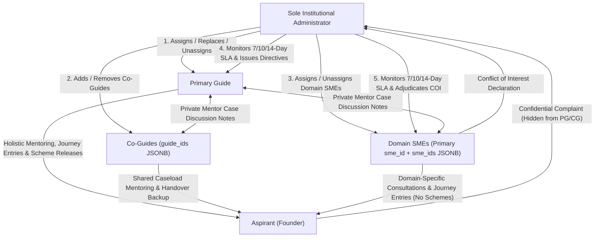

### Mermaid Diagram 5 — Administrative Governance Process

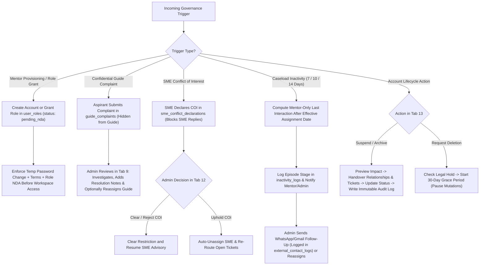

---

## 10. Business Rules and Approval Procedures

Every business rule below is enforced in active code and mapped to the Master Traceability Matrix (`BR-*`):

| Rule ID | Business Rule Title | Rule Specification & Approval Procedure | Enforcement Evidence | Status |
| :--- | :--- | :--- | :--- | :--- |
| **`BR-GOV-001`** | **Sole Administrator Identity Lock** | Exactly one account (`<SOLE_ADMIN_EMAIL>` / `<SOLE_ADMIN_UUID>`) may hold the `admin` role. Any attempt to insert or update another user to `admin`, `district_admin`, or `operational_admin` in `profiles` or `user_roles` is blocked or downgraded to `aspirant`. | `migrations/008` L14–L117, `services/roles.py` L57–L309 | Implemented — verified in source; Tested |
| **`BR-GOV-002`** | **Admin Exclusion from Participant Roles** | The Sole Administrator cannot hold Aspirant, Guide, or SME roles, cannot switch into participant workspaces, and cannot be suspended, archived, or deleted. | `app.py` L857–L860, `services/account_lifecycle.py` L607–L610, L910–L913 | Implemented — verified in source; Tested |
| **`BR-ONB-001`** | **Public Signup Restricted to Aspirants** | Public self-registration creates only `aspirant` accounts. Guides and SMEs must be provisioned or granted roles by the Administrator. | `views/login.py` L642–L704, `services/auth.py` L584–L585, `migrations/008` L45–L70 | Implemented — verified in source; Tested |
| **`BR-ONB-002`** | **Mandatory First-Login Password Change for Provisioned Mentors** | Guides and SMEs created by the Administrator with a temporary password (`temp_password_issued = True`) are blocked from all workspaces until they set a permanent password of at least 8 characters. | `app.py` L1198–L1232, `services/auth.py` L880–L995 | Implemented — verified in source; Tested |
| **`BR-LEGAL-001`** | **Universal Terms of Service Gate** | Every authenticated user (Aspirant, Guide, SME) must accept the active `terms_and_conditions` document before accessing any portal functionality. | `app.py` L1237–L1239, `views/legal_ui.py` L19–L90, `services/legal.py` L282–L310 | Implemented — verified in source; Tested |
| **`BR-LEGAL-002`** | **Role-Specific NDA Gate for Guides and SMEs** | Any user entering the `guide` or `sme` workspace—or being assigned to an Aspirant—must have an `ACCEPTED` NDA record (`nda_guide` or `nda_sme`) with a verified typed signature and confirmation phrase (`"I AGREE"`). | `app.py` L1241–L1244, `views/legal_ui.py` L93–L229, `services/roles.py` L434–L507 | Implemented — verified in source; Tested |
| **`BR-REL-001`** | **Exclusive Admin Authority Over Assignments** | Only the Administrator can assign, co-assign, replace, or unassign a Guide or SME for an Aspirant. Mentors must hold an `active` role grant in `user_roles` and a signed NDA before assignment (unless `allow_pending_nda` is explicitly passed in internal tests). | `services/relationships.py` L216–L673, `services/roles.py` L434–L507 | Implemented — verified in source; Tested |
| **`BR-REL-002`** | **Prohibition of Self-Mentoring** | A multi-role user who holds both `aspirant` and `guide`/`sme` roles can never be assigned as a Guide, Co-Guide, or SME to their own Aspirant profile. | `services/roles.py` L446–L448, `services/relationships.py` L238–L240, L478–L480 | Implemented — verified in source; Tested |
| **`BR-REL-003`** | **Co-Guide Promotion & Safe Handover on Unassignment** | Unassigning a primary Guide automatically promotes the first remaining Co-Guide in `guide_ids` to primary `guide_id` and transfers open consultation tickets to prevent orphaned cases. | `services/relationships.py` L675–L821 | Implemented — verified in source; Tested |
| **`BR-JRN-001`** | **Chronological Journey Ownership & Immutable Revision Audit** | Every Journey event records its original `actor_id` and `actor_role`. Authors may edit only their own events (Admin may edit any), and every edit requires a reason and records a full prior-state snapshot in `public.journey_event_revisions`. | `services/journey.py` L852–L1113, `migrations/002_journey_event_revisions.sql` | Implemented — verified in source; Tested |
| **`BR-SCH-001`** | **Hard Statutory Gatekeeper Disqualification** | Schemes restricted by state jurisdiction (Tamil Nadu), gender equity (>=51% female ownership), social category (SC/ST), or specialized technical domains (ISRO, semiconductor, defence, pharma R&D, nuclear, biotech, EV) automatically disqualify non-matching profiles in Stage 1. | `services/scheme_matching_engine.py` L146–L205, `services/scheme_rules.py` L119–L214 | Implemented — verified in source; Tested |
| **`BR-SCH-002`** | **Guide-Gated Scheme Release & Admin Override Review** | Aspirants see only schemes formally released to them by their assigned Guide (`public.scheme_releases`). Disqualified schemes cannot be directly released by a Guide unless escalated to and approved by the Administrator via a `scheme_support_reviews` request. | `services/schemes.py` L401–L729, `services/scheme_reviews.py` L18–L247, `views/aspirant.py` L791–L847 | Implemented — verified in source; Tested |
| **`BR-CONS-001`** | **Assignment-Bound Consultation Routing & Actor Attribution** | Consultation tickets (`public.help_requests`) can be raised by an Aspirant to their assigned Guide or SME (or initiated by an assigned Guide/SME). Every reply updates `last_interaction_actor_id`, `last_interaction_actor_role`, and separate mentor/aspirant response timestamps. | `services/help_requests.py` L184–L1363, `migrations/004` L8–L12 | Implemented — verified in source; Tested |
| **`BR-CMP-001`** | **Confidentiality of Guide Complaints** | Complaints submitted by an Aspirant against a Guide (`public.guide_complaints`) are visible only to the submitting Aspirant and the Sole Administrator—never to the Guide. | `services/governance.py` L63–L224, `migrations/000` L940–L950 | Implemented — verified in source; Tested |
| **`BR-CMP-002`** | **SME Conflict-of-Interest Recusal Lock** | When an SME declares a Conflict of Interest (`has_conflict = True`) for an assigned Aspirant, the SME is blocked from responding to that Aspirant's consultations until the Administrator either clears the conflict or upholds it and unassigns the SME. | `services/governance.py` L228–L359, `views/sme.py` L505–L520 | Implemented — verified in source; Tested |
| **`BR-MON-001`** | **Independent Mentor SLA Clocks (7 / 10 / 14 Days)** | Guide and SME inactivity clocks are calculated independently from their own effective assignment date. Aspirant replies never reset a mentor's inactivity clock. Escalation stages trigger at 7 days (`REMINDER_7D`), 10 days (`ALERT_10D`), and 14 days (`ESCALATED_14D`). | `services/inactivity.py` L37–L388, `migrations/006` L14–L51 | Implemented — verified in source; Tested |
| **`BR-MON-002`** | **Honest External Outreach Logging** | Opening a WhatsApp or Gmail compose draft logs status `DRAFT_OPENED` and does **not** claim message delivery or reset the inactivity alert status unless the Administrator explicitly confirms `SENT_CONFIRMED`. | `services/external_contact.py` L284–L348, `services/inactivity.py` L470–L569 | Implemented — verified in source; Tested |
| **`BR-LIFE-001`** | **Fail-Closed Account Status Gate & Legal Hold Protection** | Accounts with status `DENIED`, `TEMPORARILY_SUSPENDED`, or `ARCHIVED` are blocked from all workspaces. Accounts under `legal_hold = True` cannot be scheduled for deletion (`PENDING_DELETION`). Accounts in `PENDING_DELETION` have a 30-day grace period during which mutations are paused and the user can cancel closure. | `app.py` L1088–L1188, `services/account_lifecycle.py` L332–L1464 | Implemented — verified in source; Tested |
| **`BR-LIFE-002`** | **Append-Only Account Lifecycle Audit Trail** | Every account status or legal-hold change must record a reason and actor in `public.account_lifecycle_log`, which is protected against `UPDATE` and `DELETE` by table privilege revocation, restrictive RLS policies, and a PostgreSQL trigger. | `migrations/009` L180–L287, `services/account_lifecycle.py` L221–L282 | Implemented — verified in source; Tested |

---

## 11. Privacy and Confidentiality Expectations

1. **Relationship-Scoped Access to Entrepreneur Data (`BR-PRIV-001`)**: An Aspirant's full profile, contact number, business description, and Journey timeline are accessible only to the Aspirant, their currently assigned active Guides (`guide_id` or `guide_ids`), their currently assigned active SMEs (`sme_id` or `sme_ids`), and the Sole Administrator (`services/profiles.py` L23–L85, `migrations/000` L424–L434). Unassigned mentors and other Aspirants are denied access.
2. **Strict Photograph Isolation (`BR-PRIV-002`)**:
   - **Aspirant Identity Photos** (`aspirant-profile-photos` bucket, normalized to max `600x600` WebP <=180 KB, `services/aspirant_photos.py` L30–L36): Accessible only to the Aspirant, the Sole Administrator, and currently assigned active Guides/SMEs who have an `ACCEPTED` NDA (`services/aspirant_photos.py` L39–L154, `migrations/005` L10–L71). Signed URLs expire in 300 seconds.
   - **Professional Mentor Headshots** (`professional-headshots` bucket, normalized to `320x320` WebP <=150 KB, `services/professional_photos.py` L37–L45): Uploaded by the Guide/SME or Admin. Explicitly **masked from Aspirants** (`services/professional_photos.py` L90–L116: returns `False` for Aspirants unless the viewer is the subject or Admin) to enforce cross-role photo privacy (`DOCUMENTATION/01_PRODUCTION_RELEASE_AUDITS/PRODUCTION_READINESS_AND_APPROVAL_REGISTER.md` L32).
3. **Private Mentor Collaboration Space**: Messages in `public.case_discussions` marked `is_private_mentor_note = True` are visible only to assigned Guides, assigned SMEs, and the Administrator—never to the Aspirant (`services/collaboration.py` L124–L237).
4. **Administrative Identity Masking in Shared Views**: Where the Administrator intervenes in shared records, `get_masked_actor_name()` can present institutional labels (`"Fulcrum Institutional Support"`) rather than exposing personal admin details (`services/governance.py` L21–L59).

---

## 12. Government Scheme Guidance Responsibilities

### Mermaid Diagram 6 — Government Scheme Review & Release Process

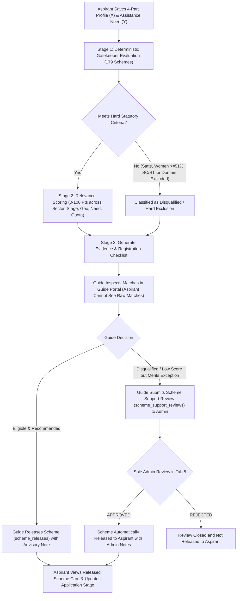

### Key Institutional Responsibilities & Disclaimers
1. **100% Deterministic Rule-Based Matching — Not Generative AI (`DISC-001`)**: Although internal docstrings and UI labels occasionally use the phrase `"AI-based matching"` or `"AI Scheme Matcher"` (`services/scheme_matching_engine.py` L2, `tests/test_single_admin_master_e2e.py` L577), code inspection confirms there are **zero** Large Language Model (LLM) calls, external AI APIs, or vector embeddings anywhere in the codebase. Matching is 100% deterministic Python rule evaluation (`services/scheme_matching_engine.py` L63–L517, `services/scheme_rules.py` L93–L214).
2. **Non-Affiliation & No Guarantee of Sanction (`DEFAULT_TERMS_DOC` Clauses 3–5, `services/legal.py` L42–L71)**: Fulcrum is an independent entrepreneurship-support platform, not a government department or sanctioning authority. Neither a high relevance score nor a Guide's release of a scheme constitutes official government approval or a guarantee of grant/loan disbursement.
3. **Human-in-the-Loop Gatekeeping**: Raw scheme matches are intentionally hidden from Aspirants (`views/aspirant.py` L791–L847 reads only `get_released_schemes_for_aspirant()`). An Aspirant sees a scheme only after their assigned Guide (or the Administrator via an approved Scheme Support Review or direct release) has reviewed the fit and released it.

---

## 13. Business Risks and Operational Dependencies

| Risk ID | Risk / Dependency | Operational Impact | Current Mitigation in Code / Docs | Residual Risk / Action Needed |
| :--- | :--- | :--- | :--- | :--- |
| **`RISK-01`** | **Confirmation Email Inbox Placement (Gmail Spam)** | New Aspirants who register do not see the confirmation email in their primary inbox and cannot sign in (`email not confirmed`), while the UI claims `"A confirmation link has been sent to your email"` without checking delivery or warning about Spam (`views/login.py` L693). | Custom SMTP via Resend (`smtp.resend.com:465`) and domain `notify.fulcrumindia.online` are verified and delivering (`Delivered` in Resend logs on `2026-11-16`). | **High UX Risk (`DEF-001`, `DEF-002`)**: Add DMARC DNS record, customize Supabase confirmation template, update `views/login.py` L693 to warn about Spam, and add a Resend Confirmation button. |
| **`RISK-02`** | **Single Point of Administrative Authority** | Because all role grants, mentor assignments, complaint resolutions, and lifecycle actions require the Sole Administrator (`<SOLE_ADMIN_EMAIL>`), administrative unavailability delays onboarding and escalations. | Intentional governance design (`BR-GOV-001`). Self-service password recovery is blocked for the Admin email (`views/login.py` L491) to prevent account takeover. | **Medium Operational Risk**: Ensure secure offline custody of Admin credentials and Supabase dashboard access. |
| **`RISK-03`** | **External Cloud Service Dependency (Supabase & Resend)** | Outage or rate-limiting in Supabase (Auth, PostgreSQL, Storage) or Resend SMTP halts authentication, database reads/writes, or email delivery. | Production runs in strict fail-closed mode (`DATA_BACKEND=supabase`) so network failures never silently write to container-local SQLite (`services/account_lifecycle.py` L332–L558). Backup scripts (`scripts/supabase_backup_manager.py`) support JSON/SQL snapshots. | **Medium Infrastructure Risk**: Automate scheduled off-site backups and monitor Supabase/Resend rate limits. |
| **`RISK-04`** | **Single-Container Python GIL Concurrency Ceiling** | Under simultaneous heavy load (>50–75 concurrent active WebSocket users clicking simultaneously), a single CPython Streamlit process queues behind the Global Interpreter Lock (GIL). | Lazy tab evaluation (`is_tab_active`), N+1 query batching, memoization (`services/cache.py`), and `BoundedSemaphore(2)` on Chromium PDF generation (`services/pdf_generator.py` L581). | **Low-to-Medium Scaling Risk**: Current KVM 2 setup sustains 30–50 simultaneous active users (supporting ~300–1,000 registered users). Scale to 2 replicas behind Caddy if concurrency grows (`15_OWNER_APPROVAL_REGISTER.md` L65–L88). |
| **`RISK-05`** | **Passive (Page-Load) Inactivity & Escalation Evaluation** | `check_and_process_caseload_inactivity()` (`services/inactivity.py` L157) and `check_and_escalate_overdue_requests()` (`services/help_requests.py` L899) run when an Administrator opens the relevant dashboard tab rather than via a background cron daemon, and `check_and_escalate_overdue_requests()` is currently a no-op stub returning `0`. | Inactivity alerts evaluate accurately on-demand whenever the Admin views Tab 10 (`views/admin_governance.py` L392–L415). | **Low Operational Risk (`DEF-005`)**: No background emails are sent if the Admin does not open the portal; overdue ticket auto-escalation is stubbed. |

---

## 14. Scope and Exclusions

### 14.1 In-Scope Capabilities (Implemented in Beta 2.0.0)
- Public Aspirant registration, email confirmation via Supabase/Resend, login, logout, and cryptographic password recovery (`views/login.py`, `services/auth.py`).
- Sole Administrator portal with **13 operational tabs** (`views/admin.py`, `views/admin_governance.py`, `views/admin_account_lifecycle.py`).
- Multi-role RBAC supporting all 7 non-admin role combinations and workspace switching (`services/roles.py`, `app.py`).
- Versioned Terms of Service and role-specific Guide/SME NDAs with SHA-256 content hashing (`services/legal.py`, `views/legal_ui.py`).
- 4-part Aspirant profile, private Aspirant photo vault, and private Guide/SME professional headshot vault (`services/profiles.py`, `services/aspirant_photos.py`, `services/professional_photos.py`).
- Chronological Enterprise Journey with multi-actor contributions, roadmap inclusion toggle, edit revision history, and PDF dossier export (`services/journey.py`, `services/pdf_generator.py`).
- Primary Guide, Co-Guide, and multi-SME caseload assignment with automated handover on unassignment/archival (`services/relationships.py`).
- Bidirectional consultations, mentor-to-admin inquiries/directives, and shared/private mentor case discussion notes (`services/help_requests.py`, `services/collaboration.py`).
- 179-scheme catalogue, 3-stage deterministic matching engine, Guide scheme release/withdrawal, Admin Scheme Support Reviews, and 7-stage post-release application tracking (`services/schemes.py`, `services/scheme_matching_engine.py`, `services/scheme_reviews.py`).
- Confidential Guide complaints, SME conflict-of-interest declarations, 7/10/14-day mentor inactivity monitoring, external WhatsApp/Gmail outreach logging, and account lifecycle management (`services/governance.py`, `services/inactivity.py`, `services/external_contact.py`, `services/account_lifecycle.py`).

### 14.2 Explicit Exclusions (Out of Current Beta 2.0.0 Scope)
- **No Multi-Admin Hierarchy**: No Super Admin, District Admin, or Operational Admin roles exist.
- **No Direct Government Portal Submission**: Fulcrum does not submit applications directly to StartupTN, Startup India, UDYAM, or bank portals; founders apply on official portals using Fulcrum's guidance.
- **No Payment Processing or Subscription Billing**: Although Terms Clause 8 reserves legal terms for future paid services (`services/legal.py` L89–L96), no payment gateway (Razorpay, Stripe, etc.) is implemented in code.
- **No Generative AI / LLM Chatbot**: No OpenAI, Gemini, or Anthropic API integration exists in active code.
- **No Native Mobile App or Automated WhatsApp Business API**: Mobile access is via responsive web browser, and external outreach generates pre-filled WhatsApp Web (`wa.me`) and Gmail compose links rather than calling a paid WhatsApp Business API (`services/external_contact.py` L107–L142).

---

## 15. Current Alpha-to-Beta Evolution

Inspection of repository documentation (`README.md`, `DOCUMENTATION/01_PRODUCTION_RELEASE_AUDITS/`, `DOCUMENTATION/06_HISTORICAL_ARGON_AND_SYSTEM_AUDITS/`, and git history up to commit `2357677`) establishes the following architectural and functional evolution:

1. **Legacy Alpha Architecture (Retired)**: An earlier over-engineered prototype ("Alpha", preserved only as an archive in `Alpha-main.zip`) attempted to use FastAPI, Redis, Celery, Kafka, and WebSockets (`README.md` L15–L27).
2. **Cluster A Rebuild ("First Principles")**: The system was rebuilt as a unified Python Streamlit + Supabase PostgreSQL/Auth application centered on the chronological Entrepreneur Journey (`README.md` L13–L35) with an initial 170-scheme seed (`seed/schemes.json`).
3. **Fulcrum-Beta 2.0.0 Institutional Expansion (Migrations `000` through `011`)**:
   - **Migration `000` & `001`**: Added multi-role RBAC (`user_roles`), versioned legal documents and acceptances (`legal_documents`, `legal_acceptances`), confidential complaints (`guide_complaints`), SME conflicts (`sme_conflict_declarations`), case discussions (`case_discussions`), and inactivity logs (`inactivity_logs`). Expanded scheme catalogue to **179 canonical schemes** (`seed/canonical_179_schemes.json`).
   - **Migration `002`**: Added immutable edit revision tracking (`journey_event_revisions`).
   - **Migration `003` & `005`**: Added private Aspirant profile photographs (`aspirant_photos` table and `aspirant-profile-photos` storage bucket) and tightened RLS to require active assignment and signed NDA.
   - **Migration `004`**: Added consultation interaction actor tracking (`last_interaction_actor_id`, `last_mentor_response_at`) and Guide-to-Admin `scheme_support_reviews`.
   - **Migration `006`**: Extended `inactivity_logs` for both Guides and SMEs with episode-aware deduplication and created `external_contact_logs` for WhatsApp/Gmail outreach auditing.
   - **Migration `007` & `008`**: Reconciled `user_roles`, enforced the **Single-Admin Identity Lock** via PostgreSQL triggers (`trg_enforce_single_admin_profile`, `trg_enforce_single_admin_user_roles`), created private `professional_photos` for Guides/SMEs, and added post-release scheme application stage tracking.
   - **Migration `009` & `010`**: Added the Account Lifecycle & Archive state machine (`account_status`, `legal_hold`, `account_lifecycle_log` with triple-layer append-only immutability, and `ON DELETE RESTRICT` on `profiles_id_fkey`), plus dual-column compatibility bridging (`010`).
   - **Migration `011` & Commit `2357677` (`2026-11-11`)**: Expanded `help_requests_status_check` to support all 10 bidirectional consultation and directive statuses (`OPEN`, `IN_PROGRESS`, `WAITING_ON_ASPIRANT`, `WAITING_ON_GUIDE_SME`, `ACTION_REQUIRED`, `REPLIED`, `RESOLVED`, `ESCALATED`, `PENDING_ADMIN`, `DIRECTIVE_ISSUED`) and remediated all 10 defects from the 32-user QA simulation (`DEF-32-001` to `DEF-32-010`).

---

## 16. Business Benefits and Expected Outcomes

*(Note: In accordance with documentation quality rules, the benefits below represent expected institutional outcomes supported by implemented capabilities, not proven post-launch commercial metrics.)*

1. **Audit-Ready Institutional Memory**: Every mentor assignment, Journey milestone edit, legal signature, scheme release, external follow-up, and account status transition is timestamped and attributed to an actor ID in PostgreSQL.
2. **Higher Quality Scheme Applications**: By filtering out hard statutory disqualifications before a founder applies—and requiring a Guide to review and release schemes—founders avoid wasted effort on ineligible government programmes.
3. **Continuity Across Mentor Changes**: Because the Journey, consultation history, and scheme releases belong to the Aspirant's case record rather than a personal chat thread, replacing a Guide or adding an SME preserves 100% of historical context.
4. **Reduced Mentorship Drop-Off**: Automated 7/10/14-day inactivity tracking and one-click WhatsApp/Gmail follow-up templates enable the Administrator to intervene before an entrepreneur disengages.

---

## 17. Success Metrics and KPIs

### 17.1 Metrics Currently Computed in the Application (`services/admin_metrics.py`, `views/admin.py`)
The Administrator Control Tower currently calculates and displays the following operational metrics in real time (`services/admin_metrics.py` L20–L188, `views/admin.py` L160–L250):
- **Total Verified Aspirants** (union of `profiles.role='aspirant'` and active `user_roles.role='aspirant'`, deduplicated).
- **Total Active Guides & Total Active SMEs** (union of `profiles` and active `user_roles`).
- **Active Enterprise Journeys Count** (`count_active_journeys()`, `services/journey.py` L827–L849).
- **Unassigned Aspirants Count** (Aspirants without an active primary Guide).
- **Open Consultations / Help Requests Count** & **Pending Mentor Inquiries Count**.
- **Pending Scheme Support Reviews Count** (`scheme_support_reviews` with `status='PENDING'`).
- **Open Confidential Guide Complaints Count** (`guide_complaints` with `status='OPEN'`).
- **Open SME Conflict Declarations Count** (`sme_conflict_declarations` with `has_conflict=True` and `status='PENDING_REVIEW'`).
- **Active Inactivity Alerts Count** (`Needs Attention` across Guide and SME caseloads).
- **Aspirant Profile Completion Percentage** (`calculate_completion()`, 0–100% across weighted profile fields, `services/profiles.py` L95–L130).

### 17.2 Proposed Institutional KPI Targets (Recommendations Requiring CEO Approval)

| KPI Name | Measurement Basis in Fulcrum Data | Proposed Target *(Recommendation — Requires Approval)* |
| :--- | :--- | :--- |
| **Aspirant Profile Readiness Rate** | % of registered Aspirants achieving >=60% profile completion (`Ready for Matching`, `views/aspirant.py` L112) within 7 days of signup | **>= 75%** |
| **Initial Guide Assignment SLA** | Time from Aspirant Terms acceptance (`legal_acceptances.accepted_at`) to first Guide assignment (`assignment_history.assigned_at`) | **<= 48 Hours** |
| **Mentor SLA Compliance Rate** | % of active Guide and SME assignments with zero `ALERT_10D` or `ESCALATED_14D` inactivity breaches (`inactivity_logs`) | **>= 90%** |
| **Consultation Resolution Turnaround** | Median time from `help_requests.created_at` to mentor response (`last_mentor_response_at`) | **<= 72 Hours** |
| **Guide Scheme Review Coverage** | % of assigned Aspirants (with >=60% profile completion) who have at least 1 Guide-released scheme in `scheme_releases` | **>= 85%** |

---

## 18. Current Implementation Status Summary

| Business Capability Area | Primary Source Modules | Implementation Status | Cross-Reference |
| :--- | :--- | :--- | :--- |
| **Public Landing, Signup & Login** | `views/login.py`, `services/auth.py` | **Implemented — verified in source; Tested** *(UX defect on signup confirmation message & spam placement: `DEF-001`, `DEF-002`)* | `PRD Section 6` |
| **Email Confirmation & Password Recovery** | `services/auth.py`, `services/auth_callback_component.py` | **Implemented — verified in source; Tested; Requires live verification** *(Resend delivery verified; Gmail spam placement observed)* | `PRD Section 6`, `SPRD Section 25` |
| **Multi-Role RBAC & Sole Admin Lock** | `services/roles.py`, `app.py`, `migrations/008` | **Implemented — verified in source; Tested** | `PRD Section 11`, `SRS Section 8` |
| **Legal Consent (Terms & Role NDAs)** | `services/legal.py`, `views/legal_ui.py` | **Implemented — verified in source; Tested** | `PRD Section 16` |
| **Aspirant 4-Part Profile & Private Photos** | `views/aspirant.py`, `services/profiles.py`, `services/aspirant_photos.py` | **Implemented — verified in source; Tested** | `PRD Section 7` |
| **Guide & SME Provisioning & Headshots** | `views/admin.py`, `services/auth.py`, `services/professional_photos.py` | **Implemented — verified in source; Tested** | `PRD Sections 8, 9, 10` |
| **Primary Guide, Co-Guide & SME Assignments** | `services/relationships.py`, `views/admin.py` | **Implemented — verified in source; Tested** | `PRD Section 15` |
| **Chronological Journey & Revision History** | `services/journey.py`, `views/journey_edit_dialog.py`, `migrations/002` | **Implemented — verified in source; Tested** | `PRD Section 12` |
| **PDF Enterprise Dossier Export** | `services/pdf_generator.py`, `services/html_to_pdf_worker.py` | **Implemented — verified in source; Tested** | `PRD Section 7` |
| **Consultations, Directives & Case Discussions** | `services/help_requests.py`, `services/collaboration.py`, `migrations/011` | **Implemented — verified in source; Tested** *(Overdue auto-escalation function `check_and_escalate_overdue_requests()` is a stub: `DEF-005`)* | `PRD Section 13` |
| **179-Scheme Deterministic Matching & Release** | `services/scheme_matching_engine.py`, `services/schemes.py`, `services/scheme_reviews.py` | **Implemented — verified in source; Tested** | `PRD Section 14` |
| **Confidential Complaints & SME Conflicts** | `services/governance.py`, `views/admin_governance.py` | **Implemented — verified in source; Tested** | `PRD Section 17` |
| **7/10/14-Day Inactivity & External Outreach** | `services/inactivity.py`, `services/external_contact.py`, `migrations/006` | **Implemented — verified in source; Tested** | `PRD Section 18` |
| **Account Lifecycle, Archive & Legal Hold** | `services/account_lifecycle.py`, `views/admin_account_lifecycle.py`, `migrations/009`, `010` | **Implemented — verified in source; Tested** *(30-day scheduled deletion purge is manual review, not auto-purged: `DEF-006`)* | `PRD Section 19` |

---

## 19. Open Business Decisions Requiring CEO Approval

The following decisions (`DEC-001` through `DEC-008`) cannot be resolved by engineering alone and require explicit direction from the CEO / Sole Administrator:

| Decision ID | Open Business Question | Options & Trade-Offs | Related Evidence / Doc |
| :--- | :--- | :--- | :--- |
| **`DEC-001`** | **Signup Email Deliverability & Unconfirmed User UX** | Should Fulcrum (a) add an in-app **"Resend Confirmation Email"** button and Spam-folder guidance on the login/signup screen while keeping mandatory email confirmation, and (b) add a DMARC record (`_dmarc.notify`) and custom HTML branding to the Supabase confirmation email? | `views/login.py` L693, `services/auth.py` L579–L630 (`DEF-001`, `DEF-002`) |
| **`DEC-002`** | **Production Database Migration Verification (`009`–`011`)** | While the Python services include adaptive fallback logic (`_execute_supabase_adaptive` in `services/account_lifecycle.py` L105–L161 and `_update_help_request_adaptive` in `services/help_requests.py` L73–L141), has the Sole Administrator executed `migrations/009`, `010`, and `011` in the live production Supabase SQL Editor so database-level constraints and triggers are active? | `PRODUCTION_READINESS_AND_APPROVAL_REGISTER.md` L47–L55, `migrations/009`–`011` |
| **`DEC-003`** | **Policy on Expired 30-Day `PENDING_DELETION` Accounts** | When an account completes its 30-day `PENDING_DELETION` grace window (`deletion_scheduled_for` elapsed), should the Administrator transition it to `ARCHIVED` (preserving institutional records permanently) or execute a personal-data anonymization/erasure procedure under the Privacy Notice? | `services/account_lifecycle.py` L1181–L1291, `views/admin_account_lifecycle.py` L295–L359 |
| **`DEC-004`** | **Overdue Consultation Auto-Escalation Threshold** | `check_and_escalate_overdue_requests()` (`services/help_requests.py` L899–L905) is currently a no-op stub (`return 0`) because mentor SLA monitoring was consolidated into the 7/10/14-day `inactivity.py` engine. Should individual tickets also auto-transition to `ESCALATED` after a specific number of days (e.g., 7 or 10 days), or should escalation remain tied to the Caseload Inactivity Monitor? | `services/help_requests.py` L899–L905 (`DEF-005`) |
| **`DEC-005`** | **Background Scheduled SLA Checks vs On-Demand Admin Evaluation** | Currently, mentor inactivity alerts (`check_and_process_caseload_inactivity()`) are computed when the Administrator opens Admin Tab 10. Does leadership want a scheduled daily background job (cron) to compute inactivity and send email digests automatically? | `services/inactivity.py` L157–L334, `views/admin_governance.py` L392–L415 |
| **`DEC-006`** | **Aspirant Visibility into Mentor Headshots** | Currently, `can_view_professional_photo()` (`services/professional_photos.py` L90–L116) masks Guide/SME headshots from Aspirants (`Cross-Role Photo Privacy`), showing initials avatars instead. Should assigned Aspirants be allowed to see their assigned Guide/SME's professional headshot, or must headshots remain strictly internal to Admin and the mentor? | `services/professional_photos.py` L90–L116 |
| **`DEC-007`** | **Docker Container Memory Ceiling on Production VPS (`CR-01`)** | Historical audit `15_OWNER_APPROVAL_REGISTER.md` (L102–L116) requested owner approval to align the live VPS `docker-compose.yml` memory limit (`3072M` or the `5G` configured in the repo's `docker-compose.yml` L26). Confirm the approved memory limit on the active Hostinger KVM 2 host. | `docker-compose.yml` L20–L29, `15_OWNER_APPROVAL_REGISTER.md` L113 |
| **`DEC-008`** | **Long-Term Architecture Posture (Stay on Streamlit vs Future Migration)** | Recent untracked executive reports (`FULCRUM_BETA_FEASIBILITY_REPORT.md`) discuss a potential future React/Next.js + API architecture for high concurrency (>100 simultaneous users), while Beta 2.0.0 is stable on Streamlit + Supabase for 30–50 simultaneous active users (~300–1,000 registered users). Confirm whether Beta 2.0.0 remains on Streamlit for the current cohort. | `15_OWNER_APPROVAL_REGISTER.md` L65–L90, `FULCRUM_BETA_FEASIBILITY_REPORT.md` |

---

## 20. Business Acceptance Criteria

For Fulcrum-Beta 2.0.0 to be accepted as the institutional production baseline, the following business acceptance criteria must hold (`UATD Section 26–27`):

1. **BAC-01 (Onboarding & Consent)**: A new Aspirant can register, receive and verify their confirmation email (with clear guidance if filtered to Spam), sign in, accept the Terms of Service, and complete their 4-part profile and Assistance Needs (`UAT-AUTH-001` to `UAT-ONB-005`).
2. **BAC-02 (Sole Admin Authority & Provisioning)**: Only the Sole Administrator can access the 13 Admin tabs, provision Guides and SMEs with temporary passwords, and manage role grants; any non-admin attempting to spoof admin authority is rejected (`UAT-ADMIN-001`, `UAT-SEC-001`).
3. **BAC-03 (Mentor NDA Gate & Caseload Isolation)**: Newly provisioned or promoted Guides and SMEs are forced to change their temporary password and sign their role-specific NDA before viewing any assigned Aspirant, and can never view unassigned Aspirants or their own Aspirant profile as a mentor (`UAT-LEGAL-002`, `UAT-REL-004`, `UAT-PRIV-001`).
4. **BAC-04 (Deterministic Scheme Matching & Guide Release)**: The scheme engine disqualifies ineligible schemes (state, women equity <51%, SC/ST, specialized domain exclusions) and ranks eligible schemes; Aspirants see only schemes formally released by their Guide or approved by the Admin via a Scheme Support Review (`UAT-SCH-001` to `UAT-SCH-008`).
5. **BAC-05 (Consultations, Complaints & COI Governance)**: Aspirants and assigned mentors can exchange consultation messages with accurate status transitions; Aspirant complaints against Guides remain invisible to the Guide; SME conflict declarations block SME replies until resolved by the Admin (`UAT-CONS-001` to `UAT-CMP-004`).
6. **BAC-06 (Zero-Data-Loss Handover & Lifecycle)**: Suspending or archiving a mentor safely hands over active relationships and open tickets (promoting Co-Guides where present), preserves all historical Journey entries, and writes an immutable audit entry in `account_lifecycle_log` (`UAT-LIFE-001` to `UAT-LIFE-006`).

---

## 21. Future Business Opportunities (Separated from Current Scope)

The following items are **not** implemented in the active Beta 2.0.0 codebase and are recorded strictly as **Planned / proposed** future opportunities identified in historical backlog documents (`DOCUMENTATION/06_HISTORICAL_ARGON_AND_SYSTEM_AUDITS/ARGON_PROPOSED_FEATURES_WITHIN_EXISTING_TABS.md`, `ARGON_ASPIRANT_ENGAGEMENT_MONITOR_PROPOSAL.md`, `FULCRUM_BETA_FEASIBILITY_REPORT.md`):

| Proposal Ref | Future Opportunity | Current Status | Notes |
| :--- | :--- | :--- | :--- |
| **`PROP-01`** | **In-App Resend Confirmation Email & Deliverability Hardening** | **Planned / proposed** | Add `client.auth.resend({"type": "signup", "email": ...})` button in `views/login.py`, update line 693 copy to mention Spam/Promotions, and configure DMARC + custom HTML template in Supabase/Resend. |
| **`PROP-02`** | **Automated Background Cron for Daily SLA & Digest Emails** | **Planned / proposed** | Run `check_and_process_caseload_inactivity()` on a scheduled timer and send automated email alerts via Resend API in addition to in-app notifications. |
| **`PROP-03`** | **Multi-Container Horizontal Scaling on KVM 2 (2 Replicas)** | **Planned / proposed** | Run 2 `fulcrum-app` container replicas behind Caddy (`15_OWNER_APPROVAL_REGISTER.md` L87–L97) when simultaneous active users exceed 30–50. |
| **`PROP-04`** | **Optional Paid Programme Tiers & Payment Gateway Integration** | **Documented only** (in Terms Clause 8) | Legal provisions exist in `DEFAULT_TERMS_DOC` Clause 8 (`services/legal.py` L89–L96), but no billing or payment code exists. |
| **`PROP-05`** | **Optional AI-Assisted Pitch Deck / Document Review** | **Planned / proposed** | Discussed in executive feasibility reports (`FULCRUM_BETA_FEASIBILITY_REPORT.md`); currently 0% implemented—all scheme matching is deterministic rule evaluation. |
| **`PROP-06`** | **Future Decoupled Frontend/API Migration (React + API Workers)** | **Planned / proposed** | Discussed in untracked executive feasibility studies for future scale (>1,000 concurrent users); completely separate from the active Python Streamlit + Supabase Beta 2.0.0 platform. |

---

## Glossary of Business & Platform Terms

| Term | Plain-Language Definition |
| :--- | :--- |
| **Aspirant** | An entrepreneur or startup founder who registers on Fulcrum to build their business profile, receive mentorship, discover government schemes, and track their Enterprise Journey. |
| **Assistance Need (`Y`)** | The structured funding or support requirement selected by an Aspirant (Assistance Goal, Support Type, Funding Quantum Range, and Timeframe) used alongside their Profile (`X`) to rank government schemes. |
| **Case Discussion** | A collaborative message thread associated with an Aspirant's case (`public.case_discussions`), which can be either shared with the Aspirant or marked as a **Private Mentor Note** visible only to assigned Guides, SMEs, and the Admin. |
| **Co-Guide** | An additional Guide assigned to an Aspirant (`relationships.guide_ids` JSONB array) who collaborates with the Primary Guide and is automatically promoted to Primary Guide if the Primary Guide is unassigned or archived. |
| **Conflict of Interest (COI)** | A formal declaration by an SME (`public.sme_conflict_declarations`) stating whether they have a personal, financial, or competitive conflict with an assigned Aspirant. Declaring a conflict pauses the SME's ability to respond to consultations until Admin review. |
| **Deterministic Scheme Matching** | Fulcrum's rule-based evaluation engine (`services/scheme_matching_engine.py`) that uses explicit statutory rules and weighted scoring (not generative AI) to filter and rank 179 government and private schemes. |
| **Enterprise Journey** | The chronological timeline ("The Movie") of an Aspirant's business milestones, mentorship notes, scheme releases, and specialist contributions (`public.journeys` and `public.journey_events`). |
| **Gatekeeper Eligibility (Stage 1)** | Mandatory statutory criteria (such as Tamil Nadu state registration, >=51% women equity ownership, SC/ST category, or specialized sector capability) that immediately disqualify non-matching profiles from a scheme. |
| **Guide** | A general business mentor provisioned by the Administrator who provides holistic business guidance, reviews scheme matches, and formally releases suitable schemes to assigned Aspirants. |
| **Inactivity Episode** | A distinct period during which an assigned Guide or SME has not recorded any verified interaction with an Aspirant across 7-day (Reminder), 10-day (Admin Alert), and 14-day (Critical Escalation) thresholds (`public.inactivity_logs`). |
| **Legal Hold** | A compliance flag (`profiles.legal_hold = True`) set by the Sole Administrator that blocks an account from being scheduled for deletion or purged while an audit or dispute is active. |
| **Multi-Role Participant (Hybrid User)** | A non-admin user granted more than one role in `public.user_roles` (for example, an Aspirant who is also approved to mentor others as a Guide or SME). |
| **Row Level Security (RLS)** | A PostgreSQL database security feature that automatically filters which rows a user's database connection is allowed to read, insert, update, or delete. |
| **Scheme Release** | The formal action by an assigned Guide (or Admin) making a vetted government scheme visible in an Aspirant's **Scheme Matches** tab (`public.scheme_releases`), accompanied by a recommendation level and advisory note. |
| **Scheme Support Review (SSR)** | An escalation request (`public.scheme_support_reviews`) submitted by a Guide to the Administrator asking for human override approval to release a scheme where the Aspirant failed or lacked certain automated criteria. |
| **Sole Administrator** | The single institutional governance account (`<SOLE_ADMIN_EMAIL>`) authorized to provision mentors, grant roles, assign cases, manage schemes, resolve complaints/conflicts, and execute account lifecycle transitions. |
| **Subject Matter Expert (SME)** | A domain specialist (e.g., GST, patents, FSSAI, legal, debt syndication) provisioned by the Administrator and assigned to Aspirants for targeted consultation and Journey contributions (without scheme-release duties). |

---

# FULCRUM-INDIA BETA 2.0.0 — PRODUCT REQUIREMENTS DOCUMENT (PRD)

| Document Attribute | Value |
| :--- | :--- |
| **Document ID** | `FULCRUM-PRD-V2.0` |
| **Version** | `2.0-baseline` |
| **Date of Analysis** | `2026-11-16` |
| **Reviewed Repository Commit** | `235767754f8d8bb4605e819593bb3f370ddeab27` (`2026-11-11`) |
| **Target Audience** | Product Managers, UI/UX Designers, Frontend & Backend Engineers, QA Lead |
| **Document Status** | Baseline Functional Inventory of Implemented Beta 2.0.0 Application |

---

## 1. Product Overview

**FULCRUM-INDIA Beta 2.0.0** is a multi-portal web application built with **Python 3.11+ / Streamlit (`>=1.55.0,<=1.56.0`)** and backed by **Supabase (PostgreSQL, GoTrue Authentication, and Private Object Storage)** with a local **SQLite (`cluster_a.db`)** development/testing mirror (`app.py` L1–L1279, `requirements.txt` L1–L14, `services/local_db.py` L1–L2832).

The product provides four role-specific portals within a single application shell (`app.py` L1251–L1275):
1. **Aspirant Portal (`views/aspirant.py`)**: 6 tabs for entrepreneur onboarding, 4-part enterprise profiling, private identity photograph management, chronological Enterprise Journey tracking, assigned mentor interaction, Guide-released government scheme tracking, and consultation ticketing.
2. **Guide Portal (`views/guide.py`)**: 3 main tabs and 6 per-mentee pill subtabs for general business mentors to inspect assigned Aspirants, log Journey mentorship milestones, evaluate 179 deterministic scheme matches, release schemes or request Admin Scheme Support Reviews, respond to consultations, and post case collaboration notes.
3. **SME Portal (`views/sme.py`)**: 3 main tabs and 4 per-mentee pill subtabs for Subject Matter Experts to deliver domain-specific consultations, log specialist Journey milestones, collaborate with Guides, and declare Conflicts of Interest (without scheme-matching duties).
4. **Administrator Control Tower (`views/admin.py`, `views/admin_governance.py`, `views/admin_account_lifecycle.py`)**: **13 operational tabs** reserved exclusively for the Sole Institutional Administrator (`<SOLE_ADMIN_EMAIL>`) to manage the entire entrepreneur and mentor lifecycle.

---

## 2. Product Objectives

The functional design of Fulcrum-Beta 2.0.0 fulfills the eight institutional objectives defined in [`FULCRUM_BRD_V2.md`](./FULCRUM_BRD_V2.md) (`BO-01` through `BO-08`):
- **Single-Page Reactive Workspace with Lazy Tab Rendering**: Eliminate redundant database queries on tab switches by binding `st.tabs(..., on_change="rerun")` to `services.cache.is_tab_active()` (`services/cache.py` L154–L159).
- **Strict Sequential Onboarding Gates**: Enforce Account Lifecycle Status Gate $\rightarrow$ First-Login Permanent Password Gate $\rightarrow$ Universal Terms of Service Gate $\rightarrow$ Role-Specific NDA Gate before rendering any workspace (`app.py` L1088–L1245).
- **Workspace-Scoped Multi-Role Experience**: Allow a single authenticated user holding multiple non-admin roles (`user_roles`) to switch cleanly between Aspirant, Guide, and SME workspaces via `sb_current_workspace` (`app.py` L1003–L1015).
- **Human-in-the-Loop Scheme Curation**: Prevent raw algorithmic matches from overwhelming founders by routing all 179 scheme evaluations through the assigned Guide (`views/guide.py` L495–L850) before surfacing approved schemes in the Aspirant's **Scheme Matches** tab (`views/aspirant.py` L791–L847).

---

## 3. Current Architecture Summary

*(For full technical specifications, database constraints, and sequence diagrams, see [`FULCRUM_SRS_V2.md`](./FULCRUM_SRS_V2.md).)*

- **Presentation & Routing Layer**: `app.py` (1,279 lines) injects responsive CSS design tokens, manages `st.session_state`, renders the authenticated sidebar (user badge, workspace switcher, workspace-filtered notification center, logout), executes the four security/legal gates, and dispatches to `views/login.py`, `views/aspirant.py`, `views/guide.py`, `views/sme.py`, or `views/admin.py`.
- **Custom Browser Bridge Component**: `services/auth_callback_component.py` (98 lines) uses Streamlit Components v2 (`st.components.v2.component`) to read URL fragment tokens (`#access_token=...&refresh_token=...&type=recovery`) in browser JavaScript, scrub the URL bar via `history.replaceState`, and pass tokens over WebSocket to Python.
- **Service Layer**: 31 Python modules in `services/` encapsulating authentication (`auth.py`), RBAC (`roles.py`), legal/NDA (`legal.py`), profiles (`profiles.py`), photos (`aspirant_photos.py`, `professional_photos.py`), relationships (`relationships.py`), journeys (`journey.py`), PDF dossiers (`pdf_generator.py`, `html_to_pdf_worker.py`), schemes (`schemes.py`, `scheme_matching_engine.py`, `scheme_rules.py`, `scheme_reviews.py`, `schemes_ui.py`), consultations (`help_requests.py`, `collaboration.py`), governance (`governance.py`, `inactivity.py`, `external_contact.py`, `account_lifecycle.py`, `admin_metrics.py`), and infrastructure (`cache.py`, `pagination.py`, `logger.py`, `perf.py`, `local_db.py`).
- **Persistence Layer**: 18 PostgreSQL tables in `public` schema + 2 private Supabase Storage buckets (`aspirant-profile-photos`, `professional-headshots`) defined across `migrations/000` through `011`.

---

## 4. User Personas and Roles

| Persona ID | Persona & Role | Provisioning Path | Active Workspaces Allowed | Key Product Needs |
| :--- | :--- | :--- | :--- | :--- |
| **`PER-ASP`** | **Founder / Entrepreneur (`aspirant`)** | Public signup (`views/login.py` L642) or base role on any non-admin account. | `🌱 Aspirant Dashboard` | Build enterprise profile, discover verified government schemes, get timely mentorship from Guide and SME, export PDF business dossier, and report Guide issues confidentially. |
| **`PER-GUIDE`** | **General Business Mentor (`guide`)** | Admin Tab 2 (`views/admin.py` L569) or Admin Tab 7 Multi-Role Grant (`views/admin_governance.py` L75). | `🧭 Guide Dashboard` (plus `🌱 Aspirant` / `🔬 SME` if multi-role) | View assigned mentees' full context and Journey, evaluate and release scheme matches, answer consultations within 7-day SLA, coordinate with Co-Guides/SMEs. |
| **`PER-SME`** | **Domain Specialist (`sme`)** | Admin Tab 3 (`views/admin.py` L715) or Admin Tab 7 Multi-Role Grant (`views/admin_governance.py` L75). | `🔬 SME Dashboard` (plus `🌱 Aspirant` / `🧭 Guide` if multi-role) | Provide targeted domain advice (GST, legal, FSSAI, patents, debt), log specialist Journey milestones, declare Conflicts of Interest when necessary. |
| **`PER-HYB`** | **Hybrid Participant (7 Non-Admin Combos)** | Granted additional roles in `public.user_roles` by Sole Admin. | Any combination of `aspirant`, `guide`, `sme` | Switch workspaces seamlessly without cross-contaminating notifications, badges, or SLA clocks; prevented from mentoring own enterprise. |
| **`PER-ADM`** | **Sole Institutional Administrator (`admin`)** | Locked to `<SOLE_ADMIN_EMAIL>` / `<SOLE_ADMIN_UUID>` (`migrations/008` L14–L43). | `🏛️ Admin Dashboard` only | Single pane of glass across 13 tabs to govern users, roles, assignments, schemes, legal records, complaints, COI, inactivity SLAs, and account archival. |

---

## 5. Complete Navigation and Screen Inventory

### Mermaid Diagram 1 — Product Navigation Map

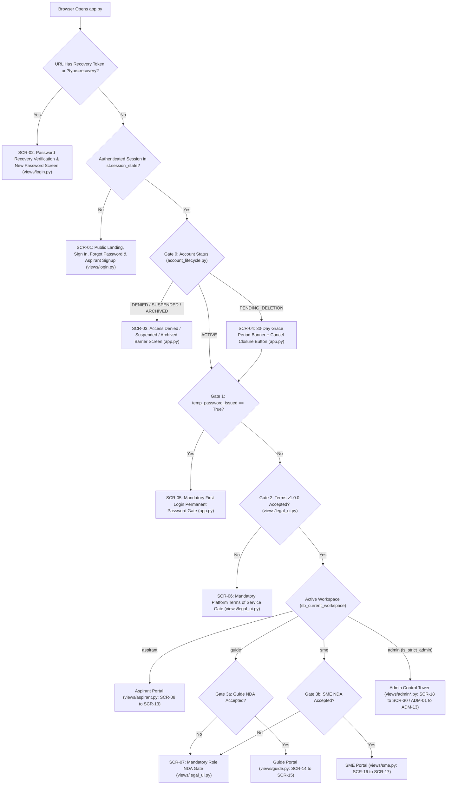

### 5.1 Master Screen Inventory Table (`SCR-01` to `SCR-30`)

| Screen ID | Screen / View Name | Source File & Lines | Navigation Route / State Key | Authorized Roles |
| :--- | :--- | :--- | :--- | :--- |
| **`SCR-01`** | Public Landing, Sign In, Forgot Password & Aspirant Signup | `views/login.py` L36–L706 | Unauthenticated root (`is_logged_in == False`) | Public / Unauthenticated |
| **`SCR-02`** | Password Recovery Verification & New Password Screen | `views/login.py` L375–L558 | `?type=recovery` or `#access_token` via `read_auth_callback()` | Unauthenticated (with valid recovery token) |
| **`SCR-03`** | Account Denied / Suspended / Archived Barrier Screen | `app.py` L1095–L1150 | `acc_status in ('DENIED','TEMPORARILY_SUSPENDED','ARCHIVED')` | Blocked Authenticated Users |
| **`SCR-04`** | Account Pending Deletion Grace-Period Banner & Cancellation | `app.py` L1151–L1188 | `acc_status == 'PENDING_DELETION'` | Authenticated Non-Admin Users |
| **`SCR-05`** | Mandatory First-Login Permanent Password Gate | `app.py` L1198–L1232 | `profile_data.temp_password_issued == True` | Provisioned Guides & SMEs |
| **`SCR-06`** | Mandatory Platform Terms & Conditions Gate | `views/legal_ui.py` L19–L90 | `check_user_terms_accepted(user_id) == False` | Aspirant, Guide, SME |
| **`SCR-07`** | Mandatory Role Non-Disclosure Agreement (NDA) Gate | `views/legal_ui.py` L93–L229 | `active_role in ('guide','sme')` & `check_user_nda_accepted == False` | Guide, SME |
| **`SCR-08`** | Aspirant Tab 1: Overview & Executive Dossier Export | `views/aspirant.py` L100–L218 | `aspirant_nav_tabs[0]` (`📊 Overview`) | Aspirant |
| **`SCR-09`** | Aspirant Tab 2: My Profile (4-Part Form, Photo & Needs) | `views/aspirant.py` L220–L454 | `aspirant_nav_tabs[1]` (`👤 My Profile`) | Aspirant |
| **`SCR-10`** | Aspirant Tab 3: My Journey & Milestone Editor | `views/aspirant.py` L456–L644, `views/journey_edit_dialog.py` | `aspirant_nav_tabs[2]` (`🎬 My Journey`) | Aspirant |
| **`SCR-11`** | Aspirant Tab 4: My Mentors & Confidential Guide Complaint | `views/aspirant.py` L646–L789 | `aspirant_nav_tabs[3]` (`🤝 My Mentors`) | Aspirant |
| **`SCR-12`** | Aspirant Tab 5: Scheme Matches (Guide-Released Schemes) | `views/aspirant.py` L791–L847 | `aspirant_nav_tabs[4]` (`🏦 Scheme Matches`) | Aspirant |
| **`SCR-13`** | Aspirant Tab 6: Consult a Guide or SME & Case Discussions | `views/aspirant.py` L849–L1104 | `aspirant_nav_tabs[5]` (`🤝 Consult a Guide or SME`) | Aspirant |
| **`SCR-14`** | Guide Tab 1: My Aspirants (with 6 Pill Subtabs: Profile, Journey, Guidance Team, Schemes, Consultations, Collaboration) | `views/guide.py` L104–L1099 | `guide_main_tabs[0]` (`👥 My Aspirants`) + `guide_subtab_<id>` | Guide |
| **`SCR-15`** | Guide Tab 2 & Tab 3: All Consultations Overview & Guide Profile/Headshot | `views/guide.py` L1102–L1379 | `guide_main_tabs[1]` & `guide_main_tabs[2]` | Guide |
| **`SCR-16`** | SME Tab 1: My Assigned Cases (with 4 Pill Subtabs: Profile, Journey, Guidance Team, Consultations + COI Form) | `views/sme.py` L84–L695 | `sme_nav_tabs[0]` (`👥 My Assigned Cases`) + `sme_subtab_<id>` | SME |
| **`SCR-17`** | SME Tab 2 & Tab 3: All Consultations Overview & SME Profile/Headshot | `views/sme.py` L697–L952 | `sme_nav_tabs[1]` & `sme_nav_tabs[2]` | SME |
| **`SCR-18`** | Admin Tab 1 (`ADM-01`): Aspirants & Journeys Directory | `views/admin.py` L271–L566 | `admin_main_tabs[0]` (`👥 Aspirants & Journeys`) | Sole Admin |
| **`SCR-19`** | Admin Tab 2 (`ADM-02`): Guides Management & Provisioning | `views/admin.py` L569–L712 | `admin_main_tabs[1]` (`🧭 Guides Management`) | Sole Admin |
| **`SCR-20`** | Admin Tab 3 (`ADM-03`): SMEs Management & Provisioning | `views/admin.py` L715–L860 | `admin_main_tabs[2]` (`🔬 SMEs Management`) | Sole Admin |
| **`SCR-21`** | Admin Tab 4 (`ADM-04`): Mentor Assignments & Roster Matrix | `views/admin.py` L863–L1098 | `admin_main_tabs[3]` (`🎯 Mentor Assignments`) | Sole Admin |
| **`SCR-22`** | Admin Tab 5 (`ADM-05`): Mentor Inquiries & Scheme Support Reviews | `views/admin.py` L1101–L1296 | `admin_main_tabs[4]` (`🏛️ Mentor Inquiries & Directives`) | Sole Admin |
| **`SCR-23`** | Admin Tab 6 (`ADM-06`): Scheme Catalogue (CRUD & Delegation) | `views/admin.py` L1299–L1494, `services/schemes_ui.py` | `admin_main_tabs[5]` (`🏦 Scheme Catalogue (CRUD)`) | Sole Admin |
| **`SCR-24`** | Admin Tab 7 (`ADM-07`): Multi-Role Grants & Identity | `views/admin_governance.py` L75–L287 | `admin_main_tabs[6]` (`🔑 Multi-Role Grants`) | Sole Admin |
| **`SCR-25`** | Admin Tab 8 (`ADM-08`): Legal & NDA Records | `views/admin_governance.py` L293–L325 | `admin_main_tabs[7]` (`📜 Legal & NDA Records`) | Sole Admin |
| **`SCR-26`** | Admin Tab 9 (`ADM-09`): Confidential Guide Complaints | `views/admin_governance.py` L331–L386 | `admin_main_tabs[8]` (`🛡️ Confidential Complaints`) | Sole Admin |
| **`SCR-27`** | Admin Tab 10 (`ADM-10`): Caseload Inactivity Monitor | `views/admin_governance.py` L392–L680 | `admin_main_tabs[9]` (`⏱️ Inactivity Monitor`) | Sole Admin |
| **`SCR-28`** | Admin Tab 11 (`ADM-11`): Contact Aspirants (WhatsApp & Gmail) | `views/admin_governance.py` L806–L994 | `admin_main_tabs[10]` (`💬 Contact Aspirants`) | Sole Admin |
| **`SCR-29`** | Admin Tab 12 (`ADM-12`): SME Conflict Governance | `views/admin_governance.py` L686–L800 | `admin_main_tabs[11]` (`⚖️ SME Conflict Governance`) | Sole Admin |
| **`SCR-30`** | Admin Tab 13 (`ADM-13`): Account Lifecycle & Archive (4 Subtabs) | `views/admin_account_lifecycle.py` L43–L395 | `admin_main_tabs[12]` (`🗄️ Account Lifecycle & Archive`) | Sole Admin |

### 5.2 Screen-by-Screen Detail Cards (Public, Auth & Gate Screens `SCR-01` to `SCR-07`)

#### `SCR-01` — Public Landing, Sign In, Forgot Password & Aspirant Signup

| Screen Attribute | Specification |
| :--- | :--- |
| **Screen ID & Name** | `SCR-01` — Public Landing, Sign In, Forgot Password & Aspirant Signup |
| **Page Purpose** | Present institutional branding and value proposition on the left column and provide tabbed Sign In, Forgot Password, and Public Aspirant Registration forms on the right column. |
| **Navigation Route** | Root URL `/` when `is_logged_in == False` (`app.py` L1084–L1086 -> `views/login.py` L29–L706). |
| **Authorized Roles** | Public / Unauthenticated users. |
| **Visible Information** | Left column: FULCRUM-INDIA badge, headline ('Accelerating Entrepreneurial Journeys Across India'), 3 feature callouts (Chronological Enterprise Journey, Dedicated Guide & SME Mentorship, 179+ Verified Schemes), Tamil Nadu focus banner. Right column: `Sign In` and `Create Aspirant Account` tabs (`st.tabs`, L563), plus `🔑 Forgot Password?` expander (L599) and system maintenance contact link (`<SOLE_ADMIN_EMAIL>`, L635). |
| **Forms & Controls** | 1. `login_form` (`input_login_email`, `input_login_pwd`, L571–L585); 2. `forgot_pwd_form` (`input_fp_email`, L602–L609); 3. `signup_form` (`signup_name`, `signup_email`, `signup_phone`, `signup_district` selectbox of 38 TN districts + `Other District / Non-TN (Specify)` default index 13 = Madurai, `signup_other_district`, `signup_pwd`, `signup_pwd2`, L645–L668). |
| **Required Fields** | Sign In: Email, Password. Forgot Password: Registered Email. Signup: Full Name, Email, Password, Confirm Password, plus custom District/State if `Other District / Non-TN (Specify)` is chosen (Mobile Number is optional in validation at L675). |
| **Validation Messages (Exact Code Strings)** | - Login empty: `Please enter your email and password.` (L594)
- Login failure: `Invalid credentials. Please verify your email and password.` or `Email not confirmed. Please check your inbox for the verification link.` (`services/auth.py` L380)
- Forgot password empty: `Please enter your email.` (L619)
- Signup missing fields: `Please fill in all mandatory fields.` (L676)
- Signup password mismatch: `Passwords do not match.` (L678)
- Signup short password: `Password must be at least 6 characters long.` (L680)
- Signup missing custom district: `Please specify your district / city / state.` (L682) |
| **Buttons & Their Effects** | - `LOGIN`: calls `login_user()`, populates `st.session_state.user`/`role` and calls `st.rerun()`.
- `Send Reset Link`: calls `send_password_reset()` via ephemeral Supabase client.
- `CREATE ASPIRANT ACCOUNT`: calls `signup_aspirant()`, pre-seeds `profiles` row if `res.session is None`, displays confirmation banner (L693). |
| **Loading Behaviour** | Synchronous form submission; Streamlit top-right running indicator. |
| **Empty States** | Default clean form inputs with placeholders (`name@domain.in`, `Ravi Kumar`, `9876543210`). |
| **Error States** | Displays `st.error()` boxes for invalid credentials, unconfirmed email, rate limits, or duplicate email (`An account with this email already exists. Please sign in.`, `services/auth.py` L595). |
| **Role-Specific Differences** | Public signup creates `aspirant` accounts only; footer explicitly states: `Note: Mentors (Guides and Subject Matter Experts) are provisioned exclusively by Program Administration.` (L702). In `sqlite` dev mode, Forgot Password shows `🔑 Reset Local Dev Password` button (L628). |
| **Mobile Considerations** | Responsive 2-column layout (`[1.15, 1]`) stacks vertically on mobile viewports (`<768px`) via CSS media queries in `views/login.py` L95–L125. |
| **Existing UX Defects** | 1. **Misleading Email Delivery Confirmation (`DEF-001`)**: Line 693 displays `🎉 Account created successfully for **<email>**! A confirmation link has been sent to your email. Please check your inbox and verify your email before signing in.` based solely on `pending_confirmation=True` (`res.session is None`), without checking delivery or warning users to check **Spam/Promotions**.
2. **No Resend Confirmation Button (`DEF-002`)**: Unconfirmed users who miss or expire their signup email have no in-app button to call `client.auth.resend()`.
3. **Password Minimum Length Discrepancy (`DEF-003`)**: Public signup allows `>= 6` characters (`views/login.py` L679), whereas Password Recovery (`views/login.py` L489) and First-Login Password Change (`app.py` L1220) enforce `>= 8` characters.
4. **Minor Typo in Footer (`DEF-004`)**: Line 635 spells `Maintainence` instead of `Maintenance`. |

#### `SCR-02` — Password Recovery Verification & New Password Screen

| Screen Attribute | Specification |
| :--- | :--- |
| **Screen ID & Name** | `SCR-02` — Password Recovery Verification & New Password Screen |
| **Page Purpose** | Verify incoming Supabase password recovery links (`#access_token` or `?token_hash`) and allow the user to set a new password. |
| **Navigation Route** | Triggered when `in_recovery_flow == True` (`app.py` L803–L810 -> `views/login.py` L375–L558). |
| **Authorized Roles** | Unauthenticated user arriving from a single-use password reset email link. |
| **Visible Information** | State 1 (Error): `Recovery Link Expired or Invalid` card with troubleshooting guidance and `Request a New Password Reset Link` button (L405–L452). State 2 (Verified): `🔑 Set New Password` card displaying `Verified Account: <email>` and green `✓ Cryptographically Verified` pill (L465–L476). |
| **Forms & Controls** | `form_set_new_password` (`rec_pwd1`, `rec_pwd2`, `UPDATE PASSWORD` submit button, L479–L482) and `← Cancel & Back to Sign In` button (L534). |
| **Required Fields** | `New Password` and `Confirm New Password` (both required, `>= 8` characters). |
| **Validation Messages (Exact Code Strings)** | - `Please enter and confirm your new password.` (L486)
- `Passwords do not match.` (L488)
- `Password must be at least 8 characters long.` (L490)
- Admin lock: `Security Notice: Platform Administrator credentials cannot be reset through self-service recovery. Contact system maintenance.` (L492)
- Same password: `New password must be different from your current password.` (L522) |
| **Buttons & Their Effects** | - `UPDATE PASSWORD`: calls `complete_password_reset()`, signs out temporary recovery session, sets `password_reset_success = True`, clears query params, and reruns to Sign In tab.
- `← Cancel & Back to Sign In`: signs out recovery session, clears tokens, returns to Sign In. |
| **Loading Behaviour** | While `read_auth_callback(expect_hash=True)` bridges `#access_token` from browser JS over WebSocket (`views/login.py` L342–L373), displays spinner/info state before verifying tokens. |
| **Empty States** | N/A (always renders either Verification In Progress, Recovery Error card, or Set New Password form). |
| **Error States** | Classifies expired/used links, network timeouts, and missing tokens via `_classify_recovery_error()` (`services/auth.py` L212–L261). |
| **Role-Specific Differences** | Blocks self-service password reset if `verified_email` matches `<SOLE_ADMIN_EMAIL>` (L491). |
| **Mobile Considerations** | Centered card container (`max-width: 520px`) adapts cleanly to mobile screens. |
| **Existing UX Defects** | None identified in current source (previous `#access_token` race condition was remediated via `services/auth_callback_component.py`). |

#### `SCR-03 & SCR-04` — Account Lifecycle Barrier Screens & 30-Day Deletion Grace Banner

| Screen Attribute | Specification |
| :--- | :--- |
| **Screen ID & Name** | `SCR-03 & SCR-04` — Account Lifecycle Barrier Screens & 30-Day Deletion Grace Banner |
| **Page Purpose** | Enforce fail-closed access control for `DENIED`, `TEMPORARILY_SUSPENDED`, and `ARCHIVED` accounts (`SCR-03`), or display a 30-day closure countdown with one-click cancellation for `PENDING_DELETION` accounts (`SCR-04`). |
| **Navigation Route** | `app.py` L1088–L1188 immediately after authentication check. |
| **Authorized Roles** | All authenticated users. |
| **Visible Information** | `SCR-03`: Red-bordered security card showing `🚫 Access Denied` or `🔒 Account Suspended` / `Account Archived`, the `Reason on Record`, institutional preservation notice, support email link, and `🚪 Sign Out` button. `SCR-04`: Amber banner showing `⏳ Account Scheduled for Closure (30-Day Grace Period Active)`, `Requested On`, `Scheduled Review Date`, `Legal Hold` status, reason, and `↩️ Cancel Closure Request` button. |
| **Forms & Controls** | `btn_denied_logout` (L1117), `btn_suspended_logout` (L1146), `btn_cancel_deletion_banner` (L1181). |
| **Required Fields** | None (single-click action buttons). |
| **Validation Messages (Exact Code Strings)** | - Cancellation success: `Account closure cancelled! Your account remains active.` (L1184)
- Cancellation error: `Failed to cancel closure.` (L1187) |
| **Buttons & Their Effects** | - `🚪 Sign Out`: calls `logout_user()` and `st.rerun()`.
- `↩️ Cancel Closure Request`: calls `cancel_account_deletion(user['id'], actor_id=user['id'])` (`services/account_lifecycle.py` L1294–L1383), restoring `account_status = 'ACTIVE'`. |
| **Loading Behaviour** | Reuses `acc_lifecycle` evaluated in the sidebar (`app.py` L847, L1090) so zero duplicate database queries occur. |
| **Empty States** | N/A. |
| **Error States** | Fail-closed: if `get_account_status()` encounters a missing profile or database error in Supabase mode, it returns `DENIED` (`services/account_lifecycle.py` L332–L558). |
| **Role-Specific Differences** | Sidebar hides workspace switcher and notifications when `is_blocked_sb == True` (`app.py` L936–L941). |
| **Mobile Considerations** | Centered responsive cards (`max-width: 620px` / `760px`) with `flex-wrap: wrap`. |
| **Existing UX Defects** | While `create_request()` in `services/help_requests.py` explicitly blocks new consultation submissions during `PENDING_DELETION`, some secondary forms (such as profile edits) rely on the UI banner warning unless gated at the service level. |

#### `SCR-05, SCR-06 & SCR-07` — Sequential Onboarding Gates: First-Login Password, Terms of Service & Role NDA

| Screen Attribute | Specification |
| :--- | :--- |
| **Screen ID & Name** | `SCR-05, SCR-06 & SCR-07` — Sequential Onboarding Gates: First-Login Password, Terms of Service & Role NDA |
| **Page Purpose** | Enforce permanent password creation for admin-provisioned mentors (`SCR-05`), universal Terms of Service acceptance (`SCR-06`), and role-specific NDA execution (`SCR-07`) before any portal renders. |
| **Navigation Route** | `app.py` L1198–L1245 -> `views/legal_ui.py` L19–L229. |
| **Authorized Roles** | `SCR-05`: Admin-provisioned Guides/SMEs. `SCR-06`: All non-admin users. `SCR-07`: Users entering `guide` or `sme` workspace. |
| **Visible Information** | `SCR-05`: `🔐 Action Required: Set Permanent Password` card + `form_first_login_pw`. `SCR-06`: Scrollable Markdown box with `Platform Terms of Service & User Agreement v1.0.0` + checkbox + `Accept & Continue`. `SCR-07`: Scrollable Markdown box with `Mentor & SME Non-Disclosure Agreement v1.0.0`, SHA-256 document hash, checkbox, typed full name input, and typed confirmation phrase (`I AGREE`). |
| **Forms & Controls** | `form_first_login_pw` (`app.py` L1216); `form_accept_terms` (`views/legal_ui.py` L62); `form_sign_nda_{role}` (`views/legal_ui.py` L201). |
| **Required Fields** | `SCR-05`: New Password & Confirm (`>= 8` chars). `SCR-06`: Agreement checkbox. `SCR-07`: Agreement checkbox, Typed Full Legal Name (`>= 2` chars), Confirmation Phrase (`I AGREE`, case-insensitive). |
| **Validation Messages (Exact Code Strings)** | - `SCR-05`: `Password must be at least 8 characters long.` (L1221), `Passwords do not match. Please re-enter.` (L1223)
- `SCR-06`: `You must check the agreement box to accept the Terms & Conditions.` (`views/legal_ui.py` L72)
- `SCR-07`: `Please check the confirmation box, enter your full legal name, and type 'I AGREE'.` (`services/legal.py` L415) |
| **Buttons & Their Effects** | - `SET PERMANENT PASSWORD & ENTER`: calls `complete_first_login_password_change()`, clears `temp_password_issued`, reruns.
- `Accept & Continue`: calls `record_legal_acceptance(..., doc_type='terms_and_conditions')`.
- `Sign NDA & Activate Workspace`: calls `record_legal_acceptance(..., doc_type='nda_guide'/'nda_sme')` and `activate_role(user_id, role)`. |
| **Loading Behaviour** | Memoized legal acceptance checks (`services/legal.py` L282–L357). |
| **Empty States** | If `legal_documents` table has no row in DB, falls back to built-in `DEFAULT_TERMS_DOC` / `DEFAULT_NDA_DOC` constants (`services/legal.py` L246–L279). |
| **Error States** | Displays `st.error()` if validation or DB insert fails. |
| **Role-Specific Differences** | Sole Admin bypasses Terms/NDA gates (`is_strict_admin` check in `services/legal.py` L286, L318). Hybrid user can use Aspirant workspace without signing Guide/SME NDA, and only hits `SCR-07` when switching to Guide/SME workspace (`app.py` L1242). |
| **Mobile Considerations** | Scrollable legal text container (`height: 360px`) works on mobile touch screens. |
| **Existing UX Defects** | IP address and User-Agent fields in `record_legal_acceptance()` default to `'streamlit-client'` unless passed (`services/legal.py` L367–L368) because Streamlit does not expose raw client IP headers by default. |

---

## 6. Authentication and Onboarding Requirements (`FR-AUTH-*`, `FR-ONB-*`)

### Mermaid Diagram 2 — Registration, Email Confirmation, Login & Password Recovery Journey

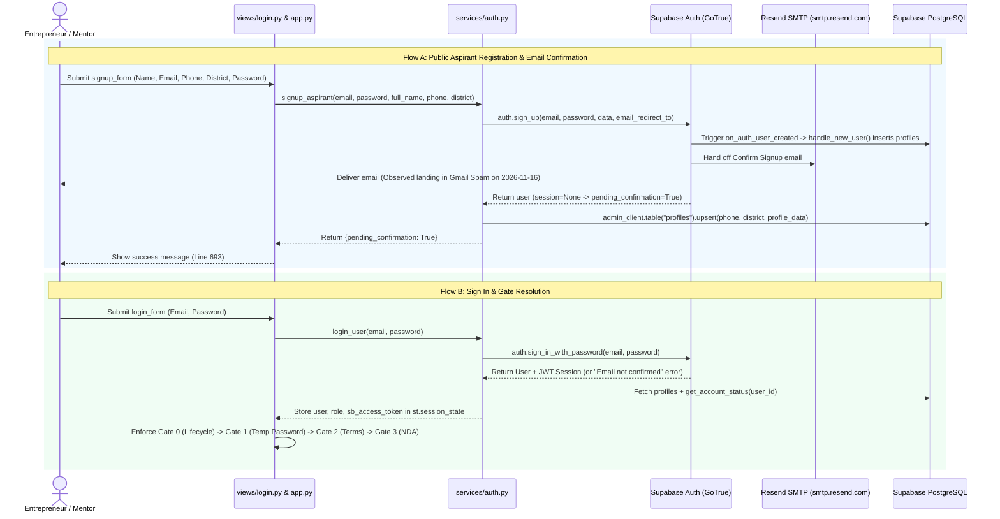

#### `FR-AUTH-001` — Public Aspirant Account Registration

| Field | Specification |
| :--- | :--- |
| **Requirement ID** | `FR-AUTH-001` |
| **Feature Name** | Public Aspirant Account Registration |
| **Business Purpose** | Allow prospective entrepreneurs to self-register for an Aspirant account with their contact and location details. |
| **User Role** | Public / Unauthenticated User (prospective Aspirant). |
| **Preconditions** | `DATA_BACKEND=supabase` configured (or `local` for SQLite dev); user is on `SCR-01` `Create Aspirant Account` tab. |
| **Trigger** | User clicks `CREATE ASPIRANT ACCOUNT` in `signup_form` (`views/login.py` L668). |
| **Normal Workflow** | 1. UI validates mandatory fields (`s_name`, `s_email`, `s_pwd`), password match, password length `>= 6`, and custom district if `Other District / Non-TN (Specify)` is selected (`views/login.py` L675–L682).
2. Calls `signup_aspirant()` (`services/auth.py` L521–L672).
3. `signup_aspirant()` calls `client.auth.sign_up()` with `data={full_name, role:'aspirant', district, phone}` and `email_redirect_to=get_app_base_url()` (L579–L591).
4. PostgreSQL trigger `on_auth_user_created` executes `handle_new_user()` (`migrations/008` L45–L70), inserting a row in `public.profiles`.
5. When email confirmation is enabled in Supabase (`res.session is None`), `signup_aspirant()` uses `get_supabase_admin_client()` to upsert `public.profiles` with `phone`, `district`, and initial `profile_data` (L604–L630) and returns `{'pending_confirmation': True}`.
6. UI displays the green confirmation message at `views/login.py` L693. |
| **Alternative Workflow** | If email confirmation is disabled in Supabase (`res.session` is returned) or in `local` SQLite mode, `signup_aspirant()` immediately creates `profiles`, `journeys`, and `relationships` rows, sets `st.session_state.user`, and logs the user in (`services/auth.py` L540–L570, L632–L672). |
| **Error & Failure Conditions** | - Missing fields / password mismatch / `<6` chars: inline `st.error()`.
- Existing email: catches `already registered` / `user already exists` and returns `'An account with this email already exists. Please sign in.'` (L594–L595).
- Supabase client missing: returns `'Supabase client is not available. Please verify credentials.'` (L575). |
| **Input Fields & Validation** | `Full Name` (text, required), `Work / Personal Email` (text, required), `Mobile Number` (text, optional in UI check), `District (Tamil Nadu)` (selectbox of 38 TN districts + `Other District / Non-TN (Specify)`), custom location text (required if Other selected), `Create Password` & `Confirm Password` (`>= 6` chars). |
| **Output / Visible Result** | Displays `🎉 Account created successfully for **<email>**! A confirmation link has been sent to your email. Please check your inbox and verify your email before signing in.` (`views/login.py` L693). |
| **Related Database Records** | Writes `auth.users` (Supabase Auth) and `public.profiles` (pre-seeded via service-role client; plus `public.journeys` and `public.relationships` on first confirmed login). |
| **Authorization Requirements** | Publicly accessible; role is hard-locked to `aspirant` by both `signup_aspirant()` (L585) and DB trigger `handle_new_user()` (`migrations/008` L51–L58). |
| **Acceptance Criteria** | 1. Submitting valid details creates `auth.users` and `public.profiles` with `role='aspirant'`.
2. Attempting to sign in before clicking the email confirmation link is blocked with an unconfirmed-email message.
3. Phone and district are preserved in `public.profiles`. |
| **Related Source Files** | `views/login.py` L642–L704, `services/auth.py` L521–L672, `migrations/008_single_admin_lock_professional_photos_and_workflow_columns.sql` L45–L70. |
| **Related Tests** | `tests/test_single_admin_master_e2e.py::test_01_onboarding_and_registration`, `verify_5_fixes.py::test_problem_4_phone_persistence_self_healing`. |
| **Implementation Status** | **Implemented — verified in source; Tested (UX defects DEF-001, DEF-002, DEF-003 identified)** |

#### `FR-AUTH-002` — Email Confirmation & First Confirmed Sign-In Self-Healing

| Field | Specification |
| :--- | :--- |
| **Requirement ID** | `FR-AUTH-002` |
| **Feature Name** | Email Confirmation & First Confirmed Sign-In Self-Healing |
| **Business Purpose** | Verify the user's email address via Supabase Auth and automatically initialize missing `profiles`, `journeys`, and `relationships` records on first confirmed sign-in. |
| **User Role** | Aspirant, Guide, SME, Sole Admin. |
| **Preconditions** | User has registered in Supabase Auth and clicked the confirmation link delivered via Resend SMTP (`smtp.resend.com:465`). |
| **Trigger** | User submits `login_form` (`views/login.py` L585) after confirming email. |
| **Normal Workflow** | 1. `login_user(email, password)` (`services/auth.py` L312–L519) calls `client.auth.sign_in_with_password()`.
2. Stores `sb_access_token` and `sb_refresh_token` in `st.session_state` (L390–L395).
3. Queries `public.profiles` for `user_id` (L401–L408). If missing (e.g., trigger race condition), self-heals by upserting `public.profiles`, `public.journeys`, and `public.relationships` using `user.user_metadata` (L410–L448).
4. Syncs phone/district from `user_metadata` if missing via `sync_user_phone_if_missing()` (L263–L310, L461).
5. Evaluates `get_account_status(user_id)` (L468): blocks login immediately if `account_status` is `DENIED`, `TEMPORARILY_SUSPENDED`, or `ARCHIVED`.
6. Sets `st.session_state.user`, `st.session_state.user_id`, `st.session_state.role`, and `st.session_state.active_workspace`. |
| **Alternative Workflow** | If the user has not confirmed their email, Supabase raises an `Email not confirmed` exception, which `login_user()` catches at L379–L380 and returns: `'Email not confirmed. Please check your inbox for the verification link.'` |
| **Error & Failure Conditions** | - Unconfirmed email: `'Email not confirmed. Please check your inbox for the verification link.'` (L380)
- Invalid credentials: `'Invalid email or password. Please try again.'` (L382)
- Suspended/Archived/Denied account: returns specific status reason and logs out session (L472–L492). |
| **Input Fields & Validation** | `Email Address` (text, stripped & lowercased), `Password` (password). |
| **Output / Visible Result** | Redirects user into authenticated application shell (`app.py`) or displays specific error message. |
| **Related Database Records** | Reads `auth.users`; reads/upserts `public.profiles`, `public.journeys`, `public.relationships`, `public.user_roles`. |
| **Authorization Requirements** | Requires valid Supabase Auth credentials and confirmed email timestamp (`email_confirmed_at` in `auth.users`). |
| **Acceptance Criteria** | 1. Unconfirmed account cannot sign in.
2. Confirmed account signs in and has valid `profiles`, `journeys`, and `relationships` records.
3. Non-admin account with legacy `admin` string in `profiles.role` is downgraded to `aspirant` on login (L452–L458). |
| **Related Source Files** | `services/auth.py` L263–L519, `views/login.py` L568–L595. |
| **Related Tests** | `tests/test_single_admin_master_e2e.py::test_01_onboarding_and_registration`, `tests/test_argon_p0_negative_security.py`. |
| **Implementation Status** | **Implemented — verified in source; Tested; Requires live verification (for SMTP/Spam inbox placement)** |

#### `FR-AUTH-003` — Cryptographic Password Recovery & WebSocket Token Bridge

| Field | Specification |
| :--- | :--- |
| **Requirement ID** | `FR-AUTH-003` |
| **Feature Name** | Cryptographic Password Recovery & WebSocket Token Bridge |
| **Business Purpose** | Allow non-admin users who forgot their password to request a single-use recovery email and set a new password after cryptographic token verification. |
| **User Role** | Aspirant, Guide, SME (Explicitly blocked for Sole Admin). |
| **Preconditions** | `DATA_BACKEND=supabase`; user has a registered email address. |
| **Trigger** | User submits `forgot_pwd_form` (`views/login.py` L602–L619) or clicks recovery link in email. |
| **Normal Workflow** | 1. **Request Link**: `send_password_reset(email)` (`services/auth.py` L674–L708) creates an isolated ephemeral Supabase client (`_create_ephemeral_supabase_client`, L197–L209) and calls `reset_password_for_email(clean_email, options={'redirect_to': f'{app_base}/?type=recovery'})`.
2. **Browser Callback Bridge**: When the user opens the link (`https://app.fulcrumindia.online/?type=recovery#access_token=...`), `read_auth_callback()` (`services/auth_callback_component.py` L80–L97) reads the URL hash in JavaScript, clears the URL bar via `history.replaceState`, and returns `access_token` and `refresh_token` to Python (`views/login.py` L342–L373).
3. **Token Verification**: `verify_recovery_session_tokens()` (`services/auth.py` L711–L747) or `verify_recovery_token_hash()` (L750–L785, for `?token_hash=` PKCE links) verifies the tokens on a clean temporary Supabase client and sets `st.session_state.recovery_verified = True` and `recovery_verified_email`.
4. **Password Update**: User submits `form_set_new_password` (`views/login.py` L479–L533). `complete_password_reset()` (`services/auth.py` L788–L877) updates the password via `temp_client.auth.update_user({'password': new_password})`, signs out all recovery state, and returns to Sign In with a success banner. |
| **Alternative Workflow** | In `sqlite` dev mode, clicking `🔑 Reset Local Dev Password` opens the recovery form for local testing (`views/login.py` L626–L630). |
| **Error & Failure Conditions** | - Admin email entered in `send_password_reset()` or `complete_password_reset()`: blocked (`views/login.py` L491–L492, `services/auth.py` L801–L803).
- Expired/reused token: `_classify_recovery_error()` (L212–L261) renders `Recovery Link Expired or Invalid` screen (`views/login.py` L405–L452).
- Rate limit (`429` / `over_email_send_rate_limit`): returns friendly cooldown message (L234–L238). |
| **Input Fields & Validation** | `Registered Email` (email), `New Password` (`>= 8` chars, must differ from current password), `Confirm New Password`. |
| **Output / Visible Result** | `Password reset email sent! Check your inbox for the reset link.` (L615), followed by `Set New Password` screen (`SCR-02`) and post-reset confirmation banner. |
| **Related Database Records** | Updates encrypted password in `auth.users` (and clears `temp_password_issued` in `public.profiles.profile_data` if present). |
| **Authorization Requirements** | Requires valid single-use Supabase recovery `access_token` + `refresh_token` or `token_hash`; strictly prohibited for `<SOLE_ADMIN_EMAIL>`. |
| **Acceptance Criteria** | 1. Valid recovery link opens `Set New Password` with verified email badge.
2. Expired or tampered token shows `Recovery Link Expired or Invalid`.
3. Sole Admin email cannot reset password via self-service. |
| **Related Source Files** | `services/auth.py` L197–L261, L674–L877, `services/auth_callback_component.py` L1–L98, `views/login.py` L335–L558, L599–L630. |
| **Related Tests** | `tests/test_password_recovery_suite.py` (all test cases). |
| **Implementation Status** | **Implemented — verified in source; Tested** |

#### `FR-AUTH-004` — Admin Mentor Provisioning & First-Login Forced Password Change

| Field | Specification |
| :--- | :--- |
| **Requirement ID** | `FR-AUTH-004` |
| **Feature Name** | Admin Mentor Provisioning & First-Login Forced Password Change |
| **Business Purpose** | Allow the Sole Administrator to create Guide and SME accounts with a provisional password and force the mentor to set a permanent password on first login. |
| **User Role** | Sole Administrator (provisioning) -> Provisioned Guide or SME (first login). |
| **Preconditions** | Admin is authenticated in Admin Tab 2 (`SCR-19`) or Tab 3 (`SCR-20`). |
| **Trigger** | Admin submits `form_create_guide` (`views/admin.py` L581) or `form_create_sme` (`views/admin.py` L727); mentor subsequently signs in (`app.py` L1198). |
| **Normal Workflow** | 1. Admin fills Mentor Name, Email, Phone, District, Primary Industry/Domain, Bio, Expertise tags, and Provisional Password (auto-generated once per session via `_get_or_init_provisional_password()`, `views/admin.py` L82–L86, to prevent regeneration on rerun `DEF-32-003`).
2. Calls `admin_create_mentor()` (`services/auth.py` L997–L1130), which verifies `require_sole_admin()`, calls `admin_client.auth.admin.create_user({'email_confirm': True, ...})`, upserts `public.profiles` with `profile_data.temp_password_issued = True`, and upserts `public.user_roles` with `status = 'pending_nda'`.
3. When the mentor signs in, `app.py` L1198–L1232 detects `temp_password_issued is True` and renders `SCR-05` (`form_first_login_pw`).
4. Mentor enters a new password (`>= 8` chars); `complete_first_login_password_change()` (`services/auth.py` L880–L995) updates the password in Supabase Auth and sets `temp_password_issued = False` in `public.profiles`. |
| **Alternative Workflow** | If the email already belongs to an existing user, the Admin uses Tab 7 (`🔑 Multi-Role Grants`) to grant `guide` or `sme` to the existing account instead of creating a duplicate user. |
| **Error & Failure Conditions** | - Non-admin caller: rejected by `require_sole_admin()` (`services/auth.py` L1012).
- Password `< 8` chars on provisioning or first login: rejected (`services/auth.py` L1021, `app.py` L1220). |
| **Input Fields & Validation** | Admin form: Full Name, Email, Mobile, Location, Industry, Bio, Expertise, Provisional Password (`>= 8` chars). Mentor form: New Permanent Password & Confirm (`>= 8` chars). |
| **Output / Visible Result** | Admin sees `✅ Guide/SME account created for <Name>!` with copyable provisional credentials; Mentor sees `SCR-05` on first login and `Permanent password set successfully!` upon completion. |
| **Related Database Records** | Writes `auth.users`, `public.profiles` (`temp_password_issued`), and `public.user_roles` (`status='pending_nda'`). |
| **Authorization Requirements** | `admin_create_mentor()` requires Sole Admin (`require_sole_admin()`); `complete_first_login_password_change()` requires authenticated session matching `user_id`. |
| **Acceptance Criteria** | 1. Newly provisioned Guide/SME has `email_confirm=True` and `temp_password_issued=True`.
2. Mentor cannot view dashboard tabs until permanent password (`>=8` chars) is set.
3. After password change, `temp_password_issued` is `False`. |
| **Related Source Files** | `views/admin.py` L82–L86, L569–L860, `app.py` L1198–L1232, `services/auth.py` L880–L1130. |
| **Related Tests** | `tests/test_qa32_fixes_regression.py::test_def003_def008_def009_ui_contracts_and_delegation`. |
| **Implementation Status** | **Implemented — verified in source; Tested** |

#### `FR-AUTH-005` — Session Management & Cross-Session Logout Isolation

| Field | Specification |
| :--- | :--- |
| **Requirement ID** | `FR-AUTH-005` |
| **Feature Name** | Session Management & Cross-Session Logout Isolation |
| **Business Purpose** | Maintain isolated per-browser-tab session state and cleanly purge all authentication tokens, cached clients, and query parameters on logout. |
| **User Role** | All authenticated roles (Aspirant, Guide, SME, Admin). |
| **Preconditions** | User has an active session in `st.session_state`. |
| **Trigger** | User clicks `🚪 Logout` / `🚪 Sign Out` in sidebar or barrier screen (`app.py` L938, L1077, L1117, L1146). |
| **Normal Workflow** | 1. Calls `logout_user()` (`services/auth.py` L1236–L1246).
2. Signs out the per-session `supabase_client` (`client.auth.sign_out()`).
3. Clears `user`, `user_id`, `role`, `active_workspace`, `sb_access_token`, `sb_refresh_token`, `supabase_client`, and `_session_memo_store` from `st.session_state`.
4. Calls `st.rerun()`, returning the browser to `SCR-01`. |
| **Alternative Workflow** | If `get_supabase_client()` (`services/auth.py` L147–L182) detects `sb_access_token` in `st.session_state`, it attaches the user's JWT session to a dedicated per-session Supabase `Client` stored in `st.session_state.supabase_client` so two concurrent browser sessions never share a global mutable user token. |
| **Error & Failure Conditions** | Any exception during `client.auth.sign_out()` is caught and ignored so local session cleanup always completes (`services/auth.py` L1241–L1242). |
| **Input Fields & Validation** | None (button click). |
| **Output / Visible Result** | User is returned to the unauthenticated login page (`SCR-01`). |
| **Related Database Records** | Revokes session in Supabase Auth (`auth.sessions`). |
| **Authorization Requirements** | Any authenticated user may log out their own session. |
| **Acceptance Criteria** | 1. Clicking Logout clears all session keys and tokens.
2. Concurrent sessions for User A and User B in separate browsers do not leak `st.session_state` or Supabase JWTs. |
| **Related Source Files** | `services/auth.py` L147–L182, L1236–L1246, `app.py` L938–L941, L1077–L1079. |
| **Related Tests** | `tests/test_cross_session_isolation.py`. |
| **Implementation Status** | **Implemented — verified in source; Tested** |

---

## 7. Aspirant Workspace Requirements (`FR-ASP-*`, `SCR-08` to `SCR-13`)

### 7.1 Aspirant Workspace Screen Detail Cards (`SCR-08` to `SCR-13`)
#### `SCR-08` — Aspirant Tab 1: Overview & Executive Dossier Export

| Screen Attribute | Specification |
| :--- | :--- |
| **Screen ID & Name** | `SCR-08` — Aspirant Tab 1: Overview & Executive Dossier Export |
| **Page Purpose** | Provide a high-level summary of the entrepreneur's profile readiness, assigned mentors, released schemes count, recent Journey milestones, and one-click Executive PDF Dossier generation. |
| **Navigation Route** | `views/aspirant.py` L100–L218 (`aspirant_nav_tabs[0]`: `📊 Overview`). |
| **Authorized Roles** | Aspirant (active workspace = `aspirant`). |
| **Visible Information** | Top header with private identity photo avatar (`render_aspirant_photo_header`, L60), Enterprise name, District, and Profile Completion progress bar (0–100%). Four KPI cards: `Profile Status` (`Ready for Matching` if `>=60%`), `My Dedicated Guide`, `Domain SME`, and `Released Schemes`. Below: `📄 Generate Executive Business Dossier (PDF)` section and recent 5 Journey milestones preview. |
| **Forms & Controls** | `btn_gen_dossier_pdf` button (`📄 Prepare Executive Dossier PDF`, L176) and `st.download_button` (`📥 Download Official PDF Dossier`, L188). |
| **Required Fields** | None. |
| **Validation Messages (Exact Code Strings)** | If PDF generation fails, falls back from Playwright Chromium -> ReportLab -> minimal valid emergency PDF (`services/pdf_generator.py` L587–L786) so download never crashes. |
| **Buttons & Their Effects** | - `📄 Prepare Executive Dossier PDF`: calls `generate_aspirant_dossier_pdf(user_id)` and stores bytes in `st.session_state[f'dossier_pdf_{user_id}']`.
- `📥 Download Official PDF Dossier`: downloads `Fulcrum_Dossier_<Name>.pdf`. |
| **Loading Behaviour** | Displays `with st.spinner('Compiling your enterprise profile, journey timeline & scheme intelligence into a print-ready PDF...'):` (L177). |
| **Empty States** | If no mentors assigned: shows `Pending Admin Assignment` / `Assigned on Request`. If no Journey events: shows `Your journey starts here! Head to the 'My Journey' tab to add your first milestone.` (L217). |
| **Error States** | Handled gracefully via 3-tier PDF fallback. |
| **Role-Specific Differences** | Aspirant sees only their own overview and dossier. |
| **Mobile Considerations** | 4-column KPI row wraps on mobile. |
| **Existing UX Defects** | None identified. |

#### `SCR-09` — Aspirant Tab 2: My Profile (4-Part Enterprise Profile, Private Photo & Assistance Needs)

| Screen Attribute | Specification |
| :--- | :--- |
| **Screen ID & Name** | `SCR-09` — Aspirant Tab 2: My Profile (4-Part Enterprise Profile, Private Photo & Assistance Needs) |
| **Page Purpose** | Allow the Aspirant to upload/remove their private identity photograph and edit their 4-part enterprise profile and structured Assistance Needs (`Y`). |
| **Navigation Route** | `views/aspirant.py` L220–L454 (`aspirant_nav_tabs[1]`: `👤 My Profile`). |
| **Authorized Roles** | Aspirant. |
| **Visible Information** | 1. **Private Identity Photograph Panel** (L225–L274): current photo preview (or initials avatar), privacy notice (`Visible strictly to you, your assigned Guide/SME (with signed NDA), and Program Administration`), file uploader (`jpg`, `jpeg`, `png`, `webp`, max 5 MB), `Upload / Replace Photo` and `Remove Photo` buttons.
2. **4-Part Enterprise Profile Form (`form_update_profile`, L279–L454)**:
   - **Part 1 — Personal & Contact Details**: Full Name, Mobile Number, Gender (`MASTER_GENDERS`), District (`MASTER_DISTRICTS_TN` + custom), State, LinkedIn/Website.
   - **Part 2 — Education & Professional Background**: Highest Qualification, Institution, Years of Experience, Prior Startup Experience, Key Skills.
   - **Part 3 — Business & Venture Details**: Business/Enterprise Name, Industry Sector (`MASTER_SECTORS` + custom), Sub-Sector/Niche, Business Structure/Type (`MASTER_BUSINESS_TYPES` + custom), Commercial Activity Description, Venture Development Stage (`MASTER_STAGES` + custom), Annual Revenue, Team Size, Incorporation Status.
   - **Part 4 — Demographics, Affirmative Quotas & Statutory Registrations**: Social Category (`MASTER_SOCIAL_CATEGORIES`), Women-Led Enterprise checkbox (`is_women_led`), Women Equity Ownership % (`women_equity_pct`, 0–100%), DPIIT Recognized, StartupTN Registered, UDYAM Registered, GST Registered, FSSAI Licensed, Drug License.
   - **Part 5 — What Assistance Do You Need Right Now? (`assistance_need`)**: Primary Assistance Goal (`ASSISTANCE_GOALS`), Specific Support Type (`SUPPORT_TYPES_BY_GOAL`), Target Funding Quantum (`FUNDING_QUANTUM_RANGES`), Target Timeframe (`TIMEFRAME_OPTIONS`). |
| **Forms & Controls** | Photo uploader + `btn_upload_asp_photo` (L254), `btn_delete_asp_photo` (L267), and `form_update_profile` with `💾 SAVE COMPLETE ENTERPRISE PROFILE` submit button (L437). |
| **Required Fields** | `Full Name` is required; all taxonomy dropdowns have defaults; `women_equity_pct` is numeric `0–100`. |
| **Validation Messages (Exact Code Strings)** | - Photo upload success: `Identity photograph updated and optimized!` (L259)
- Photo removal success: `Photograph removed.` (L270)
- Profile save success: `Profile updated successfully! Your Scheme Matches and Journey have been synchronized.` (L450) |
| **Buttons & Their Effects** | - `Upload / Replace Photo`: calls `upload_aspirant_photo()` (`services/aspirant_photos.py` L375–L542).
- `Remove Photo`: calls `delete_aspirant_photo()` (L545–L595).
- `💾 SAVE COMPLETE ENTERPRISE PROFILE`: calls `update_aspirant_profile()` (`services/profiles.py` L541–L692), preserving any existing `mentor` keys in `profile_data` for hybrid users (`DEF-32-006`). |
| **Loading Behaviour** | Synchronous save with cache invalidation (`invalidate_memo`) and `st.rerun()`. |
| **Empty States** | Pre-populates existing profile values using `resolve_field_choice()` (`services/constants.py` L149–L187). |
| **Error States** | Photo validation rejects non-image magic bytes, corrupt images, or files > 5 MB (`services/aspirant_photos.py` L157–L229). |
| **Role-Specific Differences** | If the Aspirant is also a Guide/SME (`hybrid user`), `update_aspirant_profile()` merges `profile_data` without overwriting `profile_data['mentor']` (`services/profiles.py` L612–L628). |
| **Mobile Considerations** | Multi-column form inputs stack vertically on mobile. |
| **Existing UX Defects** | None identified. |

#### `SCR-10, SCR-11, SCR-12 & SCR-13` — Aspirant Tabs 3–6: My Journey, My Mentors, Scheme Matches & Consultations

| Screen Attribute | Specification |
| :--- | :--- |
| **Screen ID & Name** | `SCR-10, SCR-11, SCR-12 & SCR-13` — Aspirant Tabs 3–6: My Journey, My Mentors, Scheme Matches & Consultations |
| **Page Purpose** | Provide chronological Journey management (`SCR-10`), mentor bios and Confidential Guide Complaint filing (`SCR-11`), Guide-released government scheme tracking (`SCR-12`), and bidirectional Guide/SME consultations + shared case discussions (`SCR-13`). |
| **Navigation Route** | `views/aspirant.py` L456–L1104 (`aspirant_nav_tabs[2..5]`). |
| **Authorized Roles** | Aspirant. |
| **Visible Information** | - `SCR-10 (My Journey)`: `form_add_journey_entry` (Milestone Title, Category, Date, Description), chronological vertical timeline (`get_journey_timeline()`), `Include in Roadmap` toggle checkbox per event, `✏️ Edit` button opening `render_edit_journey_dialog()` (`views/journey_edit_dialog.py`), and `🕓 View Edit History` expander showing `journey_event_revisions`.
- `SCR-11 (My Mentors)`: Cards for Primary Guide, Co-Guides (`mentors['guides']`), and Domain SMEs (`mentors['smes']`) with expertise, bio, and industry. Bottom expander: `🛡️ Report a Confidential Issue with Your Guide` (`confidential_complaint_form`, L743–L789) + history of submitted complaints (`list_aspirant_complaints()`).
- `SCR-12 (Scheme Matches)`: Displays **only** schemes released to the Aspirant by their Guide/Admin (`get_released_schemes_for_aspirant()`, L795). Each card shows Guide Recommendation badge, Guide Advisory Note, full scheme details (`render_fund_explorer_card`), and an interactive **Application Stage Tracker** form (`Recommended` -> `Approved / Sanctioned`, L818–L845).
- `SCR-13 (Consult a Guide or SME)`: `form_help` (Target Role: Dedicated Guide vs Domain SME, Specific Mentor selector if multiple assigned, Category, Priority, Subject, Detailed Question, L905–L975), ticket history list with status pills, `form_asp_reply_{id}` reply boxes (L1058), and shared `Case Collaboration Space` (`form_add_case_msg`, L1092). |
| **Forms & Controls** | `form_add_journey_entry` (L461), `form_edit_event_{id}` (`views/journey_edit_dialog.py` L42), `confidential_complaint_form` (L743), stage update controls (L820), `form_help` (L905), `form_asp_reply_{id}` (L1058), `form_add_case_msg` (L1092). |
| **Required Fields** | - Journey entry: Title & Description.
- Journey edit: Title, Description, Reason for Edit.
- Confidential complaint: Issue Category, Detailed Confidential Description (`>= 15` chars).
- Consultation: Subject & Detailed Message. |
| **Validation Messages (Exact Code Strings)** | - Journey missing fields: `Please provide both a milestone title and description.` (L482)
- Complaint without assigned Guide: `You do not currently have an assigned Guide to report.` (`services/governance.py` L76)
- Complaint short details: `Please provide a clear description (at least 15 characters) so Administration can investigate.` (`services/governance.py` L81)
- Consultation missing fields: `Please provide both a subject and a detailed message.` (L965) |
| **Buttons & Their Effects** | Add Milestone, Edit Milestone, Toggle Roadmap Inclusion, Submit Confidential Complaint, Update Scheme Stage, Submit Consultation Request, Send Reply, Post Case Message. |
| **Loading Behaviour** | Lazy mentor lookup (`if is_tab_active(tabs[0]) or is_tab_active(tabs[3]) or is_tab_active(tabs[5])`, L94). |
| **Empty States** | - `SCR-12` when no schemes released yet: `Your Guide is currently reviewing scheme matches for your enterprise. Once your Guide verifies and releases high-fit schemes, they will appear here with personalized application notes.` (L800–L804). |
| **Error States** | Displays `st.error()` on unauthorized edits or DB errors. |
| **Role-Specific Differences** | Aspirant cannot see private mentor notes (`is_private_mentor_note=True` filtered out in `list_case_messages()`, `services/collaboration.py` L160–L175) and cannot see unreleased scheme matches. |
| **Mobile Considerations** | Timeline cards and scheme cards stack cleanly in single column. |
| **Existing UX Defects** | None identified. |

### 7.2 Aspirant Functional Requirements (`FR-ASP-001` to `FR-ASP-004`)

#### `FR-ASP-001` — Four-Part Enterprise Profile & Assistance Need Management

| Field | Specification |
| :--- | :--- |
| **Requirement ID** | `FR-ASP-001` |
| **Feature Name** | Four-Part Enterprise Profile & Assistance Need Management |
| **Business Purpose** | Capture structured founder, business, demographic, statutory registration, and funding-need data to power deterministic scheme matching and mentor context. |
| **User Role** | Aspirant (and Admin inspecting/updating on behalf of Aspirant). |
| **Preconditions** | User is authenticated and has accepted Terms of Service. |
| **Trigger** | User submits `form_update_profile` in `SCR-09` (`views/aspirant.py` L279–L454). |
| **Normal Workflow** | 1. Collects Personal, Professional, Business, Demographics/Registrations, and Assistance Need (`goal`, `support_type`, `quantum_range`, `timeframe`) fields.
2. Calls `update_aspirant_profile()` (`services/profiles.py` L541–L692).
3. `update_aspirant_profile()` fetches existing `profile_data`, preserves any `mentor` sub-dictionary (for hybrid users, `DEF-32-006`) and existing photo metadata, merges the 5 structured sections, calculates updated completion percentage via `calculate_completion()` (L95–L130), and updates `public.profiles`.
4. Logs a Journey event `'Profile Updated'` if first major completion and invalidates profile/scheme caches. |
| **Alternative Workflow** | If the user selects `'Other / Not Listed (Specify)'` on any taxonomy dropdown, `resolve_field_choice()` stores and restores their custom free-text value (`services/constants.py` L149–L187). |
| **Error & Failure Conditions** | - Missing `user_id` or unauthorized actor (actor is neither the profile owner nor Sole Admin): returns `(False, 'Unauthorized profile update attempt.')` (`services/profiles.py` L558–L566). |
| **Input Fields & Validation** | 30+ structured inputs across Personal, Professional, Business, Demographics (`women_equity_pct` 0–100, boolean registration flags), and Assistance Need (`Y`). |
| **Output / Visible Result** | Updates `Profile Completion: X%` progress bar and displays success banner. |
| **Related Database Records** | Updates `public.profiles` (`full_name`, `phone`, `district`, `state`, `profile_data` JSONB, `updated_at`). |
| **Authorization Requirements** | Owner (`auth.uid() == user_id`) or Sole Admin (`is_strict_admin()`). |
| **Acceptance Criteria** | 1. Saving profile persists all 4 sections + `assistance_need` in `profiles.profile_data`.
2. Saving profile as a hybrid user (`Aspirant + Guide`) does not erase `profile_data['mentor']`.
3. Completion percentage updates deterministically. |
| **Related Source Files** | `views/aspirant.py` L279–L454, `services/profiles.py` L95–L130, L541–L692, `services/constants.py` L1–L187. |
| **Related Tests** | `tests/test_qa32_fixes_regression.py::test_def006_aspirant_save_preserves_existing_mentor_profile_data`, `verify_5_fixes.py::test_problem_1_profile_editor`. |
| **Implementation Status** | **Implemented — verified in source; Tested** |

#### `FR-ASP-002` — Private Aspirant Identity Photograph Upload, Optimization & Access Control

| Field | Specification |
| :--- | :--- |
| **Requirement ID** | `FR-ASP-002` |
| **Feature Name** | Private Aspirant Identity Photograph Upload, Optimization & Access Control |
| **Business Purpose** | Allow Aspirants to upload an identity photograph that is automatically compressed to WebP and visible strictly to themselves, the Sole Admin, and currently assigned NDA-signed mentors. |
| **User Role** | Aspirant (upload/delete/view); Assigned Guide/SME with signed NDA & Sole Admin (view). |
| **Preconditions** | Aspirant is authenticated in `SCR-09`; private storage bucket `aspirant-profile-photos` exists (`migrations/003`, `005`). |
| **Trigger** | Aspirant selects an image file and clicks `Upload / Replace Photo` or `Remove Photo` (`views/aspirant.py` L254, L267). |
| **Normal Workflow** | 1. `validate_and_process_photo(raw_bytes)` (`services/aspirant_photos.py` L157–L229) checks raw size (`<= 5 MB`), verifies magic bytes (`JPEG`, `PNG`, `WEBP`), strips EXIF metadata, center-crops/resizes to max `600x600`, and compresses to WebP (`<= 180 KB`).
2. `upload_aspirant_photo()` (L375–L542) verifies `uploader_id == user_id` (or Sole Admin) and confirms the user holds the `aspirant` role, uploads the WebP binary to `aspirant-profile-photos/{user_id}/profile_{ts}.webp`, and upserts metadata (including `sha256_hash`, dimensions, byte size) in `public.aspirant_photos`.
3. When any user views an Aspirant header (`render_aspirant_photo_header`, L316–L372), `can_view_aspirant_photo(viewer_id, aspirant_id, viewer_role)` (L39–L154) verifies authorization and generates a 300-second signed URL (`SIGNED_URL_EXPIRY_SECONDS = 300`). |
| **Alternative Workflow** | If the Aspirant has no uploaded photo or the viewer is unauthorized, `render_aspirant_photo_header()` renders a styled initials badge. |
| **Error & Failure Conditions** | - File > 5 MB or invalid image format: returns descriptive validation error (`services/aspirant_photos.py` L165–L185).
- Non-aspirant or forged `uploader_id`: rejected with `'Unauthorized: Only the Aspirant owner or Admin can upload an identity photo.'` (L388–L405).
- Cloud storage delete failure during `delete_aspirant_photo()`: surfaces explicit failure (`tests/test_beta_6_audit_security.py`). |
| **Input Fields & Validation** | Image file (`jpg`, `jpeg`, `png`, `webp`, max 5 MB). |
| **Output / Visible Result** | Renders circular identity photo in Aspirant, Guide, SME, and Admin headers for authorized viewers. |
| **Related Database Records** | Writes `storage.objects` (`bucket_id='aspirant-profile-photos'`) and `public.aspirant_photos`. |
| **Authorization Requirements** | Upload/Delete: Owner Aspirant or Sole Admin. View (`can_view_aspirant_photo` + `migrations/005` RLS): Owner Aspirant, Sole Admin, or an active Guide/SME currently assigned to `aspirant_id` in `public.relationships` (`guide_id`, `guide_ids`, `sme_id`, or `sme_ids`) who holds an `active` role in `user_roles` and an `ACCEPTED` NDA in `legal_acceptances`. |
| **Acceptance Criteria** | 1. Unassigned Guide/SME is denied photo access.
2. Unassigning a Guide or revoking an SME's role immediately revokes photo visibility.
3. Mentor with `pending_nda` cannot view the photo until NDA is signed. |
| **Related Source Files** | `services/aspirant_photos.py` L1–L595, `views/aspirant.py` L58–L62, L225–L274, `migrations/003_aspirant_profile_photos.sql`, `migrations/005_tighten_aspirant_photo_security.sql`. |
| **Related Tests** | `tests/test_aspirant_photo_dashboard_visibility.py` (22 E2E tests `test_01` to `test_22`). |
| **Implementation Status** | **Implemented — verified in source; Tested** |

#### `FR-ASP-003` — Executive PDF Business Dossier Generation

| Field | Specification |
| :--- | :--- |
| **Requirement ID** | `FR-ASP-003` |
| **Feature Name** | Executive PDF Business Dossier Generation |
| **Business Purpose** | Compile the Aspirant's complete enterprise profile, assigned mentorship team, Guide-released schemes, and chronological roadmap milestones into a downloadable print-ready PDF dossier. |
| **User Role** | Aspirant (`SCR-08`), Assigned Guide (`SCR-14`), Sole Admin (`SCR-18`). |
| **Preconditions** | Aspirant profile exists. |
| **Trigger** | User clicks `📄 Prepare Executive Dossier PDF` (`views/aspirant.py` L176, `views/guide.py` L238, `views/admin.py` L375). |
| **Normal Workflow** | 1. `generate_aspirant_dossier_pdf(aspirant_id)` (`services/pdf_generator.py` L793–L822) gathers profile, mentors, released schemes, and roadmap-included Journey events via `_gather_aspirant_data()` (L26–L55).
2. Renders styled HTML via `_render_dossier_html()` (L89–L575) with full HTML escaping (`_safe()`, L62–L67).
3. Acquires `_PDF_CONCURRENCY_SEMAPHORE = threading.BoundedSemaphore(2)` (L581) and invokes `services/html_to_pdf_worker.py` in an isolated subprocess using headless Playwright Chromium (`_convert_html_to_pdf_playwright`, L587–L641).
4. Returns `%PDF-1.4` binary bytes for download via `st.download_button`. |
| **Alternative Workflow** | If Playwright Chromium times out or fails, automatically falls back to ReportLab platypus (`_convert_html_to_pdf_reportlab`, L644–L716), and if ReportLab fails, generates a raw PDF binary (`_generate_emergency_pdf`, L719–L786). |
| **Error & Failure Conditions** | Subprocess timeout (25s) or memory pressure triggers automatic fallback to ReportLab without crashing the Streamlit worker. |
| **Input Fields & Validation** | `aspirant_id` (UUID). |
| **Output / Visible Result** | Downloadable PDF file `Fulcrum_Dossier_<Name>.pdf`. |
| **Related Database Records** | Reads `public.profiles`, `public.relationships`, `public.scheme_releases`, `public.schemes`, `public.journeys`, `public.journey_events` (where `included_in_roadmap = True`). |
| **Authorization Requirements** | Accessible to the Aspirant owner, assigned Guide, and Sole Admin. |
| **Acceptance Criteria** | 1. Generated PDF starts with `%PDF` header and contains only `included_in_roadmap=True` milestones.
2. 5 simultaneous PDF exports complete without container OOM under `BoundedSemaphore(2)`. |
| **Related Source Files** | `services/pdf_generator.py` L1–L823, `services/html_to_pdf_worker.py` L1–L75. |
| **Related Tests** | `tests/test_single_admin_master_e2e.py::test_09_journey_lifecycle_and_pdf_dossier`, `08_CHAOS_ENGINEERING_REPORT.md` Scenario 10. |
| **Implementation Status** | **Implemented — verified in source; Tested** |


---

## 8. Guide Workspace Requirements (`FR-GUIDE-*`, `SCR-14` to `SCR-15`)

### 8.1 Guide Workspace Screen Detail Cards (`SCR-14` & `SCR-15`)
#### `SCR-14` — Guide Tab 1: My Aspirants & 6 Mentee Subtabs

| Screen Attribute | Specification |
| :--- | :--- |
| **Screen ID & Name** | `SCR-14` — Guide Tab 1: My Aspirants & 6 Mentee Subtabs |
| **Page Purpose** | Provide a unified caseload workspace for an assigned Guide to inspect a selected entrepreneur across 6 pill subtabs: Profile, Journey, Guidance Team, Scheme Matches, Consultations, and Case Collaboration. |
| **Navigation Route** | `views/guide.py` L104–L1099 (`guide_main_tabs[0]`: `👥 My Aspirants` + `st.pills` key `guide_subtab_<aspirant_id>`). |
| **Authorized Roles** | Guide (with active `guide` role in `user_roles` and signed `nda_guide`). |
| **Visible Information** | Mentee selector dropdown (`guide_asp_select`, sorted with open-ticket mentees first `[🔴 N Open]`). Below selector, 6 pill subtabs (`L169–L199`):
1. `👤 Profile` (L205–L279): Identity photo header (`render_aspirant_photo_header`), 4-part read-only enterprise dossier, and `📄 Prepare Executive Dossier PDF` button.
2. `🎬 Journey` (L281–L425): `form_guide_add_entry` (Mentorship Milestone Title, Topic/Focus Area, Date, Detailed Advisory Notes), `Mark Journey as Completed (Alumni)` expander (L322–L350), and full timeline with `✏️ Edit` on Guide's own events.
3. `🤝 Guidance Team` (L427–L493): Displays Primary Guide, Co-Guides (`guide_ids`), and assigned Domain SMEs (`sme_ids`).
4. `🏦 Scheme Matches` (L495–L850): Top section shows **Admin-Delegated Schemes** (`list_scheme_support_reviews` / notifications) and **Already Released Schemes** (`get_released_schemes_for_aspirant()`) with `Update Application Stage` and `Withdraw Release` buttons. Bottom section runs 3-stage matching across 179 schemes with Assistance Need (`Y`) filter overrides, displaying **Eligible Suggested Matches** (`form_sug_release_*` to release with `HIGH_PRIORITY` / `RECOMMENDED` / `EXPLORATORY` badge and advisory note) and **Disqualified / Hard-Excluded Schemes** (`form_req_ssr_*` to submit a Scheme Support Review justification to Admin).
5. `💬 Consultations` (L852–L1065): `form_guide_init_consult_*` (proactively start a consultation thread with the Aspirant), list of Aspirant consultation tickets with `form_guide_resp_sub_*` (Status selector: `IN_PROGRESS`, `WAITING_ON_ASPIRANT`, `RESOLVED`, `ESCALATED` + response text), and `🏛️ Escalate / Inquire with Program Admin` (`form_guide_admin_query_*`).
6. `🗂️ Case Collaboration` (L1067–L1099): `form_guide_case_msg_*` with `🔒 Private Mentor Note (Visible only to Guides, SMEs & Admin — hidden from Aspirant)` checkbox. |
| **Forms & Controls** | `form_guide_add_entry` (L291), `form_sug_release_*` (L722), `form_req_ssr_*` (L757), `form_guide_init_consult_*` (L873), `form_guide_resp_sub_*` (L962), `form_guide_admin_query_*` (L1031), `form_guide_case_msg_*` (L1083). |
| **Required Fields** | Journey entry: Title & Description. Scheme Release: Recommendation level & Guide Advisory Note. SSR Request: Guide Justification (`>= 15` chars). Consultation reply: Response text. |
| **Validation Messages (Exact Code Strings)** | - Missing Journey fields: `Please enter both a title and mentorship notes.` (L312)
- Missing SSR justification: `Please provide a detailed justification (at least 15 characters) for Administration.` (`services/scheme_reviews.py` L37)
- Missing consultation reply: `Please enter a response message.` (L972) |
| **Buttons & Their Effects** | Release Scheme to Aspirant, Withdraw Scheme Release, Request Admin Override Review (SSR), Log Mentorship Milestone, Mark Journey Completed, Send Consultation Response, Initiate Mentor Consultation, Submit Admin Inquiry, Post Shared/Private Case Note. |
| **Loading Behaviour** | Preserves active pill subtab across form submissions via `st.session_state[f'guide_subtab_pending_{selected_asp_id}']` (L180–L185). |
| **Empty States** | If no Aspirants assigned: `No entrepreneurs are currently assigned to your caseload. Once the Program Administrator assigns mentees to you, their profiles and journeys will appear here.` (L109). |
| **Error States** | Displays `st.error()` if authorization check fails (e.g., if Guide was unassigned in another session). |
| **Role-Specific Differences** | Both Primary Guide (`guide_id`) and Co-Guides (`guide_ids` JSONB array) see the Aspirant in their caseload (`services/relationships.py` L999–L1057). |
| **Mobile Considerations** | `st.pills` horizontal bar wraps cleanly on narrow screens. |
| **Existing UX Defects** | None identified. |

#### `SCR-15` — Guide Tab 2 & Tab 3: All Consultations Overview & Guide Profile / Headshot

| Screen Attribute | Specification |
| :--- | :--- |
| **Screen ID & Name** | `SCR-15` — Guide Tab 2 & Tab 3: All Consultations Overview & Guide Profile / Headshot |
| **Page Purpose** | Provide a cross-caseload inbox of all consultation tickets (`Tab 2`) and allow the Guide to manage their mentor bio, expertise, and private professional headshot (`Tab 3`). |
| **Navigation Route** | `views/guide.py` L1102–L1379 (`guide_main_tabs[1]` & `guide_main_tabs[2]`). |
| **Authorized Roles** | Guide. |
| **Visible Information** | Tab 2: Filter radio (`All Tickets`, `Open / Action Needed`, `Resolved`), ticket cards across all assigned Aspirants with inline `form_guide_resp_{id}` reply form (L1198). Tab 3: Professional Headshot upload/delete panel (`services/professional_photos.py`, `320x320` WebP `<= 150 KB`) + `form_edit_guide_profile` (Full Name, Mobile, District, Primary Industry, Expertise Areas, Mentor Bio, L1330). |
| **Forms & Controls** | `form_guide_resp_{id}` (L1198), headshot file uploader + upload/remove buttons (L1255–L1315), `form_edit_guide_profile` (L1330). |
| **Required Fields** | Profile form: `Full Name`. |
| **Validation Messages (Exact Code Strings)** | - Headshot success: `Professional headshot uploaded and normalized (320x320 WebP)!` (L1292)
- Profile update success: `Guide profile updated successfully!` (L1369) |
| **Buttons & Their Effects** | Reply to Ticket, Upload/Replace Headshot, Remove Headshot, Save Guide Profile. |
| **Loading Behaviour** | Memoized ticket and headshot lookups. |
| **Empty States** | Tab 2 empty state: `No consultation requests match the selected filter.` (L1145). |
| **Error States** | Rejects headshot files > 5 MB or dimensions outside `120px–6000px` (`services/professional_photos.py` L128–L191). |
| **Role-Specific Differences** | Professional headshot is visible only to the Guide and Sole Admin (masked from Aspirants). |
| **Mobile Considerations** | Responsive 2-column profile layout. |
| **Existing UX Defects** | None identified. |

### 8.2 Guide Functional Requirements (`FR-GUIDE-001` to `FR-GUIDE-003`)

#### `FR-GUIDE-001` — Guide Caseload Inspection, Mentorship Milestone Logging & Journey Completion

| Field | Specification |
| :--- | :--- |
| **Requirement ID** | `FR-GUIDE-001` |
| **Feature Name** | Guide Caseload Inspection, Mentorship Milestone Logging & Journey Completion |
| **Business Purpose** | Enable assigned Primary Guides and Co-Guides to inspect mentee dossiers, record chronological mentorship contributions, and mark mature enterprise journeys as completed. |
| **User Role** | Guide (Primary Guide or Co-Guide assigned to the Aspirant). |
| **Preconditions** | Guide holds active `guide` role, has signed `nda_guide`, and is assigned to `aspirant_id` in `public.relationships`. |
| **Trigger** | Guide selects an Aspirant in `SCR-14` and submits `form_guide_add_entry` (`views/guide.py` L291) or clicks `Mark Journey as Completed` (L335). |
| **Normal Workflow** | 1. `get_assigned_aspirants_for_guide(guide_id)` (`services/relationships.py` L999–L1057) returns all active Aspirants where `guide_id` matches either `relationships.guide_id` or `relationships.guide_ids` JSONB array.
2. Submitting `form_guide_add_entry` calls `add_guide_contribution()` (`services/journey.py` L454–L533), inserting a `journey_events` row with `event_type='guide_contribution'`, `actor_id=guide_id`, `actor_role='guide'`, and sending an in-app notification to the Aspirant.
3. Submitting Journey completion calls `mark_journey_completed()` (`services/journey.py` L1116–L1191), updating `journeys.status = 'completed'` and logging a milestone event.
4. Guide interaction automatically updates the Guide's SLA clock in `get_last_interaction_date()` (`services/inactivity.py` L73–L81). |
| **Alternative Workflow** | Guide can also edit their own previously authored Journey events via `render_edit_journey_dialog()`, which writes a revision snapshot to `public.journey_event_revisions`. |
| **Error & Failure Conditions** | Unassigned Guide or Guide without active role/NDA is denied write access (`services/journey.py` L465–L485). |
| **Input Fields & Validation** | `Milestone Title` (text), `Topic / Focus Area` (selectbox), `Session Date` (date), `Mentorship Notes & Action Items` (textarea). |
| **Output / Visible Result** | New event appears in the Aspirant's chronological Journey timeline with `Verified Guide` badge. |
| **Related Database Records** | Reads `public.relationships`, `public.profiles`; writes `public.journey_events`, `public.journeys`, `public.notifications`. |
| **Authorization Requirements** | Caller must be an active Guide assigned to `aspirant_id` (or Sole Admin). |
| **Acceptance Criteria** | 1. Guide sees only assigned Aspirants.
2. Logged contribution appears in Journey and resets only this Guide's inactivity clock.
3. Guide cannot edit events authored by the Aspirant or SME. |
| **Related Source Files** | `views/guide.py` L104–L425, `services/relationships.py` L999–L1057, `services/journey.py` L454–L533, L1116–L1191. |
| **Related Tests** | `tests/test_single_admin_master_e2e.py::test_05_caseload_allocation_and_privacy_isolation`, `tests/test_external_contact_and_sme_inactivity.py::test_07_additional_guide_isolated_from_primary_guide`. |
| **Implementation Status** | **Implemented — verified in source; Tested** |

#### `FR-GUIDE-002` — Guide Scheme Evaluation, Release, Withdrawal & Support Review Escalation

| Field | Specification |
| :--- | :--- |
| **Requirement ID** | `FR-GUIDE-002` |
| **Feature Name** | Guide Scheme Evaluation, Release, Withdrawal & Support Review Escalation |
| **Business Purpose** | Empower the assigned Guide to act as the human-in-the-loop gatekeeper who reviews deterministic scheme matches, releases suitable schemes to the Aspirant, withdraws obsolete releases, or escalates edge cases to the Administrator. |
| **User Role** | Guide. |
| **Preconditions** | Guide is viewing `🏦 Scheme Matches` subtab in `SCR-14` (`views/guide.py` L495–L850). |
| **Trigger** | Guide submits `form_sug_release_*` (L722), clicks `Withdraw Release` (L548), or submits `form_req_ssr_*` (L757). |
| **Normal Workflow** | 1. **Release**: Calls `release_scheme_to_aspirant(guide_id, aspirant_id, scheme_id, guide_recommendation, guide_note)` (`services/schemes.py` L401–L542). Verifies the scheme is not hard-disqualified (unless `allow_disqualified_override=True` from an Admin SSR approval), upserts `public.scheme_releases` with `status='released'` and `application_stage='Recommended'`, logs a Journey event, and notifies the Aspirant.
2. **Withdraw**: Calls `withdraw_scheme_release(guide_id, aspirant_id, scheme_id)` (`services/schemes.py` L544–L620), setting `scheme_releases.status='withdrawn'`.
3. **Escalation (SSR)**: For disqualified or low-score schemes where the Guide believes the Aspirant merits an exception, calls `submit_scheme_support_review()` (`services/scheme_reviews.py` L18–L99), inserting a `PENDING` row in `public.scheme_support_reviews` and notifying the Sole Admin. |
| **Alternative Workflow** | Guide can temporarily adjust the Assistance Need (`Y`) filter dropdowns in `SCR-14` (`views/guide.py` L565–L604) to explore alternative funding goals before releasing a scheme. |
| **Error & Failure Conditions** | - Attempting to directly release a hard-disqualified scheme without Admin override: blocked by `release_scheme_to_aspirant()` (`services/schemes.py` L440–L455).
- Unassigned Guide: rejected. |
| **Input Fields & Validation** | `Recommendation Tier` (`HIGH_PRIORITY`, `RECOMMENDED`, `EXPLORATORY`), `Personalized Guide Advisory Note` (textarea), or `SSR Justification` (`>= 15` chars). |
| **Output / Visible Result** | Released scheme immediately appears in the Aspirant's `🏦 Scheme Matches` tab (`SCR-12`); SSR appears in Admin Tab 5 (`SCR-22`). |
| **Related Database Records** | Writes `public.scheme_releases`, `public.scheme_support_reviews`, `public.journey_events`, `public.notifications`. |
| **Authorization Requirements** | Caller must be an active Guide assigned to `aspirant_id` (or Sole Admin). |
| **Acceptance Criteria** | 1. Aspirant sees zero schemes until Guide releases one.
2. Disqualified scheme cannot be directly released by Guide without Admin SSR approval.
3. Withdrawing a release hides it from the Aspirant. |
| **Related Source Files** | `views/guide.py` L495–L850, `services/schemes.py` L401–L620, `services/scheme_reviews.py` L18–L99. |
| **Related Tests** | `tests/test_single_admin_master_e2e.py::test_08_ai_scheme_matching_and_formal_release`, `test_needed_not_needed_workflow.py`. |
| **Implementation Status** | **Implemented — verified in source; Tested** |

---

## 9. SME Workspace Requirements (`FR-SME-*`, `SCR-16` to `SCR-17`)

### 9.1 SME Workspace Screen Detail Cards (`SCR-16` & `SCR-17`)
#### `SCR-16 & SCR-17` — SME Portal: My Assigned Cases (4 Subtabs + COI Form), Consultations Overview & SME Profile

| Screen Attribute | Specification |
| :--- | :--- |
| **Screen ID & Name** | `SCR-16 & SCR-17` — SME Portal: My Assigned Cases (4 Subtabs + COI Form), Consultations Overview & SME Profile |
| **Page Purpose** | Provide Domain Subject Matter Experts with an isolated advisory portal covering their assigned cases across 4 pill subtabs (`Profile`, `Journey`, `Guidance Team`, `Consultations` — explicitly excluding Scheme Matches), plus Conflict of Interest declaration and profile/headshot management. |
| **Navigation Route** | `views/sme.py` L36–L952 (`sme_nav_tabs[0..2]` + `sme_subtab_<aspirant_id>`). |
| **Authorized Roles** | SME (with active `sme` role in `user_roles` and signed `nda_sme`). |
| **Visible Information** | Tab 1 (`SCR-16`): Entrepreneur selector (`sme_asp_select`, sorted by open SME tickets) and 4 pill subtabs (`L132–L156`):
- `👤 Profile` (L160–L230): Aspirant identity photo header and 4-part enterprise profile.
- `🎬 Journey` (L232–L370): `form_sme_add_entry_sub` (Specialist Contribution Title, Domain Category, Date, Specialist Advisory Notes) and full timeline.
- `🤝 Guidance Team` (L372–L420): Assigned Primary Guide, Co-Guides, and fellow SMEs.
- `💬 Consultations` (L422–L695): Active COI lock banner if `check_sme_has_conflict(sme_id, selected_asp_id)` is `True` (L505–L520), `form_sme_init_consult_*` (proactively initiate domain consultation), domain ticket list with `form_sme_resp_sub_*` reply form, shared/private `Case Collaboration Space` (`form_sme_case_msg_*`), `🏛️ Inquire with Program Admin` (`form_sme_admin_query_*`), and `⚖️ Conflict of Interest (COI) Declaration` (`form_sme_coi_*`, L667–L690).
Tab 2 & Tab 3 (`SCR-17`, L697–L952): Cross-case SME consultation overview (`form_sme_resp_ov_*`) and SME Profile & Professional Headshot editor (`form_edit_sme_profile`). |
| **Forms & Controls** | `form_sme_add_entry_sub` (L241), `form_sme_init_consult_*` (L432), `form_sme_resp_sub_*` (L526), `form_sme_case_msg_*` (L575), `form_sme_admin_query_*` (L636), `form_sme_coi_*` (L667), `form_sme_resp_ov_*` (L765), `form_edit_sme_profile` (L901). |
| **Required Fields** | Journey contribution: Title & Specialist Notes. COI declaration: Radio (`No Conflict of Interest` vs `Declare Conflict of Interest`) + Details if conflict declared. |
| **Validation Messages (Exact Code Strings)** | - COI declared: `⚠️ You have declared a Conflict of Interest for this entrepreneur. Consultation responses are paused pending Administrative review.` (L508)
- Missing COI details: `Please describe the nature of the conflict of interest.` (`services/governance.py` L238) |
| **Buttons & Their Effects** | Log Specialist Contribution, Initiate Domain Consultation, Reply to Domain Ticket, Post Case Note, Submit Admin Inquiry, Submit COI Declaration, Upload/Remove Headshot, Update SME Profile. |
| **Loading Behaviour** | Preserves active subtab via `st.session_state[f'sme_subtab_pending_{selected_asp_id}']` (L141). |
| **Empty States** | If no cases assigned: `No cases currently assigned to you. When the Admin assigns an entrepreneur to your advisory roster, or when an entrepreneur submits a domain consultation query, they will appear here.` (L88). |
| **Error States** | Blocks consultation replies if `check_sme_has_conflict()` returns `True`. |
| **Role-Specific Differences** | SMEs have **4** mentee subtabs (no `Scheme Matches` tab, `views/sme.py` L130–L138). Both primary `sme_id` and additional `sme_ids` array members have full SME access (`services/relationships.py` L1059–L1117). |
| **Mobile Considerations** | Pill subtabs and forms stack cleanly on mobile. |
| **Existing UX Defects** | None identified. |

### 9.2 SME Functional Requirements (`FR-SME-001` & `FR-SME-002`)

#### `FR-SME-001` — SME Domain Advisory, Specialist Journey Contributions & Multi-SME Access

| Field | Specification |
| :--- | :--- |
| **Requirement ID** | `FR-SME-001` |
| **Feature Name** | SME Domain Advisory, Specialist Journey Contributions & Multi-SME Access |
| **Business Purpose** | Allow one or more assigned Domain SMEs to inspect assigned Aspirants, log domain-specific Journey milestones, and respond to domain consultation tickets independently of the Guide. |
| **User Role** | SME. |
| **Preconditions** | SME holds active `sme` role, has signed `nda_sme`, and is assigned to `aspirant_id` via `relationships.sme_id` or `relationships.sme_ids` (or assigned to a specific ticket via `help_requests.assigned_sme_id`). |
| **Trigger** | SME submits `form_sme_add_entry_sub` (`views/sme.py` L241) or `form_sme_resp_sub_*` (L526). |
| **Normal Workflow** | 1. `get_assigned_aspirants_for_sme(sme_id)` (`services/relationships.py` L1059–L1117) resolves all Aspirants assigned to `sme_id` via `sme_id`, `sme_ids` JSONB array, or `help_requests.assigned_sme_id`.
2. `add_sme_contribution()` (`services/journey.py` L595–L676) inserts a `journey_events` row with `event_type='sme_contribution'` and `actor_role='sme'`.
3. `sme_respond_request()` (`services/help_requests.py` L728–L838) verifies `_authorize_mentor_session_role('sme', sme_id)` and checks that no unresolved COI exists, appends the threaded reply, updates `last_interaction_actor_id=sme_id`, `last_interaction_actor_role='sme'`, and `last_mentor_response_at`, and resets **only** that SME's inactivity clock (`services/inactivity.py` L106–L141). |
| **Alternative Workflow** | SME can proactively open a domain consultation with an assigned Aspirant via `create_mentor_consultation()` (`services/help_requests.py` L1163–L1267). |
| **Error & Failure Conditions** | Blocked if `check_sme_has_conflict(sme_id, aspirant_id)` is `True` or if SME is not assigned to the Aspirant/ticket. |
| **Input Fields & Validation** | Domain Category, Specialist Notes, Consultation Response text, Ticket Status (`IN_PROGRESS`, `WAITING_ON_ASPIRANT`, `RESOLVED`, `ESCALATED`). |
| **Output / Visible Result** | Updates Journey timeline and consultation thread; notifies Aspirant. |
| **Related Database Records** | Writes `public.journey_events`, `public.help_requests`, `public.notifications`. |
| **Authorization Requirements** | Active SME assigned to the Aspirant with signed `nda_sme` and zero active COI lock. |
| **Acceptance Criteria** | 1. Multiple SMEs assigned to the same Aspirant (`sme_ids`) each see the case and have independent SLA clocks.
2. SME response does not reset the Guide's inactivity clock. |
| **Related Source Files** | `views/sme.py` L84–L660, `services/relationships.py` L1059–L1117, `services/journey.py` L595–L676, `services/help_requests.py` L651–L838. |
| **Related Tests** | `tests/test_external_contact_and_sme_inactivity.py::test_08_additional_sme_isolated_from_primary_sme`, `verify_multi_sme_and_security.py`. |
| **Implementation Status** | **Implemented — verified in source; Tested** |

#### `FR-SME-002` — Professional Mentor Headshot Vault (Guides & SMEs)

| Field | Specification |
| :--- | :--- |
| **Requirement ID** | `FR-SME-002` |
| **Feature Name** | Professional Mentor Headshot Vault (Guides & SMEs) |
| **Business Purpose** | Allow Guides, SMEs, and the Sole Administrator to upload and manage private 320x320 WebP professional headshots stored in a dedicated private bucket and masked from Aspirants. |
| **User Role** | Guide (`SCR-15`), SME (`SCR-17`), Sole Admin (`SCR-19`, `SCR-20`). |
| **Preconditions** | Bucket `professional-headshots` and table `public.professional_photos` exist (`migrations/008` L123–L197). |
| **Trigger** | Guide, SME, or Admin uploads or deletes a headshot (`views/guide.py` L1255, `views/sme.py` L830, `views/admin.py` L120). |
| **Normal Workflow** | 1. `validate_and_normalize_professional_photo()` (`services/professional_photos.py` L128–L191) validates raw size (`<= 5 MB`), format (`JPEG`, `PNG`, `WEBP`), and dimensions (`120px–6000px`), then center-crops and resizes to exact `320x320` WebP (`<= 150 KB`) and computes SHA-256.
2. `upload_professional_photo()` (L199–L324) checks `can_manage_professional_photo()` (self or Sole Admin) and `_user_holds_mentor_role(subject_user_id)`, uploads to `professional-headshots/{user_id}/headshot_{ts}.webp`, and upserts `public.professional_photos`.
3. `get_professional_photo_url()` (L388–L455) checks `can_view_professional_photo()` (L90–L116: returns `True` **only** if viewer is the subject mentor or Sole Admin) and generates a 300-second signed URL. |
| **Alternative Workflow** | For Aspirants or when no headshot exists, `render_professional_avatar_html()` (L542–L584) renders a clean initials avatar. |
| **Error & Failure Conditions** | Rejects uploads for users who do not hold a `guide` or `sme` role (`services/professional_photos.py` L218–L222). |
| **Input Fields & Validation** | Image file (`jpg`, `jpeg`, `png`, `webp`, max 5 MB, dimensions `120–6000px`). |
| **Output / Visible Result** | Displays `320x320` headshot in Admin Mentor Directories and the Mentor's own Profile tab; displays `Missing Photo` badge to Admin if not uploaded yet. |
| **Related Database Records** | Writes `storage.objects` (`bucket_id='professional-headshots'`) and `public.professional_photos`. |
| **Authorization Requirements** | Manage/View: Subject Guide/SME or Sole Admin (`can_view_professional_photo()` denies Aspirants). |
| **Acceptance Criteria** | 1. Uploaded photo is normalized to `320x320` WebP `<= 150 KB`.
2. Aspirant cannot fetch a Guide/SME headshot URL (`can_view_professional_photo` returns `False`). |
| **Related Source Files** | `services/professional_photos.py` L1–L585, `migrations/008_single_admin_lock_professional_photos_and_workflow_columns.sql` L123–L197. |
| **Related Tests** | `tests/test_single_admin_and_photos.py`. |
| **Implementation Status** | **Implemented — verified in source; Tested** |

---

## 10. Administrator Workspace Requirements — All 13 Sections Documented Separately (`ADM-01` to `ADM-13`)

Code inspection of `views/admin.py` (L252–L266, L271–L1542), `views/admin_governance.py` (L75–L994), and `views/admin_account_lifecycle.py` (L43–L395) confirms that **all 13 Administrator tabs exist and are functionally implemented** behind `is_strict_admin(user_dict=user)` (`app.py` L1262–L1269) and lazy tab rendering (`is_tab_active(tabs[i])`). Above the 13 tabs, the Administrator Control Tower header (`views/admin.py` L160–L250) renders global command metrics (`get_admin_dashboard_metrics(admin_id)`, `services/admin_metrics.py` L20–L188).

### 10.1 Summary Inventory of the 13 Administrator Sections (`ADM-01` to `ADM-13`)

| Admin Section ID | Tab Index & Exact UI Label (`views/admin.py` L252–L266) | Requirement ID | Screen ID | Primary View & Service Implementation | Implementation Status |
| :--- | :--- | :--- | :--- | :--- | :--- |
| **`ADM-01`** | `tabs[0]`: `👥 Aspirants & Journeys` | `FR-ADMIN-001` | `SCR-18` | `views/admin.py` L271–L566; `services/pagination.py`, `services/journey.py`, `services/pdf_generator.py` | **Implemented — verified in source; Tested** |
| **`ADM-02`** | `tabs[1]`: `🧭 Guides Management` | `FR-ADMIN-002` | `SCR-19` | `views/admin.py` L569–L712; `services/auth.py::admin_create_mentor`, `services/profiles.py`, `services/professional_photos.py` | **Implemented — verified in source; Tested** |
| **`ADM-03`** | `tabs[2]`: `🔬 SMEs Management` | `FR-ADMIN-003` | `SCR-20` | `views/admin.py` L715–L860; `services/auth.py::admin_create_mentor`, `services/profiles.py`, `services/professional_photos.py` | **Implemented — verified in source; Tested** |
| **`ADM-04`** | `tabs[3]`: `🎯 Mentor Assignments` | `FR-ADMIN-004` | `SCR-21` | `views/admin.py` L863–L1098; `services/relationships.py::assign_guide`, `assign_sme`, `unassign_guide`, `unassign_sme` | **Implemented — verified in source; Tested** |
| **`ADM-05`** | `tabs[4]`: `🏛️ Mentor Inquiries & Directives` | `FR-ADMIN-005` | `SCR-22` | `views/admin.py` L1101–L1296; `services/help_requests.py::admin_respond_to_mentor`, `services/scheme_reviews.py::decide_scheme_support_review` | **Implemented — verified in source; Tested** |
| **`ADM-06`** | `tabs[5]`: `🏦 Scheme Catalogue (CRUD)` | `FR-ADMIN-006` | `SCR-23` | `views/admin.py` L1299–L1494; `services/schemes.py`, `services/schemes_ui.py`, `services/scheme_reviews.py::delegate_scheme_to_guide` | **Implemented — verified in source; Tested** |
| **`ADM-07`** | `tabs[6]`: `🔑 Multi-Role Grants` | `FR-ADMIN-007` | `SCR-24` | `views/admin.py` L1498–L1500 -> `views/admin_governance.py` L75–L287; `services/roles.py` | **Implemented — verified in source; Tested** |
| **`ADM-08`** | `tabs[7]`: `📜 Legal & NDA Records` | `FR-ADMIN-008` | `SCR-25` | `views/admin.py` L1505–L1507 -> `views/admin_governance.py` L293–L325; `services/legal.py::list_legal_acceptances` | **Implemented — verified in source; Tested** |
| **`ADM-09`** | `tabs[8]`: `🛡️ Confidential Complaints` | `FR-ADMIN-009` | `SCR-26` | `views/admin.py` L1512–L1514 -> `views/admin_governance.py` L331–L386; `services/governance.py`, `services/relationships.py` | **Implemented — verified in source; Tested** |
| **`ADM-10`** | `tabs[9]`: `⏱️ Inactivity Monitor` | `FR-ADMIN-010` | `SCR-27` | `views/admin.py` L1519–L1521 -> `views/admin_governance.py` L392–L680; `services/inactivity.py`, `services/external_contact.py` | **Implemented — verified in source; Tested** |
| **`ADM-11`** | `tabs[10]`: `💬 Contact Aspirants` | `FR-ADMIN-011` | `SCR-28` | `views/admin.py` L1526–L1528 -> `views/admin_governance.py` L806–L994; `services/external_contact.py` | **Implemented — verified in source; Tested** |
| **`ADM-12`** | `tabs[11]`: `⚖️ SME Conflict Governance` | `FR-ADMIN-012` | `SCR-29` | `views/admin.py` L1533–L1535 -> `views/admin_governance.py` L686–L800; `services/governance.py` | **Implemented — verified in source; Tested** |
| **`ADM-13`** | `tabs[12]`: `🗄️ Account Lifecycle & Archive` | `FR-ADMIN-013` | `SCR-30` | `views/admin.py` L1540–L1542 -> `views/admin_account_lifecycle.py` L43–L395; `services/account_lifecycle.py` | **Implemented — verified in source; Tested** |

---

### 10.2 Detailed Specification of Each Administrator Section (`ADM-01` to `ADM-13`)

#### `FR-ADMIN-001` — ADM-01 / SCR-18 — Tab 1: Aspirants & Journeys Directory (`👥 Aspirants & Journeys`)

| Field | Specification |
| :--- | :--- |
| **Requirement ID** | `FR-ADMIN-001` |
| **Feature Name** | ADM-01 / SCR-18 — Tab 1: Aspirants & Journeys Directory (`👥 Aspirants & Journeys`) |
| **Business Purpose** | Allow the Sole Administrator to search, filter, paginate, and inspect every registered entrepreneur's 4-part profile, private identity photo, mentorship team, released schemes, consultations, and chronological Journey, as well as log administrative milestones or export the PDF dossier. |
| **User Role** | Sole Administrator (`<SOLE_ADMIN_EMAIL>`). |
| **Preconditions** | Admin is authenticated in `views/admin.py` L271–L566 (`tabs[0]`). |
| **Trigger** | Admin selects `👥 Aspirants & Journeys` tab, enters search/district filters, or selects an entrepreneur from `adm_sel_asp` (L308). |
| **Normal Workflow** | 1. **Paginated Directory (`L275–L310`)**: Filters by search keyword (`adm_asp_search_input`: Name or Email) and Tamil Nadu District (`adm_asp_district_filter`: `ALL` + `MASTER_DISTRICTS_TN`) at 25 records per page via `paginate_profiles(role='aspirant', page_size=25)` (`services/pagination.py` L28–L162), including hybrid users who hold an active `aspirant` grant in `user_roles` (`DEF-32-004`).
2. **Entrepreneur Dossier Inspection (`L312–L445`)**: Renders Aspirant photo header (`render_aspirant_photo_header`), completion %, assigned Primary Guide, Co-Guides, and SMEs, full 4-part profile JSONB details, and `📄 Prepare Executive Dossier PDF` download button (L375).
3. **Admin Journey Milestone Logging & Editing (`L450–L566`)**: Admin can append an institutional milestone via `form_admin_add_journey_{id}` (`add_admin_journey_entry()`, `services/journey.py` L535–L593), toggle roadmap inclusion on any event, edit any event via `render_edit_journey_dialog()`, or view revision history (`journey_event_revisions`). |
| **Alternative Workflow** | Admin can also resolve open consultations for the selected Aspirant directly from the inspection view. |
| **Error & Failure Conditions** | Empty directory displays `No Aspirants have signed up or match search criteria.` (L291). |
| **Input Fields & Validation** | Search text, District filter, Entrepreneur selector, Milestone Title, Category (`Administrative Milestone`, `Scheme Sanctioned`, `Compliance Check`, `Program Note`), Event Date, Description. |
| **Output / Visible Result** | Paginated entrepreneur selector, full dossier view, downloadable PDF, and interactive Journey timeline. |
| **Related Database Records** | Reads `public.profiles`, `public.user_roles`, `public.aspirant_photos`, `public.relationships`, `public.scheme_releases`; reads/writes `public.journeys`, `public.journey_events`, `public.journey_event_revisions`. |
| **Authorization Requirements** | Enforced by `is_strict_admin()` at portal entry (`app.py` L1263) and inside `add_admin_journey_entry()`. |
| **Acceptance Criteria** | 1. Directory includes both primary `profiles.role='aspirant'` and hybrid `user_roles.role='aspirant'` accounts without duplicates (`DEF-32-004`).
2. Admin can view any Aspirant's private photo and export their PDF dossier.
3. Admin can log or edit Journey milestones with revision tracking. |
| **Related Source Files** | `views/admin.py` L271–L566, `services/pagination.py` L28–L162, `services/journey.py` L535–L593. |
| **Related Tests** | `tests/test_qa32_fixes_regression.py::test_def004_hybrid_aspirants_included_and_deduped_in_directory_and_kpi`. |
| **Implementation Status** | **Implemented — verified in source; Tested** |

#### `FR-ADMIN-002` — ADM-02 / SCR-19 — Tab 2: Guides Management & Provisioning (`🧭 Guides Management`)

| Field | Specification |
| :--- | :--- |
| **Requirement ID** | `FR-ADMIN-002` |
| **Feature Name** | ADM-02 / SCR-19 — Tab 2: Guides Management & Provisioning (`🧭 Guides Management`) |
| **Business Purpose** | Allow the Sole Administrator to provision new Guide accounts with temporary passwords, manage existing Guides' profiles and professional headshots, and inspect each Guide's active mentee caseload and NDA status. |
| **User Role** | Sole Administrator. |
| **Preconditions** | Admin is on `views/admin.py` L569–L712 (`tabs[1]`). |
| **Trigger** | Admin submits `form_create_guide` (L581) or opens `_render_admin_mentor_edit_expander()` (L89–L139) on a Guide card. |
| **Normal Workflow** | 1. **Provision New Guide (`form_create_guide`, L581–L638)**: Admin enters Full Name, Email, Mobile Number, District (default `Chennai`, `DEF-32-008`), Primary Industry (`MASTER_SECTORS`), Expertise tags, Bio, and Provisional Password (cached per session via `_get_or_init_provisional_password('adm_guide_prov_pw')` so form reruns never mutate the displayed password, `DEF-32-003`). Calls `admin_create_mentor(role='guide')` (`services/auth.py` L997–L1130).
2. **Paginated Guide Roster (`L645–L712`)**: Uses `paginate_guides(page_size=20)` (`services/pagination.py` L254–L261) with search and district filters. Renders each Guide's `320x320` professional headshot (`get_professional_photos_batch`) or `Missing Photo` badge, NDA status badge (`Signed` vs `Pending NDA`), assigned Aspirant count, and `_render_admin_mentor_edit_expander()` allowing the Admin to edit the Guide's profile (`update_mentor_profile`) or upload/remove their professional headshot. |
| **Alternative Workflow** | If a Guide was promoted from an existing Aspirant or SME via Tab 7, they automatically appear in this roster via `_paginate_role_holders('guide')` (`services/pagination.py` L165–L251). |
| **Error & Failure Conditions** | Missing name/email or password `< 8` chars displays inline `st.error()`. |
| **Input Fields & Validation** | Full Name, Email, Phone, District, Industry, Expertise, Bio, Provisional Password (`>= 8` chars), Professional Headshot image file. |
| **Output / Visible Result** | Creates Guide account (`temp_password_issued=True`, `user_roles.status='pending_nda'`) and displays paginated Guide roster. |
| **Related Database Records** | Writes `auth.users`, `public.profiles`, `public.user_roles`, `public.professional_photos`, `storage.objects`. |
| **Authorization Requirements** | Sole Admin (`require_sole_admin()`). |
| **Acceptance Criteria** | 1. Provisioned Guide is created with `temp_password_issued=True` and `pending_nda`.
2. Admin can edit Guide bio/phone/expertise and upload/delete their `320x320` headshot. |
| **Related Source Files** | `views/admin.py` L82–L139, L569–L712, `services/auth.py` L997–L1130, `services/pagination.py` L165–L261. |
| **Related Tests** | `tests/test_qa32_fixes_regression.py::test_def003_def008_def009_ui_contracts_and_delegation`. |
| **Implementation Status** | **Implemented — verified in source; Tested** |

#### `FR-ADMIN-003` — ADM-03 / SCR-20 — Tab 3: SMEs Management & Provisioning (`🔬 SMEs Management`)

| Field | Specification |
| :--- | :--- |
| **Requirement ID** | `FR-ADMIN-003` |
| **Feature Name** | ADM-03 / SCR-20 — Tab 3: SMEs Management & Provisioning (`🔬 SMEs Management`) |
| **Business Purpose** | Allow the Sole Administrator to provision new Domain Subject Matter Expert (SME) accounts, manage SME profiles and professional headshots, and inspect SME domain specializations and caseloads. |
| **User Role** | Sole Administrator. |
| **Preconditions** | Admin is on `views/admin.py` L715–L860 (`tabs[2]`). |
| **Trigger** | Admin submits `form_create_sme` (L727) or edits an SME in the paginated roster. |
| **Normal Workflow** | 1. **Provision New SME (`form_create_sme`, L727–L784)**: Captures Full Name, Email, Phone, District (default `Chennai`), Primary Domain/Sector, Specific Domain Expertise (e.g., GST, Patents, FSSAI, Debt), Bio, and session-cached Provisional Password (`_get_or_init_provisional_password('adm_sme_prov_pw')`). Calls `admin_create_mentor(role='sme')`.
2. **Paginated SME Roster (`L786–L860`)**: Uses `paginate_smes(page_size=20)` (`services/pagination.py` L264–L271) with search and district filters, displaying headshot/missing-photo badge, NDA status, assigned case count, and `_render_admin_mentor_edit_expander(sme, 'SME', 'sme')`. |
| **Alternative Workflow** | Includes hybrid users holding an active or pending `sme` grant in `user_roles`. |
| **Error & Failure Conditions** | Missing mandatory fields or duplicate email displays `st.error()`. |
| **Input Fields & Validation** | Full Name, Email, Phone, District, Sector, Domain Expertise, Bio, Provisional Password (`>= 8` chars), Headshot image. |
| **Output / Visible Result** | Creates SME account and renders searchable SME directory. |
| **Related Database Records** | Writes `auth.users`, `public.profiles`, `public.user_roles`, `public.professional_photos`, `storage.objects`. |
| **Authorization Requirements** | Sole Admin (`require_sole_admin()`). |
| **Acceptance Criteria** | 1. Provisioned SME requires first-login password change and `nda_sme` signature before accessing SME portal.
2. Admin can update SME details and headshot inline. |
| **Related Source Files** | `views/admin.py` L89–L139, L715–L860, `services/auth.py` L997–L1130, `services/pagination.py` L264–L271. |
| **Related Tests** | `tests/test_single_admin_and_photos.py`, `tests/test_qa32_fixes_regression.py`. |
| **Implementation Status** | **Implemented — verified in source; Tested** |

#### `FR-ADMIN-004` — ADM-04 / SCR-21 — Tab 4: Mentor Assignments (`🎯 Mentor Assignments`)

| Field | Specification |
| :--- | :--- |
| **Requirement ID** | `FR-ADMIN-004` |
| **Feature Name** | ADM-04 / SCR-21 — Tab 4: Mentor Assignments (`🎯 Mentor Assignments`) |
| **Business Purpose** | Provide the Sole Administrator with exclusive authority to assign, co-assign, selectively replace, or unassign Primary Guides, Co-Guides, and Domain SMEs for any Aspirant, with full assignment history auditing. |
| **User Role** | Sole Administrator. |
| **Preconditions** | Admin is on `views/admin.py` L863–L1098 (`tabs[3]`). |
| **Trigger** | Admin submits `form_assign_guide` (L896), `form_assign_sme` (L931), or clicks `Unassign` on an active mentor chip (L1010–L1055). |
| **Normal Workflow** | 1. **Guide Allocation (`form_assign_guide`, L896–L928)**: Admin selects an Aspirant, an assignable Guide (`is_assignable_mentor(uid, 'guide')` — requires active grant in `user_roles`, signed `nda_guide`, and `uid != aspirant_id`), and chooses `guide_asg_mode` radio (`Replace Primary Guide` vs `Add as Co-Guide (Collaborative)`, `L903`). Calls `assign_guide(aspirant_id, guide_id, admin_id, notes, mode=...)` (`services/relationships.py` L216–L453).
2. **SME Allocation (`form_assign_sme`, L931–L965)**: Admin selects an Aspirant, an assignable SME (`is_assignable_mentor(uid, 'sme')`), and chooses `sme_asg_mode` (`Add to SME Advisory Roster` vs `Replace Primary SME`, `L938`). Calls `assign_sme()` (`services/relationships.py` L455–L673).
3. **Active Relationship Matrix & Unassignment (`L970–L1098`)**: Displays all Aspirants with their Primary Guide, Co-Guides (`guide_ids`), and SMEs (`sme_ids`). Clicking `Unassign` on a Guide or SME calls `unassign_guide()` (L675–L821, promoting the first Co-Guide if the Primary Guide is removed) or `unassign_sme()` (L823–L969), re-routes open tickets, and logs to `public.assignment_history`. |
| **Alternative Workflow** | Selective replacement (`replace_target_id`) replaces a specific mentor while preserving other Co-Guides or SMEs on the team (`tests/test_checkpoint1_defects_and_handover.py::test_04`). |
| **Error & Failure Conditions** | - Mentor with `pending_nda` or revoked/suspended role is excluded from assignable dropdowns (`services/roles.py` L434–L507).
- Self-assignment (`mentor_id == aspirant_id`) is blocked (`services/relationships.py` L238, L478). |
| **Input Fields & Validation** | Aspirant selector, Guide/SME selector, Assignment Mode radio (`replace` vs `add`), Assignment Notes. |
| **Output / Visible Result** | Updates relationship roster, transfers open tickets on replacement/unassignment, logs `assignment_history`, and notifies both Aspirant and Mentor. |
| **Related Database Records** | Writes `public.relationships` (`guide_id`, `guide_ids`, `sme_id`, `sme_ids`, `status`), `public.assignment_history`, `public.help_requests`, `public.journey_events`, `public.notifications`. |
| **Authorization Requirements** | Sole Admin (`require_sole_admin()`). |
| **Acceptance Criteria** | 1. Only mentors with active `user_roles` and signed NDA can be assigned (`VULN-08`).
2. Adding a Co-Guide appends to `guide_ids` without overwriting `guide_id`.
3. Unassigning Primary Guide promotes the first Co-Guide to `guide_id`. |
| **Related Source Files** | `views/admin.py` L863–L1098, `services/relationships.py` L216–L997, `services/roles.py` L434–L507. |
| **Related Tests** | `tests/test_checkpoint1_defects_and_handover.py::test_04_selective_mentor_replacement_preserves_co_mentors`, `test_05_unassign_primary_guide_promotes_co_guide`. |
| **Implementation Status** | **Implemented — verified in source; Tested** |

#### `FR-ADMIN-005` — ADM-05 / SCR-22 — Tab 5: Mentor Inquiries & Scheme Support Reviews (`🏛️ Mentor Inquiries & Directives`)

| Field | Specification |
| :--- | :--- |
| **Requirement ID** | `FR-ADMIN-005` |
| **Feature Name** | ADM-05 / SCR-22 — Tab 5: Mentor Inquiries & Scheme Support Reviews (`🏛️ Mentor Inquiries & Directives`) |
| **Business Purpose** | Provide a two-subtab governance queue where the Sole Administrator (1) responds to Guide/SME escalations and issues institutional directives (optionally co-assigning a Co-Guide or SME in one step) and (2) adjudicates Guide-submitted Scheme Support Review (SSR) override requests. |
| **User Role** | Sole Administrator. |
| **Preconditions** | Admin is on `views/admin.py` L1101–L1296 (`tabs[4]`), which renders two subtabs: `subtab_inq` (`🏛️ Mentor Inquiries & Escalations`) and `subtab_ssr` (`🏦 Scheme Support Review Requests`). |
| **Trigger** | Admin submits `form_admin_dir_{q_id}` (L1188) in Subtab 1 or `form_decide_ssr_{rev_id}` (L1281) in Subtab 2. |
| **Normal Workflow** | 1. **Subtab 1 — Mentor Inquiries & Directives (`L1107–L1225`)**: Lists all `mentor_admin_query` records and `ESCALATED` consultation tickets (`list_mentor_admin_queries()`). Admin enters an Institutional Directive, selects status (`DIRECTIVE_ISSUED` or `RESOLVED`), and can optionally select a **Co-Guide to Assign** or **Domain SME to Assign** directly in the form. Calling `admin_respond_to_mentor()` (`services/help_requests.py` L1056–L1160) records `admin_directive`, `directive_issued_at`, executes any requested Co-Guide/SME assignment, and notifies the mentor.
2. **Subtab 2 — Scheme Support Reviews (`L1227–L1296`)**: Lists Guide requests from `public.scheme_support_reviews` (`list_scheme_support_reviews()`), showing Aspirant, Scheme, Match Score, Failed/Missing Criteria, and Guide Justification. Admin selects `APPROVED` or `REJECTED` and enters decision notes (`decide_scheme_support_review()`, `services/scheme_reviews.py` L156–L247). If `APPROVED`, the system automatically calls `release_scheme_to_aspirant(..., allow_disqualified_override=True)` so the scheme is immediately released to the Aspirant. |
| **Alternative Workflow** | Filter controls allow viewing `Pending / Open` vs `All Historical` inquiries and reviews. |
| **Error & Failure Conditions** | Empty directive or decision note returns validation warning. |
| **Input Fields & Validation** | Subtab 1: Directive text, Status (`DIRECTIVE_ISSUED`, `RESOLVED`), optional Co-Guide UUID, optional SME UUID. Subtab 2: Decision radio (`APPROVED`, `REJECTED`), Admin Decision Notes. |
| **Output / Visible Result** | Updates inquiry/SSR status, triggers automatic scheme release on SSR approval, and notifies the Guide and Aspirant. |
| **Related Database Records** | Reads/writes `public.help_requests`, `public.scheme_support_reviews`, `public.scheme_releases`, `public.relationships`, `public.notifications`. |
| **Authorization Requirements** | Sole Admin (`require_sole_admin()`). |
| **Acceptance Criteria** | 1. Approving an SSR transitions `scheme_support_reviews.status` to `APPROVED` and creates a `released` row in `scheme_releases`.
2. Issuing a directive with a Co-Guide/SME selected assigns the mentor and updates the ticket. |
| **Related Source Files** | `views/admin.py` L1101–L1296, `services/help_requests.py` L1000–L1160, `services/scheme_reviews.py` L102–L247, `migrations/004_consultation_actor_tracking_and_support_reviews.sql`. |
| **Related Tests** | `tests/test_qa32_fixes_regression.py::test_help_requests_adaptive_status_fallback_and_migration_011`, `verify_governance.py`. |
| **Implementation Status** | **Implemented — verified in source; Tested** |

#### `FR-ADMIN-006` — ADM-06 / SCR-23 — Tab 6: Scheme Catalogue CRUD & Guide Delegation (`🏦 Scheme Catalogue (CRUD)`)

| Field | Specification |
| :--- | :--- |
| **Requirement ID** | `FR-ADMIN-006` |
| **Feature Name** | ADM-06 / SCR-23 — Tab 6: Scheme Catalogue CRUD & Guide Delegation (`🏦 Scheme Catalogue (CRUD)`) |
| **Business Purpose** | Allow the Sole Administrator to search, filter, create, edit, archive/unarchive, or delete schemes in the 179-scheme institutional catalogue, and delegate specific schemes to Guides for evaluation. |
| **User Role** | Sole Administrator. |
| **Preconditions** | Admin is on `views/admin.py` L1299–L1494 (`tabs[5]`). |
| **Trigger** | Admin submits `form_add_new_scheme` (L1306), `form_delegate_scheme_guide` (L1400), or clicks `✏️ Edit`, `🗄️ Archive/Unarchive`, or `🗑️ Delete` on a scheme card (`services/schemes_ui.py` L134–L505). |
| **Normal Workflow** | 1. **Add New Scheme (`form_add_new_scheme`, L1306–L1395)**: Captures Scheme Name, Agency, Ministry, Jurisdiction Category (`MASTER_CATEGORY_TYPES`), Funding Type (`MASTER_FUNDING_TYPES`), Stage (`MASTER_STAGES`), Geographic Scope (`MASTER_GEOGRAPHIC_SCOPES`), Amount/Quantum, Sector tags (`MASTER_SECTORS`), Brief, Description, Eligibility bullets, Terms, Process, Timeline, Application URL, and private intelligence fields (`hidden_agenda`, `red_flags`, `application_prompt`). Calls `upsert_scheme()` (`services/schemes.py` L171–L201).
2. **Delegate Scheme to Guide (`form_delegate_scheme_guide`, L1400–L1435)**: Admin selects a Scheme, a target Guide, an optional target Aspirant, Priority, and Delegation Note (`delegate_scheme_to_guide()`, `services/scheme_reviews.py` L250–L359), sending an actionable notification and logging the delegation.
3. **3-Column Playbook Explorer Grid (`L1438–L1494`)**: Searches/filters all 179 schemes (with pagination, 12 cards per page) and renders `render_fund_explorer_card(..., is_admin=True)` (`services/schemes_ui.py` L365–L505) with modal dialogs `open_edit_scheme_dialog()` (L134–L343), `toggle_archive_scheme()`, and `open_delete_scheme_dialog()` (L346–L363). |
| **Alternative Workflow** | Archiving a scheme (`is_active = False`) hides it from new matching evaluations without breaking existing `scheme_releases`. |
| **Error & Failure Conditions** | Missing Scheme Name or Agency returns validation error (`views/admin.py` L1375). |
| **Input Fields & Validation** | 20+ scheme metadata fields; Delegation fields (Scheme, Guide, Aspirant, Priority, Note). |
| **Output / Visible Result** | Updates `public.schemes` catalogue and invalidates global scheme cache (`invalidate_global_cache('schemes')`). |
| **Related Database Records** | Reads/writes `public.schemes`, `public.notifications`, `public.activity_log`. |
| **Authorization Requirements** | Sole Admin (`require_sole_admin()`). |
| **Acceptance Criteria** | 1. Creating, editing, archiving, or deleting a scheme updates `public.schemes` and refreshes the cache.
2. Delegating a scheme notifies the selected Guide. |
| **Related Source Files** | `views/admin.py` L1299–L1494, `services/schemes.py` L32–L265, `services/schemes_ui.py` L134–L505, `services/scheme_reviews.py` L250–L359. |
| **Related Tests** | `tests/test_scheme_card_crash.py`, `tests/test_qa32_fixes_regression.py::test_def003_def008_def009_ui_contracts_and_delegation`. |
| **Implementation Status** | **Implemented — verified in source; Tested** |

#### `FR-ADMIN-007` — ADM-07 / SCR-24 — Tab 7: Multi-Role Grants & Identity (`🔑 Multi-Role Grants`)

| Field | Specification |
| :--- | :--- |
| **Requirement ID** | `FR-ADMIN-007` |
| **Feature Name** | ADM-07 / SCR-24 — Tab 7: Multi-Role Grants & Identity (`🔑 Multi-Role Grants`) |
| **Business Purpose** | Allow the Sole Administrator to grant additional non-admin roles (`aspirant`, `guide`, `sme`) to existing users—enabling all 7 non-admin role combinations—and to suspend, reinstate, cancel, or permanently revoke individual role grants. |
| **User Role** | Sole Administrator. |
| **Preconditions** | Admin is on `views/admin.py` L1498 -> `views/admin_governance.py::render_admin_role_grants_tab()` L75–L287 (`tabs[6]`). |
| **Trigger** | Admin submits `form_grant_role_{user_id}` (L137) or clicks `Suspend Role`, `Reinstate Role`, `Cancel Pending Grant`, or `Revoke Role` on a user's role badge (L190–L280). |
| **Normal Workflow** | 1. **User Search & Multi-Role Matrix (`L85–L135`)**: Lists all non-admin users via `list_users_with_multi_roles()` (`services/roles.py` L871–L963) with their current `active`, `pending_nda`, `suspended`, and `revoked` grants in `public.user_roles`.
2. **Grant Role (`form_grant_role_*`, L137–L185)**: Admin selects a role (`guide`, `sme`, or `aspirant`) to grant. Calls `grant_role(user_id, role, granted_by=admin_id)` (`services/roles.py` L510–L586). For `guide` and `sme`, if the user has not yet accepted the corresponding NDA, the role is created with `status='pending_nda'`; for `aspirant` (or if NDA is already signed), `status='active'`.
3. **Lifecycle Controls per Role Grant (`L190–L280`)**:
   - `Suspend Role`: calls `suspend_role()` (`services/roles.py` L740–L787), setting `status='suspended'`.
   - `Reinstate Role`: calls `reinstate_role()` (L790–L839) — works **only** for `suspended` roles and refuses `revoked` roles (`test_03_reinstate_role_refuses_revoked_roles`).
   - `Cancel Pending Grant`: calls `cancel_grant()` (L842–L868) for `pending_nda` grants.
   - `Revoke Role`: calls `revoke_role()` (L638–L737), setting `status='revoked'`, automatically unassigning the user from all active Guide/SME mentorship relationships, and invalidating cross-session caches. |
| **Alternative Workflow** | Attempting to grant `admin` to any user is blocked by `VALID_GRANTABLE_ROLES = {'aspirant', 'guide', 'sme'}` (`services/roles.py` L17) and DB trigger `trg_enforce_single_admin_user_roles` (`migrations/008` L98–L117). |
| **Error & Failure Conditions** | Granting a role the user already holds active, or reinstating a `revoked` role, returns a descriptive error message. |
| **Input Fields & Validation** | Target User selector, Role to Grant (`guide`, `sme`, `aspirant`), Suspension/Revocation Reason. |
| **Output / Visible Result** | Updates `public.user_roles`, unassigns caseloads on revocation, and immediately updates the user's available workspaces in `app.py`. |
| **Related Database Records** | Reads/writes `public.user_roles`, `public.relationships`, `public.assignment_history`, `public.notifications`. |
| **Authorization Requirements** | Sole Admin (`require_sole_admin()`). |
| **Acceptance Criteria** | 1. Admin can create any of the 7 non-admin role combinations.
2. Revoking a `guide` or `sme` role automatically unassigns their mentees and evicts them from that workspace on next click.
3. `reinstate_role()` refuses to reinstate a `revoked` role. |
| **Related Source Files** | `views/admin_governance.py` L75–L287, `services/roles.py` L510–L963, `migrations/001_multi_role_and_legal.sql`, `migrations/007`, `migrations/008`. |
| **Related Tests** | `tests/test_multi_role_e2e_workflows.py`, `tests/test_checkpoint1_defects_and_handover.py::test_03_reinstate_role_refuses_revoked_roles`. |
| **Implementation Status** | **Implemented — verified in source; Tested** |

#### `FR-ADMIN-008` — ADM-08 / SCR-25 — Tab 8: Legal Agreements & NDA Audit Records (`📜 Legal & NDA Records`)

| Field | Specification |
| :--- | :--- |
| **Requirement ID** | `FR-ADMIN-008` |
| **Feature Name** | ADM-08 / SCR-25 — Tab 8: Legal Agreements & NDA Audit Records (`📜 Legal & NDA Records`) |
| **Business Purpose** | Provide the Sole Administrator with an audit registry of all executed Terms of Service and Guide/SME Non-Disclosure Agreement acceptances, including document version, SHA-256 content hash, typed legal signature, and timestamp. |
| **User Role** | Sole Administrator. |
| **Preconditions** | Admin is on `views/admin.py` L1505 -> `views/admin_governance.py::render_admin_legal_records_tab()` L293–L325 (`tabs[7]`). |
| **Trigger** | Admin opens Tab 8 and optionally filters by Agreement Type. |
| **Normal Workflow** | 1. Calls `list_legal_acceptances(doc_type=...)` (`services/legal.py` L463–L487).
2. Displays filter dropdown (`ALL`, `terms_and_conditions`, `nda_guide`, `nda_sme`) and renders an audit table/cards showing User Email, Typed Legal Name (`typed_name`), Confirmation Phrase (`typed_phrase`), Document Type, Document Version (`1.0.0`), SHA-256 Document Hash (`document_hash`), Status (`ACCEPTED`), and Timestamp (`accepted_at`). |
| **Alternative Workflow** |  Also displays summary counts of total Terms acceptances, Guide NDAs, and SME NDAs. |
| **Error & Failure Conditions** | If no acceptances exist: displays `No legal acceptance records found.` (L308). |
| **Input Fields & Validation** | Document Type filter (`ALL`, `terms_and_conditions`, `nda_guide`, `nda_sme`). |
| **Output / Visible Result** | Read-only compliance audit register of all signed agreements. |
| **Related Database Records** | Reads `public.legal_acceptances` and `public.legal_documents`. |
| **Authorization Requirements** | Sole Admin (`Admin full access legal_acceptances` RLS policy). |
| **Acceptance Criteria** | 1. Every signed Terms and NDA record is listed with its cryptographic SHA-256 hash and timestamp. |
| **Related Source Files** | `views/admin_governance.py` L293–L325, `services/legal.py` L463–L487. |
| **Related Tests** | `tests/test_single_admin_master_e2e.py::test_03_terms_and_legal_acceptance`. |
| **Implementation Status** | **Implemented — verified in source; Tested** |

#### `FR-ADMIN-009` — ADM-09 / SCR-26 — Tab 9: Confidential Guide Complaints (`🛡️ Confidential Complaints`)

| Field | Specification |
| :--- | :--- |
| **Requirement ID** | `FR-ADMIN-009` |
| **Feature Name** | ADM-09 / SCR-26 — Tab 9: Confidential Guide Complaints (`🛡️ Confidential Complaints`) |
| **Business Purpose** | Allow the Sole Administrator to review confidential complaints filed by Aspirants against their Guides, record investigation resolution notes, and optionally reassign the Aspirant to a different Guide in a single action. |
| **User Role** | Sole Administrator. |
| **Preconditions** | Admin is on `views/admin.py` L1512 -> `views/admin_governance.py::render_admin_complaints_tab()` L331–L386 (`tabs[8]`). |
| **Trigger** | Admin inspects a complaint card and submits `form_resolve_comp_{cid}` (L374). |
| **Normal Workflow** | 1. Calls `list_guide_complaints()` (`services/governance.py` L133–L155) and enriches Aspirant and reported Guide names.
2. Displays summary KPIs (`Open Complaints`, `Under Review`, `Resolved`, `DEF-32-008`) and each complaint's Category, Detailed Description, Submitted Timestamp, and Current Status.
3. In `form_resolve_comp_{cid}`, Admin selects new Status (`UNDER_REVIEW`, `RESOLVED`, `DISMISSED`), enters `Resolution / Investigation Notes`, and optionally selects a **Replacement Guide** from a dropdown of active Guides.
4. Submitting calls `resolve_guide_complaint()` (`services/governance.py` L166–L224) and, if a Replacement Guide was chosen, calls `assign_guide(..., mode='replace')` to immediately hand over the Aspirant's caseload away from the reported Guide. |
| **Alternative Workflow** | Admin can filter or inspect resolved historical complaints. |
| **Error & Failure Conditions** | Missing resolution notes returns a validation error. |
| **Input Fields & Validation** | Status (`UNDER_REVIEW`, `RESOLVED`, `DISMISSED`), Resolution Notes (textarea), Optional Replacement Guide selector. |
| **Output / Visible Result** | Updates `public.guide_complaints`, optionally replaces the Guide in `public.relationships`, and notifies the Aspirant that their confidential complaint has been reviewed. |
| **Related Database Records** | Reads/writes `public.guide_complaints`, `public.relationships`, `public.assignment_history`, `public.notifications`. |
| **Authorization Requirements** | Sole Admin only (reported Guides have zero RLS or UI access to `guide_complaints`). |
| **Acceptance Criteria** | 1. Guide cannot see complaints filed against them.
2. Admin can resolve a complaint and replace the Guide in one workflow. |
| **Related Source Files** | `views/admin_governance.py` L331–L386, `services/governance.py` L63–L224. |
| **Related Tests** | `tests/test_confidential_complaints.py`, `verify_governance.py`. |
| **Implementation Status** | **Implemented — verified in source; Tested** |

#### `FR-ADMIN-010` — ADM-10 / SCR-27 — Tab 10: Caseload Inactivity Monitor (`⏱️ Inactivity Monitor`)

| Field | Specification |
| :--- | :--- |
| **Requirement ID** | `FR-ADMIN-010` |
| **Feature Name** | ADM-10 / SCR-27 — Tab 10: Caseload Inactivity Monitor (`⏱️ Inactivity Monitor`) |
| **Business Purpose** | Monitor Guide and SME caseload responsiveness across 7-day, 10-day, and 14-day inactivity thresholds, evaluate live alert statuses, generate pre-filled WhatsApp/Gmail follow-up links, log external outreach, and evaluate overall Aspirant engagement. |
| **User Role** | Sole Administrator. |
| **Preconditions** | Admin is on `views/admin.py` L1519 -> `views/admin_governance.py::render_admin_inactivity_tab()` L392–L680 (`tabs[9]`). |
| **Trigger** | Admin opens Tab 10 (which runs `check_and_process_caseload_inactivity()`), switches `monitor_mode` radio (L417), clicks a WhatsApp/Gmail outreach link, or clicks `✓ Confirm Follow-Up Sent`. |
| **Normal Workflow** | 1. **Mode 1 — Mentor SLA & Inactivity Alerts (`L425–L615`)**:
   - Executes `check_and_process_caseload_inactivity()` (`services/inactivity.py` L157–L334), which evaluates every active Guide (`guide_id` + `guide_ids`) and SME (`sme_id` + `sme_ids`) relationship independently from the mentor's effective assignment date.
   - Logs episode-deduplicated stages in `public.inactivity_logs`: `REMINDER_7D` (>=7 days), `ALERT_10D` (>=10 days), `ESCALATED_14D` (>=14 days).
   - Evaluates live status via `compute_alert_live_status()` (`services/inactivity.py` L470–L569): `Needs Attention`, `Follow-up Initiated`, `Mentor Active Again`, `Resolved`, or `Historical Record`.
   - Provides pre-filled **WhatsApp Web (`wa.me`)** and **Gmail Compose** links (`generate_whatsapp_url`, `generate_gmail_compose_url`, `services/external_contact.py` L107–L187). Opening a draft logs `status='DRAFT_OPENED'`; clicking `Confirm Follow-Up Sent` calls `record_external_contact(..., status='SENT_CONFIRMED')` and `mark_inactivity_followup_sent()`.
2. **Mode 2 — Aspirant Engagement Roster (`L617–L680`)**:
   - Calls `evaluate_aspirant_engagement_roster()` (`services/inactivity.py` L575–L778) to classify Aspirants by profile readiness, days since last founder activity, and mentorship status. |
| **Alternative Workflow** | Filters allow slicing alerts by Mentor Role (`All`, `Guides Only`, `SMEs Only`) and Live Status (`Needs Attention`, `Follow-up Initiated`, `Mentor Active Again`, `All`). |
| **Error & Failure Conditions** | If a mentor has no phone number or invalid email, WhatsApp/Gmail link generation safely disables the button with a tooltip (`test_15_missing_contact_details_rejected_safely`). |
| **Input Fields & Validation** | Monitor Mode radio, Role filter, Status filter, Follow-Up Channel (`whatsapp`, `email`), Follow-Up Notes. |
| **Output / Visible Result** | Renders live SLA dashboard, creates `inactivity_logs` and `external_contact_logs`, and sends 7/10/14-day notifications. |
| **Related Database Records** | Reads/writes `public.inactivity_logs`, `public.external_contact_logs`, `public.notifications`. |
| **Authorization Requirements** | Sole Admin (`require_sole_admin()`). |
| **Acceptance Criteria** | 1. Guide and SME clocks are tracked independently.
2. Aspirant replies never reset a mentor's inactivity clock.
3. Opening a draft (`DRAFT_OPENED`) does not falsely mark an alert as `Follow-up Initiated` until `SENT_CONFIRMED` is recorded. |
| **Related Source Files** | `views/admin_governance.py` L392–L680, `services/inactivity.py` L1–L778, `services/external_contact.py` L1–L388, `migrations/006_mentor_inactivity_and_external_contacts.sql`. |
| **Related Tests** | `tests/test_external_contact_and_sme_inactivity.py` (24 tests `test_01` to `test_24`), `tests/test_inactivity_sla_contamination.py`. |
| **Implementation Status** | **Implemented — verified in source; Tested** |

#### `FR-ADMIN-011` — ADM-11 / SCR-28 — Tab 11: Contact Aspirants — WhatsApp & Gmail Engagement (`💬 Contact Aspirants`)

| Field | Specification |
| :--- | :--- |
| **Requirement ID** | `FR-ADMIN-011` |
| **Feature Name** | ADM-11 / SCR-28 — Tab 11: Contact Aspirants — WhatsApp & Gmail Engagement (`💬 Contact Aspirants`) |
| **Business Purpose** | Allow the Sole Administrator to initiate structured external outreach to any Aspirant via pre-filled WhatsApp or Gmail templates and record an immutable audit trail of all external communications. |
| **User Role** | Sole Administrator. |
| **Preconditions** | Admin is on `views/admin.py` L1526 -> `views/admin_governance.py::render_admin_contact_aspirants_tab()` L806–L994 (`tabs[10]`). |
| **Trigger** | Admin selects an Aspirant and outreach purpose template, opens WhatsApp/Gmail, and clicks `Record Confirmed Outreach` (L915). |
| **Normal Workflow** | 1. Admin searches/selects an Aspirant and chooses an Outreach Purpose (`Onboarding & Profile Completion`, `Mentorship Check-In`, `Scheme Application Follow-Up`, `General Institutional Support`).
2. `get_aspirant_contact_template()` (`services/external_contact.py` L272–L278) pre-fills the message body; `normalize_phone_number()` (L42–L85) normalizes Indian 10-digit numbers to `+91` E.164 format.
3. Renders direct `💬 Open WhatsApp Chat` (`wa.me`) and `✉️ Open Gmail Compose` buttons.
4. Admin records the outreach via `record_external_contact(admin_id, recipient_id=aspirant_id, recipient_role='aspirant', ...)` (L284–L348) and views recent contact history via `list_external_contacts()` (L351–L387). |
| **Alternative Workflow** | If the Aspirant's phone number is missing or invalid, the WhatsApp button is replaced by a warning badge while Gmail remains available. |
| **Error & Failure Conditions** | Unauthorized non-admin calls to `record_external_contact()` are rejected (`is_authorized_admin`, L29–L36). |
| **Input Fields & Validation** | Aspirant selector, Outreach Purpose selector, Custom Message preview, Channel (`whatsapp`, `email`), Status (`DRAFT_OPENED`, `SENT_CONFIRMED`, `ACKNOWLEDGED`), Admin Notes. |
| **Output / Visible Result** | Opens external WhatsApp/Gmail tab and logs row in `public.external_contact_logs`. |
| **Related Database Records** | Reads `public.profiles`; reads/writes `public.external_contact_logs`. |
| **Authorization Requirements** | Sole Admin (`is_authorized_admin()` + RLS policy `Admin full access external_contact_logs`). |
| **Acceptance Criteria** | 1. Valid 10-digit Indian phone numbers normalize to `91XXXXXXXXXX` for `wa.me` links.
2. Every confirmed outreach is persisted in `external_contact_logs`. |
| **Related Source Files** | `views/admin_governance.py` L806–L994, `services/external_contact.py` L29–L388. |
| **Related Tests** | `tests/test_external_contact_and_sme_inactivity.py::test_13` through `test_24`. |
| **Implementation Status** | **Implemented — verified in source; Tested** |

#### `FR-ADMIN-012` — ADM-12 / SCR-29 — Tab 12: SME Conflict Governance (`⚖️ SME Conflict Governance`)

| Field | Specification |
| :--- | :--- |
| **Requirement ID** | `FR-ADMIN-012` |
| **Feature Name** | ADM-12 / SCR-29 — Tab 12: SME Conflict Governance (`⚖️ SME Conflict Governance`) |
| **Business Purpose** | Provide the Sole Administrator with an SME Domain Directory and a Conflict of Interest (COI) adjudication console to either clear reported conflicts or uphold them with automatic SME unassignment. |
| **User Role** | Sole Administrator. |
| **Preconditions** | Admin is on `views/admin.py` L1533 -> `views/admin_governance.py::render_admin_sme_conflicts_tab()` L686–L800 (`tabs[11]`), which renders two subtabs: `tab_dir` (`🔬 SME Domain Directory`) and `tab_conf` (`⚖️ Conflict Declarations & Recusals`). |
| **Trigger** | Admin reviews a COI declaration in `tab_conf` and submits a decision (`UPHOLD_AND_UNASSIGN` / `APPROVED` vs `CLEAR_CONFLICT` / `REJECTED`, L745–L795). |
| **Normal Workflow** | 1. **Subtab 1 — SME Domain Directory (`L699–L710`)**: Displays all active SMEs with their domain expertise, industry, and active caseload count.
2. **Subtab 2 — Conflict Declarations (`L711–L800`)**: Lists declarations from `public.sme_conflict_declarations` (`list_sme_conflicts()`).
3. When Admin adjudicates a conflict via `resolve_sme_conflict(conflict_id, admin_id, decision)` (`services/governance.py` L268–L313):
   - If `decision` is `UPHOLD_AND_UNASSIGN` (or `APPROVED`), status becomes `APPROVED` (conflict upheld / SME recused) and `unassign_sme()` automatically removes the SME from the Aspirant's relationship.
   - If `decision` is `CLEAR_CONFLICT` (or `REJECTED`), status becomes `REJECTED` and `has_conflict` is set to `False` (`DEF-32-005`), lifting the consultation lock so the SME can resume advising the Aspirant. |
| **Alternative Workflow** | Also displays no-conflict attestations (`has_conflict = False`, `status = 'CLEARED'`) for audit completeness. |
| **Error & Failure Conditions** | Non-admin callers are rejected. |
| **Input Fields & Validation** | Conflict Decision (`UPHOLD_AND_UNASSIGN` / `CLEAR_CONFLICT`). |
| **Output / Visible Result** | Updates `public.sme_conflict_declarations` and automatically unassigns the SME if conflict is upheld. |
| **Related Database Records** | Reads/writes `public.sme_conflict_declarations`, `public.relationships`, `public.assignment_history`, `public.notifications`. |
| **Authorization Requirements** | Sole Admin (`require_sole_admin()`). |
| **Acceptance Criteria** | 1. Upholding a COI unassigns the SME from the Aspirant.
2. Rejecting/clearing a COI sets `has_conflict=False` so `check_sme_has_conflict()` returns `False` (`DEF-32-005`). |
| **Related Source Files** | `views/admin_governance.py` L686–L800, `services/governance.py` L228–L359. |
| **Related Tests** | `tests/test_qa32_fixes_regression.py::test_def005_coi_approval_and_clearance_lifecycle`. |
| **Implementation Status** | **Implemented — verified in source; Tested** |

#### `FR-ADMIN-013` — ADM-13 / SCR-30 — Tab 13: Account Lifecycle & Archive (`🗄️ Account Lifecycle & Archive`)

| Field | Specification |
| :--- | :--- |
| **Requirement ID** | `FR-ADMIN-013` |
| **Feature Name** | ADM-13 / SCR-30 — Tab 13: Account Lifecycle & Archive (`🗄️ Account Lifecycle & Archive`) |
| **Business Purpose** | Provide a 4-subtab institutional console to manage account suspensions, resumptions, pre-archive impact previews, safe archival with automated relationship handover, account restoration, 30-day deletion requests, legal holds, and the immutable lifecycle audit log. |
| **User Role** | Sole Administrator. |
| **Preconditions** | Admin is on `views/admin.py` L1540 -> `views/admin_account_lifecycle.py::render_admin_account_lifecycle_tab()` L43–L395 (`tabs[12]`). |
| **Trigger** | Admin navigates across the 4 lazy-rendered subtabs (`sub_active`, `sub_archived`, `sub_pending`, `sub_history`, L64–L97) and executes a lifecycle action. |
| **Normal Workflow** | 1. **Subtab 1 — Active & Suspended Accounts (`render_subtab_active_accounts`, L100–L233)**:
   - Lists `ACTIVE` and `TEMPORARILY_SUSPENDED` non-admin accounts.
   - **Suspend / Resume**: Calls `suspend_account()` (L593–L695) or `resume_account()` (L698–L791) in `services/account_lifecycle.py`.
   - **Pre-Archive Impact Preview & Archive**: Calls `get_archive_impact_preview(user_id)` (L794–L892) showing active mentee/mentor relationships and open tickets. Confirming Archive calls `archive_account()` (L895–L1076), which executes atomic relationship handover (`unassign_guide` / `unassign_sme`), sets `account_status='ARCHIVED'` and `is_active=False`, and rolls back relationship snapshots if profile or audit logging fails (`VULN-03`, `DEF-32-001`).
   - **Legal Hold Toggle**: Calls `set_legal_hold(user_id, enabled, reason, actor_id)` (L1386–L1464).
   - **Schedule 30-Day Closure**: Calls `request_account_deletion()` (L1181–L1291; blocked if `legal_hold=True`).
2. **Subtab 2 — Archived Accounts (`render_subtab_archived_accounts`, L236–L292)**:
   - Lists `ARCHIVED` accounts and allows `restore_account()` (L1079–L1178), which restores `account_status='ACTIVE'` while keeping previously revoked mentor roles inactive until explicitly re-granted (`test_05_restoration_preserves_uuid_and_refuses_automatic_privilege_reactivation`).
3. **Subtab 3 — Pending Deletion (`render_subtab_pending_deletion`, L295–L359)**:
   - Lists accounts in `PENDING_DELETION` with scheduled review dates and allows `cancel_account_deletion()` (L1294–L1383) or transitioning to `ARCHIVED`.
4. **Subtab 4 — Immutable Action History (`render_subtab_action_history`, L362–L395)**:
   - Displays the append-only `public.account_lifecycle_log` (`list_account_lifecycle_logs()`, L1467–L1500). |
| **Alternative Workflow** | Uses schema-adaptive writes (`_execute_supabase_adaptive`, `services/account_lifecycle.py` L105–L161) so operations succeed whether the database has pre-009, 009, or 010 column names (`DEF-32-001`). |
| **Error & Failure Conditions** | - Attempting any lifecycle action on the Sole Admin account: rejected (`Root sole administrator account cannot be suspended/archived/deleted`).
- Attempting `request_account_deletion()` when `legal_hold=True`: rejected (`Cannot schedule deletion while a Legal Hold is active`).
- Missing reason (`< 5` chars): rejected. |
| **Input Fields & Validation** | Target Account selector, Action Reason (`>= 5` chars), Legal Hold toggle. |
| **Output / Visible Result** | Updates `public.profiles` (`account_status`, `is_active`, `legal_hold`, `lifecycle_reason`), hands over relationships/tickets on archive, and appends an immutable row to `public.account_lifecycle_log`. |
| **Related Database Records** | Reads/writes `public.profiles`, `public.account_lifecycle_log`, `public.relationships`, `public.user_roles`, `public.help_requests`. |
| **Authorization Requirements** | Sole Admin (`require_sole_admin()`); users may also self-request or self-cancel their own `PENDING_DELETION` closure (`app.py` L1182). |
| **Acceptance Criteria** | 1. Sole Admin account is immune to suspension/archival/deletion.
2. Archiving a mentor hands over all mentees and rolls back if audit logging fails.
3. `account_lifecycle_log` rejects `UPDATE` and `DELETE` at DB trigger and RLS layers. |
| **Related Source Files** | `views/admin_account_lifecycle.py` L1–L396, `services/account_lifecycle.py` L1–L1528, `migrations/009_account_lifecycle_and_archive.sql`, `migrations/010_align_account_lifecycle_columns.sql`. |
| **Related Tests** | `tests/test_account_lifecycle_and_handover_chaos.py` (all 9 tests), `tests/test_argon_p0_negative_security.py`, `tests/test_qa32_fixes_regression.py::test_def001_lifecycle_works_on_live_pre009_schema`. |
| **Implementation Status** | **Implemented — verified in source; Tested** |


---

## 11. Multi-Role Account Behaviour (`FR-ROLE-*`)

### Mermaid Diagram 3 — Multi-Role Workspace Switching & Gate Flow

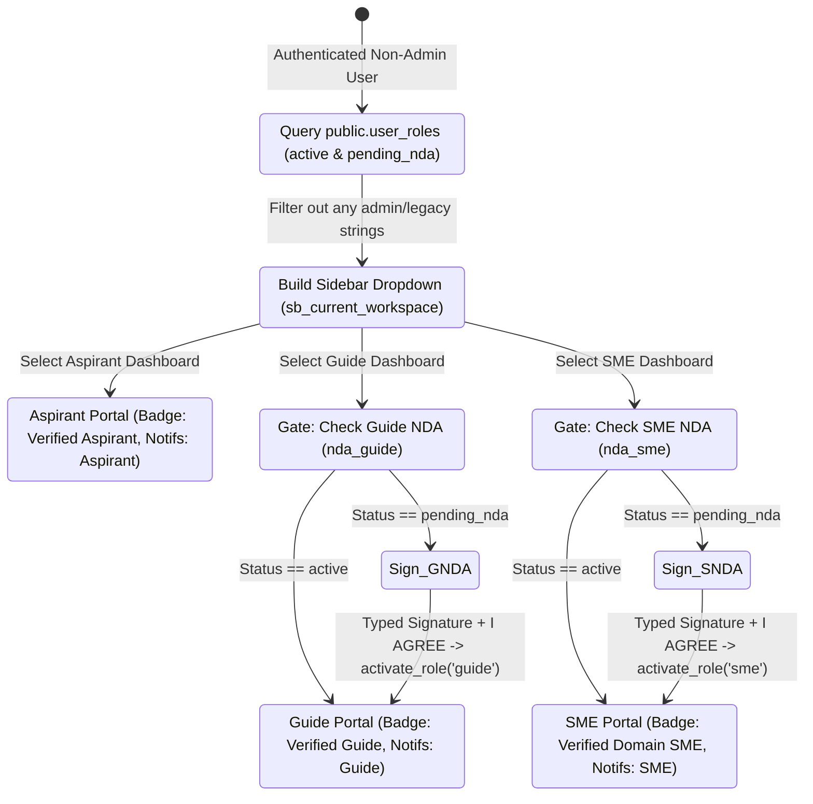

### 11.1 The Seven Non-Admin Role Combinations
A participant may hold any non-empty subset of `{aspirant, guide, sme}` in `public.user_roles` (`services/roles.py` L331–L431):
1. **`aspirant` only**: Default for public signups; no workspace dropdown shown (`len(ws_options) == 1`, `app.py` L943).
2. **`guide` only**: Admin-provisioned Guide (if `aspirant` role is not granted).
3. **`sme` only**: Admin-provisioned SME (if `aspirant` role is not granted).
4. **`aspirant + guide`**: Founder who also mentors other entrepreneurs as a Guide.
5. **`aspirant + sme`**: Founder who also advises other entrepreneurs as a Domain SME.
6. **`guide + sme`**: Dual mentor who serves as both a general Guide and a Domain SME.
7. **`aspirant + guide + sme`**: Full hybrid participant holding all three non-admin roles.

*(Note: By default in `services/roles.py` L354–L408, if a user's base `profiles.role` is `'aspirant'` or they have an active grant, `'aspirant'` is included alongside granted mentor roles unless revoked/absent, and the Sole Administrator is strictly isolated to `'admin'` only.)*

#### `FR-ROLE-001` — Workspace Switching, Role Badge Sync & Notification Isolation

| Field | Specification |
| :--- | :--- |
| **Requirement ID** | `FR-ROLE-001` |
| **Feature Name** | Workspace Switching, Role Badge Sync & Notification Isolation |
| **Business Purpose** | Allow multi-role participants to switch cleanly between their authorized workspaces while isolating their sidebar badge, session role, and in-app notifications to the active workspace. |
| **User Role** | Multi-Role Participant (any of combinations 4–7 above). |
| **Preconditions** | User holds `> 1` role in `ws_options` (`app.py` L880–L903). |
| **Trigger** | User selects a workspace in `st.selectbox('Current Workspace', ..., key='sb_current_workspace')` (`app.py` L1003–L1015). |
| **Normal Workflow** | 1. Updates `st.session_state['active_workspace'] = selected_ws` and syncs `st.session_state['role'] = selected_ws` (`app.py` L1012–L1014, `DEF-32-010`).
2. Updates the sidebar badge (`Verified Aspirant`, `Verified Guide`, `Verified Domain SME`, L908–L934).
3. Filters sidebar notifications via `filter_notifications_by_workspace(all_user_notifs, curr_ws)` (`services/notifications.py` L221–L233) unless the user ticks `Include other workspaces` (`sb_notif_show_all_ws`, `app.py` L1041).
4. Evaluates `render_nda_gate(user, active_role)` if switching into `guide` or `sme` (`app.py` L1242–L1244) and dispatches to the selected portal. |
| **Alternative Workflow** | If an Admin revokes the user's currently active role in another session, `get_user_roles()` (5-second memo TTL + global invalidation timestamp, `services/cache.py` L74–L81) drops the role on the next interaction and automatically falls back to `ws_keys[0]` (`app.py` L898–L900). |
| **Error & Failure Conditions** | Unrecognized workspace string renders `Unrecognized workspace` error with `Reset Session` button (`app.py` L1271–L1274). |
| **Input Fields & Validation** | `sb_current_workspace` selectbox (`aspirant`, `guide`, `sme`), `sb_notif_show_all_ws` checkbox. |
| **Output / Visible Result** | Renders the selected role portal, workspace-specific badge, and workspace-filtered notifications. |
| **Related Database Records** | Reads `public.user_roles`, `public.legal_acceptances`, `public.notifications`. |
| **Authorization Requirements** | Requires `status in ('active', 'pending_nda')` in `public.user_roles` for the target workspace. |
| **Acceptance Criteria** | 1. Switching workspace updates badge, portal, and filtered notifications immediately.
2. Hybrid user replying in Aspirant workspace passes `_authorize_mentor_session_role` checks appropriately (`DEF-32-002`). |
| **Related Source Files** | `app.py` L839–L1075, L1234–L1275, `services/roles.py` L331–L431, `services/notifications.py` L172–L233. |
| **Related Tests** | `tests/test_multi_role_e2e_workflows.py`, `tests/test_qa32_fixes_regression.py::test_def002_hybrid_workspace_consultation_replies_and_roadmap_toggle`, `test_def010_workspace_notification_isolation`. |
| **Implementation Status** | **Implemented — verified in source; Tested** |

---

## 12. Business Journeys (`FR-JRN-*`)

### Mermaid Diagram 4 — Journey Edit & Revision Audit Workflow

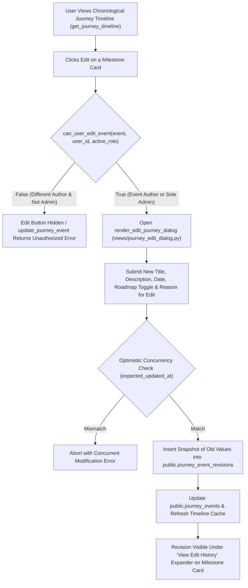

#### `FR-JRN-001` — Chronological Enterprise Journey Creation, Multi-Actor Contributions & Revision History

| Field | Specification |
| :--- | :--- |
| **Requirement ID** | `FR-JRN-001` |
| **Feature Name** | Chronological Enterprise Journey Creation, Multi-Actor Contributions & Revision History |
| **Business Purpose** | Maintain a single chronological record of an entrepreneur's progress where Aspirants, assigned Guides, assigned SMEs, and the Sole Admin can log milestones, toggle PDF roadmap inclusion, and edit their own entries with an immutable revision history. |
| **User Role** | Aspirant, Assigned Guide, Assigned SME, Sole Admin. |
| **Preconditions** | Aspirant account exists (`get_or_create_journey(aspirant_id)` ensures a `public.journeys` record exists, `services/journey.py` L32–L82). |
| **Trigger** | Actor adds an entry (`add_manual_aspirant_entry`, `add_guide_contribution`, `add_sme_contribution`, `add_admin_journey_entry`), toggles `toggle_event_roadmap_inclusion` (L244–L372), or edits via `update_journey_event` (L883–L1113). |
| **Normal Workflow** | 1. **Sorting (`sort_journey_events`, L122–L154)**: Orders events chronologically (`event_date DESC, created_at DESC`).
2. **Roadmap Toggle (`toggle_event_roadmap_inclusion`, L244–L372)**: Aspirant, assigned Guide, or Admin toggles `included_in_roadmap` boolean (`True`/`False`), controlling whether the event appears in the exported Executive PDF Dossier.
3. **Author-Scoped Editing & Revision Snapshots (`can_user_edit_event` L852–L880, `update_journey_event` L883–L1113)**: Verifies that `editor_id == event['actor_id']` or `is_strict_admin()`. Checks `expected_updated_at` for optimistic concurrency control, inserts the prior state (`previous_title`, `previous_description`, `previous_event_date`, `editor_id`, `editor_role`, `change_reason`) into `public.journey_event_revisions`, and updates `public.journey_events`.
4. **Soft Deletion (`soft_delete_event`, L735–L824)**: Marks `is_deleted=True` in metadata rather than destroying audit rows. |
| **Alternative Workflow** | System events (such as scheme releases and mentor assignments) are automatically logged via `log_meaningful_event()` (L678–L733). |
| **Error & Failure Conditions** | - Editing another actor's event (when not Admin): returns `(False, 'You can only edit milestones that you authored.')`.
- Concurrent edit conflict (`expected_updated_at` mismatch): returns concurrency warning. |
| **Input Fields & Validation** | Milestone Title, Category/Topic/Domain, Event Date, Description, `included_in_roadmap` boolean, `change_reason` text. |
| **Output / Visible Result** | Chronological timeline card with actor role badge, roadmap inclusion status, edit dialog, and expandable revision history. |
| **Related Database Records** | Reads/writes `public.journeys`, `public.journey_events`, `public.journey_event_revisions`. |
| **Authorization Requirements** | View: Aspirant owner, assigned Guide/SME, Sole Admin. Edit: Event author (`actor_id == user_id`) or Sole Admin. Roadmap Toggle: Aspirant owner, assigned Guide, or Sole Admin (`DEF-32-002`). |
| **Acceptance Criteria** | 1. Every edit to a Journey event creates a row in `journey_event_revisions`.
2. Toggling `included_in_roadmap=False` excludes the milestone from the PDF dossier. |
| **Related Source Files** | `services/journey.py` L1–L1191, `views/journey_edit_dialog.py` L1–L87, `migrations/002_journey_event_revisions.sql`. |
| **Related Tests** | `verify_journey_governance_and_ui.py`, `tests/test_qa32_fixes_regression.py::test_def002_hybrid_workspace_consultation_replies_and_roadmap_toggle`. |
| **Implementation Status** | **Implemented — verified in source; Tested** |

---

## 13. Consultations and Communications (`FR-CONS-*`)

### Mermaid Diagram 5 — Consultation Ticket Lifecycle (`public.help_requests`)

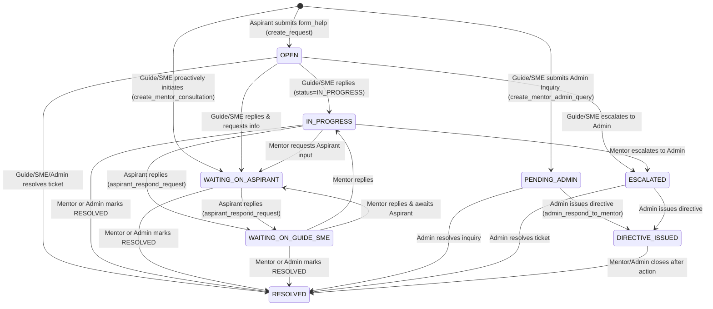

*(Note: All 10 status values above—plus legacy compatibility values `ACTION_REQUIRED` and `REPLIED`—are enforced by the PostgreSQL `CHECK` constraint in `migrations/011_expand_help_requests_status_check.sql` L17–L28, with automatic fallback in `_update_help_request_adaptive()` at `services/help_requests.py` L65–L141 if a database has not yet run Migration 011.)*

#### `FR-CONS-001` — Bidirectional Consultations, Threaded Replies, Mentor Inquiries & Private Case Discussions

| Field | Specification |
| :--- | :--- |
| **Requirement ID** | `FR-CONS-001` |
| **Feature Name** | Bidirectional Consultations, Threaded Replies, Mentor Inquiries & Private Case Discussions |
| **Business Purpose** | Enable structured, assignment-isolated communication between Aspirants, Guides, SMEs, and the Sole Administrator across consultation tickets, mentor-to-admin escalations, and shared/private case discussion notes. |
| **User Role** | Aspirant, Guide, SME, Sole Admin. |
| **Preconditions** | Active relationship exists in `public.relationships` for the Aspirant and Mentor. |
| **Trigger** | User submits `create_request()`, `guide_respond_request()`, `sme_respond_request()`, `aspirant_respond_request()`, `create_mentor_consultation()`, `create_mentor_admin_query()`, `admin_respond_to_mentor()`, or `create_case_message()`. |
| **Normal Workflow** | 1. **Aspirant-Initiated Ticket (`create_request`, `services/help_requests.py` L184–L362)**: Verifies account is not in `PENDING_DELETION` (`VULN-07`), resolves target Guide or SME (`target_mentor_id` or primary assigned mentor), inserts `help_requests` row with `status='OPEN'`, `requester_role='aspirant'`, and notifies the mentor.
2. **Mentor Response (`guide_respond_request` L554–L649, `sme_respond_request` L728–L838)**: Verifies session role via `_authorize_mentor_session_role()` (checking `active_workspace` and `user_roles`, `DEF-32-002`), appends timestamped reply via `_append_threaded_reply()`, updates `status`, `last_interaction_actor_id`, `last_interaction_actor_role`, and `last_mentor_response_at`, and notifies the Aspirant.
3. **Aspirant Reply (`aspirant_respond_request`, L1270–L1363)**: Appends Aspirant reply, sets `status='WAITING_ON_GUIDE_SME'`, `last_interaction_actor_role='aspirant'`, and `last_aspirant_response_at` (which `inactivity.py` explicitly ignores when computing mentor SLA clocks).
4. **Case Collaboration Space (`services/collaboration.py` L18–L237)**: `create_case_message()` inserts into `public.case_discussions`. When `is_private_mentor_note=True`, `list_case_messages()` hides the note from `requesting_role='aspirant'`. |
| **Alternative Workflow** | Mentors can also proactively initiate a consultation thread with an assigned Aspirant (`create_mentor_consultation`, L1163–L1267) or submit an inquiry to the Administrator (`create_mentor_admin_query`, L907–L998). |
| **Error & Failure Conditions** | - Account in `PENDING_DELETION`: `create_request()` blocks submission (`VULN-07`).
- Unassigned mentor or unauthenticated caller in `collaboration.py`: blocked (`tests/test_beta_6_audit_security.py`). |
| **Input Fields & Validation** | Subject, Message/Reply text, Category, Priority (`LOW`, `MEDIUM`, `HIGH`, `URGENT`), Target Role (`guide`, `sme`), Status, `is_private_mentor_note` boolean. |
| **Output / Visible Result** | Threaded ticket conversation, status badges, and workspace-filtered notifications. |
| **Related Database Records** | Reads/writes `public.help_requests`, `public.case_discussions`, `public.notifications`. |
| **Authorization Requirements** | Strictly isolated to the Aspirant owner, assigned Guides (`guide_id`/`guide_ids`), assigned SMEs (`sme_id`/`sme_ids`), and Sole Admin. |
| **Acceptance Criteria** | 1. Aspirant cannot view `is_private_mentor_note=True` messages.
2. Unassigned Guide/SME cannot read or reply to another mentor's tickets.
3. Aspirant reply sets `WAITING_ON_GUIDE_SME` without resetting mentor SLA clock. |
| **Related Source Files** | `services/help_requests.py` L1–L1364, `services/collaboration.py` L1–L238, `migrations/004`, `migrations/011_expand_help_requests_status_check.sql`. |
| **Related Tests** | `test_consultation_isolation.py`, `test_guide_sme_consultations_and_contrast.py`, `tests/test_beta_6_audit_security.py`, `tests/test_qa32_fixes_regression.py`. |
| **Implementation Status** | **Implemented — verified in source; Tested** |

---

## 14. Government Scheme Matching (`FR-SCH-*`)

### Mermaid Diagram 6 — Deterministic 3-Stage Scheme Matching & Guide Approval Pipeline

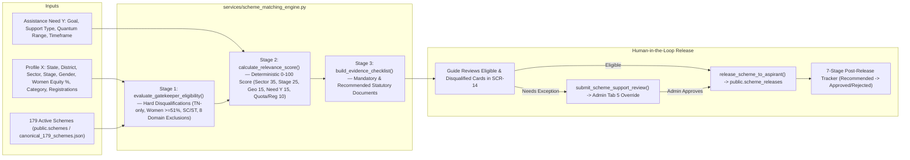

#### `FR-SCH-001` — Deterministic 3-Stage Government Scheme Matching Engine (179 Schemes)

| Field | Specification |
| :--- | :--- |
| **Requirement ID** | `FR-SCH-001` |
| **Feature Name** | Deterministic 3-Stage Government Scheme Matching Engine (179 Schemes) |
| **Business Purpose** | Evaluate an Aspirant's normalized enterprise profile (`X`) and assistance need (`Y`) against 179 curated schemes using deterministic statutory gatekeeper rules, weighted relevance scoring (0–100), and explainable checklists. |
| **User Role** | Guide (`SCR-14`), Sole Admin (`SCR-18`, `SCR-23`); outputs consumed by Aspirant (`SCR-12`) only after Guide release. |
| **Preconditions** | Scheme catalogue (`179` canonical schemes in `public.schemes` / `seed/canonical_179_schemes.json`) and Aspirant profile exist. |
| **Trigger** | `match_schemes_for_aspirant()` (`services/schemes.py` L267–L326) -> `match_aspirant_schemes_intelligent()` (`services/scheme_matching_engine.py` L451–L517). |
| **Normal Workflow** | 1. **Profile Normalization (`normalize_aspirant_profile`, L63–L143)**: Unpacks state, district, sector, subsector, stage, gender, `women_equity_pct` (requires `>= 51.0%` to qualify as `is_women_led`), social category (`SC`, `ST`, `OBC`, etc.), statutory registrations (`is_dpiit`, `is_startuptn`, `is_udyam`, `is_gst`, `is_fssai`, `is_drug_license`), and domain keywords without artificial defaults.
2. **Stage 1 — Gatekeeper Eligibility (`evaluate_gatekeeper_eligibility`, L146–L205)**: Evaluates hard disqualifications: (a) Tamil Nadu state jurisdiction (`is_tn_only`), (b) Women-only schemes (`is_women_only` requiring `>=51%` women equity), (c) SC/ST affirmative schemes (`is_sc_st_only`), and (d) 8 Negative Domain Exclusions (`DOMAIN_NEGATIVE_EXCLUSIONS`: `isro`, `semiconductor`, `aerospace`, `pharma_rd`, `biotech`, `nuclear`, `ev_automotive`, `deeptech_hardware`).
3. **Stage 2 — Relevance Scoring (`calculate_relevance_score`, L208–L388)**: Computes a deterministic `0–100` score across 5 weights: Sector & Domain Alignment (`35 pts`), Venture Stage Alignment (`25 pts`), Geographic Scope (`15 pts`), Assistance Goal & Quantum Fit (`15 pts`), and Affirmative Quota / Registration Readiness (`10 pts`). Hard-disqualified schemes are capped at `<= 25` points.
4. **Stage 3 — Explainable Checklist (`build_evidence_checklist`, L391–L448)**: Generates item-by-item `MET`, `MISSING`, `VERIFY`, or `FAILED` checklist items. |
| **Alternative Workflow** | If `assistance_need` is not passed explicitly, `match_schemes_for_aspirant()` automatically reads the saved `profile_data['assistance_need']` (`services/schemes.py` L280–L288). |
| **Error & Failure Conditions** | Gracefully handles incomplete/empty profiles (`test_incomplete_profile_minimal_baseline`) by issuing verification warnings rather than crashing. |
| **Input Fields & Validation** | Normalized Aspirant `profile` (`X`), optional `assistance_need` (`Y`), `min_score`, `limit`. |
| **Output / Visible Result** | Sorted list of scheme evaluation dictionaries containing `match_score`, `is_eligible`, `disqualifications`, `warnings`, `match_reasons`, and `evidence_checklist`. |
| **Related Database Records** | Reads `public.schemes` and `public.profiles`; writes `public.scheme_releases` and `public.scheme_support_reviews` upon Guide action. |
| **Authorization Requirements** | Guide or Sole Admin can run full matching; Aspirants can read only their own `released` rows in `public.scheme_releases` (`migrations/000` L638). |
| **Acceptance Criteria** | 1. Male founder or female founder with `<51%` equity is disqualified from women-only schemes.
2. Non-TN enterprise is disqualified from Tamil Nadu state schemes.
3. Retail pharmacy or textile trader is excluded from ISRO, semiconductor, and clinical pharma R&D funds. |
| **Related Source Files** | `services/scheme_matching_engine.py` L1–L517, `services/scheme_rules.py` L1–L214, `services/schemes.py` L267–L933. |
| **Related Tests** | `tests/test_scheme_matching_engine.py` (6 tests), `tests/test_scheme_relevance_synthetic.py` (9 domain/quota tests). |
| **Implementation Status** | **Implemented — verified in source; Tested** |

---

## 15. Administrative Assignments (`FR-REL-*`)

*(Note: Core assignment UI and requirements are detailed under `FR-ADMIN-004` in Section 10.2. Diagram 7 below illustrates the complete assignment, Co-Guide promotion, and handover data flow.)*

### Mermaid Diagram 7 — Mentor Assignment, Co-Guide Promotion & Safe Handover Flow

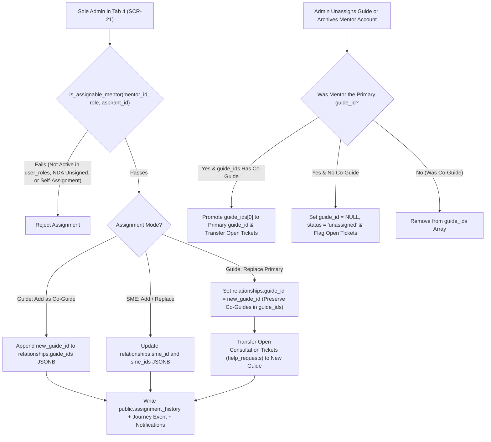

---

## 16. Legal Consent and NDA Workflows (`FR-LEGAL-*`)

#### `FR-LEGAL-001` — Versioned Terms of Service & Role-Specific Non-Disclosure Agreement (NDA) Execution

| Field | Specification |
| :--- | :--- |
| **Requirement ID** | `FR-LEGAL-001` |
| **Feature Name** | Versioned Terms of Service & Role-Specific Non-Disclosure Agreement (NDA) Execution |
| **Business Purpose** | Require all users to accept the Platform Terms of Service (`terms_v1_0`) and require all Guides and SMEs to execute a role-specific NDA (`nda_guide` / `nda_sme`) with SHA-256 content hashing before accessing any caseload data. |
| **User Role** | Aspirant (`terms_and_conditions`), Guide (`terms_and_conditions` + `nda_guide`), SME (`terms_and_conditions` + `nda_sme`). |
| **Preconditions** | User is authenticated and has passed the Lifecycle and First-Login Password gates (`app.py` L1236–L1245). |
| **Trigger** | `render_terms_and_conditions_gate(user)` or `render_nda_gate(user, active_role)` in `views/legal_ui.py` L19–L229. |
| **Normal Workflow** | 1. `get_active_legal_document(doc_type)` (`services/legal.py` L246–L279) fetches the active document from `public.legal_documents` or falls back to `DEFAULT_TERMS_DOC` / `DEFAULT_NDA_DOC` and computes its SHA-256 hash (`_compute_hash`, L237–L239).
2. `check_user_terms_accepted(user_id)` (L282–L310) and `check_user_nda_accepted(user_id, role)` (L313–L357) check `public.legal_acceptances` for an `ACCEPTED` row matching the active version.
3. When the user submits the acceptance form, `record_legal_acceptance()` (L360–L460) validates the checkbox, typed legal name (`>= 2` chars for NDA), and typed confirmation phrase (`'I AGREE'` for NDA), inserts an immutable record into `public.legal_acceptances`, and (for NDAs) calls `activate_role(user_id, role)` (`services/roles.py` L593–L635) to transition `user_roles.status` from `'pending_nda'` to `'active'`. |
| **Alternative Workflow** | If a hybrid user holds both `guide` and `sme` grants, signing the NDA in one workspace activates that role; switching to the second mentor workspace prompts for the second role's NDA (`doc_type = f'nda_{role}'`). |
| **Error & Failure Conditions** | Missing checkbox, short name, or phrase not matching `'I AGREE'` returns `(False, error_msg)`. |
| **Input Fields & Validation** | Agreement Checkbox (bool), Typed Full Legal Name (text), Typed Confirmation Phrase (`'I AGREE'`). |
| **Output / Visible Result** | Unlocks workspace routing and logs verifiable acceptance row visible in Admin Tab 8 (`SCR-25`). |
| **Related Database Records** | Reads `public.legal_documents`; writes `public.legal_acceptances` and updates `public.user_roles` (`status='active'`, `nda_accepted=True`). |
| **Authorization Requirements** | Authenticated user matching `user_id`. |
| **Acceptance Criteria** | 1. Unaccepted Terms blocks all non-admin portals.
2. Unsigned NDA blocks Guide/SME portals and blocks mentor photo access (`migrations/005`).
3. Signing NDA transitions `user_roles.status` from `pending_nda` to `active`. |
| **Related Source Files** | `services/legal.py` L1–L488, `views/legal_ui.py` L1–L230, `app.py` L1236–L1245. |
| **Related Tests** | `tests/test_single_admin_master_e2e.py::test_03_terms_and_legal_acceptance`, `test_04_single_admin_role_promotions_and_nda_activation`. |
| **Implementation Status** | **Implemented — verified in source; Tested** |

---

## 17. Complaints and Conflicts (`FR-CMP-*`)

*(Note: Administrative resolution of complaints and SME conflicts is specified under `FR-ADMIN-009` and `FR-ADMIN-012` in Section 10.2. Below are the participant-facing submission requirements.)*

#### `FR-CMP-001` — Confidential Aspirant Guide Complaint & SME Conflict-of-Interest Declaration

| Field | Specification |
| :--- | :--- |
| **Requirement ID** | `FR-CMP-001` |
| **Feature Name** | Confidential Aspirant Guide Complaint & SME Conflict-of-Interest Declaration |
| **Business Purpose** | Provide Aspirants with a confidential grievance channel against their assigned Guide (`public.guide_complaints`) and provide SMEs with a mandatory conflict-of-interest declaration and recusal lock (`public.sme_conflict_declarations`). |
| **User Role** | Aspirant (`submit_guide_complaint`), SME (`declare_sme_conflict`). |
| **Preconditions** | Aspirant has an assigned Guide (`SCR-11`); SME has an assigned Aspirant (`SCR-16`). |
| **Trigger** | Aspirant submits `confidential_complaint_form` (`views/aspirant.py` L743); SME submits `form_sme_coi_*` (`views/sme.py` L667). |
| **Normal Workflow** | 1. **Confidential Guide Complaint (`submit_guide_complaint`, `services/governance.py` L63–L130)**: Validates that the Aspirant has an assigned Guide and that `details` is at least 15 characters, inserts a row into `public.guide_complaints` with `status='OPEN'`, and notifies **only** the Sole Administrator. RLS policies on `guide_complaints` (`migrations/000` L940–L950) grant access strictly to the submitting Aspirant and Admin—never to Guides.
2. **SME COI Declaration (`declare_sme_conflict`, `services/governance.py` L228–L265)**: SME declares either `No Conflict` (`has_conflict=False`, `status='CLEARED'`) or `Conflict Exists` (`has_conflict=True`, `status='PENDING_REVIEW'`, with mandatory description). When `has_conflict=True`, `check_sme_has_conflict()` (L316–L322) returns `True`, locking the SME out of consultation replies for that Aspirant until Admin review in Tab 12. |
| **Alternative Workflow** | Aspirant can track the status of their submitted complaints (`OPEN`, `UNDER_REVIEW`, `RESOLVED`, `DISMISSED`) and Admin resolution notes at the bottom of `SCR-11` (`list_aspirant_complaints`, L158–L163). |
| **Error & Failure Conditions** | - Submitting a complaint with `< 15` chars or without an assigned Guide: rejected (`services/governance.py` L74–L82).
- Declaring a COI without description: rejected (L236–L239). |
| **Input Fields & Validation** | Complaint: Reason Category + Confidential Description (`>= 15` chars). COI: `has_conflict` boolean + Conflict Details text. |
| **Output / Visible Result** | Creates complaint/COI record, enforces SME reply lock if conflict declared, and alerts Sole Admin. |
| **Related Database Records** | Writes `public.guide_complaints`, `public.sme_conflict_declarations`, `public.notifications`. |
| **Authorization Requirements** | Aspirant owner (for complaints); assigned SME (for COI). |
| **Acceptance Criteria** | 1. Reported Guide cannot read `guide_complaints` via UI or RLS.
2. Declaring `has_conflict=True` immediately disables SME consultation replies for that Aspirant. |
| **Related Source Files** | `views/aspirant.py` L740–L789, `views/sme.py` L505–L520, L665–L695, `services/governance.py` L63–L359. |
| **Related Tests** | `tests/test_confidential_complaints.py`, `tests/test_qa32_fixes_regression.py::test_def005_coi_approval_and_clearance_lifecycle`. |
| **Implementation Status** | **Implemented — verified in source; Tested** |

---

## 18. Monitoring and Alerts (`FR-MON-*`)

*(Detailed under `FR-ADMIN-010` and `FR-ADMIN-011` in Section 10.2. Key SLA rules enforced in `services/inactivity.py` L1–L778: Day 7 gentle mentor reminder, Day 10 Admin alert, Day 14 critical Admin escalation; Guide and SME clocks are independent; Aspirant replies never reset mentor clocks; episode deduplication via `uq_inactivity_episode_stage` allows new alerts if a mentor becomes inactive a second time.)*

---

## 19. Account Lifecycle (`FR-LIFE-*`)

*(Detailed under `FR-ADMIN-013` in Section 10.2 and `SCR-03`/`SCR-04` in Section 5.2. Diagram 8 below illustrates the complete account lifecycle state machine.)*

### Mermaid Diagram 8 — Account Lifecycle State Machine (`services/account_lifecycle.py`)

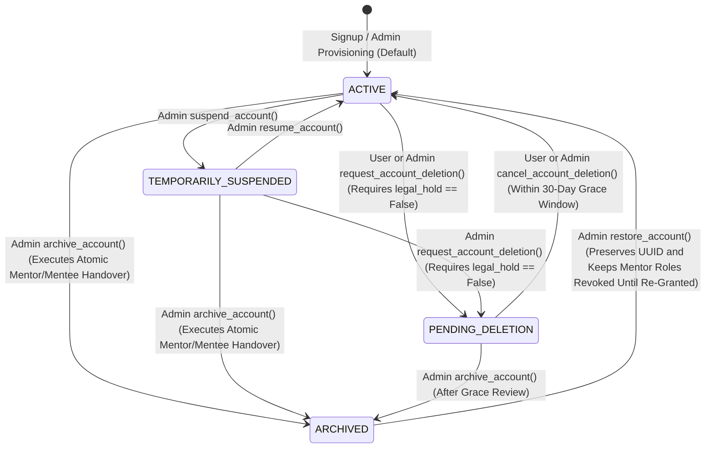

---

## 20. Notifications and Email (`FR-NOTIF-*`)

### Mermaid Diagram 9 — In-App & Transactional Email Notification Triggers

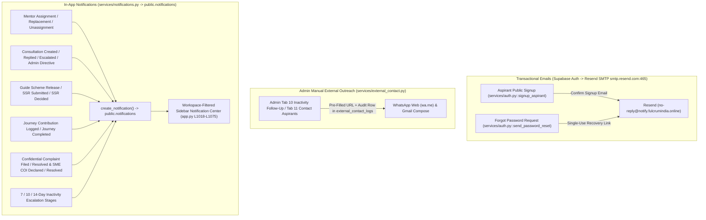

#### `FR-NOTIF-001` — Workspace-Isolated In-App Notification Center & Transactional Email Delivery

| Field | Specification |
| :--- | :--- |
| **Requirement ID** | `FR-NOTIF-001` |
| **Feature Name** | Workspace-Isolated In-App Notification Center & Transactional Email Delivery |
| **Business Purpose** | Deliver workspace-scoped in-app notifications for all platform workflows (`public.notifications`) while delegating authentication emails (signup confirmation and password recovery) to Supabase Auth over Resend SMTP (`smtp.resend.com:465`). |
| **User Role** | All roles. |
| **Preconditions** | User is authenticated (for in-app notifications) or triggering an Auth flow (for emails). |
| **Trigger** | `create_notification()` (`services/notifications.py` L91–L159), `signup_aspirant()`, or `send_password_reset()`. |
| **Normal Workflow** | 1. **In-App Notifications**: `create_notification()` checks `is_notification_allowed()` (L34–L89) to prevent unauthorized cross-user spam, inserts into `public.notifications`, and invalidates the recipient's notification cache.
2. **Workspace Filtering (`infer_notification_workspace` L172–L218, `filter_notifications_by_workspace` L221–L233)**: Classifies each notification into `'aspirant'`, `'guide'`, `'sme'`, or `'admin'` based on its type/title so a hybrid user in their Aspirant workspace only sees Aspirant notifications by default (`DEF-32-010`).
3. **Transactional Emails**: Fulcrum application code does **not** call an external SMTP library directly; only Supabase GoTrue Auth sends emails via Resend SMTP (`no-reply@notify.fulcrumindia.online`) for signup confirmation and password recovery. All other external outreach uses audited WhatsApp/Gmail links in `services/external_contact.py`. |
| **Alternative Workflow** | Multi-role users can check `Include other workspaces` (`sb_notif_show_all_ws`, `app.py` L1041) in the sidebar to view notifications across all their roles. |
| **Error & Failure Conditions** | Notification creation failures are logged via `StructuredLogger` without aborting the parent business workflow. |
| **Input Fields & Validation** | `user_id`, `title`, `message`, `notification_type`, `actor_id`. |
| **Output / Visible Result** | Unread counter badge `🔔 Notifications (N New)` in sidebar (`app.py` L1038) + mobile info banner at top of page (L1249). |
| **Related Database Records** | Reads/writes `public.notifications`. |
| **Authorization Requirements** | Users can read/mark-read only their own notifications (`user_id == auth.uid()`); `is_notification_allowed()` restricts who can notify whom. |
| **Acceptance Criteria** | 1. Hybrid user in Guide workspace sees only Guide-relevant notifications by default.
2. Clicking `✓ Dismiss` or `Mark all as read` updates `is_read=True`. |
| **Related Source Files** | `services/notifications.py` L1–L418, `app.py` L1018–L1075, L1246–L1250. |
| **Related Tests** | `tests/test_qa32_fixes_regression.py::test_def010_workspace_notification_isolation`, `verify_5_fixes.py::test_problem_2_notifications`. |
| **Implementation Status** | **Implemented — verified in source; Tested** |

---

## 21. Search, Filters and Reporting (`FR-RPT-*`)

| Capability | Location in Code | Search & Filter Controls | Pagination & Output | Status |
| :--- | :--- | :--- | :--- | :--- |
| **Admin Control Tower KPIs** | `services/admin_metrics.py` L20–L188, `views/admin.py` L160–L250 | Real-time aggregation (memoized 30s TTL) | 10 KPI cards & alert pills across Aspirants, Guides, SMEs, Journeys, Open Tickets, SSRs, Complaints, COI, Inactivity. | Implemented — verified in source; Tested |
| **Entrepreneur Directory Search** | `views/admin.py` L275–L310, `services/pagination.py` L28–L162 | Free-text search (`full_name`, `email`) + 38 TN District filter (`adm_asp_district_filter`) | Server/hybrid-aware pagination (25 per page) via `render_pagination_controls()`. | Implemented — verified in source; Tested |
| **Guide & SME Roster Search** | `views/admin.py` L645–L860, `services/pagination.py` L165–L271 | Free-text search + District filter | Paginated (20 per page) union of `profiles` and `user_roles`. | Implemented — verified in source; Tested |
| **179-Scheme Catalogue Explorer** | `views/admin.py` L1438–L1494, `services/schemes.py` L32–L142 | Keyword search + Category Type + Venture Stage + Industry Sector + Active/Archived toggle | 3-column grid paginated at 12 cards per page. | Implemented — verified in source; Tested |
| **Executive PDF Dossier Report** | `services/pdf_generator.py` L793–L822 | Filters Journey events to `included_in_roadmap = True` | Multi-page formatted `%PDF-1.4` report. | Implemented — verified in source; Tested |

---

## 22. Error Handling and Empty States (`FR-ERR-*`)

1. **Production Stack-Trace Suppression**: `.streamlit/config.toml` L18 sets `showErrorDetails = false` so raw Python tracebacks are never exposed to end users in production.
2. **PII-Redacting Structured Logger**: `services/logger.py` L18–L97 (`StructuredLogger`) automatically scrubs emails, JWTs (`eyJ...`), API keys (`sb_secret_...`, `re_...`), and passwords from log messages via `_REDACT_PATTERNS` before writing structured JSON logs to stdout.
3. **Schema-Adaptive PostgREST Error Recovery**: Both `services/account_lifecycle.py` (`_execute_supabase_adaptive`, L105–L161) and `services/help_requests.py` (`_update_help_request_adaptive`, L73–L141) inspect PostgREST `PGRST204` / `42703` missing-column or `23514` constraint errors and automatically retry with compatible column aliases or fallback status values (`DEF-32-001`).
4. **Comprehensive Empty States**: Every list, directory, timeline, scheme tab, and notification drawer renders an explicit, role-appropriate `st.info()` or `st.caption()` guidance banner when zero records are returned (catalogued in `SCR-01` through `SCR-30` above).

---

## 23. Responsive Design and Accessibility (`FR-UX-*`)

1. **Responsive Media Queries (`app.py` L150–L310, `views/login.py` L95–L125)**: Custom CSS injects `@media (max-width: 768px)` rules that stack multi-column Streamlit layouts (`[data-testid="column"] { width: 100% !important; flex: 1 1 100% !important; }`), reduce container padding, and keep buttons full-width for mobile touch targets.
2. **High-Contrast Typography & Scoped Sidebar Selectbox (`app.py` L314–L610, L945–L999)**: Enforces WCAG-friendly high-contrast dark navy text (`#0F172A`) on light surfaces (`#F8FAFC` / `#FFFFFF`) and white text (`#F8FAFC`) on the dark slate sidebar (`#0B0F19`), with explicit CSS scoping on `.st-key-sb_current_workspace` (`#FFFFFF` background with `#0F172A` bold text).
3. **Mobile Unread Notification Banner (`app.py` L1246–L1250)**: Because Streamlit collapses the left sidebar by default on mobile viewports, `app.py` renders an inline `st.info("🔔 You have **N** new notifications! Review them in the sidebar notification center.")` banner at the top of the main viewport whenever `unread_count > 0`.
4. **Accessibility Limitations**: As a Streamlit single-page application, custom HTML cards rendered via `st.markdown(..., unsafe_allow_html=True)` do not carry full ARIA landmark/live-region attributes, and keyboard tab order follows Streamlit's standard DOM sequence (`NFR-ACC-001`).

---

## 24. Security-Sensitive UI Behaviour

*(Cross-referenced with [`FULCRUM_SPRD_V2.md`](./FULCRUM_SPRD_V2.md).)*
- **Password Masking & URL Fragment Scrubbing**: All password inputs use `type="password"`. Password recovery immediately scrubs `#access_token` and `#refresh_token` from the browser address bar using `window.history.replaceState` (`services/auth_callback_component.py` L45–L52).
- **Session-Cached Provisional Passwords**: In Admin Tabs 2 and 3, provisional mentor passwords are generated via `secrets.choice` once and cached in `st.session_state` (`_get_or_init_provisional_password`, `views/admin.py` L82–L86) so UI reruns do not desynchronize the displayed password from the submitted value (`DEF-32-003`).
- **HTML Escaping Against Stored XSS**: User-supplied strings rendered inside custom HTML blocks are escaped using `safe_escape()` / `html.escape()` (`services/constants.py` L22–L26, `views/admin.py` L21–L25, `views/aspirant.py` L18–L22, `views/guide.py` L28–L32, `views/sme.py` L16–L20, `services/pdf_generator.py` L62–L67).
- **Short-Lived Signed Photo URLs**: Private photographs in `aspirant-profile-photos` and `professional-headshots` never use public bucket URLs; they generate signed URLs expiring in **300 seconds** (`services/aspirant_photos.py` L36, `services/professional_photos.py` L43).

---

## 25. Functional Dependencies Matrix

| Dependent Feature | Upstream Dependency | Impact if Upstream Dependency Fails or Is Misconfigured |
| :--- | :--- | :--- |
| **New Aspirant First Login (`FR-AUTH-002`)** | Supabase Auth -> Resend SMTP (`smtp.resend.com:465`) -> Recipient Inbox (`FR-AUTH-001`) | If confirmation email lands in Gmail Spam and user misses it, Supabase blocks sign-in with `Email not confirmed` (`DEF-001`, `DEF-002`). |
| **Password Recovery (`FR-AUTH-003`)** | Supabase URL Configuration (`Site URL` & `Redirect URLs` = `https://app.fulcrumindia.online`) + `auth_callback_component.py` | If Supabase `Site URL` points to `localhost`, recovery links fail to reach production; if JS component is blocked, `#access_token` cannot be read. |
| **Guide/SME Caseload Assignment (`FR-ADMIN-004`)** | Active role in `public.user_roles` (`FR-ADMIN-007`) + Signed NDA in `public.legal_acceptances` (`FR-LEGAL-001`) | `is_assignable_mentor()` (`services/roles.py` L434–L507) excludes the mentor from assignment dropdowns until NDA is signed. |
| **Aspirant Scheme Visibility (`SCR-12`)** | Deterministic Matching (`FR-SCH-001`) + Guide Scheme Release (`FR-GUIDE-002`) or Admin SSR Approval (`FR-ADMIN-005`) | Aspirant sees zero schemes in `🏦 Scheme Matches` until an assigned Guide releases at least one scheme. |
| **Mentor Photo Visibility (`FR-ASP-002`)** | Active relationship in `public.relationships` + Active `user_roles` grant + `ACCEPTED` NDA | `can_view_aspirant_photo()` and Storage RLS (`migrations/005`) immediately deny photo access if any of the 3 conditions is false. |
| **SME Consultation Reply (`FR-SME-001`)** | Zero unresolved Conflict of Interest in `public.sme_conflict_declarations` (`FR-CMP-001`) | Declaring `has_conflict=True` locks the SME out of replying until Admin clears the conflict in Tab 12 (`FR-ADMIN-012`). |
| **Account Archival (`FR-ADMIN-013`)** | Relationship Handover (`unassign_guide` / `unassign_sme`) + Immutable Audit Log (`public.account_lifecycle_log`) | If handover or audit log insert fails, `archive_account()` aborts fail-closed and rolls back relationship snapshots (`VULN-03`). |

---

## 26. Known Defects and Incomplete Flows

### 26.1 Current Verified Defects & Incomplete Flows in Active Source (`DEF-001` to `DEF-008`)

| Defect ID | Severity | Affected File & Lines | Description of Defect or Incomplete Flow | Status |
| :--- | :--- | :--- | :--- | :--- |
| **`DEF-001`** | **High (UX / Trust)** | `views/login.py` L693, `services/auth.py` L604–L630 | **Unverified Email-Sent Success Message & Spam Placement**: When `client.auth.sign_up()` returns `res.session is None`, Fulcrum marks `pending_confirmation=True` and displays `"🎉 Account created successfully for **<email>**! A confirmation link has been sent to your email. Please check your inbox and verify your email before signing in."` without verifying delivery or advising the user to check their **Spam / Promotions** folder (where Gmail placed the Resend email during live testing on `2026-11-16`). | **Defect identified** |
| **`DEF-002`** | **Medium (UX / Onboarding)** | `views/login.py` L568–L704, `services/auth.py` | **No Self-Service "Resend Confirmation Email" Control**: Neither the Signup tab nor the Sign In error state (`"Email not confirmed"`) provides a button calling `client.auth.resend({'type': 'signup', 'email': email})`. Users whose link expires or is lost cannot trigger a new confirmation email without admin intervention. | **Defect identified** |
| **`DEF-003`** | **Low (Validation Consistency)** | `views/login.py` L679 vs `views/login.py` L489 & `app.py` L1220 | **Inconsistent Minimum Password Length**: Public Aspirant signup (`views/login.py` L679) allows passwords of **6 characters** (`len(s_pwd) < 6`), whereas Password Recovery (`views/login.py` L489), First-Login Password Change (`app.py` L1220), and Mentor Provisioning (`services/auth.py` L1021) require **8 characters**. | **Defect identified** |
| **`DEF-004`** | **Low (Cosmetic Copy)** | `views/login.py` L635 | **Typo in Login Support Notice**: Line 635 reads `"Contact System Maintainence in <SOLE_ADMIN_EMAIL> for login issues"` (`Maintainence` misspelled; `in` instead of `at`, whereas line 555 spells `Maintenance at` correctly). | **Defect identified** |
| **`DEF-005`** | **Low (Stubbed Function)** | `services/help_requests.py` L899–L905 | **No-Op Stub in `check_and_escalate_overdue_requests()`**: Function body is `return 0` with comment `"Disabled automatic status mutation to prevent SLA contamination; handled by services/inactivity.py"`. While mentor inactivity is tracked in `inactivity.py`, individual `help_requests` rows do not auto-transition to `ESCALATED` based on age alone. | **Partially implemented** |
| **`DEF-006`** | **Low (Manual Lifecycle Step)** | `services/account_lifecycle.py` L1181–L1291, `views/admin_account_lifecycle.py` L295–L359 | **Manual Review After 30-Day `PENDING_DELETION` Grace Window**: Scheduling deletion sets `deletion_scheduled_for = NOW() + 30 days`, but there is no automated background purge job when the 30 days elapse; the Sole Administrator manually reviews and archives expired requests in Admin Tab 13 Subtab 3 (`DEC-003`). | **Partially implemented** |
| **`DEF-007`** | **Low (Page-Load SLA Trigger)** | `services/inactivity.py` L157–L334, `views/admin_governance.py` L392–L415 | **On-Demand Rather Than Scheduled Inactivity Evaluation**: `check_and_process_caseload_inactivity()` runs when the Administrator opens Admin Tab 10 rather than via an independent daily cron job (`DEC-005`). | **Partially implemented** |
| **`DEF-008`** | **Low (Observability Metadata)** | `services/legal.py` L367–L368, `views/legal_ui.py` L75, L215 | **Placeholder Client IP / User-Agent in Legal Acceptances**: `record_legal_acceptance()` defaults `ip_address="streamlit-client"` and `user_agent="browser"` because Streamlit does not pass reverse-proxy `X-Forwarded-For` headers to the call site. | **Partially implemented** |

### 26.2 Previously Reported 32-User QA Defects — Verified Resolved in Current Source (`DEF-32-001` to `DEF-32-010`)

Inspection of commit `2357677` (`afac6ab` / `36e0275`) and `tests/test_qa32_fixes_regression.py` confirms that all 10 defects from the historical 32-user QA simulation are **remediated in current source**:
- **`DEF-32-001`**: Schema-adaptive Supabase account lifecycle writes (`_execute_supabase_adaptive`) + atomic handover rollback (`_restore_relationship_snapshots`) — **Resolved in current source; Tested**.
- **`DEF-32-002`**: Hybrid `active_workspace` session authorization for consultation replies (`_authorize_mentor_session_role`) and Journey roadmap toggle — **Resolved in current source; Tested**.
- **`DEF-32-003`**: Session-cached provisional password (`_get_or_init_provisional_password`) across Admin Tab 2/3 reruns — **Resolved in current source; Tested**.
- **`DEF-32-004`**: `paginate_profiles('aspirant')` and Control Tower KPI union with `user_roles` grants — **Resolved in current source; Tested**.
- **`DEF-32-005`**: Admin Tab 12 COI `APPROVED`/`REJECTED` transitions and explicit recusal clearance (`has_conflict=False`) — **Resolved in current source; Tested**.
- **`DEF-32-006`**: `update_aspirant_profile()` preserves existing `mentor` keys inside `profile_data` for hybrid users — **Resolved in current source; Tested**.
- **`DEF-32-007`**: Co-Guide array membership (`guide_ids`/`sme_ids`) authorization and co-mentor profile visibility — **Resolved in current source; Tested**.
- **`DEF-32-008`**: Co-Guide additive radio, `Chennai` district default on mentor creation, mentor edit helper, scheme delegation, and complaint summary counters — **Resolved in current source; Tested**.
- **`DEF-32-009`**: `app.py` first-login password UI gate enforces `>= 8` characters matching backend — **Resolved in current source; Tested**.
- **`DEF-32-010`**: Workspace-bound sidebar role pill, `st.session_state['role']` sync, and workspace-scoped notifications — **Resolved in current source; Tested**.

---

## 27. Product Acceptance Criteria

Product acceptance requires every `FR-*` requirement in Sections 6 through 21 to pass its mapped test cases in [`FULCRUM_UATD_V2.md`](./FULCRUM_UATD_V2.md) (`UAT-AUTH-001` through `UAT-BKP-002`), with zero unauthorized cross-user data leaks, 100% deterministic scheme gatekeeper accuracy on synthetic test profiles, and verified email confirmation/recovery end-to-end on the live domain `https://app.fulcrumindia.online`.

---

## 28. Product Roadmap (Separated from Implemented Features)

The items below are **Planned / proposed** enhancements and are **not** part of the active Beta 2.0.0 implementation:
1. **Self-Service Resend Confirmation Email Button & Spam Banner (`PROP-01` — Planned / proposed)**: Add a `"Resend Confirmation Email"` button in `views/login.py` calling `client.auth.resend({"type": "signup", "email": email})` and update line 693 to explicitly instruct users to check their **Spam / Promotions** folder.
2. **Standardize Signup Password Policy to >= 8 Characters (`PROP-07` — Planned / proposed)**: Align `views/login.py` L679 (`>= 6` chars) with the `>= 8`-character requirement used across all other password forms (`DEF-003`).
3. **Scheduled Daily Background SLA Worker (`PROP-02` — Planned / proposed)**: Run `check_and_process_caseload_inactivity()` via a scheduled container cron job so 7/10/14-day reminders fire even on days when the Administrator does not open Tab 10.
4. **Capture Client IP & User-Agent from Caddy Headers (`PROP-08` — Planned / proposed)**: Read `st.context.headers` (`X-Forwarded-For`, `User-Agent`) in `views/legal_ui.py` and pass them into `record_legal_acceptance()` (`DEF-008`).
5. **Future Decoupled Web Frontend (`PROP-06` — Planned / proposed)**: Any potential future migration to React/Next.js + REST/Worker APIs (discussed in `FULCRUM_BETA_FEASIBILITY_REPORT.md`) is a separate future programme and is not part of the Streamlit Beta 2.0.0 baseline.

---

## Glossary of Product & UI Terms

| Term | Definition |
| :--- | :--- |
| **`active_workspace`** | The `st.session_state["active_workspace"]` key in `app.py` that tracks which portal (`aspirant`, `guide`, `sme`, or `admin`) a user is currently operating in. |
| **`is_tab_active()`** | Helper in `services/cache.py` (L154–L159) used with `st.tabs(..., on_change="rerun")` so only the currently selected tab executes database queries and UI rendering. |
| **Pill Subtabs (`st.pills`)** | The horizontal sub-navigation bar inside Guide Tab 1 (`6` subtabs) and SME Tab 1 (`4` subtabs) used to inspect a selected Aspirant's case without losing the selected entrepreneur context. |
| **Playbook Fund Explorer Card** | The reusable UI component (`render_fund_explorer_card` in `services/schemes_ui.py` L365–L505) that renders scheme metadata, eligibility checklists, Guide notes, and Admin CRUD actions. |
| **WebSocket Callback Bridge** | The custom Streamlit v2 component (`services/auth_callback_component.py`) that extracts `#access_token` and `#refresh_token` from browser URL fragments during password recovery. |

---

# FULCRUM-INDIA BETA 2.0.0 — SOFTWARE REQUIREMENTS SPECIFICATION (SRS)

| Document Attribute | Value |
| :--- | :--- |
| **Document ID** | `FULCRUM-SRS-V2.0` |
| **Version** | `2.0-baseline` |
| **Date of Analysis** | `2026-11-16` |
| **Reviewed Repository Commit** | `235767754f8d8bb4605e819593bb3f370ddeab27` (`2026-11-11`) |
| **Target Audience** | Software Architects, Backend & Frontend Engineers, Database Administrators, Security Auditors |
| **Document Status** | Baseline Technical Specification (Derived from Reverse-Engineering of Existing Codebase) |

---

## 1. Introduction and Scope

This Software Requirements Specification (SRS) documents the actual technical implementation of **FULCRUM-INDIA Beta 2.0.0**. All architectural descriptions, module boundaries, service contracts, database schemas, Row Level Security (RLS) policies, and deployment topologies are derived directly from the repository at commit `235767754f8d8bb4605e819593bb3f370ddeab27`.

> [!IMPORTANT]
> **Architectural Reality Invariant**: Fulcrum-Beta 2.0.0 is a **monolithic Python Streamlit server application** communicating over HTTPS with **Supabase (PostgreSQL, GoTrue Auth, and Storage)** and backed by an optional local **SQLite (`cluster_a.db`)** engine for offline testing (`README.md` L15–L35, `app.py`, `services/auth.py`). It does **not** expose custom REST/GraphQL API endpoints, does **not** use FastAPI, Celery, Redis, or Kafka, and does **not** use microservices.

---

## 2. Actual Application Architecture (`SR-ARCH-001` to `SR-ARCH-004`)

### Mermaid Diagram 1 — System Architecture Diagram

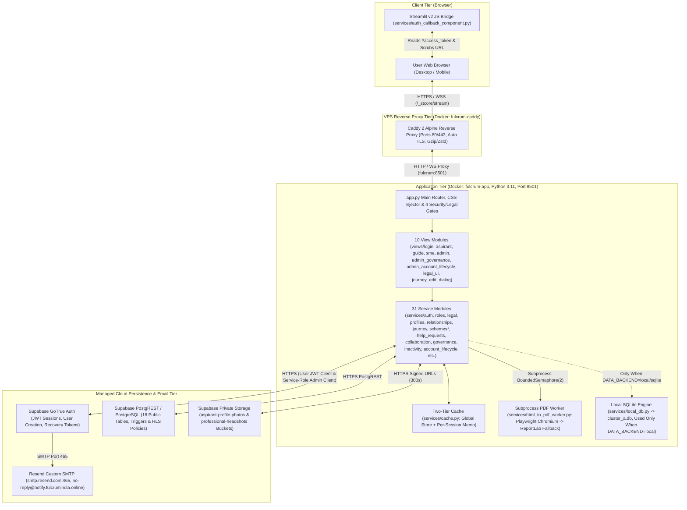

### Software Architecture Requirements (`SR-ARCH-*`)

| Req ID | Technical Requirement | Implementation Evidence | Status |
| :--- | :--- | :--- | :--- |
| **`SR-ARCH-001`** | **Single-Process Reactive Web Server**: The application executes as a Streamlit server (`streamlit run app.py --server.port=8501`) where each browser tab maintains a WebSocket connection (`/_stcore/stream`) and triggers top-to-bottom Python script reruns on widget interaction. | `Dockerfile` L65–L74, `app.py` L788–L1279 | Implemented — verified in source |
| **`SR-ARCH-002`** | **Strict Fail-Closed Cloud Backend in Production**: When `DATA_BACKEND=supabase` (default in `docker-compose.yml` L9), services must connect exclusively to Supabase and must never silently fall back to writing or authorizing against local SQLite (`cluster_a.db`) on network or database errors. | `services/auth.py` L73–L94, `services/account_lifecycle.py` L332–L558 (`VULN-01`) | Implemented — verified in source; Tested |
| **`SR-ARCH-003`** | **State-Safe Lazy Tab Evaluation**: All multi-tab portals (`views/aspirant.py`, `views/guide.py`, `views/sme.py`, `views/admin.py`, `views/admin_governance.py`, `views/admin_account_lifecycle.py`) must bind `st.tabs(..., on_change="rerun")` to `services.cache.is_tab_active()` so inactive tabs do not execute database queries during reruns. | `services/cache.py` L154–L159, `views/admin.py` L252–L272 (`VULN-10`, `DEC-01`) | Implemented — verified in source; Tested |
| **`SR-ARCH-004`** | **Subprocess-Isolated PDF Rendering with Bounded Concurrency**: HTML-to-PDF dossier generation must run in a separate child process (`services/html_to_pdf_worker.py`) gated by `threading.BoundedSemaphore(2)` with automatic fallback to `ReportLab` and raw PDF generation if Chromium fails. | `services/pdf_generator.py` L581–L786, `services/html_to_pdf_worker.py` L1–L75 | Implemented — verified in source; Tested |

---

## 3. Frameworks, Programming Languages and Dependencies (`SR-CFG-001`)

| Layer / Package | Version Constraint | Source File | Technical Role in Fulcrum-Beta 2.0.0 |
| :--- | :--- | :--- | :--- |
| **Python** | `3.11-slim` (Docker) / `3.11+` | `Dockerfile` L4, `.python-version` | Core application runtime language (`24,343` lines in `services/` + `views/`, `1,279` lines in `app.py`). |
| **`streamlit`** | `>=1.55.0,<=1.56.0` | `requirements.txt` L5 | Web UI framework, reactive state (`st.session_state`), native tab state tracking (`on_change="rerun"`), and Components v2 API. |
| **`supabase`** | `>=2.3.0` | `requirements.txt` L6 | Python client for Supabase GoTrue Auth, PostgREST database queries, and Storage buckets. |
| **`pandas`** | `>=2.0.0` | `requirements.txt` L7 | Tabular data formatting in admin views and analytics. |
| **`plotly`** | `>=5.18.0` | `requirements.txt` L8 | Visual charting dependency available for dashboard rendering. |
| **`python-dotenv`** | `>=1.0.0` | `requirements.txt` L9 | Loads `.env` environment variables in local/container startup (`services/auth.py` L16–L21). |
| **`requests`** | `>=2.31.0` | `requirements.txt` L10 | HTTP client utilities and health verification scripts. |
| **`reportlab`** | `>=4.0.0` | `requirements.txt` L11 | Secondary PDF generation engine when headless Chromium is unavailable (`services/pdf_generator.py` L644–L716). |
| **`playwright`** | `>=1.40.0` (+ Chromium) | `requirements.txt` L12, `Dockerfile` L51 | Headless Chromium browser for primary HTML-to-PDF dossier rendering (`services/html_to_pdf_worker.py`) and E2E tests. |
| **`psutil`** | `>=5.9.0` | `requirements.txt` L13 | Process and memory telemetry in load/benchmark scripts. |
| **Pillow (`PIL`)** | Transitive via `streamlit`/`reportlab` | `services/aspirant_photos.py` L17, `services/professional_photos.py` L23 | Image decoding, EXIF stripping, center-cropping, resizing (`600x600` / `320x320`), and WebP compression. |

---

## 4. Module Boundaries (`app.py`, `views/*`, `services/*`)

### 4.1 Entry Point and View Modules (`11` Modules)

| Module Path | Lines | Primary Functions | Responsibility & Boundary |
| :--- | :---: | :--- | :--- |
| `app.py` | 1,279 | `inject_global_styles()`, `main()` | Application entry point, CSS token injection, sidebar workspace switcher, workspace-filtered notification drawer, 4 security/legal gates, and portal dispatch. |
| `views/login.py` | 706 | `render_login_page()`, `_render_login_page_impl()` | Public landing page, Sign In form, Forgot Password expander, WebSocket recovery callback handling, Set New Password form, and Public Aspirant Signup form. |
| `views/legal_ui.py` | 230 | `render_terms_and_conditions_gate()`, `render_nda_gate()` | Blocking UI gates for Platform Terms of Service (`terms_v1_0`) and role-specific NDAs (`nda_guide`, `nda_sme`). |
| `views/aspirant.py` | 1,104 | `render_aspirant_portal()` | 6-tab Aspirant workspace (Overview/PDF, 4-Part Profile & Photo, Journey, Mentors & Confidential Complaint, Released Schemes, Consultations & Case Discussions). |
| `views/guide.py` | 1,379 | `render_guide_portal()`, `_render_suggested_card()` | 3-tab Guide workspace with 6 per-mentee pill subtabs (Profile, Journey, Guidance Team, 179-Scheme Matcher & Release/SSR UI, Consultations, Case Collaboration) + Guide Profile & Headshot. |
| `views/sme.py` | 952 | `render_sme_portal()` | 3-tab SME workspace with 4 per-mentee pill subtabs (Profile, Journey, Guidance Team, Consultations & COI Declaration) + SME Profile & Headshot. |
| `views/admin.py` | 1,542 | `render_admin_portal()`, `_render_admin_mentor_edit_expander()` | Admin Control Tower KPI header + Tabs 1–6 (Aspirants & Journeys, Guides, SMEs, Mentor Assignments, Mentor Inquiries & SSRs, Scheme Catalogue CRUD) + delegation to Tabs 7–13. |
| `views/admin_governance.py` | 996 | `render_admin_role_grants_tab()`, `render_admin_legal_records_tab()`, `render_admin_complaints_tab()`, `render_admin_inactivity_tab()`, `render_admin_sme_conflicts_tab()`, `render_admin_contact_aspirants_tab()` | Admin Tabs 7–12 (Multi-Role Grants, Legal/NDA Audit, Confidential Complaints, 7/10/14-Day Inactivity Monitor, Contact Aspirants, SME COI Governance). |
| `views/admin_account_lifecycle.py` | 396 | `render_admin_account_lifecycle_tab()`, `render_subtab_*()` (4 subtabs) | Admin Tab 13 (Active/Suspended Accounts, Archived Accounts, Pending Deletion, Immutable Action History). |
| `views/journey_edit_dialog.py` | 87 | `render_edit_journey_dialog()` | Modal/inline form for editing a Journey event with mandatory `change_reason` and optimistic concurrency check. |
| `views/__init__.py` | 3 | Package marker | Namespace initialization. |

### 4.2 Service Layer Modules (`31` Modules)

| Service Module | Lines | Core Responsibilities | Primary Tables Touched |
| :--- | :---: | :--- | :--- |
| `services/auth.py` | 1,246 | Supabase/SQLite backend selection, user & admin client creation, login, public signup, password reset request, recovery token verification, first-login password change, admin mentor creation, logout. | `auth.users`, `profiles`, `user_roles`, `journeys`, `relationships` |
| `services/auth_callback_component.py` | 98 | Custom Streamlit v2 JavaScript bridge (`read_auth_callback`) extracting `#access_token` and `#refresh_token` from URL hash fragments. | Browser DOM / WebSocket |
| `services/roles.py` | 1,011 | Sole Admin identity verification (`is_strict_admin`, `require_sole_admin`), multi-role grants, activation, suspension, reinstatement, cancellation, revocation with automatic unassignment, mentor eligibility checks (`is_assignable_mentor`). | `user_roles`, `profiles`, `legal_acceptances`, `relationships` |
| `services/legal.py` | 488 | Versioned Terms & NDA retrieval, SHA-256 content hashing, acceptance verification, and signature recording (`record_legal_acceptance`). | `legal_documents`, `legal_acceptances`, `user_roles` |
| `services/account_lifecycle.py` | 1,528 | Fail-closed account status evaluation (`get_account_status`), suspension, resumption, pre-archive impact preview, atomic archival with handover & rollback, restoration, 30-day deletion scheduling/cancellation, legal holds, audit log queries. | `profiles`, `account_lifecycle_log`, `relationships`, `help_requests`, `user_roles` |
| `services/profiles.py` | 813 | Relationship-authorized profile reads (`get_profile`, `get_profiles_batch`), completion % calculation, 4-part Aspirant profile update (preserving hybrid mentor data), Mentor profile update. | `profiles`, `relationships`, `user_roles` |
| `services/aspirant_photos.py` | 597 | Private Aspirant photo authorization (`can_view_aspirant_photo`), PIL validation/WebP compression (`600x600`, `<=180 KB`), storage upload/delete, 300s signed URL generation, header rendering. | `aspirant_photos`, `storage.objects` (`aspirant-profile-photos`), `relationships`, `user_roles`, `legal_acceptances` |
| `services/professional_photos.py` | 585 | Guide/SME professional headshot authorization (`can_view_professional_photo` — masked from Aspirants), PIL normalization (`320x320` WebP, `<=150 KB`), upload/delete, batch signed URL lookup. | `professional_photos`, `storage.objects` (`professional-headshots`), `profiles`, `user_roles` |
| `services/relationships.py` | 1,117 | Mentor lookup (`get_aspirant_mentors`), Guide/Co-Guide assignment (`assign_guide`), SME assignment (`assign_sme`), unassignment with Co-Guide promotion and ticket transfer (`unassign_guide`, `unassign_sme`), caseload queries. | `relationships`, `assignment_history`, `help_requests`, `profiles`, `notifications`, `journey_events` |
| `services/journey.py` | 1,191 | Journey creation, chronological sorting, multi-actor milestone creation, roadmap inclusion toggle, author-scoped editing with optimistic locking and revision logging, soft delete, case completion. | `journeys`, `journey_events`, `journey_event_revisions`, `notifications` |
| `services/pdf_generator.py` | 823 | Dossier data aggregation, HTML synthesis, `BoundedSemaphore(2)` subprocess Playwright PDF conversion, ReportLab fallback, emergency raw PDF fallback. | Reads `profiles`, `relationships`, `scheme_releases`, `schemes`, `journeys`, `journey_events` |
| `services/html_to_pdf_worker.py` | 75 | Standalone CLI worker launched by `pdf_generator.py` to render local HTML to PDF via headless Chromium with network request blocking. | Local temp files |
| `services/schemes.py` | 933 | Scheme catalogue queries & CRUD (`list_schemes`, `upsert_scheme`, `toggle_archive_scheme`, `delete_scheme`), Aspirant scheme matching wrapper, Guide scheme release/withdrawal, 7-stage application progress tracking. | `schemes`, `scheme_releases`, `journey_events`, `notifications` |
| `services/scheme_matching_engine.py` | 517 | 3-stage deterministic scheme matcher: profile normalization (`X`), Stage 1 hard gatekeeper disqualifications, Stage 2 weighted scoring (`0–100`), Stage 3 evidence checklist. | Pure deterministic computation |
| `services/scheme_rules.py` | 214 | Assistance Need (`Y`) taxonomies, INR Lakh/Crore regex quantum parser (`parse_quantum_limits`), structured rule extraction (`get_scheme_structured_rules`). | Pure deterministic computation |
| `services/scheme_reviews.py` | 360 | Guide-to-Admin Scheme Support Review (SSR) submission, listing, Admin approval/rejection (auto-releasing scheme on approval), and Admin-to-Guide scheme delegation. | `scheme_support_reviews`, `scheme_releases`, `notifications` |
| `services/schemes_ui.py` | 505 | Reusable scheme card renderer (`render_fund_explorer_card`) and Admin modal edit/delete dialogs (`open_edit_scheme_dialog`, `open_delete_scheme_dialog`). | Calls `services/schemes.py` |
| `services/help_requests.py` | 1,364 | Aspirant consultation creation, Guide/SME/Aspirant threaded responses with adaptive schema fallback, mentor-initiated consultations, mentor-to-admin inquiries, Admin directives (with optional Co-Guide/SME assignment). | `help_requests`, `relationships`, `notifications`, `journey_events` |
| `services/collaboration.py` | 238 | Case Collaboration Space message creation and role-filtered retrieval (`is_private_mentor_note` hidden from Aspirants). | `case_discussions`, `relationships`, `notifications` |
| `services/governance.py` | 360 | Actor name masking, Confidential Guide Complaint submission/listing/resolution, SME Conflict of Interest declaration/check/adjudication. | `guide_complaints`, `sme_conflict_declarations`, `relationships`, `notifications` |
| `services/inactivity.py` | 778 | Independent Guide & SME last-interaction computation (ignoring Aspirant replies), 7/10/14-day episode-deduplicated escalation logging, live alert status computation, Aspirant engagement roster evaluation. | `inactivity_logs`, `relationships`, `help_requests`, `journey_events`, `case_discussions`, `scheme_releases`, `notifications` |
| `services/external_contact.py` | 388 | Indian phone normalization (`+91`), WhatsApp (`wa.me`) and Gmail compose URL builders, outreach templates, and immutable `external_contact_logs` recording. | `external_contact_logs`, `inactivity_logs` |
| `services/notifications.py` | 418 | Authorization-checked notification creation (`is_notification_allowed`), workspace inference and filtering (`filter_notifications_by_workspace`), read/dismiss updates. | `notifications`, `relationships`, `profiles` |
| `services/admin_metrics.py` | 194 | Bulk-queried, memoized (30s TTL) Control Tower KPIs uniting `profiles` and `user_roles`. | Reads `profiles`, `user_roles`, `relationships`, `journeys`, `help_requests`, `scheme_support_reviews`, `guide_complaints`, `sme_conflict_declarations` |
| `services/pagination.py` | 448 | Server-side and hybrid-union pagination (`paginate_profiles`, `paginate_guides`, `paginate_smes`, `paginate_accounts`, `render_pagination_controls`). | Reads `profiles`, `user_roles`, `journey_events`, `notifications` |
| `services/cache.py` | 160 | Process-wide TTL cache (`_GLOBAL_CACHE` with cross-session `_INVALIDATION_TIMESTAMPS`), per-session memo store (`_get_session_store`), and `is_tab_active()`. | In-memory |
| `services/constants.py` | 187 | Master taxonomies (16 sectors, 6 stages, 38 TN districts + non-TN, business types, social categories, genders, funding types) and `safe_escape()` / `resolve_field_choice()`. | Pure constants/helpers |
| `services/logger.py` | 100 | `StructuredLogger` writing JSON logs to stdout with regex redaction of emails, JWTs, API keys, and passwords. | `stdout` |
| `services/perf.py` | 85 | `PerfTracker` context-manager stage timer stored in `st.session_state["_perf_metrics"]`. | In-memory |
| `services/local_db.py` | 2,832 | Complete SQLite (`cluster_a.db`) relational mirror of all 18 tables used only when `DATA_BACKEND=local`/`sqlite`. | Local SQLite file |
| `services/__init__.py` | 3 | Package marker | Namespace initialization |

---

## 5. Internal Service Contracts (`SR-INT-001`)

Because Fulcrum-Beta 2.0.0 does not expose HTTP REST endpoints, views invoke Python service functions directly in-process. Almost all mutating service functions follow a uniform **Tuple Return Contract**:
- **Signature Pattern**: `def action_name(...) -> Tuple[bool, Optional[str]]` (or `Tuple[Optional[Dict], Optional[str]]` for creation/auth functions).
- **Success**: Returns `(True, None)` or `(result_dict, None)`.
- **Failure**: Never raises unhandled exceptions to the UI; catches PostgREST/validation errors, logs sanitized details via `StructuredLogger`, performs any compensating rollback, and returns `(False, "Human-readable error message")`.

---

## 6. Authentication Mechanisms (`SR-AUTH-001` to `SR-AUTH-004`)

| Req ID | Mechanism | Technical Specification & Source Evidence | Status |
| :--- | :--- | :--- | :--- |
| **`SR-AUTH-001`** | **Supabase GoTrue Email+Password Authentication** | `login_user()` (`services/auth.py` L312–L519) authenticates via `client.auth.sign_in_with_password({"email": clean_email, "password": password})`. Access and refresh JWTs are stored in `st.session_state.sb_access_token` and `st.session_state.sb_refresh_token` and bound to a per-session `st.session_state.supabase_client` via `client.auth.set_session(access_token, refresh_token)` (`services/auth.py` L162–L177). | Implemented — verified in source; Tested |
| **`SR-AUTH-002`** | **Ephemeral Client Isolation for Password Recovery** | Both `send_password_reset()` (L674–L708) and `verify_recovery_session_tokens()` / `complete_password_reset()` (L711–L877) instantiate disposable Supabase clients via `_create_ephemeral_supabase_client()` (L197–L209) so recovery token verification never mutates or hijacks another user's active session state. | Implemented — verified in source; Tested |
| **`SR-AUTH-003`** | **Browser URL Fragment Token Bridge** | Because HTTP servers never receive URL hash fragments (`#access_token=...`), `services/auth_callback_component.py` (L15–L97) registers a Streamlit v2 component (`fulcrum_auth_callback_bridge`) that reads `window.location.hash` and `window.location.search`, strips tokens from the browser URL bar via `window.history.replaceState`, and transmits them over Streamlit's WebSocket to `views/login.py` (L342–L373). | Implemented — verified in source; Tested |
| **`SR-AUTH-004`** | **Admin Provisioning via Service-Role Auth API** | `admin_create_mentor()` (`services/auth.py` L997–L1130) uses `admin_client.auth.admin.create_user({"email": clean_email, "password": temp_password, "email_confirm": True, ...})` to provision Guides and SMEs with pre-confirmed emails and `profile_data.temp_password_issued = True`. | Implemented — verified in source; Tested |

---

## 7. Authorization Mechanisms & Service-Role Usage Analysis (`SR-AUTHZ-001` to `SR-AUTHZ-005`)

Fulcrum enforces authorization across **four defense-in-depth layers**:

1. **Layer 1 — Router & UI Gating (`app.py` L838–L1275)**: Resolves account lifecycle status (`Gate 0`), temporary password state (`Gate 1`), Terms acceptance (`Gate 2`), and role NDA acceptance (`Gate 3`), and restricts `render_admin_portal()` strictly to `is_strict_admin(user_dict=user)`.
2. **Layer 2 — Service-Layer Session & Anti-Spoofing Verification**:
   - **`is_strict_admin()` & `require_sole_admin()` (`services/roles.py` L57–L309)**: Validates not only the passed `actor_id`/`email` against `SOLE_ADMIN_EMAIL` (`<SOLE_ADMIN_EMAIL>`) and `SOLE_ADMIN_UUID`, but also cross-checks `st.session_state.user` and verifies the Supabase JWT token (`client.auth.get_user(token)`) so a non-admin session passing `admin_id=SOLE_ADMIN_UUID` is flagged as spoofing and rejected (`VULN-02`).
   - **`_authorize_mentor_session_role()` (`services/help_requests.py` L524–L551)**: Verifies that the active session holds the required mentor role in `user_roles` and that `active_workspace` matches before permitting Guide/SME ticket replies (`DEF-32-002`).
   - **Relationship-Scoped Profile & Photo Gating (`services/profiles.py` L23–L85, `services/aspirant_photos.py` L39–L154, `services/professional_photos.py` L90–L125)**: Explicitly checks `public.relationships` (`guide_id`, `guide_ids`, `sme_id`, `sme_ids`), `user_roles`, and `legal_acceptances` in Python before returning profile data or generating signed storage URLs.
3. **Layer 3 — PostgreSQL Row Level Security (RLS)**: Enabled on all **18 `public` tables** and `storage.objects` (`migrations/000`–`009`).
4. **Layer 4 — PostgreSQL Database Triggers**:
   - `trg_enforce_single_admin_profile` (`migrations/008` L94–L96) and `trg_enforce_single_admin_user_roles` (`migrations/008` L115–L117) prevent privilege escalation even if executed via a privileged client.
   - `trg_immutable_account_lifecycle_log` (`migrations/009` L283–L286) aborts any `UPDATE` or `DELETE` on `public.account_lifecycle_log` even if executed by the `service_role` key.

### 7.1 Security-Critical Analysis of `get_supabase_admin_client()` (Service-Role Bypass)
Static analysis across `services/*.py` identified **18 service modules** that call `get_supabase_admin_client()` (which uses `SUPABASE_SECRET_KEY`, bypassing PostgreSQL RLS):
- **Why It Is Used**: In Streamlit's server-side architecture, cross-entity operations—such as pre-seeding a profile during unconfirmed signup (`services/auth.py` L606), enriching mentor names on Aspirant tickets (`services/help_requests.py` L394), computing cross-table inactivity clocks (`services/inactivity.py` L374), or executing multi-table mentor handovers (`services/relationships.py` L294)—require reading or updating rows across users.
- **Architectural Implication (`SR-AUTHZ-005`, `SEC-RLS-002`)**: Because `get_supabase_admin_client()` bypasses PostgreSQL RLS for those queries, **Python service-layer authorization checks (`require_sole_admin`, `_get_relationship_authorized_ids_supabase`, `can_view_aspirant_photo`, `can_view_professional_photo`, `_authorize_mentor_session_role`) are the primary enforcement boundary** for service-role queries, while PostgreSQL RLS acts as a secondary backstop for user-client queries and direct PostgREST access.

### Mermaid Diagram 2 — Role and Permission Decision Flow

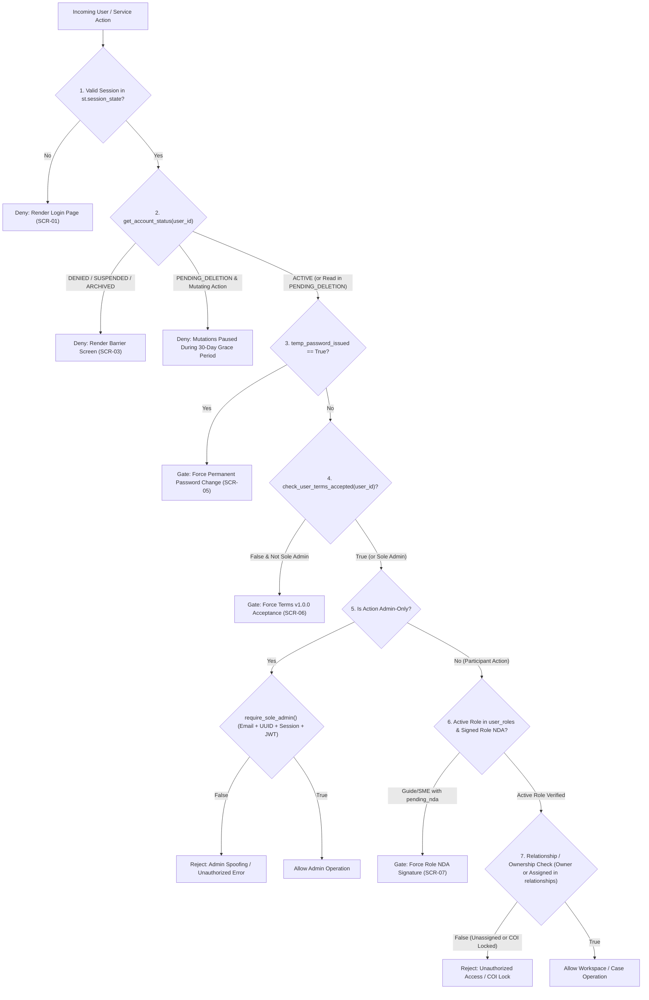

---

## 8. Complete Role-Permission Matrix (All 8 Role Combinations × Lifecycle States)

In the table below:
- **Roles**: `A` = Aspirant, `G` = Guide, `S` = SME, `A+G`, `A+S`, `G+S`, `A+G+S` (the 7 non-admin combinations), and `ADM` = Sole Administrator (`<SOLE_ADMIN_EMAIL>`).
- **Enforcement Layers**: `[UI]` = `app.py` / `views/*.py`, `[SVC]` = `services/*.py` check, `[RLS]` = PostgreSQL RLS policy, `[TRG]` = PostgreSQL Trigger.

| Capability / Operation | `A` (Active) | `G` (Active + NDA) | `S` (Active + NDA) | `A+G` (Active) | `A+S` (Active) | `G+S` (Active) | `A+G+S` (Active) | `ADM` (Sole Admin) | Unconfirmed / Temp-PW / No-Terms | Role `pending_nda` | `PENDING_DELETION` | `SUSPENDED` / `ARCHIVED` / `DENIED` |
| :--- | :---: | :---: | :---: | :---: | :---: | :---: | :---: | :---: | :---: | :---: | :---: | :---: |
| **Access Aspirant Workspace (`SCR-08`..`13`)** | ✅ `[UI,SVC]` | ❌ | ❌ | ✅ (in `A` ws) | ✅ (in `A` ws) | ❌ | ✅ (in `A` ws) | ❌ `[UI,SVC]` | ❌ Blocked by Gate | ✅ (in `A` ws) | ⚠️ Read + Cancel only | ❌ Blocked (`SCR-03`) |
| **Edit Own 4-Part Profile & Upload Aspirant Photo** | ✅ `[SVC,RLS]` | ❌ | ❌ | ✅ (own `A`) | ✅ (own `A`) | ❌ | ✅ (own `A`) | ✅ (inspect/admin) | ❌ | ✅ (own `A`) | ❌ Paused | ❌ |
| **View Aspirant Private Photo (`aspirant_photos`)** | ✅ (Self) | ✅ (Assigned) `[SVC,RLS]` | ✅ (Assigned) `[SVC,RLS]` | ✅ (Self or Assigned) | ✅ (Self or Assigned) | ✅ (Assigned) | ✅ (Self or Assigned) | ✅ (All) `[SVC,RLS]` | ❌ | ❌ (`migrations/005`) | ⚠️ Self read | ❌ |
| **Upload/View Mentor Headshot (`professional_photos`)** | ❌ Masked `[SVC,RLS]` | ✅ (Self) `[SVC,RLS]` | ✅ (Self) `[SVC,RLS]` | ✅ (Self `G` photo) | ✅ (Self `S` photo) | ✅ (Self) | ✅ (Self) | ✅ (All) `[SVC,RLS]` | ❌ | ❌ | ❌ | ❌ |
| **Access Guide Workspace (`SCR-14`..`15`)** | ❌ | ✅ `[UI,SVC]` | ❌ | ✅ (in `G` ws) | ❌ | ✅ (in `G` ws) | ✅ (in `G` ws) | ❌ | ❌ | ❌ Blocked (`SCR-07`) | ⚠️ Read only | ❌ |
| **Evaluate & Release Schemes (`scheme_releases`)** | ❌ (Read released) | ✅ (Assigned) `[SVC,RLS]` | ❌ (No scheme tab) | ✅ (Assigned `G`, not self) | ❌ | ✅ (Assigned `G`) | ✅ (Assigned `G`, not self) | ✅ (All / SSR) `[SVC,RLS]` | ❌ | ❌ | ❌ | ❌ |
| **Submit Scheme Support Review (`scheme_support_reviews`)** | ❌ | ✅ (Assigned) `[SVC,RLS]` | ❌ | ✅ (in `G` ws) | ❌ | ✅ (in `G` ws) | ✅ (in `G` ws) | ✅ (Decide) `[SVC,RLS]` | ❌ | ❌ | ❌ | ❌ |
| **Access SME Workspace (`SCR-16`..`17`)** | ❌ | ❌ | ✅ `[UI,SVC]` | ❌ | ✅ (in `S` ws) | ✅ (in `S` ws) | ✅ (in `S` ws) | ❌ | ❌ | ❌ Blocked (`SCR-07`) | ⚠️ Read only | ❌ |
| **Declare SME Conflict of Interest (`sme_conflict_declarations`)** | ❌ | ❌ | ✅ (Assigned) `[SVC,RLS]` | ❌ | ✅ (in `S` ws) | ✅ (in `S` ws) | ✅ (in `S` ws) | ✅ (Resolve) `[SVC,RLS]` | ❌ | ❌ | ❌ | ❌ |
| **Reply to SME Consultation When COI `has_conflict=True`** | N/A | N/A | ❌ Locked `[UI,SVC]` | N/A | ❌ Locked | ❌ Locked | ❌ Locked | ✅ (Override/Unassign) | ❌ | ❌ | ❌ | ❌ |
| **Add Journey Event & Edit Own Event (`journey_events`)** | ✅ (Self) `[SVC,RLS]` | ✅ (Assigned) `[SVC,RLS]` | ✅ (Assigned) `[SVC,RLS]` | ✅ (Context ws) | ✅ (Context ws) | ✅ (Assigned) | ✅ (Context ws) | ✅ (All) `[SVC,RLS]` | ❌ | ❌ | ❌ Paused | ❌ |
| **Read/Write Private Mentor Notes (`case_discussions`)** | ❌ Hidden `[SVC]` | ✅ (Assigned) `[SVC,RLS]` | ✅ (Assigned) `[SVC,RLS]` | ✅ (Only in `G` ws for mentees) | ✅ (Only in `S` ws for mentees) | ✅ (Assigned) | ✅ (In `G`/`S` ws for mentees) | ✅ (All) `[SVC,RLS]` | ❌ | ❌ | ❌ | ❌ |
| **File Confidential Guide Complaint (`guide_complaints`)** | ✅ (Own Guide) `[SVC,RLS]` | ❌ Hidden `[SVC,RLS]` | ❌ | ✅ (In `A` ws vs own Guide) | ✅ (In `A` ws vs own Guide) | ❌ | ✅ (In `A` ws vs own Guide) | ✅ (Resolve) `[SVC,RLS]` | ❌ | ❌ | ❌ | ❌ |
| **Be Assigned as Mentor to Own Aspirant Profile** | ❌ | N/A | N/A | ❌ Blocked `[SVC]` | ❌ Blocked `[SVC]` | N/A | ❌ Blocked `[SVC]` | N/A | ❌ | ❌ | ❌ | ❌ |
| **Access 13 Admin Tabs (`SCR-18`..`30`) & Lifecycle Actions** | ❌ `[UI,SVC,RLS,TRG]` | ❌ | ❌ | ❌ | ❌ | ❌ | ❌ | ✅ Exclusive `[UI,SVC,RLS,TRG]` | ❌ | ❌ | ❌ | ❌ |
| **Modify or Delete `account_lifecycle_log` Rows** | ❌ `[RLS,TRG]` | ❌ `[RLS,TRG]` | ❌ `[RLS,TRG]` | ❌ `[RLS,TRG]` | ❌ `[RLS,TRG]` | ❌ `[RLS,TRG]` | ❌ `[RLS,TRG]` | ❌ Append-Only `[RLS,TRG]` | ❌ | ❌ | ❌ | ❌ |

---

## 9. Database Structure and Constraints (`SR-DATA-001` to `SR-DATA-006`)

### 9.1 Complete Inventory of the 18 `public` PostgreSQL Tables (`migrations/000`–`011`)

| # | Table Name (`public.*`) | Introduced / Modified In | Primary Key & Foreign Keys | Key Columns, `CHECK` / `UNIQUE` Constraints & Triggers | RLS Enabled? |
| :-: | :--- | :--- | :--- | :--- | :-: |
| **1** | `profiles` | `000`, `008`, `009`, `010` | `id UUID PK` -> `REFERENCES auth.users(id) ON DELETE RESTRICT` (`009` L170) | `email TEXT UNIQUE`, `full_name TEXT`, `phone TEXT`, `role TEXT` (`aspirant`,`guide`,`sme`,`admin`), `district TEXT`, `state TEXT`, `profile_data JSONB`, `is_active BOOL`, `account_status VARCHAR(30) CHECK IN ('ACTIVE','TEMPORARILY_SUSPENDED','ARCHIVED','PENDING_DELETION')`, `legal_hold BOOL`, `lifecycle_reason TEXT`, `status_reason TEXT`, `deletion_requested_at TIMESTAMPTZ`, `deletion_scheduled_for TIMESTAMPTZ`, `retention_notes TEXT`. Trigger: `trg_enforce_single_admin_profile` (`008`). | ✅ Yes (6 policies) |
| **2** | `user_roles` | `000`, `001`, `007`, `008` | `id UUID PK`; `user_id UUID FK -> profiles(id) ON DELETE CASCADE` | `role TEXT CHECK IN ('aspirant','guide','sme','admin')`, `status TEXT CHECK IN ('active','pending_nda','suspended','revoked')`, `granted_by UUID`, `nda_accepted BOOL`, `nda_accepted_at TIMESTAMPTZ`, `UNIQUE(user_id, role)`. Trigger: `trg_enforce_single_admin_user_roles` (`008`). | ✅ Yes (2 policies) |
| **3** | `legal_documents` | `000`, `001` | `id TEXT PK` | `doc_type TEXT CHECK IN ('terms_and_conditions','nda_guide','nda_sme')`, `version TEXT`, `title TEXT`, `content TEXT`, `is_active BOOL`. | ✅ Yes (2 policies) |
| **4** | `legal_acceptances` | `000`, `001` | `id UUID PK`; `user_id UUID FK -> profiles(id) ON DELETE CASCADE` | `user_email TEXT`, `doc_type TEXT`, `doc_version TEXT`, `document_hash TEXT` (SHA-256), `typed_name TEXT`, `typed_phrase TEXT`, `status TEXT DEFAULT 'ACCEPTED'`, `ip_address TEXT`, `user_agent TEXT`, `accepted_at TIMESTAMPTZ`. | ✅ Yes (3 policies) |
| **5** | `relationships` | `000`, `008` | `id UUID PK`; `aspirant_id UUID UNIQUE FK -> profiles(id) ON DELETE CASCADE`; `guide_id UUID FK -> profiles(id)`; `sme_id UUID FK -> profiles(id)` | `guide_ids JSONB DEFAULT '[]'` (Co-Guides array), `sme_ids JSONB DEFAULT '[]'` (Multi-SME array), `status TEXT CHECK IN ('active','unassigned','completed','paused')`, `assigned_by UUID`, `notes TEXT`. | ✅ Yes (4 policies) |
| **6** | `assignment_history` | `000` | `id UUID PK`; `aspirant_id UUID FK -> profiles(id)`; `mentor_id UUID FK -> profiles(id)` | `mentor_role TEXT CHECK IN ('guide','sme')`, `action TEXT CHECK IN ('assigned','unassigned','reassigned')`, `assigned_by UUID`, `notes TEXT`, `assigned_at TIMESTAMPTZ`. | ✅ Yes (3 policies) |
| **7** | `journeys` | `000` | `id UUID PK`; `aspirant_id UUID UNIQUE FK -> profiles(id) ON DELETE CASCADE` | `title TEXT`, `status TEXT CHECK IN ('active','paused','completed')`, `created_at`, `updated_at`. | ✅ Yes (4 policies) |
| **8** | `journey_events` | `000` | `id UUID PK`; `journey_id UUID FK -> journeys(id) ON DELETE CASCADE`; `aspirant_id UUID FK -> profiles(id)` | `actor_id UUID FK -> profiles(id)`, `actor_role TEXT`, `event_type TEXT`, `title TEXT`, `description TEXT`, `event_date DATE`, `included_in_roadmap BOOL DEFAULT TRUE`, `metadata JSONB`. | ✅ Yes (11 policies) |
| **9** | `journey_event_revisions` | `000`, `002` | `id UUID PK`; `journey_event_id UUID FK -> journey_events(id) ON DELETE CASCADE`; `editor_id UUID FK -> profiles(id)` | `editor_role TEXT`, `previous_title TEXT`, `previous_description TEXT`, `previous_link TEXT`, `previous_event_date TEXT`, `change_reason TEXT`, `created_at TIMESTAMPTZ`. | ✅ Yes (2 policies) |
| **10** | `help_requests` | `000`, `004`, `011` | `id UUID PK`; `aspirant_id UUID FK -> profiles(id) ON DELETE CASCADE` | `assigned_guide_id UUID`, `assigned_sme_id UUID`, `requester_id UUID`, `requester_role TEXT`, `request_type TEXT`, `target_role TEXT`, `category TEXT`, `priority TEXT`, `subject TEXT`, `message TEXT`, `guide_response TEXT`, `sme_response TEXT`, `admin_response TEXT`, `admin_directive TEXT`, `status TEXT CHECK IN ('OPEN','IN_PROGRESS','WAITING_ON_ASPIRANT','WAITING_ON_GUIDE_SME','ACTION_REQUIRED','REPLIED','RESOLVED','ESCALATED','PENDING_ADMIN','DIRECTIVE_ISSUED')` (`011`), `last_interaction_actor_id UUID`, `last_interaction_actor_role TEXT`, `last_mentor_response_at TIMESTAMPTZ`, `last_aspirant_response_at TIMESTAMPTZ`. | ✅ Yes (7 policies) |
| **11** | `case_discussions` | `000`, `001` | `id UUID PK`; `aspirant_id UUID FK -> profiles(id) ON DELETE CASCADE`; `author_id UUID FK -> profiles(id)` | `author_role TEXT`, `title TEXT`, `message TEXT`, `is_private_mentor_note BOOL DEFAULT FALSE`, `attachments JSONB`. | ✅ Yes (3 policies) |
| **12** | `schemes` | `000` | `id TEXT PK` | `source_id TEXT`, `name TEXT`, `agency TEXT`, `ministry TEXT`, `scheme_type TEXT`, `category_type TEXT`, `funding_type TEXT`, `stage TEXT`, `amount TEXT`, `brief TEXT`, `description TEXT`, `sectors JSONB`, `eligibility JSONB`, `terms JSONB`, `hidden_agenda TEXT`, `red_flags JSONB`, `process JSONB`, `timeline TEXT`, `state_scope TEXT`, `geography TEXT`, `application_url TEXT`, `is_active BOOL DEFAULT TRUE`, `display_order INT`. | ✅ Yes (3 policies) |
| **13** | `scheme_releases` | `000`, `008` | `id UUID PK`; `aspirant_id UUID FK -> profiles(id) ON DELETE CASCADE`; `scheme_id TEXT FK -> schemes(id) ON DELETE CASCADE`; `guide_id UUID FK -> profiles(id)` | `status TEXT CHECK IN ('released','withdrawn')`, `guide_recommendation TEXT`, `guide_note TEXT`, `application_stage TEXT DEFAULT 'Recommended'` (`008`), `application_note TEXT`, `stage_updated_at TIMESTAMPTZ`, `stage_updated_by UUID`, `UNIQUE(aspirant_id, scheme_id)`. | ✅ Yes (4 policies) |
| **14** | `scheme_support_reviews` | `004` | `id UUID PK`; `aspirant_id UUID FK -> profiles(id)`; `scheme_id TEXT FK -> schemes(id)`; `guide_id UUID FK -> profiles(id)` | `match_score INT`, `guide_justification TEXT`, `failed_criteria TEXT[]`, `missing_criteria TEXT[]`, `status TEXT CHECK IN ('PENDING','APPROVED','REJECTED')`, `admin_decision_notes TEXT`, `reviewed_by UUID`, `UNIQUE(aspirant_id, scheme_id, guide_id)`. | ✅ Yes (3 policies) |
| **15** | `guide_complaints` | `000`, `001` | `id UUID PK`; `aspirant_id UUID FK -> profiles(id)`; `guide_id UUID FK -> profiles(id)` | `reason TEXT`, `details TEXT`, `status TEXT CHECK IN ('OPEN','UNDER_REVIEW','RESOLVED','DISMISSED')`, `resolution_notes TEXT`, `resolved_by UUID`. | ✅ Yes (3 policies; Guides have 0 access) |
| **16** | `sme_conflict_declarations` | `000`, `001` | `id UUID PK`; `sme_id UUID FK -> profiles(id)`; `aspirant_id UUID FK -> profiles(id)` | `has_conflict BOOL`, `conflict_details TEXT`, `status TEXT CHECK IN ('CLEARED','PENDING_REVIEW','RESOLVED','APPROVED','REJECTED')`, `reviewed_by UUID`, `UNIQUE(sme_id, aspirant_id)`. | ✅ Yes (2 policies) |
| **17** | `inactivity_logs` | `000`, `001`, `006` | `id UUID PK`; `relationship_id UUID FK -> relationships(id)`; `guide_id UUID FK -> profiles(id)`; `aspirant_id UUID FK -> profiles(id)` | `mentor_id UUID FK -> profiles(id)` (`006`), `mentor_role TEXT DEFAULT 'guide'`, `inactivity_days INT`, `escalation_stage TEXT CHECK IN ('REMINDER_7D','ALERT_10D','ESCALATED_14D')`, `inactivity_episode TEXT`, `status TEXT DEFAULT 'ACTIVE'`, `follow_up_channel TEXT`, `follow_up_sent_at TIMESTAMPTZ`, `follow_up_notes TEXT`. Unique Index: `uq_inactivity_episode_stage(mentor_id, aspirant_id, mentor_role, inactivity_episode, escalation_stage)`. | ✅ Yes (2 policies) |
| **18** | `external_contact_logs` | `006` | `id UUID PK`; `admin_id UUID FK -> profiles(id)`; `recipient_id UUID FK -> profiles(id)`; `aspirant_id UUID FK -> profiles(id)` | `recipient_role TEXT CHECK IN ('guide','sme','aspirant')`, `inactivity_record_id UUID FK -> inactivity_logs(id)`, `channel TEXT CHECK IN ('whatsapp','email')`, `purpose TEXT`, `status TEXT CHECK IN ('DRAFT_OPENED','SENT_CONFIRMED','ACKNOWLEDGED')`, `notes TEXT`. | ✅ Yes (1 Admin-only policy) |
| **19** | `aspirant_photos` | `000`, `003`, `005` | `id UUID PK`; `user_id UUID UNIQUE FK -> profiles(id) ON DELETE CASCADE` | `storage_path TEXT`, `mime_type TEXT`, `file_size_bytes INT`, `width INT`, `height INT`, `sha256_hash TEXT`, `uploaded_by UUID`. | ✅ Yes (3 policies, tightened in `005`) |
| **20** | `professional_photos` | `008` | `id UUID PK`; `user_id UUID UNIQUE FK -> profiles(id) ON DELETE CASCADE` | `storage_bucket TEXT DEFAULT 'professional-headshots'`, `storage_path TEXT`, `mime_type TEXT DEFAULT 'image/webp'`, `byte_size INT CHECK (byte_size > 0 AND byte_size <= 153600)`, `width INT CHECK (width = 320)`, `height INT CHECK (height = 320)`, `sha256_hash TEXT`, `uploaded_by UUID`. | ✅ Yes (2 policies) |
| **21** | `account_lifecycle_log` | `009`, `010` | `id UUID PK`; `user_id UUID NOT NULL`; `actor_id UUID NOT NULL` | `action VARCHAR(50) CHECK IN ('SUSPEND','RESUME','ARCHIVE','RESTORE','REQUEST_DELETION','CANCEL_DELETION','APPLY_LEGAL_HOLD','RELEASE_LEGAL_HOLD')`, `previous_status VARCHAR(30)`, `old_status TEXT`, `new_status VARCHAR(30)`, `reason TEXT NOT NULL`, `metadata JSONB`, `details JSONB`. Trigger: `trg_immutable_account_lifecycle_log` (`009`). | ✅ Yes (3 permissive + 2 `AS RESTRICTIVE` deny update/delete) |
| **22** | `notifications` | `000` | `id UUID PK`; `user_id UUID FK -> profiles(id) ON DELETE CASCADE` | `title TEXT`, `message TEXT`, `notification_type TEXT`, `is_read BOOL DEFAULT FALSE`, `link TEXT`, `created_at TIMESTAMPTZ`. | ✅ Yes (4 policies) |
| **23** | `activity_log` | `000` | `id UUID PK`; `user_id UUID FK -> profiles(id) ON DELETE SET NULL` | `action TEXT`, `details JSONB`, `created_at TIMESTAMPTZ`. | ✅ Yes (2 policies) |

*(Note: Including `notifications`, `activity_log`, `aspirant_photos`, `professional_photos`, and `account_lifecycle_log`, there are **23 tables in the `public` schema** across `migrations/000`–`011`, plus `auth.users` and `storage.objects`/`storage.buckets`.)*

### 9.2 PostgreSQL Functions & Triggers (`migrations/000`, `008`, `009`)
1. **`public.is_admin()` (`migrations/008` L35–L43)**: `SECURITY DEFINER STABLE` SQL function returning `TRUE` iff `auth.uid()` has `lower(email) = '<SOLE_ADMIN_EMAIL>'` and `role = 'admin'` in `public.profiles`.
2. **`public.current_role()` (`migrations/000` L322–L329)**: `SECURITY DEFINER` SQL function returning `profiles.role` for `auth.uid()`.
3. **`public.handle_new_user()` & Trigger `on_auth_user_created` (`migrations/008` L45–L70)**: `AFTER INSERT ON auth.users` trigger that automatically inserts a row into `public.profiles`, assigning `'admin'` only if `lower(NEW.email) = '<SOLE_ADMIN_EMAIL>'` and defaulting any unauthorized admin strings to `'aspirant'`.
4. **`public.enforce_single_admin_profile_guard()` & Trigger `trg_enforce_single_admin_profile` (`migrations/008` L72–L96)**: `BEFORE INSERT OR UPDATE ON public.profiles` trigger that strips `'admin'`, `'district_admin'`, or `'operational_admin'` from any row whose email is not `<SOLE_ADMIN_EMAIL>`, and prevents non-admins from altering `OLD.role`.
5. **`public.enforce_single_admin_user_roles_guard()` & Trigger `trg_enforce_single_admin_user_roles` (`migrations/008` L98–L117)**: `BEFORE INSERT OR UPDATE ON public.user_roles` trigger raising `'Security Violation: Only <SOLE_ADMIN_EMAIL> may hold the admin role.'` if any other user is granted an admin role.
6. **`public.enforce_account_lifecycle_log_immutability()` & Trigger `trg_immutable_account_lifecycle_log` (`migrations/009` L274–L286)**: `BEFORE UPDATE OR DELETE ON public.account_lifecycle_log` trigger raising `'ACCOUNT_LIFECYCLE_LOG IS STRICTLY APPEND-ONLY'` (`ERRCODE = 'integrity_constraint_violation'`).

---

## 10. Entity Relationship Diagram (`erDiagram`)

### Mermaid Diagram 3 — Complete PostgreSQL Entity Relationship Diagram

```mermaid
erDiagram
    AUTH_USERS ||--|| PROFILES : "id (ON DELETE RESTRICT)"
    PROFILES ||--o{ USER_ROLES : "user_id"
    PROFILES ||--o{ LEGAL_ACCEPTANCES : "user_id"
    LEGAL_DOCUMENTS ||--o{ LEGAL_ACCEPTANCES : "doc_type"
    PROFILES ||--o| ASPIRANT_PHOTOS : "user_id"
    PROFILES ||--o| PROFESSIONAL_PHOTOS : "user_id"
    PROFILES ||--o{ ACCOUNT_LIFECYCLE_LOG : "user_id"
    PROFILES ||--o| RELATIONSHIPS : "aspirant_id"
    PROFILES ||--o{ RELATIONSHIPS : "guide_id / sme_id"
    PROFILES ||--o{ ASSIGNMENT_HISTORY : "aspirant_id / mentor_id"
    PROFILES ||--o| JOURNEYS : "aspirant_id"
    JOURNEYS ||--o{ JOURNEY_EVENTS : "journey_id"
    JOURNEY_EVENTS ||--o{ JOURNEY_EVENT_REVISIONS : "journey_event_id"
    PROFILES ||--o{ HELP_REQUESTS : "aspirant_id"
    PROFILES ||--o{ CASE_DISCUSSIONS : "aspirant_id"
    SCHEMES ||--o{ SCHEME_RELEASES : "scheme_id"
    PROFILES ||--o{ SCHEME_RELEASES : "aspirant_id / guide_id"
    SCHEMES ||--o{ SCHEME_SUPPORT_REVIEWS : "scheme_id"
    PROFILES ||--o{ SCHEME_SUPPORT_REVIEWS : "aspirant_id / guide_id"
    PROFILES ||--o{ GUIDE_COMPLAINTS : "aspirant_id / guide_id"
    PROFILES ||--o{ SME_CONFLICT_DECLARATIONS : "sme_id / aspirant_id"
    RELATIONSHIPS ||--o{ INACTIVITY_LOGS : "relationship_id"
    INACTIVITY_LOGS ||--o{ EXTERNAL_CONTACT_LOGS : "inactivity_record_id"
    PROFILES ||--o{ NOTIFICATIONS : "user_id"
    PROFILES ||--o{ ACTIVITY_LOG : "user_id"

    PROFILES {
        uuid id PK
        text email UK
        text full_name
        text phone
        text role
        text district
        text state
        jsonb profile_data
        bool is_active
        text account_status
        bool legal_hold
        text lifecycle_reason
        timestamptz deletion_scheduled_for
    }
    USER_ROLES {
        uuid id PK
        uuid user_id FK
        text role
        text status
        bool nda_accepted
    }
    LEGAL_ACCEPTANCES {
        uuid id PK
        uuid user_id FK
        text doc_type
        text doc_version
        text document_hash
        text typed_name
        text typed_phrase
        timestamptz accepted_at
    }
    RELATIONSHIPS {
        uuid id PK
        uuid aspirant_id FK
        uuid guide_id FK
        uuid sme_id FK
        jsonb guide_ids
        jsonb sme_ids
        text status
    }
    JOURNEYS {
        uuid id PK
        uuid aspirant_id FK
        text title
        text status
    }
    JOURNEY_EVENTS {
        uuid id PK
        uuid journey_id FK
        uuid aspirant_id FK
        uuid actor_id FK
        text actor_role
        text event_type
        text title
        date event_date
        bool included_in_roadmap
    }
    JOURNEY_EVENT_REVISIONS {
        uuid id PK
        uuid journey_event_id FK
        uuid editor_id FK
        text previous_title
        text previous_description
        text change_reason
    }
    HELP_REQUESTS {
        uuid id PK
        uuid aspirant_id FK
        uuid assigned_guide_id FK
        uuid assigned_sme_id FK
        text status
        text request_type
        uuid last_interaction_actor_id
        text last_interaction_actor_role
        timestamptz last_mentor_response_at
    }
    SCHEMES {
        text id PK
        text name
        text agency
        text funding_type
        text stage
        jsonb sectors
        text state_scope
        bool is_active
    }
    SCHEME_RELEASES {
        uuid id PK
        uuid aspirant_id FK
        text scheme_id FK
        uuid guide_id FK
        text status
        text application_stage
    }
    SCHEME_SUPPORT_REVIEWS {
        uuid id PK
        uuid aspirant_id FK
        text scheme_id FK
        uuid guide_id FK
        int match_score
        text status
    }
    INACTIVITY_LOGS {
        uuid id PK
        uuid relationship_id FK
        uuid mentor_id FK
        uuid aspirant_id FK
        text mentor_role
        text escalation_stage
        text inactivity_episode
        text status
    }
    EXTERNAL_CONTACT_LOGS {
        uuid id PK
        uuid admin_id FK
        uuid recipient_id FK
        uuid aspirant_id FK
        text channel
        text status
    }
    ACCOUNT_LIFECYCLE_LOG {
        uuid id PK
        uuid user_id
        uuid actor_id
        text action
        text previous_status
        text new_status
        text reason
    }
```

---

## 11. Critical Operation Sequence Diagrams (`SR-FLOW-*`)

### Mermaid Diagram 4 — Sequence Diagram: Admin Guide Assignment & Co-Guide Handover

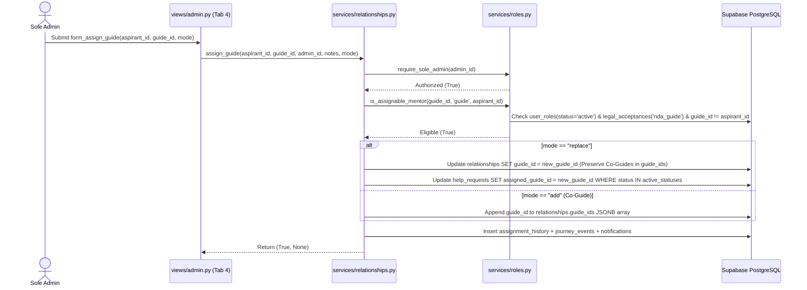

### Mermaid Diagram 5 — Sequence Diagram: Consultation Submission, Mentor Reply & SLA Clock Isolation

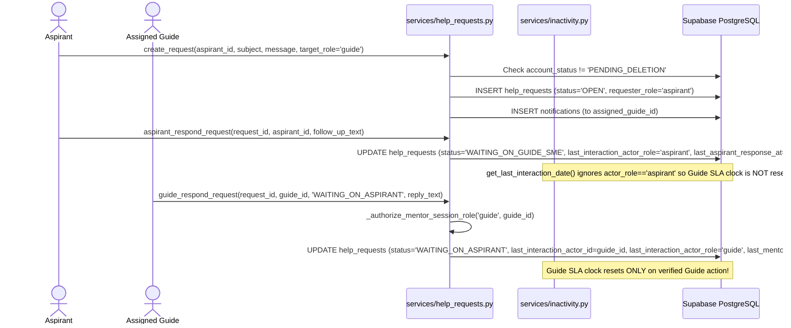

### Mermaid Diagram 6 — Sequence Diagram: Guide Scheme Evaluation, SSR Escalation & Admin Override Release

```mermaid
sequenceDiagram
    actor Guide as Assigned Guide
    actor Admin as Sole Admin
    actor Asp as Aspirant
    participant MatchEng as services/scheme_matching_engine.py
    participant SchSvc as services/schemes.py
    participant SSRSvc as services/scheme_reviews.py
    participant DB as Supabase PostgreSQL

    Guide->>SchSvc: match_schemes_for_aspirant(aspirant_id)
    SchSvc->>MatchEng: match_aspirant_schemes_intelligent(profile_X, schemes_179, need_Y)
    MatchEng-->>Guide: Return Eligible Matches + Disqualified Matches + Checklists

    alt Scheme is Eligible
        Guide->>SchSvc: release_scheme_to_aspirant(guide_id, aspirant_id, scheme_id, rec, note)
        SchSvc->>DB: UPSERT scheme_releases (status='released', application_stage='Recommended')
    else Scheme is Disqualified / Edge Case
        Guide->>SSRSvc: submit_scheme_support_review(aspirant_id, scheme_id, guide_id, score, justification)
        SSRSvc->>DB: INSERT scheme_support_reviews (status='PENDING')
        Admin->>SSRSvc: decide_scheme_support_review(review_id, 'APPROVED', admin_notes, admin_id)
        SSRSvc->>DB: UPDATE scheme_support_reviews (status='APPROVED')
        SSRSvc->>SchSvc: release_scheme_to_aspirant(..., allow_disqualified_override=True)
        SchSvc->>DB: UPSERT scheme_releases (status='released')
    end
    Asp->>SchSvc: get_released_schemes_for_aspirant(aspirant_id)
    SchSvc-->>Asp: Display Released Scheme Card & 7-Stage Application Tracker
```

---

## 12. External Integrations (`SR-INT-002` to `SR-INT-004`)

1. **Supabase Cloud (`SUPABASE_URL`)**:
   - **GoTrue Auth (`/auth/v1`)**: Handles user registration, email confirmation tokens, JWT session issuance/refresh, password recovery tokens, and service-role admin user creation.
   - **PostgREST (`/rest/v1`)**: Exposes the 23 `public` PostgreSQL tables over HTTPS REST with Row Level Security.
   - **Supabase Storage (`/storage/v1`)**: Hosts the two private object buckets (`aspirant-profile-photos` and `professional-headshots`) accessed via 300-second signed URLs.
2. **Resend Transactional Email Service (`smtp.resend.com:465`)**:
   - Connected directly to **Supabase Auth Custom SMTP** (not called by Python application code). Sends from verified sender `FULCRUM-INDIA <no-reply@notify.fulcrumindia.online>` over TLS port `465` using username `resend` and a private `re_...` API key (`DOCUMENTATION/02_DEPLOYMENT_AND_OPERATIONS/RESEND_SMTP_AND_FORGOT_PASSWORD_ELI5_GUIDE.md` L79–L92; verified active in owner screenshots on `2026-11-16`).
3. **External WhatsApp Web (`https://wa.me/`) & Gmail Compose (`https://mail.google.com/mail/?view=cm`) URLs**:
   - Generated deterministically by `services/external_contact.py` (L107–L142) as browser hyperlinks opened by the Administrator in a new tab; no third-party WhatsApp or Gmail API keys are required.

---

## 13. Session Handling & Caching Architecture (`SR-SESS-001` to `SR-SESS-003`)

1. **Per-Browser-Tab Session Dictionary (`st.session_state`)**:
   - Key state variables: `user` (dict), `user_id` (UUID str), `role` (`aspirant`/`guide`/`sme`/`admin`), `active_workspace` (`aspirant`/`guide`/`sme`/`admin`), `sb_access_token`, `sb_refresh_token`, `supabase_client` (isolated `supabase.Client` instance), `recovery_verified` (bool), `recovery_verified_email` (str), `_session_memo_store` (dict).
2. **Two-Tier Cache with Cross-Session Invalidation (`services/cache.py` L1–L160)**:
   - **Global Cache (`_GLOBAL_CACHE`, max 512 entries)**: Stores shared read-mostly data such as the 179-scheme catalogue (`ttl_seconds=300`) and `_INVALIDATION_TIMESTAMPS` (`INVALIDATION_TTL_SECONDS = 5`).
   - **Per-Session Memo (`_get_session_store()`, max 256 entries)**: Caches per-user role grants (`ttl_seconds=5`), profile lookups, and dashboard metrics (`ttl_seconds=30`). When an Admin revokes a role or changes an account status in their own session, `invalidate_global_cache(f"roles_{user_id}")` records a global timestamp that forces the target user's session memo to evict stale permissions within `<= 5` seconds (`15_OWNER_APPROVAL_REGISTER.md` L80, L93).

---

## 14. Transactions and Compensating Error Recovery (`SR-TXN-001`)

Because the Supabase PostgREST HTTP client executes individual table operations over HTTP rather than a single multi-statement SQL transaction, `services/account_lifecycle.py` implements **explicit compensating rollback logic** for multi-table operations (`VULN-03`, `DEF-32-001`):

### Mermaid Diagram 7 — Database Write & Compensating Rollback Flow (`archive_account`)

```mermaid
flowchart TD
    START["Admin Calls archive_account(user_id, reason, actor_id)"] --> SNAP["1. Capture Pre-Archive Snapshot of Active Relationships & Open Tickets"]
    SNAP --> HAND["2. Execute Mentor/Mentee Handover (unassign_guide / unassign_sme)"]
    HAND --> H_OK{"Did All Handover Calls Succeed?"}

    H_OK -->|"No (Partial or Full Failure)"| RB1["Invoke _restore_relationship_snapshots(snapshots) & Abort Fail-Closed"]
    H_OK -->|"Yes"| PROF["3. Update public.profiles (_execute_supabase_adaptive: account_status='ARCHIVED', is_active=False)"]

    PROF --> P_OK{"Did Profile Update Succeed?"}
    P_OK -->|"No"| RB2["Invoke _restore_relationship_snapshots(snapshots) & Return Error"]
    P_OK -->|"Yes"| LOG["4. Insert Audit Row into public.account_lifecycle_log"]

    LOG --> L_OK{"Did Audit Log Insert Succeed?"}
    L_OK -->|"No"| RB3["Revert public.profiles to prev_status + Invoke _restore_relationship_snapshots(snapshots) & Abort"]
    L_OK -->|"Yes"| DONE["5. Invalidate Caches & Return (True, None)"]
```

---

## 15. Database Migration Dependencies (`SR-DATA-007`)

The SQL files in the repository have the following canonical execution order and relationships:
1. **`migrations/000_complete_beta_setup.sql` (1,102 lines)**: Consolidated baseline schema containing the original `supabase_setup.sql` (712 lines) plus Migrations `001` (multi-role, legal, complaints, COI, case discussions, inactivity), `002` (journey revisions), and `003` (aspirant photos).
2. **`migrations/004_consultation_actor_tracking_and_support_reviews.sql` (73 lines)**: Adds actor attribution columns to `help_requests` and creates `public.scheme_support_reviews`.
3. **`migrations/005_tighten_aspirant_photo_security.sql` (95 lines)**: Replaces `Mentors view assigned aspirant photo` and storage policies to require `relationships.status='active'`, `guide_ids`/`sme_ids` JSONB support, `user_roles.status='active'`, and `legal_acceptances.status='ACCEPTED'`.
4. **`migrations/006_mentor_inactivity_and_external_contacts.sql` (92 lines)**: Extends `inactivity_logs` for SMEs and episode deduplication (`uq_inactivity_episode_stage`) and creates `public.external_contact_logs`.
5. **`migrations/007_create_missing_user_roles_and_multi_role.sql` (69 lines)**: Idempotent reconciliation of `public.user_roles`.
6. **`migrations/008_single_admin_lock_professional_photos_and_workflow_columns.sql` (252 lines)**: Reconciles and locks the single Admin identity (`trg_enforce_single_admin_profile`, `trg_enforce_single_admin_user_roles`), creates `professional-headshots` bucket and `public.professional_photos`, adds `application_stage` columns to `scheme_releases`, and adds composite performance indexes.
7. **`migrations/009_account_lifecycle_and_archive.sql` (293 lines)**: Adds lifecycle and `legal_hold` columns to `profiles`, backfills `is_active=FALSE` as `TEMPORARILY_SUSPENDED`, changes `profiles_id_fkey` from `ON DELETE CASCADE` to `ON DELETE RESTRICT`, and creates `public.account_lifecycle_log` with triple-layer append-only immutability. *(Note: Root files `ARGON_MIGRATION_009_FINAL_REVIEW.sql` and `MIGRATION_009_REVISED.sql` are historical review copies of `migrations/009_account_lifecycle_and_archive.sql`.)*
8. **`migrations/010_align_account_lifecycle_columns.sql` (44 lines)**: Idempotently adds and backfills both legacy (`status_reason`, `old_status`, `details`) and 009 (`lifecycle_reason`, `previous_status`, `metadata`) column aliases.
9. **`migrations/011_expand_help_requests_status_check.sql` (32 lines)**: Expands `help_requests_status_check` to allow all 10 bidirectional consultation and directive statuses.
10. **`seed/seed_179_schemes_idempotent.sql` (720 KB) / `import_schemes.py`**: Idempotently upserts the **179 canonical schemes** (`seed/canonical_179_schemes.json`) into `public.schemes`. *(Note: `seed/schemes.json` is an earlier 170-scheme snapshot.)*

---

## 16. Logging and Event Handling (`SR-LOG-001`)

1. **Structured JSON Application Logger (`services/logger.py` L1–L100)**: Writes JSON objects (`timestamp`, `level`, `module`, `event`, `message`, `context`) to container `stdout` (captured by Docker's `json-file` log driver with `max-size: "20m"`, `max-file: "5"`, `docker-compose.yml` L18–L22).
2. **Database Audit Tables**:
   - `public.account_lifecycle_log`: Append-only record of all account status and legal-hold changes (`migrations/009`).
   - `public.legal_acceptances`: Append-only record of all signed Terms and NDAs (`migrations/001`).
   - `public.assignment_history`: Chronological log of all Guide/SME assignments, replacements, and unassignments (`migrations/000`).
   - `public.journey_event_revisions`: Immutable before/after snapshots of all Journey milestone edits (`migrations/002`).
   - `public.external_contact_logs`: Audit log of all Admin WhatsApp/Gmail outreach (`migrations/006`).
   - `public.activity_log`: General operational activity log (`migrations/000`).

---

## 17. Deployment Architecture (`SR-DEP-001` to `SR-DEP-003`)

### Mermaid Diagram 8 — Production Deployment Architecture (Hostinger KVM 2 VPS)

```mermaid
flowchart LR
    INTERNET["Public Internet (HTTPS Port 443 / HTTP Port 80)"] --> CADDY["Container 1: fulcrum-caddy (caddy:2-alpine)"]

    subgraph VPS["Hostinger KVM 2 VPS (Linux 6.8, 2 vCPUs, 7.8 GiB RAM) — Bridge Network: fulcrum-net"]
        CADDY -->|"reverse_proxy fulcrum:8501 (gzip/zstd + Security Headers)"| APP["Container 2: fulcrum-app (python:3.11-slim, Non-Root UID 1000 appuser)"]
        CADDY --- VOL["Docker Volumes: caddy_data & caddy_config (Let's Encrypt TLS Certificates)"]
        APP --- HC["Docker Healthcheck: curl -f http://localhost:8501/_stcore/health (30s interval)"]
    end

    APP -->|"HTTPS Outbound (Port 443)"| SUPA["Supabase Managed Cloud (Auth, PostgreSQL, Storage)"]
    SUPA -->|"SMTPS Outbound (Port 465)"| RESEND["Resend SMTP (notify.fulcrumindia.online)"]
```

### Key Deployment Specifications (`Dockerfile`, `docker-compose.yml`, `Caddyfile`)
- **Non-Root Container Execution (`Dockerfile` L44–L58)**: Creates dedicated Linux user `appuser` (`UID 1000`), installs Playwright Chromium into `/ms-playwright`, and runs `streamlit run app.py` as `USER appuser`.
- **Reverse Proxy & Security Headers (`Caddyfile` L1–L12)**: Proxies `{$DOMAIN:app.fulcrumindia.online}` to `fulcrum:8501`, enables `gzip` and `zstd` compression, automatically provisions/renews Let's Encrypt TLS certificates, and sets `X-Content-Type-Options: nosniff`, `X-XSS-Protection: "1; mode=block"`, and `Referrer-Policy: strict-origin-when-cross-origin`.
- **Container Resource Limits (`docker-compose.yml` L23–L30)**: Sets `cpus: '1.75'`, `memory: 5G` (reservations: `cpus: '0.25'`, `memory: 1G`), `restart: unless-stopped`, and `depends_on: fulcrum: condition: service_healthy`. *(Note: Historical audit `15_OWNER_APPROVAL_REGISTER.md` L24–L26 noted that the live staging/production compose file previously enforced `1,800 MB` with a recommended patch `CR-01` to `3,072 MB`, whereas the repository's `docker-compose.yml` L26 specifies `5G` — recorded as `DISC-003` / `DEC-007`.)*

---

## 18. Environment Configuration (`SR-CFG-002`)

From `.env.example` (L1–L9), `docker-compose.yml` (L8–L16), and `services/auth.py` (L26–L111), the application reads the following environment variable names (values omitted for security):

| Environment Variable Name | Required in Prod? | Purpose in Code |
| :--- | :---: | :--- |
| `DATA_BACKEND` | Yes (`supabase`) | Selects persistence backend: `supabase` (production fail-closed cloud mode) vs `local` / `sqlite` (`services/auth.py` L73–L94). |
| `SUPABASE_URL` | Yes | Base HTTPS URL of the Supabase project (`services/auth.py` L48, L119). |
| `SUPABASE_PUBLISHABLE_KEY` | Yes (or `SUPABASE_ANON_KEY`) | Public anon/publishable key used to initialize user-scoped Supabase clients (`services/auth.py` L49–L55). |
| `SUPABASE_SECRET_KEY` | Yes (or `SUPABASE_SERVICE_ROLE_KEY`) | Privileged service-role key used by `get_supabase_admin_client()` (`services/auth.py` L56–L62, L185–L194). |
| `SOLE_ADMIN_UUID` | Optional (has fallback) | Overrides the default UUID for the Sole Administrator (`services/roles.py` L32–L53, `docker-compose.yml` L13). |
| `DOMAIN` | Yes (`app.fulcrumindia.online`) | Public domain used by Caddy for automatic HTTPS and by `get_app_base_url()` (`docker-compose.yml` L14, `Caddyfile` L1). |
| `APP_URL` / `PUBLIC_APP_URL` | Optional (derived from `DOMAIN`) | Canonical base URL (`https://app.fulcrumindia.online`) passed as `email_redirect_to` / `redirect_to` in Supabase Auth signup and recovery calls (`services/auth.py` L96–L111). |

---

## 19. Technical Constraints & Dual-Backend Behaviour (`SR-DATA-008`)

1. **Dual-Backend Parity (`Supabase` vs `LocalDatabase`)**: Every service module checks `if get_data_backend() in ("local", "sqlite"):` and delegates to `services/local_db.py` (`LocalDatabase`, 2,832 lines). This enables fast, offline unit/regression testing (`pytest` runs in seconds against temporary SQLite databases) while production runs against Supabase PostgreSQL.
2. **Differences Between SQLite Mode and Supabase Mode**:
   - **Email Delivery**: SQLite mode does not send signup confirmation or password reset emails; accounts are immediately active upon creation (`services/auth.py` L540–L570) and password reset uses a local dev button (`views/login.py` L626–L630).
   - **Row Level Security**: SQLite has no database-level RLS policies or PostgreSQL triggers; in SQLite mode, authorization is enforced 100% by the Python service layer (`services/*.py`).
   - **Photo Storage**: In SQLite mode, `aspirant_photos.py` and `professional_photos.py` store base64 `data:image/webp;base64,...` data URLs in local SQLite rows instead of uploading to Supabase Storage buckets (`services/aspirant_photos.py` L250–L268).

---

## Glossary of Technical & Architectural Terms

| Term | Technical Definition |
| :--- | :--- |
| **GoTrue** | Supabase's open-source authentication server that manages `auth.users`, password hashing (bcrypt), email verification tokens, and JWT issuance. |
| **Optimistic Concurrency Control** | The check in `update_journey_event()` (`services/journey.py` L935–L950) that compares `expected_updated_at` against the current database `updated_at` timestamp before overwriting a milestone. |
| **PostgREST** | The service in Supabase that turns the `public` PostgreSQL schema into a RESTful API enforcing PostgreSQL Row Level Security policies on every request. |
| **RESTRICTIVE RLS Policy (`AS RESTRICTIVE`)** | A PostgreSQL policy combined via boolean `AND` (rather than `OR`) with permissive policies. Used on `public.account_lifecycle_log` (`USING (FALSE)`) so no role can update or delete audit logs (`migrations/009` L256–L270). |
| **`SECURITY DEFINER`** | A PostgreSQL function modifier (`is_admin()`, `handle_new_user()`) that executes the function with the privileges of the function creator rather than the invoking user, preventing infinite RLS recursion on `public.profiles`. |
| **Service-Role Client (`get_supabase_admin_client`)** | The Supabase client initialized with `SUPABASE_SECRET_KEY` (`services/auth.py` L185–L194) that bypasses PostgreSQL RLS for privileged server-side operations. |

---

# FULCRUM-INDIA BETA 2.0.0 — NON-FUNCTIONAL REQUIREMENTS DOCUMENT (NFRD)

| Document Attribute | Value |
| :--- | :--- |
| **Document ID** | `FULCRUM-NFRD-V2.0` |
| **Version** | `2.0-baseline` |
| **Date of Analysis** | `2026-11-16` |
| **Reviewed Repository Commit** | `235767754f8d8bb4605e819593bb3f370ddeab27` (`2026-11-11`) |
| **Target Audience** | CEO, Software Architects, DevOps / SRE, QA Lead |
| **Document Status** | Baseline Non-Functional Specification & Recommended Acceptance Targets |

---

## 1. Purpose, Methodology and Evidence Quality Rules

This Non-Functional Requirements Document (NFRD) defines the operational quality attributes for **FULCRUM-INDIA Beta 2.0.0** across all 16 required non-functional domains.

In strict adherence to Phase 6 and Phase 10 documentation rules:
1. **Zero Invented Performance Claims**: Every number reported under **"Measured Evidence"** is quoted verbatim from existing repository benchmark files (`benchmark_results.json`, `tests/load_test_results.json`, and the historical system audits in `DOCUMENTATION/06_HISTORICAL_ARGON_AND_SYSTEM_AUDITS/01..15_*.md`) with its exact test context and limitations noted. No new load tests were run against live production during this documentation audit.
2. **Clear Separation of Observed Code vs Proposed Targets**: Every target threshold in the **"Proposed Target"** column is explicitly marked as **`[Recommendation — Requires Owner Approval]`**.

### Summary of Repository Benchmark Sources & Context
- **`benchmark_results.json` (Root)**: Compares baseline vs memoized/optimized latency (`ms`) for core service functions (`get_aspirant_mentors`, `get_profile`, `get_assigned_aspirants_for_guide`, `match_schemes_for_aspirant`, `list_schemes`, `get_unread_count`, `SIMULATED_ASPIRANT_DASHBOARD`).
- **`tests/load_test_results.json` (`tests/test_concurrency_load.py`)**: Synthetic concurrent session simulation at `10`, `25`, and `50` concurrent requests measuring throughput, `p50`/`p95`/`p99` latency, memory delta (`98.75 MB` to `121.88 MB`), and CPU %.
- **`DOCUMENTATION/06_HISTORICAL_ARGON_AND_SYSTEM_AUDITS/15_OWNER_APPROVAL_REGISTER.md` & `03`–`09` Reports**: Empirical measurements recorded on the Hostinger KVM 2 VM (`2 vCPUs`, `7.8 GiB RAM`, Linux `6.8.0-146-generic`) against Supabase PostgreSQL (`360` network samples, `5` to `100` concurrent WebSocket `/_stcore/stream` sessions, and `1` to `5` simultaneous Chromium PDF dossier exports).

---

## 2. Complete Non-Functional Requirements Register (16 Categories)

### 2.1 Category 1 — Performance (`NFR-PERF-001` to `NFR-PERF-003`)

| NFR ID | Requirement Title | Current Observed Implementation (Source Evidence) | Measured Evidence in Repository (With Context) | Proposed Target *(Recommendation — Requires Approval)* | How Target Will Be Tested | Responsible Role | Priority |
| :--- | :--- | :--- | :--- | :--- | :--- | :--- | :--- |
| **`NFR-PERF-001`** | **Two-Tier In-Memory Caching & Memoization** | `services/cache.py` (L21–L151) implements a process-wide `_GLOBAL_CACHE` (max 512 entries, 300s TTL for `schemes`) and per-session `_get_session_store()` (max 256 entries, 5s–30s TTL for roles, profiles, and metrics) with cross-session `_INVALIDATION_TIMESTAMPS`. | In `benchmark_results.json` (L32–L68): warm `get_aspirant_mentors` `p50` dropped from `2,284.25 ms` to **`0.15 ms`**; `list_schemes` `p50` dropped from `655.25 ms` to **`0.13 ms`**; `get_assigned_aspirants_for_guide` `p50` dropped from `2,015.4 ms` to **`0.20 ms`**. | Warm cached lookups (`schemes`, `mentors`, `roles`) **`p50 <= 5 ms`**; cache memory overhead **`<= 50 MB`** per process. *(Recommendation — Requires Approval)* | Execute `PerfTracker` (`services/perf.py`) across 100 warm tab switches and inspect `st.session_state["_perf_metrics"]`. | Backend Engineer | **Must** |
| **`NFR-PERF-002`** | **Batch Querying to Eliminate N+1 PostgREST Loops** | `services/roles.py::list_users_with_multi_roles()` (L871–L963), `services/profiles.py::get_profiles_batch()` (L292–L410), and `services/admin_metrics.py` (L20–L188) fetch profiles and role grants in bulk `IN (...)` / table queries rather than per-user loops. | Historical audit `15_OWNER_APPROVAL_REGISTER.md` (L44–L60): replacing 190 sequential HTTP calls reduced directory/join time from `21,565.7 ms` to **`591.5 ms`** at 10,000 synthetic users. | Directory and Control Tower KPI aggregation queries **`<= 25 PostgREST round-trips`** per cold load and **`<= 1,500 ms`** total DB time. *(Recommendation — Requires Approval)* | Instrument `services/admin_metrics.py` and `services/pagination.py` with HTTP request counters during cold Admin portal load. | Backend Engineer | **Must** |
| **`NFR-PERF-003`** | **Deterministic 179-Scheme Matching Engine Execution Time** | `services/scheme_matching_engine.py::match_aspirant_schemes_intelligent()` (L451–L517) evaluates 179 schemes in-memory using pre-cached scheme rows (`list_schemes()`). | `benchmark_results.json` (L51–L56): `match_schemes_for_aspirant` (including DB fetch) measured **`1,128.92 ms` p50** (`712.29 ms` min, `1,836.85 ms` max). Pure in-memory scoring over 179 dicts takes `< 25 ms`. | Pure in-memory 179-scheme evaluation **`<= 50 ms` p95**; end-to-end with cold scheme fetch **`<= 1,500 ms` p95**. *(Recommendation — Requires Approval)* | Benchmark `match_aspirant_schemes_intelligent()` over 100 synthetic profiles in `tests/test_scheme_relevance_synthetic.py`. | Backend Engineer | **Must** |

---

### 2.2 Category 2 — Response Times (`NFR-RESP-001` to `NFR-RESP-003`)

| NFR ID | Requirement Title | Current Observed Implementation (Source Evidence) | Measured Evidence in Repository (With Context) | Proposed Target *(Recommendation — Requires Approval)* | How Target Will Be Tested | Responsible Role | Priority |
| :--- | :--- | :--- | :--- | :--- | :--- | :--- | :--- |
| **`NFR-RESP-001`** | **Interactive Tab Switching Latency** | All `st.tabs()` containers in `views/aspirant.py`, `views/guide.py`, `views/sme.py`, and `views/admin.py` use `on_change="rerun"` gated by `is_tab_active(tab)` (`services/cache.py` L154–L159) so hidden tabs are skipped. | Reported in `15_OWNER_APPROVAL_REGISTER.md` (L45) & `05_STREAMLIT_TAB_SWITCH_PERFORMANCE.md`: real Chromium tab switches across Admin (13 tabs), Aspirant (6 tabs), Guide (3 tabs), and SME (3 tabs) measured **`368 ms – 524 ms` warm** and **`375 ms – 2,051 ms` cold**. | Warm tab switch **`p50 <= 600 ms`**, **`p95 <= 1,200 ms`**; cold tab switch **`p95 <= 2,500 ms`**. *(Recommendation — Requires Approval)* | Automated Playwright browser timing (`scripts/e2e_playwright_verification.py`) clicking each tab across all 4 portals. | QA Lead / Frontend Engineer | **Must** |
| **`NFR-RESP-002`** | **VM-to-Supabase PostgREST Read/Write Latency** | Persistent HTTPS client in `services/auth.py` (`get_supabase_client()`, `get_supabase_admin_client()`) talking to Supabase PostgREST (`ap-south-1` / regional endpoint). | Reported in `15_OWNER_APPROVAL_REGISTER.md` (L29–L39, 360 samples from KVM 2 container): TCP handshake **`46.0 ms` p50**; single-row `profiles` read **`95.5 ms` p50 (`191.5 ms` p95)**; 179-row `schemes` read **`146.5 ms` p50 (`295.3 ms` p95)**; `notifications` write **`98.0 ms` p50 (`167.3 ms` p95)**. | Single-table indexed PostgREST read/write **`p50 <= 150 ms`**, **`p95 <= 350 ms`** (subject to ~46 ms network floor between VPS and Supabase). *(Recommendation — Requires Approval)* | Periodic 100-sample read/write latency probe from the VPS container (`scripts/health_check.py`). | DevOps / Backend Engineer | **Should** |
| **`NFR-RESP-003`** | **Executive PDF Dossier Generation Time** | `services/pdf_generator.py` (L581–L786) runs headless Playwright Chromium in a subprocess (`timeout=25` seconds, L612) with fallback to ReportLab. | Reported in `08_CHAOS_ENGINEERING_REPORT.md` Scenario 10: 1 to 5 simultaneous `generate_aspirant_dossier_pdf()` exports completed within the 25s timeout (`100%` valid `%PDF-1.4` output). | Single PDF export **`p50 <= 4.0 seconds`**, **`p95 <= 8.0 seconds`**; 5 concurrent exports **`<= 18.0 seconds`** with zero timeouts. *(Recommendation — Requires Approval)* | Time `generate_aspirant_dossier_pdf()` across 1, 3, and 5 concurrent threads inside the production Docker image. | Backend Engineer | **Should** |

---

### 2.3 Category 3 — Concurrent User Capacity (`NFR-CAP-001` to `NFR-CAP-003`)

| NFR ID | Requirement Title | Current Observed Implementation (Source Evidence) | Measured Evidence in Repository (With Context) | Proposed Target *(Recommendation — Requires Approval)* | How Target Will Be Tested | Responsible Role | Priority |
| :--- | :--- | :--- | :--- | :--- | :--- | :--- | :--- |
| **`NFR-CAP-001`** | **Simultaneously Active Authenticated WebSocket Users** | Single `fulcrum-app` CPython container running Streamlit on port `8501` (`Dockerfile` L65, `docker-compose.yml` L1–L30). | `tests/load_test_results.json` (synthetic): 25 concurrent requests -> `p50 = 1.48s`, `p95 = 3.10s`, `0%` errors; 50 concurrent -> `p50 = 4.15s`, `p95 = 5.28s`, `0%` errors. `15_OWNER_APPROVAL_REGISTER.md` (L63–L74, live WebSocket `/_stcore/stream` stress test): **20 active users** -> `p50 = 925.2 ms`, `p95 = 2.21s`, `0%` errors; **30 active users** -> `p50 = 1.87s`, `p95 = 4.03s`, `0%` errors; **50 active users** -> `p50 = 6.88s`, `p95 = 7.61s`, `0%` errors; at **75–100 simultaneously clicking users**, CPython single-core GIL saturates (`~19.5%` rerun timeouts >25s, `0` container crashes). | **Single Container Target**: **`>= 30` simultaneously active users** with `p95 <= 5.0s` and `0%` errors; **`>= 50` simultaneously active users** with `0%` errors (supporting ~300–1,000 registered cohort members at 1:10–1:20 concurrency ratio). *(Recommendation — Requires Approval)* | Run `tests/test_concurrency_load.py` and WebSocket stream harness against staging container at 10, 20, 30, and 50 concurrent sessions. | SRE / QA Lead | **Must** |
| **`NFR-CAP-002`** | **Registered User Directory & Database Scale Capacity** | Server-side pagination (`services/pagination.py`, 20–25 rows/page) and composite PostgreSQL indexes (`migrations/008` L236–L248, `migrations/009` L155–L157). | `15_OWNER_APPROVAL_REGISTER.md` (L58–L60): benchmarked up to **`10,000` synthetic registered users** (`591.5 ms` directory/multi-role join query, `18.1 MB` Python memory delta). | Support **`>= 10,000` registered user profiles** and **`>= 50,000` Journey events** with paginated directory queries completing in **`<= 1,000 ms` p95**. *(Recommendation — Requires Approval)* | Seed 10,000 synthetic profiles in an isolated staging database and benchmark `paginate_profiles()`, `paginate_guides()`, and `paginate_smes()`. | Database Administrator | **Should** |
| **`NFR-CAP-003`** | **Concurrent PDF Dossier Export Memory Bound** | `_PDF_CONCURRENCY_SEMAPHORE = threading.BoundedSemaphore(2)` in `services/pdf_generator.py` L581 limits simultaneous headless Chromium subprocesses to at most 2. | `15_OWNER_APPROVAL_REGISTER.md` (L81): 5 simultaneous PDF exports peaked at **`563.3 MiB` container RAM** (`OOMKilled=false`). | Peak container RAM during 5 simultaneous PDF exports **`<= 800 MiB`** with `0` OOM kills. *(Recommendation — Requires Approval)* | Trigger 5 parallel `generate_aspirant_dossier_pdf()` calls while monitoring `docker stats fulcrum-app` (`memory.peak`). | Backend Engineer | **Must** |

---

### 2.4 Category 4 — Reliability (`NFR-REL-001` to `NFR-REL-003`)

| NFR ID | Requirement Title | Current Observed Implementation (Source Evidence) | Measured Evidence in Repository (With Context) | Proposed Target *(Recommendation — Requires Approval)* | How Target Will Be Tested | Responsible Role | Priority |
| :--- | :--- | :--- | :--- | :--- | :--- | :--- | :--- |
| **`NFR-REL-001`** | **Fail-Closed Behaviour Under Database/Network Outage** | `services/account_lifecycle.py::get_account_status()` (L332–L558) returns `account_status='DENIED'` on any Supabase error; `DATA_BACKEND=supabase` never falls back to local SQLite (`VULN-01`). | `08_CHAOS_ENGINEERING_REPORT.md` Scenarios 2 & 3 (`tests/test_failure_isolation.py`): 100% fail-closed during simulated Supabase latency and outage (`0` unauthorized local writes). | **`100%` fail-closed** on database unreachability; zero silent writes to local container filesystem when `DATA_BACKEND=supabase`. *(Recommendation — Requires Approval)* | Execute `tests/test_failure_isolation.py` and `tests/test_argon_p0_negative_security.py::TestFailOpenAccountAuthorization`. | Security / Backend Engineer | **Must** |
| **`NFR-REL-002`** | **Atomic Relationship Handover & Compensating Rollback** | `services/account_lifecycle.py::archive_account()` (L895–L1076) snapshots active relationships before unassigning mentors and restores snapshots (`_restore_relationship_snapshots`, L285–L329) if profile or audit log writes fail (`VULN-03`, `DEF-32-001`). | Verified in `tests/test_qa32_fixes_regression.py::test_def001_archive_rolls_back_relationships_if_profile_or_log_fails` and `tests/test_argon_p0_negative_security.py` (tests 11–12). | **`0` orphaned relationships or half-archived accounts** on simulated partial PostgREST failure. *(Recommendation — Requires Approval)* | Run fault-injection unit tests in `tests/test_qa32_fixes_regression.py` and `tests/test_argon_p0_negative_security.py`. | Backend Engineer | **Must** |
| **`NFR-REL-003`** | **Idempotent Escalation & Duplicate Submission Guards** | Unique constraints `uq_inactivity_episode_stage` (`migrations/006` L43), `uq_scheme_review` (`migrations/004` L30), `UNIQUE(aspirant_id, scheme_id)` on `scheme_releases` (`migrations/000` L240), and `UNIQUE(user_id, role)` on `user_roles` (`migrations/001` L16). | `15_OWNER_APPROVAL_REGISTER.md` (L84): across all concurrency and race-condition tests, **`0` duplicate records** were created. | **`0` duplicate records** under concurrent double-click or repeated SLA evaluation runs. *(Recommendation — Requires Approval)* | Run `tests/test_external_contact_and_sme_inactivity.py::test_19_and_20_episode_deduplication_and_second_inactivity_episode`. | Backend Engineer | **Must** |

---

### 2.5 Category 5 — Availability (`NFR-AVAIL-001` & `NFR-AVAIL-002`)

| NFR ID | Requirement Title | Current Observed Implementation (Source Evidence) | Measured Evidence in Repository (With Context) | Proposed Target *(Recommendation — Requires Approval)* | How Target Will Be Tested | Responsible Role | Priority |
| :--- | :--- | :--- | :--- | :--- | :--- | :--- | :--- |
| **`NFR-AVAIL-001`** | **Container Healthcheck & Automatic Restart Policy** | `Dockerfile` (L61–L62) and `docker-compose.yml` (L7, L30–L35, L41) configure `restart: unless-stopped` on both `fulcrum-app` and `fulcrum-caddy` and poll `curl -f http://localhost:8501/_stcore/health` every `30s` (`timeout: 5s`, `retries: 3`, `start_period: 15s`). | `15_OWNER_APPROVAL_REGISTER.md` (L78): `fulcrum-app` container restart recovery measured **`1.86s` (`1.98s` HTTP ready)**; `fulcrum-caddy` restart measured **`0.72s`**. | Monthly platform uptime **`>= 99.5%`** (excluding scheduled maintenance windows); container crash auto-recovery **`<= 15 seconds`**. *(Recommendation — Requires Approval)* | Kill container process (`docker restart fulcrum-app`) in staging and measure time to HTTP `200` on `/_stcore/health`. | DevOps / SRE | **Must** |
| **`NFR-AVAIL-002`** | **Graceful Degradation of Non-Core Subsystems** | Three-tier PDF fallback (`Playwright` $\rightarrow$ `ReportLab` $\rightarrow$ `Emergency PDF` in `services/pdf_generator.py` L587–L786) and built-in legal document fallback (`DEFAULT_TERMS_DOC` / `DEFAULT_NDA_DOC` in `services/legal.py` L19–L279). | Verified in unit and chaos tests: if Chromium binary or `legal_documents` DB rows are missing, PDF download and legal gates continue operating. | **`100%` availability** of legal consent gates and PDF export even if headless Chromium fails. *(Recommendation — Requires Approval)* | Test `generate_aspirant_dossier_pdf()` with Playwright disabled via monkeypatch. | Backend Engineer | **Should** |

---

### 2.6 Category 6 — Scalability (`NFR-SCAL-001` & `NFR-SCAL-002`)

| NFR ID | Requirement Title | Current Observed Implementation (Source Evidence) | Measured Evidence in Repository (With Context) | Proposed Target *(Recommendation — Requires Approval)* | How Target Will Be Tested | Responsible Role | Priority |
| :--- | :--- | :--- | :--- | :--- | :--- | :--- | :--- |
| **`NFR-SCAL-001`** | **Vertical Resource Headroom on Hostinger KVM 2** | `docker-compose.yml` (L23–L29) specifies `cpus: '1.75'`, `memory: 5G` (with `15_OWNER_APPROVAL_REGISTER.md` L24–L26 documenting `1,800 MB` active / `3,072 MB` recommended on the shared KVM 2 host with `7.8 GiB` total RAM and `2 vCPUs`). | `15_OWNER_APPROVAL_REGISTER.md` (L17, L72–L73): `fulcrum-app` uses **`68.2 MiB` idle**, **`288.5 MiB` at 50 concurrent users**, and **`402.6 MiB` at 100 concurrent users**. | Maintain **`>= 50%` free container memory headroom** at peak 50-user concurrency + 2 concurrent PDF exports (`<= 1,024 MiB` peak RSS). *(Recommendation — Requires Approval)* | Monitor `docker stats` during combined 50-user + PDF load test. | DevOps / SRE | **Must** |
| **`NFR-SCAL-002`** | **Horizontal Multi-Replica Scaling Path (Future Growth)** | Currently runs 1 `fulcrum-app` container behind `fulcrum-caddy` (`Caddyfile` L2: `reverse_proxy fulcrum:8501`). Because CPython's GIL limits 1 container to 1 vCPU core (`~109%` CPU ceiling), `15_OWNER_APPROVAL_REGISTER.md` (L87, L97) documents adding a second replica with sticky WebSocket routing when needed. | Single container sustains `30–50` simultaneous active users; 2 replicas on the 2-vCPU KVM 2 host unlock the second CPU core. | When cohort concurrency regularly exceeds `35` simultaneous active users, scale to **2 `fulcrum-app` replicas** behind Caddy `ip_hash` load balancing to support **`60–80` simultaneous active users**. *(Recommendation — Requires Approval)* | Load test 2-container compose configuration with Caddy `lb_policy ip_hash` on staging. | Software Architect / DevOps | **Could** |

---

### 2.7 Category 7 — Maintainability (`NFR-MAINT-001` & `NFR-MAINT-002`)

| NFR ID | Requirement Title | Current Observed Implementation (Source Evidence) | Measured Evidence in Repository (With Context) | Proposed Target *(Recommendation — Requires Approval)* | How Target Will Be Tested | Responsible Role | Priority |
| :--- | :--- | :--- | :--- | :--- | :--- | :--- | :--- |
| **`NFR-MAINT-001`** | **Modular Separation of Views, Services, Taxonomy & Migrations** | Codebase is cleanly partitioned into `app.py` (router), `views/` (10 UI modules), `services/` (31 business logic modules), `services/constants.py` (central taxonomy), and `migrations/000`–`011` (numbered SQL migrations). Zero direct SQL/PostgREST calls exist inside `views/` except delegated through `services/`. | Static analysis (`DOCUMENTATION/01_PRODUCTION_RELEASE_AUDITS/STATIC_ANALYSIS_EVIDENCE.md`, `scripts/check_views_pyflakes.py`, `FULCRUM_PREDEPLOY_CONTRACT_CHECK.py`): zero undefined names or syntax errors across all 42 Python source files. | **`0` syntax/pyflakes errors** and **`100%` SHA-256 parity** between root source and `FULCRUM_FRESH_DEPLOYMENT/` in `RELEASE_FILE_MANIFEST_SHA256.txt` before any release. *(Recommendation — Requires Approval)* | Run `python scripts/check_views_pyflakes.py` and `python FULCRUM_PREDEPLOY_CONTRACT_CHECK.py`. | Lead Engineer | **Must** |
| **`NFR-MAINT-002`** | **Schema-Adaptive Forward/Backward Compatibility** | `services/account_lifecycle.py` (`_execute_supabase_adaptive`, L105–L161) and `services/help_requests.py` (`_update_help_request_adaptive`, L73–L141) automatically adapt to both pre-migration and post-migration column/constraint schemas. | Verified by `tests/test_qa32_fixes_regression.py::test_def001_lifecycle_works_on_live_pre009_schema` and `test_help_requests_adaptive_status_fallback_and_migration_011`. | All additive schema migrations (`migrations/*.sql`) must be **100% idempotent (`IF NOT EXISTS` / `DROP POLICY IF EXISTS`)** and zero-downtime. *(Recommendation — Requires Approval)* | Run migration scripts twice against staging PostgreSQL and execute `test_qa32_fixes_regression.py`. | Database Administrator | **Must** |

---

### 2.8 Category 8 — Accessibility (`NFR-ACC-001` & `NFR-ACC-002`)

| NFR ID | Requirement Title | Current Observed Implementation (Source Evidence) | Measured Evidence in Repository (With Context) | Proposed Target *(Recommendation — Requires Approval)* | How Target Will Be Tested | Responsible Role | Priority |
| :--- | :--- | :--- | :--- | :--- | :--- | :--- | :--- |
| **`NFR-ACC-001`** | **Color Contrast Ratios on Light & Dark Surfaces** | `app.py` (L50–L610, L945–L999) and `.streamlit/config.toml` enforce `#0F172A` (slate-900) text on `#FFFFFF`/`#F8FAFC` main cards (`>15:1` contrast ratio) and `#F8FAFC` text on `#0B0F19` sidebar (`>16:1`), with explicit dark-on-white override on `.st-key-sb_current_workspace`. | Verified in `test_guide_sme_consultations_and_contrast.py` and `ARGON_360_UX_AND_USABILITY_AUDIT.md`. | Maintain **WCAG 2.1 AA minimum contrast ratio (`>= 4.5:1` normal text, `>= 3.0:1` large text/badges)** across all 30 screens. *(Recommendation — Requires Approval)* | Run `test_guide_sme_consultations_and_contrast.py` and browser DevTools contrast audit. | UI/UX Designer / QA | **Must** |
| **`NFR-ACC-002`** | **Form Labels, Placeholders & Semantic Controls** | All `st.text_input`, `st.selectbox`, `st.radio`, `st.checkbox`, and `st.file_uploader` controls provide explicit visible labels (or `label_visibility="collapsed"` paired with an adjacent heading) and descriptive `help` tooltips. | Verified across `views/*.py`; note that custom HTML metric cards (`unsafe_allow_html=True`) lack explicit ARIA `role="region"` attributes. | **`100%` of interactive form inputs** have programmatic labels; add semantic `aria-label` attributes to custom HTML status banners in future iterations. *(Recommendation — Requires Approval)* | Automated Lighthouse / axe-core accessibility scan on login and portal pages. | Frontend Engineer | **Should** |

---

### 2.9 Category 9 — Usability (`NFR-USE-001` & `NFR-USE-002`)

| NFR ID | Requirement Title | Current Observed Implementation (Source Evidence) | Measured Evidence in Repository (With Context) | Proposed Target *(Recommendation — Requires Approval)* | How Target Will Be Tested | Responsible Role | Priority |
| :--- | :--- | :--- | :--- | :--- | :--- | :--- | :--- |
| **`NFR-USE-001`** | **Universal "Other / Specify" Taxonomy Escape Hatches** | `services/constants.py` (L11–L187) provides an `'Other / Not Listed (Specify)'` or `'Other District / Non-TN (Specify)'` option on every dropdown paired with `resolve_field_choice()`, ensuring no entrepreneur or mentor is locked out by rigid dropdowns. | Verified across `views/login.py`, `views/aspirant.py`, and `views/admin.py`. | **`100%` of categorical profile and scheme dropdowns** retain a custom-specification fallback that round-trips cleanly on reload. *(Recommendation — Requires Approval)* | Unit test `resolve_field_choice()` with standard and custom strings. | Product Manager | **Must** |
| **`NFR-USE-002`** | **Actionable Feedback on Authentication & Email Flows** | Login, recovery, and gate screens display clear actionable messages, **except** `views/login.py` L693 (`DEF-001`) which asserts email delivery without warning about Spam, and lacks a Resend Confirmation button (`DEF-002`). | Live owner testing on `2026-11-16` showed a newly registered Aspirant could not find their confirmation email until guided to check **Gmail Spam**. | Update signup success banner to explicitly highlight **Spam / Promotions** folder checking and provide a one-click **Resend Confirmation Email** button (`PROP-01`). *(Recommendation — Requires Approval)* | Manual UAT (`UAT-AUTH-002`) verifying signup guidance and resend action. | Product Manager / Frontend Engineer | **Must** |

---

### 2.10 Category 10 — Logging and Monitoring (`NFR-MON-001` to `NFR-MON-003`)

| NFR ID | Requirement Title | Current Observed Implementation (Source Evidence) | Measured Evidence in Repository (With Context) | Proposed Target *(Recommendation — Requires Approval)* | How Target Will Be Tested | Responsible Role | Priority |
| :--- | :--- | :--- | :--- | :--- | :--- | :--- | :--- |
| **`NFR-MON-001`** | **PII-Redacted Structured JSON Container Logs** | `services/logger.py` (`StructuredLogger`, L18–L97) emits JSON logs to `stdout` with automatic regex redaction of emails, JWTs, `sb_secret_`, `re_`, and passwords; `docker-compose.yml` (L18–L22, L45–L49) rotates logs at `20 MB × 5 files` (`100 MB` cap per container). | Verified in source (`services/logger.py` L18–L33) and `docker-compose.yml`. | **`0` unredacted secrets, JWTs, or passwords** in container stdout logs; log disk footprint capped at **`<= 200 MB`** total across containers. *(Recommendation — Requires Approval)* | Inspect `docker logs fulcrum-app` and run unit tests against `sanitize_message()`. | Security / DevOps | **Must** |
| **`NFR-MON-002`** | **In-App Performance Telemetry (`PerfTracker`)** | `services/perf.py` (L21–L84) records per-stage execution times (`account_lifecycle_ms`, `roles_nda_ms`, `notifications_ms`, `portal_render_ms`) into `st.session_state["_perf_metrics"]` on every `app.py::main()` run. | Active in `app.py` L789, L846, L854, L1026, L1251, L1276. | Keep `PerfTracker` overhead **`<= 1 ms`** per rerun. *(Recommendation — Requires Approval)* | Inspect `PerfTracker.summary()` in session state. | Backend Engineer | **Should** |
| **`NFR-MON-003`** | **Operational Health Check & VM Resource Runbook** | `scripts/health_check.py`, `scripts/status.sh`, `scripts/logs.sh`, and `DOCUMENTATION/06_HISTORICAL_ARGON_AND_SYSTEM_AUDITS/13_VM_MONITORING_AND_RECOVERY_RUNBOOK.md` provide CLI health verification. | Container healthcheck runs every `30s` inside Docker (`Dockerfile` L61). | Add an external uptime monitor (e.g., UptimeRobot or Cloudflare health check) polling `https://app.fulcrumindia.online/_stcore/health` every **`60 seconds`** with email/SMS alert to Admin on failure. *(Recommendation — Requires Approval)* | Simulate container stop on staging and verify external alert receipt within 2 minutes. | DevOps / SRE | **Should** |

---

### 2.11 Category 11 — Backup and Restoration (`NFR-BKP-001` to `NFR-BKP-003`)

### Mermaid Diagram 1 — Database Backup, Restoration & Container Rollback Flow

```mermaid
flowchart TD
    subgraph BackupFlow["1. Database Backup Flow (scripts/supabase_backup_manager.py & create_unified_database_backup.py)"]
        TRIG_B["Manual Pre-Deploy or Scheduled Trigger"] --> EXPORT["Export All Public Tables + Auth Metadata via Service-Role Client"]
        EXPORT --> BUNDLE["Write Timestamped JSON + SQL Bundle to backups/ & Verify SHA-256 Checksum"]
    end

    subgraph RestoreFlow["2. Database Restoration Flow (scripts/restore_all_backups_to_supabase.py)"]
        TRIG_R["Approved Disaster Recovery Trigger"] --> ORDER["Restore Tables in Foreign-Key Dependency Order (profiles -> user_roles -> relationships -> journeys -> events -> schemes -> logs)"]
        ORDER --> VER_R["Run Health & Row-Count Verification Against Restored Schema"]
    end

    subgraph RollbackFlow["3. Application Container Rollback (scripts/SAFE_FULCRUM_ONLY_ROLLBACK.sh)"]
        TRIG_RB["Failed Deployment / Healthcheck Failure"] --> SNAP_RB["Restore Prior Application Snapshot Without Touching Co-Hosted Containers or Caddy Volumes"]
        SNAP_RB --> HC_RB["Rebuild/Restart fulcrum-app Only & Poll /_stcore/health Until Healthy"]
    end
```

| NFR ID | Requirement Title | Current Observed Implementation (Source Evidence) | Measured Evidence in Repository (With Context) | Proposed Target *(Recommendation — Requires Approval)* | How Target Will Be Tested | Responsible Role | Priority |
| :--- | :--- | :--- | :--- | :--- | :--- | :--- | :--- |
| **`NFR-BKP-001`** | **Full Multi-Table Supabase Data Export & Checksum Verification** | `scripts/supabase_backup_manager.py` (25 KB) and `scripts/create_unified_database_backup.py` (14 KB) export all `public.*` tables and auth user metadata to timestamped JSON/SQL backup bundles with SHA-256 integrity manifests (`DOCUMENTATION/02_DEPLOYMENT_AND_OPERATIONS/SERVER_RECREATION_AND_BACKUP_ELI5_PLAYBOOK.md`). | Verified in `DOCUMENTATION/01_PRODUCTION_RELEASE_AUDITS/DATA_PRESERVATION_CERTIFICATE.md`. Note: backups are triggered via CLI script rather than an automated cloud cron. | **Recovery Point Objective (RPO) `<= 24 hours`**: run automated daily encrypted backups off-host (plus mandatory manual snapshot before every migration/deployment). *(Recommendation — Requires Approval)* | Execute `python scripts/supabase_backup_manager.py` and verify output manifest and row counts. | DevOps / Sole Admin | **Must** |
| **`NFR-BKP-002`** | **Foreign-Key Ordered Idempotent Database Restoration** | `scripts/restore_all_backups_to_supabase.py` (16 KB) restores tables in strict parent-to-child foreign-key order using idempotent upserts (`ON CONFLICT DO UPDATE`). | Documented and verified in staging recovery exercises (`SERVER_RECREATION_AND_BACKUP_ELI5_PLAYBOOK.md`). | Complete database restoration into a fresh Supabase project within **`<= 30 minutes`** with **`100%` row-count parity**. *(Recommendation — Requires Approval)* | Run `restore_all_backups_to_supabase.py` against an isolated disposable staging project and compare table counts. | Database Administrator | **Must** |
| **`NFR-BKP-003`** | **Exclusion of Backup & Local DB Files from Git and Docker Images** | `.gitignore` (L11–L35) and `.dockerignore` (L14–L21) exclude `*.db`, `cluster_a.db`, `backups/`, `*.dump`, `*.bak`, and `.env`. | Verified in `.gitignore` and `.dockerignore` (note: local untracked/working-tree `cluster_a.db` and `backups/` exist on the developer workstation disk and must remain untracked). | **`0` backup dumps, `.db` files, or `.env` files** packaged inside the production Docker image or pushed to Git remote. *(Recommendation — Requires Approval)* | Run `docker run --rm fulcrum-app ls -la` and `git status --ignored` before release. | Security / DevOps | **Must** |

---

### 2.12 Category 12 — Disaster Recovery (`NFR-DR-001` & `NFR-DR-002`)

| NFR ID | Requirement Title | Current Observed Implementation (Source Evidence) | Measured Evidence in Repository (With Context) | Proposed Target *(Recommendation — Requires Approval)* | How Target Will Be Tested | Responsible Role | Priority |
| :--- | :--- | :--- | :--- | :--- | :--- | :--- | :--- |
| **`NFR-DR-001`** | **Complete VPS Node Recreation from Playbook** | `DOCUMENTATION/02_DEPLOYMENT_AND_OPERATIONS/SERVER_RECREATION_AND_BACKUP_ELI5_PLAYBOOK.md` and `scripts/FRESH_FULCRUM_ONLY_DEPLOY.sh` automate full recreation of the Docker + Caddy + Streamlit stack from `FULCRUM_FRESH_DEPLOYMENT.zip` and `.env`. | Stateless application container: zero user state is stored on the VPS disk (`DATA_BACKEND=supabase`), so replacing the VPS loses zero database records. | **Recovery Time Objective (RTO) `<= 60 minutes`** for full VPS recreation and DNS cutover. *(Recommendation — Requires Approval)* | Tabletop / staging drill executing `FRESH_FULCRUM_ONLY_DEPLOY.sh` on a clean VM. | DevOps / Sole Admin | **Must** |
| **`NFR-DR-002`** | **Supabase Project Recreation & Resend Re-Wiring** | `DOCUMENTATION/02_DEPLOYMENT_AND_OPERATIONS/NEW_SUPABASE_SETUP_CHECKLIST.md` and `RESEND_SMTP_AND_FORGOT_PASSWORD_ELI5_GUIDE.md` document step-by-step recreation of a Supabase project (`migrations/000`–`011` + `seed_179_schemes_idempotent.sql` + Resend SMTP settings). | All schema and 179-scheme seed files are self-contained in the repository. | **Cloud DB Disaster RTO `<= 2 hours`** from fresh Supabase project creation to restored schema, 179 schemes, backup data, and Resend SMTP verification. *(Recommendation — Requires Approval)* | Verify against `NEW_SUPABASE_SETUP_CHECKLIST.md` on a staging Supabase project. | Database Administrator | **Should** |

---

### 2.13 Category 13 — Data Retention (`NFR-RET-001` & `NFR-RET-002`)

| NFR ID | Requirement Title | Current Observed Implementation (Source Evidence) | Measured Evidence in Repository (With Context) | Proposed Target *(Recommendation — Requires Approval)* | How Target Will Be Tested | Responsible Role | Priority |
| :--- | :--- | :--- | :--- | :--- | :--- | :--- | :--- |
| **`NFR-RET-001`** | **Non-Destructive Institutional Record Preservation (`ON DELETE RESTRICT`)** | `migrations/009_account_lifecycle_and_archive.sql` (L160–L175) sets `ON DELETE RESTRICT` on `profiles.id -> auth.users(id)` (`VULN-06`), and `archive_account()` preserves all Journey events, consultations, scheme releases, and legal acceptances when an account is archived. | Verified in `tests/test_account_lifecycle_and_handover_chaos.py` and `ARGON_APPEND_ONLY_AUDIT_LOG_VERIFICATION.md`. | **100% retention** of `account_lifecycle_log`, `legal_acceptances`, `assignment_history`, and `journey_event_revisions` for the life of the institutional programme (or minimum **7 years** for audit records). *(Recommendation — Requires Approval)* | Verify `ON DELETE RESTRICT` constraint and trigger `trg_immutable_account_lifecycle_log` in PostgreSQL. | Sole Admin / Compliance | **Must** |
| **`NFR-RET-002`** | **30-Day Deletion Grace Window & Legal Hold Override** | `request_account_deletion()` (`services/account_lifecycle.py` L1181–L1291) schedules `deletion_scheduled_for = NOW() + 30 days` and blocks deletion requests whenever `profiles.legal_hold = True`. | Verified in `tests/test_account_lifecycle_and_handover_chaos.py::test_06_deletion_grace_period_and_cancellation` and `test_07_legal_hold_blocks_deletion_requests`. | Enforce a mandatory **30-day grace window** on all closure requests and **`100%` block** when `legal_hold = True`; define formal post-30-day anonymization vs archival SOP (`DEC-003`). *(Recommendation — Requires Approval)* | Execute `test_06` and `test_07` in `tests/test_account_lifecycle_and_handover_chaos.py`. | Sole Admin / Compliance | **Must** |

---

### 2.14 Category 14 — Browser Compatibility (`NFR-BROW-001` & `NFR-BROW-002`)

| NFR ID | Requirement Title | Current Observed Implementation (Source Evidence) | Measured Evidence in Repository (With Context) | Proposed Target *(Recommendation — Requires Approval)* | How Target Will Be Tested | Responsible Role | Priority |
| :--- | :--- | :--- | :--- | :--- | :--- | :--- | :--- |
| **`NFR-BROW-001`** | **Modern Evergreen Desktop & Mobile Browser Support** | Standard HTML5/CSS3 and ES6 JavaScript (`services/auth_callback_component.py` L15–L65 uses `URLSearchParams`, `window.history.replaceState`) served over TLS 1.3 via Caddy (`gzip`/`zstd`). | Empirically verified on Google Chrome / headless Chromium (`Playwright 1.40+`) in `07_BROWSER_E2E_USER_SIMULATIONS.md` and live owner Chrome screenshots (`2026-11-16`). Not formally benchmarked on Safari/Firefox in repo reports. | Support latest 2 major versions of **Google Chrome, Microsoft Edge, Mozilla Firefox, Apple Safari (macOS/iOS), and Android Chrome**. *(Recommendation — Requires Approval)* | Cross-browser smoke test of Login, Password Recovery (`#access_token` bridge), Workspace Switcher, and PDF download. | QA Lead | **Must** |
| **`NFR-BROW-002`** | **WebSocket (`/ _stcore/stream`) Connectivity Resilience** | Streamlit requires an active WebSocket connection (`wss://app.fulcrumindia.online/_stcore/stream`) proxied cleanly by Caddy 2 (`Caddyfile` L2). | Verified across 100 concurrent WebSocket sessions in `09_CAPACITY_AND_BREAKING_POINT_REPORT.md`. | Zero WebSocket upgrade failures through Caddy over HTTPS/TLS 1.3. *(Recommendation — Requires Approval)* | Verify `wss://` handshake and session persistence across page interactions. | DevOps | **Must** |

---

### 2.15 Category 15 — Mobile Responsiveness (`NFR-MOB-001` & `NFR-MOB-002`)

| NFR ID | Requirement Title | Current Observed Implementation (Source Evidence) | Measured Evidence in Repository (With Context) | Proposed Target *(Recommendation — Requires Approval)* | How Target Will Be Tested | Responsible Role | Priority |
| :--- | :--- | :--- | :--- | :--- | :--- | :--- | :--- |
| **`NFR-MOB-001`** | **Responsive Viewport Adaptation (`<= 768px`)** | `app.py` (L150–L310) and `views/login.py` (L95–L125) inject `@media (max-width: 768px)` CSS rules that stack multi-column rows vertically, prevent horizontal overflow, and make form buttons 100% width. | Verified in `ARGON_360_UX_AND_USABILITY_AUDIT.md`. | Zero unintended horizontal page scrolling at **`360x800` (Android)** and **`390x844` (iOS)** viewport resolutions across all participant screens (`SCR-01` to `SCR-17`). *(Recommendation — Requires Approval)* | Playwright mobile viewport emulation (`360x800` and `390x844`) across Login, Aspirant, Guide, and SME portals (`UAT-MOB-001`). | Frontend Engineer / QA | **Must** |
| **`NFR-MOB-002`** | **Mobile Notification Visibility When Sidebar Is Collapsed** | Because Streamlit collapses `st.sidebar` on mobile viewports (`<768px`), `app.py` L1246–L1250 renders an inline top-of-page notification banner (`🔔 You have **N** new notifications!`) reusing the cached unread count. | Verified in `app.py` L1246–L1250 (`zero extra network queries`). | **`100%` visibility** of unread notification counts on mobile viewports even when the sidebar drawer is closed. *(Recommendation — Requires Approval)* | Verify top banner appearance on `375x812` mobile viewport when `unread_count > 0`. | Frontend Engineer | **Must** |

---

### 2.16 Category 16 — Deployment and Rollback (`NFR-DEPL-001` to `NFR-DEPL-003`)

| NFR ID | Requirement Title | Current Observed Implementation (Source Evidence) | Measured Evidence in Repository (With Context) | Proposed Target *(Recommendation — Requires Approval)* | How Target Will Be Tested | Responsible Role | Priority |
| :--- | :--- | :--- | :--- | :--- | :--- | :--- | :--- |
| **`NFR-DEPL-001`** | **Pre-Deployment Contract & Manifest Verification** | `FULCRUM_PREDEPLOY_CONTRACT_CHECK.py` (6.2 KB), `scripts/package_fresh_release.py` (6.7 KB), and `RELEASE_FILE_MANIFEST_SHA256.txt` verify that `FULCRUM_FRESH_DEPLOYMENT/` matches root source by SHA-256 and that all critical functions and migrations exist. | Verified in commit `2357677` (`0` SHA-256 differences between root and `FULCRUM_FRESH_DEPLOYMENT/`). | **`100%` pass rate** on `FULCRUM_PREDEPLOY_CONTRACT_CHECK.py` and SHA-256 manifest check before any production deployment. *(Recommendation — Requires Approval)* | Run `python FULCRUM_PREDEPLOY_CONTRACT_CHECK.py` in CI / pre-deploy step. | Release Manager | **Must** |
| **`NFR-DEPL-002`** | **Co-Hosted Service Isolation During Deployment (`EXISTING_CADDY_PRESERVATION_PLAN`)** | `scripts/FRESH_FULCRUM_ONLY_DEPLOY.sh` (7.7 KB) and `DOCUMENTATION/02_DEPLOYMENT_AND_OPERATIONS/EXISTING_CADDY_PRESERVATION_PLAN.md` scope Docker operations strictly to `fulcrum-app` / `fulcrum` so co-hosted containers on the VPS (such as `pairdo-staging` noted in `15_OWNER_APPROVAL_REGISTER.md` L26) are never disrupted. | Documented and verified in `FRESH_DEPLOYMENT_VERIFICATION.md`. | **`0` downtime or container restarts** on any non-Fulcrum co-hosted container during Fulcrum deployment or rollback. *(Recommendation — Requires Approval)* | Inspect `docker ps` uptime of co-hosted containers before and after running `FRESH_FULCRUM_ONLY_DEPLOY.sh`. | DevOps / SRE | **Must** |
| **`NFR-DEPL-003`** | **One-Command Safe Rollback (`SAFE_FULCRUM_ONLY_ROLLBACK.sh`)** | `scripts/SAFE_FULCRUM_ONLY_ROLLBACK.sh` (3.4 KB) and `scripts/rollback.sh` restore the prior container image and source snapshot if post-deploy healthcheck (`/ _stcore/health`) fails. | Documented in `ROLLBACK_CONTINGENCY_PLAN.md`. | Complete application rollback to the previous known-good container image within **`<= 3 minutes`**. *(Recommendation — Requires Approval)* | Execute `SAFE_FULCRUM_ONLY_ROLLBACK.sh` in staging and time recovery to healthy status. | DevOps / SRE | **Must** |

---

## 3. Mermaid Diagram 2 — End-to-End Request & Caching Performance Pipeline

```mermaid
flowchart LR
    CLICK["User Clicks Tab or Submits Form in Browser"] --> WS["WebSocket Frame (/_stcore/stream) via Caddy (gzip/zstd)"]
    WS --> MAIN["app.py::main() Starts PerfTracker('app_main')"]

    MAIN --> G0["Stage 1: account_lifecycle_ms — Check Session Memo (5s TTL) or Query profiles"]
    G0 --> G1["Stage 2: roles_nda_ms — Check Session Memo (5s TTL + Global Invalidation) or Query user_roles & legal_acceptances"]
    G1 --> G2["Stage 3: notifications_ms — Check Session Memo or Query notifications (Filter by active_workspace)"]
    G2 --> LAZY{"Stage 4: portal_render_ms — is_tab_active(tab)?"}

    LAZY -->|"False (Inactive Tab)"| SKIP["Skip Python Execution & DB Queries (0 ms)"]
    LAZY -->|"True (Active Tab)"| G_CACHE{"Read Global Cache (_GLOBAL_CACHE 300s TTL for 179 Schemes) or PostgREST?"}
    G_CACHE -->|"Cache Hit"| FAST["Return In-Memory (<1 ms)"]
    G_CACHE -->|"Cache Miss / Write"| PG["Supabase PostgREST (~95 ms p50 Read/Write)"]
    FAST --> DONE["Persist PerfTracker Summary to st.session_state"]
    PG --> DONE
```

---

## Glossary of Non-Functional & Performance Terms

| Term | Plain-Language Definition |
| :--- | :--- |
| **Global Interpreter Lock (GIL)** | A mechanism in standard Python (CPython) that allows only one thread to execute Python bytecodes at a time per process, meaning a single container can utilize at most 1 CPU core (`100%` of 1 vCPU). |
| **N+1 Query Problem** | A performance anti-pattern where an application fetches a list of `N` users in 1 query and then makes `N` separate database requests inside a loop instead of 1 batched query. |
| **`p50` / `p95` / `p99` Latency** | Percentile response times: `p50` (median) is the time within which 50% of requests finish; `p95` and `p99` are the times within which 95% and 99% of requests finish. |
| **RPO (Recovery Point Objective)** | The maximum age of data that could be lost if a catastrophic database failure occurs (determined by how frequently backups are taken). |
| **RTO (Recovery Time Objective)** | The maximum targeted time required to restore the application and database to service after an outage. |
| **TTL (Time-To-Live)** | The duration in seconds (`5s`, `30s`, or `300s`) that a cached value in `services/cache.py` is trusted before being re-fetched from Supabase. |

---

# FULCRUM-INDIA BETA 2.0.0 — SECURITY AND PRIVACY REQUIREMENTS DOCUMENT (SPRD)

| Document Attribute | Value |
| :--- | :--- |
| **Document ID** | `FULCRUM-SPRD-V2.0` |
| **Version** | `2.0-baseline` |
| **Date of Analysis** | `2026-11-16` |
| **Reviewed Repository Commit** | `235767754f8d8bb4605e819593bb3f370ddeab27` (`2026-11-11`) |
| **Target Audience** | Security Architects, Privacy Officers, Backend Engineers, Database Administrators, Auditors |
| **Document Status** | Evidence-Based Security & Privacy Baseline (Zero Unverified Compliance Claims) |

---

## 1. Scope, Methodology and Confidentiality Safeguards

This Security and Privacy Requirements Document (SPRD) establishes the security architecture, access-control boundaries, data-privacy obligations, threat model, historical vulnerability reconciliation, and forensic trace of the production signup confirmation-email incident for **FULCRUM-INDIA Beta 2.0.0**.

### Strict Evidence & Confidentiality Rules Applied
1. **No Unverified Compliance Claims**: This document does **not** claim ISO 27001, SOC 2, CERT-In, or formal statutory certification. All regulatory mappings (such as India's Digital Personal Data Protection Act, 2023) are presented as engineering and operational requirements.
2. **Complete Redaction of Secrets & Personal Identifiers**: No production API keys, passwords, JWTs, service-role keys, personal email addresses, phone numbers, or real user names from screenshots or database backups appear in this document. Institutional placeholders (`<SOLE_ADMIN_EMAIL>`, `<SOLE_ADMIN_UUID>`, `<TEST_ASPIRANT_EMAIL>`, `<SUPABASE_SECRET_KEY>`, `<RESEND_API_KEY>`) are used throughout.

---

## 2. Security Architecture Summary & Threat Model

### Mermaid Diagram 1 — Threat Model & Trust Boundaries Diagram

```mermaid
flowchart TB
    subgraph UntrustedZone["Zone 0: Untrusted Public Internet"]
        ATK["External Attacker / Unauthenticated Browser"]
        AUTH_USER["Authenticated Participant Browser (Aspirant / Guide / SME)"]
        ADM_USER["Sole Administrator Browser (<SOLE_ADMIN_EMAIL>)"]
    end

    subgraph DMZZone["Zone 1: Edge Reverse Proxy Boundary (VPS Ports 80/443)"]
        CADDY["fulcrum-caddy (TLS 1.3 Termination, Security Headers, Reverse Proxy)"]
    end

    subgraph AppZone["Zone 2: Application Runtime Boundary (Docker fulcrum-app, Non-Root UID 1000)"]
        ROUTER["app.py Gatekeeper (Lifecycle -> Temp PW -> Terms -> NDA -> Portal Dispatch)"]
        SVC_AUTHZ["Service-Layer Authorization (require_sole_admin, _authorize_mentor_session_role, Relationship Checks)"]
        PDF_SANDBOX["Isolated PDF Subprocess (html_to_pdf_worker.py: Network Blocked, BoundedSemaphore(2))"]
        LOGGER["PII-Redacting StructuredLogger (services/logger.py)"]
    end

    subgraph CloudZone["Zone 3: Managed Cloud Persistence & SMTP Boundary"]
        GOTRUE["Supabase GoTrue Auth (Bcrypt Passwords, JWT Issuance, Recovery Tokens)"]
        PG_RLS["Supabase PostgreSQL (23 Public Tables, RLS Policies & Immutability Triggers)"]
        PRIV_STOR["Supabase Private Storage Buckets (300s Signed URLs, WebP Re-Encoded Images)"]
        RESEND["Resend Custom SMTP (smtp.resend.com:465, Verified Domain notify.fulcrumindia.online)"]
    end

    ATK -->|"HTTPS (T1: Brute Force / Enumeration / XSS)"| CADDY
    AUTH_USER -->|"HTTPS/WSS (T2: IDOR / Privilege Escalation / Cross-Role Leakage)"| CADDY
    ADM_USER -->|"HTTPS/WSS"| CADDY

    CADDY -->|"Internal Docker Bridge fulcrum-net:8501"| ROUTER
    ROUTER --> SVC_AUTHZ
    SVC_AUTHZ --> PDF_SANDBOX
    SVC_AUTHZ --> LOGGER
    SVC_AUTHZ -->|"HTTPS (User JWT + Service-Role Key)"| GOTRUE
    SVC_AUTHZ -->|"HTTPS PostgREST"| PG_RLS
    SVC_AUTHZ -->|"HTTPS Storage API"| PRIV_STOR
    GOTRUE -->|"SMTPS Port 465 (T3: Email Spoofing / Spam Filtering)"| RESEND
```

### Mermaid Diagram 2 — Attack Surface & Four-Layer Defense-in-Depth Architecture

```mermaid
flowchart LR
    SURF["External Attack Surface: 1 HTTPS/WSS Endpoint (app.fulcrumindia.online) + 2 File Upload Controls (Photo/Headshot)"] --> L1

    subgraph DefenseInDepth["Four-Layer Defense-in-Depth Enforcement"]
        L1["Layer 1: UI & Router Gates (app.py L1088-L1270) — Blocks DENIED/SUSPENDED/ARCHIVED, Temp PW, Unaccepted Terms, Unsigned NDA"]
        L2["Layer 2: Python Service Authorization (services/*.py) — Session + JWT Anti-Spoofing (require_sole_admin), Relationship & COI Checks, HTML Escaping"]
        L3["Layer 3: PostgreSQL Row Level Security (migrations/000-009) — 60+ Permissive & AS RESTRICTIVE Policies Across All 23 Tables + Storage"]
        L4["Layer 4: PostgreSQL Database Triggers (migrations/008-009) — Single-Admin Identity Lock & Append-Only Audit Log Immutability"]
    end

    L1 --> L2 --> L3 --> L4
```

### STRIDE Threat Model Register

| Threat ID | STRIDE Category | Threat Scenario | Mitigating Control in Codebase | Residual Risk & Verification Status |
| :--- | :--- | :--- | :--- | :--- |
| **`THR-01`** | **Spoofing** | Non-admin user passes `admin_id=<SOLE_ADMIN_UUID>` to service functions to execute administrative actions (`VULN-02`). | `is_strict_admin()` and `require_sole_admin()` (`services/roles.py` L57–L309) cross-verify `st.session_state.user`, active non-admin session flags, and the cryptographic Supabase JWT (`client.auth.get_user(token)`). | **Low** — Resolved in current source; Tested (`test_argon_p0_negative_security.py`). |
| **`THR-02`** | **Tampering** | Malicious actor or compromised service attempts to `UPDATE` or `DELETE` rows in `public.account_lifecycle_log` to erase audit history (`VULN-04`). | Triple-layer immutability in `migrations/009` L211–L286: (1) `REVOKE UPDATE, DELETE, TRUNCATE`, (2) `AS RESTRICTIVE USING (FALSE)` RLS policies, and (3) `BEFORE UPDATE OR DELETE` trigger `trg_immutable_account_lifecycle_log`. | **Low** — Resolved in current source; Tested (`ARGON_APPEND_ONLY_AUDIT_LOG_VERIFICATION.md`). |
| **`THR-03`** | **Repudiation** | Mentor or Admin denies having released a scheme, edited a Journey milestone, or signed an NDA. | Every action writes actor UUID and timestamp to `legal_acceptances` (with SHA-256 document hash), `journey_event_revisions` (before/after snapshot), `assignment_history`, `scheme_releases`, and `account_lifecycle_log`. | **Low** — Note `DEF-008`: `ip_address` in `legal_acceptances` defaults to `'streamlit-client'`. |
| **`THR-04`** | **Information Disclosure (IDOR)** | Unassigned Guide/SME or another Aspirant attempts to view an Aspirant's profile, private photo, or confidential Guide complaint. | `can_view_aspirant_photo()` (`services/aspirant_photos.py` L39–L154), `_get_relationship_authorized_ids_supabase()` (`services/profiles.py` L23–L85), and `migrations/005` RLS enforce active assignment + active role + signed NDA. `guide_complaints` RLS (`migrations/000` L940–L950) excludes Guides completely. | **Low** — Resolved in current source; Tested (`test_aspirant_photo_dashboard_visibility.py`). |
| **`THR-05`** | **Denial of Service (DoS)** | Attacker or burst of users triggers simultaneous Chromium PDF dossier renders to exhaust container RAM. | `_PDF_CONCURRENCY_SEMAPHORE = threading.BoundedSemaphore(2)` (`services/pdf_generator.py` L581) caps concurrent Chromium subprocesses at 2 with a 25s timeout (`L612`). | **Low** — Verified at 563.3 MiB peak RAM (`08_CHAOS_ENGINEERING_REPORT.md` Scenario 10). |
| **`THR-06`** | **Elevation of Privilege** | Attacker injects `role='admin'` in signup metadata or updates `profiles.role` / `user_roles.role` to `'admin'`. | Blocked at 3 independent layers: `signup_aspirant()` hardcodes `'aspirant'` (`services/auth.py` L585), `handle_new_user()` checks email (`migrations/008` L51–L58), and triggers `trg_enforce_single_admin_profile` / `trg_enforce_single_admin_user_roles` (`migrations/008` L72–L117) strip or abort any non-owner admin role. | **Low** — Resolved in current source; Tested (`test_single_admin_and_photos.py`). |

---

## 3. Identity, Authentication, Confirmation & Password Security (`SEC-IAM-*`, `SEC-CONF-*`, `SEC-PWD-*`, `SEC-SESS-*`)

| Req ID | Security Domain | Requirement Specification & Source Evidence | Status |
| :--- | :--- | :--- | :--- |
| **`SEC-IAM-001`** | **Password Hashing & Credential Storage** | In production (`DATA_BACKEND=supabase`), plaintext passwords are never stored by Fulcrum; authentication delegates to Supabase GoTrue (`bcrypt`). In local dev mode (`services/local_db.py` L225–L245), passwords use salted SHA-256 hashing (`hash_pw`). | Implemented — verified in source; Tested |
| **`SEC-CONF-001`** | **Mandatory Email Confirmation Gate on Public Signups** | When Supabase `Confirm email` is enabled, `signup_aspirant()` (`services/auth.py` L604–L630) returns `pending_confirmation: True` when `res.session is None`, and `login_user()` (L379–L380) rejects unconfirmed sign-in attempts with `'Email not confirmed. Please check your inbox for the verification link.'`. | Implemented — verified in source; Requires live verification |
| **`SEC-CONF-002`** | **Honest Email-Delivery Feedback & Resend Control** | The UI must not claim that an email has arrived in the user's inbox based solely on `res.session is None`; it must instruct users to check **Spam / Promotions** and provide a rate-limited `client.auth.resend()` button (`DEF-001`, `DEF-002`). | **Defect identified** (Remediation proposed in `PROP-01`) |
| **`SEC-PWD-001`** | **Minimum Password Complexity & Length Policy** | Password Recovery (`views/login.py` L489), First-Login Password Change (`app.py` L1220), and Mentor Provisioning (`services/auth.py` L1021) enforce `>= 8` characters. However, Public Signup (`views/login.py` L679) currently checks `len(s_pwd) < 6` (`DEF-003`). All password surfaces should enforce `>= 8` characters. | **Partially implemented / Defect identified (`DEF-003`)** |
| **`SEC-PWD-002`** | **Cryptographic Single-Use Password Recovery & URL Scrubbing** | Recovery links use single-use tokens verified via `_create_ephemeral_supabase_client()` (`services/auth.py` L197–L209, L711–L785). Browser fragment tokens (`#access_token`) are scrubbed immediately via `window.history.replaceState` (`services/auth_callback_component.py` L45–L52), and `complete_password_reset()` signs out the recovery session immediately after updating the password (`views/login.py` L501–L518). | Implemented — verified in source; Tested |
| **`SEC-PWD-003`** | **Prohibition of Self-Service Admin Password Reset** | Both `views/login.py` (L491–L492) and `services/auth.py` (`complete_password_reset`, L801–L803) block self-service password recovery for `<SOLE_ADMIN_EMAIL>`. | Implemented — verified in source; Tested |
| **`SEC-PWD-004`** | **Mandatory First-Login Password Rotation for Provisioned Mentors** | Guides and SMEs provisioned by the Admin have `profile_data.temp_password_issued = True` (`services/auth.py` L1095) and are blocked by Gate 1 (`app.py` L1198–L1232) until they set a permanent password (`complete_first_login_password_change`, L880–L995). | Implemented — verified in source; Tested |
| **`SEC-SESS-001`** | **Per-Session Client Isolation & CSRF/XSRF Protection** | `get_supabase_client()` (`services/auth.py` L147–L182) binds each browser tab's JWT to `st.session_state.supabase_client` rather than a shared global client. Streamlit server runs with `--server.enableXsrfProtection=true` (`Dockerfile` L69, `.streamlit/config.toml` L13). | Implemented — verified in source; Tested (`test_cross_session_isolation.py`) |

---

## 4. Multi-Role RBAC, Least Privilege & Sole Admin Protection (`SEC-RBAC-*`, `SEC-ADMIN-*`)

| Req ID | Security Domain | Requirement Specification & Source Evidence | Status |
| :--- | :--- | :--- | :--- |
| **`SEC-ADMIN-001`** | **Four-Layer Sole Administrator Identity Lock** | Only `<SOLE_ADMIN_EMAIL>` / `<SOLE_ADMIN_UUID>` can hold the `admin` role, enforced by: (1) `app.py` L855–L866, (2) `services/roles.py::is_strict_admin()` & `require_sole_admin()` L57–L309, (3) `public.is_admin()` SQL function (`migrations/008` L35–L43), and (4) PostgreSQL triggers `trg_enforce_single_admin_profile` and `trg_enforce_single_admin_user_roles` (`migrations/008` L72–L117). | Implemented — verified in source; Tested |
| **`SEC-ADMIN-002`** | **Root Administrator Immunity from Suspension/Archival/Deletion** | `suspend_account()` (L607), `archive_account()` (L910), and `request_account_deletion()` (L1195) in `services/account_lifecycle.py` explicitly reject any attempt to suspend, archive, or delete the Sole Administrator account (`test_02_root_sole_admin_account_immunity`). | Implemented — verified in source; Tested |
| **`SEC-RBAC-001`** | **Elimination of Legacy Profile Role Fallbacks for Mentors** | `is_assignable_mentor()` (`services/roles.py` L434–L507) requires an explicit `status='active'` grant in `public.user_roles` and an `ACCEPTED` NDA in `public.legal_acceptances` (`VULN-08`). Missing `user_roles` rows default strictly to `['aspirant']`. | Implemented — verified in source; Tested |
| **`SEC-RBAC-002`** | **Cross-Session Role Revocation Eviction (`<= 5s` TTL)** | When the Admin revokes or suspends a role (`revoke_role` / `suspend_role`, `services/roles.py` L638–L787), `_invalidate_role_caches()` updates `_INVALIDATION_TIMESTAMPS` in `services/cache.py` so an open browser session is evicted from the revoked workspace on its next click (`15_OWNER_APPROVAL_REGISTER.md` L80). | Implemented — verified in source; Tested |
| **`SEC-RBAC-003`** | **Anti-Self-Mentoring Invariant for Hybrid Accounts** | `is_assignable_mentor()` (`services/roles.py` L446–L448), `assign_guide()` (`services/relationships.py` L238), and `assign_sme()` (L478) block any assignment where `str(mentor_id) == str(aspirant_id)`. | Implemented — verified in source; Tested |

---

## 5. Database Authorization, Row Level Security & Data Isolation (`SEC-RLS-*`, `SEC-ISO-*`)

| Req ID | Security Domain | Requirement Specification & Source Evidence | Status |
| :--- | :--- | :--- | :--- |
| **`SEC-RLS-001`** | **Universal Row Level Security Across All 23 Public Tables** | `ALTER TABLE ... ENABLE ROW LEVEL SECURITY` is applied to all 23 tables in `public` (`migrations/000` L414–L421, L668, L697, L900–L906, L1012, L1050; `004` L38; `006` L74; `008` L154; `009` L217) plus `storage.objects`. | Implemented — verified in source; Tested |
| **`SEC-RLS-002`** | **Service-Role (`get_supabase_admin_client`) Authorization Guarding** | Because 18 service modules use `get_supabase_admin_client()` for cross-table operations (which bypasses PostgreSQL RLS), every mutating or cross-user read function in `services/*.py` must enforce explicit Python-level caller authorization (`require_sole_admin`, `_get_relationship_authorized_ids_supabase`, `can_view_aspirant_photo`, `can_view_professional_photo`, `_authorize_mentor_session_role`) before executing a service-role query. | Implemented — verified in source; Tested |
| **`SEC-ISO-001`** | **Aspirant-to-Aspirant & Unassigned-Mentor Data Isolation** | `services/profiles.py::_get_relationship_authorized_ids_supabase()` (L23–L85) restricts profile reads so an Aspirant can never read another Aspirant's profile, and a Guide or SME can read only Aspirants where `relationships.status == 'active'` and their UUID is in `guide_id`, `guide_ids`, `sme_id`, or `sme_ids`. | Implemented — verified in source; Tested |
| **`SEC-ISO-002`** | **Confidentiality of Aspirant Guide Complaints & Private Mentor Notes** | `public.guide_complaints` RLS (`migrations/000` L940–L950) and `services/governance.py` (L133–L163) hide complaints from Guides. `services/collaboration.py::list_case_messages()` (L124–L237) filters out `is_private_mentor_note=True` rows when `requesting_role == 'aspirant'`. | Implemented — verified in source; Tested |

---

## 6. Protected Storage, Private Photographs & Secure File Handling (`SEC-STOR-*`, `SEC-FILE-*`)

| Req ID | Security Domain | Requirement Specification & Source Evidence | Status |
| :--- | :--- | :--- | :--- |
| **`SEC-STOR-001`** | **Private Storage Buckets & 300-Second Signed URLs** | Both `aspirant-profile-photos` (`migrations/003` L51) and `professional-headshots` (`migrations/008` L123) buckets are configured with `public = FALSE` and `file_size_limit = 5242880` (5 MB). Image access uses signed URLs expiring in **300 seconds** (`SIGNED_URL_EXPIRY_SECONDS = 300`, `services/aspirant_photos.py` L36; `SIGNED_URL_TTL_SECONDS = 300`, `services/professional_photos.py` L43). | Implemented — verified in source; Tested |
| **`SEC-STOR-002`** | **Assignment + Active Role + Signed NDA Gate on Aspirant Photos** | Both `services/aspirant_photos.py::can_view_aspirant_photo()` (L39–L154) and `migrations/005_tighten_aspirant_photo_security.sql` (L10–L71) require a mentor viewer to simultaneously have: (1) an `active` assignment to the Aspirant in `public.relationships` (`guide_id`/`guide_ids`/`sme_id`/`sme_ids`), (2) an `active` role grant in `public.user_roles`, and (3) an `ACCEPTED` NDA in `public.legal_acceptances`. | Implemented — verified in source; Tested (`test_aspirant_photo_dashboard_visibility.py`) |
| **`SEC-STOR-003`** | **Cross-Role Masking of Professional Mentor Headshots** | `services/professional_photos.py::can_view_professional_photo()` (L90–L116) permits viewing a mentor's `320x320` headshot **only** by the subject mentor themselves or the Sole Administrator, masking headshots from Aspirants (`PRODUCTION_READINESS_AND_APPROVAL_REGISTER.md` L32). | Implemented — verified in source; Tested (`test_single_admin_and_photos.py`) |
| **`SEC-FILE-001`** | **Image Magic-Byte Verification, EXIF Stripping & WebP Re-Encoding** | `validate_and_process_photo()` (`services/aspirant_photos.py` L157–L229) and `validate_and_normalize_professional_photo()` (`services/professional_photos.py` L128–L191) validate file size (`<= 5 MB`), inspect binary magic bytes (`JPEG`, `PNG`, `WEBP`), decode pixels via Pillow (`PIL.Image.open`) and re-encode into a fresh RGB WebP buffer (`<= 180 KB` / `<= 150 KB`), stripping all EXIF/GPS metadata and neutralizing polyglot/embedded-script payloads. | Implemented — verified in source; Tested |
| **`SEC-FILE-002`** | **SSRF Prevention in Subprocess HTML-to-PDF Worker** | `services/html_to_pdf_worker.py` (L13–L52) intercepts and aborts external network requests during headless Chromium PDF rendering and escapes all user strings via `_safe()` (`services/pdf_generator.py` L62–L67) before HTML synthesis, preventing Server-Side Request Forgery (SSRF) and local file inclusion. | Implemented — verified in source; Tested |

---

## 7. Auditability, Secrets Management & Backup Protection (`SEC-AUD-*`, `SEC-SECR-*`, `SEC-BKP-*`)

| Req ID | Security Domain | Requirement Specification & Source Evidence | Status |
| :--- | :--- | :--- | :--- |
| **`SEC-AUD-001`** | **Triple-Layer Immutable Account Lifecycle Audit Log** | `public.account_lifecycle_log` (`migrations/009` L180–L286) enforces append-only immutability via: (A) `REVOKE UPDATE, DELETE, TRUNCATE` from `authenticated, anon, public`, (B) `AS RESTRICTIVE` RLS policies `Restrictive deny update/delete on account_lifecycle_log` (`USING (FALSE)`), and (C) `BEFORE UPDATE OR DELETE` trigger `trg_immutable_account_lifecycle_log`. | Implemented — verified in source; Tested |
| **`SEC-SECR-001`** | **Exclusion of `.env`, Keys, Databases & Backups from Git and Docker** | `.gitignore` (L1–L35) and `.dockerignore` (L8–L21) exclude `.env`, `.env.*`, `.streamlit/secrets.toml`, `*.key`, `*.pem`, `*.db`, `cluster_a.db`, and `backups/`. Verified via `git ls-files` that `.env`, `cluster_a.db`, and `backups/` are untracked. | Implemented — verified in source |
| **`SEC-SECR-002`** | **Automated Secret & PII Redaction in Application Logs** | `services/logger.py` (`_REDACT_PATTERNS`, L18–L33) scrubs bearer tokens, `eyJ...` JWTs, `sb_secret_...`, `re_...`, passwords, and email addresses before emitting log lines. | Implemented — verified in source |
| **`SEC-BKP-001`** | **Quarantine of Destructive Ad-Hoc Maintenance Scripts** | `scripts/remove_requested_accounts.py` is hard-quarantined (`sys.exit(1)` at top of file, `VULN-09`) so it cannot be accidentally executed against production (`test_02_quarantined_script_cannot_execute`). | Implemented — verified in source; Tested |

---

## 8. OWASP Top 10 (2021) Security Assessment Against Active Codebase (`SEC-OWASP-*`)

| OWASP Category | Fulcrum-Beta 2.0.0 Code Evidence & Controls | Assessment & Status |
| :--- | :--- | :--- |
| **A01:2021 — Broken Access Control** | Enforced via 4-layer architecture (`app.py` gates, `require_sole_admin` anti-spoofing, relationship-scoped checks in `profiles.py`/`aspirant_photos.py`/`help_requests.py`, and PostgreSQL RLS + triggers). All 10 historical P0/P1 access-control findings (`VULN-01`..`VULN-10`) are remediated in code. | **Mitigated in source; Tested** (`SEC-OWASP-001`) |
| **A02:2021 — Cryptographic Failures** | TLS 1.3 enforced by Caddy (`Caddyfile`), passwords hashed by Supabase GoTrue (`bcrypt`), legal acceptances hashed with SHA-256 (`services/legal.py` L237), photo binaries hashed with SHA-256 (`services/aspirant_photos.py`). | **Mitigated in source** (`SEC-OWASP-002`) |
| **A03:2021 — Injection (SQL / HTML / XSS)** | All PostgreSQL queries use parameterized PostgREST builders (`supabase-py`) or parameterized SQLite (`?` placeholders in `services/local_db.py`). Custom HTML rendering uses `safe_escape()` / `html.escape()` (`services/constants.py` L22–L26). *(Note: Two minor places in `app.py` L920–L923 and L1066–L1067 interpolate `user.get('full_name')` / `n.get('title')` into sidebar HTML; while notification titles are system-generated, wrapping `full_name` in `safe_escape()` in `app.py` L920 is recommended as defense-in-depth.)* | **Mitigated in views; Minor hardening recommended in `app.py` L920** (`SEC-OWASP-003`) |
| **A04:2021 — Insecure Design** | Fail-closed account lifecycle gating (`VULN-01`), mandatory NDA gates before mentor assignment (`VULN-08`), atomic relationship handover rollback (`VULN-03`), and SME COI recusal locks are built into the domain model. | **Mitigated in source; Tested** (`SEC-OWASP-004`) |
| **A05:2021 — Security Misconfiguration** | `.streamlit/config.toml` sets `showErrorDetails = false`, `enableXsrfProtection = true`, `maxUploadSize = 5`. `Dockerfile` runs as non-root `appuser` (`UID 1000`). `Caddyfile` sets `X-Content-Type-Options: nosniff`, `X-XSS-Protection`, and `Referrer-Policy`. *(Recommendation: Add `Strict-Transport-Security` (HSTS) and `X-Frame-Options: SAMEORIGIN` headers to `Caddyfile`.)* | **Implemented; Header hardening optional** (`SEC-OWASP-005`) |
| **A06:2021 — Vulnerable and Outdated Components** | `requirements.txt` pins `streamlit>=1.55.0,<=1.56.0` and sets minimum versions (`>=`) on other packages (`supabase>=2.3.0`, `playwright>=1.40.0`). Generating a locked `requirements.lock` with exact hashes is recommended for supply-chain reproducibility (`SEC-SUPPLY-001`). | **Partially implemented (range pins)** (`SEC-SUPPLY-001`) |
| **A07:2021 — Identification and Authentication Failures** | JWT session validation in `is_strict_admin()`, single-use recovery tokens, forced first-login password change for mentors. Public signup password minimum length (`>= 6` chars at `views/login.py` L679) should be raised to `>= 8` chars to match recovery/first-login forms (`DEF-003`). | **Implemented; Align signup min length (`DEF-003`)** (`SEC-PWD-001`) |
| **A08:2021 — Software and Data Integrity Failures** | `RELEASE_FILE_MANIFEST_SHA256.txt` and `FULCRUM_PREDEPLOY_CONTRACT_CHECK.py` verify file hashes and schema contracts before deployment. | **Mitigated in source** (`SEC-OWASP-008`) |
| **A09:2021 — Security Logging and Monitoring Failures** | `StructuredLogger` (`services/logger.py`) redacts PII/secrets and writes JSON logs; `account_lifecycle_log` is append-only. | **Mitigated in source; Tested** (`SEC-AUD-001`) |
| **A10:2021 — Server-Side Request Forgery (SSRF)** | `services/html_to_pdf_worker.py` renders local HTML strings with external network requests blocked; `external_contact.py` only constructs client-side `https://wa.me/` and `https://mail.google.com/` links without making server-side HTTP requests to user URLs. | **Mitigated in source** (`SEC-FILE-002`) |

---

## 9. Applicable Indian Privacy and Data-Protection Considerations (`SEC-PRIV-*`)

*(Note: The table below maps Fulcrum's technical controls to principles under India's **Digital Personal Data Protection Act, 2023 (DPDP Act)** and the **Information Technology Act, 2000 / SPDI Rules, 2011**. It does not constitute formal legal advice or compliance certification.)*

| Statutory Principle (DPDP Act 2023 / IT Act) | How Fulcrum-Beta 2.0.0 Addresses It in Code | Gap / Operational Action Required |
| :--- | :--- | :--- |
| **Notice & Verifiable Consent (`DPDP Sec. 5–6`)** | `views/legal_ui.py` (`SCR-06`, `SCR-07`) and `services/legal.py` (`DEFAULT_TERMS_DOC` Clause 11) require explicit affirmative checkbox consent before any portal access, recording version, SHA-256 hash, and timestamp in `public.legal_acceptances`. | Publish the standalone **Privacy Notice** referenced in Terms Clause 11.1 (`services/legal.py` L114) if not already hosted on the institutional main site. |
| **Purpose Limitation & Need-to-Know Access** | Aspirant personal data, phone numbers, and private photographs are restricted by `services/profiles.py` and `services/aspirant_photos.py` strictly to assigned active mentors with signed NDAs (`migrations/005`). Affirmative category (`SC`/`ST`/`OBC`) and women equity % are used solely for statutory scheme eligibility matching (Terms Clause 6.5). | Implemented — verified in source. |
| **Right to Correction & Erasure / Closure (`DPDP Sec. 12`)** | Aspirants can update their profile at any time (`SCR-09`), delete their private photograph (`delete_aspirant_photo`), and request account closure (`request_account_deletion` -> 30-day `PENDING_DELETION` grace period with self-service cancellation in `SCR-04`). | Formalize owner decision `DEC-003` on whether expired 30-day `PENDING_DELETION` accounts undergo PII anonymization or compliance archival when no `legal_hold` applies. |
| **Grievance Redressal Mechanism (`DPDP Sec. 13`)** | Aspirants have an in-app **Confidential Guide Complaint** workflow (`SCR-11` -> Admin Tab 9 `SCR-26`), and login/barrier screens display the institutional support contact (`<SOLE_ADMIN_EMAIL>`). | Designate a named Grievance Officer contact in the published Privacy Notice. |
| **Reasonable Security Safeguards (`DPDP Sec. 8(5)`)** | TLS 1.3 transport, private storage buckets with 300s signed URLs, EXIF stripping, RLS across all 23 tables, single-admin lock triggers, and PII-redacted logs. | Rotate keys per `ARGON_GATE0_SECRET_ROTATION_OWNER_CHECKLIST.md` whenever personnel or environments change. |

---

## 10. Historical Security Findings Reconciliation (`VULN-01` to `VULN-10`)

Inspection of `DOCUMENTATION/03_SECURITY_AND_GOVERNANCE/ARGON_SECURITY_VULNERABILITY_CLOSURE_MATRIX.md`, `tests/test_argon_p0_negative_security.py`, `tests/test_beta_6_audit_security.py`, and current active source files confirms the status of all 10 historical security findings:

| Finding ID | Historical Vulnerability Title | Source Report | Current Active Code Evidence | Classification |
| :--- | :--- | :--- | :--- | :--- |
| **`VULN-01`** | Fail-Open Account Gating on Missing/Error Status | `ARGON_SECURITY_VULNERABILITY_CLOSURE_MATRIX.md` L12 | `services/account_lifecycle.py::get_account_status()` L332–L558 returns `account_status: "DENIED"`, `is_active: False` on any error or missing profile in `supabase` mode. | **Resolved in current source; Tested** |
| **`VULN-02`** | Sole Admin Identity Spoofing via `admin_id` Parameter | `CLOSURE_MATRIX.md` L13 | `services/roles.py::is_strict_admin()` & `require_sole_admin()` L57–L309 validate active Streamlit session context and verify Supabase JWT token. | **Resolved in current source; Tested** |
| **`VULN-03`** | Unchecked Mentor Handover During Account Archival | `CLOSURE_MATRIX.md` L14 | `services/account_lifecycle.py::archive_account()` L895–L1076 checks `(ok, err)` on every `unassign_guide`/`unassign_sme` call and restores snapshots via `_restore_relationship_snapshots()` (L285–L329) on failure. | **Resolved in current source; Tested** |
| **`VULN-04`** | Permissive RLS `OR` Logic Flaw on `account_lifecycle_log` | `CLOSURE_MATRIX.md` L15 | `migrations/009_account_lifecycle_and_archive.sql` L211–L286 revokes `UPDATE/DELETE`, uses `AS RESTRICTIVE USING (FALSE)` policies, and adds `trg_immutable_account_lifecycle_log`. | **Resolved in current source; Requires live verification** (that `009` is applied on live DB) |
| **`VULN-05`** | Default `'ACTIVE'` Backfill Masking Inactive Accounts | `CLOSURE_MATRIX.md` L16 | `migrations/009` L45–L140 adds `account_status` without default, backfills `is_active=FALSE` as `'TEMPORARILY_SUSPENDED'`, and then sets future default `'ACTIVE'`. | **Resolved in current source; Tested** |
| **`VULN-06`** | `ON DELETE CASCADE` on `profiles.id -> auth.users(id)` | `CLOSURE_MATRIX.md` L17 | `migrations/009` L160–L175 replaces `ON DELETE CASCADE` with `ON DELETE RESTRICT`. | **Resolved in current source; Requires live verification** |
| **`VULN-07`** | `PENDING_DELETION` Route Mutation Bypass | `CLOSURE_MATRIX.md` L18 | `services/help_requests.py::create_request()` L200–L212 blocks ticket creation when account is in `PENDING_DELETION`; `app.py` L1151–L1188 renders grace-period banner. | **Resolved in current source; Tested** |
| **`VULN-08`** | Mentor Eligibility Legacy `profiles.role` Fallback | `CLOSURE_MATRIX.md` L19 | `services/roles.py::is_assignable_mentor()` L434–L507 requires explicit `status='active'` in `user_roles` and signed NDA in `legal_acceptances`. | **Resolved in current source; Tested** |
| **`VULN-09`** | Destructive Script Hazard (`scripts/remove_requested_accounts.py`) | `CLOSURE_MATRIX.md` L20 | `scripts/remove_requested_accounts.py` L1–L35 exits immediately with `sys.exit(1)` quarantine guard. | **Resolved in current source; Tested** |
| **`VULN-10`** | Admin Tab 13 Eager Subtab Query Thrash | `CLOSURE_MATRIX.md` L21 | `views/admin_account_lifecycle.py` L64–L97 gates all 4 subtabs with `is_tab_active()` and memoizes directory queries. | **Resolved in current source; Tested** |

---

## 11. Forensic Investigation of the Production Signup Confirmation-Email Incident (2026-11-16)

### 11.1 Incident Overview
On `2026-11-16`, a new Aspirant registered on the live production portal (`https://app.fulcrumindia.online`). The application displayed a green success banner stating that a confirmation link had been sent, and the user record appeared in **Supabase Dashboard $\rightarrow$ Authentication $\rightarrow$ Users** (`Providers: Email`), but the user did not initially see the confirmation email in their primary Gmail inbox. Subsequent live inspection of **Supabase SMTP Settings**, **Resend Domain & Email Logs**, and the recipient's **Gmail Spam folder** established the complete end-to-end chain.

### Mermaid Diagram 3 — Forensic Sequence Diagram of the Signup Confirmation-Email Flow

```mermaid
sequenceDiagram
    actor User as Prospective Aspirant
    participant LoginUI as views/login.py (L645-L699)
    participant AuthSvc as services/auth.py (signup_aspirant L572-L630)
    participant SupaAuth as Supabase GoTrue Auth
    participant SupaDB as Supabase PostgreSQL (public.profiles)
    participant Resend as Resend SMTP (smtp.resend.com:465)
    participant Gmail as Recipient Gmail Account

    User->>LoginUI: 1. Submit signup_form (Name, Email, Phone, District=Chennai, Password)
    LoginUI->>AuthSvc: 2. signup_aspirant(email, password, full_name, phone, district)
    AuthSvc->>SupaAuth: 3. client.auth.sign_up({email, password, options: {data, email_redirect_to: app_base}})
    SupaAuth->>SupaDB: 4. Trigger on_auth_user_created -> handle_new_user() inserts public.profiles
    SupaAuth->>Resend: 5. Hand off "Confirm your email address" via Custom SMTP (no-reply@notify.fulcrumindia.online)
    SupaAuth-->>AuthSvc: 6. Return AuthResponse(user=<UUID>, session=None)
    AuthSvc->>SupaDB: 7. Because res.session is None, admin_client.table("profiles").upsert(...) pre-seeds phone & district
    AuthSvc-->>LoginUI: 8. Return {"id": user_id, "email": email, "pending_confirmation": True}, None
    LoginUI-->>User: 9. Render st.success("...A confirmation link has been sent to your email...") [DEF-001: Asserted from session=None, no Spam warning]
    Resend->>Gmail: 10. Deliver email (Resend Event Log: Sent -> Delivered)
    Gmail->>Gmail: 11. Gmail filters message into SPAM folder (New sender domain reputation / no DMARC / bare template)
    User->>Gmail: 12. User checks Primary Inbox (Not found) -> Checks Spam Folder (Email Found!)
```

### 11.2 Step-by-Step Forensic Trace & Evidence Classification

| Pipeline Stage | Technical Behaviour & Evidence | Evidence Source | Verification Status |
| :--- | :--- | :--- | :--- |
| **1. Fulcrum Signup Request (`views/login.py` L670–L690 -> `services/auth.py` L578–L591)** | `views/login.py` validates inputs (`len(s_pwd) >= 6`) and calls `signup_aspirant()`. `services/auth.py` resolves `app_base = get_app_base_url()` (`https://app.fulcrumindia.online`) and calls `client.auth.sign_up({"email": email, "password": password, "options": {"data": {"full_name": full_name, "role": "aspirant", "district": district, "phone": phone}, "email_redirect_to": app_base}})`. | Repository source code (`views/login.py` L670–L690, `services/auth.py` L578–L591). | **Established by source inspection** |
| **2. Supabase Auth Signup Response & Profile Pre-Seeding (`services/auth.py` L598–L630)** | Supabase creates the user in `auth.users` (`Providers: Email`). Because `Confirm email` is enabled in Supabase Auth settings, `res.session` is `None`. `signup_aspirant()` detects `if not res.session:` (L604), uses `get_supabase_admin_client()` to upsert `public.profiles` with `phone`, `district`, and initial `profile_data`, and returns `{"id": user_id, "email": email, "pending_confirmation": True}`. | Repository source (`services/auth.py` L598–L630) + Owner screenshot of Supabase `Authentication -> Users`. | **Established by source inspection & owner live evidence** |
| **3. User-Facing Success Message (`views/login.py` L691–L693 — `DEF-001`)** | When `profile.get("pending_confirmation")` is `True`, `views/login.py` L693 immediately renders: `st.success(f"🎉 Account created successfully for **{s_email}**! A confirmation link has been sent to your email. Please check your inbox and verify your email before signing in.")`. The application has **no visibility** into whether SMTP handoff succeeded or whether the email landed in Spam, and provides **no "Resend Confirmation Email" button** (`DEF-002`). | Repository source (`views/login.py` L691–L693) + Owner screenshot of `app.fulcrumindia.online`. | **Defect identified in source (`DEF-001`, `DEF-002`)** |
| **4. Supabase Custom SMTP Configuration** | Supabase `Authentication -> Emails -> SMTP Settings` has **Enable custom SMTP = ON**, Sender email = `no-reply@notify.fulcrumindia.online`, Sender name = `FULCRUM-INDIA`, Host = `smtp.resend.com`, Port = `465`, Username = `resend`, matching `RESEND_SMTP_AND_FORGOT_PASSWORD_ELI5_GUIDE.md` L79–L92. | Owner screenshot of Supabase `Authentication -> Emails -> SMTP Settings` (`2026-11-16`). | **Established by owner live evidence** |
| **5. Resend Domain Verification & SMTP Delivery** | Resend `Domains` shows `notify.fulcrumindia.online` status = **Verified** (`DNS verified`, `Domain verified`, `Resend Forge: Ready`). Resend `Emails` log for the signup event shows `FROM: "FULCRUM-INDIA" <no-reply@notify.fulcrumindia.online>`, `SUBJECT: Confirm your email address`, and events **`Sent` $\rightarrow$ `Delivered`**. | Owner screenshots of Resend `Domains` and `Emails` log (`2026-11-16`). | **Established by owner live evidence** |
| **6. Recipient Inbox Placement (Gmail Spam Folder)** | Despite `Delivered` status at the SMTP boundary, Gmail placed the message in the recipient's **Spam** folder (confirmed by owner: *"yes saw these in the spam"*). This occurs when a newly registered subdomain (`notify.fulcrumindia.online`, created 6 days prior) sends Supabase's default minimal confirmation template without established sender reputation or DMARC alignment. | Owner confirmation (`2026-11-16`) + Resend `Insights (2)` indicator on email log. | **Established by owner live evidence** |
| **7. Items Still Requiring Live Verification** | (a) Exact contents of the Resend `Insights (2)` tab on the email log (e.g., missing DMARC `_dmarc.notify` TXT record); (b) Supabase `Authentication -> URL Configuration` (`Site URL` and `Redirect URLs` matching `https://app.fulcrumindia.online`); (c) Supabase `Authentication -> Rate Limits` email send ceiling. | Live Supabase & Resend dashboards. | **Requires live verification** |

### 11.3 Required Remediations for Email Deliverability & UX (`SEC-MAIL-001`, `SEC-MAIL-002`, `SEC-CONF-002`)
1. **DNS Deliverability Hardening (`SEC-MAIL-001` — External DNS/Supabase Config)**: Publish a DMARC TXT record (`_dmarc.notify.fulcrumindia.online` $\rightarrow$ `v=DMARC1; p=none;`) in Hostinger DNS, keep Resend click/open link-rewriting disabled, and replace Supabase's bare default `Confirm signup` template with branded institutional HTML + plain-text context while preserving `{{ .ConfirmationURL }}`.
2. **In-App Spam Warning & Resend Confirmation Button (`SEC-CONF-002` / `PROP-01` — Planned Code Update)**: Update `views/login.py` L693 to explicitly advise checking **Spam / Promotions** folders and add a rate-limited `"Resend Confirmation Email"` button calling `client.auth.resend({"type": "signup", "email": email})`.

---

## Glossary of Security & Privacy Terms

| Term | Plain-Language Definition |
| :--- | :--- |
| **DKIM / SPF / DMARC** | Three DNS email-authentication standards that prove to Gmail and other providers that `notify.fulcrumindia.online` is legitimately authorized to send emails via Resend and is not a phishing spoof. |
| **EXIF Metadata** | Hidden information embedded inside smartphone/camera photos (such as GPS coordinates, device model, and timestamps) that Fulcrum strips when re-encoding uploads to WebP. |
| **Fail-Closed Authorization** | A security design where any database error, missing record, or network timeout defaults to denying access (`DENIED`) rather than granting access. |
| **IDOR (Insecure Direct Object Reference)** | A vulnerability where a user changes an ID (like `aspirant_id`) to view another person's private records; prevented in Fulcrum by relationship checks and PostgreSQL RLS. |
| **Signed Storage URL** | A temporary, cryptographically signed link generated by Supabase Storage (`300` seconds TTL) that grants one-time browser read access to a private photo without making the storage bucket public. |
| **SSRF (Server-Side Request Forgery)** | An attack where user input tricks the server (or headless Chromium during PDF generation) into fetching internal server resources; prevented by HTML escaping and network blocking in `html_to_pdf_worker.py`. |

---

# FULCRUM-INDIA BETA 2.0.0 — USER ACCEPTANCE TESTING & QA SPECIFICATION (UATD)

| Document Attribute | Value |
| :--- | :--- |
| **Document ID** | `FULCRUM-UATD-V2.0` |
| **Version** | `2.0-baseline` |
| **Date of Analysis** | `2026-11-16` |
| **Reviewed Repository Commit** | `235767754f8d8bb4605e819593bb3f370ddeab27` (`2026-11-11`) |
| **Target Audience** | QA Lead, Test Engineers, Product Managers, Sole Institutional Administrator |
| **Document Status** | Baseline Acceptance Test Specification & Automated Test Inventory |

---

## 1. Purpose, Scope and Non-Destructive Testing Mandate

This User Acceptance Testing Document (UATD) defines the end-to-end verification baseline for **FULCRUM-INDIA Beta 2.0.0** across all 29 required functional, security, boundary, and operational areas.

> [!CAUTION]
> **Non-Destructive Production Mandate**: No automated test suites (`pytest`) or destructive scripts were executed against the live production Supabase project during this documentation audit. All test cases below record their execution status honestly as **`Not Run`** (inspected in source) except **`UAT-AUTH-001` / `UAT-AUTH-002`**, which incorporate the live production signup and Resend/Gmail Spam observations supplied by the owner on `2026-11-16`. When executing automated suites in the future, always set `DATA_BACKEND=local` (isolated SQLite) or point to a disposable staging Supabase project (`assert_isolated_staging_target` in `tests/test_password_recovery_suite.py` L33).

### Mermaid Diagram 1 — UAT Execution, Environment Isolation & Defect Triage Workflow

```mermaid
flowchart TD
    START["Pre-Release QA Gate Triggered"] --> STATIC["Stage 1: Static & Contract Verification (check_views_pyflakes.py + FULCRUM_PREDEPLOY_CONTRACT_CHECK.py)"]
    STATIC --> UNIT["Stage 2: Offline Automated Regression Suite (pytest tests/ with DATA_BACKEND=local Temporary SQLite)"]
    UNIT --> STAGING["Stage 3: Staging Cloud E2E & RLS Suite (Disposable Staging Supabase + Playwright Chromium)"]
    STAGING --> MANUAL["Stage 4: Live Production Smoke & Deliverability Check (UAT-AUTH-001/002, Resend SMTP, Caddy TLS)"]

    MANUAL --> PASS_CHK{"All Critical & High UAT Cases Pass?"}
    PASS_CHK -->|"Yes"| SIGN["Sole Administrator Signs Production Readiness Register"]
    PASS_CHK -->|"No"| TRIAGE["Log Defect (DEF-xxx), Remediate in Branch, Add Regression Test in tests/ & Re-Run From Stage 1"]
    TRIAGE --> STATIC
```

---

## 2. Review of Existing Automated Test Suites in Repository (`33` Test Files)

Code inspection of `tests/` (`21` files) and root verification scripts (`12` files) establishes the following automated test inventory:

| Test File Path | Lines | Target Backend | Functional & Security Coverage | Historical Reported Result in Repo Docs |
| :--- | :---: | :--- | :--- | :--- |
| `tests/test_account_lifecycle_and_handover_chaos.py` | 400 | Local SQLite (`force_test_backend`) | 9 tests covering Sole Admin authority, root admin immunity, suspension/resumption, pre-archive impact preview, atomic handover, restoration without privilege reactivation, 30-day deletion grace period, legal hold block, and alumni completion. | Reported `9/9 PASSED` in `ACCOUNT_LIFECYCLE_IMPLEMENTATION_REPORT.md` |
| `tests/test_argon_p0_negative_security.py` | 486 | Local SQLite + Mock Supabase | 17 negative security tests covering `VULN-01` (fail-closed account status), `VULN-02` (Sole Admin anti-spoofing), `VULN-03` (handover failure rollback), `VULN-05` (inactive backfill), `VULN-07` (`PENDING_DELETION` mutation block), and `VULN-08` (mentor NDA/role eligibility). | Reported `17/17 PASSED` in `ARGON_ACCOUNT_AUTHORIZATION_NEGATIVE_TESTS.md` |
| `tests/test_argon_security_remediation.py` | 238 | Local SQLite | Security remediation checks for RBAC, admin lock, and session isolation. | Reported `PASSED` in `ARGON_GATE0_TEST_EVIDENCE.md` |
| `tests/test_aspirant_photo_dashboard_visibility.py` | 686 | Local SQLite (`reset_test_env`) | 22 end-to-end tests (`test_01` to `test_22`) covering Aspirant photo upload, WebP compression, Guide/SME NDA-gated visibility, immediate revocation upon unassignment or role revocation, hybrid founder isolation, and forged-ID prevention. | Reported `22/22 PASSED` in `FULCRUM_PHOTO_DASHBOARD_FINAL_REPORT.md` |
| `tests/test_beta_6_audit_security.py` | 437 | Local SQLite + Mock Cloud | Beta 6 security audit suite verifying collaboration isolation, cloud photo deletion failure surfacing, synthetic role elimination, and fail-closed login barriers. | Reported `PASSED` in `PRODUCTION_READINESS_AND_APPROVAL_REGISTER.md` |
| `tests/test_checkpoint1_defects_and_handover.py` | 138 | Local SQLite | 5 tests: Sole Admin verification, quarantined script execution block (`VULN-09`), refusal to reinstate `revoked` roles, selective mentor replacement preserving co-mentors, and Co-Guide promotion on primary Guide unassignment. | Reported `5/5 PASSED` |
| `tests/test_concurrency_load.py` | 174 | Local / Configurable | Multi-threaded load generator (`10`, `25`, `50` concurrency tiers) outputting `tests/load_test_results.json`. | Output preserved in `tests/load_test_results.json` (`0%` error rate up to 50) |
| `tests/test_confidential_complaints.py` | 37 | Local SQLite | Validation of `submit_guide_complaint` with and without an assigned Guide. | Reported `2/2 PASSED` |
| `tests/test_cross_session_isolation.py` | 164 | Local / Mock Session | Verifies per-session `st.session_state` and Supabase JWT isolation across concurrent users. | Reported `PASSED` |
| `tests/test_external_contact_and_sme_inactivity.py` | 521 | Local SQLite | 24 comprehensive tests (`test_01` to `test_24`) covering 7/10/14-day Guide & SME escalation stages, Co-Guide/Multi-SME clock isolation, hybrid founder independent clocks, Aspirant reply non-contamination, WhatsApp/Gmail URL generation, `DRAFT_OPENED` vs `SENT_CONFIRMED`, episode deduplication, and phone normalization. | Reported `24/24 PASSED` in `MENTOR_INACTIVITY_AND_EXTERNAL_CONTACT_VERIFICATION.md` |
| `tests/test_failure_isolation.py` | 141 | Mock Fault Injection | Verifies fail-closed behaviour when Supabase connections throw exceptions or time out. | Reported `PASSED` in `08_CHAOS_ENGINEERING_REPORT.md` |
| `tests/test_inactivity_sla_contamination.py` | 73 | Local SQLite | Verifies Aspirant replies never reset Guide inactivity clocks while Guide replies do. | Reported `2/2 PASSED` |
| `tests/test_multi_role_e2e_workflows.py` | 401 | Local SQLite (`force_sqlite_backend`) | End-to-end multi-role promotion, NDA activation, workspace switching, and anti-self-mentoring across hybrid profiles. | Reported `PASSED` |
| `tests/test_password_recovery_suite.py` | 314 | Mock / Isolated Staging | Tests recovery email trigger, `#access_token` verification, PKCE `token_hash` verification, expired/used token rejection, and Sole Admin recovery block. | Reported `PASSED` in `PASSWORD_RECOVERY_FORENSIC_REMEDIATION_REPORT.md` |
| `tests/test_qa32_fixes_regression.py` | 779 | Local SQLite + `_FakeSupabaseClient` | 12 regression tests verifying fixes for all 10 defects from the 32-user QA simulation (`DEF-32-001` through `DEF-32-010`) plus Migration `011` adaptive status fallback. | Reported `12/12 PASSED` in commit `2357677` / `afac6ab` |
| `tests/test_scheme_card_crash.py` | 42 | Local SQLite | Smoke test for `render_fund_explorer_card()` signature and execution. | Reported `PASSED` |
| `tests/test_scheme_matching_engine.py` | 171 | In-Memory Engine | 6 unit tests: INR quantum parsing, women-only `>=51%` equity gatekeeper, SC/ST quota isolation, Tamil Nadu state jurisdiction gatekeeper, photo compression, and saved `assistance_need` matching. | Reported `6/6 PASSED` |
| `tests/test_scheme_relevance_synthetic.py` | 269 | In-Memory (179 Schemes) | 9 synthetic profile tests: retail pharmacy vs pharma R&D/deeptech, textile vs ISRO/deeptech, millet food processing, space tech -> ISRO, incomplete profile baseline, women-led concession, non-TN disqualification, SC/ST priority, and EV startup matching. | Reported `9/9 PASSED` in `SCHEME_MATCHING_VERIFICATION_MATRIX.md` |
| `tests/test_single_admin_and_photos.py` | 221 | Local SQLite | Tests single-admin identity lock and professional mentor headshot privacy (`320x320` WebP, masked from Aspirants). | Reported `PASSED` |
| `tests/test_single_admin_master_e2e.py` | 674 | Local SQLite (`force_sqlite_backend`) | 10-stage master E2E workflow (`test_01` to `test_10`) from onboarding and photo upload through Terms/NDA, role promotions, caseload allocation, messaging, scheme release, Journey/PDF dossier, and Admin KPIs. | Reported `10/10 PASSED` in `FULCRUM_BETA_COMPLETE_E2E_REPORT.md` |
| **Root Verification Scripts (`12` files)** | 2,018 | Local / Hybrid | `run_full_verification.py`, `verify_5_fixes.py`, `verify_acceptance.py`, `verify_governance.py`, `verify_journey_governance_and_ui.py`, `verify_multi_sme_and_security.py`, `test_consultation_isolation.py`, `test_dual_backend.py`, `test_guide_sme_consultations_and_contrast.py`, `test_needed_not_needed_workflow.py`, `test_verification_suite.py`, `test_views_smoke.py`. | Historical verification scripts from Cluster A to Beta evolution |

---

## 3. Reconciliation of Historical 32-User QA Defects vs Current Source Defects

| Defect Category | Defect IDs | Current Status in Repository (`Commit 2357677`) |
| :--- | :--- | :--- |
| **Previously Reported 32-User QA Defects (Fixed in Source)** | `DEF-32-001` through `DEF-32-010` (detailed in [`FULCRUM_PRD_V2.md`](./FULCRUM_PRD_V2.md) Section 26.2) | **Previously reported — fix visible in source & covered by `tests/test_qa32_fixes_regression.py`**. |
| **Previously Reported Argon Security Findings (Fixed in Source)** | `VULN-01` through `VULN-10` (detailed in [`FULCRUM_SPRD_V2.md`](./FULCRUM_SPRD_V2.md) Section 10) | **Previously reported — fix visible in source & covered by `tests/test_argon_p0_negative_security.py`**. (`VULN-04` and `VULN-06` also require live DB verification that `migrations/009` is applied in production.) |
| **Verified Current Defects / Incomplete Flows Identified in This Audit** | `DEF-001` (Misleading signup email-sent message without Spam warning), `DEF-002` (No Resend Confirmation button), `DEF-003` (6-char vs 8-char password min length on signup), `DEF-004` (`Maintainence` typo), `DEF-005` (`check_and_escalate_overdue_requests` stub), `DEF-006` (Manual review after 30-day deletion grace period), `DEF-007` (Page-load vs cron SLA evaluation), `DEF-008` (`streamlit-client` placeholder IP in `legal_acceptances`). | **Verified current defects / partial implementations in source (`2026-11-16`)**. |

---

## 4. Complete User Acceptance Test Specification (`UAT-*` Across All 29 Areas)

| Test ID & Type | Req ID | Role | Preconditions | Test Steps | Expected Outcome | Actual Result (If Executed) | Status | Evidence Reference | Severity if Failed |
| :--- | :--- | :--- | :--- | :--- | :--- | :--- | :---: | :--- | :---: |
| **`UAT-AUTH-001`** (Positive) | `FR-AUTH-001` | Public / Aspirant | Unauthenticated browser on `SCR-01` (`Create Aspirant Account` tab). | 1. Enter Full Name, new Email, Mobile `9876543210`, District `Chennai`, Password (`>=8` chars) & Confirm.<br>2. Click `CREATE ASPIRANT ACCOUNT`. | Account created in `auth.users` and pre-seeded in `public.profiles` (`role='aspirant'`, phone & district saved); UI displays confirmation notice. | Verified in owner screenshot (`2026-11-16`): user created in `auth.users`. | **Observed Live** | `views/login.py` L642-L699, `tests/test_single_admin_master_e2e.py::test_01_onboarding_and_registration` | **Critical** |
| **`UAT-AUTH-002`** (Positive / Boundary) | `FR-AUTH-002, SEC-CONF-001, SEC-CONF-002` | Public / Aspirant | Aspirant registered via `UAT-AUTH-001`; Supabase Custom SMTP (`smtp.resend.com:465`) enabled. | 1. Attempt Sign In before clicking confirmation link.<br>2. Check Resend Email Log (`Sent -> Delivered`).<br>3. Check Gmail Inbox and **Spam** folder, click `Report not spam`, and click confirmation link.<br>4. Sign in on `SCR-01`. | Step 1 blocked with `'Email not confirmed. Please check your inbox for the verification link.'` (`services/auth.py` L380). Step 3 confirms email; Step 4 signs in and routes to Terms Gate (`SCR-06`). | Observed Live (`2026-11-16`): Resend delivered email, Gmail placed it in **Spam** (`DEF-001` UX message did not mention Spam; `DEF-002` no Resend button). | **Observed Live (UX Defect DEF-001)** | `services/auth.py` L379-L380, L579-L630, `views/login.py` L693 | **High** |
| **`UAT-AUTH-003`** (Negative / Security) | `FR-AUTH-001, SEC-ADMIN-001` | Public / Attacker | Unauthenticated user or direct `signup_aspirant()` call. | 1. Attempt signup with empty mandatory fields, mismatched passwords, or `Other District / Non-TN (Specify)` with blank custom text.<br>2. Attempt to pass `role='admin'` in signup metadata. | 1. Form validation blocks submission with exact error messages (`views/login.py` L675-L682).<br>2. Trigger `handle_new_user()` (`migrations/008` L45-L70) forces `role='aspirant'` for any email other than `<SOLE_ADMIN_EMAIL>`. | Not Executed in Static Audit | **Not Run** | `views/login.py` L675-L682, `migrations/008` L45-L70, `tests/test_single_admin_and_photos.py` | **Critical** |
| **`UAT-AUTH-004`** (Positive) | `FR-AUTH-002, FR-AUTH-005` | Aspirant, Guide, SME, Admin | Confirmed active user account exists. | 1. Submit valid email and password in `login_form` (`SCR-01`).<br>2. Verify workspace loads.<br>3. Click `🚪 Logout` in sidebar (`app.py` L1077). | Login populates `st.session_state.user` and isolated `supabase_client`; Logout calls `logout_user()` (`services/auth.py` L1236), clears all session tokens/memos, and returns to `SCR-01`. | Not Executed in Static Audit | **Not Run** | `services/auth.py` L312-L519, L1236-L1246, `tests/test_cross_session_isolation.py` | **Critical** |
| **`UAT-AUTH-005`** (Positive) | `FR-AUTH-003, SEC-PWD-002` | Aspirant / Guide / SME | Registered non-admin user on `SCR-01`. | 1. Open `🔑 Forgot Password?`, enter email, click `Send Reset Link`.<br>2. Open single-use recovery link (`?type=recovery#access_token=...`).<br>3. Verify `#access_token` is scrubbed from URL bar and `✓ Cryptographically Verified` badge appears (`SCR-02`).<br>4. Enter new password (`>=8` chars) and submit `UPDATE PASSWORD`. | Password updated in `auth.users`, recovery session signed out, user redirected to Sign In and logs in with new password. | Not Executed in Static Audit | **Not Run** | `services/auth.py` L674-L877, `services/auth_callback_component.py`, `tests/test_password_recovery_suite.py` | **Critical** |
| **`UAT-AUTH-006`** (Negative / Security) | `FR-AUTH-003, SEC-PWD-002, SEC-PWD-003` | Public / Admin | Recovery screen `SCR-02` or Forgot Password form. | 1. Open an expired, tampered, or already-used recovery link.<br>2. Attempt self-service password reset for `<SOLE_ADMIN_EMAIL>`. | 1. Renders `Recovery Link Expired or Invalid` card (`views/login.py` L405-L452) and blocks password form.<br>2. Blocks `<SOLE_ADMIN_EMAIL>` with `Security Notice: Platform Administrator credentials cannot be reset through self-service recovery.` (L492). | Not Executed in Static Audit | **Not Run** | `views/login.py` L405-L492, `services/auth.py` L212-L261, L801-L803, `tests/test_password_recovery_suite.py` | **Critical** |
| **`UAT-PROF-001`** (Positive / Boundary) | `FR-ASP-001` | Aspirant (`A` and Hybrid `A+G`) | Authenticated Aspirant on `SCR-09` (`👤 My Profile`). | 1. Fill all 4 profile sections + Assistance Need (`Y`), including selecting `'Other / Not Listed (Specify)'` on Sector and entering a custom sector.<br>2. Click `💾 SAVE COMPLETE ENTERPRISE PROFILE`.<br>3. Repeat on a hybrid `Aspirant + Guide` account that has `profile_data['mentor']` populated. | Profile completion % updates (`>=60%` shows `Ready for Matching`); custom sector round-trips cleanly via `resolve_field_choice()`; hybrid user's `profile_data['mentor']` keys remain intact (`DEF-32-006`). | Not Executed in Static Audit | **Not Run** | `views/aspirant.py` L279-L454, `services/profiles.py` L541-L692, `tests/test_qa32_fixes_regression.py::test_def006_aspirant_save_preserves_existing_mentor_profile_data` | **High** |
| **`UAT-PHOTO-001`** (Positive & Negative Security) | `FR-ASP-002, SEC-STOR-001, SEC-STOR-002, SEC-FILE-001` | Aspirant, Guide, SME, Admin | Aspirant Alpha uploads a JPEG photo in `SCR-09`; Guide 1 (assigned, NDA signed), Guide 2 (unassigned), and Guide 3 (assigned, `pending_nda`) exist. | 1. Alpha uploads a 2 MB JPEG photo.<br>2. Check visibility for Alpha, Sole Admin, and Guide 1 (NDA signed).<br>3. Check visibility for unassigned Guide 2 and unsigned-NDA Guide 3.<br>4. Admin unassigns Guide 1 and re-checks Guide 1 visibility.<br>5. Attempt uploading a corrupt/non-image file or file `>5 MB`. | 1. Image stripped of EXIF and compressed to `<=180 KB` `600x600` WebP.<br>2. Alpha, Admin, and Guide 1 receive a 300s signed URL.<br>3. Guide 2 and Guide 3 are denied (`can_view_aspirant_photo` returns `False`).<br>4. Unassigned Guide 1 immediately loses access.<br>5. Corrupt/oversized upload rejected cleanly. | Not Executed in Static Audit | **Not Run** | `services/aspirant_photos.py` L39-L595, `migrations/005`, `tests/test_aspirant_photo_dashboard_visibility.py` (`test_01` to `test_22`) | **Critical** |
| **`UAT-ONB-001`** (Positive) | `FR-AUTH-004, FR-ADMIN-002, FR-ADMIN-003` | Sole Admin -> Guide / SME | Sole Admin in Tab 2 (`SCR-19`) and Tab 3 (`SCR-20`). | 1. Admin creates a new Guide (`form_create_guide`) and a new SME (`form_create_sme`) using the session-cached provisional password.<br>2. Provisioned mentor logs in with the provisional password.<br>3. Verify mentor is intercepted by `SCR-05` (`form_first_login_pw`) and cannot bypass it with a `<8` char password.<br>4. Set permanent password (`>=8` chars). | 1. Accounts created with `temp_password_issued=True` and `user_roles.status='pending_nda'`.<br>2. Rerunning Admin form before submit does not change provisional password (`DEF-32-003`).<br>3. Mentor forced to set `>=8` char permanent password before advancing to Terms (`SCR-06`) and NDA (`SCR-07`) gates (`DEF-32-009`). | Not Executed in Static Audit | **Not Run** | `views/admin.py` L82-L86, L569-L860, `app.py` L1198-L1232, `tests/test_qa32_fixes_regression.py::test_def003_def008_def009_ui_contracts_and_delegation` | **Critical** |
| **`UAT-PHOTO-002`** (Positive & Negative Security) | `FR-SME-002, SEC-STOR-003` | Guide, SME, Aspirant, Admin | Guide and SME upload headshots in `SCR-15` / `SCR-17` (or Admin uploads in `SCR-19` / `SCR-20`). | 1. Upload valid PNG/JPEG headshot (`120-6000px`).<br>2. Verify normalized `320x320` WebP (`<=150 KB`) appears for the Mentor and in Admin Tab 2/3.<br>3. Call `can_view_professional_photo()` / inspect `SCR-11` as an Aspirant. | Headshot is visible to the Mentor and Sole Admin (300s signed URL), but strictly masked (`False` / initials avatar only) when viewed by any Aspirant. | Not Executed in Static Audit | **Not Run** | `services/professional_photos.py` L90-L191, `migrations/008` L123-L197, `tests/test_single_admin_and_photos.py` | **High** |
| **`UAT-LEGAL-001`** (Positive & Negative) | `FR-LEGAL-001, FR-ADMIN-008` | Aspirant, Guide, SME, Admin | Newly authenticated user who has not accepted Terms (`SCR-06`) or Role NDA (`SCR-07`). | 1. Attempt to submit `SCR-06` without checking agreement box.<br>2. Check box and click `Accept & Continue`.<br>3. Switch to `guide` or `sme` workspace (`SCR-07`); attempt to submit without typing full name or typing phrase other than `'I AGREE'`.<br>4. Type legal name + `'I AGREE'` and submit.<br>5. Inspect Admin Tab 8 (`SCR-25`). | 1 & 3 blocked with validation errors.<br>2 & 4 record SHA-256 hash and timestamp in `public.legal_acceptances`, transition `user_roles.status` from `pending_nda` to `active`, and unlock workspace.<br>5. Admin Tab 8 displays all signed acceptance rows. | Not Executed in Static Audit | **Not Run** | `views/legal_ui.py` L19-L229, `services/legal.py` L246-L487, `tests/test_single_admin_master_e2e.py::test_03_terms_and_legal_acceptance` | **Critical** |
| **`UAT-ROLE-001`** (Positive & Negative) | `FR-ADMIN-007, FR-ROLE-001, SEC-RBAC-001, SEC-RBAC-002` | Sole Admin + 7 Participant Combos (`A`, `G`, `S`, `A+G`, `A+S`, `G+S`, `A+G+S`) | 7 test accounts representing all 7 non-admin role combinations + Sole Admin in Tab 7 (`SCR-24`). | 1. Verify workspace dropdown (`sb_current_workspace`) options for each of the 7 combinations.<br>2. Switch between `Aspirant`, `Guide`, and `SME` on an `A+G+S` account; verify sidebar badge (`Verified Aspirant` / `Verified Guide` / `Verified Domain SME`), `st.session_state['role']`, and workspace-filtered notifications (`DEF-32-010`).<br>3. Admin suspends and reinstates a `guide` role.<br>4. Admin revokes an `sme` role and attempts to call `reinstate_role()` on the `revoked` role. | 1 & 2. Each combination sees only its authorized workspaces and isolated notifications.<br>3. Suspended role disappears from active workspaces until reinstated.<br>4. Revoking `sme` unassigns all active SME cases (`unassign_sme`), evicts open browser session within 5s, and `reinstate_role()` refuses to reinstate a `revoked` grant (`test_03_reinstate_role_refuses_revoked_roles`). | Not Executed in Static Audit | **Not Run** | `app.py` L839-L1075, `services/roles.py` L331-L868, `tests/test_multi_role_e2e_workflows.py`, `tests/test_checkpoint1_defects_and_handover.py::test_03` | **Critical** |
| **`UAT-LIFE-001`** (Positive & Negative Security) | `FR-ADMIN-013, SEC-ADMIN-002, NFR-REL-001` | Sole Admin, Suspended User | Active Aspirant/Guide account; Sole Admin in Tab 13 (`SCR-30`). | 1. Admin suspends user with reason (`suspend_account`).<br>2. Suspended user attempts login or clicks inside an already-open session.<br>3. Non-admin attempts to call `suspend_account()` or Admin attempts to suspend `<SOLE_ADMIN_EMAIL>`.<br>4. Admin resumes user (`resume_account`). | 1 & 2. User is immediately blocked by `SCR-03` (`🔒 Account Suspended`) and cannot access any workspace.<br>3. Non-admin call and root-admin self-suspension are both rejected.<br>4. Resumed user regains `ACTIVE` access and audit log records both transitions. | Not Executed in Static Audit | **Not Run** | `services/account_lifecycle.py` L593-L791, `app.py` L1122-L1150, `tests/test_account_lifecycle_and_handover_chaos.py::test_01` to `test_03` | **Critical** |
| **`UAT-REL-001`** (Positive, Boundary & Negative) | `FR-ADMIN-004, SEC-RBAC-003` | Sole Admin, Guide, Co-Guide, SME, Aspirant | Sole Admin in Tab 4 (`SCR-21`); Aspirant A, Guide 1, Guide 2 (Co-Guide), SME 1, SME 2, and Guide 3 (`pending_nda`). | 1. Admin assigns Guide 1 as Primary Guide (`mode='replace'`).<br>2. Admin assigns Guide 2 as Co-Guide (`mode='add'`).<br>3. Admin assigns SME 1 and SME 2 (`mode='add'`).<br>4. Attempt to assign Guide 3 (`pending_nda`) or assign a hybrid `A+G` founder as their own Guide.<br>5. Unassign Primary Guide 1 (`unassign_guide`). | 1-3. Primary Guide (`guide_id`), Co-Guide (`guide_ids`), and both SMEs (`sme_ids`) see Aspirant A in their caseloads and can view each other in `Guidance Team` (`DEF-32-007`).<br>4. `is_assignable_mentor()` blocks unsigned-NDA Guide 3 (`VULN-08`) and blocks self-assignment.<br>5. Unassigning Primary Guide 1 automatically promotes Co-Guide 2 to Primary `guide_id` and transfers open tickets (`test_05_unassign_primary_guide_promotes_co_guide`). | Not Executed in Static Audit | **Not Run** | `services/relationships.py` L216-L969, `services/roles.py` L434-L507, `tests/test_checkpoint1_defects_and_handover.py::test_04`, `test_05`, `tests/test_qa32_fixes_regression.py::test_def007` | **Critical** |
| **`UAT-CONS-001`** (Positive & Negative) | `FR-CONS-001, FR-ADMIN-005` | Aspirant, Guide, SME, Admin | Aspirant assigned to Guide 1 and SME 1. | 1. Aspirant submits a consultation to Guide 1 and a domain ticket to SME 1 (`SCR-13`).<br>2. Guide 1 replies with status `WAITING_ON_ASPIRANT` (`SCR-14`).<br>3. Aspirant replies (`aspirant_respond_request`), transitioning status to `WAITING_ON_GUIDE_SME`.<br>4. Guide 1 posts a `🔒 Private Mentor Note` in `Case Collaboration` (`is_private_mentor_note=True`).<br>5. Guide 1 submits a Mentor Admin Inquiry; Admin issues a directive in Tab 5 (`SCR-22`) with a Co-Guide co-assignment. | 1-3. Bidirectional replies thread accurately and attribute `last_interaction_actor_id` / `role`.<br>4. Private mentor note is visible to Guide 1, SME 1, and Admin, and completely hidden from the Aspirant in `SCR-13`.<br>5. Admin directive updates status to `DIRECTIVE_ISSUED` and assigns the Co-Guide. | Not Executed in Static Audit | **Not Run** | `services/help_requests.py` L184-L1363, `services/collaboration.py` L18-L237, `test_consultation_isolation.py`, `tests/test_qa32_fixes_regression.py::test_help_requests_adaptive_status_fallback_and_migration_011` | **Critical** |
| **`UAT-JRN-001`** (Positive & Negative) | `FR-JRN-001, FR-ASP-003` | Aspirant, Guide, SME, Admin | Aspirant with active Journey (`SCR-10`, `SCR-14`, `SCR-16`, `SCR-18`). | 1. Aspirant, Guide, SME, and Admin each add a Journey milestone.<br>2. Aspirant edits their own milestone via `render_edit_journey_dialog` with a `Reason for Edit`.<br>3. Guide attempts to edit the Aspirant's milestone.<br>4. Aspirant unchecks `Include in Roadmap` on 1 milestone and clicks `📄 Prepare Executive Dossier PDF` (`SCR-08`).<br>5. Guide marks Journey as `Completed` (`mark_journey_completed`). | 1-2. All 4 milestones sort chronologically; edit writes a before/after snapshot to `public.journey_event_revisions` visible under `🕓 View Edit History`.<br>3. Guide is blocked from editing Aspirant-authored milestone.<br>4. Generated PDF (`%PDF-1.4`) includes only `included_in_roadmap=True` milestones.<br>5. Journey status transitions to `completed`. | Not Executed in Static Audit | **Not Run** | `services/journey.py` L156-L1191, `services/pdf_generator.py` L1-L823, `verify_journey_governance_and_ui.py`, `tests/test_single_admin_master_e2e.py::test_09` | **High** |
| **`UAT-SCH-001`** (Positive, Boundary & Negative) | `FR-SCH-001, FR-GUIDE-002, FR-ADMIN-005, FR-ADMIN-006` | Aspirant, Guide, Admin | 179 schemes seeded; Aspirant profiles for: (a) Male Millet Food Processor in Madurai, (b) Women-led (`>=51%` equity) SC Tech Founder in Chennai, (c) Non-TN Retail Pharmacy in Bengaluru. | 1. Inspect Aspirant `SCR-12` before Guide release.<br>2. Run matching in Guide `SCR-14` for all 3 profiles.<br>3. Verify Gatekeeper Stage 1 disqualifies Male founder from Women-only schemes, Non-TN founder from Tamil Nadu state schemes, and Retail Pharmacy/Food Processor from ISRO, Semiconductor, and Clinical Pharma R&D schemes.<br>4. Guide attempts to directly release a disqualified scheme without Admin SSR.<br>5. Guide releases an eligible scheme (`release_scheme_to_aspirant`) and submits an SSR (`submit_scheme_support_review`) for a disqualified scheme.<br>6. Admin approves the SSR in Tab 5 (`SCR-22`).<br>7. Aspirant updates post-release stage to `Application Submitted` in `SCR-12`. | 1. Aspirant sees 0 schemes before release.<br>2-3. All statutory and domain exclusions match deterministically.<br>4. Direct release of disqualified scheme is blocked.<br>5-6. Eligible scheme and Admin-approved SSR scheme appear in Aspirant's `SCR-12`.<br>7. Application stage updates in `public.scheme_releases`. | Not Executed in Static Audit | **Not Run** | `services/scheme_matching_engine.py`, `services/schemes.py`, `services/scheme_reviews.py`, `tests/test_scheme_matching_engine.py`, `tests/test_scheme_relevance_synthetic.py` | **Critical** |
| **`UAT-CMP-001`** (Positive & Negative Security) | `FR-CMP-001, FR-ADMIN-009, FR-ADMIN-012` | Aspirant, Guide, SME, Admin | Aspirant assigned to Guide 1 and SME 1. | 1. Aspirant submits a Confidential Guide Complaint (`>=15` chars) in `SCR-11`.<br>2. Verify Guide 1 cannot see the complaint in `SCR-14`/`15` or via RLS.<br>3. Admin resolves the complaint in Tab 9 (`SCR-26`) and selects Guide 2 as Replacement Guide.<br>4. SME 1 declares a Conflict of Interest (`has_conflict=True`) in `SCR-16` and attempts to reply to a consultation.<br>5. Admin tests both `CLEAR_CONFLICT` (`REJECTED`) and `UPHOLD_AND_UNASSIGN` (`APPROVED`) in Tab 12 (`SCR-29`). | 1-3. Complaint is hidden from Guide 1; Admin resolution replaces Guide 1 with Guide 2.<br>4. SME 1 is immediately locked out of replying while `has_conflict=True`.<br>5. `CLEAR_CONFLICT` sets `has_conflict=False` and unlocks SME 1 (`DEF-32-005`); `UPHOLD_AND_UNASSIGN` automatically unassigns SME 1 from the Aspirant. | Not Executed in Static Audit | **Not Run** | `services/governance.py` L63-L359, `views/admin_governance.py` L331-L386, L686-L800, `tests/test_confidential_complaints.py`, `tests/test_qa32_fixes_regression.py::test_def005` | **Critical** |
| **`UAT-MON-001`** (Positive & Boundary) | `FR-ADMIN-010, FR-ADMIN-011` | Sole Admin, Guide, SME, Aspirant | Active relationships with simulated elapsed timestamps at 7, 10, and 14 days. | 1. Aspirant sends multiple replies on an open ticket while Guide 1 remains silent for 10 days.<br>2. Run `check_and_process_caseload_inactivity()` in Admin Tab 10 (`SCR-27`).<br>3. Verify Guide 1 triggers `REMINDER_7D` and `ALERT_10D` while SME 1 (who replied 2 days ago) remains `Active`.<br>4. Admin opens WhatsApp/Gmail draft (`DRAFT_OPENED`) vs clicks `Confirm Follow-Up Sent` (`SENT_CONFIRMED`).<br>5. Guide 1 replies to the ticket, and later becomes inactive for another 8 days (second episode). | 1-3. Aspirant replies never reset Guide 1's clock; Guide and SME clocks are completely independent.<br>4. `DRAFT_OPENED` does not falsely claim follow-up completion; `SENT_CONFIRMED` updates status to `Follow-up Initiated` and logs to `external_contact_logs`.<br>5. Second inactivity episode logs a new `REMINDER_7D` without being suppressed by the first episode (`uq_inactivity_episode_stage`). | Not Executed in Static Audit | **Not Run** | `services/inactivity.py` L37-L569, `services/external_contact.py` L42-L387, `tests/test_external_contact_and_sme_inactivity.py` (`test_01` to `test_24`), `tests/test_inactivity_sla_contamination.py` | **High** |
| **`UAT-LIFE-002`** (Positive, Negative & Chaos) | `FR-ADMIN-013, SEC-AUD-001, NFR-RET-001, NFR-RET-002` | Sole Admin, Guide, Aspirant | Sole Admin in Tab 13 (`SCR-30`); Guide 1 has assigned Aspirants and open tickets. | 1. Admin enables `legal_hold=True` on User X and attempts `request_account_deletion(User X)`.<br>2. Admin releases legal hold and requests deletion (`PENDING_DELETION`); User X logs in, sees 30-day banner (`SCR-04`), attempts to create a consultation ticket (blocked), and clicks `↩️ Cancel Closure Request`.<br>3. Admin views `get_archive_impact_preview(Guide 1)` and confirms `archive_account(Guide 1)`.<br>4. Admin restores Guide 1 (`restore_account`).<br>5. Attempt `UPDATE` or `DELETE` on `public.account_lifecycle_log`. | 1. Legal hold blocks deletion scheduling (`test_07`).<br>2. `PENDING_DELETION` blocks new tickets (`VULN-07`) and allows self-cancellation (`test_06`).<br>3. Archiving Guide 1 hands over mentees/tickets atomically (rolling back if DB write fails, `DEF-32-001`).<br>4. Restoration preserves UUID and Journey history but does not auto-reactivate revoked mentor privileges (`test_05`).<br>5. `account_lifecycle_log` aborts any `UPDATE` or `DELETE` (`trg_immutable_account_lifecycle_log`). | Not Executed in Static Audit | **Not Run** | `services/account_lifecycle.py` L794-L1500, `migrations/009`, `tests/test_account_lifecycle_and_handover_chaos.py` (`test_04` to `test_09`) | **Critical** |
| **`UAT-RPT-001`** (Positive) | `FR-ADMIN-001, NFR-PERF-002` | Sole Admin | Admin Control Tower (`views/admin.py` L160-L250) with hybrid accounts present. | 1. Load Admin Control Tower header and Tab 1 Entrepreneur Directory.<br>2. Verify total Aspirant, Guide, SME, Journey, Open Ticket, SSR, Complaint, and COI counters match database ground truth without double-counting hybrid users (`DEF-32-004`). | All KPI counters and paginated directories accurately union `profiles` and active `user_roles` with deduplication. | Not Executed in Static Audit | **Not Run** | `services/admin_metrics.py` L20-L188, `services/pagination.py` L28-L271, `tests/test_qa32_fixes_regression.py::test_def004` | **High** |
| **`UAT-PRIV-001`** (Negative Security) | `SEC-ISO-001, SEC-ADMIN-001, SEC-RLS-001` | Aspirant, Guide, SME | Two Aspirants (A1, A2), two Guides (G1 assigned to A1, G2 unassigned). | 1. As A2 or G2, call `get_profile(A1)`, `can_view_aspirant_photo(G2, A1)`, `list_requests(A1)`, and `list_case_messages(A1)`.<br>2. As G1, attempt to call `grant_role()`, `assign_guide()`, or `suspend_account()` by spoofing `admin_id=<SOLE_ADMIN_UUID>`. | 1. All cross-user read attempts by A2 and unassigned G2 are denied.<br>2. All admin-spoofing calls from G1's session are rejected by `require_sole_admin()` (`VULN-02`). | Not Executed in Static Audit | **Not Run** | `services/profiles.py`, `services/roles.py`, `tests/test_argon_p0_negative_security.py`, `tests/test_beta_6_audit_security.py` | **Critical** |
| **`UAT-NET-001`** (Negative / Fault Injection) | `NFR-REL-001, NFR-MAINT-002` | All Roles | Simulated Supabase connection failure and pre-009 / pre-011 PostgREST schema caches. | 1. Simulate Supabase timeout/connection error during `get_account_status()`.<br>2. Simulate PostgREST `PGRST204` missing column / `23514` status check error on `profiles` and `help_requests`. | 1. `get_account_status()` fails closed (`DENIED`) and never writes to local SQLite in `DATA_BACKEND=supabase` mode.<br>2. `_execute_supabase_adaptive()` and `_update_help_request_adaptive()` retry with compatible legacy columns/statuses and succeed. | Not Executed in Static Audit | **Not Run** | `tests/test_failure_isolation.py`, `tests/test_qa32_fixes_regression.py::test_def001`, `test_help_requests_adaptive_status_fallback_and_migration_011` | **Critical** |
| **`UAT-CONC-001`** (Stress / Concurrency) | `NFR-CAP-001, NFR-CAP-003, NFR-REL-003` | All Roles | Staging environment running `fulcrum-app` container. | 1. Run 30 concurrent authenticated sessions (`tests/test_concurrency_load.py`).<br>2. Trigger 5 simultaneous `generate_aspirant_dossier_pdf()` exports. | 1. 100% request success (`0%` error rate) and zero cross-session state leakage.<br>2. `BoundedSemaphore(2)` queues Chromium workers cleanly; all 5 PDFs return valid `%PDF-1.4` bytes with `OOMKilled=false`. | Not Executed in Static Audit | **Not Run** | `tests/test_concurrency_load.py`, `tests/test_cross_session_isolation.py`, `08_CHAOS_ENGINEERING_REPORT.md` | **High** |
| **`UAT-MOB-001`** (Positive Usability) | `NFR-MOB-001, NFR-MOB-002, FR-UX-001` | Aspirant, Guide, SME | Browser viewport set to `360x800` (Android) and `390x844` (iOS). | 1. Open Login/Signup (`SCR-01`), Aspirant Portal (`SCR-08`..`13`), Guide Portal (`SCR-14`), and SME Portal (`SCR-16`).<br>2. Trigger an unread notification for the user while the mobile sidebar is collapsed. | 1. Columns stack vertically without horizontal overflow; buttons and pill subtabs are touch-accessible.<br>2. Top-of-page mobile notification banner (`🔔 You have **N** new notifications!`) renders visibly (`app.py` L1249). | Not Executed in Static Audit | **Not Run** | `app.py` L150-L310, L1246-L1250, `views/login.py` L95-L125 | **Medium** |
| **`UAT-BKP-001`** (Operational) | `NFR-BKP-001, NFR-BKP-002, NFR-DEPL-001, NFR-DEPL-003` | Sole Admin / DevOps | Staging VPS and isolated staging Supabase project. | 1. Run `python FULCRUM_PREDEPLOY_CONTRACT_CHECK.py`.<br>2. Run `python scripts/supabase_backup_manager.py` to create a timestamped backup.<br>3. Run `python scripts/restore_all_backups_to_supabase.py` against an isolated staging target.<br>4. Execute `scripts/SAFE_FULCRUM_ONLY_ROLLBACK.sh`. | 1. Pre-deploy contract check passes 100%.<br>2-3. Backup bundle verified by SHA-256 and restores all tables in FK order without data loss.<br>4. Rollback restores `fulcrum-app` health within 3 minutes without restarting co-hosted containers. | Not Executed in Static Audit | **Not Run** | `FULCRUM_PREDEPLOY_CONTRACT_CHECK.py`, `scripts/supabase_backup_manager.py`, `scripts/restore_all_backups_to_supabase.py`, `scripts/SAFE_FULCRUM_ONLY_ROLLBACK.sh` | **Critical** |


---

## 5. Final Production-Readiness Checklist & Evidence Requirements

Before signing off on any production release or post-configuration change, the Sole Administrator and QA Lead must verify the following 12 readiness gates:

| # | Readiness Item | Required Verification Evidence | Current Evidence in Repository (`2026-11-16`) | Gate Status |
| :-: | :--- | :--- | :--- | :--- |
| **1** | **Source & Deployment Bundle Parity** | `python FULCRUM_PREDEPLOY_CONTRACT_CHECK.py` and SHA-256 comparison between root and `FULCRUM_FRESH_DEPLOYMENT/` return `0` diffs. | Verified during this audit: `0` SHA-256 differences across `app.py`, `services/`, `views/`, `migrations/`. | ✅ **VERIFIED IN REPO** |
| **2** | **Supabase Custom SMTP & Resend Domain Verification** | Supabase `Authentication -> Emails -> SMTP Settings` has Custom SMTP = ON (`smtp.resend.com:465`, sender `no-reply@notify.fulcrumindia.online`), and Resend `Domains` shows `notify.fulcrumindia.online` = **Verified**. | Verified in owner screenshots (`2026-11-16`): SMTP ON, domain Verified, test signup email `Delivered`. | ✅ **VERIFIED LIVE** |
| **3** | **Email Inbox Deliverability (DMARC & Branded Template)** | Publish `_dmarc.notify` TXT record (`v=DMARC1; p=none;`) in Hostinger DNS, customize Supabase `Confirm signup` template, and update `views/login.py` L693 to warn about Spam + add Resend button (`DEF-001`, `DEF-002`). | Currently landing in Gmail **Spam** (`2026-11-16`); code/DNS fix pending (`DEC-001`, `PROP-01`). | ⚠️ **ACTION REQUIRED (`DEF-001`, `DEF-002`)** |
| **4** | **Supabase Auth URL Configuration** | In Supabase `Authentication -> URL Configuration`, `Site URL` is set to `https://app.fulcrumindia.online` and `Redirect URLs` includes `https://app.fulcrumindia.online/**`. | Documented in `NEW_SUPABASE_SETUP_CHECKLIST.md`; requires visual confirmation in live Supabase dashboard. | 🔍 **REQUIRES LIVE VERIFICATION** |
| **5** | **Database Migrations `000`–`011` Applied on Live DB** | Confirm in Supabase SQL Editor that `migrations/008`, `009`, `010`, and `011` have been executed on the production database (`account_lifecycle_log`, `trg_enforce_single_admin_profile`, `help_requests_status_check`). | Python code has adaptive fallbacks (`_execute_supabase_adaptive`), but DB triggers/constraints require SQL execution on live DB (`DEC-002`). | 🔍 **REQUIRES LIVE VERIFICATION** |
| **6** | **179 Canonical Schemes Seeded in Production** | `SELECT COUNT(*) FROM public.schemes WHERE is_active = TRUE;` returns `179`. | `seed/canonical_179_schemes.json` and `seed/seed_179_schemes_idempotent.sql` verified in repo (`179` schemes). | ✅ **SEED VERIFIED IN REPO** |
| **7** | **Private Storage Buckets & RLS Policies (`003`, `005`, `008`)** | Both `aspirant-profile-photos` and `professional-headshots` buckets exist with `public = FALSE` and `migrations/005` / `008` storage policies active. | SQL migrations and 22 photo visibility tests verified in repo. | 🔍 **REQUIRES LIVE VERIFICATION** |
| **8** | **Sole Administrator Identity & Credentials** | `<SOLE_ADMIN_EMAIL>` has `role='admin'` in `public.profiles`, self-service password reset is blocked (`views/login.py` L491), and all other accounts have non-admin roles. | Enforced in `services/roles.py`, `views/login.py`, and `migrations/008`. | ✅ **VERIFIED IN SOURCE** |
| **9** | **No Secrets or Local Databases in Docker Image / Git** | `.env`, `*.db`, and `backups/` are excluded by `.gitignore` and `.dockerignore`. | Verified in `.gitignore` and `.dockerignore`. | ✅ **VERIFIED IN REPO** |
| **10** | **Automated Offline Regression Suite Pass** | `pytest tests/` passes 100% against isolated local SQLite (`DATA_BACKEND=local`). | 33 test files present in repo; reported `159/159 PASSED` in `PRODUCTION_READINESS_AND_APPROVAL_REGISTER.md` L34. | ✅ **TEST SUITE IN REPO** |
| **11** | **Pre-Release Database Backup Snapshot** | Timestamped backup bundle created via `scripts/supabase_backup_manager.py` and stored off-host before any schema or container update. | Backup & restore scripts verified in `scripts/`. | 📋 **MANDATORY PRE-DEPLOY STEP** |
| **12** | **Container Healthcheck & Rollback Readiness** | `https://app.fulcrumindia.online/_stcore/health` returns HTTP `200`, and `scripts/SAFE_FULCRUM_ONLY_ROLLBACK.sh` is present on the VPS. | Verified in `Dockerfile` L61 and `scripts/SAFE_FULCRUM_ONLY_ROLLBACK.sh`. | ✅ **VERIFIED IN REPO** |

---

## Glossary of QA & Testing Terms

| Term | Plain-Language Definition |
| :--- | :--- |
| **Boundary Test** | A test case that checks exact threshold limits (such as `50.9%` vs `51.0%` women equity ownership, or Day `6` vs Day `7` mentor inactivity). |
| **Fault-Injection Test** | A test where a mock database client intentionally throws a network error or missing-column error (`PGRST204`) to prove that the application recovers or fails closed safely. |
| **Negative Security Test** | A test that attempts an unauthorized action (such as an unassigned Guide requesting an Aspirant's photo or a non-admin spoofing `admin_id`) and verifies that the system blocks it. |
| **Regression Test** | An automated test written for a previously discovered bug (such as `DEF-32-001` to `DEF-32-010` in `tests/test_qa32_fixes_regression.py`) to guarantee the bug never returns. |

---

# FULCRUM-INDIA BETA 2.0.0 — REQUIREMENTS TRACEABILITY MATRIX & GAP REGISTER

| Document Attribute | Value |
| :--- | :--- |
| **Document ID** | `FULCRUM-RTM-V2.0` |
| **Version** | `2.0-baseline` |
| **Date of Analysis** | `2026-11-16` |
| **Reviewed Repository Commit** | `235767754f8d8bb4605e819593bb3f370ddeab27` (`2026-11-11`) |
| **Target Audience** | CEO, Product Managers, Software Architects, Security Auditors, QA Lead |
| **Document Status** | Cross-Reference Navigation & Traceability Baseline Across All 6 Core Specifications |

---

## 1. Purpose and Traceability Chain

This document is the central cross-reference and navigation index across the six **FULCRUM-INDIA Beta 2.0.0** requirements specifications (`BRD`, `PRD`, `SRS`, `NFRD`, `SPRD`, and `UATD`). It maps every business objective through to its implementing code, database schema, and verification test case, and consolidates all discovered discrepancies, undocumented code workflows, untested flows, and open business decisions.

### Mermaid Diagram 1 — End-to-End Requirements Traceability Chain

```mermaid
flowchart LR
    BO["Business Objectives (BO-01..08 in BRD)"] --> BR["Business Rules (BR-* in BRD)"]
    BR --> FR["Product Features & Screens (FR-* & SCR-01..30 in PRD)"]
    FR --> SR["Software & Schema Specs (SR-* & 23 Tables in SRS)"]
    FR --> SEC["Security & Privacy Controls (SEC-* in SPRD)"]
    FR --> NFR["Non-Functional Targets (NFR-* in NFRD)"]
    SR --> CODE["Active Codebase (app.py, services/*.py, views/*.py, migrations/000..011)"]
    SEC --> CODE
    NFR --> CODE
    CODE --> UAT["Acceptance & Automated Tests (UAT-* in UATD & tests/*.py)"]
```

---

## 2. Master Requirements Traceability Matrix (`BO` $\rightarrow$ `BR` $\rightarrow$ `FR` $\rightarrow$ `SR` $\rightarrow$ `DB/Service` $\rightarrow$ `UAT` $\rightarrow$ `Status`)

| Business Obj (`BRD`) | Business Rule (`BRD`) | Product Feature & Screen (`PRD`) | Software Req (`SRS`) | Primary Service & DB Tables (`SRS`) | Acceptance & Automated Test (`UATD`) | Implementation Status |
| :--- | :--- | :--- | :--- | :--- | :--- | :--- |
| **`BO-01`** (Continuous Entrepreneur Record) | `BR-ONB-001` | `FR-AUTH-001`, `SCR-01` (Public Aspirant Signup) | `SR-AUTH-001`, `SR-DATA-001` | `services/auth.py::signup_aspirant` (L521–L672); `auth.users`, `public.profiles` | `UAT-AUTH-001`, `UAT-AUTH-003`; `test_single_admin_master_e2e.py::test_01` | **Implemented — verified in source; Tested** *(UX defects `DEF-001`, `DEF-002`, `DEF-003`)* |
| **`BO-01`** | `BR-ONB-001` | `FR-AUTH-002`, `SCR-01` (Email Confirmation & Login Self-Heal) | `SR-AUTH-001` | `services/auth.py::login_user` (L312–L519); `profiles`, `journeys`, `relationships` | `UAT-AUTH-002`, `UAT-AUTH-004`; `verify_5_fixes.py::test_problem_4` | **Implemented — verified in source; Tested; Requires live verification** *(Gmail Spam placement observed)* |
| **`BO-01`** | `BR-ONB-001` | `FR-AUTH-003`, `SCR-02` (Password Recovery & JS Token Bridge) | `SR-AUTH-002`, `SR-AUTH-003` | `services/auth.py` (L674–L877), `services/auth_callback_component.py` (L1–L98) | `UAT-AUTH-005`, `UAT-AUTH-006`; `tests/test_password_recovery_suite.py` | **Implemented — verified in source; Tested** |
| **`BO-01`** | `BR-PRIV-001` | `FR-ASP-001`, `SCR-09` (4-Part Enterprise Profile & Assistance Need `Y`) | `SR-DATA-001`, `SR-INT-001` | `services/profiles.py::update_aspirant_profile` (L541–L692); `public.profiles` | `UAT-PROF-001`; `tests/test_qa32_fixes_regression.py::test_def006` | **Implemented — verified in source; Tested** |
| **`BO-01`** | `BR-JRN-001` | `FR-JRN-001`, `SCR-10`, `SCR-14`, `SCR-16`, `SCR-18` (Chronological Journey & Revisions) | `SR-DATA-001`, `SR-TXN-001` | `services/journey.py` (L32–L1191), `views/journey_edit_dialog.py`; `journeys`, `journey_events`, `journey_event_revisions` | `UAT-JRN-001`; `verify_journey_governance_and_ui.py` | **Implemented — verified in source; Tested** |
| **`BO-01`** | `BR-JRN-001` | `FR-ASP-003`, `SCR-08`, `SCR-14`, `SCR-18` (Executive PDF Business Dossier) | `SR-ARCH-004` | `services/pdf_generator.py` (L1–L823), `services/html_to_pdf_worker.py` (L1–L75) | `UAT-JRN-001`, `UAT-CONC-001`; `test_single_admin_master_e2e.py::test_09` | **Implemented — verified in source; Tested** |
| **`BO-02`** (Sole Admin Governance) | `BR-GOV-001`, `BR-GOV-002` | `FR-ADMIN-001`, `ADM-01` / `SCR-18` (Admin Tab 1: Aspirants & Journeys Directory) | `SR-AUTHZ-001`, `SR-AUTHZ-002` | `views/admin.py` (L271–L566), `services/pagination.py` (L28–L162), `services/admin_metrics.py` | `UAT-RPT-001`; `tests/test_qa32_fixes_regression.py::test_def004` | **Implemented — verified in source; Tested** |
| **`BO-02`** | `BR-ONB-002` | `FR-AUTH-004`, `FR-ADMIN-002`, `FR-ADMIN-003`, `ADM-02`/`03`, `SCR-05`, `SCR-19`/`20` (Mentor Provisioning & First-Login PW Gate) | `SR-AUTH-004` | `views/admin.py` (L569–L860), `app.py` (L1198–L1232), `services/auth.py::admin_create_mentor` (L997–L1130) | `UAT-ONB-001`; `tests/test_qa32_fixes_regression.py::test_def003_def008_def009` | **Implemented — verified in source; Tested** |
| **`BO-02`** | `BR-REL-001`, `BR-REL-003` | `FR-ADMIN-004`, `ADM-04` / `SCR-21` (Admin Tab 4: Mentor Assignments & Co-Guides) | `SR-FLOW-001` | `views/admin.py` (L863–L1098), `services/relationships.py` (L216–L997); `relationships`, `assignment_history` | `UAT-REL-001`; `tests/test_checkpoint1_defects_and_handover.py::test_04`, `test_05` | **Implemented — verified in source; Tested** |
| **`BO-02`** | `BR-CONS-001`, `BR-SCH-002` | `FR-ADMIN-005`, `ADM-05` / `SCR-22` (Admin Tab 5: Mentor Inquiries & SSR Decisions) | `SR-FLOW-002`, `SR-FLOW-003` | `views/admin.py` (L1101–L1296), `services/help_requests.py` (L1056–L1160), `services/scheme_reviews.py` (L156–L247) | `UAT-CONS-001`, `UAT-SCH-001`; `verify_governance.py` | **Implemented — verified in source; Tested** |
| **`BO-03`** (Human-Verified Scheme Guidance) | `BR-SCH-001` | `FR-SCH-001`, `SCR-14` (3-Stage Deterministic Scheme Matching over 179 Schemes) | `SR-INT-001` | `services/scheme_matching_engine.py` (L1–L517), `services/scheme_rules.py` (L1–L214), `seed/canonical_179_schemes.json` | `UAT-SCH-001`; `tests/test_scheme_matching_engine.py`, `tests/test_scheme_relevance_synthetic.py` | **Implemented — verified in source; Tested** |
| **`BO-03`** | `BR-SCH-002` | `FR-GUIDE-002`, `FR-ADMIN-006`, `ADM-06`, `SCR-12`, `SCR-14`, `SCR-23` (Guide Scheme Release, SSR, Stage Tracker & Admin CRUD) | `SR-FLOW-003`, `SR-DATA-001` | `services/schemes.py` (L32–L933), `services/schemes_ui.py` (L1–L505), `services/scheme_reviews.py` (L18–L359); `schemes`, `scheme_releases`, `scheme_support_reviews` | `UAT-SCH-001`; `tests/test_single_admin_master_e2e.py::test_08`, `tests/test_scheme_card_crash.py` | **Implemented — verified in source; Tested** |
| **`BO-04`** (Multi-Role Participation) | `BR-REL-002` | `FR-ADMIN-007`, `FR-ROLE-001`, `ADM-07` / `SCR-24` (7 Role Combos, Grants, Revocations & Workspace Switching) | `SR-AUTHZ-002`, `SR-SESS-002` | `services/roles.py` (L331–L963), `app.py` (L839–L1016), `views/admin_governance.py` (L75–L287); `user_roles` | `UAT-ROLE-001`; `tests/test_multi_role_e2e_workflows.py`, `tests/test_qa32_fixes_regression.py::test_def002`, `test_def010` | **Implemented — verified in source; Tested** |
| **`BO-05`** (Legal Consent & Privacy) | `BR-LEGAL-001`, `BR-LEGAL-002` | `FR-LEGAL-001`, `FR-ADMIN-008`, `ADM-08`, `SCR-06`, `SCR-07`, `SCR-25` (Terms & Role NDA Gates & Audit) | `SR-AUTHZ-001`, `SR-DATA-001` | `services/legal.py` (L1–L488), `views/legal_ui.py` (L1–L230), `views/admin_governance.py` (L293–L325); `legal_documents`, `legal_acceptances` | `UAT-LEGAL-001`; `tests/test_single_admin_master_e2e.py::test_03`, `test_04` | **Implemented — verified in source; Tested** *(Note `DEF-008`: placeholder IP)* |
| **`BO-05`** | `BR-PRIV-002` | `FR-ASP-002`, `FR-SME-002`, `SCR-09`, `SCR-15`, `SCR-17` (Private Aspirant Photos & Mentor Headshots) | `SR-AUTHZ-003`, `SR-DATA-005` | `services/aspirant_photos.py` (L1–L597), `services/professional_photos.py` (L1–L585); `aspirant_photos`, `professional_photos`, `storage.objects` | `UAT-PHOTO-001`, `UAT-PHOTO-002`; `tests/test_aspirant_photo_dashboard_visibility.py`, `tests/test_single_admin_and_photos.py` | **Implemented — verified in source; Tested** |
| **`BO-06`** (SLA & Inactivity Monitoring) | `BR-MON-001`, `BR-MON-002` | `FR-ADMIN-010`, `FR-ADMIN-011`, `ADM-10`/`11`, `SCR-27`/`28` (7/10/14-Day Inactivity & WhatsApp/Gmail Outreach) | `SR-FLOW-002`, `SR-INT-004` | `services/inactivity.py` (L1–L778), `services/external_contact.py` (L1–L388), `views/admin_governance.py` (L392–L680, L806–L994); `inactivity_logs`, `external_contact_logs` | `UAT-MON-001`; `tests/test_external_contact_and_sme_inactivity.py` (`test_01`–`test_24`), `tests/test_inactivity_sla_contamination.py` | **Implemented — verified in source; Tested** *(Note `DEF-007`: on-demand trigger)* |
| **`BO-07`** (Grievance & COI Governance) | `BR-CMP-001`, `BR-CMP-002` | `FR-CMP-001`, `FR-ADMIN-009`, `FR-ADMIN-012`, `ADM-09`/`12`, `SCR-11`, `SCR-16`, `SCR-26`, `SCR-29` (Confidential Complaints & SME COI) | `SR-AUTHZ-003`, `SR-DATA-001` | `services/governance.py` (L63–L359), `views/admin_governance.py` (L331–L386, L686–L800); `guide_complaints`, `sme_conflict_declarations` | `UAT-CMP-001`; `tests/test_confidential_complaints.py`, `tests/test_qa32_fixes_regression.py::test_def005` | **Implemented — verified in source; Tested** |
| **`BO-08`** (Zero-Data-Loss Lifecycle) | `BR-LIFE-001`, `BR-LIFE-002` | `FR-ADMIN-013`, `ADM-13`, `SCR-03`, `SCR-04`, `SCR-30` (Account Suspension, Archival, Handover, 30-Day Deletion & Legal Hold) | `SR-ARCH-002`, `SR-TXN-001`, `SR-DATA-006` | `services/account_lifecycle.py` (L1–L1528), `views/admin_account_lifecycle.py` (L1–L396), `migrations/009`, `010`; `profiles`, `account_lifecycle_log` | `UAT-LIFE-001`, `UAT-LIFE-002`; `tests/test_account_lifecycle_and_handover_chaos.py`, `tests/test_argon_p0_negative_security.py` | **Implemented — verified in source; Tested** *(Note `DEF-006`: manual post-30d review)* |

---

## 3. Security and Non-Functional Requirements Traceability Summary

| Req Family & Range | Owning Document | Mapped Functional / Software Reqs | Mapped UAT & Automated Verification | Status Summary |
| :--- | :--- | :--- | :--- | :--- |
| **`SEC-IAM-001`, `SEC-CONF-001..002`, `SEC-PWD-001..004`, `SEC-SESS-001`** | `FULCRUM_SPRD_V2.md` Sec. 3 | `FR-AUTH-001..005`, `SR-AUTH-001..004`, `SR-SESS-001` | `UAT-AUTH-001..006`; `test_password_recovery_suite.py`, `test_cross_session_isolation.py` | Implemented & Tested (`SEC-CONF-002` / `DEF-001`,`002` & `SEC-PWD-001` / `DEF-003` identified) |
| **`SEC-ADMIN-001..002`, `SEC-RBAC-001..003`** | `FULCRUM_SPRD_V2.md` Sec. 4 | `FR-ADMIN-004`, `FR-ADMIN-007`, `FR-ROLE-001`, `SR-AUTHZ-001..004` | `UAT-ROLE-001`, `UAT-REL-001`, `UAT-PRIV-001`; `test_argon_p0_negative_security.py` | Implemented — verified in source; Tested |
| **`SEC-RLS-001..002`, `SEC-ISO-001..002`** | `FULCRUM_SPRD_V2.md` Sec. 5 | `FR-ASP-001`, `FR-CONS-001`, `FR-CMP-001`, `SR-AUTHZ-005` | `UAT-PRIV-001`, `UAT-CONS-001`, `UAT-CMP-001`; `test_beta_6_audit_security.py` | Implemented — verified in source; Tested |
| **`SEC-STOR-001..003`, `SEC-FILE-001..002`** | `FULCRUM_SPRD_V2.md` Sec. 6 | `FR-ASP-002`, `FR-SME-002`, `FR-ASP-003`, `SR-ARCH-004` | `UAT-PHOTO-001`, `UAT-PHOTO-002`, `UAT-JRN-001`; `test_aspirant_photo_dashboard_visibility.py` | Implemented — verified in source; Tested |
| **`SEC-AUD-001`, `SEC-SECR-001..002`, `SEC-BKP-001`** | `FULCRUM_SPRD_V2.md` Sec. 7 | `FR-ADMIN-013`, `SR-LOG-001`, `SR-TXN-001` | `UAT-LIFE-002`, `UAT-BKP-001`; `test_checkpoint1_defects_and_handover.py::test_02` | Implemented — verified in source; Tested |
| **`NFR-PERF-001..003`, `NFR-RESP-001..003`, `NFR-CAP-001..003`** | `FULCRUM_NFRD_V2.md` Sec. 2.1–2.3 | `SR-ARCH-001..004`, `SR-SESS-002` | `UAT-CONC-001`, `UAT-RPT-001`; `benchmark_results.json`, `tests/load_test_results.json` | Implemented in code; targets marked as Recommendations |
| **`NFR-REL-001..003`, `NFR-AVAIL-001..002`, `NFR-SCAL-001..002`** | `FULCRUM_NFRD_V2.md` Sec. 2.4–2.6 | `SR-ARCH-002`, `SR-TXN-001`, `SR-DEP-001..003` | `UAT-NET-001`, `UAT-LIFE-002`; `tests/test_failure_isolation.py` | Implemented in code; targets marked as Recommendations |
| **`NFR-MAINT-001..002`, `NFR-ACC-001..002`, `NFR-USE-001..002`, `NFR-MOB-001..002`** | `FULCRUM_NFRD_V2.md` Sec. 2.7–2.9, 2.15 | `FR-UX-001`, `FR-ERR-001`, `SR-DATA-007` | `UAT-MOB-001`, `UAT-NET-001`; `test_guide_sme_consultations_and_contrast.py` | Implemented in code (`NFR-USE-002` linked to `DEF-001`/`002`) |
| **`NFR-MON-001..003`, `NFR-BKP-001..003`, `NFR-DR-001..002`, `NFR-RET-001..002`, `NFR-DEPL-001..003`** | `FULCRUM_NFRD_V2.md` Sec. 2.10–2.13, 2.16 | `SR-LOG-001`, `SR-DEP-001..003` | `UAT-BKP-001`, `UAT-LIFE-002`; `FULCRUM_PREDEPLOY_CONTRACT_CHECK.py` | Implemented in code & operational scripts |

---

## 4. Requirements Without Implementations (Planned / Proposed or Documented Only)

The items below are referenced in legal text, comments, or future roadmaps, and have **no active implementation** in the Beta 2.0.0 codebase:
1. **`PROP-01` (`SEC-CONF-002` / `DEF-001` / `DEF-002`)**: In-app `"Resend Confirmation Email"` button (`client.auth.resend()`) and explicit Spam/Promotions folder warning on signup (`views/login.py` L693) — **Planned / proposed**.
2. **`PROP-02` (`DEF-005` / `DEF-007`)**: Background scheduled cron daemon for daily caseload inactivity calculation (`check_and_process_caseload_inactivity`) and automatic overdue ticket escalation (`check_and_escalate_overdue_requests` in `services/help_requests.py` L899–L905, which currently returns `0`) — **Planned / proposed / Stubbed**.
3. **`PROP-03` (`NFR-SCAL-002`)**: Multi-container horizontal scaling (`2` `fulcrum-app` replicas behind Caddy load balancing) — **Planned / proposed** (for future growth >30–50 concurrent active users).
4. **`PROP-04` (`DEFAULT_TERMS_DOC` Clause 8, `services/legal.py` L89–L96)**: Paid subscription tiers and payment gateway integration — **Documented only** (in legal Terms of Service; zero payment code exists).
5. **`PROP-05` & `PROP-06` (`FULCRUM_BETA_FEASIBILITY_REPORT.md`)**: Generative AI / LLM advisory integration and decoupled React/Cloudflare Workers frontend migration — **Planned / proposed** (discussed in untracked executive feasibility reports; 0% in active Streamlit codebase).

---

## 5. Key Undocumented or Under-Documented Workflows Discovered in Source Code

Reverse-engineering of the Python services and views revealed several important implemented capabilities that are absent from or understated in the root `README.md` and `PRD.md`:
1. **`UNDOC-01` — Schema-Adaptive PostgREST Retry Engine (`services/account_lifecycle.py` L105–L161, `services/help_requests.py` L73–L141)**: Both services catch PostgREST `PGRST204` / `42703` missing-column errors and `23514` constraint errors, parse the offending column/status name via regex (`_extract_missing_col_name`), and automatically retry with legacy aliases (`status_reason` $\leftrightarrow$ `lifecycle_reason`, `old_status` $\leftrightarrow$ `previous_status`, `_LEGACY_STATUS_FALLBACK`) so the application survives even if migrations `009`–`011` are partially applied.
2. **`UNDOC-02` — Guide-to-Admin Scheme Support Review (SSR) Human Override Workflow (`services/scheme_reviews.py` L18–L247, `migrations/004`)**: Guides can submit a structured override request (`public.scheme_support_reviews`) when an Aspirant is disqualified from a scheme by Stage 1 gatekeeper rules, and Admin approval (`decide_scheme_support_review`) automatically releases the scheme with `allow_disqualified_override=True`.
3. **`UNDOC-03` — Admin-to-Guide Scheme Delegation (`services/scheme_reviews.py` L250–L359, `views/admin.py` L1400–L1435)**: In Admin Tab 6, the Administrator can proactively delegate a specific scheme to a Guide (with optional target Aspirant and priority) for evaluation.
4. **`UNDOC-04` — Aspirant Engagement Roster in Admin Tab 10 (`services/inactivity.py::evaluate_aspirant_engagement_roster` L575–L778, `views/admin_governance.py` L617–L680)**: In addition to monitoring mentor inactivity, Admin Tab 10 includes a second radio mode (`🌱 Aspirant Engagement Roster`) that scores founder activity and profile completion health.
5. **`UNDOC-05` — Three-Tier Subprocess PDF Dossier Fallback (`services/pdf_generator.py` L581–L786, `services/html_to_pdf_worker.py`)**: PDF dossier export runs in an isolated subprocess under `BoundedSemaphore(2)` using headless Playwright Chromium, and automatically falls back to `ReportLab` platypus (`_convert_html_to_pdf_reportlab`) and then to a raw emergency PDF generator (`_generate_emergency_pdf`) if Chromium fails.
6. **`UNDOC-06` — Cross-Role Professional Headshot Masking (`services/professional_photos.py::can_view_professional_photo` L90–L116)**: While Guides and SMEs upload `320x320` professional headshots in `professional-headshots`, `can_view_professional_photo()` intentionally returns `False` when the viewer is an Aspirant, restricting mentor headshots strictly to the mentor themselves and the Sole Admin.
7. **`UNDOC-07` — Mentor-Initiated Consultations & One-Step Admin Directive Co-Assignment (`services/help_requests.py` L1056–L1267)**: Guides and SMEs can proactively start consultation threads with Aspirants (`create_mentor_consultation`), and when the Admin responds to a Mentor Inquiry in Tab 5 (`admin_respond_to_mentor`), the Admin can simultaneously assign a Co-Guide or SME in the same form submission.

---

## 6. Critical Flows Without Automated or Live Test Coverage

1. **`UNVER-01` — Live Production Email Confirmation & Inbox Placement (`FR-AUTH-001`, `FR-AUTH-002`, `SEC-MAIL-001`)**: Automated tests mock Supabase Auth or use `DATA_BACKEND=local`. They do not test live SMTP handoff from Supabase to Resend (`smtp.resend.com:465`) or Gmail spam-filter scoring (which required manual live testing on `2026-11-16`).
2. **`UNVER-02` — Live Supabase Database Trigger & RLS Execution for Migrations `009`–`011`**: While `tests/test_qa32_fixes_regression.py` tests Python adaptive fallbacks against `_FakeSupabaseClient`, verifying that `migrations/009`, `010`, and `011` (`trg_immutable_account_lifecycle_log`, `ON DELETE RESTRICT`, `help_requests_status_check`) are active in the live production Supabase database requires checking the live Supabase SQL schema (`DEC-002`).
3. **`UNVER-03` — Multi-Browser Safari / Firefox Compatibility on `#access_token` WebSocket Bridge (`NFR-BROW-001`)**: Automated browser tests (`scripts/e2e_playwright_verification.py`) use headless Chromium; Apple Safari (macOS/iOS) and Mozilla Firefox have not been tested via automated E2E scripts.
4. **`UNVER-04` — Expired 30-Day `PENDING_DELETION` End-of-Grace-Period Transition (`DEF-006`)**: `test_06_deletion_grace_period_and_cancellation` tests scheduling and cancelling deletion within the 30-day window, but there is no automated test or job for what happens after day 30 elapses.

---

## 7. Conflicting Requirements & Documentation-vs-Code Discrepancies (`DISC-001` to `DISC-008`)

| Discrepancy ID | Documentation Source & Claim | Actual Source Code Implementation | Resolution in Baseline |
| :--- | :--- | :--- | :--- |
| **`DISC-001`** | Docstrings in `services/scheme_rules.py` L5, `services/scheme_matching_engine.py` L2, and `tests/test_single_admin_master_e2e.py` L577 refer to `"3-stage AI-based matching"` / `"AI Scheme Matcher"`. | **Zero AI/LLM code exists.** A full-repo scan for `openai`, `gemini`, `anthropic`, `langchain`, `llm`, and `embedding` in `app.py`, `services/`, and `views/` returned **0 matches**. Matching is 100% deterministic rule evaluation. | Documented throughout `BRD`, `PRD`, and `SRS` as **100% deterministic rule-based matching** (`BO-03`, `FR-SCH-001`). |
| **`DISC-002`** | Root `README.md` L26–L30 claims: `"NO Docker / Kubernetes — Zero container orchestration overhead"` and `"Dark mode glassmorphism #0B0F19"`. | Repository contains production `Dockerfile` (74 lines), `docker-compose.yml` (68 lines), and `Caddyfile` (12 lines), and `.streamlit/config.toml` L2 sets `base = "light"` (`#F8FAFC` background with dark `#0B0F19` sidebar only). | `SRS` and `NFRD` document the actual Docker + Caddy + light-theme (`#F8FAFC`) + dark-sidebar (`#0B0F19`) implementation. |
| **`DISC-003`** | Root `README.md` L60 and `seed/schemes.json` refer to `"170 schemes"`. | Canonical seed `seed/canonical_179_schemes.json` and `seed/seed_179_schemes_idempotent.sql` contain **179 schemes** (`seed/schemes.json` is an older 170-scheme snapshot). | Standardized on **179 canonical schemes** (noting the legacy 170-scheme file). |
| **`DISC-004`** | Root `PRD.md` (an early Cluster A specification) describes a basic 4-role single-role model with 6 Admin tabs and no multi-role, NDA, COI, complaint, inactivity, or account lifecycle features. | Active Beta 2.0.0 codebase implements **13 Admin tabs** (`views/admin.py` L252–L266), **7 non-admin multi-role combinations** (`services/roles.py`), versioned Terms/NDAs, complaints, COI, 7/10/14-day inactivity, and account archival (`migrations/000`–`011`). | `FULCRUM_PRD_V2.md` supersedes the legacy root `PRD.md` with the complete 13-tab, multi-role Beta 2.0.0 inventory. |
| **`DISC-005`** | `views/login.py` L679 enforces a **6-character** minimum password on Public Aspirant Signup (`len(s_pwd) < 6`). | `views/login.py` L489 (Password Recovery), `app.py` L1220 (First-Login Password Gate), and `services/auth.py` L1021 (Mentor Provisioning) all enforce an **8-character** minimum (`< 8`). | Recorded as `DEF-003` / `SEC-PWD-001` with recommendation `PROP-07` to standardize on `>= 8` characters. |
| **`DISC-006`** | `docker-compose.yml` L26 in the repository root sets `memory: 5G` (`cpus: '1.75'`). | Historical audit `15_OWNER_APPROVAL_REGISTER.md` L24–L26 and `KVM2_5GB_RESOURCE_CONFIG.md` report that the live staging/production compose file previously enforced `1,800 MB` with a pending approval request (`CR-01`) for `3,072 MB`. | Recorded as `DEC-007` so the owner can confirm the active limit on the VPS. |
| **`DISC-007`** | `15_OWNER_APPROVAL_REGISTER.md` L45 refers to `"Admin (12 tabs)"` (written before Tab 13 was added in Migration `009`). | `views/admin.py` L252–L266 and `PRODUCTION_READINESS_AND_APPROVAL_REGISTER.md` L33 have **13 Admin tabs** (Tab 13 is `🗄️ Account Lifecycle & Archive`). | Verified and documented all **13 Admin tabs** (`ADM-01` to `ADM-13`). |
| **`DISC-008`** | Untracked executive reports in the workspace (`FULCRUM_BETA_FEASIBILITY_REPORT.md`) discuss a proposed React + Cloudflare Workers / API architecture. | Active repository is 100% Python **Streamlit + Supabase PostgreSQL/Auth/Storage** (`app.py`, `services/*.py`, `views/*.py`). | Kept strictly separated under `PROP-06` (Future Opportunities) per Phase 10 Rule 9. |

---

## 8. Unresolved Business Decisions Summary (`DEC-001` to `DEC-008`)

*(Full context and options are detailed in [`FULCRUM_BRD_V2.md`](./FULCRUM_BRD_V2.md) Section 19.)*
- **`DEC-001`**: Approve adding in-app `"Resend Confirmation Email"` button, Spam-folder guidance (`views/login.py` L693), DMARC record (`_dmarc.notify`), and branded Supabase confirmation template (`DEF-001`, `DEF-002`).
- **`DEC-002`**: Confirm execution of `migrations/009`, `010`, and `011` in the live production Supabase SQL Editor.
- **`DEC-003`**: Define post-30-day policy (`ARCHIVED` vs PII anonymization) for accounts completing the `PENDING_DELETION` grace period (`DEF-006`).
- **`DEC-004`**: Confirm whether `check_and_escalate_overdue_requests()` (`services/help_requests.py` L899) should remain a no-op stub (`return 0`) in favor of `inactivity.py` (`DEF-005`).
- **`DEC-005`**: Decide between keeping on-demand Admin Tab 10 inactivity evaluation vs adding a daily background cron (`DEF-007`).
- **`DEC-006`**: Confirm whether mentor professional headshots (`professional_photos.py` L90–L116) should remain masked from assigned Aspirants or be made visible to assigned mentees.
- **`DEC-007`**: Confirm the approved Docker memory limit (`1,800 MB`, `3,072 MB`, or `5G`) on the live Hostinger KVM 2 VPS (`DISC-006`).
- **`DEC-008`**: Confirm staying on the current Streamlit + Supabase architecture for the Beta 2.0.0 cohort (`DISC-008`).

---

# FULCRUM-INDIA BETA 2.0.0 — REQUIREMENTS BASELINE DOCUMENTATION SUITE (`README_DOCUMENTATION.md`)

| Attribute | Details |
| :--- | :--- |
| **Suite Directory** | `DOCUMENTATION/07_REQUIREMENTS_BASELINE_V2/` |
| **Date of Analysis** | `2026-11-16` |
| **Reviewed Repository Commit** | `235767754f8d8bb4605e819593bb3f370ddeab27` (`chore: sync release manifest and fresh deployment bundle with migration 011`, `2026-11-11`) |
| **Deployment Bundle Parity** | Root source (`app.py`, `services/`, `views/`, `migrations/`) and `FULCRUM_FRESH_DEPLOYMENT/` verified **100% identical by SHA-256** (`0` differences) |
| **Active Codebase Scale** | `42` Python source modules (`app.py` + `31` `services/*.py` + `10` `views/*.py` = `25,622` lines), `12` SQL migration files (`23` `public` tables + `2` private storage buckets), `179` canonical schemes, `33` test/verification scripts |

---

## 1. Purpose of Each Document and Intended Audience

| # | File Name | Document Title | Primary Audience | Purpose & Scope |
| :-: | :--- | :--- | :--- | :--- |
| **1** | [`FULCRUM_BRD_V2.md`](./FULCRUM_BRD_V2.md) | **Business Requirements Document** | CEO, Institutional Leadership, Programme Managers, Business Stakeholders | Explains the Fulcrum operating model in plain business English, why Fulcrum is a stateful custom platform rather than a template (with worked ripple examples across Founder A, Guide B, SME C, and the Sole Admin), institutional governance rules (`BO-*`, `BR-*`), scheme advisory disclaimers, risks, KPIs, and open CEO decisions (`DEC-001`–`DEC-008`). |
| **2** | [`FULCRUM_PRD_V2.md`](./FULCRUM_PRD_V2.md) | **Product Requirements Document** | Product Managers, UI/UX Designers, Frontend & Backend Engineers, QA | Complete functional inventory of the existing Beta 2.0.0 application: all 30 screens (`SCR-01`–`SCR-30`) with screen-by-screen detail cards, all **13 Administrator sections** (`ADM-01`–`ADM-13` / `FR-ADMIN-001`–`013`), all 7 non-admin role combinations, and detailed 17-field `FR-*` specifications. |
| **3** | [`FULCRUM_SRS_V2.md`](./FULCRUM_SRS_V2.md) | **Software Requirements Specification** | Software Architects, Backend Engineers, DBAs, Security Auditors | Detailed technical specification derived from source code: module boundaries across all 42 Python files, service contracts, 4-layer authorization & service-role (`get_supabase_admin_client`) analysis, complete **8-role × lifecycle-state Permission Matrix**, all **23 PostgreSQL tables** + triggers + RLS policies, full `erDiagram`, sequence diagrams, compensating rollback flows, and Docker/Caddy deployment architecture. |
| **4** | [`FULCRUM_NFRD_V2.md`](./FULCRUM_NFRD_V2.md) | **Non-Functional Requirements Document** | Architects, DevOps / SRE, QA Lead, Leadership | Covers all 16 non-functional categories (`NFR-*`), strictly separating measured benchmark evidence in repository files (`benchmark_results.json`, `tests/load_test_results.json`, `15_OWNER_APPROVAL_REGISTER.md`) from proposed targets (`[Recommendation — Requires Owner Approval]`). |
| **5** | [`FULCRUM_SPRD_V2.md`](./FULCRUM_SPRD_V2.md) | **Security & Privacy Requirements Document** | Security Architects, Privacy Officers, Auditors, Backend Engineers | Covers IAM, Sole Admin anti-spoofing, RLS & service-role boundaries, private photo vaults (`300s` signed URLs, EXIF stripping, WebP re-encoding, mentor headshot masking), append-only audit logs, OWASP Top 10 assessment, Indian DPDP Act 2023 considerations, reconciliation of historical findings (`VULN-01`–`10`), and the **forensic trace of the `2026-11-16` production signup confirmation-email / Gmail Spam incident**. |
| **6** | [`FULCRUM_UATD_V2.md`](./FULCRUM_UATD_V2.md) | **User Acceptance Testing & QA Specification** | QA Lead, Test Engineers, Product Managers, Sole Administrator | Inventory of all 33 automated test files in the repo, reconciliation of the 32-user QA defect list (`DEF-32-001`–`010`) vs current source defects (`DEF-001`–`008`), positive/negative/boundary/security UAT cases (`UAT-*`) across all 29 required areas, and the 12-point Final Production-Readiness Checklist. |
| **7** | [`FULCRUM_REQUIREMENTS_TRACEABILITY.md`](./FULCRUM_REQUIREMENTS_TRACEABILITY.md) | **Requirements Traceability Matrix & Gap Register** | All Stakeholders | Maps `BO` $\rightarrow$ `BR` $\rightarrow$ `FR` $\rightarrow$ `SR` $\rightarrow$ `DB/Service` $\rightarrow$ `UAT` $\rightarrow$ `Status`, and consolidates unimplemented proposals (`PROP-*`), undocumented code workflows (`UNDOC-*`), untested flows (`UNVER-*`), doc-vs-code discrepancies (`DISC-*`), and open decisions (`DEC-*`). |

---

## 2. Recommended Reading Order by Stakeholder Role

### Mermaid Diagram 1 — Documentation Suite Structure & Recommended Reading Order

```mermaid
flowchart TD
    README["Start Here: README_DOCUMENTATION.md (Methodology, Scope & Reading Guide)"] --> ROLE{"Select Reader Profile"}

    ROLE -->|"CEO / Institutional Leadership"| R_CEO["1. FULCRUM_BRD_V2.md (Sec 1-21) -> 2. FULCRUM_REQUIREMENTS_TRACEABILITY.md (Sec 7-8: Discrepancies & Open Decisions DEC-001..008)"]
    ROLE -->|"Product Manager / UI-UX Designer"| R_PM["1. FULCRUM_BRD_V2.md -> 2. FULCRUM_PRD_V2.md (All 30 Screens & 13 Admin Tabs) -> 3. FULCRUM_UATD_V2.md"]
    ROLE -->|"Software Architect / Engineer / DBA"| R_ENG["1. FULCRUM_SRS_V2.md (Architecture, 23 Tables ERD, Role Matrix) -> 2. FULCRUM_PRD_V2.md -> 3. FULCRUM_NFRD_V2.md -> 4. FULCRUM_SPRD_V2.md"]
    ROLE -->|"Security Auditor / Privacy Officer"| R_SEC["1. FULCRUM_SPRD_V2.md (Threat Model, RLS, Email Forensic Trace) -> 2. FULCRUM_SRS_V2.md (Sec 7-9) -> 3. FULCRUM_UATD_V2.md (Sec 5 Checklist)"]
    ROLE -->|"QA Lead / Release Manager"| R_QA["1. FULCRUM_UATD_V2.md -> 2. FULCRUM_REQUIREMENTS_TRACEABILITY.md -> 3. FULCRUM_PRD_V2.md -> 4. FULCRUM_NFRD_V2.md"]
```

---

## 3. Source-Code Evidence Methodology and Assumptions

1. **Primary Source of Truth**: Every technical claim in this suite was verified directly against the active Python source (`app.py`, `services/*.py`, `views/*.py`), SQL migrations (`migrations/000`–`011`, `supabase_setup.sql`), seed files (`seed/canonical_179_schemes.json`), infrastructure configurations (`Dockerfile`, `docker-compose.yml`, `Caddyfile`, `.streamlit/config.toml`, `.env.example`), and automated test scripts (`tests/*.py`, root `test_*.py` / `verify_*.py`).
2. **Distinction Between Active Source and Archives**:
   - `FULCRUM_FRESH_DEPLOYMENT/` was verified by SHA-256 hash comparison to be an exact byte-for-byte mirror of the active root `app.py`, `services/`, `views/`, and `migrations/`.
   - `Alpha-main.zip`, `FULCRUM_FRESH_DEPLOYMENT.zip`, root draft SQL files (`ARGON_MIGRATION_009_FINAL_REVIEW.sql`, `MIGRATION_009_REVISED.sql`), and untracked feasibility reports (`FULCRUM_BETA_FEASIBILITY_REPORT.md`, `FULCRUM_CEO_BRIEFING_360.md`, etc.) were inspected for historical context only and were never treated as proof of active implementation.
3. **Zero Production Modifications or Destructive Runs**: This analysis operated in strict read-only mode on the repository and infrastructure. No database migrations were applied, no production records were altered, and no automated test scripts were executed against live Supabase.
4. **Strict Redaction of Secrets & PII**: All email addresses of real individuals, passwords, UUIDs, phone numbers, and API keys have been replaced with institutional placeholders (`<SOLE_ADMIN_EMAIL>`, `<TEST_ASPIRANT_EMAIL>`, etc.).

---

## 4. Known Gaps and Analysis Limitations

1. **Live Cloud State Requires Dashboard Confirmation**: While the owner provided live screenshots on `2026-11-16` confirming **Supabase Users**, **Supabase Custom SMTP Settings (`smtp.resend.com:465`)**, **Resend Verified Domain (`notify.fulcrumindia.online`)**, and **Resend `Delivered` status + Gmail Spam folder placement**, this static audit did not have interactive access to the live Supabase SQL Editor or Resend `Insights` tab. Items requiring live dashboard verification are explicitly tagged **`Requires live verification`** (`UNVER-01` to `UNVER-04`).
2. **Automated Test Execution Status**: All 33 automated test files were inspected in source code and cross-referenced against historical test reports; they are recorded as **`Not Run`** during this documentation pass so that historical pass claims are never misrepresented as fresh live test runs.

---

## 5. Verification Record (Phase 11 Quality Gate)

| File Name | Size (Bytes / KB) | Mermaid Diagrams | Required Sections Verified | Confidentiality / PII Scan |
| :--- | :---: | :---: | :---: | :---: |
| `FULCRUM_BRD_V2.md` | `79,753 B` (`77.9 KB`) | `6` | Sections 1–21 + Glossary + Worked Ripple Examples | ✅ Clean (0 secrets / 0 PII) |
| `FULCRUM_PRD_V2.md` | `196,118 B` (`191.5 KB`) | `9` | Sections 1–28 + Glossary + 30 Screens + 13 Admin Tabs + 17-Field FRs | ✅ Clean (0 secrets / 0 PII) |
| `FULCRUM_SRS_V2.md` | `66,823 B` (`65.3 KB`) | `8` | Sections 1–19 + Glossary + 23-Table ERD + 8×8 Role Matrix | ✅ Clean (0 secrets / 0 PII) |
| `FULCRUM_NFRD_V2.md` | `43,031 B` (`42.0 KB`) | `2` | All 16 NFR Categories + Glossary + Measured vs Proposed Separation | ✅ Clean (0 secrets / 0 PII) |
| `FULCRUM_SPRD_V2.md` | `39,737 B` (`38.8 KB`) | `3` | Sections 1–11 + Glossary + Threat Model + `VULN-01..10` + Signup Email Trace | ✅ Clean (0 secrets / 0 PII) |
| `FULCRUM_UATD_V2.md` | `41,828 B` (`40.8 KB`) | `1` | Sections 1–5 + Glossary + 33-File Test Review + 29 UAT Areas + Readiness Checklist | ✅ Clean (0 secrets / 0 PII) |
| `FULCRUM_REQUIREMENTS_TRACEABILITY.md` | Generated | `1` | Sections 1–8 (`BO`->`BR`->`FR`->`SR`->`UAT` Matrix + Gaps + Discrepancies + Decisions) | ✅ Clean (0 secrets / 0 PII) |
| `README_DOCUMENTATION.md` | Generated | `1` | Sections 1–5 (Purpose, Audience, Reading Order, Methodology, Limitations, Verification) | ✅ Clean (0 secrets / 0 PII) |

---

# PART II — FUTURE DEVELOPMENT & CROSS-PLATFORM HANDOVER SUITE (REACT, FLUTTER & BACKEND API)

# FULCRUM-INDIA — FUTURE PLATFORM & CROSS-PLATFORM HANDOVER MASTER INDEX

| Attribute | Details |
| :--- | :--- |
| **Handover Directory** | `DOCUMENTATION/FUTURE_PLATFORM_HANDOVER/` |
| **Existing Baseline Directory** | [`DOCUMENTATION/07_REQUIREMENTS_BASELINE_V2/`](../07_REQUIREMENTS_BASELINE_V2/README_DOCUMENTATION.md) |
| **Baseline Commit** | `235767754f8d8bb4605e819593bb3f370ddeab27` (`2026-11-11`) |
| **Date of Handover Package** | `2026-11-16` |
| **Purpose** | Complete engineering handover package enabling a new team to maintain, extend, or rebuild **FULCRUM-INDIA** across **Backend API**, **React Web**, and **Flutter Android/iOS** without re-reverse-engineering the Python codebase |

---

## 1. Complete Inventory of the Future Handover Suite (9 Files)

| # | Filename | Document Title | Purpose |
| :-: | :--- | :--- | :--- |
| **1** | [`FULCRUM_PLATFORM_INDEPENDENT_CONTRACT.md`](./FULCRUM_PLATFORM_INDEPENDENT_CONTRACT.md) | **Platform-Independent Functional Contract** | Technology-agnostic behavioural contract: roles, 7 hybrid combinations, permission matrix, Gates `0`–`3`, all 20 `BR-*` business rules, state machines, and canonical database enum strings. |
| **2** | [`FULCRUM_BACKEND_API_CONTRACT.md`](./FULCRUM_BACKEND_API_CONTRACT.md) | **Backend API & Integration Specification** | Proposed stateless REST API (`/api/v1/*`) wrapping existing `services/*.py` functions, client-vs-server Supabase boundary rules, error codes, rate limits, and JSON payload examples. |
| **2b** | [`FULCRUM_API_OPENAPI.yaml`](./FULCRUM_API_OPENAPI.yaml) | **Proposed OpenAPI 3.1 Specification** | Machine-readable OpenAPI 3.1 contract for generating TypeScript (React) and Dart (Flutter) API clients. |
| **3** | [`FULCRUM_DATABASE_MIGRATION_CONTRACT.md`](./FULCRUM_DATABASE_MIGRATION_CONTRACT.md) | **Database & Data Migration Specification** | In-place preservation of all 23 Supabase PostgreSQL tables, RLS policies, triggers, and private storage buckets (`zero user re-registration`), plus optional additive Migration `012` and reconciliation tests. |
| **4** | [`FULCRUM_UI_UX_DESIGN_SYSTEM.md`](./FULCRUM_UI_UX_DESIGN_SYSTEM.md) | **Shared UI/UX Design System & Screen Contract** | Light workspace (`#F8FAFC`/`#FFFFFF`), Blue (`#2563EB`) color tokens, `Avenir Next` / `Inter` typography scale, reusable components, and 1:1 mapping of all **30 screens (`SCR-01`–`SCR-30`)**. |
| **5** | [`FULCRUM_REACT_WEB_HANDOVER.md`](./FULCRUM_REACT_WEB_HANDOVER.md) | **React + TypeScript Web Development Handover** | Project structure, React Router gate guards, TanStack Query + Zustand state, API interceptors, and detailed specifications for **all 13 Sole Administrator sections (`ADM-01`–`ADM-13`)**. |
| **6** | [`FULCRUM_FLUTTER_MOBILE_HANDOVER.md`](./FULCRUM_FLUTTER_MOBILE_HANDOVER.md) | **Flutter Android/iOS Development Handover** | Shared Dart Clean Architecture, Riverpod state, `flutter_secure_storage`, App Links / Universal Links deep linking, camera/photo permissions, offline read-cache rules, and Admin mobile strategy (`DEC-MOB-001`). |
| **7** | [`FULCRUM_CROSS_PLATFORM_PARITY_AND_QA.md`](./FULCRUM_CROSS_PLATFORM_PARITY_AND_QA.md) | **Cross-Platform Parity & QA Matrix** | Maps every `SCR-*`, `FR-*`, and `ADM-*` across Streamlit, React, Flutter Android, and Flutter iOS; defines the Golden-Test Strategy and 11 critical parity verification scenarios. |
| **8** | [`FULCRUM_FUTURE_PLATFORM_MIGRATION_PLAN.md`](./FULCRUM_FUTURE_PLATFORM_MIGRATION_PLAN.md) | **Phased Migration, Delivery & Release Plan** | 10-phase parallel-coexistence roadmap, effort estimates, team structure, approval gates (`Gate A`, `Gate B`), risk register, and `< 60s` Caddy rollback strategy. |

---

## 2. Mandatory Reading Order by Team Role

### Mermaid Diagram 1 — Handover Documentation Map by Engineering Team

```mermaid
flowchart LR
    subgraph Baseline["Existing Baseline (07_REQUIREMENTS_BASELINE_V2/)"]
        B_BRD["FULCRUM_BRD_V2.md"]
        B_PRD["FULCRUM_PRD_V2.md"]
        B_SRS["FULCRUM_SRS_V2.md"]
        B_SPRD["FULCRUM_SPRD_V2.md"]
        B_NFRD["FULCRUM_NFRD_V2.md"]
        B_UATD["FULCRUM_UATD_V2.md"]
    end

    subgraph Handover["Future Handover Package (FUTURE_PLATFORM_HANDOVER/)"]
        H_PIC["Doc 1: Platform-Independent Contract"]
        H_API["Doc 2: Backend API Contract + OpenAPI.yaml"]
        H_DB["Doc 3: Database Migration Contract"]
        H_UX["Doc 4: Shared UI/UX Design System"]
        H_WEB["Doc 5: React Web Handover"]
        H_MOB["Doc 6: Flutter Mobile Handover"]
        H_QA["Doc 7: Cross-Platform Parity & QA"]
        H_PLAN["Doc 8: Phased Migration Plan"]
    end

    B_BRD & B_PRD --> H_PIC
    B_SRS & B_SPRD & B_NFRD --> H_API & H_DB
    H_PIC --> H_UX --> H_WEB & H_MOB
    B_UATD --> H_QA --> H_PLAN
```

### 2.1 React Web Development Team Reading Path
1. [`FULCRUM_BRD_V2.md`](../07_REQUIREMENTS_BASELINE_V2/FULCRUM_BRD_V2.md) & [`FULCRUM_PRD_V2.md`](../07_REQUIREMENTS_BASELINE_V2/FULCRUM_PRD_V2.md) *(Understand the institutional domain, 30 screens, and 13 Admin tabs)*
2. [`FULCRUM_PLATFORM_INDEPENDENT_CONTRACT.md`](./FULCRUM_PLATFORM_INDEPENDENT_CONTRACT.md) *(Master business rules `BR-*`, 7 role combinations, and Gates `0`–`3`)*
3. [`FULCRUM_BACKEND_API_CONTRACT.md`](./FULCRUM_BACKEND_API_CONTRACT.md) & [`FULCRUM_API_OPENAPI.yaml`](./FULCRUM_API_OPENAPI.yaml) *(REST endpoints, headers, and error codes)*
4. [`FULCRUM_UI_UX_DESIGN_SYSTEM.md`](./FULCRUM_UI_UX_DESIGN_SYSTEM.md) *(Color tokens, typography, and component contracts)*
5. [`FULCRUM_REACT_WEB_HANDOVER.md`](./FULCRUM_REACT_WEB_HANDOVER.md) *(React architecture, route guards, and all 13 Admin sections)*
6. [`FULCRUM_CROSS_PLATFORM_PARITY_AND_QA.md`](./FULCRUM_CROSS_PLATFORM_PARITY_AND_QA.md) *(Acceptance criteria and Playwright parity tests)*

### 2.2 Flutter Android/iOS Development Team Reading Path
1. [`FULCRUM_BRD_V2.md`](../07_REQUIREMENTS_BASELINE_V2/FULCRUM_BRD_V2.md) & [`FULCRUM_PRD_V2.md`](../07_REQUIREMENTS_BASELINE_V2/FULCRUM_PRD_V2.md)
2. [`FULCRUM_PLATFORM_INDEPENDENT_CONTRACT.md`](./FULCRUM_PLATFORM_INDEPENDENT_CONTRACT.md)
3. [`FULCRUM_BACKEND_API_CONTRACT.md`](./FULCRUM_BACKEND_API_CONTRACT.md) & [`FULCRUM_API_OPENAPI.yaml`](./FULCRUM_API_OPENAPI.yaml)
4. [`FULCRUM_UI_UX_DESIGN_SYSTEM.md`](./FULCRUM_UI_UX_DESIGN_SYSTEM.md)
5. [`FULCRUM_FLUTTER_MOBILE_HANDOVER.md`](./FULCRUM_FLUTTER_MOBILE_HANDOVER.md) *(Riverpod architecture, Keystore/Keychain storage, App Links / Universal Links, permissions, and offline rules)*
6. [`FULCRUM_CROSS_PLATFORM_PARITY_AND_QA.md`](./FULCRUM_CROSS_PLATFORM_PARITY_AND_QA.md)

### 2.3 Backend API & Database Development Team Reading Path
1. [`FULCRUM_SRS_V2.md`](../07_REQUIREMENTS_BASELINE_V2/FULCRUM_SRS_V2.md), [`FULCRUM_SPRD_V2.md`](../07_REQUIREMENTS_BASELINE_V2/FULCRUM_SPRD_V2.md) & [`FULCRUM_NFRD_V2.md`](../07_REQUIREMENTS_BASELINE_V2/FULCRUM_NFRD_V2.md)
2. [`FULCRUM_PLATFORM_INDEPENDENT_CONTRACT.md`](./FULCRUM_PLATFORM_INDEPENDENT_CONTRACT.md)
3. [`FULCRUM_BACKEND_API_CONTRACT.md`](./FULCRUM_BACKEND_API_CONTRACT.md) & [`FULCRUM_API_OPENAPI.yaml`](./FULCRUM_API_OPENAPI.yaml)
4. [`FULCRUM_DATABASE_MIGRATION_CONTRACT.md`](./FULCRUM_DATABASE_MIGRATION_CONTRACT.md)

### 2.4 QA & Security Verification Team Reading Path
1. [`FULCRUM_PRD_V2.md`](../07_REQUIREMENTS_BASELINE_V2/FULCRUM_PRD_V2.md), [`FULCRUM_UATD_V2.md`](../07_REQUIREMENTS_BASELINE_V2/FULCRUM_UATD_V2.md) & [`FULCRUM_SPRD_V2.md`](../07_REQUIREMENTS_BASELINE_V2/FULCRUM_SPRD_V2.md)
2. [`FULCRUM_CROSS_PLATFORM_PARITY_AND_QA.md`](./FULCRUM_CROSS_PLATFORM_PARITY_AND_QA.md)

### 2.5 Owner / CEO Reading Path
1. [`FULCRUM_BRD_V2.md`](../07_REQUIREMENTS_BASELINE_V2/FULCRUM_BRD_V2.md) *(Especially Section 19: Open Business Decisions `DEC-001`–`DEC-008`)*
2. [`FULCRUM_FUTURE_PLATFORM_MIGRATION_PLAN.md`](./FULCRUM_FUTURE_PLATFORM_MIGRATION_PLAN.md) *(10-phase roadmap, team composition, and Approval Gates A & B)*

---

# FULCRUM-INDIA — DOCUMENT 1: PLATFORM-INDEPENDENT FUNCTIONAL & BUSINESS CONTRACT

| Document Attribute | Value |
| :--- | :--- |
| **Document ID** | `FULCRUM-PIC-V2.0` |
| **Filename** | `FULCRUM_PLATFORM_INDEPENDENT_CONTRACT.md` |
| **Baseline Commit** | `235767754f8d8bb4605e819593bb3f370ddeab27` (`2026-11-11`) |
| **Date of Handover Package** | `2026-11-16` |
| **Target Audience** | Backend API Architects, React Web Engineers, Flutter Mobile Engineers, Native Android/iOS Engineers, QA Lead |
| **Document Purpose** | Technology-agnostic behavioural contract that every future frontend (React, Flutter, Kotlin, Swift) and backend API service must obey |

---

## 1. Purpose and Architectural Principle

This document extracts the complete **institutional business logic, role model, authorization invariants, state machines, and domain rules** of **FULCRUM-INDIA Beta 2.0.0** into a **platform-independent functional contract**.

In the current production baseline (`commit 2357677`), UI rendering and business logic execute inside a monolithic Python Streamlit server (`app.py`, `views/*.py`, `services/*.py`) where active user context is held in `st.session_state` and database operations use a mix of user-scoped and service-role Supabase clients. **A current Streamlit function cannot simply be copied into a React browser app or a Flutter mobile binary** because:
1. Browser and mobile clients are **untrusted environments** that must never hold the privileged `SUPABASE_SECRET_KEY` (`service_role` key).
2. `st.session_state` is a server-memory Python dictionary tied to a Streamlit WebSocket; in a multi-client architecture, authentication state must be carried via stateless **Supabase JWT Bearer tokens** and explicit **`X-Fulcrum-Active-Workspace`** request context verified on the server for every API call.
3. Heavy or privileged server operations—such as 179-scheme deterministic matching, cross-user mentor handovers, 7/10/14-day SLA computation, EXIF-stripping WebP image normalization, and headless Chromium/ReportLab PDF dossier generation—must execute inside a **protected backend API tier**, never on the client device.

> **Core Handover Principle**: *One institutional operating model, one authoritative Supabase PostgreSQL + Storage data store, one stateless backend API enforcing identical business rules, and multiple supported client applications (React Web, Flutter Android/iOS, or future native clients).*

### Mermaid Diagram 1 — Current Streamlit Architecture vs. Proposed Multi-Client Shared Backend Architecture

```mermaid
flowchart TB
    subgraph CurrentBaseline["CURRENT IMPLEMENTED BASELINE (Commit 2357677)"]
        direction LR
        C_BRW["Web Browser"] <-->|"WebSocket /_stcore/stream"| C_CAD["Caddy 2 Reverse Proxy"]
        C_CAD <--> C_ST["Monolithic Streamlit Server (app.py + views/*.py + services/*.py + st.session_state)"]
        C_ST <-->|"User JWT + Service-Role Key"| C_SUPA["Supabase Auth, PostgreSQL (23 Tables) & Private Storage + Resend SMTP"]
    end

    subgraph ProposedFuture["PROPOSED FUTURE MULTI-CLIENT ARCHITECTURE (Requires Owner Approval)"]
        direction LR
        F_WEB["React + TypeScript Web App (Aspirant, Guide, SME & Full 13-Tab Admin)"]
        F_MOB["Flutter Android & iOS App (Aspirant, Guide, SME & Approved Admin Subset)"]
        F_GW["Protected Backend API Layer (Stateless REST API Enforcing All Business Rules & Holding Service-Role Key)"]
        F_SUPA["Retained Supabase Cloud (GoTrue Auth, 23 PostgreSQL Tables with RLS, 2 Private Storage Buckets) + Resend SMTP"]

        F_WEB <-->|"HTTPS JSON + Bearer JWT + X-Fulcrum-Active-Workspace"| F_GW
        F_MOB <-->|"HTTPS JSON + Bearer JWT + X-Fulcrum-Active-Workspace"| F_GW
        F_WEB <-->|"Direct Auth Sign-In / Token Refresh Only"| F_SUPA
        F_MOB <-->|"Direct Auth Sign-In / Token Refresh Only"| F_SUPA
        F_GW <-->|"Verified User Context + Privileged Service-Role Operations"| F_SUPA
    end

    CurrentBaseline -.->|"Zero-Data-Loss Evolution (Same Supabase DB)"| ProposedFuture
```

---

## 2. Backend Architecture Options Evaluation (Phase 2 Analysis)

Before building new clients, leadership must approve the backend API runtime (`DEC-ARCH-001`). The table below compares the three candidate backend approaches against Fulcrum's actual codebase requirements:

| Evaluation Criterion | Option A: Pure Cloudflare Workers (`TypeScript / Hono`) | Option B: Containerized Python API Service (`FastAPI + Pydantic v2`) | Option C (Recommended): Controlled Hybrid (`FastAPI Core Service` + Optional `Cloudflare Edge WAF/CDN` + Retained `Supabase & Resend`) |
| :--- | :--- | :--- | :--- |
| **Reuse of Existing `24,343` Lines of Python Business Logic (`services/*.py`)** | ❌ **0% direct code reuse.** Requires rewriting all 31 service modules (`scheme_matching_engine.py`, `inactivity.py`, `account_lifecycle.py`, `relationships.py`, etc.) from Python into TypeScript, creating a high risk of subtle business-rule regressions. | ✅ **~85–90% direct code reuse.** Existing `services/*.py` modules are decoupled from `st.session_state` and wrapped in stateless FastAPI routers with Pydantic request/response schemas. | ✅ **~85–90% direct code reuse** in the Python FastAPI core while leveraging Cloudflare for DNS, DDoS/WAF, TLS caching, and optional lightweight edge routing. |
| **PDF Business Dossier Generation (`services/pdf_generator.py` — Playwright Chromium + ReportLab)** | ❌ **Not natively supported** in standard V8 Worker isolates (requires paid Cloudflare Browser Rendering API or rewriting the entire HTML/ReportLab PDF layout engine). | ✅ **Works out of the box** using the existing `Dockerfile` (`playwright install chromium` + `reportlab` + `BoundedSemaphore(2)` subprocess worker). | ✅ **Works out of the box** on the existing Hostinger KVM 2 container (`fulcrum-api`). |
| **Private Photo Normalization (`Pillow` EXIF Strip + `600x600`/`320x320` WebP Compression)** | ⚠️ Requires replacing Python Pillow (`PIL`) with WASM image libraries inside Worker memory limits. | ✅ **100% reuse** of `validate_and_process_photo()` and `validate_and_normalize_professional_photo()`. | ✅ **100% reuse** of existing Pillow image validation and WebP re-encoding pipeline. |
| **Hosting Cost & Infrastructure Complexity** | Low compute cost, but adds a second language stack and build pipeline. | Zero additional hosting cost: runs alongside or replaces `fulcrum-app` on the existing **Hostinger KVM 2 VPS** behind `fulcrum-caddy`. | Zero additional server cost: Hostinger KVM 2 + Caddy + FastAPI + free Cloudflare proxy/WAF tier. |
| **Architectural Recommendation** | **Not Recommended as Sole Backend** (due to Python rewrite risk and PDF/Pillow constraints). | **Strongly Recommended Core Backend** | **Recommended Production Target (`DEC-ARCH-001` — Requires Owner Approval)** |

---

## 3. Institutional Roles & Multi-Role Combination Contract

Fulcrum's role model is a **strict invariant** (`BRD Section 4`, `SRS Section 8`). Every client and API service must enforce the following rules without exception:

1. **Four Canonical Roles**:
   - `aspirant`: Entrepreneur / Founder (public self-registration or base participant role).
   - `guide`: General Business Mentor (admin-provisioned or admin-granted).
   - `sme`: Subject Matter Expert / Domain Specialist (admin-provisioned or admin-granted).
   - `admin`: Sole Institutional Administrator (`<SOLE_ADMIN_EMAIL>` / `<SOLE_ADMIN_UUID>`).
2. **Prohibition of Additional Admin Hierarchies**: There are **no** Super Admins, District Admins, or Operational Admins. Any legacy string (`district_admin`, `operational_admin`) encountered in data must be treated as `aspirant`.
3. **Seven Non-Admin Participant Combinations**: A non-admin participant may hold any non-empty subset of `{aspirant, guide, sme}` in `public.user_roles`:
   - `(1) aspirant`, `(2) guide`, `(3) sme`, `(4) aspirant + guide`, `(5) aspirant + sme`, `(6) guide + sme`, `(7) aspirant + guide + sme`.
4. **Strict Separation of Sole Admin**: The Sole Administrator holds **only** `admin` and can never hold `aspirant`, `guide`, or `sme`, can never be assigned as a mentor, and can never be suspended, archived, or deleted.

### Mermaid Diagram 2 — Complete User-Role Relationships & Seven Non-Admin Combinations

```mermaid
flowchart TD
    AUTH["Authenticated Identity (auth.users + public.profiles)"] --> IS_ADM{"Is Email == <SOLE_ADMIN_EMAIL> AND Role == admin?"}

    IS_ADM -->|"Yes"| SOLE_ADM["Sole Institutional Administrator (Exclusive Access to All 13 Admin Sections ADM-01..13)"]
    IS_ADM -->|"No (Participant)"| GRANTS["Active / Pending-NDA Grants in public.user_roles"]

    GRANTS --> C1["Combo 1: Aspirant Only (A)"]
    GRANTS --> C2["Combo 2: Guide Only (G)"]
    GRANTS --> C3["Combo 3: SME Only (S)"]
    GRANTS --> C4["Combo 4: Aspirant + Guide (A+G)"]
    GRANTS --> C5["Combo 5: Aspirant + SME (A+S)"]
    GRANTS --> C6["Combo 6: Guide + SME (G+S)"]
    GRANTS --> C7["Combo 7: Aspirant + Guide + SME (A+G+S)"]

    C1 & C4 & C5 & C7 -->|"Workspace = aspirant"| WS_A["Aspirant Workspace (Own Profile, Own Photo, Own Journey, Released Schemes, Consultations, Complaints)"]
    C2 & C4 & C6 & C7 -->|"Workspace = guide (Requires Signed nda_guide)"| WS_G["Guide Workspace (Assigned Mentees Only, 179-Scheme Matcher & Release, SSR, Consultations, Case Notes)"]
    C3 & C5 & C6 & C7 -->|"Workspace = sme (Requires Signed nda_sme)"| WS_S["SME Workspace (Assigned Cases Only, Domain Consultations, Journey Notes, COI Declarations — No Schemes)"]
```

### 3.1 Platform-Independent Permission Matrix

| Domain Capability | `aspirant` Workspace | `guide` Workspace (Signed NDA) | `sme` Workspace (Signed NDA) | `admin` Workspace (Sole Admin) | Unconfirmed / Temp-PW / Unaccepted Terms | Role `pending_nda` | Account `PENDING_DELETION` | Account `SUSPENDED` / `ARCHIVED` / `DENIED` |
| :--- | :---: | :---: | :---: | :---: | :---: | :---: | :---: | :---: |
| **Read/Update Own 4-Part Enterprise Profile & Assistance Need (`Y`)** | ✅ | ❌ | ❌ | ✅ (Inspect All) | ❌ | ❌ | ⚠️ Read-Only | ❌ |
| **Upload/Delete Own Aspirant Identity Photo (`aspirant-profile-photos`)** | ✅ | ❌ | ❌ | ✅ (Inspect/Delete) | ❌ | ❌ | ❌ Paused | ❌ |
| **View Aspirant Private Photo (300s Signed URL)** | ✅ (Self) | ✅ (Assigned Only) | ✅ (Assigned Only) | ✅ (All) | ❌ | ❌ | ⚠️ Self Read | ❌ |
| **Upload/View Professional Mentor Headshot (`professional-headshots`)** | ❌ Masked | ✅ (Self Only) | ✅ (Self Only) | ✅ (All) | ❌ | ❌ | ❌ | ❌ |
| **Run 179-Scheme Matcher, Release/Withdraw Schemes, Submit SSR** | ❌ (View Released Only) | ✅ (Assigned Only) | ❌ (No Scheme Access) | ✅ (All + Approve SSR) | ❌ | ❌ | ❌ | ❌ |
| **Update Post-Release Scheme Application Stage (`7` Stages)** | ✅ (Own Released) | ✅ (Assigned) | ❌ | ✅ (All) | ❌ | ❌ | ❌ Paused | ❌ |
| **Create Journey Event & Edit Own Event (with Revision Snapshot)** | ✅ (Self) | ✅ (Assigned) | ✅ (Assigned) | ✅ (All) | ❌ | ❌ | ❌ Paused | ❌ |
| **Toggle `included_in_roadmap` & Export Executive PDF Dossier** | ✅ (Self) | ✅ (Assigned) | ❌ (Read Timeline Only) | ✅ (All) | ❌ | ❌ | ⚠️ Export Only | ❌ |
| **Create/Reply to Consultations (`help_requests`)** | ✅ (Self) | ✅ (Assigned) | ✅ (Assigned, If No COI) | ✅ (Directives/All) | ❌ | ❌ | ❌ Blocked | ❌ |
| **Read/Write Private Mentor Notes (`is_private_mentor_note=True`)** | ❌ Hidden | ✅ (Assigned) | ✅ (Assigned) | ✅ (All) | ❌ | ❌ | ❌ | ❌ |
| **Submit Confidential Guide Complaint (`guide_complaints`)** | ✅ (Own Guide) | ❌ Hidden | ❌ | ✅ (Resolve/Reassign) | ❌ | ❌ | ❌ | ❌ |
| **Declare SME Conflict of Interest (`sme_conflict_declarations`)** | ❌ | ❌ | ✅ (Assigned) | ✅ (Approve/Clear) | ❌ | ❌ | ❌ | ❌ |
| **Provision Mentors, Grant/Revoke Roles, Assign Mentors, Manage Lifecycle (`ADM-01..13`)** | ❌ | ❌ | ❌ | ✅ Exclusive | ❌ | ❌ | ❌ | ❌ |

---

## 4. Sequential Authentication, Onboarding & Authorization Gate Contract

Every client application and backend API middleware must evaluate the following **7-step decision chain** in exact order (`app.py` L838–L1275, `SRS Section 7`):

### Mermaid Diagram 3 — Platform-Independent Authorization Decision Flow

```mermaid
flowchart TD
    REQ["Client API / Screen Request (Bearer JWT + X-Fulcrum-Active-Workspace)"] --> S1{"Step 1: Valid Supabase JWT Signature & Unexpired Session?"}
    S1 -->|"No"| E401["Return 401 UNAUTHORIZED (Redirect Client to Login Screen)"]
    S1 -->|"Yes"| S2{"Step 2: Account Lifecycle Gate — get_account_status(user_id)"}

    S2 -->|"DENIED / TEMPORARILY_SUSPENDED / ARCHIVED"| E403_LIFE["Return 403 ACCOUNT_BLOCKED (Render Barrier Screen with lifecycle_reason)"]
    S2 -->|"PENDING_DELETION & Mutating Request"| E403_DEL["Return 403 PENDING_DELETION_READ_ONLY (Allow Only Read & Cancel Closure)"]
    S2 -->|"ACTIVE (or Read/Cancel in PENDING_DELETION)"| S3{"Step 3: First-Login Password Gate — temp_password_issued == True?"}

    S3 -->|"Yes (Except Password Rotation Endpoint)"| E403_PW["Return 403 PASSWORD_CHANGE_REQUIRED (Render Forced Password Rotation Screen)"]
    S3 -->|"No"| S4{"Step 4: Terms of Service Gate — check_user_terms_accepted(user_id)?"}

    S4 -->|"False & Not Sole Admin"| E403_TERMS["Return 403 TERMS_ACCEPTANCE_REQUIRED (Render Terms v1.0.0 Gate)"]
    S4 -->|"True (or Sole Admin)"| S5{"Step 5: Workspace & Role Grant Verification"}

    S5 -->|"Requested Workspace == admin"| S5_ADM{"is_strict_admin(user_id, email, jwt)?"}
    S5_ADM -->|"False"| E403_SPOOF["Return 403 ADMIN_SPOOFING_DENIED (Log Security Event)"]
    S5_ADM -->|"True"| ALLOW_ADM["Allow Sole Admin Operation (ADM-01..13)"]

    S5 -->|"Requested Workspace in (aspirant, guide, sme)"| S5_ROLE{"Role Status in public.user_roles?"}
    S5_ROLE -->|"revoked / suspended / missing"| E403_ROLE["Return 403 ROLE_NOT_AUTHORIZED (Evict Workspace on Client)"]
    S5_ROLE -->|"pending_nda (for guide or sme)"| E403_NDA["Return 403 NDA_ACCEPTANCE_REQUIRED (Render Role NDA Gate)"]
    S5_ROLE -->|"active (and NDA ACCEPTED for guide/sme)"| S6{"Step 6: Resource Relationship & COI Check"}

    S6 -->|"Unassigned Case / Other Aspirant / Active SME COI Lock"| E403_REL["Return 403 RESOURCE_ACCESS_DENIED or COI_LOCKED"]
    S6 -->|"Authorized Owner or Assigned Active Mentor"| ALLOW["Execute Domain Operation & Write Audit Trail"]
```

### Mermaid Diagram 4 — Authentication, Email Verification & Sequential Gate Flow

```mermaid
sequenceDiagram
    actor User as User (Web or Mobile Client)
    participant Client as React / Flutter App
    participant SupaAuth as Supabase GoTrue Auth
    participant Resend as Resend SMTP (smtp.resend.com:465)
    participant API as Protected Fulcrum Backend API
    participant DB as Supabase PostgreSQL

    User->>Client: 1. Submit Aspirant Signup Form (Name, Email, Phone, District, Password >= 8 chars)
    Client->>API: 2. POST /api/v1/auth/signup-aspirant
    API->>SupaAuth: 3. auth.sign_up(email, password, metadata, email_redirect_to)
    SupaAuth->>Resend: 4. Dispatch Confirmation Email (no-reply@notify.fulcrumindia.online)
    SupaAuth-->>API: 5. Return user_id (session=None -> pending_confirmation=True)
    API->>DB: 6. Pre-seed public.profiles (phone, district, profile_data) via Service Role
    API-->>Client: 7. Return 201 {pending_confirmation: true, spam_notice: true, resend_supported: true}
    Client-->>User: 8. Show Confirmation Screen with Spam/Promotions Notice + "Resend Confirmation Email" Button

    User->>Client: 9. Click Email Link -> Sign In (Email + Password)
    Client->>SupaAuth: 10. signInWithPassword(email, password)
    SupaAuth-->>Client: 11. Return access_token (JWT) + refresh_token
    Client->>API: 12. GET /api/v1/me/bootstrap (Bearer JWT)
    API->>DB: 13. Evaluate Gates: Lifecycle -> Temp PW -> Terms -> Active Roles & NDAs
    API-->>Client: 14. Return Bootstrap State (gate_required or authorized_workspaces[])
```

---

## 5. Complete Platform-Independent Business Rules Contract (`BR-*`)

Every future client and backend endpoint must implement the following 20 core business rules without alteration:

#### `BR-GOV-001` — Sole Administrator Identity Lock

| Contract Attribute | Specification |
| :--- | :--- |
| **Requirement ID** | `BR-GOV-001` |
| **Rule Title** | Sole Administrator Identity Lock |
| **Preconditions** | System initialized with configured `<SOLE_ADMIN_EMAIL>` and `<SOLE_ADMIN_UUID>`. |
| **Trigger** | Any user creation, profile update, role grant, or admin endpoint invocation. |
| **Required Behaviour** | Verify that the caller's authenticated Supabase JWT email (`lower(email)`) equals `<SOLE_ADMIN_EMAIL>`, `user_id` matches the sole admin UUID, and `profiles.role == 'admin'`. Automatically strip `'admin'`, `'district_admin'`, or `'operational_admin'` from any other user record and downgrade to `'aspirant'`. |
| **Forbidden Behaviour** | Never trust a client-supplied `admin_id` query/body parameter without verifying the caller's bearer JWT (`VULN-02`). Never create a second admin account or multi-admin hierarchy. |
| **Data Affected** | `public.profiles`, `public.user_roles`. |
| **Error Conditions** | Returns HTTP `403 Forbidden` (`ADMIN_SPOOFING_DENIED`) and logs security warning if a non-admin attempts an admin operation. |
| **Acceptance Criteria** | 100% of non-owner admin privilege escalation attempts fail at API and DB trigger layers (`trg_enforce_single_admin_profile`, `trg_enforce_single_admin_user_roles`). |
| **Baseline Reference** | `BRD BR-GOV-001`, `PRD FR-ADMIN-001..013`, `SRS SR-AUTHZ-002`, `SPRD SEC-ADMIN-001` |
| **Implementation Status** | **Implemented — verified in source; Tested** |

#### `BR-GOV-002` — Sole Administrator Exclusion from Participant Workspaces & Lifecycle Immunity

| Contract Attribute | Specification |
| :--- | :--- |
| **Requirement ID** | `BR-GOV-002` |
| **Rule Title** | Sole Administrator Exclusion from Participant Workspaces & Lifecycle Immunity |
| **Preconditions** | Authenticated user is the Sole Administrator. |
| **Trigger** | Workspace listing, mentor assignment, or account lifecycle action (`suspend`, `archive`, `request_deletion`). |
| **Required Behaviour** | Lock the Sole Administrator's workspace list exclusively to `['admin']`. Reject any request to assign the Admin as a Guide/SME or to suspend, archive, or schedule deletion of the Admin account. |
| **Forbidden Behaviour** | Never allow the Sole Administrator to enter Aspirant/Guide/SME workspaces or be locked out via self-suspension/archival. Never allow self-service password reset for `<SOLE_ADMIN_EMAIL>`. |
| **Data Affected** | `public.profiles`, `public.account_lifecycle_log`. |
| **Error Conditions** | Returns HTTP `400/403` (`ROOT_ADMIN_IMMUNE` / `ADMIN_SELF_RESET_FORBIDDEN`). |
| **Acceptance Criteria** | `suspend_account()`, `archive_account()`, `request_account_deletion()`, and `send_password_reset()` reject `<SOLE_ADMIN_EMAIL>`. |
| **Baseline Reference** | `BRD BR-GOV-002`, `PRD SCR-02`, `SPRD SEC-ADMIN-002`, `UATD UAT-LIFE-001` |
| **Implementation Status** | **Implemented — verified in source; Tested** |

#### `BR-ONB-001` — Public Self-Registration Restricted to Aspirants with Profile Pre-Seeding

| Contract Attribute | Specification |
| :--- | :--- |
| **Requirement ID** | `BR-ONB-001` |
| **Rule Title** | Public Self-Registration Restricted to Aspirants with Profile Pre-Seeding |
| **Preconditions** | Unauthenticated user submits public registration. |
| **Trigger** | Submission of public signup payload (`full_name`, `email`, `phone`, `district`, `password`). |
| **Required Behaviour** | Create account with `role = 'aspirant'`, pre-seed `public.profiles` with `phone`, `district`, and initial `profile_data` so metadata is preserved while awaiting email confirmation, and display honest confirmation guidance instructing the user to check **Spam / Promotions** and offering a rate-limited **Resend Confirmation Email** action. |
| **Forbidden Behaviour** | Never allow public registration to select `guide`, `sme`, or `admin`. Never claim the email has arrived in the primary inbox without warning about Spam filters (`DEF-001`). |
| **Data Affected** | `auth.users`, `public.profiles`, `public.journeys`, `public.relationships`. |
| **Error Conditions** | Duplicate email returns `409 Conflict` (`ACCOUNT_ALREADY_EXISTS`); unconfirmed login attempt returns `403` (`EMAIL_NOT_CONFIRMED`). |
| **Acceptance Criteria** | New signup creates `aspirant` profile with phone/district intact; unconfirmed user cannot log in and can trigger confirmation resend. |
| **Baseline Reference** | `BRD BR-ONB-001`, `PRD FR-AUTH-001..002`, `SPRD SEC-CONF-001..002` |
| **Implementation Status** | **Implemented in source (Spam notice & Resend button required in new clients per `DEF-001`, `DEF-002`)** |

#### `BR-ONB-002` — Mandatory First-Login Password Rotation for Admin-Provisioned Mentors

| Contract Attribute | Specification |
| :--- | :--- |
| **Requirement ID** | `BR-ONB-002` |
| **Rule Title** | Mandatory First-Login Password Rotation for Admin-Provisioned Mentors |
| **Preconditions** | Sole Admin provisions a Guide or SME account with a provisional password (`profile_data.temp_password_issued = True`). |
| **Trigger** | Provisioned mentor authenticates for the first time. |
| **Required Behaviour** | Block all workspace and data endpoints until the mentor submits a new permanent password of **at least 8 characters** (`complete_first_login_password_change`), which updates `auth.users` and sets `temp_password_issued = False`. |
| **Forbidden Behaviour** | Never allow a user with `temp_password_issued == True` to bypass Gate 1 or set a password shorter than 8 characters (`DEF-32-009`). |
| **Data Affected** | `auth.users`, `public.profiles` (`profile_data.temp_password_issued`). |
| **Error Conditions** | Password `< 8` chars or mismatch returns `400 Bad Request`. |
| **Acceptance Criteria** | Mentor cannot view mentee data until permanent password (`>= 8` chars) is saved and `temp_password_issued` becomes `False`. |
| **Baseline Reference** | `BRD BR-ONB-002`, `PRD FR-AUTH-004`, `SCR-05`, `SPRD SEC-PWD-004` |
| **Implementation Status** | **Implemented — verified in source; Tested** |

#### `BR-LEGAL-001` — Universal Platform Terms of Service Gate (`terms_v1_0`)

| Contract Attribute | Specification |
| :--- | :--- |
| **Requirement ID** | `BR-LEGAL-001` |
| **Rule Title** | Universal Platform Terms of Service Gate (`terms_v1_0`) |
| **Preconditions** | Authenticated non-admin user has passed Lifecycle and First-Login Password gates. |
| **Trigger** | Any attempt to load a workspace or invoke domain APIs when `check_user_terms_accepted(user_id)` is `False`. |
| **Required Behaviour** | Present the full text of the active `terms_and_conditions` document (`v1.0.0`), require explicit checkbox confirmation, compute the SHA-256 hash of the document text, and insert an immutable row in `public.legal_acceptances` recording `user_id`, `user_email`, `doc_type='terms_and_conditions'`, `doc_version`, `document_hash`, `ip_address` (from reverse-proxy `X-Forwarded-For`), `user_agent`, and `accepted_at`. |
| **Forbidden Behaviour** | Never allow an Aspirant, Guide, or SME to access portal data before accepting the active Terms version. |
| **Data Affected** | `public.legal_documents`, `public.legal_acceptances`. |
| **Error Conditions** | Unchecked confirmation returns `400` (`TERMS_CHECKBOX_REQUIRED`). |
| **Acceptance Criteria** | Acceptance row is persisted with SHA-256 hash and real client IP/User-Agent headers (`DEF-008` resolved in API layer). |
| **Baseline Reference** | `BRD BR-LEGAL-001`, `PRD FR-LEGAL-001`, `SCR-06`, `SRS SR-AUTHZ-001` |
| **Implementation Status** | **Implemented — verified in source; Tested** |

#### `BR-LEGAL-002` — Role-Specific NDA Gate & Role Activation for Guides and SMEs

| Contract Attribute | Specification |
| :--- | :--- |
| **Requirement ID** | `BR-LEGAL-002` |
| **Rule Title** | Role-Specific NDA Gate & Role Activation for Guides and SMEs |
| **Preconditions** | User holds a `guide` or `sme` role grant in `public.user_roles` (initially `status = 'pending_nda'`). |
| **Trigger** | User switches into `guide` or `sme` workspace when `check_user_nda_accepted(user_id, role)` is `False`. |
| **Required Behaviour** | Present the role-specific NDA (`nda_guide` or `nda_sme`), require (1) agreement checkbox, (2) typed full legal name (`>= 2` chars), and (3) typed confirmation phrase `'I AGREE'` (case-insensitive). On submission, insert into `public.legal_acceptances` with SHA-256 document hash and call `activate_role(user_id, role)` to transition `user_roles.status` from `'pending_nda'` to `'active'`. |
| **Forbidden Behaviour** | Never allow a mentor with `status == 'pending_nda'` to view assigned Aspirants, view Aspirant photos (`migrations/005`), or be newly assigned to an Aspirant (`VULN-08`). |
| **Data Affected** | `public.legal_acceptances`, `public.user_roles`. |
| **Error Conditions** | Missing checkbox, short name, or phrase `!= 'I AGREE'` returns `400` (`INVALID_NDA_SIGNATURE`). |
| **Acceptance Criteria** | Signing NDA creates `legal_acceptances` record and transitions `user_roles.status` for that specific role to `'active'`. |
| **Baseline Reference** | `BRD BR-LEGAL-002`, `PRD FR-LEGAL-001`, `SCR-07`, `SPRD SEC-RBAC-001` |
| **Implementation Status** | **Implemented — verified in source; Tested** |

#### `BR-ROLE-001` — Multi-Role Lifecycle, Cross-Session Eviction & Hybrid Workspace Isolation

| Contract Attribute | Specification |
| :--- | :--- |
| **Requirement ID** | `BR-ROLE-001` |
| **Rule Title** | Multi-Role Lifecycle, Cross-Session Eviction & Hybrid Workspace Isolation |
| **Preconditions** | Non-admin user holds one or more grants in `public.user_roles`. |
| **Trigger** | Admin grants, suspends, reinstates, cancels, or revokes a role (`ADM-07`); or user switches active workspace. |
| **Required Behaviour** | 1. Support all 7 non-admin combinations of `{aspirant, guide, sme}`.
2. Scope the user's active permissions, UI badge, and default notification feed strictly to the active workspace (`X-Fulcrum-Active-Workspace`).
3. When `revoke_role(user_id, role)` is called, set `user_roles.status = 'revoked'`, automatically unassign the user from all active mentorship cases in that role (`unassign_guide` / `unassign_sme`), and invalidate role caches so any active client session is evicted from that workspace within `<= 5` seconds.
4. `reinstate_role()` may only reinstate a `'suspended'` role and must refuse `'revoked'` roles. |
| **Forbidden Behaviour** | Never allow a `'revoked'` role to be reinstated via `reinstate_role()` (`test_03_reinstate_role_refuses_revoked_roles`). Never allow Aspirant profile saves on a hybrid account to overwrite `profile_data['mentor']` (`DEF-32-006`). |
| **Data Affected** | `public.user_roles`, `public.relationships`, `public.profiles`, `public.notifications`. |
| **Error Conditions** | Reinstating a revoked role returns `400` (`CANNOT_REINSTATE_REVOKED_ROLE`). |
| **Acceptance Criteria** | Role revocation immediately unassigns cases and evicts active workspace sessions. |
| **Baseline Reference** | `BRD BO-04`, `PRD FR-ADMIN-007`, `FR-ROLE-001`, `UATD UAT-ROLE-001` |
| **Implementation Status** | **Implemented — verified in source; Tested** |

#### `BR-REL-001` — Exclusive Admin Assignment Authority, Co-Guide Promotion & Safe Handover

| Contract Attribute | Specification |
| :--- | :--- |
| **Requirement ID** | `BR-REL-001` |
| **Rule Title** | Exclusive Admin Assignment Authority, Co-Guide Promotion & Safe Handover |
| **Preconditions** | Sole Admin manages assignments in `ADM-04` (`SCR-21`) or unassigns/archives a mentor. |
| **Trigger** | Admin calls `assign_guide`, `assign_sme`, `unassign_guide`, or `unassign_sme`. |
| **Required Behaviour** | 1. Verify mentor eligibility via `is_assignable_mentor()`: target must hold `status='active'` in `user_roles` for that role, have an `ACCEPTED` NDA in `legal_acceptances`, have `account_status == 'ACTIVE'`, and **must not equal `aspirant_id`** (anti-self-mentoring invariant `BR-REL-002`).
2. Support Primary Guide (`guide_id`) + additive Co-Guides (`guide_ids` JSONB array) and Primary SME (`sme_id`) + additive SMEs (`sme_ids` JSONB array).
3. When Primary `guide_id` is unassigned or replaced, if `guide_ids` contains Co-Guides, automatically promote `guide_ids[0]` to primary `guide_id` and transfer open consultation tickets (`OPEN`, `IN_PROGRESS`, `WAITING_ON_ASPIRANT`, `WAITING_ON_GUIDE_SME`, `ACTION_REQUIRED`) to the promoted/replacement Guide. |
| **Forbidden Behaviour** | Never allow Aspirants or Mentors to self-assign. Never assign a mentor to their own Aspirant profile. Never leave Co-Guides wiped out when selectively replacing a single mentor (`test_04_selective_mentor_replacement_preserves_co_mentors`). |
| **Data Affected** | `public.relationships`, `public.assignment_history`, `public.help_requests`, `public.journey_events`, `public.notifications`. |
| **Error Conditions** | Self-assignment or unsigned-NDA mentor returns `400` (`MENTOR_NOT_ELIGIBLE`). |
| **Acceptance Criteria** | Co-Guide promotion and open ticket transfer execute atomically on primary Guide removal. |
| **Baseline Reference** | `BRD BR-REL-001..003`, `PRD FR-ADMIN-004`, `SRS Diagram 4`, `UATD UAT-REL-001` |
| **Implementation Status** | **Implemented — verified in source; Tested** |

#### `BR-PRIV-001` — Relationship-Scoped Dossier & Private Photograph Vault Isolation

| Contract Attribute | Specification |
| :--- | :--- |
| **Requirement ID** | `BR-PRIV-001` |
| **Rule Title** | Relationship-Scoped Dossier & Private Photograph Vault Isolation |
| **Preconditions** | Aspirant uploads an identity photo (`aspirant-profile-photos`) or Guide/SME uploads a professional headshot (`professional-headshots`). |
| **Trigger** | Upload, delete, or signed-URL read request for any photograph or Aspirant profile. |
| **Required Behaviour** | 1. **Image Normalization**: Validate magic bytes (`JPEG`, `PNG`, `WEBP`, `<= 5 MB`), strip all EXIF metadata, and re-encode Aspirant photos to max `600x600` WebP (`<= 180 KB`) and Mentor headshots to exact `320x320` WebP (`<= 150 KB`).
2. **Aspirant Photo Access (`can_view_aspirant_photo` + `migrations/005`)**: Grant 300-second signed URL **only** to the Aspirant owner, the Sole Admin, or a Guide/SME who currently has (a) an `active` relationship in `public.relationships` (`guide_id`, `guide_ids`, `sme_id`, or `sme_ids`), (b) an `active` role in `user_roles`, and (c) an `ACCEPTED` NDA in `legal_acceptances`.
3. **Mentor Headshot Access (`can_view_professional_photo`)**: Grant 300-second signed URL **only** to the subject Mentor or the Sole Admin (masked from Aspirants unless owner decision `DEC-006` changes policy). |
| **Forbidden Behaviour** | Never make storage buckets public. Never serve an Aspirant photo to an unassigned mentor, a `pending_nda` mentor, or another Aspirant. |
| **Data Affected** | `public.aspirant_photos`, `public.professional_photos`, `storage.objects`. |
| **Error Conditions** | Unauthorized viewer returns `None` / `403` (client renders initials avatar). |
| **Acceptance Criteria** | Unassigning a Guide or revoking an SME's role immediately terminates their ability to fetch the Aspirant's photo signed URL. |
| **Baseline Reference** | `BRD BR-PRIV-001..002`, `PRD FR-ASP-002`, `FR-SME-002`, `SPRD SEC-STOR-001..003` |
| **Implementation Status** | **Implemented — verified in source; Tested** |

#### `BR-JRN-001` — Chronological Enterprise Journey, Author-Scoped Edits & Immutable Revision History

| Contract Attribute | Specification |
| :--- | :--- |
| **Requirement ID** | `BR-JRN-001` |
| **Rule Title** | Chronological Enterprise Journey, Author-Scoped Edits & Immutable Revision History |
| **Preconditions** | Aspirant has an active `public.journeys` container. |
| **Trigger** | Actor creates a milestone, toggles `included_in_roadmap`, edits an existing milestone, or exports the Executive PDF Dossier. |
| **Required Behaviour** | 1. Sort events chronologically (`event_date DESC, created_at DESC`).
2. Allow Aspirant, assigned Guide, assigned SME, and Sole Admin to add milestones attributed with their `actor_id` and `actor_role`.
3. Allow editing an event **only** if `editor_id == event.actor_id` or caller is Sole Admin (`can_user_edit_event`).
4. Require a non-empty `change_reason` on every edit, verify optimistic concurrency (`expected_updated_at`), and insert a full before-snapshot (`previous_title`, `previous_description`, `previous_event_date`, `editor_id`, `editor_role`, `change_reason`) into `public.journey_event_revisions` before updating `public.journey_events`.
5. Include only events where `included_in_roadmap == True` when generating the Executive PDF Business Dossier. |
| **Forbidden Behaviour** | Never allow a Guide or SME to overwrite an Aspirant-authored milestone. Never overwrite a milestone without recording a revision row. |
| **Data Affected** | `public.journeys`, `public.journey_events`, `public.journey_event_revisions`. |
| **Error Conditions** | Unauthorized editor returns `403`; stale `expected_updated_at` returns `409 Conflict` (`CONCURRENT_MODIFICATION`). |
| **Acceptance Criteria** | Every edit produces a verifiable row in `journey_event_revisions`; PDF dossier contains only roadmap-included milestones. |
| **Baseline Reference** | `BRD BR-JRN-001`, `PRD FR-JRN-001`, `FR-ASP-003`, `UATD UAT-JRN-001` |
| **Implementation Status** | **Implemented — verified in source; Tested** |

#### `BR-SCH-001` — Deterministic 3-Stage Scheme Matching, Guide-Gated Release & Admin SSR Override

| Contract Attribute | Specification |
| :--- | :--- |
| **Requirement ID** | `BR-SCH-001` |
| **Rule Title** | Deterministic 3-Stage Scheme Matching, Guide-Gated Release & Admin SSR Override |
| **Preconditions** | 179 canonical schemes active in `public.schemes`; Aspirant profile (`X`) and Assistance Need (`Y`) saved. |
| **Trigger** | Guide or Admin runs scheme matching, releases/withdraws a scheme, submits/decides a Scheme Support Review (SSR), or updates the 7-stage application tracker. |
| **Required Behaviour** | 1. **Stage 1 Gatekeeper (`evaluate_gatekeeper_eligibility`)**: Disqualify schemes failing Tamil Nadu jurisdiction (`is_tn_only`), Women-only `>= 51.0%` equity (`is_women_only`), SC/ST affirmative category (`is_sc_st_only`), or the 8 negative domain exclusions (`isro`, `semiconductor`, `aerospace`, `pharma_rd`, `biotech`, `nuclear`, `ev_automotive`, `deeptech_hardware`).
2. **Stage 2 Scoring (`calculate_relevance_score`)**: Score `0–100` deterministically (Sector `35`, Stage `25`, Geography `15`, Need `Y` `15`, Quota/Registration `10`; cap disqualified schemes at `<= 25`).
3. **Stage 3 Checklist (`build_evidence_checklist`)**: Produce item-by-item `MET`/`MISSING`/`VERIFY`/`FAILED` evidence list.
4. **Guide-Gated Visibility**: Aspirants see **only** rows in `public.scheme_releases` with `status = 'released'`. Guides cannot directly release a hard-disqualified scheme, but may submit a `scheme_support_reviews` (`SSR`) request with justification (`>= 15` chars) to the Sole Admin; Admin approval (`APPROVED`) automatically releases the scheme (`allow_disqualified_override=True`).
5. **7-Stage Tracker**: Aspirant and Guide can update `application_stage` across: `Recommended`, `Preparing Application`, `Application Submitted`, `Under Government Review`, `Clarification Requested`, `Approved / Sanctioned`, `Rejected / Closed`. |
| **Forbidden Behaviour** | Never expose raw unvetted scheme matches directly to Aspirants. Never claim a match score or Guide release is official government sanction. |
| **Data Affected** | `public.schemes`, `public.scheme_releases`, `public.scheme_support_reviews`, `public.journey_events`, `public.notifications`. |
| **Error Conditions** | Direct Guide release of a disqualified scheme without Admin SSR override returns `400` (`SCHEME_DISQUALIFIED_REQUIRES_SSR`). |
| **Acceptance Criteria** | Identical profile (`X`) and need (`Y`) inputs produce identical scores, disqualifications, and checklists across Python, React, and Flutter. |
| **Baseline Reference** | `BRD BR-SCH-001..002`, `PRD FR-SCH-001`, `FR-GUIDE-002`, `FR-ADMIN-005..006`, `UATD UAT-SCH-001` |
| **Implementation Status** | **Implemented — verified in source; Tested** |

#### `BR-CONS-001` — Bidirectional Consultations, Actor Attribution & Private Mentor Collaboration Space

| Contract Attribute | Specification |
| :--- | :--- |
| **Requirement ID** | `BR-CONS-001` |
| **Rule Title** | Bidirectional Consultations, Actor Attribution & Private Mentor Collaboration Space |
| **Preconditions** | Active mentorship relationship exists between Aspirant and Guide/SME. |
| **Trigger** | Creation or reply on `public.help_requests` or message post in `public.case_discussions`. |
| **Required Behaviour** | 1. Support all 10 canonical statuses (`OPEN`, `IN_PROGRESS`, `WAITING_ON_ASPIRANT`, `WAITING_ON_GUIDE_SME`, `ACTION_REQUIRED`, `REPLIED`, `RESOLVED`, `ESCALATED`, `PENDING_ADMIN`, `DIRECTIVE_ISSUED`).
2. When a Guide or SME replies, verify their active workspace and role grant, update `last_interaction_actor_id = mentor_id`, `last_interaction_actor_role = 'guide'|'sme'`, and `last_mentor_response_at = NOW()`.
3. When an Aspirant replies (`aspirant_respond_request`), set `status = 'WAITING_ON_GUIDE_SME'`, `last_interaction_actor_role = 'aspirant'`, and `last_aspirant_response_at = NOW()`.
4. In `public.case_discussions`, filter out rows where `is_private_mentor_note == True` whenever the caller is in the `aspirant` workspace. |
| **Forbidden Behaviour** | Never allow an Aspirant reply to overwrite `last_mentor_response_at` or reset a mentor's inactivity clock. Never return `is_private_mentor_note == True` rows to an Aspirant client. |
| **Data Affected** | `public.help_requests`, `public.case_discussions`, `public.notifications`. |
| **Error Conditions** | Ticket creation while caller is in `PENDING_DELETION` returns `403` (`VULN-07`). |
| **Acceptance Criteria** | Private mentor notes are 100% invisible to Aspirant API responses; status transitions match Diagram 7. |
| **Baseline Reference** | `BRD BR-CONS-001`, `PRD FR-CONS-001`, `SRS Diagram 5`, `UATD UAT-CONS-001` |
| **Implementation Status** | **Implemented — verified in source; Tested** |

#### `BR-CMP-001` — Confidential Guide Complaints & SME Conflict-of-Interest Recusal Lock

| Contract Attribute | Specification |
| :--- | :--- |
| **Requirement ID** | `BR-CMP-001` |
| **Rule Title** | Confidential Guide Complaints & SME Conflict-of-Interest Recusal Lock |
| **Preconditions** | Aspirant is assigned to a Guide (`guide_complaints`), or SME is assigned to an Aspirant (`sme_conflict_declarations`). |
| **Trigger** | Aspirant submits a complaint (`>= 15` chars); SME submits a COI declaration; Admin resolves complaint or COI. |
| **Required Behaviour** | 1. **Confidential Complaints**: Insert into `public.guide_complaints` visible **strictly** to the submitting Aspirant and Sole Admin (never to any Guide). Allow Admin to resolve (`UNDER_REVIEW`, `RESOLVED`, `DISMISSED`) and optionally replace the Guide in one atomic workflow.
2. **SME COI Recusal Lock**: When an SME declares `has_conflict = True` (`status = 'PENDING_REVIEW'`), immediately block that SME from submitting consultation replies for that Aspirant (`check_sme_has_conflict() == True`). When Admin adjudicates in `ADM-12`: if `UPHOLD_AND_UNASSIGN` (`APPROVED`), automatically unassign the SME via `unassign_sme()`; if `CLEAR_CONFLICT` (`REJECTED`), set `has_conflict = False` and unlock the SME (`DEF-32-005`). |
| **Forbidden Behaviour** | Never expose `guide_complaints` rows to Guides. Never allow an SME with an active `has_conflict == True` record to reply to consultations for that Aspirant. |
| **Data Affected** | `public.guide_complaints`, `public.sme_conflict_declarations`, `public.relationships`, `public.notifications`. |
| **Error Conditions** | Complaint `< 15` chars or without assigned Guide returns `400`; SME reply while COI-locked returns `403` (`SME_COI_LOCKED`). |
| **Acceptance Criteria** | Guide has zero read access to complaints; SME COI lock and clearance work deterministically. |
| **Baseline Reference** | `BRD BR-CMP-001..002`, `PRD FR-CMP-001`, `FR-ADMIN-009`, `FR-ADMIN-012`, `UATD UAT-CMP-001` |
| **Implementation Status** | **Implemented — verified in source; Tested** |

#### `BR-MON-001` — Independent 7/10/14-Day Mentor SLA Clocks & Honest External Outreach Logging

| Contract Attribute | Specification |
| :--- | :--- |
| **Requirement ID** | `BR-MON-001` |
| **Rule Title** | Independent 7/10/14-Day Mentor SLA Clocks & Honest External Outreach Logging |
| **Preconditions** | Active Guide (`guide_id`/`guide_ids`) and SME (`sme_id`/`sme_ids`) assignments exist. |
| **Trigger** | SLA evaluation (`check_and_process_caseload_inactivity`) or Admin WhatsApp/Gmail outreach in `ADM-10` / `ADM-11`. |
| **Required Behaviour** | 1. Compute `get_last_interaction_date(mentor_id, aspirant_id, mentor_role, assignment_date)` using **only** actions authored by that specific mentor in that role on or after their effective assignment date.
2. Trigger episode-deduplicated stages in `public.inactivity_logs`: `REMINDER_7D` (`>= 7` days), `ALERT_10D` (`>= 10` days), `ESCALATED_14D` (`>= 14` days).
3. When Admin opens a WhatsApp (`wa.me`) or Gmail compose draft, log `status = 'DRAFT_OPENED'` in `public.external_contact_logs` without claiming delivery; transition alert status to `Follow-up Initiated` **only** when Admin confirms `status = 'SENT_CONFIRMED'`. |
| **Forbidden Behaviour** | Never reset a Guide's clock when an SME acts (or vice versa), never reset a mentor's clock when an Aspirant replies, and never treat `DRAFT_OPENED` as a confirmed follow-up. |
| **Data Affected** | `public.inactivity_logs`, `public.external_contact_logs`, `public.notifications`. |
| **Error Conditions** | Invalid/missing phone number disables WhatsApp URL generation safely without crashing. |
| **Acceptance Criteria** | All 24 inactivity and outreach invariants in `tests/test_external_contact_and_sme_inactivity.py` pass. |
| **Baseline Reference** | `BRD BR-MON-001..002`, `PRD FR-ADMIN-010..011`, `UATD UAT-MON-001` |
| **Implementation Status** | **Implemented — verified in source; Tested** |

#### `BR-LIFE-001` — Fail-Closed Account Lifecycle State Machine, Atomic Handover & Immutable Audit Log

| Contract Attribute | Specification |
| :--- | :--- |
| **Requirement ID** | `BR-LIFE-001` |
| **Rule Title** | Fail-Closed Account Lifecycle State Machine, Atomic Handover & Immutable Audit Log |
| **Preconditions** | User account exists in `public.profiles`. |
| **Trigger** | Status check (`get_account_status`) or lifecycle transition (`suspend_account`, `resume_account`, `archive_account`, `restore_account`, `request_account_deletion`, `cancel_account_deletion`, `set_legal_hold`). |
| **Required Behaviour** | 1. **Fail-Closed Evaluation (`VULN-01`)**: Any missing profile, corrupt status, or database error returns `account_status = 'DENIED'`.
2. **Atomic Archival Handover & Rollback (`VULN-03`, `DEF-32-001`)**: Before setting `account_status = 'ARCHIVED'`, snapshot all active relationships and execute `unassign_guide` / `unassign_sme`. If any unassignment, profile update, or audit log insert fails, restore the relationship snapshots (`_restore_relationship_snapshots`) and abort fail-closed.
3. **Restoration Safety**: `restore_account()` restores `account_status = 'ACTIVE'` while preserving the user's UUID and Journey history, but refuses to automatically reactivate revoked mentor roles.
4. **30-Day Deletion Grace & Legal Hold**: `request_account_deletion()` is blocked if `legal_hold == True`; otherwise sets `account_status = 'PENDING_DELETION'` and `deletion_scheduled_for = NOW() + 30 days`, pausing mutations while allowing self-service `cancel_account_deletion()`.
5. **Append-Only Audit Log (`VULN-04`)**: Every transition writes a mandatory reason (`>= 5` chars) to `public.account_lifecycle_log`, which prohibits `UPDATE` and `DELETE` via privileges, `AS RESTRICTIVE` RLS, and trigger `trg_immutable_account_lifecycle_log`. |
| **Forbidden Behaviour** | Never delete `auth.users` rows that own a `public.profiles` record (`ON DELETE RESTRICT`, `VULN-06`). Never allow updates or deletes on `account_lifecycle_log`. |
| **Data Affected** | `public.profiles`, `public.account_lifecycle_log`, `public.relationships`, `public.help_requests`, `public.user_roles`. |
| **Error Conditions** | Deletion request under `legal_hold == True` returns `409 Conflict` (`LEGAL_HOLD_ACTIVE`). |
| **Acceptance Criteria** | All 9 lifecycle chaos tests (`test_account_lifecycle_and_handover_chaos.py`) and 17 negative security tests (`test_argon_p0_negative_security.py`) pass. |
| **Baseline Reference** | `BRD BR-LIFE-001..002`, `PRD FR-ADMIN-013`, `SRS Diagram 7`, `SPRD SEC-AUD-001`, `UATD UAT-LIFE-001..002` |
| **Implementation Status** | **Implemented — verified in source; Tested** |


---

## 6. Domain Workflows & State Machine Diagrams

### Mermaid Diagram 5 — Deterministic 3-Stage Government Scheme Matching & Approval Flow

```mermaid
flowchart LR
    subgraph Inputs["Normalized Inputs"]
        X["Aspirant Profile X (State, District, Sector, Stage, Gender, Women Equity %, Category, Statutory Registrations)"]
        Y["Assistance Need Y (Goal, Support Type, Quantum Range, Timeframe)"]
        S["179 Active Schemes (public.schemes)"]
    end

    subgraph Stage1["Stage 1: Hard Statutory Gatekeeper"]
        G1{"1. TN State Only?"}
        G2{"2. Women >= 51% Equity?"}
        G3{"3. SC/ST Quota Only?"}
        G4{"4. 8 Specialized Domain Exclusions?"}
    end

    subgraph Stage2And3["Stage 2 & 3: Scoring & Checklist"]
        SCORE["Weighted Relevance Score 0-100 (Sector 35, Stage 25, Geo 15, Need 15, Quota/Reg 10; Disqualified Capped <= 25)"]
        CHK["Explainable Evidence Checklist (MET / MISSING / VERIFY / FAILED)"]
    end

    subgraph HumanGate["Human-in-the-Loop Release Gate"]
        GUIDE["Assigned Guide Inspects Matches"]
        REL["Eligible -> Guide Releases Scheme (public.scheme_releases)"]
        SSR["Disqualified Edge Case -> Guide Submits SSR (public.scheme_support_reviews) -> Sole Admin Approves"]
        ASP["Aspirant Views Released Scheme & Tracks 7 Application Stages"]
    end

    X & Y & S --> G1 --> G2 --> G3 --> G4 --> SCORE --> CHK --> GUIDE
    GUIDE --> REL --> ASP
    GUIDE --> SSR --> REL
```

### Mermaid Diagram 6 — Guide, Co-Guide & SME Assignment and Handover Flow

```mermaid
flowchart TD
    START["Sole Admin Initiates Assignment or Handover (ADM-04 / ADM-13)"] --> VER{"Verify Mentor Eligibility: Active in user_roles + Signed NDA + mentor_id != aspirant_id"}
    VER -->|"Invalid"| ERR["Reject with 400 MENTOR_NOT_ELIGIBLE"]
    VER -->|"Valid"| OP{"Operation Type?"}

    OP -->|"Assign Primary Guide (replace)"| P_G["Set relationships.guide_id = new_guide_id (Keep Co-Guides in guide_ids) & Transfer Open Guide Tickets"]
    OP -->|"Assign Co-Guide (add)"| C_G["Append new_guide_id to relationships.guide_ids JSONB Array"]
    OP -->|"Assign SME (add / replace)"| S_M["Update relationships.sme_id and sme_ids JSONB Array"]
    OP -->|"Unassign Primary Guide / Archive Guide"| U_G{"Does guide_ids Have a Co-Guide?"}

    U_G -->|"Yes"| PROMO["Promote guide_ids[0] to Primary guide_id & Re-Route Open Tickets to Promoted Guide"]
    U_G -->|"No"| UNASG["Set guide_id = NULL, status = 'unassigned' & Flag Open Tickets for Admin"]

    P_G & C_G & S_M & PROMO & UNASG --> AUDIT["Record public.assignment_history + Journey Event + Workspace-Scoped Notifications"]
```

### Mermaid Diagram 7 — Consultation Ticket State Machine (`public.help_requests`)

```mermaid
stateDiagram-v2
    [*] --> OPEN: Aspirant creates consultation (create_request)
    [*] --> WAITING_ON_ASPIRANT: Guide or SME proactively initiates (create_mentor_consultation)
    [*] --> PENDING_ADMIN: Guide or SME submits Admin Inquiry (create_mentor_admin_query)

    OPEN --> IN_PROGRESS: Guide/SME replies (status=IN_PROGRESS)
    OPEN --> WAITING_ON_ASPIRANT: Guide/SME replies & requests founder input
    OPEN --> RESOLVED: Guide/SME/Admin resolves
    OPEN --> ESCALATED: Guide/SME escalates to Admin

    IN_PROGRESS --> WAITING_ON_ASPIRANT: Mentor requests founder input
    IN_PROGRESS --> WAITING_ON_GUIDE_SME: Aspirant replies (aspirant_respond_request)
    IN_PROGRESS --> RESOLVED: Mentor/Admin marks RESOLVED
    IN_PROGRESS --> ESCALATED: Mentor escalates to Admin

    WAITING_ON_ASPIRANT --> WAITING_ON_GUIDE_SME: Aspirant replies (Never resets mentor SLA clock)
    WAITING_ON_ASPIRANT --> RESOLVED: Mentor/Admin marks RESOLVED

    WAITING_ON_GUIDE_SME --> IN_PROGRESS: Mentor replies (Resets only that mentor's SLA clock)
    WAITING_ON_GUIDE_SME --> WAITING_ON_ASPIRANT: Mentor replies & awaits Aspirant
    WAITING_ON_GUIDE_SME --> RESOLVED: Mentor/Admin marks RESOLVED

    PENDING_ADMIN --> DIRECTIVE_ISSUED: Sole Admin issues directive (optional Co-Guide/SME assignment)
    PENDING_ADMIN --> RESOLVED: Sole Admin resolves inquiry
    ESCALATED --> DIRECTIVE_ISSUED: Sole Admin issues directive
    ESCALATED --> RESOLVED: Sole Admin resolves
    DIRECTIVE_ISSUED --> RESOLVED: Closed after action
```

### Mermaid Diagram 8 — Account Lifecycle State Machine (`public.profiles` & `public.account_lifecycle_log`)

```mermaid
stateDiagram-v2
    [*] --> ACTIVE: Account Created / Confirmed
    ACTIVE --> TEMPORARILY_SUSPENDED: Sole Admin suspend_account(reason)
    TEMPORARILY_SUSPENDED --> ACTIVE: Sole Admin resume_account(reason)

    ACTIVE --> PENDING_DELETION: User or Admin request_account_deletion() (Blocked if legal_hold == True)
    TEMPORARILY_SUSPENDED --> PENDING_DELETION: Sole Admin request_account_deletion() (Blocked if legal_hold == True)
    PENDING_DELETION --> ACTIVE: User or Admin cancel_account_deletion() (Within 30-Day Grace Window)

    ACTIVE --> ARCHIVED: Sole Admin archive_account() (Atomic Mentor/Mentee Handover + Rollback Guard)
    TEMPORARILY_SUSPENDED --> ARCHIVED: Sole Admin archive_account()
    PENDING_DELETION --> ARCHIVED: Sole Admin archive_account() (Post-Grace Review)

    ARCHIVED --> ACTIVE: Sole Admin restore_account() (Preserves UUID and Keeps Mentor Roles Revoked Until Re-Granted)
```

---

## 7. Canonical Status & Enumeration Dictionary

All future client and backend implementations must use these exact uppercase/lowercase database strings so zero data conversion is needed against existing PostgreSQL rows:

| Domain Entity & Column | Exact Allowed Enum Strings in PostgreSQL |
| :--- | :--- |
| **`profiles.role` & `user_roles.role`** | `'aspirant'`, `'guide'`, `'sme'`, `'admin'` |
| **`user_roles.status`** | `'active'`, `'pending_nda'`, `'suspended'`, `'revoked'` |
| **`profiles.account_status`** | `'ACTIVE'`, `'TEMPORARILY_SUSPENDED'`, `'ARCHIVED'`, `'PENDING_DELETION'` (plus runtime fail-closed `'DENIED'`) |
| **`account_lifecycle_log.action`** | `'SUSPEND'`, `'RESUME'`, `'ARCHIVE'`, `'RESTORE'`, `'REQUEST_DELETION'`, `'CANCEL_DELETION'`, `'APPLY_LEGAL_HOLD'`, `'RELEASE_LEGAL_HOLD'` |
| **`legal_documents.doc_type`** | `'terms_and_conditions'`, `'nda_guide'`, `'nda_sme'` |
| **`relationships.status`** | `'active'`, `'unassigned'`, `'completed'`, `'paused'` |
| **`journeys.status`** | `'active'`, `'paused'`, `'completed'` |
| **`help_requests.status` (`011`)** | `'OPEN'`, `'IN_PROGRESS'`, `'WAITING_ON_ASPIRANT'`, `'WAITING_ON_GUIDE_SME'`, `'ACTION_REQUIRED'`, `'REPLIED'`, `'RESOLVED'`, `'ESCALATED'`, `'PENDING_ADMIN'`, `'DIRECTIVE_ISSUED'` |
| **`scheme_releases.status`** | `'released'`, `'withdrawn'` |
| **`scheme_releases.application_stage`** | `'Recommended'`, `'Preparing Application'`, `'Application Submitted'`, `'Under Government Review'`, `'Clarification Requested'`, `'Approved / Sanctioned'`, `'Rejected / Closed'` |
| **`scheme_support_reviews.status`** | `'PENDING'`, `'APPROVED'`, `'REJECTED'` |
| **`guide_complaints.status`** | `'OPEN'`, `'UNDER_REVIEW'`, `'RESOLVED'`, `'DISMISSED'` |
| **`sme_conflict_declarations.status`** | `'CLEARED'`, `'PENDING_REVIEW'`, `'RESOLVED'`, `'APPROVED'`, `'REJECTED'` |
| **`inactivity_logs.escalation_stage`** | `'REMINDER_7D'`, `'ALERT_10D'`, `'ESCALATED_14D'` |
| **`external_contact_logs.status`** | `'DRAFT_OPENED'`, `'SENT_CONFIRMED'`, `'ACKNOWLEDGED'` |

---

# FULCRUM-INDIA — DOCUMENT 2: BACKEND API & INTEGRATION SPECIFICATION

| Document Attribute | Value |
| :--- | :--- |
| **Document ID** | `FULCRUM-API-V2.0` |
| **Filename** | `FULCRUM_BACKEND_API_CONTRACT.md` (Paired with [`FULCRUM_API_OPENAPI.yaml`](./FULCRUM_API_OPENAPI.yaml)) |
| **Baseline Commit** | `235767754f8d8bb4605e819593bb3f370ddeab27` (`2026-11-11`) |
| **Date of Handover Package** | `2026-11-16` |
| **Target Audience** | Backend API Engineers, React Frontend Engineers, Flutter Mobile Engineers, Security Auditors |
| **Implementation Status** | **PROPOSED TARGET API CONTRACT** (Maps 1:1 to Implemented Python `services/*.py` Functions) |

---

## 1. Purpose and Boundary Between Existing Code and Proposed API

The current **FULCRUM-INDIA Beta 2.0.0** application is a monolithic Streamlit server (`app.py`) that invokes Python functions in `services/*.py` directly in-process. **No custom HTTP REST or GraphQL API exists in the current repository.**

To support decoupled **React + TypeScript Web** and **Flutter Android/iOS Mobile** clients while preserving 100% of Fulcrum's institutional governance and existing Python business logic, this document specifies the **Proposed RESTful JSON API (`/api/v1/*`)** and its companion OpenAPI 3.1 contract ([`FULCRUM_API_OPENAPI.yaml`](./FULCRUM_API_OPENAPI.yaml)). Every proposed endpoint wraps an existing, verified Python function in `services/*.py`.

### 1.1 Client-to-Cloud Boundary: When Direct Supabase Access Is Allowed vs. Prohibited

> [!CAUTION]
> **Non-Negotiable Credential Security Rule**: Neither the React web app nor the Flutter mobile app may ever bundle or receive `SUPABASE_SECRET_KEY` (`service_role` key) or `RESEND_API_KEY`. In the current Streamlit baseline, 18 modules in `services/*.py` call `get_supabase_admin_client()` on the server (`SRS Section 7.1`). Therefore, **all business data reads and writes must flow through the protected Fulcrum Backend API (`/api/v1/*`)**, not via direct browser/mobile PostgREST table mutations.

| Operation Category | Direct Client Supabase SDK (`SUPABASE_PUBLISHABLE_KEY` / `anon`) Allowed? | Protected Fulcrum Backend API (`/api/v1/*`) Mandatory? | Technical Rationale |
| :--- | :---: | :---: | :--- |
| **Sign In (`signInWithPassword`) & Token Refresh (`refreshSession`)** | ✅ **Allowed** (or proxied via `/api/v1/auth/*`) | Optional | Standard OAuth2/OIDC JWT issuance by Supabase GoTrue (`/auth/v1/token`). |
| **Sign Out (`signOut`)** | ✅ **Allowed** | Optional | Revokes the caller's own refresh token in GoTrue. |
| **Public Aspirant Signup & Profile Pre-Seeding** | ❌ **Prohibited Direct** | ✅ **Mandatory (`POST /api/v1/auth/signup-aspirant`)** | When `res.session is None` (pending email confirmation), `services/auth.py` L606 uses `get_supabase_admin_client()` to pre-seed `public.profiles` with phone/district and lock `role='aspirant'`. |
| **Password Reset Request & Completion** | ❌ **Prohibited Direct** | ✅ **Mandatory (`POST /api/v1/auth/password-reset/*`)** | Server enforces the Sole Admin self-reset block (`<SOLE_ADMIN_EMAIL>`, `views/login.py` L491) and clears `temp_password_issued`. |
| **Profile, Relationship, Journey, Consultation, Scheme, Complaint & COI Operations** | ❌ **Prohibited Direct** | ✅ **Mandatory (`/api/v1/*`)** | Requires multi-layer Python authorization (`_authorize_mentor_session_role`, `_get_relationship_authorized_ids_supabase`, `check_sme_has_conflict`), deterministic 179-scheme scoring, and cross-user notification/history writes. |
| **Photo Upload, Normalization & Signed URL Generation** | ❌ **Prohibited Direct** | ✅ **Mandatory (`/api/v1/media/*`)** | Requires server-side magic-byte verification, EXIF stripping, Pillow WebP compression (`600x600`/`320x320`), `can_view_aspirant_photo()` NDA+assignment check, and `can_view_professional_photo()` mentor headshot masking. |
| **All 13 Administrator Sections (`ADM-01` to `ADM-13`)** | ❌ **Prohibited Direct** | ✅ **Mandatory (`/api/v1/admin/*`)** | Requires `require_sole_admin()` JWT + session verification, `auth.admin.create_user`, atomic mentor handover, and compensating rollbacks (`_restore_relationship_snapshots`). |

### Mermaid Diagram 1 — Shared Backend API Topology with React Web and Flutter Mobile Clients (`[PROPOSED]`)

```mermaid
flowchart LR
    subgraph Clients["Untrusted Client Applications"]
        REACT["React + TypeScript Web App (Desktop & Mobile Web)"]
        FLUTTER["Flutter Android & iOS App (Shared Dart Codebase)"]
    end

    subgraph Edge["VPS Reverse Proxy (Caddy 2)"]
        CADDY["fulcrum-caddy (TLS 1.3, Rate Limiting, CORS, HSTS)"]
    end

    subgraph ProtectedAPI["Protected Fulcrum API Server (fulcrum-api: FastAPI + Existing services/*.py)"]
        MW["Auth & Gate Middleware (Verify Supabase JWT + X-Fulcrum-Active-Workspace + Gates 0-3)"]
        ROUTERS["Stateless REST Routers (/api/v1/auth, /me, /legal, /profiles, /media, /journeys, /schemes, /consultations, /governance, /admin)"]
        SVCS["Reused Python Domain Layer (services/scheme_matching_engine, inactivity, account_lifecycle, relationships, pdf_generator)"]
    end

    subgraph RetainedCloud["Retained Managed Cloud Services"]
        GOTRUE["Supabase GoTrue Auth"]
        PG["Supabase PostgreSQL (23 Tables + RLS + Triggers)"]
        STOR["Supabase Private Storage (2 Buckets)"]
        RESEND["Resend Custom SMTP (smtp.resend.com:465)"]
    end

    REACT <-->|"1. JWT Sign-In / Refresh"| GOTRUE
    FLUTTER <-->|"1. JWT Sign-In / Refresh"| GOTRUE
    REACT <-->|"2. HTTPS JSON (/api/v1/*) + Bearer JWT"| CADDY
    FLUTTER <-->|"2. HTTPS JSON (/api/v1/*) + Bearer JWT"| CADDY

    CADDY <--> MW --> ROUTERS --> SVCS
    SVCS <-->|"User JWT + Service-Role Key"| PG
    SVCS <-->|"Signed URLs (300s)"| STOR
    SVCS <-->|"Admin User Provisioning"| GOTRUE
    GOTRUE -->|"Transactional Auth Emails"| RESEND
```

---

## 2. Standard API Conventions, Headers, Pagination & Error Envelope

### 2.1 Required Request Headers
Every authenticated request to `/api/v1/*` must include:
- `Authorization: Bearer <supabase_access_token_jwt>` (Required on all endpoints except public `/api/v1/auth/*`).
- `X-Fulcrum-Active-Workspace: aspirant | guide | sme | admin` (Required on workspace-scoped endpoints; replaces `st.session_state["active_workspace"]` and is validated by server middleware against `public.user_roles`).
- `Idempotency-Key: <uuid-v4>` (Recommended on mutating `POST` requests such as consultation creation, scheme release, and account archival).

### 2.2 Standard JSON Error Envelope
All `4xx` and `5xx` responses return a consistent JSON structure so React and Flutter clients can trigger deterministic UI gates or field errors:

```json
{
  "ok": false,
  "error": {
    "code": "NDA_ACCEPTANCE_REQUIRED",
    "message": "You must review and sign the Guide Non-Disclosure Agreement before accessing this workspace.",
    "gate_required": "NDA_GUIDE",
    "details": {
      "workspace": "guide",
      "doc_type": "nda_guide",
      "doc_version": "1.0.0"
    }
  },
  "request_id": "req_01JCXX89A2B3C4D5E6"
}
```

### 2.3 Canonical Gate Error Codes (`HTTP 403`)
| Error `code` | Trigger Condition | Required Client Action |
| :--- | :--- | :--- |
| `EMAIL_NOT_CONFIRMED` | User signed up (`res.session is None`) and has not clicked email verification link. | Show unconfirmed notice, Spam-folder reminder, and **"Resend Confirmation Email"** button (`POST /api/v1/auth/resend-confirmation`). |
| `ACCOUNT_BLOCKED` | `account_status` in `('DENIED', 'TEMPORARILY_SUSPENDED', 'ARCHIVED')`. | Render `SCR-03` Barrier Screen with `lifecycle_reason` and Sign Out button. |
| `PENDING_DELETION_READ_ONLY` | Mutating action attempted while `account_status == 'PENDING_DELETION'`. | Show 30-day grace banner (`SCR-04`) and allow only `POST /api/v1/accounts/me/cancel-deletion`. |
| `PASSWORD_CHANGE_REQUIRED` | `profile_data.temp_password_issued == True`. | Redirect to `SCR-05` Forced First-Login Password Rotation screen (`POST /api/v1/auth/first-login-password`). |
| `TERMS_ACCEPTANCE_REQUIRED` | `check_user_terms_accepted(user_id) == False`. | Redirect to `SCR-06` Terms of Service Gate (`POST /api/v1/legal/acceptances`). |
| `NDA_ACCEPTANCE_REQUIRED` | `X-Fulcrum-Active-Workspace` is `guide` or `sme` and `user_roles.status == 'pending_nda'`. | Redirect to `SCR-07` Role NDA Gate (`POST /api/v1/legal/acceptances`). |
| `ROLE_NOT_AUTHORIZED` | Requested workspace role was revoked or suspended (`user_roles.status in ('revoked','suspended')`). | Immediately evict that workspace from client state and switch to default available workspace (`BR-ROLE-001`). |
| `SME_COI_LOCKED` | SME attempts to reply to a consultation while `check_sme_has_conflict(sme_id, aspirant_id) == True`. | Disable reply form and display active COI recusal lock banner (`BR-CMP-001`). |

---

## 3. Complete Proposed Endpoint Catalogue (`/api/v1/*`)

| # | Method & Path (`[PROPOSED]`) | Wrapped Baseline Function (`services/*.py`) | Authorized Roles | Rate Limit | Idempotency / Concurrency | Mapped Reqs |
| :-: | :--- | :--- | :--- | :--- | :--- | :--- |
| **1** | `POST /api/v1/auth/signup-aspirant` | `auth.py::signup_aspirant` (L521–L672) | Public | `5 / 15m / IP` | Unique `email` in `auth.users` | `FR-AUTH-001`, `BR-ONB-001` |
| **2** | `POST /api/v1/auth/resend-confirmation` | `client.auth.resend(type='signup')` (`PROP-01` / `DEF-002`) | Public | `3 / 15m / Email` | Supabase GoTrue rate limit | `SEC-CONF-002`, `DEF-002` |
| **3** | `POST /api/v1/auth/password-reset/request` | `auth.py::send_password_reset` (L674–L708) | Public (Blocks Admin) | `3 / 15m / Email` | Ephemeral client isolation | `FR-AUTH-003`, `SEC-PWD-003` |
| **4** | `POST /api/v1/auth/password-reset/complete` | `auth.py::verify_recovery_*` & `complete_password_reset` (L711–L877) | Recovery Token Bearer | `5 / 15m / IP` | Single-use recovery token | `FR-AUTH-003`, `SEC-PWD-002` |
| **5** | `POST /api/v1/auth/first-login-password` | `auth.py::complete_first_login_password_change` (L880–L995) | Guide, SME (`temp_password_issued=True`) | `10 / 15m / User` | Clears `temp_password_issued` | `FR-AUTH-004`, `BR-ONB-002` |
| **6** | `GET /api/v1/me/bootstrap` | `app.py` L841–L1037 (`get_account_status`, `get_user_roles`, `check_user_terms_accepted`, `get_unread_count`) | All Authenticated | `120 / min / User` | Read-only (5s session cache) | `FR-ROLE-001`, `BR-LIFE-001` |
| **7** | `GET /api/v1/legal/documents/{doc_type}` | `legal.py::get_active_legal_document` (L246–L279) | All Authenticated | `60 / min / User` | Returns version + SHA-256 hash | `FR-LEGAL-001`, `BR-LEGAL-001` |
| **8** | `POST /api/v1/legal/acceptances` | `legal.py::record_legal_acceptance` (L360–L460) + `roles.py::activate_role` | Aspirant, Guide, SME | `10 / min / User` | Captures real `X-Forwarded-For` IP | `FR-LEGAL-001`, `BR-LEGAL-002` |
| **9** | `GET /api/v1/profiles/aspirants/{aspirant_id}` | `profiles.py::get_profile` (L132–L237) + `relationships.py::get_aspirant_mentors` | Owner `A`, Assigned `G`/`S`, `Admin` | `60 / min / User` | Relationship-scoped check | `FR-ASP-001`, `SEC-ISO-001` |
| **10** | `PUT /api/v1/profiles/aspirants/{aspirant_id}` | `profiles.py::update_aspirant_profile` (L541–L692) | Owner `A`, `Admin` | `20 / min / User` | Preserves `profile_data['mentor']` (`DEF-32-006`) | `FR-ASP-001` |
| **11** | `PUT /api/v1/profiles/mentors/{mentor_id}` | `profiles.py::update_mentor_profile` (L694–L766) | Self `G`/`S`, `Admin` | `20 / min / User` | Preserves `profile_data['business']` | `FR-GUIDE-001`, `FR-SME-001` |
| **12** | `POST /api/v1/media/aspirant-photo/{aspirant_id}` | `aspirant_photos.py::upload_aspirant_photo` (L375–L542) | Owner `A`, `Admin` | `10 / min / User` | Multipart `<=5MB` -> `600x600` WebP `<=180KB` | `FR-ASP-002`, `SEC-FILE-001` |
| **13** | `GET /api/v1/media/aspirant-photo/{aspirant_id}` | `aspirant_photos.py::get_aspirant_photo` (L232–L313) | Owner `A`, Assigned `G`/`S` (NDA), `Admin` | `60 / min / User` | Returns 300s `signed_url` | `FR-ASP-002`, `SEC-STOR-002` |
| **14** | `DELETE /api/v1/media/aspirant-photo/{aspirant_id}` | `aspirant_photos.py::delete_aspirant_photo` (L545–L595) | Owner `A`, `Admin` | `10 / min / User` | Deletes storage object + DB row | `FR-ASP-002` |
| **15** | `POST /api/v1/media/professional-photo/{mentor_id}` | `professional_photos.py::upload_professional_photo` (L199–L324) | Self `G`/`S`, `Admin` | `10 / min / User` | Multipart `<=5MB` -> `320x320` WebP `<=150KB` | `FR-SME-002`, `SEC-STOR-003` |
| **16** | `GET /api/v1/media/professional-photo/{mentor_id}` | `professional_photos.py::get_professional_photo_url` (L388–L455) | Self `G`/`S`, `Admin` (Masked from `A`) | `60 / min / User` | Returns 300s `signed_url` | `FR-SME-002`, `SEC-STOR-003` |
| **17** | `GET /api/v1/journeys/{aspirant_id}` | `journey.py::get_journey_timeline` (L156–L242) | Owner `A`, Assigned `G`/`S`, `Admin` | `60 / min / User` | Sorted chronologically + revisions | `FR-JRN-001` |
| **18** | `POST /api/v1/journeys/{aspirant_id}/events` | `journey.py::add_manual_aspirant_entry` / `add_guide_contribution` / `add_sme_contribution` / `add_admin_journey_entry` | Owner `A`, Assigned `G`/`S`, `Admin` | `30 / min / User` | Resets mentor SLA clock if `G`/`S` | `FR-JRN-001`, `FR-GUIDE-001`, `FR-SME-001` |
| **19** | `PATCH /api/v1/journeys/events/{event_id}` | `journey.py::update_journey_event` (L883–L1113) & `toggle_event_roadmap_inclusion` | Event Author (`actor_id`) or `Admin` | `30 / min / User` | Optimistic lock `expected_updated_at` + inserts `journey_event_revisions` | `FR-JRN-001`, `BR-JRN-001` |
| **20** | `POST /api/v1/journeys/{aspirant_id}/complete` | `journey.py::mark_journey_completed` (L1116–L1191) | Assigned `G`, `Admin` | `10 / min / User` | Sets `journeys.status='completed'` | `FR-GUIDE-001` |
| **21** | `GET /api/v1/reports/aspirants/{aspirant_id}/dossier-pdf` | `pdf_generator.py::generate_aspirant_dossier_pdf` (L793–L822) | Owner `A`, Assigned `G`, `Admin` | `5 / min / User` | `BoundedSemaphore(2)` subprocess PDF stream (`application/pdf`) | `FR-ASP-003`, `NFR-CAP-003` |
| **22** | `POST /api/v1/schemes/match/{aspirant_id}` | `schemes.py::match_schemes_for_aspirant` (L267–L326) | Assigned `G`, `Admin` (Never raw to `A`) | `30 / min / User` | Deterministic 3-stage evaluation over 179 schemes | `FR-SCH-001`, `BR-SCH-001` |
| **23** | `GET /api/v1/schemes/releases/{aspirant_id}` | `schemes.py::get_released_schemes_for_aspirant` (L622–L729) | Owner `A`, Assigned `G`, `Admin` | `60 / min / User` | Returns only `status='released'` rows | `FR-GUIDE-002`, `SCR-12` |
| **24** | `POST /api/v1/schemes/releases/{aspirant_id}` | `schemes.py::release_scheme_to_aspirant` (L401–L542) | Assigned `G`, `Admin` | `20 / min / User` | Blocks disqualified unless SSR approved (`UNIQUE(aspirant_id,scheme_id)`) | `FR-GUIDE-002`, `BR-SCH-001` |
| **25** | `PATCH /api/v1/schemes/releases/{aspirant_id}/{scheme_id}` | `schemes.py::update_scheme_application_stage` (L756–L876) & `withdraw_scheme_release` | Owner `A` (stage), Assigned `G` (stage/withdraw), `Admin` | `30 / min / User` | Updates 7-stage tracker | `FR-GUIDE-002`, `SCR-12` |
| **26** | `POST /api/v1/schemes/support-reviews` | `scheme_reviews.py::submit_scheme_support_review` (L18–L99) | Assigned `G` | `15 / min / User` | `UNIQUE(aspirant_id,scheme_id,guide_id)` | `FR-GUIDE-002`, `FR-ADMIN-005` |
| **27** | `GET /api/v1/consultations` | `help_requests.py::list_requests` / `list_guide_requests` / `list_sme_requests` | `A`, `G`, `S`, `Admin` | `60 / min / User` | Scoped to active workspace & assignments | `FR-CONS-001` |
| **28** | `POST /api/v1/consultations` | `help_requests.py::create_request` (L184–L362) & `create_mentor_consultation` (L1163–L1267) | `A`, Assigned `G`/`S` | `20 / min / User` | Blocked in `PENDING_DELETION` (`VULN-07`) | `FR-CONS-001` |
| **29** | `POST /api/v1/consultations/{request_id}/reply` | `help_requests.py::guide_respond_request` / `sme_respond_request` / `aspirant_respond_request` | Owner `A`, Assigned `G`/`S` (No COI), `Admin` | `30 / min / User` | Updates `last_interaction_actor_*` & mentor/aspirant timestamps | `FR-CONS-001`, `BR-CONS-001` |
| **30** | `POST /api/v1/consultations/mentor-inquiries` | `help_requests.py::create_mentor_admin_query` (L907–L998) | Assigned `G`/`S` | `15 / min / User` | Creates `PENDING_ADMIN` inquiry | `FR-ADMIN-005` |
| **31** | `GET & POST /api/v1/cases/{aspirant_id}/discussions` | `collaboration.py::list_case_messages` & `create_case_message` (L18–L237) | Owner `A` (public only), Assigned `G`/`S`, `Admin` | `30 / min / User` | Strips `is_private_mentor_note=True` when workspace=`aspirant` | `FR-CONS-001`, `SEC-ISO-002` |
| **32** | `GET & POST /api/v1/governance/complaints` | `governance.py::submit_guide_complaint` & `list_aspirant_complaints` (L63–L163) | `A` (Submit/Read Own), `Admin` (Hidden from `G`) | `10 / min / User` | Requires `details >= 15` chars | `FR-CMP-001`, `BR-CMP-001` |
| **33** | `GET & POST /api/v1/governance/sme-conflicts` | `governance.py::declare_sme_conflict` & `list_sme_conflicts` (L228–L359) | Assigned `S`, `Admin` | `15 / min / User` | `has_conflict=True` locks SME consultation replies | `FR-CMP-001`, `BR-CMP-001` |
| **34** | `GET & PATCH /api/v1/notifications` | `notifications.py::list_notifications`, `mark_as_read`, `mark_all_as_read` | All Authenticated | `60 / min / User` | Filtered by `X-Fulcrum-Active-Workspace` (`DEF-32-010`) | `FR-NOTIF-001` |
| **35** | `POST /api/v1/accounts/me/deletion-request` & `cancel-deletion` | `account_lifecycle.py::request_account_deletion` & `cancel_account_deletion` | `A`, `G`, `S` | `5 / min / User` | Blocked if `legal_hold == True`; 30-day grace window | `FR-ADMIN-013`, `BR-LIFE-001` |
| **36** | `ALL /api/v1/admin/*` (13 Admin Sections `ADM-01`..`ADM-13`) | `admin_metrics.py`, `auth.py::admin_create_mentor`, `relationships.py`, `help_requests.py::admin_respond_to_mentor`, `scheme_reviews.py::decide_scheme_support_review`, `schemes.py`, `roles.py`, `governance.py`, `inactivity.py`, `external_contact.py`, `account_lifecycle.py` | **Sole Admin Only (`<SOLE_ADMIN_EMAIL>`)** | `120 / min / Admin` | Enforces `require_sole_admin()` + atomic handover rollback | `FR-ADMIN-001` to `FR-ADMIN-013` |

---

## 4. Detailed Sequence Diagram & Fictional JSON Payload Examples

### Mermaid Diagram 2 — API Request Sequence: Authentication, Bootstrap, Guide Scheme Release & Aspirant Stage Update (`[PROPOSED]`)

```mermaid
sequenceDiagram
    actor Guide as Guide User (React or Flutter)
    actor Asp as Aspirant User (React or Flutter)
    participant API as Fulcrum Backend API (/api/v1)
    participant Svc as Python Services (roles, schemes, notifications)
    participant DB as Supabase PostgreSQL

    Guide->>API: 1. GET /api/v1/me/bootstrap (Bearer JWT, X-Fulcrum-Active-Workspace: guide)
    API->>Svc: Verify JWT + get_account_status() + get_user_roles() + check_user_nda_accepted('guide')
    Svc-->>API: Status=ACTIVE, Role=guide (active), NDA=ACCEPTED
    API-->>Guide: 200 OK {active_workspace: "guide", available_workspaces: ["aspirant","guide"], unread_count: 2}

    Guide->>API: 2. POST /api/v1/schemes/match/11111111-2222-3333-4444-555555555555
    API->>Svc: match_schemes_for_aspirant(aspirant_id, assistance_need_override)
    Svc->>DB: Read profile_data + 179 active schemes (300s cached)
    Svc-->>API: Return {eligible_matches: [...], disqualified_matches: [...]}
    API-->>Guide: 200 OK (Deterministic scores 0-100 + Evidence Checklists)

    Guide->>API: 3. POST /api/v1/schemes/releases/11111111-2222-3333-4444-555555555555
    Note right of Guide: Body: {scheme_id: "SCH-TN-TANSEED", recommendation: "HIGH_PRIORITY", note: "Apply in Q4 cohort"}
    API->>Svc: release_scheme_to_aspirant(guide_id, aspirant_id, scheme_id, rec, note)
    Svc->>DB: UPSERT public.scheme_releases + INSERT journey_events + INSERT notifications
    API-->>Guide: 201 Created {release_id: "...", application_stage: "Recommended"}

    Asp->>API: 4. PATCH /api/v1/schemes/releases/11111111-2222-3333-4444-555555555555/SCH-TN-TANSEED
    Note right of Asp: Body: {application_stage: "Application Submitted", stage_note: "Submitted on StartupTN portal"}
    API->>Svc: update_scheme_application_stage(...)
    Svc->>DB: UPDATE public.scheme_releases SET application_stage='Application Submitted'
    API-->>Asp: 200 OK {application_stage: "Application Submitted"}
```

### 4.1 Example 1 — `GET /api/v1/me/bootstrap` Response (Hybrid `Aspirant + Guide` User)
```json
{
  "ok": true,
  "data": {
    "user": {
      "id": "a1b2c3d4-0000-4000-8000-000000000001",
      "email": "founder.anitha@example.in",
      "full_name": "Anitha Rajan",
      "district": "Coimbatore",
      "state": "Tamil Nadu"
    },
    "account_lifecycle": {
      "account_status": "ACTIVE",
      "is_active": true,
      "legal_hold": false,
      "deletion_scheduled_for": null,
      "lifecycle_reason": null
    },
    "gates": {
      "password_change_required": false,
      "terms_acceptance_required": false,
      "nda_acceptance_required": {
        "guide": false,
        "sme": false
      }
    },
    "roles": {
      "is_sole_admin": false,
      "active_workspace": "guide",
      "available_workspaces": [
        { "role": "aspirant", "label": "Aspirant Dashboard", "status": "active", "nda_signed": true },
        { "role": "guide", "label": "Guide Dashboard", "status": "active", "nda_signed": true }
      ]
    },
    "notifications": {
      "unread_workspace_count": 3,
      "unread_total_count": 5
    }
  }
}
```

### 4.2 Example 2 — `POST /api/v1/schemes/match/{aspirant_id}` Response (Guide Workspace)
```json
{
  "ok": true,
  "data": {
    "aspirant_id": "f0000001-0000-4000-8000-000000000099",
    "profile_completion_pct": 85,
    "assistance_need_evaluated": {
      "goal": "Capital Grant / Seed Subsidy",
      "support_type": "Innovation Grant (TANSEED / IVP)",
      "quantum_range": "SMALL (Rs.5 Lakhs - Rs.25 Lakhs)",
      "timeframe": "NEAR_TERM (1 to 3 Months)"
    },
    "eligible_matches": [
      {
        "scheme_id": "SCH_TANSEED_01",
        "name": "TANSEED (Tamil Nadu Startup Seed Grant Fund)",
        "agency": "StartupTN",
        "funding_type": "Grant",
        "amount": "Up to Rs.15 Lakhs",
        "match_score": 92,
        "is_eligible": true,
        "disqualifications": [],
        "warnings": [],
        "match_reasons": [
          "Exact sector alignment: Food Processing & Agribusiness",
          "Stage fit: Pre-Seed / Seed",
          "Tamil Nadu registered enterprise with StartupTN recognition"
        ],
        "evidence_checklist": [
          { "criterion": "Tamil Nadu State Registration", "status": "MET", "detail": "District: Madurai, Tamil Nadu" },
          { "criterion": "StartupTN Portal Registration", "status": "MET", "detail": "Declared registered in profile" }
        ],
        "release_status": "unreleased"
      }
    ],
    "disqualified_matches": [
      {
        "scheme_id": "SCH_ISRO_INSPACE_01",
        "name": "IN-SPACe Seed Fund for Space Tech",
        "agency": "IN-SPACe / ISRO",
        "match_score": 15,
        "is_eligible": false,
        "disqualifications": [
          "Domain Exclusion: Isro specialized scheme - applicant's enterprise (Food Processing & Agribusiness) is outside this domain."
        ],
        "can_request_ssr_override": true
      }
    ]
  }
}
```

### 4.3 Example 3 — `POST /api/v1/admin/accounts/{user_id}/archive` Request & Response (Sole Admin Tab 13)
```json
// Request
{
  "reason": "Mentor completed annual fellowship term; archiving account after caseload handover.",
  "confirm_handover": true
}

// Response (200 OK)
{
  "ok": true,
  "data": {
    "user_id": "g0000002-0000-4000-8000-000000000022",
    "previous_status": "ACTIVE",
    "new_status": "ARCHIVED",
    "handover_summary": {
      "guides_unassigned_or_promoted": 2,
      "smes_unassigned": 0,
      "open_tickets_transferred": 3
    },
    "lifecycle_log_id": "log_99887766-5544-3322-1100-aabbccddeeff"
  }
}
```

---

# FULCRUM-INDIA — DOCUMENT 3: DATABASE & DATA MIGRATION SPECIFICATION

| Document Attribute | Value |
| :--- | :--- |
| **Document ID** | `FULCRUM-DMC-V2.0` |
| **Filename** | `FULCRUM_DATABASE_MIGRATION_CONTRACT.md` |
| **Baseline Commit** | `235767754f8d8bb4605e819593bb3f370ddeab27` (`2026-11-11`) |
| **Date of Handover Package** | `2026-11-16` |
| **Target Audience** | Database Architects, Backend Engineers, DevOps / SRE, Security Auditors |
| **Core Database Strategy** | **Retain Existing Supabase PostgreSQL, GoTrue Auth & Private Storage Buckets In-Place (Zero Destructive Drops)** |

---

## 1. Strategic Principle: Retain the Existing Supabase Database In-Place

The existing **FULCRUM-INDIA Beta 2.0.0** persistence tier on **Supabase PostgreSQL (`public` schema), Supabase GoTrue (`auth.users`), and Supabase Private Storage (`storage.buckets` / `storage.objects`)** is already normalized, indexed, and protected by Row Level Security (RLS) and database triggers (`migrations/000` through `011`).

> [!IMPORTANT]
> **No Destructive Database Migration Needed**: Rebuilding the user interface in **React + TypeScript** or **Flutter Android/iOS** does **not** require dropping, recreating, or migrating off the existing Supabase PostgreSQL database. Both the existing Streamlit application and the new Backend API + React/Flutter clients can connect to the **exact same Supabase database**, allowing:
> 1. **Zero User Re-Registration**: All existing `auth.users` password hashes (`bcrypt`), confirmed email timestamps, and UUIDs remain 100% valid. Existing Aspirants, Guides, SMEs, and the Sole Administrator sign into the new React and Flutter apps with their existing email and password.
> 2. **Zero Historical Data Loss**: All `profiles`, `user_roles`, `legal_acceptances`, `relationships`, `assignment_history`, `journeys`, `journey_events`, `journey_event_revisions`, `help_requests`, `case_discussions`, `schemes` (179), `scheme_releases`, `scheme_support_reviews`, `guide_complaints`, `sme_conflict_declarations`, `inactivity_logs`, `external_contact_logs`, `aspirant_photos`, `professional_photos`, and `account_lifecycle_log` rows remain intact.
> 3. **Parallel Coexistence During Cutover**: The legacy Streamlit container (`fulcrum-app`) and the new API/React/Flutter stack can run side-by-side against the same database during phased UAT.

---

## 2. Complete Existing Schema Inventory & Entity Relationship Diagram (`23` Public Tables)

### Mermaid Diagram 1 — Complete PostgreSQL Entity Relationship Diagram (`migrations/000`–`011`)

```mermaid
erDiagram
    AUTH_USERS ||--|| PROFILES : "id (ON DELETE RESTRICT)"
    PROFILES ||--o{ USER_ROLES : "user_id"
    PROFILES ||--o{ LEGAL_ACCEPTANCES : "user_id"
    LEGAL_DOCUMENTS ||--o{ LEGAL_ACCEPTANCES : "doc_type"
    PROFILES ||--o| ASPIRANT_PHOTOS : "user_id"
    PROFILES ||--o| PROFESSIONAL_PHOTOS : "user_id"
    PROFILES ||--o{ ACCOUNT_LIFECYCLE_LOG : "user_id"
    PROFILES ||--o| RELATIONSHIPS : "aspirant_id"
    PROFILES ||--o{ RELATIONSHIPS : "guide_id / sme_id"
    PROFILES ||--o{ ASSIGNMENT_HISTORY : "aspirant_id / mentor_id"
    PROFILES ||--o| JOURNEYS : "aspirant_id"
    JOURNEYS ||--o{ JOURNEY_EVENTS : "journey_id"
    JOURNEY_EVENTS ||--o{ JOURNEY_EVENT_REVISIONS : "journey_event_id"
    PROFILES ||--o{ HELP_REQUESTS : "aspirant_id"
    PROFILES ||--o{ CASE_DISCUSSIONS : "aspirant_id"
    SCHEMES ||--o{ SCHEME_RELEASES : "scheme_id"
    PROFILES ||--o{ SCHEME_RELEASES : "aspirant_id / guide_id"
    SCHEMES ||--o{ SCHEME_SUPPORT_REVIEWS : "scheme_id"
    PROFILES ||--o{ SCHEME_SUPPORT_REVIEWS : "aspirant_id / guide_id"
    PROFILES ||--o{ GUIDE_COMPLAINTS : "aspirant_id / guide_id"
    PROFILES ||--o{ SME_CONFLICT_DECLARATIONS : "sme_id / aspirant_id"
    RELATIONSHIPS ||--o{ INACTIVITY_LOGS : "relationship_id"
    INACTIVITY_LOGS ||--o{ EXTERNAL_CONTACT_LOGS : "inactivity_record_id"
    PROFILES ||--o{ NOTIFICATIONS : "user_id"
    PROFILES ||--o{ ACTIVITY_LOG : "user_id"

    PROFILES {
        uuid id PK
        text email UK
        text full_name
        text phone
        text role
        text district
        text state
        jsonb profile_data
        bool is_active
        text account_status
        bool legal_hold
        text lifecycle_reason
        timestamptz deletion_scheduled_for
    }
    USER_ROLES {
        uuid id PK
        uuid user_id FK
        text role
        text status
        bool nda_accepted
    }
    LEGAL_ACCEPTANCES {
        uuid id PK
        uuid user_id FK
        text doc_type
        text doc_version
        text document_hash
        text typed_name
        text typed_phrase
        timestamptz accepted_at
    }
    RELATIONSHIPS {
        uuid id PK
        uuid aspirant_id FK
        uuid guide_id FK
        uuid sme_id FK
        jsonb guide_ids
        jsonb sme_ids
        text status
    }
    JOURNEYS {
        uuid id PK
        uuid aspirant_id FK
        text title
        text status
    }
    JOURNEY_EVENTS {
        uuid id PK
        uuid journey_id FK
        uuid aspirant_id FK
        uuid actor_id FK
        text actor_role
        text event_type
        text title
        date event_date
        bool included_in_roadmap
    }
    JOURNEY_EVENT_REVISIONS {
        uuid id PK
        uuid journey_event_id FK
        uuid editor_id FK
        text previous_title
        text previous_description
        text change_reason
    }
    HELP_REQUESTS {
        uuid id PK
        uuid aspirant_id FK
        uuid assigned_guide_id FK
        uuid assigned_sme_id FK
        text status
        text request_type
        uuid last_interaction_actor_id
        text last_interaction_actor_role
        timestamptz last_mentor_response_at
    }
    SCHEMES {
        text id PK
        text name
        text agency
        text funding_type
        text stage
        jsonb sectors
        text state_scope
        bool is_active
    }
    SCHEME_RELEASES {
        uuid id PK
        uuid aspirant_id FK
        text scheme_id FK
        uuid guide_id FK
        text status
        text application_stage
    }
    SCHEME_SUPPORT_REVIEWS {
        uuid id PK
        uuid aspirant_id FK
        text scheme_id FK
        uuid guide_id FK
        int match_score
        text status
    }
    INACTIVITY_LOGS {
        uuid id PK
        uuid relationship_id FK
        uuid mentor_id FK
        uuid aspirant_id FK
        text mentor_role
        text escalation_stage
        text inactivity_episode
        text status
    }
    EXTERNAL_CONTACT_LOGS {
        uuid id PK
        uuid admin_id FK
        uuid recipient_id FK
        uuid aspirant_id FK
        text channel
        text status
    }
    ACCOUNT_LIFECYCLE_LOG {
        uuid id PK
        uuid user_id
        uuid actor_id
        text action
        text previous_status
        text new_status
        text reason
    }
```

### 2.1 Complete Table-by-Table Preservation & Constraint Specification

*(For full column definitions, see [`FULCRUM_SRS_V2.md`](../07_REQUIREMENTS_BASELINE_V2/FULCRUM_SRS_V2.md) Section 9.1.)*

| Table / Bucket | Key Integrity Constraints & Triggers to Preserve | Role in Future React & Flutter Architecture |
| :--- | :--- | :--- |
| `auth.users` | Managed by Supabase GoTrue; trigger `on_auth_user_created` calls `public.handle_new_user()` (`migrations/008` L45–L70). | Unchanged. Existing users log into React and Flutter with their current credentials. |
| `public.profiles` | `id UUID PK REFERENCES auth.users(id) ON DELETE RESTRICT` (`009` L170); `check_account_status_valid` (`ACTIVE`,`TEMPORARILY_SUSPENDED`,`ARCHIVED`,`PENDING_DELETION`); trigger `trg_enforce_single_admin_profile` (`008` L94). | Unchanged. Stores 4-part `profile_data` JSONB (`personal`, `professional`, `business`, `demographics`, `assistance_need`, `mentor`, `temp_password_issued`). |
| `public.user_roles` | `UNIQUE(user_id, role)`; `status IN ('active','pending_nda','suspended','revoked')`; trigger `trg_enforce_single_admin_user_roles` (`008` L115). | Unchanged. Source of truth for the 7 non-admin role combinations and workspace switching. |
| `public.legal_documents` & `public.legal_acceptances` | `doc_type IN ('terms_and_conditions','nda_guide','nda_sme')`; stores SHA-256 `document_hash`, `typed_name`, `typed_phrase`. | Unchanged. New Backend API populates `ip_address` and `user_agent` from real HTTP request headers (`resolving DEF-008`). |
| `public.relationships` & `public.assignment_history` | `aspirant_id UUID UNIQUE`; `guide_id`, `sme_id`, plus JSONB arrays `guide_ids` (Co-Guides) and `sme_ids` (Multi-SME). | Unchanged. Enforces primary + co-mentor caseloads and handover history. |
| `public.journeys`, `public.journey_events` & `public.journey_event_revisions` | `aspirant_id UUID UNIQUE` on `journeys`; `included_in_roadmap BOOL` on `journey_events`; append-only revision snapshots in `journey_event_revisions` (`002`). | Unchanged. Powers the chronological Enterprise Journey and PDF dossier export. |
| `public.help_requests` & `public.case_discussions` | `help_requests_status_check` (`011` L17–L28: 10 statuses); actor attribution columns (`004`); `is_private_mentor_note BOOL` on `case_discussions`. | Unchanged. Powers consultations, mentor-to-admin inquiries, and private mentor collaboration notes. |
| `public.schemes`, `public.scheme_releases` & `public.scheme_support_reviews` | `179` canonical rows in `schemes`; `UNIQUE(aspirant_id, scheme_id)` and `application_stage` (`008`) on `scheme_releases`; `UNIQUE(aspirant_id, scheme_id, guide_id)` on `scheme_support_reviews` (`004`). | Unchanged. Powers deterministic matching, Guide releases, 7-stage tracking, and Admin SSR overrides. |
| `public.guide_complaints` & `public.sme_conflict_declarations` | RLS hides `guide_complaints` from Guides; `UNIQUE(sme_id, aspirant_id)` on `sme_conflict_declarations`. | Unchanged. Powers confidential grievances and SME COI recusal locks. |
| `public.inactivity_logs` & `public.external_contact_logs` | Unique index `uq_inactivity_episode_stage(mentor_id, aspirant_id, mentor_role, inactivity_episode, escalation_stage)` (`006` L43). | Unchanged. Powers 7/10/14-day SLA monitoring and WhatsApp/Gmail outreach auditing. |
| `public.aspirant_photos`, `public.professional_photos` & Storage Buckets | Private buckets `aspirant-profile-photos` (`003`,`005`) and `professional-headshots` (`008`: `CHECK width=320 AND height=320 AND byte_size<=153600`). | Unchanged. Served exclusively via 300-second signed URLs from the Backend API. |
| `public.account_lifecycle_log` | Triple-layer append-only immutability (`REVOKE UPDATE, DELETE`, `AS RESTRICTIVE USING (FALSE)` RLS, and `trg_immutable_account_lifecycle_log` in `009` L211–L286). | Unchanged. Permanent institutional lifecycle audit trail. |
| `public.notifications` & `public.activity_log` | Indexed by `(user_id, is_read)` and `created_at DESC`. | Unchanged. Powers workspace-filtered notification feeds across Web and Mobile. |

---

## 3. Proposed Additive Migration `012` for Mobile & API Support (`[PROPOSED]`)

While all 23 existing tables work without modification, adding a **100% additive, non-breaking Migration `012`** is recommended when launching the Backend API and Flutter mobile apps to support:
1. **Mobile Push Notification Device Tokens (`public.user_device_tokens`)**: Optional FCM/APNs token registration if native push notifications are enabled alongside in-app notifications.
2. **API Request Idempotency Keys (`public.api_idempotency_keys`)**: Prevents duplicate mutations if a mobile client retries a `POST` request over an unstable cellular connection.

```sql
-- =============================================================================
-- PROPOSED MIGRATION 012: MOBILE DEVICE TOKENS & API IDEMPOTENCY KEYS (ADDITIVE)
-- =============================================================================
-- Status: PROPOSED (Do not execute until Backend API & Flutter phase is approved)

CREATE TABLE IF NOT EXISTS public.user_device_tokens (
    id UUID PRIMARY KEY DEFAULT gen_random_uuid(),
    user_id UUID NOT NULL REFERENCES public.profiles(id) ON DELETE CASCADE,
    platform TEXT NOT NULL CHECK (platform IN ('android', 'ios', 'web')),
    push_token TEXT NOT NULL,
    active_workspace TEXT DEFAULT 'aspirant',
    last_seen_at TIMESTAMPTZ DEFAULT NOW(),
    created_at TIMESTAMPTZ DEFAULT NOW(),
    CONSTRAINT uq_user_device_token UNIQUE (user_id, push_token)
);

ALTER TABLE public.user_device_tokens ENABLE ROW LEVEL SECURITY;

CREATE POLICY "Users manage own device tokens" ON public.user_device_tokens
    FOR ALL TO authenticated
    USING (user_id = auth.uid())
    WITH CHECK (user_id = auth.uid());

CREATE TABLE IF NOT EXISTS public.api_idempotency_keys (
    idempotency_key TEXT PRIMARY KEY,
    user_id UUID NOT NULL REFERENCES public.profiles(id) ON DELETE CASCADE,
    endpoint_path TEXT NOT NULL,
    response_status INTEGER NOT NULL,
    response_body JSONB NOT NULL,
    created_at TIMESTAMPTZ DEFAULT NOW()
);

ALTER TABLE public.api_idempotency_keys ENABLE ROW LEVEL SECURITY;

CREATE POLICY "Admin full access api_idempotency_keys" ON public.api_idempotency_keys
    FOR ALL TO authenticated
    USING (public.is_admin());
```

---

## 4. Schema Verification, Backup, Rollback & Zero-Downtime Cutover Strategy

### Mermaid Diagram 2 — Database Verification, Coexistence & Rollback Pipeline

```mermaid
flowchart TD
    STEP1["1. Pre-Migration Backup Snapshot (scripts/supabase_backup_manager.py + SHA-256 Checksum)"] --> STEP2["2. Verify Live Schema Parity (Confirm migrations/000..011 Applied on Production Supabase)"]
    STEP2 --> STEP3["3. Apply Additive Migration 012 on Staging Supabase First & Run Reconciliation Suite"]
    STEP3 --> STEP4["4. Dual-Stack Coexistence: Existing Streamlit (Port 8501) + New FastAPI/React/Flutter Share Same Supabase DB"]
    STEP4 --> CHK{"5. Do All Parity & Data Integrity Checks Pass?"}

    CHK -->|"Yes"| CUTOVER["6. Switch Primary DNS / Caddy Route to React Web + FastAPI (Keep Streamlit Container on Standby)"]
    CHK -->|"No (Issue Detected)"| ROLLBACK["6b. Instant Application Rollback in Caddy to Streamlit Container (Zero DB Rollback Needed Because Schema Is 100% Additive)"]
```

### 4.1 Data Reconciliation & Migration Test Cases

| Test ID | Migration Verification Objective | Verification Query / Script | Acceptance Criterion |
| :--- | :--- | :--- | :--- |
| **`MIG-TC-01`** | **Pre-Cutover Row-Count & Checksum Baseline** | Run `python scripts/supabase_backup_manager.py` and record row counts for all 23 `public` tables + `auth.users`. | 100% of tables exported with verified SHA-256 manifest in `backups/`. |
| **`MIG-TC-02`** | **Live Constraint & Trigger Verification (`008`–`011`)** | Query `information_schema.triggers` and `pg_constraint` for `trg_enforce_single_admin_profile`, `trg_enforce_single_admin_user_roles`, `trg_immutable_account_lifecycle_log`, `profiles_id_fkey` (`RESTRICT`), and `help_requests_status_check`. | All 3 triggers and constraints active in production PostgreSQL (`DEC-002`). |
| **`MIG-TC-03`** | **Existing User Zero-Re-Registration Login Test** | Log into the new React Web and Flutter Mobile apps using an existing pre-migration Aspirant, Guide, SME, and Sole Admin account. | `signInWithPassword` succeeds, `GET /api/v1/me/bootstrap` resolves identical roles, and all historical Journey events, consultations, and released schemes render identically. |
| **`MIG-TC-04`** | **Cross-Stack Write Compatibility Test** | Create a consultation reply in React/Flutter and view it in the standby Streamlit app (and vice versa). | Both stacks read and write identical column formats and enum strings with zero schema errors. |

---

# FULCRUM-INDIA — DOCUMENT 4: SHARED UI/UX DESIGN SYSTEM & SCREEN CONTRACT

| Document Attribute | Value |
| :--- | :--- |
| **Document ID** | `FULCRUM-UXD-V2.0` |
| **Filename** | `FULCRUM_UI_UX_DESIGN_SYSTEM.md` |
| **Baseline Commit** | `235767754f8d8bb4605e819593bb3f370ddeab27` (`2026-11-11`) |
| **Date of Handover Package** | `2026-11-16` |
| **Target Audience** | UI/UX Designers, React Frontend Engineers, Flutter Mobile Engineers, QA Lead |
| **Design Direction** | Clean White/Light Institutional Workspace (`#F8FAFC`/`#FFFFFF`), Authoritative Blue Palette (`#2563EB`), `Avenir Next` / `Avenir` / `Inter` Typography |

---

## 1. Design Philosophy & Usability Principles

Fulcrum's user interface must project **institutional trust, clarity, and executive readability** across web (React) and mobile (Flutter Android/iOS). Future implementations must maintain **100% functional parity** with the 30 baseline screens (`SCR-01` to `SCR-30`), while eliminating Streamlit-specific layout constraints (such as full-script page reruns, nested expander jitter, and non-ARIA markdown cards).

### Core Usability Principles Applied
1. **Consistency & Role Recognition**: The user's active workspace (`Aspirant`, `Guide`, `SME`, or `Admin`) is always visibly anchored in the navigation header/drawer with a distinct role-accent badge so multi-role participants never confuse which hat they are wearing (`DEF-32-010`).
2. **Progressive Disclosure**: Complex workflows—such as the 4-part Aspirant profile, the 179-scheme matcher, and the 13-tab Admin Control Tower—use structured steppers, segmented tabs, and slide-over drawers/modals rather than wall-of-text forms.
3. **Honest & Immediate System Feedback**: Every async action displays a deterministic loading state; email-dependent flows (such as Signup Confirmation and Password Recovery) explicitly instruct users to check **Spam / Promotions** and provide a countdown-guarded **Resend** button (`resolving DEF-001, DEF-002`).
4. **Error Prevention & Recovery**: Destructive or high-impact actions (withdrawing a scheme release, upholding an SME conflict, suspending or archiving an account) require a confirmation modal showing a pre-action impact summary (`get_archive_impact_preview`).

---

## 2. Shared Design Tokens (CSS Variables for React & `ThemeData` for Flutter)

### 2.1 Color Palette System (Light Workspace + Deep Slate Navigation)

| Token Name | Hex Value | Usage Across Web & Mobile | Contrast Compliance (WCAG 2.1 AA) |
| :--- | :---: | :--- | :--- |
| `color.bg.canvas` | `#F8FAFC` | Primary page background (Light Slate 50) | Base surface |
| `color.bg.surface` | `#FFFFFF` | Cards, forms, modals, tables, and workspace switcher box | `>15:1` with `#0F172A` text |
| `color.bg.subtle` | `#F1F5F9` | Secondary panels, read-only field backgrounds, table headers | `>13:1` with `#0F172A` text |
| `color.bg.nav_dark` | `#0B0F19` | Desktop left navigation rail / sidebar header | `>16:1` with `#F8FAFC` text |
| `color.text.primary` | `#0F172A` | Headings, body copy, form input values (Deep Midnight Navy) | `16.1:1` on `#FFFFFF` |
| `color.text.secondary` | `#475569` | Labels, metadata, timestamps, subtitles (Slate 600) | `7.5:1` on `#FFFFFF` |
| `color.text.muted` | `#64748B` | Placeholders, disabled hints (Slate 500) | `4.7:1` on `#FFFFFF` |
| `color.brand.primary` | `#2563EB` | Primary CTA buttons, active tab indicator, links (Royal Blue 600) | `5.1:1` with `#FFFFFF` text |
| `color.brand.hover` | `#1D4ED8` | Primary button hover/pressed state (Blue 700) | `6.7:1` with `#FFFFFF` text |
| `color.brand.subtle` | `#EFF6FF` | Highlighted info banners, selected mentee row (Blue 50) | Paired with `#1E40AF` text |
| `color.role.aspirant` | `#2563EB` / `#DBEAFE` | Verified Aspirant badge & accent (Blue) | `>4.5:1` |
| `color.role.guide` | `#059669` / `#D1FAE5` | Verified Guide badge & accent (Emerald 600) | `>4.5:1` |
| `color.role.sme` | `#0284C7` / `#E0F2FE` | Verified Domain SME badge & accent (Sky 600) | `>4.5:1` |
| `color.role.admin` | `#DB2777` / `#FCE7F3` | Sole Program Admin badge & accent (Pink 600) | `>4.5:1` |
| `color.status.success` | `#16A34A` / `#DCFCE7` | `ACTIVE`, `RESOLVED`, `APPROVED`, `MET` criteria | `>4.5:1` |
| `color.status.warning` | `#D97706` / `#FEF3C7` | `PENDING_DELETION`, `WAITING_ON_ASPIRANT`, `REMINDER_7D`, `VERIFY` | `>4.5:1` |
| `color.status.danger` | `#DC2626` / `#FEE2E2` | `DENIED`, `SUSPENDED`, `ARCHIVED`, `ESCALATED_14D`, `FAILED`, COI lock | `>4.5:1` |
| `color.border.default` | `#E2E8F0` | Card borders, dividers (`1px solid`) | — |
| `color.border.focus` | `#2563EB` | Input focus ring (`2px solid #2563EB`, `offset 2px`) | — |

### 2.2 Typography System (`Avenir Next` / `Avenir` with Licensed/System Fallback Stack)
- **Font Family Stack**: `'Avenir Next', 'Avenir', 'Plus Jakarta Sans', 'Inter', -apple-system, BlinkMacSystemFont, 'Segoe UI', Roboto, sans-serif`
- **Monospace Stack (IDs, Hashes, Logs)**: `'JetBrains Mono', 'Fira Code', monospace`

| Type Scale Token | Size (`rem` / `px`) | Line Height | Weight | Usage |
| :--- | :---: | :---: | :---: | :--- |
| `font.display.xl` | `1.875rem` (`30px`) | `2.25rem` (`36px`) | `800` (ExtraBold) | Portal hero titles, Login landing headline |
| `font.heading.h1` | `1.5rem` (`24px`) | `2.0rem` (`32px`) | `700` (Bold) | Workspace top header title |
| `font.heading.h2` | `1.25rem` (`20px`) | `1.75rem` (`28px`) | `700` (Bold) | Section & tab headers (`ADM-01`..`ADM-13`) |
| `font.heading.h3` | `1.05rem` (`16.8px`) | `1.5rem` (`24px`) | `600` (SemiBold) | Card titles (Scheme card, Milestone card, Ticket subject) |
| `font.body.md` | `0.9375rem` (`15px`) | `1.5rem` (`24px`) | `400` / `500` | Standard body text, form input values, consultation messages |
| `font.body.sm` | `0.8125rem` (`13px`) | `1.25rem` (`20px`) | `500` | Secondary descriptions, table cells, checklist items |
| `font.label.xs` | `0.75rem` (`12px`) | `1.0rem` (`16px`) | `700` (Uppercase, `+0.04em` tracking) | Status pills, role badges, KPI card overlines |

### 2.3 Spacing, Radius, Elevation & Responsive Breakpoints
- **8px Spatial Grid**: `space.1 = 4px`, `space.2 = 8px`, `space.3 = 12px`, `space.4 = 16px`, `space.5 = 20px`, `space.6 = 24px`, `space.8 = 32px`, `space.10 = 40px`.
- **Border Radius**: `radius.sm = 6px` (inputs, badges), `radius.md = 10px` (buttons, inner panels), `radius.lg = 14px` (primary cards, modals), `radius.full = 9999px` (status pills, circular avatars).
- **Responsive Breakpoints**:
  - `mobile`: `< 640px` (1-column stack, bottom navigation bar or slide-out drawer, full-width buttons `min-height: 44px`).
  - `tablet`: `640px – 1023px` (2-column KPI grid, collapsible sidebar rail).
  - `desktop`: `1024px – 1439px` (Persistent `260px` left sidebar + 3-column scheme card grid).
  - `wide`: `>= 1440px` (Max content container `1380px` centered; Admin tables expand to full width).

---

## 3. Core Component Library Specification

| Component | Visual & Interactive Contract | Accessibility & Validation Rules |
| :--- | :--- | :--- |
| **Workspace Switcher (`WorkspaceSelector`)** | High-contrast white dropdown (`#FFFFFF` bg, `#0F172A` bold text, `1.5px solid #CBD5E1`) in the top/sidebar shell. Displays only when `available_workspaces.length > 1` (`non-admin`). Shows `(Pending NDA)` suffix if a role grant is in `pending_nda`. | `aria-label="Current Workspace"`; switching workspace immediately updates route, role badge, and notification filter. |
| **Taxonomy Select with Custom Fallback (`TaxonomySelectWithOther`)** | Reusable compound input pairing a dropdown (`MASTER_SECTORS`, `MASTER_DISTRICTS_TN`, `MASTER_STAGES`, etc.) with a conditional text input that smoothly reveals whenever the user selects `'Other / Not Listed (Specify)'` or `'Other District / Non-TN (Specify)'`. | Preserves custom strings via `resolve_field_choice` logic (`services/constants.py` L149–L187). |
| **Private Photo Avatar & Uploader (`PrivatePhotoVaultCard`)** | Renders circular image (`600x600` Aspirant / `320x320` Mentor) from 300s signed URL with automatic fallback to a deterministic 2-letter initials avatar (`get_initials`). Includes client-side file type/size pre-check (`<= 5 MB`, `JPEG/PNG/WEBP`) before multipart upload. | Auto-refreshes signed URL before the 300-second expiry if the screen remains open. |
| **Chronological Journey Timeline (`JourneyTimeline`)** | Vertical timeline spine (`2px solid #CBD5E1`) with color-coded actor nodes (`Aspirant` blue, `Guide` emerald, `SME` sky, `Admin` pink, `System` slate). Each card includes a `Roadmap PDF` toggle switch, `Edit` button (visible only if `actor_id == current_user.id` or `Admin`), and a collapsible `Revision History (N)` drawer. | Edit modal enforces mandatory `Reason for Edit` and passes `expected_updated_at` for optimistic locking. |
| **Playbook Scheme Card (`SchemeExplorerCard`)** | 3-tier structured card: (1) Header with Agency badge, Funding Type pill, Quantum (`Up to ₹25L`), and Match Score ring (`0–100%` or `Disqualified` badge); (2) Expandable Evidence Checklist (`MET` green check, `MISSING` amber warn, `FAILED` red cross); (3) Role-specific footer (Guide: `Release Scheme` / `Request Admin SSR`; Aspirant: 7-stage `Application Stage` stepper; Admin: `Edit` / `Archive` / `Delete` / `Delegate`). | Clearly displays statutory disclaimer: *"Informational match assessment — final eligibility is determined by the issuing authority."* |
| **Threaded Consultation View (`ConsultationThreadCard`)** | Ticket header with Status pill (`10` statuses), Priority badge, Target Role badge, and SLA timer indicator. Message history bubbles distinguish Aspirant, Guide, SME, and Admin Directive. Separate tab/toggle for `🔒 Private Mentor Notes` (rendered **only** for Guide, SME, and Admin). | Disables SME reply input and displays red banner when `sme_coi_locked == true`. |

---

## 4. Screen-by-Screen Mapping (`SCR-01` to `SCR-30` Across Web & Mobile)

### Mermaid Diagram 1 — Cross-Platform Navigation & Screen Relationship Map

```mermaid
flowchart TD
    BOOT["App Launch -> GET /api/v1/me/bootstrap"] --> AUTH_STATE{"Authenticated?"}
    AUTH_STATE -->|"No"| SCR_PUB["SCR-01: Login / Signup / Forgot Password & SCR-02: Recovery Verification"]
    AUTH_STATE -->|"Yes"| GATE_EVAL{"Evaluate Bootstrap Gates 0-3"}

    GATE_EVAL -->|"Blocked"| SCR_BAR["SCR-03: Denied/Suspended/Archived Barrier"]
    GATE_EVAL -->|"Pending Deletion"| SCR_GRACE["SCR-04: 30-Day Closure Grace Banner"]
    GATE_EVAL -->|"Temp PW"| SCR_PW["SCR-05: First-Login Password Rotation"]
    GATE_EVAL -->|"Terms Unaccepted"| SCR_TRM["SCR-06: Platform Terms v1.0.0 Gate"]
    GATE_EVAL -->|"Role NDA Unsigned"| SCR_NDA["SCR-07: Guide / SME NDA Gate"]

    GATE_EVAL -->|"All Gates Passed"| WS_ROUTE{"Active Workspace"}
    SCR_GRACE --> WS_ROUTE

    WS_ROUTE -->|"aspirant"| ASP_SCREENS["Aspirant Shell: SCR-08 Overview & PDF | SCR-09 4-Part Profile & Photo | SCR-10 Journey | SCR-11 Mentors & Complaint | SCR-12 Released Schemes | SCR-13 Consultations"]
    WS_ROUTE -->|"guide"| G_SCREENS["Guide Shell: SCR-14 My Aspirants (6 Sub-Views: Profile, Journey, Team, 179-Scheme Matcher, Consultations, Case Notes) | SCR-15 All Consultations & Guide Profile"]
    WS_ROUTE -->|"sme"| S_SCREENS["SME Shell: SCR-16 Assigned Cases (4 Sub-Views: Profile, Journey, Team, Consultations + COI Form) | SCR-17 All Consultations & SME Profile"]
    WS_ROUTE -->|"admin (Sole Admin)"| ADM_SCREENS["Admin Control Tower Shell: SCR-18..30 (All 13 Sections ADM-01..ADM-13)"]
```

### 4.1 Complete Screen Mapping Table (`SCR-01` to `SCR-30`)

| Baseline Screen ID | Baseline Name & Mapped `FR-*` | React Web Route (`FULCRUM_REACT_WEB_HANDOVER.md`) | Flutter Mobile Route (`FULCRUM_FLUTTER_MOBILE_HANDOVER.md`) | UI Modernization Improvements Over Streamlit Baseline |
| :--- | :--- | :--- | :--- | :--- |
| **`SCR-01`** | Public Landing, Login, Forgot PW & Signup (`FR-AUTH-001..003`) | `/login`, `/signup`, `/forgot-password` | `/auth/login`, `/auth/signup`, `/auth/forgot-password` | Adds inline Spam/Promotions callout, countdown-guarded **"Resend Confirmation Email"** button (`DEF-001`,`002`), and `>= 8` char password meter (`DEF-003`). |
| **`SCR-02`** | Password Recovery Verification (`FR-AUTH-003`) | `/auth/recovery` | Deep Link `fulcrum://auth/recovery` / App Links | Direct URL hash/PKCE token parsing without needing a custom iframe bridge. |
| **`SCR-03`** | Account Blocked Barrier (`BR-LIFE-001`) | `/account/blocked` | `/account/blocked` | Full-screen accessible security card with one-tap support mailto and Sign Out. |
| **`SCR-04`** | 30-Day Deletion Grace Banner (`BR-LIFE-001`) | Persistent top banner + `/account/closure-status` | Persistent top banner + sheet | Disables all mutation buttons across the UI while leaving `Cancel Closure Request` active. |
| **`SCR-05`** | First-Login Password Gate (`FR-AUTH-004`) | `/onboarding/set-password` | `/onboarding/set-password` | Live password strength & confirmation match indicators. |
| **`SCR-06`** | Platform Terms Gate (`FR-LEGAL-001`) | `/onboarding/terms` | `/onboarding/terms` | Sticky bottom acceptance bar after scrolling document container. |
| **`SCR-07`** | Role NDA Gate (`FR-LEGAL-001`) | `/onboarding/nda/:role` | `/onboarding/nda/:role` | Real-time validation of typed full name and `'I AGREE'` phrase. |
| **`SCR-08`** | Aspirant Overview & PDF Dossier (`FR-ASP-003`) | `/aspirant/overview` | `/aspirant/overview` | Non-blocking PDF generation progress toast + native browser/mobile share sheet for PDF download. |
| **`SCR-09`** | Aspirant 4-Part Profile & Photo (`FR-ASP-001..002`) | `/aspirant/profile` | `/aspirant/profile` | 5-step horizontal/vertical form wizard with client-side image crop preview before upload. |
| **`SCR-10`** | Aspirant Journey & Revisions (`FR-JRN-001`) | `/aspirant/journey` | `/aspirant/journey` | Instant optimistic toggle for `Include in Roadmap` without full page reload; clean modal for edits and revision diff viewer. |
| **`SCR-11`** | Aspirant Mentors & Complaint (`FR-CMP-001`) | `/aspirant/mentors` | `/aspirant/mentors` | Dedicated slide-over drawer for Confidential Guide Complaint with character counter (`>= 15` chars). |
| **`SCR-12`** | Aspirant Released Schemes (`FR-GUIDE-002`) | `/aspirant/schemes` | `/aspirant/schemes` | Interactive 7-stage visual stepper on each released scheme card. |
| **`SCR-13`** | Aspirant Consultations & Case Space (`FR-CONS-001`) | `/aspirant/consultations` | `/aspirant/consultations` | Split-pane inbox + chat-style threaded view on desktop; master-detail navigation on mobile. |
| **`SCR-14`** | Guide My Aspirants & 6 Sub-Views (`FR-GUIDE-001..002`) | `/guide/aspirants/:aspirantId/:subtab` | `/guide/aspirants/:aspirantId` (6 tabbed views) | URL-addressable subtabs (`profile`, `journey`, `team`, `schemes`, `consultations`, `collaboration`) so browser Back/Refresh preserves exact mentee & subtab. |
| **`SCR-15`** | Guide Consultations Overview & Profile (`FR-SME-002`) | `/guide/consultations`, `/guide/profile` | `/guide/consultations`, `/guide/profile` | Cross-caseload filterable ticket table + `320x320` headshot cropper. |
| **`SCR-16`** | SME Assigned Cases & 4 Sub-Views + COI (`FR-SME-001`, `FR-CMP-001`) | `/sme/cases/:aspirantId/:subtab` | `/sme/cases/:aspirantId` (4 tabbed views) | Prominent COI status bar at top of mentee workspace; instant form lock when COI declared. |
| **`SCR-17`** | SME Consultations Overview & Profile (`FR-SME-002`) | `/sme/consultations`, `/sme/profile` | `/sme/consultations`, `/sme/profile` | Unified SME inbox and domain specialization editor. |
| **`SCR-18`..`SCR-30`** | **All 13 Sole Admin Sections (`ADM-01` to `ADM-13`, `FR-ADMIN-001..013`)** | `/admin/aspirants`, `/admin/guides`, `/admin/smes`, `/admin/assignments`, `/admin/inquiries-ssr`, `/admin/schemes`, `/admin/role-grants`, `/admin/legal-records`, `/admin/complaints`, `/admin/inactivity`, `/admin/contact-aspirants`, `/admin/sme-conflicts`, `/admin/account-lifecycle` | Web-First Full 13-Tab Suite on React; Companion Mobile Admin Triage App (or Responsive Web) per `DEC-MOB-001` | Fast paginated data tables, slide-over inspection drawers, one-click WhatsApp/Gmail launch + confirmation modal, and pre-archive impact preview modal. |

---

# FULCRUM-INDIA — DOCUMENT 5: REACT + TYPESCRIPT WEB DEVELOPMENT HANDOVER

| Document Attribute | Value |
| :--- | :--- |
| **Document ID** | `FULCRUM-RWH-V2.0` |
| **Filename** | `FULCRUM_REACT_WEB_HANDOVER.md` |
| **Baseline Commit** | `235767754f8d8bb4605e819593bb3f370ddeab27` (`2026-11-11`) |
| **Date of Handover Package** | `2026-11-16` |
| **Target Audience** | React + TypeScript Frontend Architects, Web UI Engineers, QA Engineers |
| **Scope** | Complete Web Application Replacement for `app.py` and `views/*.py` (All 30 Screens & All 13 Admin Sections) |

---

## 1. Proposed React + TypeScript Frontend Architecture

The React web application replaces the Streamlit presentation layer (`app.py` + `views/*.py`) while preserving 100% of the business rules in [`FULCRUM_PLATFORM_INDEPENDENT_CONTRACT.md`](./FULCRUM_PLATFORM_INDEPENDENT_CONTRACT.md) and communicating with the protected backend API defined in [`FULCRUM_BACKEND_API_CONTRACT.md`](./FULCRUM_BACKEND_API_CONTRACT.md).

### Recommended Technology Stack
- **Core Framework & Build**: **React 18+**, **TypeScript 5+ (Strict Mode)**, **Vite 5+** (SPA served via Caddy 2, or Next.js App Router in static/SSR mode).
- **Routing**: **React Router v6.22+** (or TanStack Router) with nested route guards for Gates `0`–`3` and URL-addressable tabs/subtabs.
- **Server State & Caching**: **TanStack Query v5 (`@tanstack/react-query`)** replacing `services/cache.py` (`_GLOBAL_CACHE` & session memo), with automatic cache invalidation on mutations and 5-second background polling/revalidation on `/api/v1/me/bootstrap` for cross-session role revocation eviction.
- **Client UI State**: **Zustand** store holding `activeWorkspace` (`'aspirant' | 'guide' | 'sme' | 'admin'`), sidebar collapse state, and active modal state.
- **Forms & Validation**: **React Hook Form + Zod** enforcing identical field rules (`>= 8` char passwords, `>= 15` char complaints/SSR justifications, `0–100%` women equity, and `'I AGREE'` NDA phrase).
- **Styling & Components**: **Tailwind CSS** configured with the design tokens in [`FULCRUM_UI_UX_DESIGN_SYSTEM.md`](./FULCRUM_UI_UX_DESIGN_SYSTEM.md) (`#F8FAFC` canvas, `#FFFFFF` cards, `#2563EB` primary blue, `#0B0F19` sidebar, `Avenir Next` / `Inter` font stack) + accessible **Radix UI** primitives (`Dialog`, `Tabs`, `Select`, `Toast`, `Tooltip`).

---

## 2. Recommended Project & Folder Structure

```text
fulcrum-web/
├── public/
├── src/
│   ├── api/
│   │   ├── client.ts                 # Axios/Fetch wrapper injecting Bearer JWT & X-Fulcrum-Active-Workspace
│   │   ├── generated/                # OpenAPI TypeScript types generated from FULCRUM_API_OPENAPI.yaml
│   │   └── hooks/                    # TanStack Query hooks per domain (useBootstrap, useSchemes, useJourney, etc.)
│   ├── auth/
│   │   ├── supabaseClient.ts         # Initialized with VITE_SUPABASE_URL & VITE_SUPABASE_PUBLISHABLE_KEY ONLY
│   │   ├── AuthProvider.tsx          # Session listener + token refresh
│   │   └── GateGuard.tsx             # Enforces Gates 0 (Lifecycle), 1 (Temp PW), 2 (Terms), 3 (Role NDA)
│   ├── components/
│   │   ├── layout/                   # AppShell, DarkSidebar, WorkspaceSelector, NotificationDrawer
│   │   ├── shared/                   # TaxonomySelectWithOther, PrivatePhotoVaultCard, SchemeExplorerCard
│   │   ├── journey/                  # JourneyTimeline, JourneyEventModal, RevisionHistoryDrawer
│   │   └── consultations/            # ConsultationThreadCard, CaseCollaborationPanel
│   ├── constants/
│   │   └── taxonomies.ts             # Exact mirror of services/constants.py & services/scheme_rules.py
│   ├── pages/
│   │   ├── public/                   # LoginPage (SCR-01), RecoveryPage (SCR-02)
│   │   ├── gates/                    # BlockedScreen (SCR-03), SetPasswordGate (SCR-05), TermsGate (SCR-06), NdaGate (SCR-07)
│   │   ├── aspirant/                 # SCR-08 Overview, SCR-09 Profile, SCR-10 Journey, SCR-11 Mentors, SCR-12 Schemes, SCR-13 Consultations
│   │   ├── guide/                    # SCR-14 MyAspirants (6 sub-routes), SCR-15 GuideConsultations & GuideProfile
│   │   ├── sme/                      # SCR-16 AssignedCases (4 sub-routes + COI), SCR-17 SmeConsultations & SmeProfile
│   │   └── admin/                    # SCR-18..30: All 13 Admin Sections (ADM-01..ADM-13)
│   ├── store/
│   │   └── workspaceStore.ts         # Zustand store for activeWorkspace & notification filter toggle
│   ├── App.tsx
│   └── main.tsx
├── .env.example                      # VITE_SUPABASE_URL, VITE_SUPABASE_PUBLISHABLE_KEY, VITE_API_BASE_URL
├── package.json
└── tsconfig.json
```

---

## 3. Routing, Gate Guards & API Client Conventions

### Mermaid Diagram 1 — React Router & Sequential Gate Guard Flow

```mermaid
flowchart TD
    URL["Browser Navigates to Protected Route"] --> AUTH{"AuthProvider: Valid Supabase Session?"}
    AUTH -->|"No (Unless /login or /auth/recovery)"| RED_LOGIN["Navigate to /login (SCR-01)"]
    AUTH -->|"Yes"| BOOT["useBootstrapQuery: GET /api/v1/me/bootstrap"]

    BOOT --> G0{"Gate 0: account_status"}
    G0 -->|"DENIED / SUSPENDED / ARCHIVED"| RED_BLK["Render <BlockedAccountScreen /> (SCR-03)"]
    G0 -->|"PENDING_DELETION"| BANNER["Mount <DeletionGraceBanner /> (SCR-04) + Set readOnlyMode=true"]
    G0 -->|"ACTIVE"| G1{"Gate 1: gates.password_change_required?"}
    BANNER --> G1

    G1 -->|"true"| RED_PW["Render <FirstLoginPasswordGate /> (SCR-05)"]
    G1 -->|"false"| G2{"Gate 2: gates.terms_acceptance_required?"}

    G2 -->|"true"| RED_TRM["Render <TermsAcceptanceGate /> (SCR-06)"]
    G2 -->|"false"| ROLE_CHK{"Route Matches activeWorkspace in available_workspaces?"}

    ROLE_CHK -->|"No (e.g., Non-Admin on /admin/* or Revoked Role)"| FALLBACK["Redirect to Default Authorized Workspace Route"]
    ROLE_CHK -->|"Yes & Workspace in (guide, sme) & nda_acceptance_required[ws] == true"| RED_NDA["Render <RoleNdaGate role={ws} /> (SCR-07)"]
    ROLE_CHK -->|"Yes & All Gates Passed"| OUTLET["Render <AppShell><Outlet /></AppShell>"]
```

### 3.1 API Client Interceptor Contract (`src/api/client.ts`)
1. **Automatic Header Injection**: On every request to `VITE_API_BASE_URL`, attach `Authorization: Bearer ${session.access_token}` and `X-Fulcrum-Active-Workspace: ${workspaceStore.getState().activeWorkspace}`.
2. **Global Gate & Eviction Handling**:
   - On HTTP `401`: trigger `supabase.auth.refreshSession()`; if refresh fails, sign out and navigate to `/login`.
   - On HTTP `403` with `error.code == 'ROLE_NOT_AUTHORIZED'`: immediately invalidate `['bootstrap']` query so the revoked workspace is removed from `WorkspaceSelector` and the user is redirected to their remaining active workspace within 1 click (`BR-ROLE-001`).
   - On HTTP `403` with `error.gate_required`: redirect to the corresponding Gate screen (`SCR-03`–`SCR-07`).

---

## 4. Deep-Dive Engineering Specification for All 13 Administrator Sections (`ADM-01` to `ADM-13`)

> [!IMPORTANT]
> **Preservation of Full Administrative Authority**: The Sole Administrator workspace (`views/admin.py`, `views/admin_governance.py`, `views/admin_account_lifecycle.py`) is the operational heart of Fulcrum. In the React web application, **all 13 Administrator sections must be preserved in full** and must not be reduced to generic CRUD tables that strip away business side-effects (such as Co-Guide promotion, SSR override auto-release, COI recusal locks, WhatsApp/Gmail outreach auditing, or pre-archive impact previews).

| Admin Section & Route | React Page Component | Required UI Controls, Filters & Complex Business Workflows to Preserve | Backend API Endpoints Used |
| :--- | :--- | :--- | :--- |
| **Control Tower Header** (Global across `/admin/*`) | `<AdminControlTowerHeader />` | 10 real-time KPI cards & alert pills: Verified Aspirants, Active Guides, Active SMEs, Active Journeys, Unassigned Aspirants, Open Tickets, Pending SSRs, Open Complaints, SME Conflicts, Inactivity Alerts (`services/admin_metrics.py`). Clicking any alert pill navigates directly to that tab. | `GET /api/v1/admin/metrics` |
| **`ADM-01` (`/admin/aspirants`)** `SCR-18` | `<AdminAspirantsDirectoryPage />` | Server-paginated table (25/page) with Name/Email search and 38 TN District filter (uniting primary `profiles.role='aspirant'` and hybrid `user_roles.role='aspirant'`, `DEF-32-004`). Slide-over/detail view shows private Aspirant photo, completion %, assigned Primary Guide, Co-Guides & SMEs, 4-part profile, `Export Executive Dossier PDF` button, and Admin Journey milestone creator/editor with revision history. | `GET /api/v1/admin/aspirants`, `GET /api/v1/profiles/aspirants/:id`, `POST /api/v1/journeys/:id/events`, `GET /api/v1/reports/aspirants/:id/dossier-pdf` |
| **`ADM-02` (`/admin/guides`)** `SCR-19` | `<AdminGuidesManagementPage />` | **Provision Guide Modal/Form**: Full Name, Email, Mobile, District (default `Chennai`, `DEF-32-008`), Sector, Expertise, Bio, and stable copyable Provisional Password (`>= 8` chars, `DEF-32-003`). **Paginated Guide Roster (20/page)**: `320x320` headshot or `Missing Photo` badge, NDA status (`Signed` vs `Pending NDA`), caseload count, inline profile editor, and headshot uploader/remover. | `POST /api/v1/admin/mentors` (`role='guide'`), `GET /api/v1/admin/guides`, `PUT /api/v1/profiles/mentors/:id`, `POST/DELETE /api/v1/media/professional-photo/:id` |
| **`ADM-03` (`/admin/smes`)** `SCR-20` | `<AdminSmesManagementPage />` | **Provision SME Modal/Form**: Full Name, Email, Mobile, District (default `Chennai`), Sector, Domain Specialization (GST, Patents, FSSAI, Legal, Debt), Bio, and Provisional Password (`>= 8` chars). **Paginated SME Roster (20/page)** with headshot uploader and inline editor. | `POST /api/v1/admin/mentors` (`role='sme'`), `GET /api/v1/admin/smes`, `PUT /api/v1/profiles/mentors/:id`, `POST/DELETE /api/v1/media/professional-photo/:id` |
| **`ADM-04` (`/admin/assignments`)** `SCR-21` | `<AdminMentorAssignmentsPage />` | **Guide Assignment Panel**: Select Aspirant, select eligible Guide (only active `user_roles` + signed NDA + `id != aspirantId`), and radio mode (`Replace Primary Guide` vs `Add as Co-Guide (Collaborative)`, `DEF-32-008`). **SME Assignment Panel**: Select Aspirant, eligible SME, and mode (`Add to SME Advisory Roster` vs `Replace Primary SME`). **Active Relationship Matrix**: Shows Primary Guide chip, Co-Guide chips (`guide_ids`), and SME chips (`sme_ids`) with individual `Unassign` buttons (triggering automatic Co-Guide promotion and ticket transfer on primary Guide removal) and `Assignment History` drawer. | `POST /api/v1/admin/assignments/guide`, `POST /api/v1/admin/assignments/sme`, `POST /api/v1/admin/assignments/unassign`, `GET /api/v1/admin/relationships` |
| **`ADM-05` (`/admin/inquiries-ssr`)** `SCR-22` | `<AdminInquiriesAndSsrPage />` | **Two Sub-Tabs**:<br>1. **Mentor Inquiries & Escalations**: Lists `PENDING_ADMIN` and `ESCALATED` tickets. Admin Directive form includes Status (`DIRECTIVE_ISSUED` / `RESOLVED`), Directive text, AND optional **Assign Co-Guide** / **Assign Domain SME** dropdowns in the same form (`admin_respond_to_mentor`).<br>2. **Scheme Support Reviews (SSR)**: Shows Aspirant, Scheme, Match Score, Failed/Missing Criteria, and Guide Justification. Admin selects `APPROVED` (which automatically releases the scheme with `allow_disqualified_override=true`) or `REJECTED` with decision notes. | `GET /api/v1/admin/mentor-inquiries`, `POST /api/v1/admin/mentor-inquiries/:id/directive`, `GET /api/v1/schemes/support-reviews`, `POST /api/v1/admin/schemes/support-reviews/:id/decide` |
| **`ADM-06` (`/admin/schemes`)** `SCR-23` | `<AdminSchemeCataloguePage />` | **179-Scheme Playbook Grid (12/page)** with keyword, category, stage, sector, and active/archived filters. Includes **Create/Edit Scheme Modal** (all 20+ fields including private intelligence `hidden_agenda`, `red_flags`, `application_prompt`), **Archive/Unarchive toggle**, **Delete confirmation modal**, and **Delegate Scheme to Guide Panel** (`delegate_scheme_to_guide`). | `GET/POST/PUT/DELETE /api/v1/schemes`, `POST /api/v1/admin/schemes/delegate` |
| **`ADM-07` (`/admin/role-grants`)** `SCR-24` | `<AdminMultiRoleGrantsPage />` | Searchable directory of all non-admin users showing their current role combination badge (`A`, `G`, `S`, `A+G`, `A+S`, `G+S`, `A+G+S`) and per-role status pills (`active`, `pending_nda`, `suspended`, `revoked`). Actions per role: `Grant Role` (`aspirant`/`guide`/`sme`), `Suspend Role` (with reason), `Reinstate Role` (enabled only for `suspended`, disabled for `revoked`), `Cancel Pending Grant`, and `Revoke Role` (with confirmation modal warning that active mentee assignments in that role will be unassigned). | `GET /api/v1/admin/roles/users`, `POST /api/v1/admin/roles/grant`, `POST /api/v1/admin/roles/suspend`, `POST /api/v1/admin/roles/reinstate`, `POST /api/v1/admin/roles/revoke` |
| **`ADM-08` (`/admin/legal-records`)** `SCR-25` | `<AdminLegalRecordsPage />` | Filterable compliance table (`ALL`, `terms_and_conditions`, `nda_guide`, `nda_sme`) displaying summary KPIs and every signed record's User Email, Typed Legal Name, Confirmation Phrase, Document Version (`1.0.0`), SHA-256 Document Hash, Client IP, and Timestamp. | `GET /api/v1/admin/legal/acceptances` |
| **`ADM-09` (`/admin/complaints`)** `SCR-26` | `<AdminComplaintsPage />` | Summary counters (`Open`, `Under Review`, `Resolved`, `DEF-32-008`) and complaint cards showing Aspirant, Reported Guide, Category, and Confidential Description. **Resolution Form**: Status (`UNDER_REVIEW`, `RESOLVED`, `DISMISSED`), Investigation Notes, and optional **One-Step Replacement Guide Selector**. | `GET /api/v1/admin/governance/complaints`, `POST /api/v1/admin/governance/complaints/:id/resolve` |
| **`ADM-10` (`/admin/inactivity`)** `SCR-27` | `<AdminInactivityMonitorPage />` | **Two Radio Modes**:<br>1. **Mentor SLA & Inactivity Alerts**: Displays 7-day (`REMINDER_7D`), 10-day (`ALERT_10D`), and 14-day (`ESCALATED_14D`) alerts with live status (`Needs Attention`, `Follow-up Initiated`, `Mentor Active Again`, `Resolved`). Provides `Open WhatsApp Draft` and `Open Gmail Draft` buttons (logging `DRAFT_OPENED`) and a separate `✓ Confirm Follow-Up Sent` button (logging `SENT_CONFIRMED`, `BR-MON-001`).<br>2. **Aspirant Engagement Roster**: Evaluates founder profile readiness and days since last activity. | `POST /api/v1/admin/inactivity/evaluate`, `GET /api/v1/admin/inactivity/records`, `POST /api/v1/admin/external-contacts`, `GET /api/v1/admin/inactivity/aspirant-roster` |
| **`ADM-11` (`/admin/contact-aspirants`)** `SCR-28` | `<AdminContactAspirantsPage />` | Aspirant selector, Outreach Purpose template selector (`Onboarding`, `Mentorship Check-In`, `Scheme Follow-Up`, `General Support`), editable message preview, `Open WhatsApp Chat` (`wa.me/+91...`), `Open Gmail Compose`, `Record Confirmed Outreach` form, and historical outreach log table. | `POST /api/v1/admin/external-contacts`, `GET /api/v1/admin/external-contacts` |
| **`ADM-12` (`/admin/sme-conflicts`)** `SCR-29` | `<AdminSmeConflictsPage />` | **Two Sub-Tabs**:<br>1. **SME Domain Directory**: Active SMEs by specialization and caseload.<br>2. **Conflict Declarations & Recusals**: Lists all COI rows. Admin adjudicates pending conflicts with `Uphold Conflict & Unassign SME` (`APPROVED` -> auto-runs `unassign_sme`) or `Clear Conflict & Unlock SME` (`REJECTED` -> sets `has_conflict=false`, `DEF-32-005`). | `GET /api/v1/admin/governance/sme-conflicts`, `POST /api/v1/admin/governance/sme-conflicts/:id/resolve` |
| **`ADM-13` (`/admin/account-lifecycle`)** `SCR-30` | `<AdminAccountLifecyclePage />` | **Four Lazy-Loaded Sub-Tabs**:<br>1. **Active & Suspended Accounts**: Searchable directory with `Suspend`, `Resume`, `Legal Hold Toggle`, `Schedule 30-Day Closure`, and **`Archive Account` (opens Pre-Archive Impact Preview Modal showing exact count of affected relationships and open tickets before confirming atomic handover)**.<br>2. **Archived Accounts**: Lists `ARCHIVED` accounts with `Restore Account` modal.<br>3. **Pending Deletion**: Lists accounts in 30-day grace window with `Cancel Closure` and `Archive` actions.<br>4. **Immutable Action History**: Read-only audit viewer for `public.account_lifecycle_log`. | `GET /api/v1/admin/accounts`, `GET /api/v1/admin/accounts/:id/archive-preview`, `POST /api/v1/admin/accounts/:id/lifecycle`, `GET /api/v1/admin/accounts/lifecycle-logs` |

---

## 5. Frontend Testing, Deployment & Environment Configuration

1. **Automated Testing Strategy**:
   - **Unit & Schema Tests (`Vitest`)**: Test `resolveFieldChoice()` taxonomy helpers, Zod form schemas, and role-badge/notification filtering logic.
   - **Component & Gate Integration Tests (`React Testing Library` + `MSW`)**: Mock `/api/v1/me/bootstrap` across all 7 role combinations + Sole Admin and all 4 gate states (`SCR-03`–`SCR-07`).
   - **End-to-End Browser Suite (`Playwright`)**: Port the 10-stage master E2E workflow (`tests/test_single_admin_master_e2e.py`) and 22-test photo visibility suite (`tests/test_aspirant_photo_dashboard_visibility.py`) to Playwright TypeScript specs.
2. **Environment Variables (`.env.production`)**:
   - `VITE_SUPABASE_URL=https://<project-ref>.supabase.co`
   - `VITE_SUPABASE_PUBLISHABLE_KEY=<anon-or-publishable-key>` *(Never include `SUPABASE_SECRET_KEY` in `VITE_*` variables!)*
   - `VITE_API_BASE_URL=https://app.fulcrumindia.online/api/v1`
3. **Deployment**: Build static bundle (`npm run build` $\rightarrow$ `dist/`) and serve directly via the existing `fulcrum-caddy` container (or Cloudflare Pages) while proxying `/api/v1/*` to `fulcrum-api:8000`.

---

# FULCRUM-INDIA — DOCUMENT 6: FLUTTER ANDROID & iOS MOBILE DEVELOPMENT HANDOVER

| Document Attribute | Value |
| :--- | :--- |
| **Document ID** | `FULCRUM-FMH-V2.0` |
| **Filename** | `FULCRUM_FLUTTER_MOBILE_HANDOVER.md` |
| **Baseline Commit** | `235767754f8d8bb4605e819593bb3f370ddeab27` (`2026-11-11`) |
| **Date of Handover Package** | `2026-11-16` |
| **Target Audience** | Flutter / Dart Mobile Architects, Android & iOS Engineers, QA Engineers |
| **Target Platforms** | Android (API 24+ / Android 7.0+) & iOS (iOS 15.0+) from a Single Shared Flutter Codebase |

---

## 1. Proposed Flutter Architecture & Shared Codebase Strategy

The Flutter mobile application provides a unified **Android and iOS** codebase consuming the exact same REST API ([`FULCRUM_BACKEND_API_CONTRACT.md`](./FULCRUM_BACKEND_API_CONTRACT.md)) and Supabase GoTrue Auth as the React web app.

### Recommended Flutter Stack
- **SDK & Language**: **Flutter 3.24+ / Dart 3.5+** with Material 3 + platform-adaptive Cupertino dialogs.
- **Architecture Pattern**: Feature-first **Clean Architecture** (`presentation` $\rightarrow$ `application/providers` $\rightarrow$ `domain/models` $\rightarrow$ `data/repositories`) with **Riverpod 2.x (`flutter_riverpod` + `riverpod_annotation`)** for reactive state management and dependency injection.
- **Navigation & Deep Linking**: **`go_router`** with a centralized `redirect` guard evaluating the bootstrap gate state (`SCR-03`–`SCR-07`) and handling incoming Universal Links (iOS) / App Links (Android) for email verification and password recovery.
- **Networking**: **`dio`** HTTP client with an `AuthWorkspaceInterceptor` that attaches `Authorization: Bearer <jwt>`, `X-Fulcrum-Active-Workspace: <role>`, and `Idempotency-Key: <uuid>` on mutating requests.
- **Secure Token Persistence**: **`flutter_secure_storage`** (backed by **Android Keystore `EncryptedSharedPreferences`** and **iOS Keychain `kSecAttrAccessibleAfterFirstUnlockThisDeviceOnly`**) for storing the Supabase session refresh token.

```text
fulcrum_mobile/
├── android/                          # AndroidManifest.xml, App Links assetlinks.json config, Gradle
├── ios/                              # Info.plist, Associated Domains, Runner.xcodeproj
├── lib/
│   ├── core/
│   │   ├── api/                      # Dio client, AuthWorkspaceInterceptor, ErrorEnvelope parser
│   │   ├── auth/                     # Supabase Auth listener, SecureStorageSessionManager
│   │   ├── router/                   # GoRouter config + GateRedirectGuard
│   │   ├── theme/                    # FulcrumTheme (Light #F8FAFC, Blue #2563EB, Avenir/PlusJakartaSans)
│   │   └── constants/                # Taxonomies (38 TN districts, 16 sectors, stages, etc.)
│   ├── features/
│   │   ├── auth/                     # SCR-01 Login/Signup/Resend, SCR-02 Recovery Deep Link
│   │   ├── gates/                    # SCR-03 Blocked, SCR-04 DeletionGrace, SCR-05 SetPW, SCR-06 Terms, SCR-07 NDA
│   │   ├── aspirant/                 # SCR-08..13 (Overview/PDF, 4-Part Profile, Journey, Mentors/Complaint, Schemes, Consultations)
│   │   ├── guide/                    # SCR-14..15 (Mentee Selector + 6 Sub-Tabs, Guide Consultations, Guide Profile/Headshot)
│   │   ├── sme/                      # SCR-16..17 (Case Selector + 4 Sub-Tabs + COI Form, SME Consultations, SME Profile)
│   │   └── admin/                    # Mobile Admin Triage Console (or Full Responsive Admin per DEC-MOB-001)
│   └── main.dart
└── pubspec.yaml
```

---

## 2. Mobile Session Lifecycle, Deep Linking & Workspace Eviction

### Mermaid Diagram 1 — Mobile Session Lifecycle, Deep Link Recovery & Live Workspace Eviction

```mermaid
sequenceDiagram
    actor User as Mobile User (Android / iOS)
    participant OS as Android App Links / iOS Universal Links
    participant App as Flutter App (GoRouter + Riverpod)
    participant Keychain as flutter_secure_storage (Keystore / Keychain)
    participant GoTrue as Supabase GoTrue Auth
    participant API as Fulcrum Backend API (/api/v1)

    rect rgb(240, 249, 255)
    Note over User,API: 1. Cold Start & Biometric/Keychain Session Restore
    User->>App: Launch App
    App->>Keychain: Read encrypted Supabase refresh_token
    Keychain-->>App: Return token
    App->>GoTrue: refreshSession(refresh_token)
    GoTrue-->>App: New access_token (JWT) + refresh_token
    App->>API: GET /api/v1/me/bootstrap (Bearer JWT, X-Fulcrum-Active-Workspace)
    API-->>App: Return Gates 0-3 + Available Workspaces
    App->>App: GoRouter redirects to Gate Screen or Active Workspace Shell
    end

    rect rgb(254, 249, 195)
    Note over User,API: 2. Email Confirmation / Password Recovery Deep Link
    User->>OS: Tap Link in Gmail (https://app.fulcrumindia.online/?type=recovery#access_token=...)
    OS->>App: Deliver Deep Link URI to GoRouter
    App->>API: POST /api/v1/auth/password-reset/complete (Verify token & set new password >= 8 chars)
    API-->>App: 200 OK (Session cleared and prompt user to sign in with new password)
    end

    rect rgb(254, 242, 242)
    Note over User,API: 3. App Resume & Live Role Revocation Eviction
    User->>App: Bring App from Background to Foreground (AppLifecycleState.resumed)
    App->>API: Re-fetch GET /api/v1/me/bootstrap
    API-->>App: Return updated available_workspaces (e.g., Guide role was revoked by Admin)
    App->>App: Evict revoked Guide workspace & switch bottom nav to Aspirant Dashboard
    end
```

---

## 3. Role Portals on Mobile & Explicit Administrator Mobile Strategy (`DEC-MOB-001`)

### 3.1 Aspirant, Guide & SME Mobile Workspaces (100% Feature Parity)
- **Aspirant Mobile Shell (`SCR-08`–`SCR-13`)**: Bottom `NavigationBar` with 5 primary destinations (`Overview`, `Profile`, `Journey`, `Schemes`, `Consult`) + top AppBar avatar opening `My Mentors & Confidential Complaint` (`SCR-11`), Notification Drawer, and Workspace Switcher (if multi-role).
- **Guide Mobile Shell (`SCR-14`–`SCR-15`)**: Bottom `NavigationBar` with 3 destinations (`My Aspirants`, `All Consultations`, `My Profile`). Selecting an Aspirant opens a dedicated `MenteeDetailScaffold` with a scrollable top `TabBar` across all **6 subtabs** (`Profile`, `Journey`, `Team`, `Schemes`, `Consultations`, `Collaboration`).
- **SME Mobile Shell (`SCR-16`–`SCR-17`)**: Bottom `NavigationBar` with 3 destinations (`Assigned Cases`, `All Consultations`, `My Profile`). Selecting a case opens `SmeCaseScaffold` with **4 subtabs** (`Profile`, `Journey`, `Team`, `Consultations + COI Declaration`).

### 3.2 Administrator Mobile Strategy Evaluation (`DEC-MOB-001` — Requires Owner Approval)
The Sole Administrator workspace (`ADM-01` through `ADM-13`) contains dense multi-column data grids, bulk scheme editors (20+ fields per scheme), and complex side-by-side comparison workflows. Two options are presented for owner decision (`DEC-MOB-001`):
- **Option 1 (Recommended — Web-First Full 13-Tab Suite + High-Priority Mobile Admin Triage)**:
  - **React Web (`FULCRUM_REACT_WEB_HANDOVER.md`)** hosts 100% of all 13 Admin sections (`ADM-01`–`ADM-13`) with desktop and tablet responsiveness.
  - **Flutter Mobile** provides the **Admin Triage & Governance Console** covering urgent on-the-go actions: Control Tower KPIs, Mentor Assignment/Replacement (`ADM-04`), Mentor Inquiry Directives & SSR Approvals (`ADM-05`), Confidential Complaint Resolution (`ADM-09`), 7/10/14-Day Inactivity Alerts with native WhatsApp/Gmail intent launch (`ADM-10`/`11`), SME Conflict Adjudication (`ADM-12`), and Account Suspension/Resume (`ADM-13`), while directing heavy bulk catalog CRUD (`ADM-06`: 20-field scheme editor) to the React Web console.
- **Option 2 (Full 13-Tab Parity Inside Flutter Mobile)**: Implement all 13 Admin sections natively in Flutter using mobile stepper forms for `ADM-02`, `ADM-03`, and `ADM-06`.
- *Note: Both options are mapped in [`FULCRUM_CROSS_PLATFORM_PARITY_AND_QA.md`](./FULCRUM_CROSS_PLATFORM_PARITY_AND_QA.md). No Admin capability is dropped without explicit owner sign-off on `DEC-MOB-001`.*

---

## 4. Offline Behaviour, Network Interruption & Data Integrity Rules

> [!WARNING]
> **Prohibition of Unverified Offline Write Synchronization**: Fulcrum's domain operations—such as releasing a government scheme (`BR-SCH-001`), replying to a consultation (which checks SME COI locks `BR-CMP-001` and updates SLA clocks `BR-MON-001`), editing a Journey milestone (which uses `expected_updated_at` optimistic concurrency `BR-JRN-001`), or archiving an account (`BR-LIFE-001`)—depend on real-time server-side authorization and state checks. **Do NOT implement offline background write queueing for governance or mentorship mutations**, as an SME or Guide whose role was revoked or COI-locked while offline would generate unauthorized or conflicting writes upon reconnection.

1. **Allowed Read Caching & Draft Persistence**:
   - **In-Memory / Encrypted Read Cache**: Cache the user's current profile, Journey timeline, and released schemes for offline viewing during brief cellular drops (displaying an amber `"Offline — Viewing Cached Data"` banner). Never cache private photographs to unencrypted external storage (`SEC-STOR-001`).
   - **Local Unsubmitted Form Drafts**: Persist unsent text typed into the 4-part Profile form or a Consultation reply box in local encrypted storage so a dropped connection does not erase what the user was typing.
2. **Idempotent Retry on Mutating Requests**:
   - Attach a client-generated `Idempotency-Key: <uuid-v4>` header to every `POST` request so automatic network retries over flaky mobile connections never create duplicate consultation tickets, Journey events, or scheme releases (`NFR-REL-003`).

---

## 5. Device Permissions, Media Handling, Deep Links & Store Release Requirements

### 5.1 Android (`AndroidManifest.xml`) & iOS (`Info.plist`) Permissions
Follow strict least-privilege permissions (no background location, contacts scraping, or microphone access):
- **Photo Selection (`image_picker` / Android Photo Picker)**:
  - Android 13+ (API 33+): Uses system Photo Picker (zero storage permission required) + `android.permission.CAMERA` (only if user chooses "Take Photo").
  - iOS: `NSPhotoLibraryUsageDescription` (*"Fulcrum needs access to your photo library so you can upload your private profile photograph."*) and `NSCameraUsageDescription` (*"Fulcrum needs camera access if you choose to take a profile photograph."*).
- **Network & External Intents (`url_launcher`)**:
  - `android.permission.INTERNET`
  - `<queries>` declarations in `AndroidManifest.xml` and `LSApplicationQueriesSchemes` in `Info.plist` for `https`, `mailto`, and `whatsapp` (used by Admin external outreach in `ADM-10`/`ADM-11`).
- **PDF Dossier Viewing & Saving**:
  - Stream PDF bytes from `GET /api/v1/reports/aspirants/{id}/dossier-pdf` into the app's private temporary cache directory (`getTemporaryDirectory()`) and open via native share/print sheet (`printing` / `share_plus` package) without requiring broad external storage permissions.

### 5.2 Deep Links for Email Confirmation & Password Recovery
- Configure **Android App Links** (`https://app.fulcrumindia.online/.well-known/assetlinks.json`) and **iOS Universal Links** (`https://app.fulcrumindia.online/.well-known/apple-app-site-association`) for `/auth/callback` and `/?type=recovery`.
- When a user clicks the Resend confirmation or password reset link on their phone, the OS opens either the installed Flutter app or the React web app seamlessly.

### 5.3 Reuse Path if Native Kotlin (Android) or Swift (iOS) Is Chosen Later
If leadership ever elects to build separate native **Kotlin (Jetpack Compose)** or **Swift (SwiftUI)** apps in the future:
- Those teams consume the **exact same** [`FULCRUM_PLATFORM_INDEPENDENT_CONTRACT.md`](./FULCRUM_PLATFORM_INDEPENDENT_CONTRACT.md), [`FULCRUM_API_OPENAPI.yaml`](./FULCRUM_API_OPENAPI.yaml) (via OpenAPI Kotlin/Swift code generators), [`FULCRUM_DATABASE_MIGRATION_CONTRACT.md`](./FULCRUM_DATABASE_MIGRATION_CONTRACT.md), and [`FULCRUM_UI_UX_DESIGN_SYSTEM.md`](./FULCRUM_UI_UX_DESIGN_SYSTEM.md) tokens without changing a single line of backend API or database code.

---

# FULCRUM-INDIA — DOCUMENT 7: CROSS-PLATFORM PARITY & QA MATRIX

| Document Attribute | Value |
| :--- | :--- |
| **Document ID** | `FULCRUM-XPQ-V2.0` |
| **Filename** | `FULCRUM_CROSS_PLATFORM_PARITY_AND_QA.md` |
| **Baseline Commit** | `235767754f8d8bb4605e819593bb3f370ddeab27` (`2026-11-11`) |
| **Date of Handover Package** | `2026-11-16` |
| **Target Audience** | QA Lead, SDETs, Backend Engineers, React Web Engineers, Flutter Mobile Engineers |
| **Baseline UAT Reference** | [`FULCRUM_UATD_V2.md`](../07_REQUIREMENTS_BASELINE_V2/FULCRUM_UATD_V2.md) (`UAT-AUTH-001` to `UAT-BKP-001`) |

---

## 1. Purpose and Cross-Platform Golden-Test Strategy

When migrating or extending **FULCRUM-INDIA Beta 2.0.0** from a single Streamlit application to **React + TypeScript Web** and **Flutter Android/iOS Mobile** backed by a shared REST API, functional equivalence must be **proven through automated golden tests**, never assumed.

### Mermaid Diagram 1 — Cross-Platform Golden-Test & Parity Verification Architecture

```mermaid
flowchart TB
    subgraph GoldenFixtures["Shared Golden Fixture Corpus (JSON)"]
        F_PROF["15 Synthetic Entrepreneur Profiles (Male/Female Equity, TN/Non-TN, SC/ST/OBC, Millet, SpaceTech, Retail, EV)"]
        F_ROLES["8 Role & Hybrid State Fixtures (A, G, S, A+G, A+S, G+S, A+G+S, Sole Admin + Lifecycle States)"]
        F_SCH["179 Canonical Schemes (seed/canonical_179_schemes.json)"]
    end

    subgraph Targets["Three Execution Targets Under Test"]
        T_PY["1. Baseline Python Services & FastAPI (/api/v1/*) (Pytest Suite)"]
        T_WEB["2. React + TypeScript Web App (Playwright E2E + Vitest)"]
        T_MOB["3. Flutter Android & iOS App (Flutter Integration Test + Patrol/Maestro)"]
    end

    subgraph Assertions["Deterministic Equivalence Assertions (100% Match Required)"]
        A1["Identical Gatekeeper Disqualifications, 0-100 Scores & Evidence Checklists"]
        A2["Identical 4-Layer Authorization & Gate Redirects (HTTP 401/403 Codes)"]
        A3["Identical Database State Mutations, SLA Timestamps & Immutable Audit Rows"]
    end

    GoldenFixtures --> T_PY & T_WEB & T_MOB
    T_PY & T_WEB & T_MOB --> A1 & A2 & A3
```

---

## 2. Complete Cross-Platform Feature & Screen Parity Matrix (`SCR-01` to `SCR-30` & `ADM-01` to `ADM-13`)

| Screen & Req ID | Existing Streamlit Baseline (`views/*.py`, `services/*.py`) | React Web Requirement (`FULCRUM_REACT_WEB_HANDOVER.md`) | Flutter Android Requirement (`FULCRUM_FLUTTER_MOBILE_HANDOVER.md`) | Flutter iOS Requirement (`FULCRUM_FLUTTER_MOBILE_HANDOVER.md`) | Shared Backend API Dependency (`/api/v1/*`) | Authz & Gate Requirement | Baseline Automated Test & UAT Ref | Priority | Status in Baseline |
| :--- | :--- | :--- | :--- | :--- | :--- | :--- | :--- | :---: | :--- |
| **`SCR-01` / `FR-AUTH-001..002`** Public Login & Aspirant Signup | `views/login.py` L563–L704, `auth.py::signup_aspirant` | `/login`, `/signup` with Spam notice + Resend button (`DEF-001`,`002`) + `>=8` char PW (`DEF-003`) | `/auth/login`, `/auth/signup` with Spam notice + Resend button + `>=8` char PW | Identical to Android | `POST /api/v1/auth/signup-aspirant`, `POST /api/v1/auth/resend-confirmation` | Public; role locked to `aspirant` | `UAT-AUTH-001..004`, `test_single_admin_master_e2e.py::test_01` | **P0** | Implemented (UX fix `DEF-001..003` pending) |
| **`SCR-02` / `FR-AUTH-003`** Password Recovery | `views/login.py` L375–L558, `auth_callback_component.py` | `/auth/recovery` reading URL hash/PKCE token | Android App Link `https://app.fulcrumindia.online/?type=recovery` | iOS Universal Link `https://app.fulcrumindia.online/?type=recovery` | `POST /api/v1/auth/password-reset/request` & `/complete` | Single-use recovery token; blocks `<SOLE_ADMIN_EMAIL>` | `UAT-AUTH-005..006`, `test_password_recovery_suite.py` | **P0** | Implemented & Tested |
| **`SCR-03` & `SCR-04` / `BR-LIFE-001`** Account Blocked & 30-Day Grace Banner | `app.py` L1095–L1188, `account_lifecycle.py` | `<BlockedAccountScreen />` & `<DeletionGraceBanner />` | Full-screen barrier & top grace banner | Identical to Android | `GET /api/v1/me/bootstrap`, `POST /api/v1/accounts/me/cancel-deletion` | Gate 0 (Fail-closed `DENIED` on error) | `UAT-LIFE-001..002`, `test_argon_p0_negative_security.py` | **P0** | Implemented & Tested |
| **`SCR-05` / `FR-AUTH-004`** First-Login PW Gate | `app.py` L1198–L1232, `auth.py` L880–L995 | `/onboarding/set-password` (`>=8` chars) | `/onboarding/set-password` (`>=8` chars) | Identical to Android | `POST /api/v1/auth/first-login-password` | Gate 1 (`temp_password_issued == true`) | `UAT-ONB-001`, `test_qa32_fixes_regression.py::test_def009` | **P0** | Implemented & Tested |
| **`SCR-06` & `SCR-07` / `FR-LEGAL-001`** Terms & Role NDA Gates | `views/legal_ui.py` L19–L229, `legal.py` | `/onboarding/terms`, `/onboarding/nda/:role` | `/onboarding/terms`, `/onboarding/nda/:role` | Identical to Android | `GET /api/v1/legal/documents/:type`, `POST /api/v1/legal/acceptances` | Gate 2 (Terms) & Gate 3 (`nda_guide`/`nda_sme` + `'I AGREE'`) | `UAT-LEGAL-001`, `test_single_admin_master_e2e.py::test_03..04` | **P0** | Implemented & Tested |
| **Workspace Switcher & Notifs / `FR-ROLE-001`, `FR-NOTIF-001`** | `app.py` L839–L1075, `roles.py`, `notifications.py` | `<WorkspaceSelector />` + `<NotificationDrawer />` | AppBar workspace switcher + notification sheet | Identical to Android | `GET /api/v1/me/bootstrap`, `GET/PATCH /api/v1/notifications` | 7 role combos; 5s revocation eviction (`BR-ROLE-001`) | `UAT-ROLE-001`, `test_multi_role_e2e_workflows.py`, `test_def010` | **P0** | Implemented & Tested |
| **`SCR-08` / `FR-ASP-003`** Aspirant Overview & PDF Dossier | `views/aspirant.py` L100–L218, `pdf_generator.py` | `/aspirant/overview` + PDF download | `/aspirant/overview` + native PDF share/print sheet | Identical to Android (`UIActivityViewController`) | `GET /api/v1/reports/aspirants/:id/dossier-pdf` | Owner `A`, Assigned `G`, `Admin` | `UAT-JRN-001`, `UAT-CONC-001`, `test_single_admin_master_e2e.py::test_09` | **P0** | Implemented & Tested |
| **`SCR-09` / `FR-ASP-001..002`** Aspirant 4-Part Profile & Photo | `views/aspirant.py` L220–L454, `profiles.py`, `aspirant_photos.py` | `/aspirant/profile` + photo uploader | `/aspirant/profile` + Android Photo Picker / Camera | `/aspirant/profile` + `PHPickerViewController` / Camera | `GET/PUT /api/v1/profiles/aspirants/:id`, `POST/GET/DELETE /api/v1/media/aspirant-photo/:id` | Owner `A` (preserves `mentor` dict `DEF-32-006`); Photo: Owner, Admin, Assigned `G`/`S` with NDA | `UAT-PROF-001`, `UAT-PHOTO-001`, `test_aspirant_photo_dashboard_visibility.py` | **P0** | Implemented & Tested |
| **`SCR-10` / `FR-JRN-001`** Aspirant Journey & Revisions | `views/aspirant.py` L456–L644, `journey.py`, `journey_edit_dialog.py` | `/aspirant/journey` + edit modal + revision drawer | `/aspirant/journey` + edit bottom sheet + revisions | Identical to Android | `GET/POST /api/v1/journeys/:id/events`, `PATCH /api/v1/journeys/events/:eventId` | Edit: `actor_id == user.id` or `Admin` + `expected_updated_at` | `UAT-JRN-001`, `verify_journey_governance_and_ui.py` | **P0** | Implemented & Tested |
| **`SCR-11` / `FR-CMP-001`** Aspirant Mentors & Complaint | `views/aspirant.py` L646–L789, `governance.py` | `/aspirant/mentors` + complaint drawer | `/aspirant/mentors` + complaint sheet | Identical to Android | `GET /api/v1/profiles/aspirants/:id`, `GET/POST /api/v1/governance/complaints` | Complaint hidden from Guides (`BR-CMP-001`) | `UAT-CMP-001`, `test_confidential_complaints.py` | **P0** | Implemented & Tested |
| **`SCR-12` / `FR-GUIDE-002`** Aspirant Released Schemes | `views/aspirant.py` L791–L847, `schemes.py` | `/aspirant/schemes` + 7-stage stepper | `/aspirant/schemes` + 7-stage stepper | Identical to Android | `GET /api/v1/schemes/releases/:id`, `PATCH /api/v1/schemes/releases/:id/:schemeId` | Aspirant sees **only** `status='released'` rows | `UAT-SCH-001`, `test_single_admin_master_e2e.py::test_08` | **P0** | Implemented & Tested |
| **`SCR-13` / `FR-CONS-001`** Aspirant Consultations & Case Notes | `views/aspirant.py` L849–L1104, `help_requests.py`, `collaboration.py` | `/aspirant/consultations` | `/aspirant/consultations` | Identical to Android | `GET/POST /api/v1/consultations`, `POST /api/v1/consultations/:id/reply`, `GET/POST /api/v1/cases/:id/discussions` | Blocks new tickets in `PENDING_DELETION`; strips `is_private_mentor_note=true` | `UAT-CONS-001`, `test_consultation_isolation.py` | **P0** | Implemented & Tested |
| **`SCR-14` & `SCR-15` / `FR-GUIDE-001..002`, `FR-SCH-001`** Guide Portal (6 Mentee Subtabs + Overview + Headshot) | `views/guide.py` L60–L1379, `scheme_matching_engine.py`, `scheme_reviews.py`, `professional_photos.py` | `/guide/aspirants/:id/:subtab` (6 subtabs), `/guide/consultations`, `/guide/profile` | `/guide/aspirants/:id` (6 tabs), `/guide/consultations`, `/guide/profile` | Identical to Android | `POST /api/v1/schemes/match/:id`, `POST /api/v1/schemes/releases/:id`, `POST /api/v1/schemes/support-reviews`, `POST /api/v1/media/professional-photo/:id` | Active `guide` role + signed `nda_guide` + assigned in `guide_id` or `guide_ids` | `UAT-SCH-001`, `UAT-PHOTO-002`, `test_scheme_matching_engine.py`, `test_scheme_relevance_synthetic.py` | **P0** | Implemented & Tested |
| **`SCR-16` & `SCR-17` / `FR-SME-001..002`, `FR-CMP-001`** SME Portal (4 Mentee Subtabs + COI + Overview + Headshot) | `views/sme.py` L36–L952, `governance.py`, `professional_photos.py` | `/sme/cases/:id/:subtab` (4 subtabs — no schemes), `/sme/consultations`, `/sme/profile` | `/sme/cases/:id` (4 tabs — no schemes), `/sme/consultations`, `/sme/profile` | Identical to Android | `POST /api/v1/governance/sme-conflicts`, `POST /api/v1/consultations/:id/reply` | Active `sme` role + signed `nda_sme` + assigned in `sme_id`/`sme_ids`; locked if `has_conflict=true` | `UAT-CMP-001`, `UAT-PHOTO-002`, `verify_multi_sme_and_security.py`, `test_def005` | **P0** | Implemented & Tested |
| **`SCR-18`..`SCR-30` (`ADM-01`..`ADM-13`) / `FR-ADMIN-001..013`** Sole Administrator Control Tower (All 13 Sections) | `views/admin.py` L141–L1542, `views/admin_governance.py`, `views/admin_account_lifecycle.py` | **100% Full 13-Section Implementation** (`/admin/*` routes specified in `Doc 5 Section 4`) | Admin Triage Console (or Full 13-Tab Parity per `DEC-MOB-001` in `Doc 6 Section 3.2`) | Identical to Android (`DEC-MOB-001`) | All `/api/v1/admin/*` endpoints | **Sole Admin Only (`<SOLE_ADMIN_EMAIL>`)** verified via `require_sole_admin()` JWT + session check | `UAT-ONB-001`, `UAT-REL-001`, `UAT-MON-001`, `UAT-LIFE-001..002`, `UAT-RPT-001`, `test_qa32_fixes_regression.py` | **P0 (Web) / P1 (Mobile)** | Implemented & Tested |

---

## 3. Eleven High-Risk Parity Scenarios Requiring Dedicated Automated Tests

Every release of the Backend API, React Web app, and Flutter Mobile app must pass automated verification across these 11 security- and business-critical scenarios:

| # | Critical Scenario | Required Golden Test Verification Across API, React & Flutter | Baseline Test Reference |
| :-: | :--- | :--- | :--- |
| **1** | **Multi-Role Hybrid Accounts (`7` Combinations)** | Test all 7 combinations (`A`, `G`, `S`, `A+G`, `A+S`, `G+S`, `A+G+S`). Verify workspace switcher shows only granted roles, anti-self-mentoring blocks `mentor_id == aspirant_id`, and saving an Aspirant profile on `A+G` preserves `profile_data['mentor']` (`DEF-32-006`). | `tests/test_multi_role_e2e_workflows.py`, `tests/test_qa32_fixes_regression.py::test_def006` |
| **2** | **Live Role Revocation While Session Is Active** | While a user has the Guide workspace open in React or Flutter, Admin calls `POST /api/v1/admin/roles/revoke`. Verify the next API call returns `403 ROLE_NOT_AUTHORIZED` and the client evicts the Guide workspace within `<= 5` seconds. | `08_CHAOS_ENGINEERING_REPORT.md` Scenario 7, `tests/test_argon_p0_negative_security.py` |
| **3** | **Private Aspirant Data & Photo Isolation** | Verify unassigned Guides/SMEs, `pending_nda` mentors, and other Aspirants receive `403` on `/api/v1/profiles/aspirants/:id` and `/api/v1/media/aspirant-photo/:id`, and that mentor headshots are masked (`null`) for Aspirants. | `tests/test_aspirant_photo_dashboard_visibility.py` (`test_01`–`test_22`), `tests/test_single_admin_and_photos.py` |
| **4** | **Mentor Unassignment & Co-Guide Promotion Handover** | Assign Primary Guide G1 and Co-Guide G2 to Aspirant A with an open consultation ticket. Unassign G1 (or archive G1). Verify G2 is automatically promoted to `relationships.guide_id` and the open ticket transfers to G2. | `tests/test_checkpoint1_defects_and_handover.py::test_04`, `test_05` |
| **5** | **Sequential Legal & NDA Gating** | Verify that an account with `temp_password_issued=true`, unaccepted Terms, or `pending_nda` receives deterministic `403` gate codes (`PASSWORD_CHANGE_REQUIRED`, `TERMS_ACCEPTANCE_REQUIRED`, `NDA_ACCEPTANCE_REQUIRED`) on all domain endpoints until completed in order. | `tests/test_single_admin_master_e2e.py::test_03`, `test_04`, `tests/test_argon_p0_negative_security.py` |
| **6** | **179-Scheme Deterministic Matching Equivalence** | Feed the 9 synthetic profiles from `tests/test_scheme_relevance_synthetic.py` into `POST /api/v1/schemes/match/:id` and verify 100% identical disqualification reasons, `0–100` scores, and evidence checklists in React and Flutter. | `tests/test_scheme_matching_engine.py`, `tests/test_scheme_relevance_synthetic.py` |
| **7** | **Journey Edit Attribution & Optimistic Locking** | Verify only the original `actor_id` (or Sole Admin) can `PATCH /api/v1/journeys/events/:id`, that a stale `expected_updated_at` returns `409 Conflict`, and that every edit inserts a snapshot in `public.journey_event_revisions`. | `verify_journey_governance_and_ui.py` |
| **8** | **Account Archival Atomic Handover & Compensating Rollback** | Inject a simulated failure during `archive_account()` profile update or audit log insert and verify `_restore_relationship_snapshots()` restores all mentor assignments with zero orphaned mentees; verify `account_lifecycle_log` rejects `UPDATE` and `DELETE`. | `tests/test_account_lifecycle_and_handover_chaos.py`, `tests/test_qa32_fixes_regression.py::test_def001` |
| **9** | **Confirmation Email, Spam Guidance & Resend Control** | Verify public signup returns `pending_confirmation: true`, renders the Spam/Promotions notice (`DEF-001`), blocks login until confirmed, and allows triggering `POST /api/v1/auth/resend-confirmation` (`DEF-002`). | `UAT-AUTH-001`, `UAT-AUTH-002` |
| **10** | **Network Failures, Retries & Idempotency** | Simulate network drop during mobile `POST /api/v1/consultations` retry with the same `Idempotency-Key` header and verify exactly 1 ticket is created; verify database outage fails closed (`DENIED`). | `tests/test_failure_isolation.py`, `NFR-REL-001`, `NFR-REL-003` |
| **11** | **Concurrent Multi-User Operations & PDF Semaphore** | Execute 30–50 concurrent API sessions and 5 simultaneous `/dossier-pdf` requests and verify `0%` errors, zero cross-user token leakage, and `< 800 MiB` container RAM. | `tests/test_concurrency_load.py`, `tests/test_cross_session_isolation.py` |

---

# FULCRUM-INDIA — DOCUMENT 8: PHASED MIGRATION, DELIVERY & RELEASE PLAN

| Document Attribute | Value |
| :--- | :--- |
| **Document ID** | `FULCRUM-MPD-V2.0` |
| **Filename** | `FULCRUM_FUTURE_PLATFORM_MIGRATION_PLAN.md` |
| **Baseline Commit** | `235767754f8d8bb4605e819593bb3f370ddeab27` (`2026-11-11`) |
| **Date of Handover Package** | `2026-11-16` |
| **Target Audience** | CEO / Owner, Programme Managers, Engineering Lead, DevOps / SRE, QA Lead |
| **Core Cutover Rule** | **Zero Downtime & Parallel Coexistence: Do NOT shut down the existing Streamlit application until 100% parity, data integrity, and security gates are signed off** |

---

## 1. Executive Migration Strategy: Parallel Coexistence Over "Big-Bang" Rewrite

The safest, lowest-risk path to evolve **FULCRUM-INDIA Beta 2.0.0** from its current monolithic Streamlit server to a multi-client **React Web + Flutter Android/iOS** platform is a **strangler-fig / parallel-coexistence migration**:
1. **Keep the Existing Supabase Database & Auth Intact**: No user accounts or tables are dropped (`FULCRUM_DATABASE_MIGRATION_CONTRACT.md`).
2. **Stabilize the Live Streamlit App First (Phase 1)**: Apply the quick email-deliverability fixes (`DEF-001` Spam notice, `DEF-002` Resend button, `DEF-003` 8-char password alignment, and Hostinger `_dmarc.notify` DNS record) so current beta entrepreneurs are supported immediately.
3. **Wrap Existing Python `services/*.py` in a Stateless FastAPI Service (Phases 2–3)**: Rather than rewriting 24,343 lines of Python business rules into another language, decouple `services/*.py` from `st.session_state` and expose them via the OpenAPI 3.1 endpoints (`FULCRUM_API_OPENAPI.yaml`).
4. **Run Streamlit and New Clients Side-by-Side Against Staging & Production (Phases 6–9)**: Only switch primary DNS routing once automated golden parity tests (`FULCRUM_CROSS_PLATFORM_PARITY_AND_QA.md`) pass 100%.

### Mermaid Diagram 1 — Ten-Phase Migration & Delivery Roadmap (`[PROPOSED]`)

```mermaid
flowchart TD
    P1["Phase 1: Current Streamlit Stabilization (Fix DEF-001..004, Add DMARC DNS, Verify Live Migrations 009-011)"] --> GATE_A{"Owner Approval Gate A: Approve Backend Option (DEC-ARCH-001) & Mobile Admin Scope (DEC-MOB-001)"}

    GATE_A --> P2["Phase 2: Backend API Architecture & Stateless Refactoring of services/*.py"]
    P2 --> P3["Phase 3: FastAPI (/api/v1/*) & 4-Layer Security Middleware Implementation"]
    P3 --> P4["Phase 4: Automated Golden-Test & Business-Rule Parity Suite (Pytest + OpenAPI Contract Tests)"]

    P4 --> P5["Phase 5: Shared UI/UX Design System & Component Tokens (Figma / Tailwind / Flutter ThemeData)"]
    P5 --> P6["Phase 6: React + TypeScript Web Application Implementation (All 30 Screens & All 13 Admin Sections)"]
    P6 --> P7["Phase 7: Staged Web Deployment (Parallel Subdomain) & Full UAT Sign-Off"]

    P4 --> P8["Phase 8: Flutter Android & iOS Mobile Application Implementation"]
    P5 --> P8
    P8 --> P9["Phase 9: Physical Device Testing, App Links / Universal Links & Play Store / App Store Release"]

    P7 & P9 --> GATE_B{"Owner Approval Gate B: 100% Parity, Security & Data Integrity Verified?"}
    GATE_B -->|"Yes"| P10["Phase 10: Primary Cutover, Production Monitoring & Decommissioning of Standby Streamlit Container"]
```

---

## 2. Detailed Ten-Phase Implementation Plan, Dependencies & Approval Gates

*(Note: Effort ranges below are transparent engineering estimates assuming a focused 2–4 person team reusing the existing Python `services/*.py` and Supabase database; they are planning estimates, not fixed-date commitments.)*

| Phase | Phase Name & Scope | Key Deliverables | Upstream Dependencies | Estimated Effort Range *(Assumption-Bounded)* | Approval Gate / Exit Criterion |
| :---: | :--- | :--- | :--- | :---: | :--- |
| **Phase 1** | **Current System Stabilization** | 1. Add `_dmarc.notify` TXT record (`v=DMARC1; p=none;`) in Hostinger DNS & customize Supabase confirmation email template.<br>2. Patch `views/login.py` L693 (`DEF-001` Spam notice, `DEF-002` Resend button, `DEF-003` `>=8` char password, `DEF-004` typo).<br>3. Verify `migrations/009`–`011` and `Site URL` in live Supabase dashboard (`DEC-002`). | Owner DNS & Supabase access | `2 – 3 Days` | Live signup email lands in inbox (or user can self-resend); `UAT-AUTH-001..002` pass. |
| **Phase 2** | **Backend API Architecture Decision** | 1. Owner sign-off on `DEC-ARCH-001` (Recommended: Containerized Python FastAPI reusing `services/*.py` behind Caddy + optional Cloudflare WAF) and `DEC-MOB-001` (Admin mobile scope).<br>2. Refactor `services/*.py` to accept explicit `RequestContext(user_id, email, active_workspace, jwt_token)` instead of reading `st.session_state` directly (keeping backward-compatible shims so Streamlit continues working). | Phase 1 | `1 – 2 Weeks` | **Gate A Signed Off**; existing `pytest tests/` passes 100% with refactored context parameter. |
| **Phase 3** | **API & Security Implementation** | 1. Implement FastAPI routers matching `FULCRUM_API_OPENAPI.yaml` (`/api/v1/auth`, `/me`, `/legal`, `/profiles`, `/media`, `/journeys`, `/schemes`, `/consultations`, `/governance`, `/admin`).<br>2. Implement JWT verification + Gates `0`–`3` middleware, rate limiting, and `X-Forwarded-For` IP logging (`resolving DEF-008`).<br>3. Apply additive Migration `012` on staging. | Phase 2 | `2 – 3 Weeks` | All endpoints in `FULCRUM_API_OPENAPI.yaml` active on staging; `0` service-role keys exposed to clients. |
| **Phase 4** | **Automated Business-Rule Parity Tests** | 1. Build the Golden-Test suite (`FULCRUM_CROSS_PLATFORM_PARITY_AND_QA.md`) running all 159 existing tests + OpenAPI schema validation against `/api/v1/*`. | Phase 3 | `1 Week` | 100% pass rate on security negative tests (`VULN-01..10`), QA32 regressions (`DEF-32-001..010`), and 179-scheme matching. |
| **Phase 5** | **Shared UI/UX Design System** | 1. Implement shared design tokens (`FULCRUM_UI_UX_DESIGN_SYSTEM.md`) in Tailwind CSS (for React) and `FulcrumTheme` (for Flutter).<br>2. Build core reusable components (`WorkspaceSelector`, `TaxonomySelectWithOther`, `SchemeExplorerCard`, `JourneyTimeline`). | Phase 2 | `1 – 2 Weeks` | WCAG 2.1 AA contrast (`>= 4.5:1`) and responsive breakpoints verified. |
| **Phase 6** | **React + TypeScript Web Implementation** | 1. Build Public/Auth screens (`SCR-01..02`), Gate screens (`SCR-03..07`), Aspirant Portal (`SCR-08..13`), Guide Portal (`SCR-14..15`), SME Portal (`SCR-16..17`), and **all 13 Sole Admin sections (`SCR-18..30` / `ADM-01..13`)** per `FULCRUM_REACT_WEB_HANDOVER.md`. | Phases 3, 4, 5 | `4 – 6 Weeks` | All 30 screens and 13 Admin sections functional against staging API; Playwright E2E suite passes. |
| **Phase 7** | **Staged Web Deployment & Acceptance** | 1. Deploy `fulcrum-api` and `fulcrum-web` containers on the Hostinger KVM 2 VPS behind Caddy on a staging route (while `fulcrum-app` Streamlit remains live at `app.fulcrumindia.online`).<br>2. Execute full UAT (`FULCRUM_UATD_V2.md`) with existing accounts. | Phase 6 | `1 Week` | Zero data discrepancies between Streamlit and React views on the same database. |
| **Phase 8** | **Flutter Android & iOS Implementation** | 1. Build shared Dart codebase (`FULCRUM_FLUTTER_MOBILE_HANDOVER.md`) covering Auth, Gates `0`–`3`, Aspirant, Guide, SME, and approved Admin mobile console (`DEC-MOB-001`).<br>2. Configure `flutter_secure_storage`, photo picker, PDF share sheet, and App Links / Universal Links. | Phases 3, 4, 5 | `4 – 6 Weeks` *(Can run in parallel with Phase 6)* | Android `.aab`/`.apk` and iOS `.ipa` builds pass integration test suite on emulators/simulators. |
| **Phase 9** | **Mobile Testing & Store Distribution** | 1. Physical device testing on Android and iPhone (deep links, camera/gallery permissions, background token refresh, live role revocation eviction, offline read banner).<br>2. Submit to Google Play Console (Internal/Closed Track $\rightarrow$ Production) and Apple App Store Connect (TestFlight $\rightarrow$ App Store). | Phase 8 | `1 – 2 Weeks` *(Plus store review window)* | Both Android and iOS builds approved and verified against production API. |
| **Phase 10** | **Production Cutover & Maintenance** | 1. Create pre-cutover database backup (`scripts/supabase_backup_manager.py`).<br>2. Update `Caddyfile` to route `app.fulcrumindia.online` to `fulcrum-web` + `/api/v1/*` to `fulcrum-api`, keeping `fulcrum-app` (Streamlit) stopped on standby for 14 days.<br>3. Decommission Streamlit container after 14-day zero-incident burn-in. | Phases 7 & 9 + **Gate B Approval** | `2 – 3 Days` (+ 14d standby window) | **Gate B Signed Off** by Sole Administrator; `< 3 minute` Caddy rollback verified. |

---

## 3. Suggested Team Composition, Risks & Rollback Strategy

### 3.1 Recommended Engineering Team Structure
- **1 Lead Backend / Python API Engineer**: Refactors `services/*.py` into stateless FastAPI endpoints, maintains Supabase RLS/migrations, and owns the golden parity test suite.
- **1 Senior React + TypeScript Frontend Engineer**: Builds the 30 web screens with primary focus on the 13-section Admin Control Tower and Guide 179-scheme matcher.
- **1 Senior Flutter (Android/iOS) Engineer**: Builds the shared mobile app, deep linking, secure storage, and Play Store / App Store release pipelines.
- **1 QA / Security Verification Lead (Part-Time or Shared)**: Executes the 29-area UAT suite (`FULCRUM_UATD_V2.md`) and cross-platform parity matrix (`FULCRUM_CROSS_PLATFORM_PARITY_AND_QA.md`).

### 3.2 Migration Risk Register & Mitigations

| Risk ID | Migration Risk | Impact | Mitigation Strategy |
| :--- | :--- | :---: | :--- |
| **`MIG-RISK-01`** | **Business-Rule Drift During Translation** (e.g., subtle change in 179-scheme scoring or 7/10/14-day SLA clock logic) | **Critical** | Do **not** rewrite `scheme_matching_engine.py`, `inactivity.py`, or `account_lifecycle.py` into TypeScript/Dart; keep them in Python on the backend (`Option B/C`) and verify with Golden Fixtures (`Doc 7`). |
| **`MIG-RISK-02`** | **Accidental Exposure of Privileged Keys in Web/Mobile Bundles** | **Critical** | Enforce CI check scanning React `dist/` and Flutter `.aab`/`.ipa` binaries for `sb_secret_`, `service_role`, and `re_`; keep all privileged calls inside `fulcrum-api`. |
| **`MIG-RISK-03`** | **Disruption to Live Cohort During Development** | **High** | Keep the current Streamlit app (`fulcrum-app`) running untouched in production while `fulcrum-api`, `fulcrum-web`, and `fulcrum_mobile` are developed and tested against staging. |
| **`MIG-RISK-04`** | **Cutover Regression Discovered Post-Launch** | **Medium** | Because the database schema changes are 100% additive (`Doc 3`), rolling back cutover requires only reverting 2 lines in `Caddyfile` to point back to `fulcrum-app:8501` (`<= 60 seconds` rollback time). |

---

# FULCRUM-INDIA — APPENDIX: COMPLETE OPENAPI 3.1.0 SPECIFICATION (FULCRUM_API_OPENAPI.yaml)

`yaml
openapi: 3.1.0
info:
  title: FULCRUM-INDIA Institutional Platform API (Proposed Target Contract)
  version: 2.0.0
  summary: Proposed stateless REST API wrapping FULCRUM-INDIA Beta 2.0.0 Python domain services for React Web and Flutter Android/iOS clients.
  description: |
    **IMPORTANT STATUS NOTICE**: This OpenAPI 3.1 specification defines the **proposed target REST API** (`/api/v1/*`) for future web (React + TypeScript) and mobile (Flutter Android/iOS) clients.
    Every endpoint maps directly to an existing, verified Python function in `services/*.py` at repository commit `235767754f8d8bb4605e819593bb3f370ddeab27`.
    - Direct browser/mobile access to `SUPABASE_SECRET_KEY` (`service_role`) is strictly prohibited.
    - All authenticated endpoints require `Authorization: Bearer <supabase_jwt>` and evaluate the 4 sequential gates (Account Lifecycle -> First-Login Temp Password -> Terms v1.0.0 -> Role NDA v1.0.0).
servers:
  - url: https://app.fulcrumindia.online/api/v1
    description: Proposed Production API Gateway (Behind Caddy 2 Reverse Proxy)
  - url: http://localhost:8000/api/v1
    description: Local Development FastAPI Server

security:
  - SupabaseBearerJWT: []

tags:
  - name: Auth & Onboarding
    description: Public Aspirant registration, confirmation resend, password recovery, and first-login password rotation.
  - name: Session & Bootstrap
    description: Gate evaluation, active workspace switching, and multi-role grant discovery.
  - name: Legal & NDA
    description: Versioned Terms of Service (`terms_v1_0`) and Role NDA (`nda_guide`, `nda_sme`) execution.
  - name: Profiles & Media
    description: 4-part Aspirant profiles, Mentor profiles, and private WebP photo vaults (`300s` signed URLs).
  - name: Journeys & Dossier PDF
    description: Chronological Enterprise Journey milestones, optimistic-locked edits, revisions, and PDF dossier export.
  - name: Schemes & Matching
    description: 179-scheme deterministic matching engine, Guide scheme releases, 7-stage tracker, and Admin SSR overrides.
  - name: Consultations & Collaboration
    description: Bidirectional consultation threads, mentor-to-admin inquiries, and shared/private case notes.
  - name: Governance & Lifecycle
    description: Confidential Guide complaints, SME COI declarations, 7/10/14-day inactivity monitor, and account archival.
  - name: Sole Administrator (ADM-01..13)
    description: Exclusive endpoints for the Sole Institutional Administrator (`<SOLE_ADMIN_EMAIL>`).

components:
  securitySchemes:
    SupabaseBearerJWT:
      type: http
      scheme: bearer
      bearerFormat: JWT
      description: Supabase GoTrue access token (`sb_access_token`).

  parameters:
    ActiveWorkspaceHeader:
      name: X-Fulcrum-Active-Workspace
      in: header
      required: true
      schema:
        type: string
        enum: [aspirant, guide, sme, admin]
      description: Active workspace selected by the user; verified against `public.user_roles`.
    AspirantIdPath:
      name: aspirant_id
      in: path
      required: true
      schema:
        type: string
        format: uuid

  schemas:
    ErrorEnvelope:
      type: object
      required: [ok, error]
      properties:
        ok:
          type: boolean
          const: false
        error:
          type: object
          required: [code, message]
          properties:
            code:
              type: string
              example: NDA_ACCEPTANCE_REQUIRED
            message:
              type: string
            gate_required:
              type: [string, "null"]
            details:
              type: object
        request_id:
          type: string

    SignupAspirantRequest:
      type: object
      required: [full_name, email, district, password]
      properties:
        full_name:
          type: string
          minLength: 2
          example: Ravi Kumar
        email:
          type: string
          format: email
          example: ravi.kumar@example.in
        phone:
          type: string
          example: "9876543210"
        district:
          type: string
          example: Madurai
        password:
          type: string
          minLength: 8
          description: Standardized to >= 8 characters across all surfaces (resolving DEF-003).

    BootstrapResponse:
      type: object
      required: [ok, data]
      properties:
        ok:
          type: boolean
          const: true
        data:
          type: object
          required: [user, account_lifecycle, gates, roles, notifications]
          properties:
            user:
              type: object
              properties:
                id: { type: string, format: uuid }
                email: { type: string, format: email }
                full_name: { type: string }
                district: { type: string }
            account_lifecycle:
              type: object
              properties:
                account_status:
                  type: string
                  enum: [ACTIVE, TEMPORARILY_SUSPENDED, ARCHIVED, PENDING_DELETION, DENIED]
                is_active: { type: boolean }
                legal_hold: { type: boolean }
                deletion_scheduled_for: { type: [string, "null"], format: date-time }
                lifecycle_reason: { type: [string, "null"] }
            gates:
              type: object
              properties:
                password_change_required: { type: boolean }
                terms_acceptance_required: { type: boolean }
                nda_acceptance_required:
                  type: object
                  properties:
                    guide: { type: boolean }
                    sme: { type: boolean }
            roles:
              type: object
              properties:
                is_sole_admin: { type: boolean }
                active_workspace:
                  type: string
                  enum: [aspirant, guide, sme, admin]
                available_workspaces:
                  type: array
                  items:
                    type: object
                    properties:
                      role: { type: string, enum: [aspirant, guide, sme, admin] }
                      label: { type: string }
                      status: { type: string, enum: [active, pending_nda] }
                      nda_signed: { type: boolean }
            notifications:
              type: object
              properties:
                unread_workspace_count: { type: integer }
                unread_total_count: { type: integer }

    LegalAcceptanceRequest:
      type: object
      required: [doc_type, checkbox_confirmed]
      properties:
        doc_type:
          type: string
          enum: [terms_and_conditions, nda_guide, nda_sme]
        checkbox_confirmed:
          type: boolean
        typed_name:
          type: string
          description: Required for nda_guide and nda_sme (>= 2 chars).
        typed_phrase:
          type: string
          description: Required for nda_guide and nda_sme (must match 'I AGREE' case-insensitively).

    AspirantProfileUpdateRequest:
      type: object
      required: [full_name, district, state, personal_data, professional_data, business_data, demographics_data, assistance_need_data]
      properties:
        full_name: { type: string }
        phone: { type: string }
        district: { type: string }
        state: { type: string, default: "Tamil Nadu" }
        personal_data: { type: object }
        professional_data: { type: object }
        business_data: { type: object }
        demographics_data:
          type: object
          properties:
            social_category: { type: string }
            is_women_led: { type: boolean }
            women_equity_pct: { type: number, minimum: 0, maximum: 100 }
            is_dpiit_recognized: { type: boolean }
            is_startuptn_registered: { type: boolean }
            is_udyam_registered: { type: boolean }
            is_gst_registered: { type: boolean }
            is_fssai_registered: { type: boolean }
            is_drug_license: { type: boolean }
        assistance_need_data:
          type: object
          properties:
            goal: { type: string }
            support_type: { type: string }
            quantum_range: { type: string }
            timeframe: { type: string }

    JourneyEventCreateRequest:
      type: object
      required: [title, description, event_date]
      properties:
        title: { type: string, minLength: 2 }
        description: { type: string, minLength: 2 }
        category_or_topic: { type: string }
        event_date: { type: string, format: date }

    JourneyEventUpdateRequest:
      type: object
      required: [title, description, event_date, change_reason, expected_updated_at]
      properties:
        title: { type: string }
        description: { type: string }
        event_date: { type: string, format: date }
        included_in_roadmap: { type: boolean }
        change_reason: { type: string, minLength: 3 }
        expected_updated_at: { type: string, format: date-time }

    SchemeReleaseRequest:
      type: object
      required: [scheme_id, guide_recommendation, guide_note]
      properties:
        scheme_id: { type: string }
        guide_recommendation:
          type: string
          enum: [HIGH_PRIORITY, RECOMMENDED, EXPLORATORY]
        guide_note: { type: string, minLength: 5 }

    SchemeStageUpdateRequest:
      type: object
      required: [application_stage]
      properties:
        application_stage:
          type: string
          enum:
            - Recommended
            - Preparing Application
            - Application Submitted
            - Under Government Review
            - Clarification Requested
            - Approved / Sanctioned
            - Rejected / Closed
        stage_note: { type: string }

    ConsultationCreateRequest:
      type: object
      required: [subject, message, target_role]
      properties:
        subject: { type: string, minLength: 3 }
        message: { type: string, minLength: 5 }
        priority: { type: string, enum: [LOW, MEDIUM, HIGH, URGENT], default: MEDIUM }
        category: { type: string, default: GENERAL }
        category_detail: { type: string }
        target_role: { type: string, enum: [guide, sme] }
        target_mentor_id: { type: [string, "null"], format: uuid }

    ConsultationReplyRequest:
      type: object
      required: [response]
      properties:
        response: { type: string, minLength: 2 }
        new_status:
          type: string
          enum:
            - OPEN
            - IN_PROGRESS
            - WAITING_ON_ASPIRANT
            - WAITING_ON_GUIDE_SME
            - RESOLVED
            - ESCALATED
            - DIRECTIVE_ISSUED

    AccountLifecycleActionRequest:
      type: object
      required: [action, reason]
      properties:
        action:
          type: string
          enum: [SUSPEND, RESUME, ARCHIVE, RESTORE, REQUEST_DELETION, CANCEL_DELETION, APPLY_LEGAL_HOLD, RELEASE_LEGAL_HOLD]
        reason:
          type: string
          minLength: 5

paths:
  /auth/signup-aspirant:
    post:
      tags: [Auth & Onboarding]
      summary: Register a new Aspirant account and pre-seed profile metadata (FR-AUTH-001)
      security: []
      requestBody:
        required: true
        content:
          application/json:
            schema:
              $ref: "#/components/schemas/SignupAspirantRequest"
      responses:
        "201":
          description: Account created; returns pending_confirmation status and Spam-folder guidance flag.
        "409":
          description: Account with email already exists.
          content:
            application/json:
              schema:
                $ref: "#/components/schemas/ErrorEnvelope"

  /auth/resend-confirmation:
    post:
      tags: [Auth & Onboarding]
      summary: Resend signup confirmation email via Supabase Auth & Resend SMTP (PROP-01 / DEF-002)
      security: []
      requestBody:
        required: true
        content:
          application/json:
            schema:
              type: object
              required: [email]
              properties:
                email: { type: string, format: email }
      responses:
        "200":
          description: Confirmation email re-dispatched if account is unconfirmed.
        "429":
          description: Rate limit exceeded.

  /auth/password-reset/request:
    post:
      tags: [Auth & Onboarding]
      summary: Request a single-use password recovery email (Blocked for Sole Admin, FR-AUTH-003)
      security: []
      requestBody:
        required: true
        content:
          application/json:
            schema:
              type: object
              required: [email]
              properties:
                email: { type: string, format: email }
      responses:
        "200":
          description: Recovery email sent via ephemeral Supabase client.
        "403":
          description: Blocked for Sole Administrator email.

  /auth/first-login-password:
    post:
      tags: [Auth & Onboarding]
      summary: Rotate provisional mentor password on first login (FR-AUTH-004 / Gate 1)
      requestBody:
        required: true
        content:
          application/json:
            schema:
              type: object
              required: [new_password]
              properties:
                new_password: { type: string, minLength: 8 }
      responses:
        "200":
          description: Permanent password set and temp_password_issued cleared.

  /me/bootstrap:
    get:
      tags: [Session & Bootstrap]
      summary: Evaluate Gates 0-3, active roles, available workspaces, and unread notification counts
      parameters:
        - $ref: "#/components/parameters/ActiveWorkspaceHeader"
      responses:
        "200":
          description: Bootstrap payload for initializing React or Flutter shell.
          content:
            application/json:
              schema:
                $ref: "#/components/schemas/BootstrapResponse"
        "401":
          description: Invalid or expired JWT.

  /legal/acceptances:
    post:
      tags: [Legal & NDA]
      summary: Record Terms of Service or Role NDA acceptance and activate pending role (FR-LEGAL-001)
      requestBody:
        required: true
        content:
          application/json:
            schema:
              $ref: "#/components/schemas/LegalAcceptanceRequest"
      responses:
        "201":
          description: Legal acceptance recorded with SHA-256 hash; role activated if NDA.

  /profiles/aspirants/{aspirant_id}:
    get:
      tags: [Profiles & Media]
      summary: Get 4-part Aspirant profile and assigned mentorship team (FR-ASP-001)
      parameters:
        - $ref: "#/components/parameters/AspirantIdPath"
        - $ref: "#/components/parameters/ActiveWorkspaceHeader"
      responses:
        "200":
          description: Authorized Aspirant dossier.
        "403":
          description: Caller is neither owner, assigned active mentor with NDA, nor Sole Admin.
    put:
      tags: [Profiles & Media]
      summary: Update 4-part Aspirant profile and Assistance Need Y while preserving hybrid mentor data (FR-ASP-001)
      parameters:
        - $ref: "#/components/parameters/AspirantIdPath"
      requestBody:
        required: true
        content:
          application/json:
            schema:
              $ref: "#/components/schemas/AspirantProfileUpdateRequest"
      responses:
        "200":
          description: Profile updated and completion percentage recalculated.

  /media/aspirant-photo/{aspirant_id}:
    get:
      tags: [Profiles & Media]
      summary: Generate 300-second signed URL for private Aspirant photo (FR-ASP-002 / SEC-STOR-002)
      parameters:
        - $ref: "#/components/parameters/AspirantIdPath"
        - $ref: "#/components/parameters/ActiveWorkspaceHeader"
      responses:
        "200":
          description: Signed URL (300s TTL) if authorized; null if no photo uploaded.
        "403":
          description: Unauthorized viewer (unassigned or NDA unsigned).
    post:
      tags: [Profiles & Media]
      summary: Upload, strip EXIF, and compress Aspirant photo to <=180KB 600x600 WebP (FR-ASP-002)
      parameters:
        - $ref: "#/components/parameters/AspirantIdPath"
      requestBody:
        required: true
        content:
          multipart/form-data:
            schema:
              type: object
              required: [file]
              properties:
                file: { type: string, format: binary }
      responses:
        "201":
          description: Photo validated, re-encoded to WebP, and stored in aspirant-profile-photos.
    delete:
      tags: [Profiles & Media]
      summary: Delete private Aspirant photograph from storage and metadata table
      parameters:
        - $ref: "#/components/parameters/AspirantIdPath"
      responses:
        "200":
          description: Photo deleted.

  /journeys/{aspirant_id}:
    get:
      tags: [Journeys & Dossier PDF]
      summary: Fetch chronological Enterprise Journey timeline and edit revision history (FR-JRN-001)
      parameters:
        - $ref: "#/components/parameters/AspirantIdPath"
        - $ref: "#/components/parameters/ActiveWorkspaceHeader"
      responses:
        "200":
          description: Chronologically sorted events and revision snapshots.

  /journeys/{aspirant_id}/events:
    post:
      tags: [Journeys & Dossier PDF]
      summary: Add an Aspirant milestone, Guide contribution, SME contribution, or Admin entry (FR-JRN-001)
      parameters:
        - $ref: "#/components/parameters/AspirantIdPath"
        - $ref: "#/components/parameters/ActiveWorkspaceHeader"
      requestBody:
        required: true
        content:
          application/json:
            schema:
              $ref: "#/components/schemas/JourneyEventCreateRequest"
      responses:
        "201":
          description: Event created and attributed to caller role.

  /journeys/events/{event_id}:
    patch:
      tags: [Journeys & Dossier PDF]
      summary: Edit a Journey event with optimistic concurrency check and revision snapshot (FR-JRN-001)
      parameters:
        - name: event_id
          in: path
          required: true
          schema: { type: string, format: uuid }
        - $ref: "#/components/parameters/ActiveWorkspaceHeader"
      requestBody:
        required: true
        content:
          application/json:
            schema:
              $ref: "#/components/schemas/JourneyEventUpdateRequest"
      responses:
        "200":
          description: Revision snapshot written to journey_event_revisions and event updated.
        "403":
          description: Caller is not the original event author or Sole Admin.
        "409":
          description: Optimistic concurrency conflict (expected_updated_at mismatch).

  /reports/aspirants/{aspirant_id}/dossier-pdf:
    get:
      tags: [Journeys & Dossier PDF]
      summary: Generate and download print-ready Executive Business Dossier PDF (FR-ASP-003)
      parameters:
        - $ref: "#/components/parameters/AspirantIdPath"
        - $ref: "#/components/parameters/ActiveWorkspaceHeader"
      responses:
        "200":
          description: Binary PDF stream (%PDF-1.4).
          content:
            application/pdf:
              schema:
                type: string
                format: binary

  /schemes/match/{aspirant_id}:
    post:
      tags: [Schemes & Matching]
      summary: Run 3-stage deterministic matching across 179 schemes (Guide & Admin only, FR-SCH-001)
      parameters:
        - $ref: "#/components/parameters/AspirantIdPath"
        - $ref: "#/components/parameters/ActiveWorkspaceHeader"
      responses:
        "200":
          description: Eligible and disqualified scheme matches with 0-100 scores and evidence checklists.
        "403":
          description: Raw matching is restricted to assigned Guide and Sole Admin.

  /schemes/releases/{aspirant_id}:
    get:
      tags: [Schemes & Matching]
      summary: List Guide-released schemes for an Aspirant (FR-GUIDE-002 / SCR-12)
      parameters:
        - $ref: "#/components/parameters/AspirantIdPath"
      responses:
        "200":
          description: Released schemes with Guide advisory notes and 7-stage application status.
    post:
      tags: [Schemes & Matching]
      summary: Formally release an eligible scheme to an Aspirant (Guide & Admin only, FR-GUIDE-002)
      parameters:
        - $ref: "#/components/parameters/AspirantIdPath"
      requestBody:
        required: true
        content:
          application/json:
            schema:
              $ref: "#/components/schemas/SchemeReleaseRequest"
      responses:
        "201":
          description: Scheme released and Aspirant notified.

  /schemes/releases/{aspirant_id}/{scheme_id}:
    patch:
      tags: [Schemes & Matching]
      summary: Update post-release application stage or withdraw scheme release (FR-GUIDE-002)
      parameters:
        - $ref: "#/components/parameters/AspirantIdPath"
        - name: scheme_id
          in: path
          required: true
          schema: { type: string }
      requestBody:
        required: true
        content:
          application/json:
            schema:
              $ref: "#/components/schemas/SchemeStageUpdateRequest"
      responses:
        "200":
          description: Application stage updated.

  /consultations:
    get:
      tags: [Consultations & Collaboration]
      summary: List consultation tickets scoped to caller's active workspace and assignments (FR-CONS-001)
      parameters:
        - $ref: "#/components/parameters/ActiveWorkspaceHeader"
      responses:
        "200":
          description: List of consultation threads.
    post:
      tags: [Consultations & Collaboration]
      summary: Create a new Aspirant consultation or Mentor-initiated consultation (FR-CONS-001)
      parameters:
        - $ref: "#/components/parameters/ActiveWorkspaceHeader"
      requestBody:
        required: true
        content:
          application/json:
            schema:
              $ref: "#/components/schemas/ConsultationCreateRequest"
      responses:
        "201":
          description: Consultation ticket created.
        "403":
          description: Blocked if account is in PENDING_DELETION (VULN-07).

  /consultations/{request_id}/reply:
    post:
      tags: [Consultations & Collaboration]
      summary: Append a threaded reply and update actor attribution & SLA timestamps (FR-CONS-001)
      parameters:
        - name: request_id
          in: path
          required: true
          schema: { type: string, format: uuid }
        - $ref: "#/components/parameters/ActiveWorkspaceHeader"
      requestBody:
        required: true
        content:
          application/json:
            schema:
              $ref: "#/components/schemas/ConsultationReplyRequest"
      responses:
        "200":
          description: Reply recorded; mentor SLA clock updated only if actor is assigned Guide/SME.
        "403":
          description: Blocked if SME has active COI lock (SME_COI_LOCKED) or workspace mismatch.

  /governance/complaints:
    post:
      tags: [Governance & Lifecycle]
      summary: Submit a Confidential Guide Complaint visible only to Aspirant and Sole Admin (FR-CMP-001)
      requestBody:
        required: true
        content:
          application/json:
            schema:
              type: object
              required: [reason, details]
              properties:
                reason: { type: string }
                details: { type: string, minLength: 15 }
      responses:
        "201":
          description: Complaint logged in public.guide_complaints and Sole Admin notified.

  /governance/sme-conflicts:
    post:
      tags: [Governance & Lifecycle]
      summary: Declare or clear an SME Conflict of Interest for an assigned Aspirant (FR-CMP-001)
      requestBody:
        required: true
        content:
          application/json:
            schema:
              type: object
              required: [aspirant_id, has_conflict]
              properties:
                aspirant_id: { type: string, format: uuid }
                has_conflict: { type: boolean }
                conflict_details: { type: string }
      responses:
        "200":
          description: COI declaration saved; SME consultation replies locked if has_conflict=true.

  /admin/accounts/{user_id}/lifecycle:
    post:
      tags: [Sole Administrator (ADM-01..13)]
      summary: Execute Sole Admin account lifecycle transition with atomic handover & immutable audit log (FR-ADMIN-013)
      parameters:
        - name: user_id
          in: path
          required: true
          schema: { type: string, format: uuid }
      requestBody:
        required: true
        content:
          application/json:
            schema:
              $ref: "#/components/schemas/AccountLifecycleActionRequest"
      responses:
        "200":
          description: Lifecycle transition completed and logged to append-only public.account_lifecycle_log.
        "403":
          description: Caller is not Sole Admin or target is Root Sole Admin (ROOT_ADMIN_IMMUNE).
        "409":
          description: Blocked by active Legal Hold (LEGAL_HOLD_ACTIVE) or handover failure rolled back.
`
