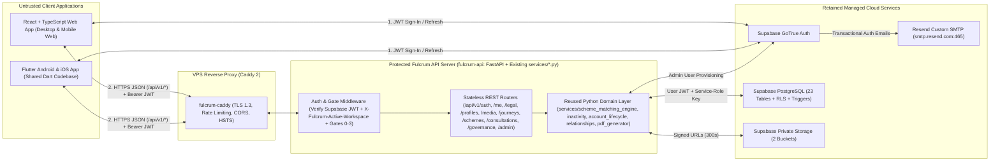
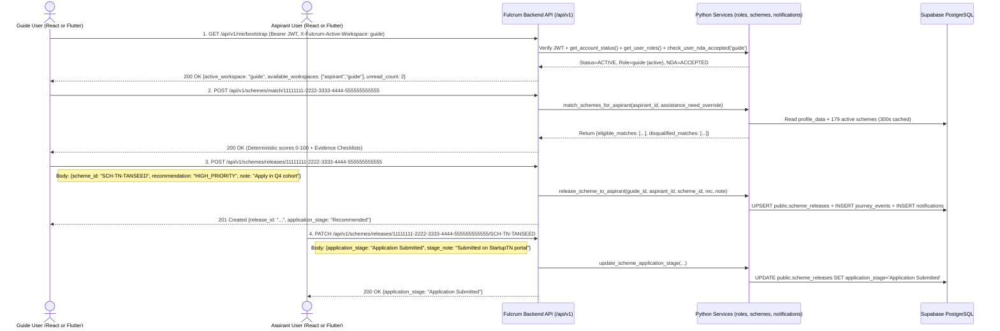

# FULCRUM-INDIA — DOCUMENT 2: BACKEND API & INTEGRATION SPECIFICATION

| Document Attribute | Value |
| :--- | :--- |
| **Document ID** | `FULCRUM-API-V2.0` |
| **Filename** | `FULCRUM_BACKEND_API_CONTRACT.md` (Paired with [`FULCRUM_API_OPENAPI.yaml`](./FULCRUM_API_OPENAPI.yaml)) |
| **Baseline Commit** | `235767754f8d8bb4605e819593bb3f370ddeab27` (`2026-11-11`) |
| **Date of Handover Package** | `2026-11-16` |
| **Target Audience** | Backend API Engineers, React Frontend Engineers, Flutter Mobile Engineers, Security Auditors |
| **Implementation Status** | **PROPOSED TARGET API CONTRACT** (Maps 1:1 to Implemented Python `services/*.py` Functions) |

---

## 1. Purpose and Boundary Between Existing Code and Proposed API

The current **FULCRUM-INDIA Beta 2.0.0** application is a monolithic Streamlit server (`app.py`) that invokes Python functions in `services/*.py` directly in-process. **No custom HTTP REST or GraphQL API exists in the current repository.**

To support decoupled **React + TypeScript Web** and **Flutter Android/iOS Mobile** clients while preserving 100% of Fulcrum's institutional governance and existing Python business logic, this document specifies the **Proposed RESTful JSON API (`/api/v1/*`)** and its companion OpenAPI 3.1 contract ([`FULCRUM_API_OPENAPI.yaml`](./FULCRUM_API_OPENAPI.yaml)). Every proposed endpoint wraps an existing, verified Python function in `services/*.py`.

### 1.1 Client-to-Cloud Boundary: When Direct Supabase Access Is Allowed vs. Prohibited

> [!CAUTION]
> **Non-Negotiable Credential Security Rule**: Neither the React web app nor the Flutter mobile app may ever bundle or receive `SUPABASE_SECRET_KEY` (`service_role` key) or `RESEND_API_KEY`. In the current Streamlit baseline, 18 modules in `services/*.py` call `get_supabase_admin_client()` on the server (`SRS Section 7.1`). Therefore, **all business data reads and writes must flow through the protected Fulcrum Backend API (`/api/v1/*`)**, not via direct browser/mobile PostgREST table mutations.

| Operation Category | Direct Client Supabase SDK (`SUPABASE_PUBLISHABLE_KEY` / `anon`) Allowed? | Protected Fulcrum Backend API (`/api/v1/*`) Mandatory? | Technical Rationale |
| :--- | :---: | :---: | :--- |
| **Sign In (`signInWithPassword`) & Token Refresh (`refreshSession`)** | ✅ **Allowed** (or proxied via `/api/v1/auth/*`) | Optional | Standard OAuth2/OIDC JWT issuance by Supabase GoTrue (`/auth/v1/token`). |
| **Sign Out (`signOut`)** | ✅ **Allowed** | Optional | Revokes the caller's own refresh token in GoTrue. |
| **Public Aspirant Signup & Profile Pre-Seeding** | ❌ **Prohibited Direct** | ✅ **Mandatory (`POST /api/v1/auth/signup-aspirant`)** | When `res.session is None` (pending email confirmation), `services/auth.py` L606 uses `get_supabase_admin_client()` to pre-seed `public.profiles` with phone/district and lock `role='aspirant'`. |
| **Password Reset Request & Completion** | ❌ **Prohibited Direct** | ✅ **Mandatory (`POST /api/v1/auth/password-reset/*`)** | Server enforces the Sole Admin self-reset block (`<SOLE_ADMIN_EMAIL>`, `views/login.py` L491) and clears `temp_password_issued`. |
| **Profile, Relationship, Journey, Consultation, Scheme, Complaint & COI Operations** | ❌ **Prohibited Direct** | ✅ **Mandatory (`/api/v1/*`)** | Requires multi-layer Python authorization (`_authorize_mentor_session_role`, `_get_relationship_authorized_ids_supabase`, `check_sme_has_conflict`), deterministic 179-scheme scoring, and cross-user notification/history writes. |
| **Photo Upload, Normalization & Signed URL Generation** | ❌ **Prohibited Direct** | ✅ **Mandatory (`/api/v1/media/*`)** | Requires server-side magic-byte verification, EXIF stripping, Pillow WebP compression (`600x600`/`320x320`), `can_view_aspirant_photo()` NDA+assignment check, and `can_view_professional_photo()` mentor headshot masking. |
| **All 13 Administrator Sections (`ADM-01` to `ADM-13`)** | ❌ **Prohibited Direct** | ✅ **Mandatory (`/api/v1/admin/*`)** | Requires `require_sole_admin()` JWT + session verification, `auth.admin.create_user`, atomic mentor handover, and compensating rollbacks (`_restore_relationship_snapshots`). |

### Mermaid Diagram 1 — Shared Backend API Topology with React Web and Flutter Mobile Clients (`[PROPOSED]`)



---

## 2. Standard API Conventions, Headers, Pagination & Error Envelope

### 2.1 Required Request Headers
Every authenticated request to `/api/v1/*` must include:
- `Authorization: Bearer <supabase_access_token_jwt>` (Required on all endpoints except public `/api/v1/auth/*`).
- `X-Fulcrum-Active-Workspace: aspirant | guide | sme | admin` (Required on workspace-scoped endpoints; replaces `st.session_state["active_workspace"]` and is validated by server middleware against `public.user_roles`).
- `Idempotency-Key: <uuid-v4>` (Recommended on mutating `POST` requests such as consultation creation, scheme release, and account archival).

### 2.2 Standard JSON Error Envelope
All `4xx` and `5xx` responses return a consistent JSON structure so React and Flutter clients can trigger deterministic UI gates or field errors:

```json
{
  "ok": false,
  "error": {
    "code": "NDA_ACCEPTANCE_REQUIRED",
    "message": "You must review and sign the Guide Non-Disclosure Agreement before accessing this workspace.",
    "gate_required": "NDA_GUIDE",
    "details": {
      "workspace": "guide",
      "doc_type": "nda_guide",
      "doc_version": "1.0.0"
    }
  },
  "request_id": "req_01JCXX89A2B3C4D5E6"
}
```

### 2.3 Canonical Gate Error Codes (`HTTP 403`)
| Error `code` | Trigger Condition | Required Client Action |
| :--- | :--- | :--- |
| `EMAIL_NOT_CONFIRMED` | User signed up (`res.session is None`) and has not clicked email verification link. | Show unconfirmed notice, Spam-folder reminder, and **"Resend Confirmation Email"** button (`POST /api/v1/auth/resend-confirmation`). |
| `ACCOUNT_BLOCKED` | `account_status` in `('DENIED', 'TEMPORARILY_SUSPENDED', 'ARCHIVED')`. | Render `SCR-03` Barrier Screen with `lifecycle_reason` and Sign Out button. |
| `PENDING_DELETION_READ_ONLY` | Mutating action attempted while `account_status == 'PENDING_DELETION'`. | Show 30-day grace banner (`SCR-04`) and allow only `POST /api/v1/accounts/me/cancel-deletion`. |
| `PASSWORD_CHANGE_REQUIRED` | `profile_data.temp_password_issued == True`. | Redirect to `SCR-05` Forced First-Login Password Rotation screen (`POST /api/v1/auth/first-login-password`). |
| `TERMS_ACCEPTANCE_REQUIRED` | `check_user_terms_accepted(user_id) == False`. | Redirect to `SCR-06` Terms of Service Gate (`POST /api/v1/legal/acceptances`). |
| `NDA_ACCEPTANCE_REQUIRED` | `X-Fulcrum-Active-Workspace` is `guide` or `sme` and `user_roles.status == 'pending_nda'`. | Redirect to `SCR-07` Role NDA Gate (`POST /api/v1/legal/acceptances`). |
| `ROLE_NOT_AUTHORIZED` | Requested workspace role was revoked or suspended (`user_roles.status in ('revoked','suspended')`). | Immediately evict that workspace from client state and switch to default available workspace (`BR-ROLE-001`). |
| `SME_COI_LOCKED` | SME attempts to reply to a consultation while `check_sme_has_conflict(sme_id, aspirant_id) == True`. | Disable reply form and display active COI recusal lock banner (`BR-CMP-001`). |

---

## 3. Complete Proposed Endpoint Catalogue (`/api/v1/*`)

| # | Method & Path (`[PROPOSED]`) | Wrapped Baseline Function (`services/*.py`) | Authorized Roles | Rate Limit | Idempotency / Concurrency | Mapped Reqs |
| :-: | :--- | :--- | :--- | :--- | :--- | :--- |
| **1** | `POST /api/v1/auth/signup-aspirant` | `auth.py::signup_aspirant` (L521–L672) | Public | `5 / 15m / IP` | Unique `email` in `auth.users` | `FR-AUTH-001`, `BR-ONB-001` |
| **2** | `POST /api/v1/auth/resend-confirmation` | `client.auth.resend(type='signup')` (`PROP-01` / `DEF-002`) | Public | `3 / 15m / Email` | Supabase GoTrue rate limit | `SEC-CONF-002`, `DEF-002` |
| **3** | `POST /api/v1/auth/password-reset/request` | `auth.py::send_password_reset` (L674–L708) | Public (Blocks Admin) | `3 / 15m / Email` | Ephemeral client isolation | `FR-AUTH-003`, `SEC-PWD-003` |
| **4** | `POST /api/v1/auth/password-reset/complete` | `auth.py::verify_recovery_*` & `complete_password_reset` (L711–L877) | Recovery Token Bearer | `5 / 15m / IP` | Single-use recovery token | `FR-AUTH-003`, `SEC-PWD-002` |
| **5** | `POST /api/v1/auth/first-login-password` | `auth.py::complete_first_login_password_change` (L880–L995) | Guide, SME (`temp_password_issued=True`) | `10 / 15m / User` | Clears `temp_password_issued` | `FR-AUTH-004`, `BR-ONB-002` |
| **6** | `GET /api/v1/me/bootstrap` | `app.py` L841–L1037 (`get_account_status`, `get_user_roles`, `check_user_terms_accepted`, `get_unread_count`) | All Authenticated | `120 / min / User` | Read-only (5s session cache) | `FR-ROLE-001`, `BR-LIFE-001` |
| **7** | `GET /api/v1/legal/documents/{doc_type}` | `legal.py::get_active_legal_document` (L246–L279) | All Authenticated | `60 / min / User` | Returns version + SHA-256 hash | `FR-LEGAL-001`, `BR-LEGAL-001` |
| **8** | `POST /api/v1/legal/acceptances` | `legal.py::record_legal_acceptance` (L360–L460) + `roles.py::activate_role` | Aspirant, Guide, SME | `10 / min / User` | Captures real `X-Forwarded-For` IP | `FR-LEGAL-001`, `BR-LEGAL-002` |
| **9** | `GET /api/v1/profiles/aspirants/{aspirant_id}` | `profiles.py::get_profile` (L132–L237) + `relationships.py::get_aspirant_mentors` | Owner `A`, Assigned `G`/`S`, `Admin` | `60 / min / User` | Relationship-scoped check | `FR-ASP-001`, `SEC-ISO-001` |
| **10** | `PUT /api/v1/profiles/aspirants/{aspirant_id}` | `profiles.py::update_aspirant_profile` (L541–L692) | Owner `A`, `Admin` | `20 / min / User` | Preserves `profile_data['mentor']` (`DEF-32-006`) | `FR-ASP-001` |
| **11** | `PUT /api/v1/profiles/mentors/{mentor_id}` | `profiles.py::update_mentor_profile` (L694–L766) | Self `G`/`S`, `Admin` | `20 / min / User` | Preserves `profile_data['business']` | `FR-GUIDE-001`, `FR-SME-001` |
| **12** | `POST /api/v1/media/aspirant-photo/{aspirant_id}` | `aspirant_photos.py::upload_aspirant_photo` (L375–L542) | Owner `A`, `Admin` | `10 / min / User` | Multipart `<=5MB` -> `600x600` WebP `<=180KB` | `FR-ASP-002`, `SEC-FILE-001` |
| **13** | `GET /api/v1/media/aspirant-photo/{aspirant_id}` | `aspirant_photos.py::get_aspirant_photo` (L232–L313) | Owner `A`, Assigned `G`/`S` (NDA), `Admin` | `60 / min / User` | Returns 300s `signed_url` | `FR-ASP-002`, `SEC-STOR-002` |
| **14** | `DELETE /api/v1/media/aspirant-photo/{aspirant_id}` | `aspirant_photos.py::delete_aspirant_photo` (L545–L595) | Owner `A`, `Admin` | `10 / min / User` | Deletes storage object + DB row | `FR-ASP-002` |
| **15** | `POST /api/v1/media/professional-photo/{mentor_id}` | `professional_photos.py::upload_professional_photo` (L199–L324) | Self `G`/`S`, `Admin` | `10 / min / User` | Multipart `<=5MB` -> `320x320` WebP `<=150KB` | `FR-SME-002`, `SEC-STOR-003` |
| **16** | `GET /api/v1/media/professional-photo/{mentor_id}` | `professional_photos.py::get_professional_photo_url` (L388–L455) | Self `G`/`S`, `Admin` (Masked from `A`) | `60 / min / User` | Returns 300s `signed_url` | `FR-SME-002`, `SEC-STOR-003` |
| **17** | `GET /api/v1/journeys/{aspirant_id}` | `journey.py::get_journey_timeline` (L156–L242) | Owner `A`, Assigned `G`/`S`, `Admin` | `60 / min / User` | Sorted chronologically + revisions | `FR-JRN-001` |
| **18** | `POST /api/v1/journeys/{aspirant_id}/events` | `journey.py::add_manual_aspirant_entry` / `add_guide_contribution` / `add_sme_contribution` / `add_admin_journey_entry` | Owner `A`, Assigned `G`/`S`, `Admin` | `30 / min / User` | Resets mentor SLA clock if `G`/`S` | `FR-JRN-001`, `FR-GUIDE-001`, `FR-SME-001` |
| **19** | `PATCH /api/v1/journeys/events/{event_id}` | `journey.py::update_journey_event` (L883–L1113) & `toggle_event_roadmap_inclusion` | Event Author (`actor_id`) or `Admin` | `30 / min / User` | Optimistic lock `expected_updated_at` + inserts `journey_event_revisions` | `FR-JRN-001`, `BR-JRN-001` |
| **20** | `POST /api/v1/journeys/{aspirant_id}/complete` | `journey.py::mark_journey_completed` (L1116–L1191) | Assigned `G`, `Admin` | `10 / min / User` | Sets `journeys.status='completed'` | `FR-GUIDE-001` |
| **21** | `GET /api/v1/reports/aspirants/{aspirant_id}/dossier-pdf` | `pdf_generator.py::generate_aspirant_dossier_pdf` (L793–L822) | Owner `A`, Assigned `G`, `Admin` | `5 / min / User` | `BoundedSemaphore(2)` subprocess PDF stream (`application/pdf`) | `FR-ASP-003`, `NFR-CAP-003` |
| **22** | `POST /api/v1/schemes/match/{aspirant_id}` | `schemes.py::match_schemes_for_aspirant` (L267–L326) | Assigned `G`, `Admin` (Never raw to `A`) | `30 / min / User` | Deterministic 3-stage evaluation over 179 schemes | `FR-SCH-001`, `BR-SCH-001` |
| **23** | `GET /api/v1/schemes/releases/{aspirant_id}` | `schemes.py::get_released_schemes_for_aspirant` (L622–L729) | Owner `A`, Assigned `G`, `Admin` | `60 / min / User` | Returns only `status='released'` rows | `FR-GUIDE-002`, `SCR-12` |
| **24** | `POST /api/v1/schemes/releases/{aspirant_id}` | `schemes.py::release_scheme_to_aspirant` (L401–L542) | Assigned `G`, `Admin` | `20 / min / User` | Blocks disqualified unless SSR approved (`UNIQUE(aspirant_id,scheme_id)`) | `FR-GUIDE-002`, `BR-SCH-001` |
| **25** | `PATCH /api/v1/schemes/releases/{aspirant_id}/{scheme_id}` | `schemes.py::update_scheme_application_stage` (L756–L876) & `withdraw_scheme_release` | Owner `A` (stage), Assigned `G` (stage/withdraw), `Admin` | `30 / min / User` | Updates 7-stage tracker | `FR-GUIDE-002`, `SCR-12` |
| **26** | `POST /api/v1/schemes/support-reviews` | `scheme_reviews.py::submit_scheme_support_review` (L18–L99) | Assigned `G` | `15 / min / User` | `UNIQUE(aspirant_id,scheme_id,guide_id)` | `FR-GUIDE-002`, `FR-ADMIN-005` |
| **27** | `GET /api/v1/consultations` | `help_requests.py::list_requests` / `list_guide_requests` / `list_sme_requests` | `A`, `G`, `S`, `Admin` | `60 / min / User` | Scoped to active workspace & assignments | `FR-CONS-001` |
| **28** | `POST /api/v1/consultations` | `help_requests.py::create_request` (L184–L362) & `create_mentor_consultation` (L1163–L1267) | `A`, Assigned `G`/`S` | `20 / min / User` | Blocked in `PENDING_DELETION` (`VULN-07`) | `FR-CONS-001` |
| **29** | `POST /api/v1/consultations/{request_id}/reply` | `help_requests.py::guide_respond_request` / `sme_respond_request` / `aspirant_respond_request` | Owner `A`, Assigned `G`/`S` (No COI), `Admin` | `30 / min / User` | Updates `last_interaction_actor_*` & mentor/aspirant timestamps | `FR-CONS-001`, `BR-CONS-001` |
| **30** | `POST /api/v1/consultations/mentor-inquiries` | `help_requests.py::create_mentor_admin_query` (L907–L998) | Assigned `G`/`S` | `15 / min / User` | Creates `PENDING_ADMIN` inquiry | `FR-ADMIN-005` |
| **31** | `GET & POST /api/v1/cases/{aspirant_id}/discussions` | `collaboration.py::list_case_messages` & `create_case_message` (L18–L237) | Owner `A` (public only), Assigned `G`/`S`, `Admin` | `30 / min / User` | Strips `is_private_mentor_note=True` when workspace=`aspirant` | `FR-CONS-001`, `SEC-ISO-002` |
| **32** | `GET & POST /api/v1/governance/complaints` | `governance.py::submit_guide_complaint` & `list_aspirant_complaints` (L63–L163) | `A` (Submit/Read Own), `Admin` (Hidden from `G`) | `10 / min / User` | Requires `details >= 15` chars | `FR-CMP-001`, `BR-CMP-001` |
| **33** | `GET & POST /api/v1/governance/sme-conflicts` | `governance.py::declare_sme_conflict` & `list_sme_conflicts` (L228–L359) | Assigned `S`, `Admin` | `15 / min / User` | `has_conflict=True` locks SME consultation replies | `FR-CMP-001`, `BR-CMP-001` |
| **34** | `GET & PATCH /api/v1/notifications` | `notifications.py::list_notifications`, `mark_as_read`, `mark_all_as_read` | All Authenticated | `60 / min / User` | Filtered by `X-Fulcrum-Active-Workspace` (`DEF-32-010`) | `FR-NOTIF-001` |
| **35** | `POST /api/v1/accounts/me/deletion-request` & `cancel-deletion` | `account_lifecycle.py::request_account_deletion` & `cancel_account_deletion` | `A`, `G`, `S` | `5 / min / User` | Blocked if `legal_hold == True`; 30-day grace window | `FR-ADMIN-013`, `BR-LIFE-001` |
| **36** | `ALL /api/v1/admin/*` (13 Admin Sections `ADM-01`..`ADM-13`) | `admin_metrics.py`, `auth.py::admin_create_mentor`, `relationships.py`, `help_requests.py::admin_respond_to_mentor`, `scheme_reviews.py::decide_scheme_support_review`, `schemes.py`, `roles.py`, `governance.py`, `inactivity.py`, `external_contact.py`, `account_lifecycle.py` | **Sole Admin Only (`<SOLE_ADMIN_EMAIL>`)** | `120 / min / Admin` | Enforces `require_sole_admin()` + atomic handover rollback | `FR-ADMIN-001` to `FR-ADMIN-013` |

---

## 4. Detailed Sequence Diagram & Fictional JSON Payload Examples

### Mermaid Diagram 2 — API Request Sequence: Authentication, Bootstrap, Guide Scheme Release & Aspirant Stage Update (`[PROPOSED]`)



### 4.1 Example 1 — `GET /api/v1/me/bootstrap` Response (Hybrid `Aspirant + Guide` User)
```json
{
  "ok": true,
  "data": {
    "user": {
      "id": "a1b2c3d4-0000-4000-8000-000000000001",
      "email": "founder.anitha@example.in",
      "full_name": "Anitha Rajan",
      "district": "Coimbatore",
      "state": "Tamil Nadu"
    },
    "account_lifecycle": {
      "account_status": "ACTIVE",
      "is_active": true,
      "legal_hold": false,
      "deletion_scheduled_for": null,
      "lifecycle_reason": null
    },
    "gates": {
      "password_change_required": false,
      "terms_acceptance_required": false,
      "nda_acceptance_required": {
        "guide": false,
        "sme": false
      }
    },
    "roles": {
      "is_sole_admin": false,
      "active_workspace": "guide",
      "available_workspaces": [
        { "role": "aspirant", "label": "Aspirant Dashboard", "status": "active", "nda_signed": true },
        { "role": "guide", "label": "Guide Dashboard", "status": "active", "nda_signed": true }
      ]
    },
    "notifications": {
      "unread_workspace_count": 3,
      "unread_total_count": 5
    }
  }
}
```

### 4.2 Example 2 — `POST /api/v1/schemes/match/{aspirant_id}` Response (Guide Workspace)
```json
{
  "ok": true,
  "data": {
    "aspirant_id": "f0000001-0000-4000-8000-000000000099",
    "profile_completion_pct": 85,
    "assistance_need_evaluated": {
      "goal": "Capital Grant / Seed Subsidy",
      "support_type": "Innovation Grant (TANSEED / IVP)",
      "quantum_range": "SMALL (Rs.5 Lakhs - Rs.25 Lakhs)",
      "timeframe": "NEAR_TERM (1 to 3 Months)"
    },
    "eligible_matches": [
      {
        "scheme_id": "SCH_TANSEED_01",
        "name": "TANSEED (Tamil Nadu Startup Seed Grant Fund)",
        "agency": "StartupTN",
        "funding_type": "Grant",
        "amount": "Up to Rs.15 Lakhs",
        "match_score": 92,
        "is_eligible": true,
        "disqualifications": [],
        "warnings": [],
        "match_reasons": [
          "Exact sector alignment: Food Processing & Agribusiness",
          "Stage fit: Pre-Seed / Seed",
          "Tamil Nadu registered enterprise with StartupTN recognition"
        ],
        "evidence_checklist": [
          { "criterion": "Tamil Nadu State Registration", "status": "MET", "detail": "District: Madurai, Tamil Nadu" },
          { "criterion": "StartupTN Portal Registration", "status": "MET", "detail": "Declared registered in profile" }
        ],
        "release_status": "unreleased"
      }
    ],
    "disqualified_matches": [
      {
        "scheme_id": "SCH_ISRO_INSPACE_01",
        "name": "IN-SPACe Seed Fund for Space Tech",
        "agency": "IN-SPACe / ISRO",
        "match_score": 15,
        "is_eligible": false,
        "disqualifications": [
          "Domain Exclusion: Isro specialized scheme - applicant's enterprise (Food Processing & Agribusiness) is outside this domain."
        ],
        "can_request_ssr_override": true
      }
    ]
  }
}
```

### 4.3 Example 3 — `POST /api/v1/admin/accounts/{user_id}/archive` Request & Response (Sole Admin Tab 13)
```json
// Request
{
  "reason": "Mentor completed annual fellowship term; archiving account after caseload handover.",
  "confirm_handover": true
}

// Response (200 OK)
{
  "ok": true,
  "data": {
    "user_id": "g0000002-0000-4000-8000-000000000022",
    "previous_status": "ACTIVE",
    "new_status": "ARCHIVED",
    "handover_summary": {
      "guides_unassigned_or_promoted": 2,
      "smes_unassigned": 0,
      "open_tickets_transferred": 3
    },
    "lifecycle_log_id": "log_99887766-5544-3322-1100-aabbccddeeff"
  }
}
```
