# FULCRUM-INDIA — FUTURE PLATFORM & CROSS-PLATFORM HANDOVER MASTER INDEX

| Attribute | Details |
| :--- | :--- |
| **Handover Directory** | `DOCUMENTATION/FUTURE_PLATFORM_HANDOVER/` |
| **Existing Baseline Directory** | [`DOCUMENTATION/07_REQUIREMENTS_BASELINE_V2/`](../07_REQUIREMENTS_BASELINE_V2/README_DOCUMENTATION.md) |
| **Baseline Commit** | `235767754f8d8bb4605e819593bb3f370ddeab27` (`2026-11-11`) |
| **Date of Handover Package** | `2026-11-16` |
| **Purpose** | Complete engineering handover package enabling a new team to maintain, extend, or rebuild **FULCRUM-INDIA** across **Backend API**, **React Web**, and **Flutter Android/iOS** without re-reverse-engineering the Python codebase |

---

## 1. Complete Inventory of the Future Handover Suite (9 Files)

| # | Filename | Document Title | Purpose |
| :-: | :--- | :--- | :--- |
| **1** | [`FULCRUM_PLATFORM_INDEPENDENT_CONTRACT.md`](./FULCRUM_PLATFORM_INDEPENDENT_CONTRACT.md) | **Platform-Independent Functional Contract** | Technology-agnostic behavioural contract: roles, 7 hybrid combinations, permission matrix, Gates `0`–`3`, all 20 `BR-*` business rules, state machines, and canonical database enum strings. |
| **2** | [`FULCRUM_BACKEND_API_CONTRACT.md`](./FULCRUM_BACKEND_API_CONTRACT.md) | **Backend API & Integration Specification** | Proposed stateless REST API (`/api/v1/*`) wrapping existing `services/*.py` functions, client-vs-server Supabase boundary rules, error codes, rate limits, and JSON payload examples. |
| **2b** | [`FULCRUM_API_OPENAPI.yaml`](./FULCRUM_API_OPENAPI.yaml) | **Proposed OpenAPI 3.1 Specification** | Machine-readable OpenAPI 3.1 contract for generating TypeScript (React) and Dart (Flutter) API clients. |
| **3** | [`FULCRUM_DATABASE_MIGRATION_CONTRACT.md`](./FULCRUM_DATABASE_MIGRATION_CONTRACT.md) | **Database & Data Migration Specification** | In-place preservation of all 23 Supabase PostgreSQL tables, RLS policies, triggers, and private storage buckets (`zero user re-registration`), plus optional additive Migration `012` and reconciliation tests. |
| **4** | [`FULCRUM_UI_UX_DESIGN_SYSTEM.md`](./FULCRUM_UI_UX_DESIGN_SYSTEM.md) | **Shared UI/UX Design System & Screen Contract** | Light workspace (`#F8FAFC`/`#FFFFFF`), Blue (`#2563EB`) color tokens, `Avenir Next` / `Inter` typography scale, reusable components, and 1:1 mapping of all **30 screens (`SCR-01`–`SCR-30`)**. |
| **5** | [`FULCRUM_REACT_WEB_HANDOVER.md`](./FULCRUM_REACT_WEB_HANDOVER.md) | **React + TypeScript Web Development Handover** | Project structure, React Router gate guards, TanStack Query + Zustand state, API interceptors, and detailed specifications for **all 13 Sole Administrator sections (`ADM-01`–`ADM-13`)**. |
| **6** | [`FULCRUM_FLUTTER_MOBILE_HANDOVER.md`](./FULCRUM_FLUTTER_MOBILE_HANDOVER.md) | **Flutter Android/iOS Development Handover** | Shared Dart Clean Architecture, Riverpod state, `flutter_secure_storage`, App Links / Universal Links deep linking, camera/photo permissions, offline read-cache rules, and Admin mobile strategy (`DEC-MOB-001`). |
| **7** | [`FULCRUM_CROSS_PLATFORM_PARITY_AND_QA.md`](./FULCRUM_CROSS_PLATFORM_PARITY_AND_QA.md) | **Cross-Platform Parity & QA Matrix** | Maps every `SCR-*`, `FR-*`, and `ADM-*` across Streamlit, React, Flutter Android, and Flutter iOS; defines the Golden-Test Strategy and 11 critical parity verification scenarios. |
| **8** | [`FULCRUM_FUTURE_PLATFORM_MIGRATION_PLAN.md`](./FULCRUM_FUTURE_PLATFORM_MIGRATION_PLAN.md) | **Phased Migration, Delivery & Release Plan** | 10-phase parallel-coexistence roadmap, effort estimates, team structure, approval gates (`Gate A`, `Gate B`), risk register, and `< 60s` Caddy rollback strategy. |

---

## 2. Mandatory Reading Order by Team Role

### Mermaid Diagram 1 — Handover Documentation Map by Engineering Team

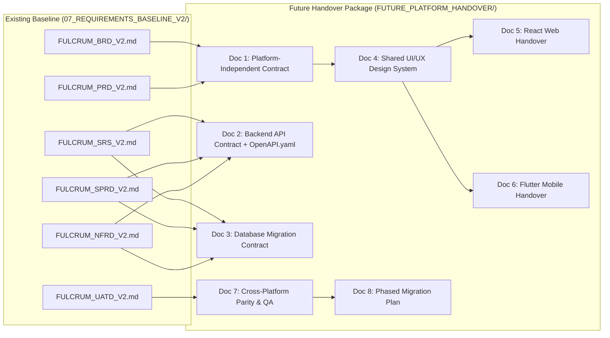

### 2.1 React Web Development Team Reading Path
1. [`FULCRUM_BRD_V2.md`](../07_REQUIREMENTS_BASELINE_V2/FULCRUM_BRD_V2.md) & [`FULCRUM_PRD_V2.md`](../07_REQUIREMENTS_BASELINE_V2/FULCRUM_PRD_V2.md) *(Understand the institutional domain, 30 screens, and 13 Admin tabs)*
2. [`FULCRUM_PLATFORM_INDEPENDENT_CONTRACT.md`](./FULCRUM_PLATFORM_INDEPENDENT_CONTRACT.md) *(Master business rules `BR-*`, 7 role combinations, and Gates `0`–`3`)*
3. [`FULCRUM_BACKEND_API_CONTRACT.md`](./FULCRUM_BACKEND_API_CONTRACT.md) & [`FULCRUM_API_OPENAPI.yaml`](./FULCRUM_API_OPENAPI.yaml) *(REST endpoints, headers, and error codes)*
4. [`FULCRUM_UI_UX_DESIGN_SYSTEM.md`](./FULCRUM_UI_UX_DESIGN_SYSTEM.md) *(Color tokens, typography, and component contracts)*
5. [`FULCRUM_REACT_WEB_HANDOVER.md`](./FULCRUM_REACT_WEB_HANDOVER.md) *(React architecture, route guards, and all 13 Admin sections)*
6. [`FULCRUM_CROSS_PLATFORM_PARITY_AND_QA.md`](./FULCRUM_CROSS_PLATFORM_PARITY_AND_QA.md) *(Acceptance criteria and Playwright parity tests)*

### 2.2 Flutter Android/iOS Development Team Reading Path
1. [`FULCRUM_BRD_V2.md`](../07_REQUIREMENTS_BASELINE_V2/FULCRUM_BRD_V2.md) & [`FULCRUM_PRD_V2.md`](../07_REQUIREMENTS_BASELINE_V2/FULCRUM_PRD_V2.md)
2. [`FULCRUM_PLATFORM_INDEPENDENT_CONTRACT.md`](./FULCRUM_PLATFORM_INDEPENDENT_CONTRACT.md)
3. [`FULCRUM_BACKEND_API_CONTRACT.md`](./FULCRUM_BACKEND_API_CONTRACT.md) & [`FULCRUM_API_OPENAPI.yaml`](./FULCRUM_API_OPENAPI.yaml)
4. [`FULCRUM_UI_UX_DESIGN_SYSTEM.md`](./FULCRUM_UI_UX_DESIGN_SYSTEM.md)
5. [`FULCRUM_FLUTTER_MOBILE_HANDOVER.md`](./FULCRUM_FLUTTER_MOBILE_HANDOVER.md) *(Riverpod architecture, Keystore/Keychain storage, App Links / Universal Links, permissions, and offline rules)*
6. [`FULCRUM_CROSS_PLATFORM_PARITY_AND_QA.md`](./FULCRUM_CROSS_PLATFORM_PARITY_AND_QA.md)

### 2.3 Backend API & Database Development Team Reading Path
1. [`FULCRUM_SRS_V2.md`](../07_REQUIREMENTS_BASELINE_V2/FULCRUM_SRS_V2.md), [`FULCRUM_SPRD_V2.md`](../07_REQUIREMENTS_BASELINE_V2/FULCRUM_SPRD_V2.md) & [`FULCRUM_NFRD_V2.md`](../07_REQUIREMENTS_BASELINE_V2/FULCRUM_NFRD_V2.md)
2. [`FULCRUM_PLATFORM_INDEPENDENT_CONTRACT.md`](./FULCRUM_PLATFORM_INDEPENDENT_CONTRACT.md)
3. [`FULCRUM_BACKEND_API_CONTRACT.md`](./FULCRUM_BACKEND_API_CONTRACT.md) & [`FULCRUM_API_OPENAPI.yaml`](./FULCRUM_API_OPENAPI.yaml)
4. [`FULCRUM_DATABASE_MIGRATION_CONTRACT.md`](./FULCRUM_DATABASE_MIGRATION_CONTRACT.md)

### 2.4 QA & Security Verification Team Reading Path
1. [`FULCRUM_PRD_V2.md`](../07_REQUIREMENTS_BASELINE_V2/FULCRUM_PRD_V2.md), [`FULCRUM_UATD_V2.md`](../07_REQUIREMENTS_BASELINE_V2/FULCRUM_UATD_V2.md) & [`FULCRUM_SPRD_V2.md`](../07_REQUIREMENTS_BASELINE_V2/FULCRUM_SPRD_V2.md)
2. [`FULCRUM_CROSS_PLATFORM_PARITY_AND_QA.md`](./FULCRUM_CROSS_PLATFORM_PARITY_AND_QA.md)

### 2.5 Owner / CEO Reading Path
1. [`FULCRUM_BRD_V2.md`](../07_REQUIREMENTS_BASELINE_V2/FULCRUM_BRD_V2.md) *(Especially Section 19: Open Business Decisions `DEC-001`–`DEC-008`)*
2. [`FULCRUM_FUTURE_PLATFORM_MIGRATION_PLAN.md`](./FULCRUM_FUTURE_PLATFORM_MIGRATION_PLAN.md) *(10-phase roadmap, team composition, and Approval Gates A & B)*

---

# FULCRUM-INDIA — DOCUMENT 1: PLATFORM-INDEPENDENT FUNCTIONAL & BUSINESS CONTRACT

| Document Attribute | Value |
| :--- | :--- |
| **Document ID** | `FULCRUM-PIC-V2.0` |
| **Filename** | `FULCRUM_PLATFORM_INDEPENDENT_CONTRACT.md` |
| **Baseline Commit** | `235767754f8d8bb4605e819593bb3f370ddeab27` (`2026-11-11`) |
| **Date of Handover Package** | `2026-11-16` |
| **Target Audience** | Backend API Architects, React Web Engineers, Flutter Mobile Engineers, Native Android/iOS Engineers, QA Lead |
| **Document Purpose** | Technology-agnostic behavioural contract that every future frontend (React, Flutter, Kotlin, Swift) and backend API service must obey |

---

## 1. Purpose and Architectural Principle

This document extracts the complete **institutional business logic, role model, authorization invariants, state machines, and domain rules** of **FULCRUM-INDIA Beta 2.0.0** into a **platform-independent functional contract**.

In the current production baseline (`commit 2357677`), UI rendering and business logic execute inside a monolithic Python Streamlit server (`app.py`, `views/*.py`, `services/*.py`) where active user context is held in `st.session_state` and database operations use a mix of user-scoped and service-role Supabase clients. **A current Streamlit function cannot simply be copied into a React browser app or a Flutter mobile binary** because:
1. Browser and mobile clients are **untrusted environments** that must never hold the privileged `SUPABASE_SECRET_KEY` (`service_role` key).
2. `st.session_state` is a server-memory Python dictionary tied to a Streamlit WebSocket; in a multi-client architecture, authentication state must be carried via stateless **Supabase JWT Bearer tokens** and explicit **`X-Fulcrum-Active-Workspace`** request context verified on the server for every API call.
3. Heavy or privileged server operations—such as 179-scheme deterministic matching, cross-user mentor handovers, 7/10/14-day SLA computation, EXIF-stripping WebP image normalization, and headless Chromium/ReportLab PDF dossier generation—must execute inside a **protected backend API tier**, never on the client device.

> **Core Handover Principle**: *One institutional operating model, one authoritative Supabase PostgreSQL + Storage data store, one stateless backend API enforcing identical business rules, and multiple supported client applications (React Web, Flutter Android/iOS, or future native clients).*

### Mermaid Diagram 1 — Current Streamlit Architecture vs. Proposed Multi-Client Shared Backend Architecture

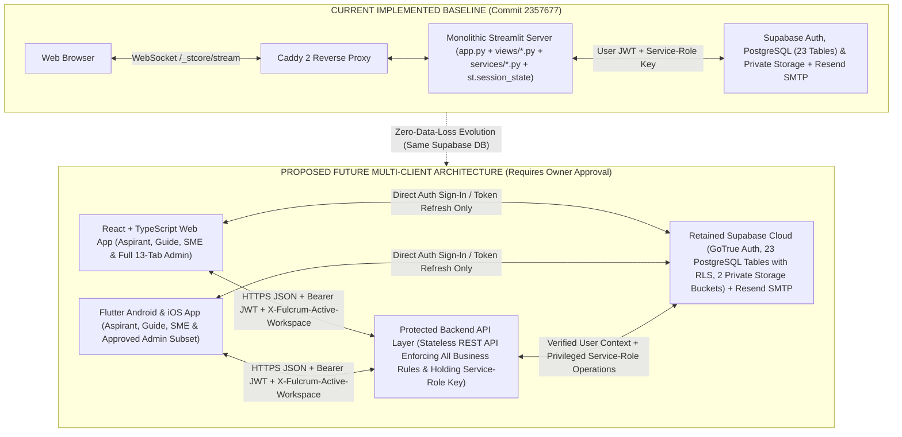

---

## 2. Backend Architecture Options Evaluation (Phase 2 Analysis)

Before building new clients, leadership must approve the backend API runtime (`DEC-ARCH-001`). The table below compares the three candidate backend approaches against Fulcrum's actual codebase requirements:

| Evaluation Criterion | Option A: Pure Cloudflare Workers (`TypeScript / Hono`) | Option B: Containerized Python API Service (`FastAPI + Pydantic v2`) | Option C (Recommended): Controlled Hybrid (`FastAPI Core Service` + Optional `Cloudflare Edge WAF/CDN` + Retained `Supabase & Resend`) |
| :--- | :--- | :--- | :--- |
| **Reuse of Existing `24,343` Lines of Python Business Logic (`services/*.py`)** | ❌ **0% direct code reuse.** Requires rewriting all 31 service modules (`scheme_matching_engine.py`, `inactivity.py`, `account_lifecycle.py`, `relationships.py`, etc.) from Python into TypeScript, creating a high risk of subtle business-rule regressions. | ✅ **~85–90% direct code reuse.** Existing `services/*.py` modules are decoupled from `st.session_state` and wrapped in stateless FastAPI routers with Pydantic request/response schemas. | ✅ **~85–90% direct code reuse** in the Python FastAPI core while leveraging Cloudflare for DNS, DDoS/WAF, TLS caching, and optional lightweight edge routing. |
| **PDF Business Dossier Generation (`services/pdf_generator.py` — Playwright Chromium + ReportLab)** | ❌ **Not natively supported** in standard V8 Worker isolates (requires paid Cloudflare Browser Rendering API or rewriting the entire HTML/ReportLab PDF layout engine). | ✅ **Works out of the box** using the existing `Dockerfile` (`playwright install chromium` + `reportlab` + `BoundedSemaphore(2)` subprocess worker). | ✅ **Works out of the box** on the existing Hostinger KVM 2 container (`fulcrum-api`). |
| **Private Photo Normalization (`Pillow` EXIF Strip + `600x600`/`320x320` WebP Compression)** | ⚠️ Requires replacing Python Pillow (`PIL`) with WASM image libraries inside Worker memory limits. | ✅ **100% reuse** of `validate_and_process_photo()` and `validate_and_normalize_professional_photo()`. | ✅ **100% reuse** of existing Pillow image validation and WebP re-encoding pipeline. |
| **Hosting Cost & Infrastructure Complexity** | Low compute cost, but adds a second language stack and build pipeline. | Zero additional hosting cost: runs alongside or replaces `fulcrum-app` on the existing **Hostinger KVM 2 VPS** behind `fulcrum-caddy`. | Zero additional server cost: Hostinger KVM 2 + Caddy + FastAPI + free Cloudflare proxy/WAF tier. |
| **Architectural Recommendation** | **Not Recommended as Sole Backend** (due to Python rewrite risk and PDF/Pillow constraints). | **Strongly Recommended Core Backend** | **Recommended Production Target (`DEC-ARCH-001` — Requires Owner Approval)** |

---

## 3. Institutional Roles & Multi-Role Combination Contract

Fulcrum's role model is a **strict invariant** (`BRD Section 4`, `SRS Section 8`). Every client and API service must enforce the following rules without exception:

1. **Four Canonical Roles**:
   - `aspirant`: Entrepreneur / Founder (public self-registration or base participant role).
   - `guide`: General Business Mentor (admin-provisioned or admin-granted).
   - `sme`: Subject Matter Expert / Domain Specialist (admin-provisioned or admin-granted).
   - `admin`: Sole Institutional Administrator (`<SOLE_ADMIN_EMAIL>` / `<SOLE_ADMIN_UUID>`).
2. **Prohibition of Additional Admin Hierarchies**: There are **no** Super Admins, District Admins, or Operational Admins. Any legacy string (`district_admin`, `operational_admin`) encountered in data must be treated as `aspirant`.
3. **Seven Non-Admin Participant Combinations**: A non-admin participant may hold any non-empty subset of `{aspirant, guide, sme}` in `public.user_roles`:
   - `(1) aspirant`, `(2) guide`, `(3) sme`, `(4) aspirant + guide`, `(5) aspirant + sme`, `(6) guide + sme`, `(7) aspirant + guide + sme`.
4. **Strict Separation of Sole Admin**: The Sole Administrator holds **only** `admin` and can never hold `aspirant`, `guide`, or `sme`, can never be assigned as a mentor, and can never be suspended, archived, or deleted.

### Mermaid Diagram 2 — Complete User-Role Relationships & Seven Non-Admin Combinations

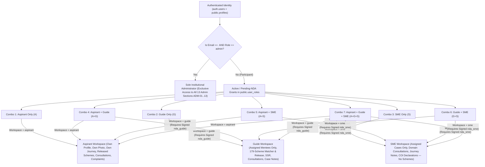

### 3.1 Platform-Independent Permission Matrix

| Domain Capability | `aspirant` Workspace | `guide` Workspace (Signed NDA) | `sme` Workspace (Signed NDA) | `admin` Workspace (Sole Admin) | Unconfirmed / Temp-PW / Unaccepted Terms | Role `pending_nda` | Account `PENDING_DELETION` | Account `SUSPENDED` / `ARCHIVED` / `DENIED` |
| :--- | :---: | :---: | :---: | :---: | :---: | :---: | :---: | :---: |
| **Read/Update Own 4-Part Enterprise Profile & Assistance Need (`Y`)** | ✅ | ❌ | ❌ | ✅ (Inspect All) | ❌ | ❌ | ⚠️ Read-Only | ❌ |
| **Upload/Delete Own Aspirant Identity Photo (`aspirant-profile-photos`)** | ✅ | ❌ | ❌ | ✅ (Inspect/Delete) | ❌ | ❌ | ❌ Paused | ❌ |
| **View Aspirant Private Photo (300s Signed URL)** | ✅ (Self) | ✅ (Assigned Only) | ✅ (Assigned Only) | ✅ (All) | ❌ | ❌ | ⚠️ Self Read | ❌ |
| **Upload/View Professional Mentor Headshot (`professional-headshots`)** | ❌ Masked | ✅ (Self Only) | ✅ (Self Only) | ✅ (All) | ❌ | ❌ | ❌ | ❌ |
| **Run 179-Scheme Matcher, Release/Withdraw Schemes, Submit SSR** | ❌ (View Released Only) | ✅ (Assigned Only) | ❌ (No Scheme Access) | ✅ (All + Approve SSR) | ❌ | ❌ | ❌ | ❌ |
| **Update Post-Release Scheme Application Stage (`7` Stages)** | ✅ (Own Released) | ✅ (Assigned) | ❌ | ✅ (All) | ❌ | ❌ | ❌ Paused | ❌ |
| **Create Journey Event & Edit Own Event (with Revision Snapshot)** | ✅ (Self) | ✅ (Assigned) | ✅ (Assigned) | ✅ (All) | ❌ | ❌ | ❌ Paused | ❌ |
| **Toggle `included_in_roadmap` & Export Executive PDF Dossier** | ✅ (Self) | ✅ (Assigned) | ❌ (Read Timeline Only) | ✅ (All) | ❌ | ❌ | ⚠️ Export Only | ❌ |
| **Create/Reply to Consultations (`help_requests`)** | ✅ (Self) | ✅ (Assigned) | ✅ (Assigned, If No COI) | ✅ (Directives/All) | ❌ | ❌ | ❌ Blocked | ❌ |
| **Read/Write Private Mentor Notes (`is_private_mentor_note=True`)** | ❌ Hidden | ✅ (Assigned) | ✅ (Assigned) | ✅ (All) | ❌ | ❌ | ❌ | ❌ |
| **Submit Confidential Guide Complaint (`guide_complaints`)** | ✅ (Own Guide) | ❌ Hidden | ❌ | ✅ (Resolve/Reassign) | ❌ | ❌ | ❌ | ❌ |
| **Declare SME Conflict of Interest (`sme_conflict_declarations`)** | ❌ | ❌ | ✅ (Assigned) | ✅ (Approve/Clear) | ❌ | ❌ | ❌ | ❌ |
| **Provision Mentors, Grant/Revoke Roles, Assign Mentors, Manage Lifecycle (`ADM-01..13`)** | ❌ | ❌ | ❌ | ✅ Exclusive | ❌ | ❌ | ❌ | ❌ |

---

## 4. Sequential Authentication, Onboarding & Authorization Gate Contract

Every client application and backend API middleware must evaluate the following **7-step decision chain** in exact order (`app.py` L838–L1275, `SRS Section 7`):

### Mermaid Diagram 3 — Platform-Independent Authorization Decision Flow

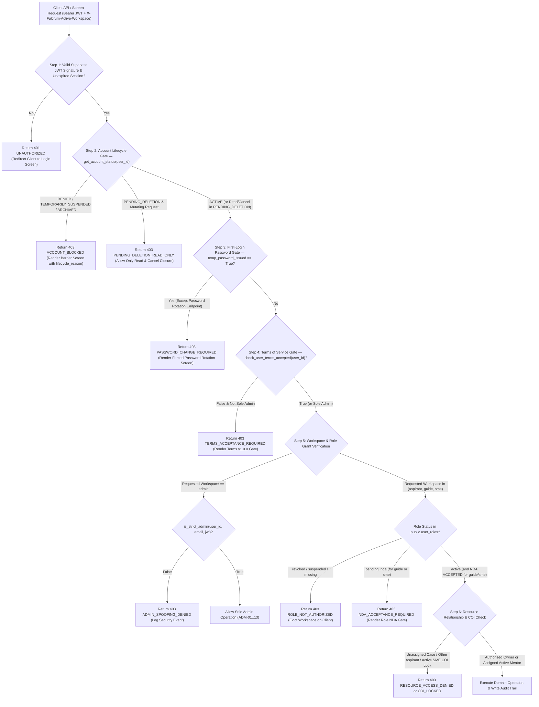

### Mermaid Diagram 4 — Authentication, Email Verification & Sequential Gate Flow

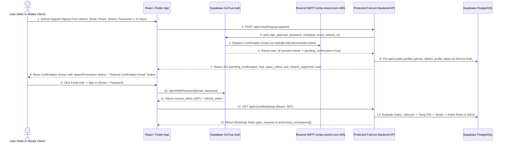

---

## 5. Complete Platform-Independent Business Rules Contract (`BR-*`)

Every future client and backend endpoint must implement the following 20 core business rules without alteration:

#### `BR-GOV-001` — Sole Administrator Identity Lock

| Contract Attribute | Specification |
| :--- | :--- |
| **Requirement ID** | `BR-GOV-001` |
| **Rule Title** | Sole Administrator Identity Lock |
| **Preconditions** | System initialized with configured `<SOLE_ADMIN_EMAIL>` and `<SOLE_ADMIN_UUID>`. |
| **Trigger** | Any user creation, profile update, role grant, or admin endpoint invocation. |
| **Required Behaviour** | Verify that the caller's authenticated Supabase JWT email (`lower(email)`) equals `<SOLE_ADMIN_EMAIL>`, `user_id` matches the sole admin UUID, and `profiles.role == 'admin'`. Automatically strip `'admin'`, `'district_admin'`, or `'operational_admin'` from any other user record and downgrade to `'aspirant'`. |
| **Forbidden Behaviour** | Never trust a client-supplied `admin_id` query/body parameter without verifying the caller's bearer JWT (`VULN-02`). Never create a second admin account or multi-admin hierarchy. |
| **Data Affected** | `public.profiles`, `public.user_roles`. |
| **Error Conditions** | Returns HTTP `403 Forbidden` (`ADMIN_SPOOFING_DENIED`) and logs security warning if a non-admin attempts an admin operation. |
| **Acceptance Criteria** | 100% of non-owner admin privilege escalation attempts fail at API and DB trigger layers (`trg_enforce_single_admin_profile`, `trg_enforce_single_admin_user_roles`). |
| **Baseline Reference** | `BRD BR-GOV-001`, `PRD FR-ADMIN-001..013`, `SRS SR-AUTHZ-002`, `SPRD SEC-ADMIN-001` |
| **Implementation Status** | **Implemented — verified in source; Tested** |

#### `BR-GOV-002` — Sole Administrator Exclusion from Participant Workspaces & Lifecycle Immunity

| Contract Attribute | Specification |
| :--- | :--- |
| **Requirement ID** | `BR-GOV-002` |
| **Rule Title** | Sole Administrator Exclusion from Participant Workspaces & Lifecycle Immunity |
| **Preconditions** | Authenticated user is the Sole Administrator. |
| **Trigger** | Workspace listing, mentor assignment, or account lifecycle action (`suspend`, `archive`, `request_deletion`). |
| **Required Behaviour** | Lock the Sole Administrator's workspace list exclusively to `['admin']`. Reject any request to assign the Admin as a Guide/SME or to suspend, archive, or schedule deletion of the Admin account. |
| **Forbidden Behaviour** | Never allow the Sole Administrator to enter Aspirant/Guide/SME workspaces or be locked out via self-suspension/archival. Never allow self-service password reset for `<SOLE_ADMIN_EMAIL>`. |
| **Data Affected** | `public.profiles`, `public.account_lifecycle_log`. |
| **Error Conditions** | Returns HTTP `400/403` (`ROOT_ADMIN_IMMUNE` / `ADMIN_SELF_RESET_FORBIDDEN`). |
| **Acceptance Criteria** | `suspend_account()`, `archive_account()`, `request_account_deletion()`, and `send_password_reset()` reject `<SOLE_ADMIN_EMAIL>`. |
| **Baseline Reference** | `BRD BR-GOV-002`, `PRD SCR-02`, `SPRD SEC-ADMIN-002`, `UATD UAT-LIFE-001` |
| **Implementation Status** | **Implemented — verified in source; Tested** |

#### `BR-ONB-001` — Public Self-Registration Restricted to Aspirants with Profile Pre-Seeding

| Contract Attribute | Specification |
| :--- | :--- |
| **Requirement ID** | `BR-ONB-001` |
| **Rule Title** | Public Self-Registration Restricted to Aspirants with Profile Pre-Seeding |
| **Preconditions** | Unauthenticated user submits public registration. |
| **Trigger** | Submission of public signup payload (`full_name`, `email`, `phone`, `district`, `password`). |
| **Required Behaviour** | Create account with `role = 'aspirant'`, pre-seed `public.profiles` with `phone`, `district`, and initial `profile_data` so metadata is preserved while awaiting email confirmation, and display honest confirmation guidance instructing the user to check **Spam / Promotions** and offering a rate-limited **Resend Confirmation Email** action. |
| **Forbidden Behaviour** | Never allow public registration to select `guide`, `sme`, or `admin`. Never claim the email has arrived in the primary inbox without warning about Spam filters (`DEF-001`). |
| **Data Affected** | `auth.users`, `public.profiles`, `public.journeys`, `public.relationships`. |
| **Error Conditions** | Duplicate email returns `409 Conflict` (`ACCOUNT_ALREADY_EXISTS`); unconfirmed login attempt returns `403` (`EMAIL_NOT_CONFIRMED`). |
| **Acceptance Criteria** | New signup creates `aspirant` profile with phone/district intact; unconfirmed user cannot log in and can trigger confirmation resend. |
| **Baseline Reference** | `BRD BR-ONB-001`, `PRD FR-AUTH-001..002`, `SPRD SEC-CONF-001..002` |
| **Implementation Status** | **Implemented in source (Spam notice & Resend button required in new clients per `DEF-001`, `DEF-002`)** |

#### `BR-ONB-002` — Mandatory First-Login Password Rotation for Admin-Provisioned Mentors

| Contract Attribute | Specification |
| :--- | :--- |
| **Requirement ID** | `BR-ONB-002` |
| **Rule Title** | Mandatory First-Login Password Rotation for Admin-Provisioned Mentors |
| **Preconditions** | Sole Admin provisions a Guide or SME account with a provisional password (`profile_data.temp_password_issued = True`). |
| **Trigger** | Provisioned mentor authenticates for the first time. |
| **Required Behaviour** | Block all workspace and data endpoints until the mentor submits a new permanent password of **at least 8 characters** (`complete_first_login_password_change`), which updates `auth.users` and sets `temp_password_issued = False`. |
| **Forbidden Behaviour** | Never allow a user with `temp_password_issued == True` to bypass Gate 1 or set a password shorter than 8 characters (`DEF-32-009`). |
| **Data Affected** | `auth.users`, `public.profiles` (`profile_data.temp_password_issued`). |
| **Error Conditions** | Password `< 8` chars or mismatch returns `400 Bad Request`. |
| **Acceptance Criteria** | Mentor cannot view mentee data until permanent password (`>= 8` chars) is saved and `temp_password_issued` becomes `False`. |
| **Baseline Reference** | `BRD BR-ONB-002`, `PRD FR-AUTH-004`, `SCR-05`, `SPRD SEC-PWD-004` |
| **Implementation Status** | **Implemented — verified in source; Tested** |

#### `BR-LEGAL-001` — Universal Platform Terms of Service Gate (`terms_v1_0`)

| Contract Attribute | Specification |
| :--- | :--- |
| **Requirement ID** | `BR-LEGAL-001` |
| **Rule Title** | Universal Platform Terms of Service Gate (`terms_v1_0`) |
| **Preconditions** | Authenticated non-admin user has passed Lifecycle and First-Login Password gates. |
| **Trigger** | Any attempt to load a workspace or invoke domain APIs when `check_user_terms_accepted(user_id)` is `False`. |
| **Required Behaviour** | Present the full text of the active `terms_and_conditions` document (`v1.0.0`), require explicit checkbox confirmation, compute the SHA-256 hash of the document text, and insert an immutable row in `public.legal_acceptances` recording `user_id`, `user_email`, `doc_type='terms_and_conditions'`, `doc_version`, `document_hash`, `ip_address` (from reverse-proxy `X-Forwarded-For`), `user_agent`, and `accepted_at`. |
| **Forbidden Behaviour** | Never allow an Aspirant, Guide, or SME to access portal data before accepting the active Terms version. |
| **Data Affected** | `public.legal_documents`, `public.legal_acceptances`. |
| **Error Conditions** | Unchecked confirmation returns `400` (`TERMS_CHECKBOX_REQUIRED`). |
| **Acceptance Criteria** | Acceptance row is persisted with SHA-256 hash and real client IP/User-Agent headers (`DEF-008` resolved in API layer). |
| **Baseline Reference** | `BRD BR-LEGAL-001`, `PRD FR-LEGAL-001`, `SCR-06`, `SRS SR-AUTHZ-001` |
| **Implementation Status** | **Implemented — verified in source; Tested** |

#### `BR-LEGAL-002` — Role-Specific NDA Gate & Role Activation for Guides and SMEs

| Contract Attribute | Specification |
| :--- | :--- |
| **Requirement ID** | `BR-LEGAL-002` |
| **Rule Title** | Role-Specific NDA Gate & Role Activation for Guides and SMEs |
| **Preconditions** | User holds a `guide` or `sme` role grant in `public.user_roles` (initially `status = 'pending_nda'`). |
| **Trigger** | User switches into `guide` or `sme` workspace when `check_user_nda_accepted(user_id, role)` is `False`. |
| **Required Behaviour** | Present the role-specific NDA (`nda_guide` or `nda_sme`), require (1) agreement checkbox, (2) typed full legal name (`>= 2` chars), and (3) typed confirmation phrase `'I AGREE'` (case-insensitive). On submission, insert into `public.legal_acceptances` with SHA-256 document hash and call `activate_role(user_id, role)` to transition `user_roles.status` from `'pending_nda'` to `'active'`. |
| **Forbidden Behaviour** | Never allow a mentor with `status == 'pending_nda'` to view assigned Aspirants, view Aspirant photos (`migrations/005`), or be newly assigned to an Aspirant (`VULN-08`). |
| **Data Affected** | `public.legal_acceptances`, `public.user_roles`. |
| **Error Conditions** | Missing checkbox, short name, or phrase `!= 'I AGREE'` returns `400` (`INVALID_NDA_SIGNATURE`). |
| **Acceptance Criteria** | Signing NDA creates `legal_acceptances` record and transitions `user_roles.status` for that specific role to `'active'`. |
| **Baseline Reference** | `BRD BR-LEGAL-002`, `PRD FR-LEGAL-001`, `SCR-07`, `SPRD SEC-RBAC-001` |
| **Implementation Status** | **Implemented — verified in source; Tested** |

#### `BR-ROLE-001` — Multi-Role Lifecycle, Cross-Session Eviction & Hybrid Workspace Isolation

| Contract Attribute | Specification |
| :--- | :--- |
| **Requirement ID** | `BR-ROLE-001` |
| **Rule Title** | Multi-Role Lifecycle, Cross-Session Eviction & Hybrid Workspace Isolation |
| **Preconditions** | Non-admin user holds one or more grants in `public.user_roles`. |
| **Trigger** | Admin grants, suspends, reinstates, cancels, or revokes a role (`ADM-07`); or user switches active workspace. |
| **Required Behaviour** | 1. Support all 7 non-admin combinations of `{aspirant, guide, sme}`.
2. Scope the user's active permissions, UI badge, and default notification feed strictly to the active workspace (`X-Fulcrum-Active-Workspace`).
3. When `revoke_role(user_id, role)` is called, set `user_roles.status = 'revoked'`, automatically unassign the user from all active mentorship cases in that role (`unassign_guide` / `unassign_sme`), and invalidate role caches so any active client session is evicted from that workspace within `<= 5` seconds.
4. `reinstate_role()` may only reinstate a `'suspended'` role and must refuse `'revoked'` roles. |
| **Forbidden Behaviour** | Never allow a `'revoked'` role to be reinstated via `reinstate_role()` (`test_03_reinstate_role_refuses_revoked_roles`). Never allow Aspirant profile saves on a hybrid account to overwrite `profile_data['mentor']` (`DEF-32-006`). |
| **Data Affected** | `public.user_roles`, `public.relationships`, `public.profiles`, `public.notifications`. |
| **Error Conditions** | Reinstating a revoked role returns `400` (`CANNOT_REINSTATE_REVOKED_ROLE`). |
| **Acceptance Criteria** | Role revocation immediately unassigns cases and evicts active workspace sessions. |
| **Baseline Reference** | `BRD BO-04`, `PRD FR-ADMIN-007`, `FR-ROLE-001`, `UATD UAT-ROLE-001` |
| **Implementation Status** | **Implemented — verified in source; Tested** |

#### `BR-REL-001` — Exclusive Admin Assignment Authority, Co-Guide Promotion & Safe Handover

| Contract Attribute | Specification |
| :--- | :--- |
| **Requirement ID** | `BR-REL-001` |
| **Rule Title** | Exclusive Admin Assignment Authority, Co-Guide Promotion & Safe Handover |
| **Preconditions** | Sole Admin manages assignments in `ADM-04` (`SCR-21`) or unassigns/archives a mentor. |
| **Trigger** | Admin calls `assign_guide`, `assign_sme`, `unassign_guide`, or `unassign_sme`. |
| **Required Behaviour** | 1. Verify mentor eligibility via `is_assignable_mentor()`: target must hold `status='active'` in `user_roles` for that role, have an `ACCEPTED` NDA in `legal_acceptances`, have `account_status == 'ACTIVE'`, and **must not equal `aspirant_id`** (anti-self-mentoring invariant `BR-REL-002`).
2. Support Primary Guide (`guide_id`) + additive Co-Guides (`guide_ids` JSONB array) and Primary SME (`sme_id`) + additive SMEs (`sme_ids` JSONB array).
3. When Primary `guide_id` is unassigned or replaced, if `guide_ids` contains Co-Guides, automatically promote `guide_ids[0]` to primary `guide_id` and transfer open consultation tickets (`OPEN`, `IN_PROGRESS`, `WAITING_ON_ASPIRANT`, `WAITING_ON_GUIDE_SME`, `ACTION_REQUIRED`) to the promoted/replacement Guide. |
| **Forbidden Behaviour** | Never allow Aspirants or Mentors to self-assign. Never assign a mentor to their own Aspirant profile. Never leave Co-Guides wiped out when selectively replacing a single mentor (`test_04_selective_mentor_replacement_preserves_co_mentors`). |
| **Data Affected** | `public.relationships`, `public.assignment_history`, `public.help_requests`, `public.journey_events`, `public.notifications`. |
| **Error Conditions** | Self-assignment or unsigned-NDA mentor returns `400` (`MENTOR_NOT_ELIGIBLE`). |
| **Acceptance Criteria** | Co-Guide promotion and open ticket transfer execute atomically on primary Guide removal. |
| **Baseline Reference** | `BRD BR-REL-001..003`, `PRD FR-ADMIN-004`, `SRS Diagram 4`, `UATD UAT-REL-001` |
| **Implementation Status** | **Implemented — verified in source; Tested** |

#### `BR-PRIV-001` — Relationship-Scoped Dossier & Private Photograph Vault Isolation

| Contract Attribute | Specification |
| :--- | :--- |
| **Requirement ID** | `BR-PRIV-001` |
| **Rule Title** | Relationship-Scoped Dossier & Private Photograph Vault Isolation |
| **Preconditions** | Aspirant uploads an identity photo (`aspirant-profile-photos`) or Guide/SME uploads a professional headshot (`professional-headshots`). |
| **Trigger** | Upload, delete, or signed-URL read request for any photograph or Aspirant profile. |
| **Required Behaviour** | 1. **Image Normalization**: Validate magic bytes (`JPEG`, `PNG`, `WEBP`, `<= 5 MB`), strip all EXIF metadata, and re-encode Aspirant photos to max `600x600` WebP (`<= 180 KB`) and Mentor headshots to exact `320x320` WebP (`<= 150 KB`).
2. **Aspirant Photo Access (`can_view_aspirant_photo` + `migrations/005`)**: Grant 300-second signed URL **only** to the Aspirant owner, the Sole Admin, or a Guide/SME who currently has (a) an `active` relationship in `public.relationships` (`guide_id`, `guide_ids`, `sme_id`, or `sme_ids`), (b) an `active` role in `user_roles`, and (c) an `ACCEPTED` NDA in `legal_acceptances`.
3. **Mentor Headshot Access (`can_view_professional_photo`)**: Grant 300-second signed URL **only** to the subject Mentor or the Sole Admin (masked from Aspirants unless owner decision `DEC-006` changes policy). |
| **Forbidden Behaviour** | Never make storage buckets public. Never serve an Aspirant photo to an unassigned mentor, a `pending_nda` mentor, or another Aspirant. |
| **Data Affected** | `public.aspirant_photos`, `public.professional_photos`, `storage.objects`. |
| **Error Conditions** | Unauthorized viewer returns `None` / `403` (client renders initials avatar). |
| **Acceptance Criteria** | Unassigning a Guide or revoking an SME's role immediately terminates their ability to fetch the Aspirant's photo signed URL. |
| **Baseline Reference** | `BRD BR-PRIV-001..002`, `PRD FR-ASP-002`, `FR-SME-002`, `SPRD SEC-STOR-001..003` |
| **Implementation Status** | **Implemented — verified in source; Tested** |

#### `BR-JRN-001` — Chronological Enterprise Journey, Author-Scoped Edits & Immutable Revision History

| Contract Attribute | Specification |
| :--- | :--- |
| **Requirement ID** | `BR-JRN-001` |
| **Rule Title** | Chronological Enterprise Journey, Author-Scoped Edits & Immutable Revision History |
| **Preconditions** | Aspirant has an active `public.journeys` container. |
| **Trigger** | Actor creates a milestone, toggles `included_in_roadmap`, edits an existing milestone, or exports the Executive PDF Dossier. |
| **Required Behaviour** | 1. Sort events chronologically (`event_date DESC, created_at DESC`).
2. Allow Aspirant, assigned Guide, assigned SME, and Sole Admin to add milestones attributed with their `actor_id` and `actor_role`.
3. Allow editing an event **only** if `editor_id == event.actor_id` or caller is Sole Admin (`can_user_edit_event`).
4. Require a non-empty `change_reason` on every edit, verify optimistic concurrency (`expected_updated_at`), and insert a full before-snapshot (`previous_title`, `previous_description`, `previous_event_date`, `editor_id`, `editor_role`, `change_reason`) into `public.journey_event_revisions` before updating `public.journey_events`.
5. Include only events where `included_in_roadmap == True` when generating the Executive PDF Business Dossier. |
| **Forbidden Behaviour** | Never allow a Guide or SME to overwrite an Aspirant-authored milestone. Never overwrite a milestone without recording a revision row. |
| **Data Affected** | `public.journeys`, `public.journey_events`, `public.journey_event_revisions`. |
| **Error Conditions** | Unauthorized editor returns `403`; stale `expected_updated_at` returns `409 Conflict` (`CONCURRENT_MODIFICATION`). |
| **Acceptance Criteria** | Every edit produces a verifiable row in `journey_event_revisions`; PDF dossier contains only roadmap-included milestones. |
| **Baseline Reference** | `BRD BR-JRN-001`, `PRD FR-JRN-001`, `FR-ASP-003`, `UATD UAT-JRN-001` |
| **Implementation Status** | **Implemented — verified in source; Tested** |

#### `BR-SCH-001` — Deterministic 3-Stage Scheme Matching, Guide-Gated Release & Admin SSR Override

| Contract Attribute | Specification |
| :--- | :--- |
| **Requirement ID** | `BR-SCH-001` |
| **Rule Title** | Deterministic 3-Stage Scheme Matching, Guide-Gated Release & Admin SSR Override |
| **Preconditions** | 179 canonical schemes active in `public.schemes`; Aspirant profile (`X`) and Assistance Need (`Y`) saved. |
| **Trigger** | Guide or Admin runs scheme matching, releases/withdraws a scheme, submits/decides a Scheme Support Review (SSR), or updates the 7-stage application tracker. |
| **Required Behaviour** | 1. **Stage 1 Gatekeeper (`evaluate_gatekeeper_eligibility`)**: Disqualify schemes failing Tamil Nadu jurisdiction (`is_tn_only`), Women-only `>= 51.0%` equity (`is_women_only`), SC/ST affirmative category (`is_sc_st_only`), or the 8 negative domain exclusions (`isro`, `semiconductor`, `aerospace`, `pharma_rd`, `biotech`, `nuclear`, `ev_automotive`, `deeptech_hardware`).
2. **Stage 2 Scoring (`calculate_relevance_score`)**: Score `0–100` deterministically (Sector `35`, Stage `25`, Geography `15`, Need `Y` `15`, Quota/Registration `10`; cap disqualified schemes at `<= 25`).
3. **Stage 3 Checklist (`build_evidence_checklist`)**: Produce item-by-item `MET`/`MISSING`/`VERIFY`/`FAILED` evidence list.
4. **Guide-Gated Visibility**: Aspirants see **only** rows in `public.scheme_releases` with `status = 'released'`. Guides cannot directly release a hard-disqualified scheme, but may submit a `scheme_support_reviews` (`SSR`) request with justification (`>= 15` chars) to the Sole Admin; Admin approval (`APPROVED`) automatically releases the scheme (`allow_disqualified_override=True`).
5. **7-Stage Tracker**: Aspirant and Guide can update `application_stage` across: `Recommended`, `Preparing Application`, `Application Submitted`, `Under Government Review`, `Clarification Requested`, `Approved / Sanctioned`, `Rejected / Closed`. |
| **Forbidden Behaviour** | Never expose raw unvetted scheme matches directly to Aspirants. Never claim a match score or Guide release is official government sanction. |
| **Data Affected** | `public.schemes`, `public.scheme_releases`, `public.scheme_support_reviews`, `public.journey_events`, `public.notifications`. |
| **Error Conditions** | Direct Guide release of a disqualified scheme without Admin SSR override returns `400` (`SCHEME_DISQUALIFIED_REQUIRES_SSR`). |
| **Acceptance Criteria** | Identical profile (`X`) and need (`Y`) inputs produce identical scores, disqualifications, and checklists across Python, React, and Flutter. |
| **Baseline Reference** | `BRD BR-SCH-001..002`, `PRD FR-SCH-001`, `FR-GUIDE-002`, `FR-ADMIN-005..006`, `UATD UAT-SCH-001` |
| **Implementation Status** | **Implemented — verified in source; Tested** |

#### `BR-CONS-001` — Bidirectional Consultations, Actor Attribution & Private Mentor Collaboration Space

| Contract Attribute | Specification |
| :--- | :--- |
| **Requirement ID** | `BR-CONS-001` |
| **Rule Title** | Bidirectional Consultations, Actor Attribution & Private Mentor Collaboration Space |
| **Preconditions** | Active mentorship relationship exists between Aspirant and Guide/SME. |
| **Trigger** | Creation or reply on `public.help_requests` or message post in `public.case_discussions`. |
| **Required Behaviour** | 1. Support all 10 canonical statuses (`OPEN`, `IN_PROGRESS`, `WAITING_ON_ASPIRANT`, `WAITING_ON_GUIDE_SME`, `ACTION_REQUIRED`, `REPLIED`, `RESOLVED`, `ESCALATED`, `PENDING_ADMIN`, `DIRECTIVE_ISSUED`).
2. When a Guide or SME replies, verify their active workspace and role grant, update `last_interaction_actor_id = mentor_id`, `last_interaction_actor_role = 'guide'|'sme'`, and `last_mentor_response_at = NOW()`.
3. When an Aspirant replies (`aspirant_respond_request`), set `status = 'WAITING_ON_GUIDE_SME'`, `last_interaction_actor_role = 'aspirant'`, and `last_aspirant_response_at = NOW()`.
4. In `public.case_discussions`, filter out rows where `is_private_mentor_note == True` whenever the caller is in the `aspirant` workspace. |
| **Forbidden Behaviour** | Never allow an Aspirant reply to overwrite `last_mentor_response_at` or reset a mentor's inactivity clock. Never return `is_private_mentor_note == True` rows to an Aspirant client. |
| **Data Affected** | `public.help_requests`, `public.case_discussions`, `public.notifications`. |
| **Error Conditions** | Ticket creation while caller is in `PENDING_DELETION` returns `403` (`VULN-07`). |
| **Acceptance Criteria** | Private mentor notes are 100% invisible to Aspirant API responses; status transitions match Diagram 7. |
| **Baseline Reference** | `BRD BR-CONS-001`, `PRD FR-CONS-001`, `SRS Diagram 5`, `UATD UAT-CONS-001` |
| **Implementation Status** | **Implemented — verified in source; Tested** |

#### `BR-CMP-001` — Confidential Guide Complaints & SME Conflict-of-Interest Recusal Lock

| Contract Attribute | Specification |
| :--- | :--- |
| **Requirement ID** | `BR-CMP-001` |
| **Rule Title** | Confidential Guide Complaints & SME Conflict-of-Interest Recusal Lock |
| **Preconditions** | Aspirant is assigned to a Guide (`guide_complaints`), or SME is assigned to an Aspirant (`sme_conflict_declarations`). |
| **Trigger** | Aspirant submits a complaint (`>= 15` chars); SME submits a COI declaration; Admin resolves complaint or COI. |
| **Required Behaviour** | 1. **Confidential Complaints**: Insert into `public.guide_complaints` visible **strictly** to the submitting Aspirant and Sole Admin (never to any Guide). Allow Admin to resolve (`UNDER_REVIEW`, `RESOLVED`, `DISMISSED`) and optionally replace the Guide in one atomic workflow.
2. **SME COI Recusal Lock**: When an SME declares `has_conflict = True` (`status = 'PENDING_REVIEW'`), immediately block that SME from submitting consultation replies for that Aspirant (`check_sme_has_conflict() == True`). When Admin adjudicates in `ADM-12`: if `UPHOLD_AND_UNASSIGN` (`APPROVED`), automatically unassign the SME via `unassign_sme()`; if `CLEAR_CONFLICT` (`REJECTED`), set `has_conflict = False` and unlock the SME (`DEF-32-005`). |
| **Forbidden Behaviour** | Never expose `guide_complaints` rows to Guides. Never allow an SME with an active `has_conflict == True` record to reply to consultations for that Aspirant. |
| **Data Affected** | `public.guide_complaints`, `public.sme_conflict_declarations`, `public.relationships`, `public.notifications`. |
| **Error Conditions** | Complaint `< 15` chars or without assigned Guide returns `400`; SME reply while COI-locked returns `403` (`SME_COI_LOCKED`). |
| **Acceptance Criteria** | Guide has zero read access to complaints; SME COI lock and clearance work deterministically. |
| **Baseline Reference** | `BRD BR-CMP-001..002`, `PRD FR-CMP-001`, `FR-ADMIN-009`, `FR-ADMIN-012`, `UATD UAT-CMP-001` |
| **Implementation Status** | **Implemented — verified in source; Tested** |

#### `BR-MON-001` — Independent 7/10/14-Day Mentor SLA Clocks & Honest External Outreach Logging

| Contract Attribute | Specification |
| :--- | :--- |
| **Requirement ID** | `BR-MON-001` |
| **Rule Title** | Independent 7/10/14-Day Mentor SLA Clocks & Honest External Outreach Logging |
| **Preconditions** | Active Guide (`guide_id`/`guide_ids`) and SME (`sme_id`/`sme_ids`) assignments exist. |
| **Trigger** | SLA evaluation (`check_and_process_caseload_inactivity`) or Admin WhatsApp/Gmail outreach in `ADM-10` / `ADM-11`. |
| **Required Behaviour** | 1. Compute `get_last_interaction_date(mentor_id, aspirant_id, mentor_role, assignment_date)` using **only** actions authored by that specific mentor in that role on or after their effective assignment date.
2. Trigger episode-deduplicated stages in `public.inactivity_logs`: `REMINDER_7D` (`>= 7` days), `ALERT_10D` (`>= 10` days), `ESCALATED_14D` (`>= 14` days).
3. When Admin opens a WhatsApp (`wa.me`) or Gmail compose draft, log `status = 'DRAFT_OPENED'` in `public.external_contact_logs` without claiming delivery; transition alert status to `Follow-up Initiated` **only** when Admin confirms `status = 'SENT_CONFIRMED'`. |
| **Forbidden Behaviour** | Never reset a Guide's clock when an SME acts (or vice versa), never reset a mentor's clock when an Aspirant replies, and never treat `DRAFT_OPENED` as a confirmed follow-up. |
| **Data Affected** | `public.inactivity_logs`, `public.external_contact_logs`, `public.notifications`. |
| **Error Conditions** | Invalid/missing phone number disables WhatsApp URL generation safely without crashing. |
| **Acceptance Criteria** | All 24 inactivity and outreach invariants in `tests/test_external_contact_and_sme_inactivity.py` pass. |
| **Baseline Reference** | `BRD BR-MON-001..002`, `PRD FR-ADMIN-010..011`, `UATD UAT-MON-001` |
| **Implementation Status** | **Implemented — verified in source; Tested** |

#### `BR-LIFE-001` — Fail-Closed Account Lifecycle State Machine, Atomic Handover & Immutable Audit Log

| Contract Attribute | Specification |
| :--- | :--- |
| **Requirement ID** | `BR-LIFE-001` |
| **Rule Title** | Fail-Closed Account Lifecycle State Machine, Atomic Handover & Immutable Audit Log |
| **Preconditions** | User account exists in `public.profiles`. |
| **Trigger** | Status check (`get_account_status`) or lifecycle transition (`suspend_account`, `resume_account`, `archive_account`, `restore_account`, `request_account_deletion`, `cancel_account_deletion`, `set_legal_hold`). |
| **Required Behaviour** | 1. **Fail-Closed Evaluation (`VULN-01`)**: Any missing profile, corrupt status, or database error returns `account_status = 'DENIED'`.
2. **Atomic Archival Handover & Rollback (`VULN-03`, `DEF-32-001`)**: Before setting `account_status = 'ARCHIVED'`, snapshot all active relationships and execute `unassign_guide` / `unassign_sme`. If any unassignment, profile update, or audit log insert fails, restore the relationship snapshots (`_restore_relationship_snapshots`) and abort fail-closed.
3. **Restoration Safety**: `restore_account()` restores `account_status = 'ACTIVE'` while preserving the user's UUID and Journey history, but refuses to automatically reactivate revoked mentor roles.
4. **30-Day Deletion Grace & Legal Hold**: `request_account_deletion()` is blocked if `legal_hold == True`; otherwise sets `account_status = 'PENDING_DELETION'` and `deletion_scheduled_for = NOW() + 30 days`, pausing mutations while allowing self-service `cancel_account_deletion()`.
5. **Append-Only Audit Log (`VULN-04`)**: Every transition writes a mandatory reason (`>= 5` chars) to `public.account_lifecycle_log`, which prohibits `UPDATE` and `DELETE` via privileges, `AS RESTRICTIVE` RLS, and trigger `trg_immutable_account_lifecycle_log`. |
| **Forbidden Behaviour** | Never delete `auth.users` rows that own a `public.profiles` record (`ON DELETE RESTRICT`, `VULN-06`). Never allow updates or deletes on `account_lifecycle_log`. |
| **Data Affected** | `public.profiles`, `public.account_lifecycle_log`, `public.relationships`, `public.help_requests`, `public.user_roles`. |
| **Error Conditions** | Deletion request under `legal_hold == True` returns `409 Conflict` (`LEGAL_HOLD_ACTIVE`). |
| **Acceptance Criteria** | All 9 lifecycle chaos tests (`test_account_lifecycle_and_handover_chaos.py`) and 17 negative security tests (`test_argon_p0_negative_security.py`) pass. |
| **Baseline Reference** | `BRD BR-LIFE-001..002`, `PRD FR-ADMIN-013`, `SRS Diagram 7`, `SPRD SEC-AUD-001`, `UATD UAT-LIFE-001..002` |
| **Implementation Status** | **Implemented — verified in source; Tested** |


---

## 6. Domain Workflows & State Machine Diagrams

### Mermaid Diagram 5 — Deterministic 3-Stage Government Scheme Matching & Approval Flow

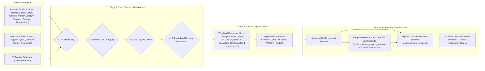

### Mermaid Diagram 6 — Guide, Co-Guide & SME Assignment and Handover Flow

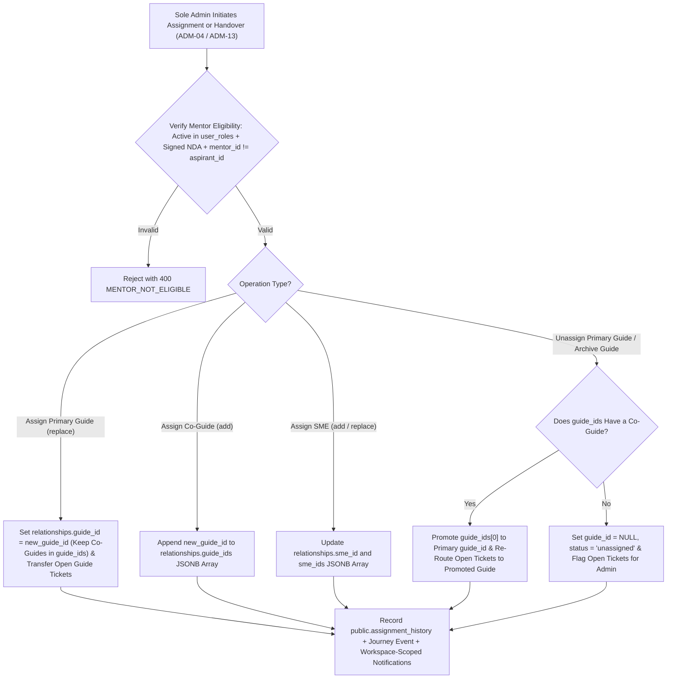

### Mermaid Diagram 7 — Consultation Ticket State Machine (`public.help_requests`)

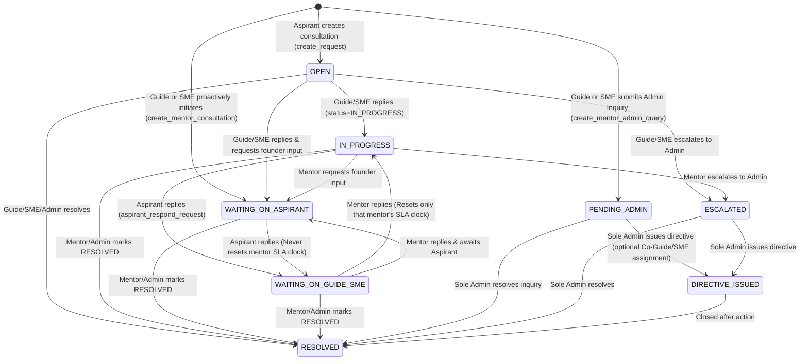

### Mermaid Diagram 8 — Account Lifecycle State Machine (`public.profiles` & `public.account_lifecycle_log`)

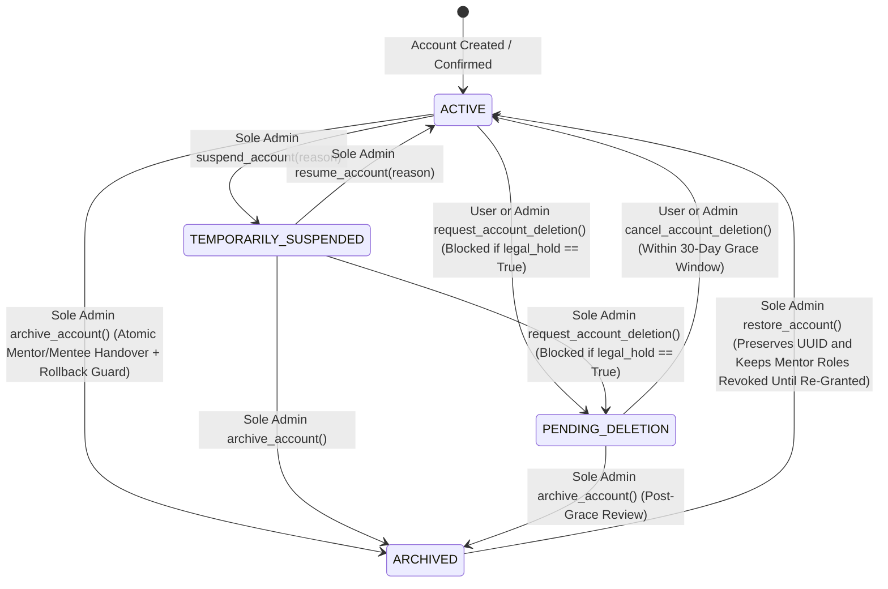

---

## 7. Canonical Status & Enumeration Dictionary

All future client and backend implementations must use these exact uppercase/lowercase database strings so zero data conversion is needed against existing PostgreSQL rows:

| Domain Entity & Column | Exact Allowed Enum Strings in PostgreSQL |
| :--- | :--- |
| **`profiles.role` & `user_roles.role`** | `'aspirant'`, `'guide'`, `'sme'`, `'admin'` |
| **`user_roles.status`** | `'active'`, `'pending_nda'`, `'suspended'`, `'revoked'` |
| **`profiles.account_status`** | `'ACTIVE'`, `'TEMPORARILY_SUSPENDED'`, `'ARCHIVED'`, `'PENDING_DELETION'` (plus runtime fail-closed `'DENIED'`) |
| **`account_lifecycle_log.action`** | `'SUSPEND'`, `'RESUME'`, `'ARCHIVE'`, `'RESTORE'`, `'REQUEST_DELETION'`, `'CANCEL_DELETION'`, `'APPLY_LEGAL_HOLD'`, `'RELEASE_LEGAL_HOLD'` |
| **`legal_documents.doc_type`** | `'terms_and_conditions'`, `'nda_guide'`, `'nda_sme'` |
| **`relationships.status`** | `'active'`, `'unassigned'`, `'completed'`, `'paused'` |
| **`journeys.status`** | `'active'`, `'paused'`, `'completed'` |
| **`help_requests.status` (`011`)** | `'OPEN'`, `'IN_PROGRESS'`, `'WAITING_ON_ASPIRANT'`, `'WAITING_ON_GUIDE_SME'`, `'ACTION_REQUIRED'`, `'REPLIED'`, `'RESOLVED'`, `'ESCALATED'`, `'PENDING_ADMIN'`, `'DIRECTIVE_ISSUED'` |
| **`scheme_releases.status`** | `'released'`, `'withdrawn'` |
| **`scheme_releases.application_stage`** | `'Recommended'`, `'Preparing Application'`, `'Application Submitted'`, `'Under Government Review'`, `'Clarification Requested'`, `'Approved / Sanctioned'`, `'Rejected / Closed'` |
| **`scheme_support_reviews.status`** | `'PENDING'`, `'APPROVED'`, `'REJECTED'` |
| **`guide_complaints.status`** | `'OPEN'`, `'UNDER_REVIEW'`, `'RESOLVED'`, `'DISMISSED'` |
| **`sme_conflict_declarations.status`** | `'CLEARED'`, `'PENDING_REVIEW'`, `'RESOLVED'`, `'APPROVED'`, `'REJECTED'` |
| **`inactivity_logs.escalation_stage`** | `'REMINDER_7D'`, `'ALERT_10D'`, `'ESCALATED_14D'` |
| **`external_contact_logs.status`** | `'DRAFT_OPENED'`, `'SENT_CONFIRMED'`, `'ACKNOWLEDGED'` |

---

# FULCRUM-INDIA — DOCUMENT 2: BACKEND API & INTEGRATION SPECIFICATION

| Document Attribute | Value |
| :--- | :--- |
| **Document ID** | `FULCRUM-API-V2.0` |
| **Filename** | `FULCRUM_BACKEND_API_CONTRACT.md` (Paired with [`FULCRUM_API_OPENAPI.yaml`](./FULCRUM_API_OPENAPI.yaml)) |
| **Baseline Commit** | `235767754f8d8bb4605e819593bb3f370ddeab27` (`2026-11-11`) |
| **Date of Handover Package** | `2026-11-16` |
| **Target Audience** | Backend API Engineers, React Frontend Engineers, Flutter Mobile Engineers, Security Auditors |
| **Implementation Status** | **PROPOSED TARGET API CONTRACT** (Maps 1:1 to Implemented Python `services/*.py` Functions) |

---

## 1. Purpose and Boundary Between Existing Code and Proposed API

The current **FULCRUM-INDIA Beta 2.0.0** application is a monolithic Streamlit server (`app.py`) that invokes Python functions in `services/*.py` directly in-process. **No custom HTTP REST or GraphQL API exists in the current repository.**

To support decoupled **React + TypeScript Web** and **Flutter Android/iOS Mobile** clients while preserving 100% of Fulcrum's institutional governance and existing Python business logic, this document specifies the **Proposed RESTful JSON API (`/api/v1/*`)** and its companion OpenAPI 3.1 contract ([`FULCRUM_API_OPENAPI.yaml`](./FULCRUM_API_OPENAPI.yaml)). Every proposed endpoint wraps an existing, verified Python function in `services/*.py`.

### 1.1 Client-to-Cloud Boundary: When Direct Supabase Access Is Allowed vs. Prohibited

> [!CAUTION]
> **Non-Negotiable Credential Security Rule**: Neither the React web app nor the Flutter mobile app may ever bundle or receive `SUPABASE_SECRET_KEY` (`service_role` key) or `RESEND_API_KEY`. In the current Streamlit baseline, 18 modules in `services/*.py` call `get_supabase_admin_client()` on the server (`SRS Section 7.1`). Therefore, **all business data reads and writes must flow through the protected Fulcrum Backend API (`/api/v1/*`)**, not via direct browser/mobile PostgREST table mutations.

| Operation Category | Direct Client Supabase SDK (`SUPABASE_PUBLISHABLE_KEY` / `anon`) Allowed? | Protected Fulcrum Backend API (`/api/v1/*`) Mandatory? | Technical Rationale |
| :--- | :---: | :---: | :--- |
| **Sign In (`signInWithPassword`) & Token Refresh (`refreshSession`)** | ✅ **Allowed** (or proxied via `/api/v1/auth/*`) | Optional | Standard OAuth2/OIDC JWT issuance by Supabase GoTrue (`/auth/v1/token`). |
| **Sign Out (`signOut`)** | ✅ **Allowed** | Optional | Revokes the caller's own refresh token in GoTrue. |
| **Public Aspirant Signup & Profile Pre-Seeding** | ❌ **Prohibited Direct** | ✅ **Mandatory (`POST /api/v1/auth/signup-aspirant`)** | When `res.session is None` (pending email confirmation), `services/auth.py` L606 uses `get_supabase_admin_client()` to pre-seed `public.profiles` with phone/district and lock `role='aspirant'`. |
| **Password Reset Request & Completion** | ❌ **Prohibited Direct** | ✅ **Mandatory (`POST /api/v1/auth/password-reset/*`)** | Server enforces the Sole Admin self-reset block (`<SOLE_ADMIN_EMAIL>`, `views/login.py` L491) and clears `temp_password_issued`. |
| **Profile, Relationship, Journey, Consultation, Scheme, Complaint & COI Operations** | ❌ **Prohibited Direct** | ✅ **Mandatory (`/api/v1/*`)** | Requires multi-layer Python authorization (`_authorize_mentor_session_role`, `_get_relationship_authorized_ids_supabase`, `check_sme_has_conflict`), deterministic 179-scheme scoring, and cross-user notification/history writes. |
| **Photo Upload, Normalization & Signed URL Generation** | ❌ **Prohibited Direct** | ✅ **Mandatory (`/api/v1/media/*`)** | Requires server-side magic-byte verification, EXIF stripping, Pillow WebP compression (`600x600`/`320x320`), `can_view_aspirant_photo()` NDA+assignment check, and `can_view_professional_photo()` mentor headshot masking. |
| **All 13 Administrator Sections (`ADM-01` to `ADM-13`)** | ❌ **Prohibited Direct** | ✅ **Mandatory (`/api/v1/admin/*`)** | Requires `require_sole_admin()` JWT + session verification, `auth.admin.create_user`, atomic mentor handover, and compensating rollbacks (`_restore_relationship_snapshots`). |

### Mermaid Diagram 1 — Shared Backend API Topology with React Web and Flutter Mobile Clients (`[PROPOSED]`)

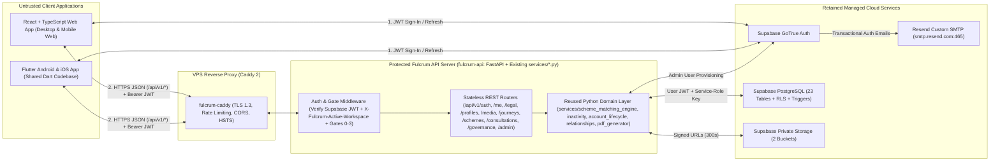

---

## 2. Standard API Conventions, Headers, Pagination & Error Envelope

### 2.1 Required Request Headers
Every authenticated request to `/api/v1/*` must include:
- `Authorization: Bearer <supabase_access_token_jwt>` (Required on all endpoints except public `/api/v1/auth/*`).
- `X-Fulcrum-Active-Workspace: aspirant | guide | sme | admin` (Required on workspace-scoped endpoints; replaces `st.session_state["active_workspace"]` and is validated by server middleware against `public.user_roles`).
- `Idempotency-Key: <uuid-v4>` (Recommended on mutating `POST` requests such as consultation creation, scheme release, and account archival).

### 2.2 Standard JSON Error Envelope
All `4xx` and `5xx` responses return a consistent JSON structure so React and Flutter clients can trigger deterministic UI gates or field errors:

```json
{
  "ok": false,
  "error": {
    "code": "NDA_ACCEPTANCE_REQUIRED",
    "message": "You must review and sign the Guide Non-Disclosure Agreement before accessing this workspace.",
    "gate_required": "NDA_GUIDE",
    "details": {
      "workspace": "guide",
      "doc_type": "nda_guide",
      "doc_version": "1.0.0"
    }
  },
  "request_id": "req_01JCXX89A2B3C4D5E6"
}
```

### 2.3 Canonical Gate Error Codes (`HTTP 403`)
| Error `code` | Trigger Condition | Required Client Action |
| :--- | :--- | :--- |
| `EMAIL_NOT_CONFIRMED` | User signed up (`res.session is None`) and has not clicked email verification link. | Show unconfirmed notice, Spam-folder reminder, and **"Resend Confirmation Email"** button (`POST /api/v1/auth/resend-confirmation`). |
| `ACCOUNT_BLOCKED` | `account_status` in `('DENIED', 'TEMPORARILY_SUSPENDED', 'ARCHIVED')`. | Render `SCR-03` Barrier Screen with `lifecycle_reason` and Sign Out button. |
| `PENDING_DELETION_READ_ONLY` | Mutating action attempted while `account_status == 'PENDING_DELETION'`. | Show 30-day grace banner (`SCR-04`) and allow only `POST /api/v1/accounts/me/cancel-deletion`. |
| `PASSWORD_CHANGE_REQUIRED` | `profile_data.temp_password_issued == True`. | Redirect to `SCR-05` Forced First-Login Password Rotation screen (`POST /api/v1/auth/first-login-password`). |
| `TERMS_ACCEPTANCE_REQUIRED` | `check_user_terms_accepted(user_id) == False`. | Redirect to `SCR-06` Terms of Service Gate (`POST /api/v1/legal/acceptances`). |
| `NDA_ACCEPTANCE_REQUIRED` | `X-Fulcrum-Active-Workspace` is `guide` or `sme` and `user_roles.status == 'pending_nda'`. | Redirect to `SCR-07` Role NDA Gate (`POST /api/v1/legal/acceptances`). |
| `ROLE_NOT_AUTHORIZED` | Requested workspace role was revoked or suspended (`user_roles.status in ('revoked','suspended')`). | Immediately evict that workspace from client state and switch to default available workspace (`BR-ROLE-001`). |
| `SME_COI_LOCKED` | SME attempts to reply to a consultation while `check_sme_has_conflict(sme_id, aspirant_id) == True`. | Disable reply form and display active COI recusal lock banner (`BR-CMP-001`). |

---

## 3. Complete Proposed Endpoint Catalogue (`/api/v1/*`)

| # | Method & Path (`[PROPOSED]`) | Wrapped Baseline Function (`services/*.py`) | Authorized Roles | Rate Limit | Idempotency / Concurrency | Mapped Reqs |
| :-: | :--- | :--- | :--- | :--- | :--- | :--- |
| **1** | `POST /api/v1/auth/signup-aspirant` | `auth.py::signup_aspirant` (L521–L672) | Public | `5 / 15m / IP` | Unique `email` in `auth.users` | `FR-AUTH-001`, `BR-ONB-001` |
| **2** | `POST /api/v1/auth/resend-confirmation` | `client.auth.resend(type='signup')` (`PROP-01` / `DEF-002`) | Public | `3 / 15m / Email` | Supabase GoTrue rate limit | `SEC-CONF-002`, `DEF-002` |
| **3** | `POST /api/v1/auth/password-reset/request` | `auth.py::send_password_reset` (L674–L708) | Public (Blocks Admin) | `3 / 15m / Email` | Ephemeral client isolation | `FR-AUTH-003`, `SEC-PWD-003` |
| **4** | `POST /api/v1/auth/password-reset/complete` | `auth.py::verify_recovery_*` & `complete_password_reset` (L711–L877) | Recovery Token Bearer | `5 / 15m / IP` | Single-use recovery token | `FR-AUTH-003`, `SEC-PWD-002` |
| **5** | `POST /api/v1/auth/first-login-password` | `auth.py::complete_first_login_password_change` (L880–L995) | Guide, SME (`temp_password_issued=True`) | `10 / 15m / User` | Clears `temp_password_issued` | `FR-AUTH-004`, `BR-ONB-002` |
| **6** | `GET /api/v1/me/bootstrap` | `app.py` L841–L1037 (`get_account_status`, `get_user_roles`, `check_user_terms_accepted`, `get_unread_count`) | All Authenticated | `120 / min / User` | Read-only (5s session cache) | `FR-ROLE-001`, `BR-LIFE-001` |
| **7** | `GET /api/v1/legal/documents/{doc_type}` | `legal.py::get_active_legal_document` (L246–L279) | All Authenticated | `60 / min / User` | Returns version + SHA-256 hash | `FR-LEGAL-001`, `BR-LEGAL-001` |
| **8** | `POST /api/v1/legal/acceptances` | `legal.py::record_legal_acceptance` (L360–L460) + `roles.py::activate_role` | Aspirant, Guide, SME | `10 / min / User` | Captures real `X-Forwarded-For` IP | `FR-LEGAL-001`, `BR-LEGAL-002` |
| **9** | `GET /api/v1/profiles/aspirants/{aspirant_id}` | `profiles.py::get_profile` (L132–L237) + `relationships.py::get_aspirant_mentors` | Owner `A`, Assigned `G`/`S`, `Admin` | `60 / min / User` | Relationship-scoped check | `FR-ASP-001`, `SEC-ISO-001` |
| **10** | `PUT /api/v1/profiles/aspirants/{aspirant_id}` | `profiles.py::update_aspirant_profile` (L541–L692) | Owner `A`, `Admin` | `20 / min / User` | Preserves `profile_data['mentor']` (`DEF-32-006`) | `FR-ASP-001` |
| **11** | `PUT /api/v1/profiles/mentors/{mentor_id}` | `profiles.py::update_mentor_profile` (L694–L766) | Self `G`/`S`, `Admin` | `20 / min / User` | Preserves `profile_data['business']` | `FR-GUIDE-001`, `FR-SME-001` |
| **12** | `POST /api/v1/media/aspirant-photo/{aspirant_id}` | `aspirant_photos.py::upload_aspirant_photo` (L375–L542) | Owner `A`, `Admin` | `10 / min / User` | Multipart `<=5MB` -> `600x600` WebP `<=180KB` | `FR-ASP-002`, `SEC-FILE-001` |
| **13** | `GET /api/v1/media/aspirant-photo/{aspirant_id}` | `aspirant_photos.py::get_aspirant_photo` (L232–L313) | Owner `A`, Assigned `G`/`S` (NDA), `Admin` | `60 / min / User` | Returns 300s `signed_url` | `FR-ASP-002`, `SEC-STOR-002` |
| **14** | `DELETE /api/v1/media/aspirant-photo/{aspirant_id}` | `aspirant_photos.py::delete_aspirant_photo` (L545–L595) | Owner `A`, `Admin` | `10 / min / User` | Deletes storage object + DB row | `FR-ASP-002` |
| **15** | `POST /api/v1/media/professional-photo/{mentor_id}` | `professional_photos.py::upload_professional_photo` (L199–L324) | Self `G`/`S`, `Admin` | `10 / min / User` | Multipart `<=5MB` -> `320x320` WebP `<=150KB` | `FR-SME-002`, `SEC-STOR-003` |
| **16** | `GET /api/v1/media/professional-photo/{mentor_id}` | `professional_photos.py::get_professional_photo_url` (L388–L455) | Self `G`/`S`, `Admin` (Masked from `A`) | `60 / min / User` | Returns 300s `signed_url` | `FR-SME-002`, `SEC-STOR-003` |
| **17** | `GET /api/v1/journeys/{aspirant_id}` | `journey.py::get_journey_timeline` (L156–L242) | Owner `A`, Assigned `G`/`S`, `Admin` | `60 / min / User` | Sorted chronologically + revisions | `FR-JRN-001` |
| **18** | `POST /api/v1/journeys/{aspirant_id}/events` | `journey.py::add_manual_aspirant_entry` / `add_guide_contribution` / `add_sme_contribution` / `add_admin_journey_entry` | Owner `A`, Assigned `G`/`S`, `Admin` | `30 / min / User` | Resets mentor SLA clock if `G`/`S` | `FR-JRN-001`, `FR-GUIDE-001`, `FR-SME-001` |
| **19** | `PATCH /api/v1/journeys/events/{event_id}` | `journey.py::update_journey_event` (L883–L1113) & `toggle_event_roadmap_inclusion` | Event Author (`actor_id`) or `Admin` | `30 / min / User` | Optimistic lock `expected_updated_at` + inserts `journey_event_revisions` | `FR-JRN-001`, `BR-JRN-001` |
| **20** | `POST /api/v1/journeys/{aspirant_id}/complete` | `journey.py::mark_journey_completed` (L1116–L1191) | Assigned `G`, `Admin` | `10 / min / User` | Sets `journeys.status='completed'` | `FR-GUIDE-001` |
| **21** | `GET /api/v1/reports/aspirants/{aspirant_id}/dossier-pdf` | `pdf_generator.py::generate_aspirant_dossier_pdf` (L793–L822) | Owner `A`, Assigned `G`, `Admin` | `5 / min / User` | `BoundedSemaphore(2)` subprocess PDF stream (`application/pdf`) | `FR-ASP-003`, `NFR-CAP-003` |
| **22** | `POST /api/v1/schemes/match/{aspirant_id}` | `schemes.py::match_schemes_for_aspirant` (L267–L326) | Assigned `G`, `Admin` (Never raw to `A`) | `30 / min / User` | Deterministic 3-stage evaluation over 179 schemes | `FR-SCH-001`, `BR-SCH-001` |
| **23** | `GET /api/v1/schemes/releases/{aspirant_id}` | `schemes.py::get_released_schemes_for_aspirant` (L622–L729) | Owner `A`, Assigned `G`, `Admin` | `60 / min / User` | Returns only `status='released'` rows | `FR-GUIDE-002`, `SCR-12` |
| **24** | `POST /api/v1/schemes/releases/{aspirant_id}` | `schemes.py::release_scheme_to_aspirant` (L401–L542) | Assigned `G`, `Admin` | `20 / min / User` | Blocks disqualified unless SSR approved (`UNIQUE(aspirant_id,scheme_id)`) | `FR-GUIDE-002`, `BR-SCH-001` |
| **25** | `PATCH /api/v1/schemes/releases/{aspirant_id}/{scheme_id}` | `schemes.py::update_scheme_application_stage` (L756–L876) & `withdraw_scheme_release` | Owner `A` (stage), Assigned `G` (stage/withdraw), `Admin` | `30 / min / User` | Updates 7-stage tracker | `FR-GUIDE-002`, `SCR-12` |
| **26** | `POST /api/v1/schemes/support-reviews` | `scheme_reviews.py::submit_scheme_support_review` (L18–L99) | Assigned `G` | `15 / min / User` | `UNIQUE(aspirant_id,scheme_id,guide_id)` | `FR-GUIDE-002`, `FR-ADMIN-005` |
| **27** | `GET /api/v1/consultations` | `help_requests.py::list_requests` / `list_guide_requests` / `list_sme_requests` | `A`, `G`, `S`, `Admin` | `60 / min / User` | Scoped to active workspace & assignments | `FR-CONS-001` |
| **28** | `POST /api/v1/consultations` | `help_requests.py::create_request` (L184–L362) & `create_mentor_consultation` (L1163–L1267) | `A`, Assigned `G`/`S` | `20 / min / User` | Blocked in `PENDING_DELETION` (`VULN-07`) | `FR-CONS-001` |
| **29** | `POST /api/v1/consultations/{request_id}/reply` | `help_requests.py::guide_respond_request` / `sme_respond_request` / `aspirant_respond_request` | Owner `A`, Assigned `G`/`S` (No COI), `Admin` | `30 / min / User` | Updates `last_interaction_actor_*` & mentor/aspirant timestamps | `FR-CONS-001`, `BR-CONS-001` |
| **30** | `POST /api/v1/consultations/mentor-inquiries` | `help_requests.py::create_mentor_admin_query` (L907–L998) | Assigned `G`/`S` | `15 / min / User` | Creates `PENDING_ADMIN` inquiry | `FR-ADMIN-005` |
| **31** | `GET & POST /api/v1/cases/{aspirant_id}/discussions` | `collaboration.py::list_case_messages` & `create_case_message` (L18–L237) | Owner `A` (public only), Assigned `G`/`S`, `Admin` | `30 / min / User` | Strips `is_private_mentor_note=True` when workspace=`aspirant` | `FR-CONS-001`, `SEC-ISO-002` |
| **32** | `GET & POST /api/v1/governance/complaints` | `governance.py::submit_guide_complaint` & `list_aspirant_complaints` (L63–L163) | `A` (Submit/Read Own), `Admin` (Hidden from `G`) | `10 / min / User` | Requires `details >= 15` chars | `FR-CMP-001`, `BR-CMP-001` |
| **33** | `GET & POST /api/v1/governance/sme-conflicts` | `governance.py::declare_sme_conflict` & `list_sme_conflicts` (L228–L359) | Assigned `S`, `Admin` | `15 / min / User` | `has_conflict=True` locks SME consultation replies | `FR-CMP-001`, `BR-CMP-001` |
| **34** | `GET & PATCH /api/v1/notifications` | `notifications.py::list_notifications`, `mark_as_read`, `mark_all_as_read` | All Authenticated | `60 / min / User` | Filtered by `X-Fulcrum-Active-Workspace` (`DEF-32-010`) | `FR-NOTIF-001` |
| **35** | `POST /api/v1/accounts/me/deletion-request` & `cancel-deletion` | `account_lifecycle.py::request_account_deletion` & `cancel_account_deletion` | `A`, `G`, `S` | `5 / min / User` | Blocked if `legal_hold == True`; 30-day grace window | `FR-ADMIN-013`, `BR-LIFE-001` |
| **36** | `ALL /api/v1/admin/*` (13 Admin Sections `ADM-01`..`ADM-13`) | `admin_metrics.py`, `auth.py::admin_create_mentor`, `relationships.py`, `help_requests.py::admin_respond_to_mentor`, `scheme_reviews.py::decide_scheme_support_review`, `schemes.py`, `roles.py`, `governance.py`, `inactivity.py`, `external_contact.py`, `account_lifecycle.py` | **Sole Admin Only (`<SOLE_ADMIN_EMAIL>`)** | `120 / min / Admin` | Enforces `require_sole_admin()` + atomic handover rollback | `FR-ADMIN-001` to `FR-ADMIN-013` |

---

## 4. Detailed Sequence Diagram & Fictional JSON Payload Examples

### Mermaid Diagram 2 — API Request Sequence: Authentication, Bootstrap, Guide Scheme Release & Aspirant Stage Update (`[PROPOSED]`)

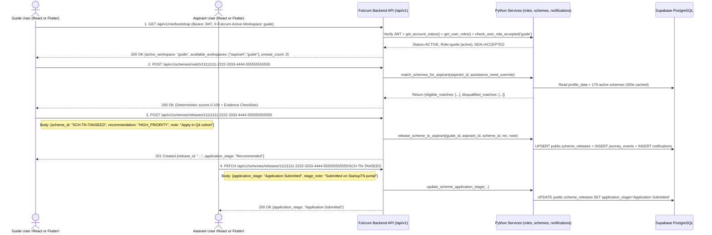

### 4.1 Example 1 — `GET /api/v1/me/bootstrap` Response (Hybrid `Aspirant + Guide` User)
```json
{
  "ok": true,
  "data": {
    "user": {
      "id": "a1b2c3d4-0000-4000-8000-000000000001",
      "email": "founder.anitha@example.in",
      "full_name": "Anitha Rajan",
      "district": "Coimbatore",
      "state": "Tamil Nadu"
    },
    "account_lifecycle": {
      "account_status": "ACTIVE",
      "is_active": true,
      "legal_hold": false,
      "deletion_scheduled_for": null,
      "lifecycle_reason": null
    },
    "gates": {
      "password_change_required": false,
      "terms_acceptance_required": false,
      "nda_acceptance_required": {
        "guide": false,
        "sme": false
      }
    },
    "roles": {
      "is_sole_admin": false,
      "active_workspace": "guide",
      "available_workspaces": [
        { "role": "aspirant", "label": "Aspirant Dashboard", "status": "active", "nda_signed": true },
        { "role": "guide", "label": "Guide Dashboard", "status": "active", "nda_signed": true }
      ]
    },
    "notifications": {
      "unread_workspace_count": 3,
      "unread_total_count": 5
    }
  }
}
```

### 4.2 Example 2 — `POST /api/v1/schemes/match/{aspirant_id}` Response (Guide Workspace)
```json
{
  "ok": true,
  "data": {
    "aspirant_id": "f0000001-0000-4000-8000-000000000099",
    "profile_completion_pct": 85,
    "assistance_need_evaluated": {
      "goal": "Capital Grant / Seed Subsidy",
      "support_type": "Innovation Grant (TANSEED / IVP)",
      "quantum_range": "SMALL (Rs.5 Lakhs - Rs.25 Lakhs)",
      "timeframe": "NEAR_TERM (1 to 3 Months)"
    },
    "eligible_matches": [
      {
        "scheme_id": "SCH_TANSEED_01",
        "name": "TANSEED (Tamil Nadu Startup Seed Grant Fund)",
        "agency": "StartupTN",
        "funding_type": "Grant",
        "amount": "Up to Rs.15 Lakhs",
        "match_score": 92,
        "is_eligible": true,
        "disqualifications": [],
        "warnings": [],
        "match_reasons": [
          "Exact sector alignment: Food Processing & Agribusiness",
          "Stage fit: Pre-Seed / Seed",
          "Tamil Nadu registered enterprise with StartupTN recognition"
        ],
        "evidence_checklist": [
          { "criterion": "Tamil Nadu State Registration", "status": "MET", "detail": "District: Madurai, Tamil Nadu" },
          { "criterion": "StartupTN Portal Registration", "status": "MET", "detail": "Declared registered in profile" }
        ],
        "release_status": "unreleased"
      }
    ],
    "disqualified_matches": [
      {
        "scheme_id": "SCH_ISRO_INSPACE_01",
        "name": "IN-SPACe Seed Fund for Space Tech",
        "agency": "IN-SPACe / ISRO",
        "match_score": 15,
        "is_eligible": false,
        "disqualifications": [
          "Domain Exclusion: Isro specialized scheme - applicant's enterprise (Food Processing & Agribusiness) is outside this domain."
        ],
        "can_request_ssr_override": true
      }
    ]
  }
}
```

### 4.3 Example 3 — `POST /api/v1/admin/accounts/{user_id}/archive` Request & Response (Sole Admin Tab 13)
```json
// Request
{
  "reason": "Mentor completed annual fellowship term; archiving account after caseload handover.",
  "confirm_handover": true
}

// Response (200 OK)
{
  "ok": true,
  "data": {
    "user_id": "g0000002-0000-4000-8000-000000000022",
    "previous_status": "ACTIVE",
    "new_status": "ARCHIVED",
    "handover_summary": {
      "guides_unassigned_or_promoted": 2,
      "smes_unassigned": 0,
      "open_tickets_transferred": 3
    },
    "lifecycle_log_id": "log_99887766-5544-3322-1100-aabbccddeeff"
  }
}
```

---

# FULCRUM-INDIA — DOCUMENT 3: DATABASE & DATA MIGRATION SPECIFICATION

| Document Attribute | Value |
| :--- | :--- |
| **Document ID** | `FULCRUM-DMC-V2.0` |
| **Filename** | `FULCRUM_DATABASE_MIGRATION_CONTRACT.md` |
| **Baseline Commit** | `235767754f8d8bb4605e819593bb3f370ddeab27` (`2026-11-11`) |
| **Date of Handover Package** | `2026-11-16` |
| **Target Audience** | Database Architects, Backend Engineers, DevOps / SRE, Security Auditors |
| **Core Database Strategy** | **Retain Existing Supabase PostgreSQL, GoTrue Auth & Private Storage Buckets In-Place (Zero Destructive Drops)** |

---

## 1. Strategic Principle: Retain the Existing Supabase Database In-Place

The existing **FULCRUM-INDIA Beta 2.0.0** persistence tier on **Supabase PostgreSQL (`public` schema), Supabase GoTrue (`auth.users`), and Supabase Private Storage (`storage.buckets` / `storage.objects`)** is already normalized, indexed, and protected by Row Level Security (RLS) and database triggers (`migrations/000` through `011`).

> [!IMPORTANT]
> **No Destructive Database Migration Needed**: Rebuilding the user interface in **React + TypeScript** or **Flutter Android/iOS** does **not** require dropping, recreating, or migrating off the existing Supabase PostgreSQL database. Both the existing Streamlit application and the new Backend API + React/Flutter clients can connect to the **exact same Supabase database**, allowing:
> 1. **Zero User Re-Registration**: All existing `auth.users` password hashes (`bcrypt`), confirmed email timestamps, and UUIDs remain 100% valid. Existing Aspirants, Guides, SMEs, and the Sole Administrator sign into the new React and Flutter apps with their existing email and password.
> 2. **Zero Historical Data Loss**: All `profiles`, `user_roles`, `legal_acceptances`, `relationships`, `assignment_history`, `journeys`, `journey_events`, `journey_event_revisions`, `help_requests`, `case_discussions`, `schemes` (179), `scheme_releases`, `scheme_support_reviews`, `guide_complaints`, `sme_conflict_declarations`, `inactivity_logs`, `external_contact_logs`, `aspirant_photos`, `professional_photos`, and `account_lifecycle_log` rows remain intact.
> 3. **Parallel Coexistence During Cutover**: The legacy Streamlit container (`fulcrum-app`) and the new API/React/Flutter stack can run side-by-side against the same database during phased UAT.

---

## 2. Complete Existing Schema Inventory & Entity Relationship Diagram (`23` Public Tables)

### Mermaid Diagram 1 — Complete PostgreSQL Entity Relationship Diagram (`migrations/000`–`011`)

```mermaid
erDiagram
    AUTH_USERS ||--|| PROFILES : "id (ON DELETE RESTRICT)"
    PROFILES ||--o{ USER_ROLES : "user_id"
    PROFILES ||--o{ LEGAL_ACCEPTANCES : "user_id"
    LEGAL_DOCUMENTS ||--o{ LEGAL_ACCEPTANCES : "doc_type"
    PROFILES ||--o| ASPIRANT_PHOTOS : "user_id"
    PROFILES ||--o| PROFESSIONAL_PHOTOS : "user_id"
    PROFILES ||--o{ ACCOUNT_LIFECYCLE_LOG : "user_id"
    PROFILES ||--o| RELATIONSHIPS : "aspirant_id"
    PROFILES ||--o{ RELATIONSHIPS : "guide_id / sme_id"
    PROFILES ||--o{ ASSIGNMENT_HISTORY : "aspirant_id / mentor_id"
    PROFILES ||--o| JOURNEYS : "aspirant_id"
    JOURNEYS ||--o{ JOURNEY_EVENTS : "journey_id"
    JOURNEY_EVENTS ||--o{ JOURNEY_EVENT_REVISIONS : "journey_event_id"
    PROFILES ||--o{ HELP_REQUESTS : "aspirant_id"
    PROFILES ||--o{ CASE_DISCUSSIONS : "aspirant_id"
    SCHEMES ||--o{ SCHEME_RELEASES : "scheme_id"
    PROFILES ||--o{ SCHEME_RELEASES : "aspirant_id / guide_id"
    SCHEMES ||--o{ SCHEME_SUPPORT_REVIEWS : "scheme_id"
    PROFILES ||--o{ SCHEME_SUPPORT_REVIEWS : "aspirant_id / guide_id"
    PROFILES ||--o{ GUIDE_COMPLAINTS : "aspirant_id / guide_id"
    PROFILES ||--o{ SME_CONFLICT_DECLARATIONS : "sme_id / aspirant_id"
    RELATIONSHIPS ||--o{ INACTIVITY_LOGS : "relationship_id"
    INACTIVITY_LOGS ||--o{ EXTERNAL_CONTACT_LOGS : "inactivity_record_id"
    PROFILES ||--o{ NOTIFICATIONS : "user_id"
    PROFILES ||--o{ ACTIVITY_LOG : "user_id"

    PROFILES {
        uuid id PK
        text email UK
        text full_name
        text phone
        text role
        text district
        text state
        jsonb profile_data
        bool is_active
        text account_status
        bool legal_hold
        text lifecycle_reason
        timestamptz deletion_scheduled_for
    }
    USER_ROLES {
        uuid id PK
        uuid user_id FK
        text role
        text status
        bool nda_accepted
    }
    LEGAL_ACCEPTANCES {
        uuid id PK
        uuid user_id FK
        text doc_type
        text doc_version
        text document_hash
        text typed_name
        text typed_phrase
        timestamptz accepted_at
    }
    RELATIONSHIPS {
        uuid id PK
        uuid aspirant_id FK
        uuid guide_id FK
        uuid sme_id FK
        jsonb guide_ids
        jsonb sme_ids
        text status
    }
    JOURNEYS {
        uuid id PK
        uuid aspirant_id FK
        text title
        text status
    }
    JOURNEY_EVENTS {
        uuid id PK
        uuid journey_id FK
        uuid aspirant_id FK
        uuid actor_id FK
        text actor_role
        text event_type
        text title
        date event_date
        bool included_in_roadmap
    }
    JOURNEY_EVENT_REVISIONS {
        uuid id PK
        uuid journey_event_id FK
        uuid editor_id FK
        text previous_title
        text previous_description
        text change_reason
    }
    HELP_REQUESTS {
        uuid id PK
        uuid aspirant_id FK
        uuid assigned_guide_id FK
        uuid assigned_sme_id FK
        text status
        text request_type
        uuid last_interaction_actor_id
        text last_interaction_actor_role
        timestamptz last_mentor_response_at
    }
    SCHEMES {
        text id PK
        text name
        text agency
        text funding_type
        text stage
        jsonb sectors
        text state_scope
        bool is_active
    }
    SCHEME_RELEASES {
        uuid id PK
        uuid aspirant_id FK
        text scheme_id FK
        uuid guide_id FK
        text status
        text application_stage
    }
    SCHEME_SUPPORT_REVIEWS {
        uuid id PK
        uuid aspirant_id FK
        text scheme_id FK
        uuid guide_id FK
        int match_score
        text status
    }
    INACTIVITY_LOGS {
        uuid id PK
        uuid relationship_id FK
        uuid mentor_id FK
        uuid aspirant_id FK
        text mentor_role
        text escalation_stage
        text inactivity_episode
        text status
    }
    EXTERNAL_CONTACT_LOGS {
        uuid id PK
        uuid admin_id FK
        uuid recipient_id FK
        uuid aspirant_id FK
        text channel
        text status
    }
    ACCOUNT_LIFECYCLE_LOG {
        uuid id PK
        uuid user_id
        uuid actor_id
        text action
        text previous_status
        text new_status
        text reason
    }
```

### 2.1 Complete Table-by-Table Preservation & Constraint Specification

*(For full column definitions, see [`FULCRUM_SRS_V2.md`](../07_REQUIREMENTS_BASELINE_V2/FULCRUM_SRS_V2.md) Section 9.1.)*

| Table / Bucket | Key Integrity Constraints & Triggers to Preserve | Role in Future React & Flutter Architecture |
| :--- | :--- | :--- |
| `auth.users` | Managed by Supabase GoTrue; trigger `on_auth_user_created` calls `public.handle_new_user()` (`migrations/008` L45–L70). | Unchanged. Existing users log into React and Flutter with their current credentials. |
| `public.profiles` | `id UUID PK REFERENCES auth.users(id) ON DELETE RESTRICT` (`009` L170); `check_account_status_valid` (`ACTIVE`,`TEMPORARILY_SUSPENDED`,`ARCHIVED`,`PENDING_DELETION`); trigger `trg_enforce_single_admin_profile` (`008` L94). | Unchanged. Stores 4-part `profile_data` JSONB (`personal`, `professional`, `business`, `demographics`, `assistance_need`, `mentor`, `temp_password_issued`). |
| `public.user_roles` | `UNIQUE(user_id, role)`; `status IN ('active','pending_nda','suspended','revoked')`; trigger `trg_enforce_single_admin_user_roles` (`008` L115). | Unchanged. Source of truth for the 7 non-admin role combinations and workspace switching. |
| `public.legal_documents` & `public.legal_acceptances` | `doc_type IN ('terms_and_conditions','nda_guide','nda_sme')`; stores SHA-256 `document_hash`, `typed_name`, `typed_phrase`. | Unchanged. New Backend API populates `ip_address` and `user_agent` from real HTTP request headers (`resolving DEF-008`). |
| `public.relationships` & `public.assignment_history` | `aspirant_id UUID UNIQUE`; `guide_id`, `sme_id`, plus JSONB arrays `guide_ids` (Co-Guides) and `sme_ids` (Multi-SME). | Unchanged. Enforces primary + co-mentor caseloads and handover history. |
| `public.journeys`, `public.journey_events` & `public.journey_event_revisions` | `aspirant_id UUID UNIQUE` on `journeys`; `included_in_roadmap BOOL` on `journey_events`; append-only revision snapshots in `journey_event_revisions` (`002`). | Unchanged. Powers the chronological Enterprise Journey and PDF dossier export. |
| `public.help_requests` & `public.case_discussions` | `help_requests_status_check` (`011` L17–L28: 10 statuses); actor attribution columns (`004`); `is_private_mentor_note BOOL` on `case_discussions`. | Unchanged. Powers consultations, mentor-to-admin inquiries, and private mentor collaboration notes. |
| `public.schemes`, `public.scheme_releases` & `public.scheme_support_reviews` | `179` canonical rows in `schemes`; `UNIQUE(aspirant_id, scheme_id)` and `application_stage` (`008`) on `scheme_releases`; `UNIQUE(aspirant_id, scheme_id, guide_id)` on `scheme_support_reviews` (`004`). | Unchanged. Powers deterministic matching, Guide releases, 7-stage tracking, and Admin SSR overrides. |
| `public.guide_complaints` & `public.sme_conflict_declarations` | RLS hides `guide_complaints` from Guides; `UNIQUE(sme_id, aspirant_id)` on `sme_conflict_declarations`. | Unchanged. Powers confidential grievances and SME COI recusal locks. |
| `public.inactivity_logs` & `public.external_contact_logs` | Unique index `uq_inactivity_episode_stage(mentor_id, aspirant_id, mentor_role, inactivity_episode, escalation_stage)` (`006` L43). | Unchanged. Powers 7/10/14-day SLA monitoring and WhatsApp/Gmail outreach auditing. |
| `public.aspirant_photos`, `public.professional_photos` & Storage Buckets | Private buckets `aspirant-profile-photos` (`003`,`005`) and `professional-headshots` (`008`: `CHECK width=320 AND height=320 AND byte_size<=153600`). | Unchanged. Served exclusively via 300-second signed URLs from the Backend API. |
| `public.account_lifecycle_log` | Triple-layer append-only immutability (`REVOKE UPDATE, DELETE`, `AS RESTRICTIVE USING (FALSE)` RLS, and `trg_immutable_account_lifecycle_log` in `009` L211–L286). | Unchanged. Permanent institutional lifecycle audit trail. |
| `public.notifications` & `public.activity_log` | Indexed by `(user_id, is_read)` and `created_at DESC`. | Unchanged. Powers workspace-filtered notification feeds across Web and Mobile. |

---

## 3. Proposed Additive Migration `012` for Mobile & API Support (`[PROPOSED]`)

While all 23 existing tables work without modification, adding a **100% additive, non-breaking Migration `012`** is recommended when launching the Backend API and Flutter mobile apps to support:
1. **Mobile Push Notification Device Tokens (`public.user_device_tokens`)**: Optional FCM/APNs token registration if native push notifications are enabled alongside in-app notifications.
2. **API Request Idempotency Keys (`public.api_idempotency_keys`)**: Prevents duplicate mutations if a mobile client retries a `POST` request over an unstable cellular connection.

```sql
-- =============================================================================
-- PROPOSED MIGRATION 012: MOBILE DEVICE TOKENS & API IDEMPOTENCY KEYS (ADDITIVE)
-- =============================================================================
-- Status: PROPOSED (Do not execute until Backend API & Flutter phase is approved)

CREATE TABLE IF NOT EXISTS public.user_device_tokens (
    id UUID PRIMARY KEY DEFAULT gen_random_uuid(),
    user_id UUID NOT NULL REFERENCES public.profiles(id) ON DELETE CASCADE,
    platform TEXT NOT NULL CHECK (platform IN ('android', 'ios', 'web')),
    push_token TEXT NOT NULL,
    active_workspace TEXT DEFAULT 'aspirant',
    last_seen_at TIMESTAMPTZ DEFAULT NOW(),
    created_at TIMESTAMPTZ DEFAULT NOW(),
    CONSTRAINT uq_user_device_token UNIQUE (user_id, push_token)
);

ALTER TABLE public.user_device_tokens ENABLE ROW LEVEL SECURITY;

CREATE POLICY "Users manage own device tokens" ON public.user_device_tokens
    FOR ALL TO authenticated
    USING (user_id = auth.uid())
    WITH CHECK (user_id = auth.uid());

CREATE TABLE IF NOT EXISTS public.api_idempotency_keys (
    idempotency_key TEXT PRIMARY KEY,
    user_id UUID NOT NULL REFERENCES public.profiles(id) ON DELETE CASCADE,
    endpoint_path TEXT NOT NULL,
    response_status INTEGER NOT NULL,
    response_body JSONB NOT NULL,
    created_at TIMESTAMPTZ DEFAULT NOW()
);

ALTER TABLE public.api_idempotency_keys ENABLE ROW LEVEL SECURITY;

CREATE POLICY "Admin full access api_idempotency_keys" ON public.api_idempotency_keys
    FOR ALL TO authenticated
    USING (public.is_admin());
```

---

## 4. Schema Verification, Backup, Rollback & Zero-Downtime Cutover Strategy

### Mermaid Diagram 2 — Database Verification, Coexistence & Rollback Pipeline

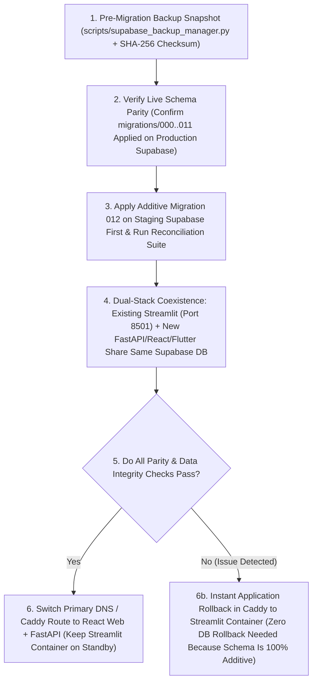

### 4.1 Data Reconciliation & Migration Test Cases

| Test ID | Migration Verification Objective | Verification Query / Script | Acceptance Criterion |
| :--- | :--- | :--- | :--- |
| **`MIG-TC-01`** | **Pre-Cutover Row-Count & Checksum Baseline** | Run `python scripts/supabase_backup_manager.py` and record row counts for all 23 `public` tables + `auth.users`. | 100% of tables exported with verified SHA-256 manifest in `backups/`. |
| **`MIG-TC-02`** | **Live Constraint & Trigger Verification (`008`–`011`)** | Query `information_schema.triggers` and `pg_constraint` for `trg_enforce_single_admin_profile`, `trg_enforce_single_admin_user_roles`, `trg_immutable_account_lifecycle_log`, `profiles_id_fkey` (`RESTRICT`), and `help_requests_status_check`. | All 3 triggers and constraints active in production PostgreSQL (`DEC-002`). |
| **`MIG-TC-03`** | **Existing User Zero-Re-Registration Login Test** | Log into the new React Web and Flutter Mobile apps using an existing pre-migration Aspirant, Guide, SME, and Sole Admin account. | `signInWithPassword` succeeds, `GET /api/v1/me/bootstrap` resolves identical roles, and all historical Journey events, consultations, and released schemes render identically. |
| **`MIG-TC-04`** | **Cross-Stack Write Compatibility Test** | Create a consultation reply in React/Flutter and view it in the standby Streamlit app (and vice versa). | Both stacks read and write identical column formats and enum strings with zero schema errors. |

---

# FULCRUM-INDIA — DOCUMENT 4: SHARED UI/UX DESIGN SYSTEM & SCREEN CONTRACT

| Document Attribute | Value |
| :--- | :--- |
| **Document ID** | `FULCRUM-UXD-V2.0` |
| **Filename** | `FULCRUM_UI_UX_DESIGN_SYSTEM.md` |
| **Baseline Commit** | `235767754f8d8bb4605e819593bb3f370ddeab27` (`2026-11-11`) |
| **Date of Handover Package** | `2026-11-16` |
| **Target Audience** | UI/UX Designers, React Frontend Engineers, Flutter Mobile Engineers, QA Lead |
| **Design Direction** | Clean White/Light Institutional Workspace (`#F8FAFC`/`#FFFFFF`), Authoritative Blue Palette (`#2563EB`), `Avenir Next` / `Avenir` / `Inter` Typography |

---

## 1. Design Philosophy & Usability Principles

Fulcrum's user interface must project **institutional trust, clarity, and executive readability** across web (React) and mobile (Flutter Android/iOS). Future implementations must maintain **100% functional parity** with the 30 baseline screens (`SCR-01` to `SCR-30`), while eliminating Streamlit-specific layout constraints (such as full-script page reruns, nested expander jitter, and non-ARIA markdown cards).

### Core Usability Principles Applied
1. **Consistency & Role Recognition**: The user's active workspace (`Aspirant`, `Guide`, `SME`, or `Admin`) is always visibly anchored in the navigation header/drawer with a distinct role-accent badge so multi-role participants never confuse which hat they are wearing (`DEF-32-010`).
2. **Progressive Disclosure**: Complex workflows—such as the 4-part Aspirant profile, the 179-scheme matcher, and the 13-tab Admin Control Tower—use structured steppers, segmented tabs, and slide-over drawers/modals rather than wall-of-text forms.
3. **Honest & Immediate System Feedback**: Every async action displays a deterministic loading state; email-dependent flows (such as Signup Confirmation and Password Recovery) explicitly instruct users to check **Spam / Promotions** and provide a countdown-guarded **Resend** button (`resolving DEF-001, DEF-002`).
4. **Error Prevention & Recovery**: Destructive or high-impact actions (withdrawing a scheme release, upholding an SME conflict, suspending or archiving an account) require a confirmation modal showing a pre-action impact summary (`get_archive_impact_preview`).

---

## 2. Shared Design Tokens (CSS Variables for React & `ThemeData` for Flutter)

### 2.1 Color Palette System (Light Workspace + Deep Slate Navigation)

| Token Name | Hex Value | Usage Across Web & Mobile | Contrast Compliance (WCAG 2.1 AA) |
| :--- | :---: | :--- | :--- |
| `color.bg.canvas` | `#F8FAFC` | Primary page background (Light Slate 50) | Base surface |
| `color.bg.surface` | `#FFFFFF` | Cards, forms, modals, tables, and workspace switcher box | `>15:1` with `#0F172A` text |
| `color.bg.subtle` | `#F1F5F9` | Secondary panels, read-only field backgrounds, table headers | `>13:1` with `#0F172A` text |
| `color.bg.nav_dark` | `#0B0F19` | Desktop left navigation rail / sidebar header | `>16:1` with `#F8FAFC` text |
| `color.text.primary` | `#0F172A` | Headings, body copy, form input values (Deep Midnight Navy) | `16.1:1` on `#FFFFFF` |
| `color.text.secondary` | `#475569` | Labels, metadata, timestamps, subtitles (Slate 600) | `7.5:1` on `#FFFFFF` |
| `color.text.muted` | `#64748B` | Placeholders, disabled hints (Slate 500) | `4.7:1` on `#FFFFFF` |
| `color.brand.primary` | `#2563EB` | Primary CTA buttons, active tab indicator, links (Royal Blue 600) | `5.1:1` with `#FFFFFF` text |
| `color.brand.hover` | `#1D4ED8` | Primary button hover/pressed state (Blue 700) | `6.7:1` with `#FFFFFF` text |
| `color.brand.subtle` | `#EFF6FF` | Highlighted info banners, selected mentee row (Blue 50) | Paired with `#1E40AF` text |
| `color.role.aspirant` | `#2563EB` / `#DBEAFE` | Verified Aspirant badge & accent (Blue) | `>4.5:1` |
| `color.role.guide` | `#059669` / `#D1FAE5` | Verified Guide badge & accent (Emerald 600) | `>4.5:1` |
| `color.role.sme` | `#0284C7` / `#E0F2FE` | Verified Domain SME badge & accent (Sky 600) | `>4.5:1` |
| `color.role.admin` | `#DB2777` / `#FCE7F3` | Sole Program Admin badge & accent (Pink 600) | `>4.5:1` |
| `color.status.success` | `#16A34A` / `#DCFCE7` | `ACTIVE`, `RESOLVED`, `APPROVED`, `MET` criteria | `>4.5:1` |
| `color.status.warning` | `#D97706` / `#FEF3C7` | `PENDING_DELETION`, `WAITING_ON_ASPIRANT`, `REMINDER_7D`, `VERIFY` | `>4.5:1` |
| `color.status.danger` | `#DC2626` / `#FEE2E2` | `DENIED`, `SUSPENDED`, `ARCHIVED`, `ESCALATED_14D`, `FAILED`, COI lock | `>4.5:1` |
| `color.border.default` | `#E2E8F0` | Card borders, dividers (`1px solid`) | — |
| `color.border.focus` | `#2563EB` | Input focus ring (`2px solid #2563EB`, `offset 2px`) | — |

### 2.2 Typography System (`Avenir Next` / `Avenir` with Licensed/System Fallback Stack)
- **Font Family Stack**: `'Avenir Next', 'Avenir', 'Plus Jakarta Sans', 'Inter', -apple-system, BlinkMacSystemFont, 'Segoe UI', Roboto, sans-serif`
- **Monospace Stack (IDs, Hashes, Logs)**: `'JetBrains Mono', 'Fira Code', monospace`

| Type Scale Token | Size (`rem` / `px`) | Line Height | Weight | Usage |
| :--- | :---: | :---: | :---: | :--- |
| `font.display.xl` | `1.875rem` (`30px`) | `2.25rem` (`36px`) | `800` (ExtraBold) | Portal hero titles, Login landing headline |
| `font.heading.h1` | `1.5rem` (`24px`) | `2.0rem` (`32px`) | `700` (Bold) | Workspace top header title |
| `font.heading.h2` | `1.25rem` (`20px`) | `1.75rem` (`28px`) | `700` (Bold) | Section & tab headers (`ADM-01`..`ADM-13`) |
| `font.heading.h3` | `1.05rem` (`16.8px`) | `1.5rem` (`24px`) | `600` (SemiBold) | Card titles (Scheme card, Milestone card, Ticket subject) |
| `font.body.md` | `0.9375rem` (`15px`) | `1.5rem` (`24px`) | `400` / `500` | Standard body text, form input values, consultation messages |
| `font.body.sm` | `0.8125rem` (`13px`) | `1.25rem` (`20px`) | `500` | Secondary descriptions, table cells, checklist items |
| `font.label.xs` | `0.75rem` (`12px`) | `1.0rem` (`16px`) | `700` (Uppercase, `+0.04em` tracking) | Status pills, role badges, KPI card overlines |

### 2.3 Spacing, Radius, Elevation & Responsive Breakpoints
- **8px Spatial Grid**: `space.1 = 4px`, `space.2 = 8px`, `space.3 = 12px`, `space.4 = 16px`, `space.5 = 20px`, `space.6 = 24px`, `space.8 = 32px`, `space.10 = 40px`.
- **Border Radius**: `radius.sm = 6px` (inputs, badges), `radius.md = 10px` (buttons, inner panels), `radius.lg = 14px` (primary cards, modals), `radius.full = 9999px` (status pills, circular avatars).
- **Responsive Breakpoints**:
  - `mobile`: `< 640px` (1-column stack, bottom navigation bar or slide-out drawer, full-width buttons `min-height: 44px`).
  - `tablet`: `640px – 1023px` (2-column KPI grid, collapsible sidebar rail).
  - `desktop`: `1024px – 1439px` (Persistent `260px` left sidebar + 3-column scheme card grid).
  - `wide`: `>= 1440px` (Max content container `1380px` centered; Admin tables expand to full width).

---

## 3. Core Component Library Specification

| Component | Visual & Interactive Contract | Accessibility & Validation Rules |
| :--- | :--- | :--- |
| **Workspace Switcher (`WorkspaceSelector`)** | High-contrast white dropdown (`#FFFFFF` bg, `#0F172A` bold text, `1.5px solid #CBD5E1`) in the top/sidebar shell. Displays only when `available_workspaces.length > 1` (`non-admin`). Shows `(Pending NDA)` suffix if a role grant is in `pending_nda`. | `aria-label="Current Workspace"`; switching workspace immediately updates route, role badge, and notification filter. |
| **Taxonomy Select with Custom Fallback (`TaxonomySelectWithOther`)** | Reusable compound input pairing a dropdown (`MASTER_SECTORS`, `MASTER_DISTRICTS_TN`, `MASTER_STAGES`, etc.) with a conditional text input that smoothly reveals whenever the user selects `'Other / Not Listed (Specify)'` or `'Other District / Non-TN (Specify)'`. | Preserves custom strings via `resolve_field_choice` logic (`services/constants.py` L149–L187). |
| **Private Photo Avatar & Uploader (`PrivatePhotoVaultCard`)** | Renders circular image (`600x600` Aspirant / `320x320` Mentor) from 300s signed URL with automatic fallback to a deterministic 2-letter initials avatar (`get_initials`). Includes client-side file type/size pre-check (`<= 5 MB`, `JPEG/PNG/WEBP`) before multipart upload. | Auto-refreshes signed URL before the 300-second expiry if the screen remains open. |
| **Chronological Journey Timeline (`JourneyTimeline`)** | Vertical timeline spine (`2px solid #CBD5E1`) with color-coded actor nodes (`Aspirant` blue, `Guide` emerald, `SME` sky, `Admin` pink, `System` slate). Each card includes a `Roadmap PDF` toggle switch, `Edit` button (visible only if `actor_id == current_user.id` or `Admin`), and a collapsible `Revision History (N)` drawer. | Edit modal enforces mandatory `Reason for Edit` and passes `expected_updated_at` for optimistic locking. |
| **Playbook Scheme Card (`SchemeExplorerCard`)** | 3-tier structured card: (1) Header with Agency badge, Funding Type pill, Quantum (`Up to ₹25L`), and Match Score ring (`0–100%` or `Disqualified` badge); (2) Expandable Evidence Checklist (`MET` green check, `MISSING` amber warn, `FAILED` red cross); (3) Role-specific footer (Guide: `Release Scheme` / `Request Admin SSR`; Aspirant: 7-stage `Application Stage` stepper; Admin: `Edit` / `Archive` / `Delete` / `Delegate`). | Clearly displays statutory disclaimer: *"Informational match assessment — final eligibility is determined by the issuing authority."* |
| **Threaded Consultation View (`ConsultationThreadCard`)** | Ticket header with Status pill (`10` statuses), Priority badge, Target Role badge, and SLA timer indicator. Message history bubbles distinguish Aspirant, Guide, SME, and Admin Directive. Separate tab/toggle for `🔒 Private Mentor Notes` (rendered **only** for Guide, SME, and Admin). | Disables SME reply input and displays red banner when `sme_coi_locked == true`. |

---

## 4. Screen-by-Screen Mapping (`SCR-01` to `SCR-30` Across Web & Mobile)

### Mermaid Diagram 1 — Cross-Platform Navigation & Screen Relationship Map

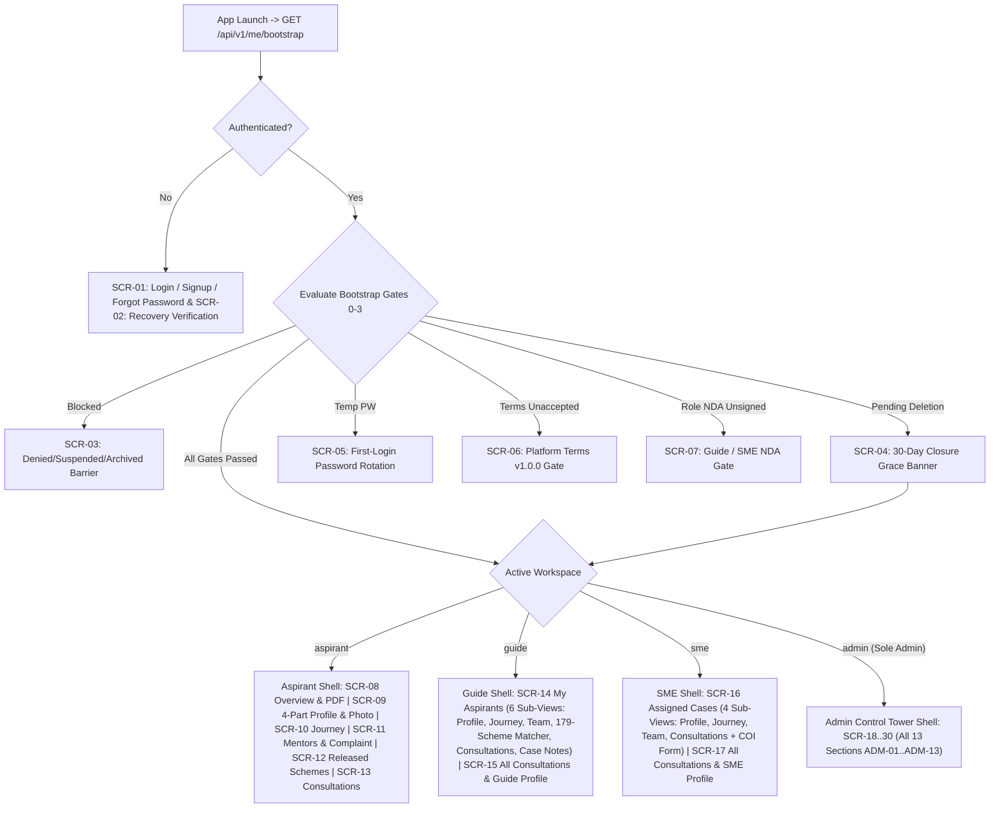

### 4.1 Complete Screen Mapping Table (`SCR-01` to `SCR-30`)

| Baseline Screen ID | Baseline Name & Mapped `FR-*` | React Web Route (`FULCRUM_REACT_WEB_HANDOVER.md`) | Flutter Mobile Route (`FULCRUM_FLUTTER_MOBILE_HANDOVER.md`) | UI Modernization Improvements Over Streamlit Baseline |
| :--- | :--- | :--- | :--- | :--- |
| **`SCR-01`** | Public Landing, Login, Forgot PW & Signup (`FR-AUTH-001..003`) | `/login`, `/signup`, `/forgot-password` | `/auth/login`, `/auth/signup`, `/auth/forgot-password` | Adds inline Spam/Promotions callout, countdown-guarded **"Resend Confirmation Email"** button (`DEF-001`,`002`), and `>= 8` char password meter (`DEF-003`). |
| **`SCR-02`** | Password Recovery Verification (`FR-AUTH-003`) | `/auth/recovery` | Deep Link `fulcrum://auth/recovery` / App Links | Direct URL hash/PKCE token parsing without needing a custom iframe bridge. |
| **`SCR-03`** | Account Blocked Barrier (`BR-LIFE-001`) | `/account/blocked` | `/account/blocked` | Full-screen accessible security card with one-tap support mailto and Sign Out. |
| **`SCR-04`** | 30-Day Deletion Grace Banner (`BR-LIFE-001`) | Persistent top banner + `/account/closure-status` | Persistent top banner + sheet | Disables all mutation buttons across the UI while leaving `Cancel Closure Request` active. |
| **`SCR-05`** | First-Login Password Gate (`FR-AUTH-004`) | `/onboarding/set-password` | `/onboarding/set-password` | Live password strength & confirmation match indicators. |
| **`SCR-06`** | Platform Terms Gate (`FR-LEGAL-001`) | `/onboarding/terms` | `/onboarding/terms` | Sticky bottom acceptance bar after scrolling document container. |
| **`SCR-07`** | Role NDA Gate (`FR-LEGAL-001`) | `/onboarding/nda/:role` | `/onboarding/nda/:role` | Real-time validation of typed full name and `'I AGREE'` phrase. |
| **`SCR-08`** | Aspirant Overview & PDF Dossier (`FR-ASP-003`) | `/aspirant/overview` | `/aspirant/overview` | Non-blocking PDF generation progress toast + native browser/mobile share sheet for PDF download. |
| **`SCR-09`** | Aspirant 4-Part Profile & Photo (`FR-ASP-001..002`) | `/aspirant/profile` | `/aspirant/profile` | 5-step horizontal/vertical form wizard with client-side image crop preview before upload. |
| **`SCR-10`** | Aspirant Journey & Revisions (`FR-JRN-001`) | `/aspirant/journey` | `/aspirant/journey` | Instant optimistic toggle for `Include in Roadmap` without full page reload; clean modal for edits and revision diff viewer. |
| **`SCR-11`** | Aspirant Mentors & Complaint (`FR-CMP-001`) | `/aspirant/mentors` | `/aspirant/mentors` | Dedicated slide-over drawer for Confidential Guide Complaint with character counter (`>= 15` chars). |
| **`SCR-12`** | Aspirant Released Schemes (`FR-GUIDE-002`) | `/aspirant/schemes` | `/aspirant/schemes` | Interactive 7-stage visual stepper on each released scheme card. |
| **`SCR-13`** | Aspirant Consultations & Case Space (`FR-CONS-001`) | `/aspirant/consultations` | `/aspirant/consultations` | Split-pane inbox + chat-style threaded view on desktop; master-detail navigation on mobile. |
| **`SCR-14`** | Guide My Aspirants & 6 Sub-Views (`FR-GUIDE-001..002`) | `/guide/aspirants/:aspirantId/:subtab` | `/guide/aspirants/:aspirantId` (6 tabbed views) | URL-addressable subtabs (`profile`, `journey`, `team`, `schemes`, `consultations`, `collaboration`) so browser Back/Refresh preserves exact mentee & subtab. |
| **`SCR-15`** | Guide Consultations Overview & Profile (`FR-SME-002`) | `/guide/consultations`, `/guide/profile` | `/guide/consultations`, `/guide/profile` | Cross-caseload filterable ticket table + `320x320` headshot cropper. |
| **`SCR-16`** | SME Assigned Cases & 4 Sub-Views + COI (`FR-SME-001`, `FR-CMP-001`) | `/sme/cases/:aspirantId/:subtab` | `/sme/cases/:aspirantId` (4 tabbed views) | Prominent COI status bar at top of mentee workspace; instant form lock when COI declared. |
| **`SCR-17`** | SME Consultations Overview & Profile (`FR-SME-002`) | `/sme/consultations`, `/sme/profile` | `/sme/consultations`, `/sme/profile` | Unified SME inbox and domain specialization editor. |
| **`SCR-18`..`SCR-30`** | **All 13 Sole Admin Sections (`ADM-01` to `ADM-13`, `FR-ADMIN-001..013`)** | `/admin/aspirants`, `/admin/guides`, `/admin/smes`, `/admin/assignments`, `/admin/inquiries-ssr`, `/admin/schemes`, `/admin/role-grants`, `/admin/legal-records`, `/admin/complaints`, `/admin/inactivity`, `/admin/contact-aspirants`, `/admin/sme-conflicts`, `/admin/account-lifecycle` | Web-First Full 13-Tab Suite on React; Companion Mobile Admin Triage App (or Responsive Web) per `DEC-MOB-001` | Fast paginated data tables, slide-over inspection drawers, one-click WhatsApp/Gmail launch + confirmation modal, and pre-archive impact preview modal. |

---

# FULCRUM-INDIA — DOCUMENT 5: REACT + TYPESCRIPT WEB DEVELOPMENT HANDOVER

| Document Attribute | Value |
| :--- | :--- |
| **Document ID** | `FULCRUM-RWH-V2.0` |
| **Filename** | `FULCRUM_REACT_WEB_HANDOVER.md` |
| **Baseline Commit** | `235767754f8d8bb4605e819593bb3f370ddeab27` (`2026-11-11`) |
| **Date of Handover Package** | `2026-11-16` |
| **Target Audience** | React + TypeScript Frontend Architects, Web UI Engineers, QA Engineers |
| **Scope** | Complete Web Application Replacement for `app.py` and `views/*.py` (All 30 Screens & All 13 Admin Sections) |

---

## 1. Proposed React + TypeScript Frontend Architecture

The React web application replaces the Streamlit presentation layer (`app.py` + `views/*.py`) while preserving 100% of the business rules in [`FULCRUM_PLATFORM_INDEPENDENT_CONTRACT.md`](./FULCRUM_PLATFORM_INDEPENDENT_CONTRACT.md) and communicating with the protected backend API defined in [`FULCRUM_BACKEND_API_CONTRACT.md`](./FULCRUM_BACKEND_API_CONTRACT.md).

### Recommended Technology Stack
- **Core Framework & Build**: **React 18+**, **TypeScript 5+ (Strict Mode)**, **Vite 5+** (SPA served via Caddy 2, or Next.js App Router in static/SSR mode).
- **Routing**: **React Router v6.22+** (or TanStack Router) with nested route guards for Gates `0`–`3` and URL-addressable tabs/subtabs.
- **Server State & Caching**: **TanStack Query v5 (`@tanstack/react-query`)** replacing `services/cache.py` (`_GLOBAL_CACHE` & session memo), with automatic cache invalidation on mutations and 5-second background polling/revalidation on `/api/v1/me/bootstrap` for cross-session role revocation eviction.
- **Client UI State**: **Zustand** store holding `activeWorkspace` (`'aspirant' | 'guide' | 'sme' | 'admin'`), sidebar collapse state, and active modal state.
- **Forms & Validation**: **React Hook Form + Zod** enforcing identical field rules (`>= 8` char passwords, `>= 15` char complaints/SSR justifications, `0–100%` women equity, and `'I AGREE'` NDA phrase).
- **Styling & Components**: **Tailwind CSS** configured with the design tokens in [`FULCRUM_UI_UX_DESIGN_SYSTEM.md`](./FULCRUM_UI_UX_DESIGN_SYSTEM.md) (`#F8FAFC` canvas, `#FFFFFF` cards, `#2563EB` primary blue, `#0B0F19` sidebar, `Avenir Next` / `Inter` font stack) + accessible **Radix UI** primitives (`Dialog`, `Tabs`, `Select`, `Toast`, `Tooltip`).

---

## 2. Recommended Project & Folder Structure

```text
fulcrum-web/
├── public/
├── src/
│   ├── api/
│   │   ├── client.ts                 # Axios/Fetch wrapper injecting Bearer JWT & X-Fulcrum-Active-Workspace
│   │   ├── generated/                # OpenAPI TypeScript types generated from FULCRUM_API_OPENAPI.yaml
│   │   └── hooks/                    # TanStack Query hooks per domain (useBootstrap, useSchemes, useJourney, etc.)
│   ├── auth/
│   │   ├── supabaseClient.ts         # Initialized with VITE_SUPABASE_URL & VITE_SUPABASE_PUBLISHABLE_KEY ONLY
│   │   ├── AuthProvider.tsx          # Session listener + token refresh
│   │   └── GateGuard.tsx             # Enforces Gates 0 (Lifecycle), 1 (Temp PW), 2 (Terms), 3 (Role NDA)
│   ├── components/
│   │   ├── layout/                   # AppShell, DarkSidebar, WorkspaceSelector, NotificationDrawer
│   │   ├── shared/                   # TaxonomySelectWithOther, PrivatePhotoVaultCard, SchemeExplorerCard
│   │   ├── journey/                  # JourneyTimeline, JourneyEventModal, RevisionHistoryDrawer
│   │   └── consultations/            # ConsultationThreadCard, CaseCollaborationPanel
│   ├── constants/
│   │   └── taxonomies.ts             # Exact mirror of services/constants.py & services/scheme_rules.py
│   ├── pages/
│   │   ├── public/                   # LoginPage (SCR-01), RecoveryPage (SCR-02)
│   │   ├── gates/                    # BlockedScreen (SCR-03), SetPasswordGate (SCR-05), TermsGate (SCR-06), NdaGate (SCR-07)
│   │   ├── aspirant/                 # SCR-08 Overview, SCR-09 Profile, SCR-10 Journey, SCR-11 Mentors, SCR-12 Schemes, SCR-13 Consultations
│   │   ├── guide/                    # SCR-14 MyAspirants (6 sub-routes), SCR-15 GuideConsultations & GuideProfile
│   │   ├── sme/                      # SCR-16 AssignedCases (4 sub-routes + COI), SCR-17 SmeConsultations & SmeProfile
│   │   └── admin/                    # SCR-18..30: All 13 Admin Sections (ADM-01..ADM-13)
│   ├── store/
│   │   └── workspaceStore.ts         # Zustand store for activeWorkspace & notification filter toggle
│   ├── App.tsx
│   └── main.tsx
├── .env.example                      # VITE_SUPABASE_URL, VITE_SUPABASE_PUBLISHABLE_KEY, VITE_API_BASE_URL
├── package.json
└── tsconfig.json
```

---

## 3. Routing, Gate Guards & API Client Conventions

### Mermaid Diagram 1 — React Router & Sequential Gate Guard Flow

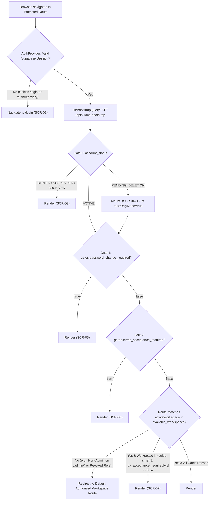

### 3.1 API Client Interceptor Contract (`src/api/client.ts`)
1. **Automatic Header Injection**: On every request to `VITE_API_BASE_URL`, attach `Authorization: Bearer ${session.access_token}` and `X-Fulcrum-Active-Workspace: ${workspaceStore.getState().activeWorkspace}`.
2. **Global Gate & Eviction Handling**:
   - On HTTP `401`: trigger `supabase.auth.refreshSession()`; if refresh fails, sign out and navigate to `/login`.
   - On HTTP `403` with `error.code == 'ROLE_NOT_AUTHORIZED'`: immediately invalidate `['bootstrap']` query so the revoked workspace is removed from `WorkspaceSelector` and the user is redirected to their remaining active workspace within 1 click (`BR-ROLE-001`).
   - On HTTP `403` with `error.gate_required`: redirect to the corresponding Gate screen (`SCR-03`–`SCR-07`).

---

## 4. Deep-Dive Engineering Specification for All 13 Administrator Sections (`ADM-01` to `ADM-13`)

> [!IMPORTANT]
> **Preservation of Full Administrative Authority**: The Sole Administrator workspace (`views/admin.py`, `views/admin_governance.py`, `views/admin_account_lifecycle.py`) is the operational heart of Fulcrum. In the React web application, **all 13 Administrator sections must be preserved in full** and must not be reduced to generic CRUD tables that strip away business side-effects (such as Co-Guide promotion, SSR override auto-release, COI recusal locks, WhatsApp/Gmail outreach auditing, or pre-archive impact previews).

| Admin Section & Route | React Page Component | Required UI Controls, Filters & Complex Business Workflows to Preserve | Backend API Endpoints Used |
| :--- | :--- | :--- | :--- |
| **Control Tower Header** (Global across `/admin/*`) | `<AdminControlTowerHeader />` | 10 real-time KPI cards & alert pills: Verified Aspirants, Active Guides, Active SMEs, Active Journeys, Unassigned Aspirants, Open Tickets, Pending SSRs, Open Complaints, SME Conflicts, Inactivity Alerts (`services/admin_metrics.py`). Clicking any alert pill navigates directly to that tab. | `GET /api/v1/admin/metrics` |
| **`ADM-01` (`/admin/aspirants`)** `SCR-18` | `<AdminAspirantsDirectoryPage />` | Server-paginated table (25/page) with Name/Email search and 38 TN District filter (uniting primary `profiles.role='aspirant'` and hybrid `user_roles.role='aspirant'`, `DEF-32-004`). Slide-over/detail view shows private Aspirant photo, completion %, assigned Primary Guide, Co-Guides & SMEs, 4-part profile, `Export Executive Dossier PDF` button, and Admin Journey milestone creator/editor with revision history. | `GET /api/v1/admin/aspirants`, `GET /api/v1/profiles/aspirants/:id`, `POST /api/v1/journeys/:id/events`, `GET /api/v1/reports/aspirants/:id/dossier-pdf` |
| **`ADM-02` (`/admin/guides`)** `SCR-19` | `<AdminGuidesManagementPage />` | **Provision Guide Modal/Form**: Full Name, Email, Mobile, District (default `Chennai`, `DEF-32-008`), Sector, Expertise, Bio, and stable copyable Provisional Password (`>= 8` chars, `DEF-32-003`). **Paginated Guide Roster (20/page)**: `320x320` headshot or `Missing Photo` badge, NDA status (`Signed` vs `Pending NDA`), caseload count, inline profile editor, and headshot uploader/remover. | `POST /api/v1/admin/mentors` (`role='guide'`), `GET /api/v1/admin/guides`, `PUT /api/v1/profiles/mentors/:id`, `POST/DELETE /api/v1/media/professional-photo/:id` |
| **`ADM-03` (`/admin/smes`)** `SCR-20` | `<AdminSmesManagementPage />` | **Provision SME Modal/Form**: Full Name, Email, Mobile, District (default `Chennai`), Sector, Domain Specialization (GST, Patents, FSSAI, Legal, Debt), Bio, and Provisional Password (`>= 8` chars). **Paginated SME Roster (20/page)** with headshot uploader and inline editor. | `POST /api/v1/admin/mentors` (`role='sme'`), `GET /api/v1/admin/smes`, `PUT /api/v1/profiles/mentors/:id`, `POST/DELETE /api/v1/media/professional-photo/:id` |
| **`ADM-04` (`/admin/assignments`)** `SCR-21` | `<AdminMentorAssignmentsPage />` | **Guide Assignment Panel**: Select Aspirant, select eligible Guide (only active `user_roles` + signed NDA + `id != aspirantId`), and radio mode (`Replace Primary Guide` vs `Add as Co-Guide (Collaborative)`, `DEF-32-008`). **SME Assignment Panel**: Select Aspirant, eligible SME, and mode (`Add to SME Advisory Roster` vs `Replace Primary SME`). **Active Relationship Matrix**: Shows Primary Guide chip, Co-Guide chips (`guide_ids`), and SME chips (`sme_ids`) with individual `Unassign` buttons (triggering automatic Co-Guide promotion and ticket transfer on primary Guide removal) and `Assignment History` drawer. | `POST /api/v1/admin/assignments/guide`, `POST /api/v1/admin/assignments/sme`, `POST /api/v1/admin/assignments/unassign`, `GET /api/v1/admin/relationships` |
| **`ADM-05` (`/admin/inquiries-ssr`)** `SCR-22` | `<AdminInquiriesAndSsrPage />` | **Two Sub-Tabs**:<br>1. **Mentor Inquiries & Escalations**: Lists `PENDING_ADMIN` and `ESCALATED` tickets. Admin Directive form includes Status (`DIRECTIVE_ISSUED` / `RESOLVED`), Directive text, AND optional **Assign Co-Guide** / **Assign Domain SME** dropdowns in the same form (`admin_respond_to_mentor`).<br>2. **Scheme Support Reviews (SSR)**: Shows Aspirant, Scheme, Match Score, Failed/Missing Criteria, and Guide Justification. Admin selects `APPROVED` (which automatically releases the scheme with `allow_disqualified_override=true`) or `REJECTED` with decision notes. | `GET /api/v1/admin/mentor-inquiries`, `POST /api/v1/admin/mentor-inquiries/:id/directive`, `GET /api/v1/schemes/support-reviews`, `POST /api/v1/admin/schemes/support-reviews/:id/decide` |
| **`ADM-06` (`/admin/schemes`)** `SCR-23` | `<AdminSchemeCataloguePage />` | **179-Scheme Playbook Grid (12/page)** with keyword, category, stage, sector, and active/archived filters. Includes **Create/Edit Scheme Modal** (all 20+ fields including private intelligence `hidden_agenda`, `red_flags`, `application_prompt`), **Archive/Unarchive toggle**, **Delete confirmation modal**, and **Delegate Scheme to Guide Panel** (`delegate_scheme_to_guide`). | `GET/POST/PUT/DELETE /api/v1/schemes`, `POST /api/v1/admin/schemes/delegate` |
| **`ADM-07` (`/admin/role-grants`)** `SCR-24` | `<AdminMultiRoleGrantsPage />` | Searchable directory of all non-admin users showing their current role combination badge (`A`, `G`, `S`, `A+G`, `A+S`, `G+S`, `A+G+S`) and per-role status pills (`active`, `pending_nda`, `suspended`, `revoked`). Actions per role: `Grant Role` (`aspirant`/`guide`/`sme`), `Suspend Role` (with reason), `Reinstate Role` (enabled only for `suspended`, disabled for `revoked`), `Cancel Pending Grant`, and `Revoke Role` (with confirmation modal warning that active mentee assignments in that role will be unassigned). | `GET /api/v1/admin/roles/users`, `POST /api/v1/admin/roles/grant`, `POST /api/v1/admin/roles/suspend`, `POST /api/v1/admin/roles/reinstate`, `POST /api/v1/admin/roles/revoke` |
| **`ADM-08` (`/admin/legal-records`)** `SCR-25` | `<AdminLegalRecordsPage />` | Filterable compliance table (`ALL`, `terms_and_conditions`, `nda_guide`, `nda_sme`) displaying summary KPIs and every signed record's User Email, Typed Legal Name, Confirmation Phrase, Document Version (`1.0.0`), SHA-256 Document Hash, Client IP, and Timestamp. | `GET /api/v1/admin/legal/acceptances` |
| **`ADM-09` (`/admin/complaints`)** `SCR-26` | `<AdminComplaintsPage />` | Summary counters (`Open`, `Under Review`, `Resolved`, `DEF-32-008`) and complaint cards showing Aspirant, Reported Guide, Category, and Confidential Description. **Resolution Form**: Status (`UNDER_REVIEW`, `RESOLVED`, `DISMISSED`), Investigation Notes, and optional **One-Step Replacement Guide Selector**. | `GET /api/v1/admin/governance/complaints`, `POST /api/v1/admin/governance/complaints/:id/resolve` |
| **`ADM-10` (`/admin/inactivity`)** `SCR-27` | `<AdminInactivityMonitorPage />` | **Two Radio Modes**:<br>1. **Mentor SLA & Inactivity Alerts**: Displays 7-day (`REMINDER_7D`), 10-day (`ALERT_10D`), and 14-day (`ESCALATED_14D`) alerts with live status (`Needs Attention`, `Follow-up Initiated`, `Mentor Active Again`, `Resolved`). Provides `Open WhatsApp Draft` and `Open Gmail Draft` buttons (logging `DRAFT_OPENED`) and a separate `✓ Confirm Follow-Up Sent` button (logging `SENT_CONFIRMED`, `BR-MON-001`).<br>2. **Aspirant Engagement Roster**: Evaluates founder profile readiness and days since last activity. | `POST /api/v1/admin/inactivity/evaluate`, `GET /api/v1/admin/inactivity/records`, `POST /api/v1/admin/external-contacts`, `GET /api/v1/admin/inactivity/aspirant-roster` |
| **`ADM-11` (`/admin/contact-aspirants`)** `SCR-28` | `<AdminContactAspirantsPage />` | Aspirant selector, Outreach Purpose template selector (`Onboarding`, `Mentorship Check-In`, `Scheme Follow-Up`, `General Support`), editable message preview, `Open WhatsApp Chat` (`wa.me/+91...`), `Open Gmail Compose`, `Record Confirmed Outreach` form, and historical outreach log table. | `POST /api/v1/admin/external-contacts`, `GET /api/v1/admin/external-contacts` |
| **`ADM-12` (`/admin/sme-conflicts`)** `SCR-29` | `<AdminSmeConflictsPage />` | **Two Sub-Tabs**:<br>1. **SME Domain Directory**: Active SMEs by specialization and caseload.<br>2. **Conflict Declarations & Recusals**: Lists all COI rows. Admin adjudicates pending conflicts with `Uphold Conflict & Unassign SME` (`APPROVED` -> auto-runs `unassign_sme`) or `Clear Conflict & Unlock SME` (`REJECTED` -> sets `has_conflict=false`, `DEF-32-005`). | `GET /api/v1/admin/governance/sme-conflicts`, `POST /api/v1/admin/governance/sme-conflicts/:id/resolve` |
| **`ADM-13` (`/admin/account-lifecycle`)** `SCR-30` | `<AdminAccountLifecyclePage />` | **Four Lazy-Loaded Sub-Tabs**:<br>1. **Active & Suspended Accounts**: Searchable directory with `Suspend`, `Resume`, `Legal Hold Toggle`, `Schedule 30-Day Closure`, and **`Archive Account` (opens Pre-Archive Impact Preview Modal showing exact count of affected relationships and open tickets before confirming atomic handover)**.<br>2. **Archived Accounts**: Lists `ARCHIVED` accounts with `Restore Account` modal.<br>3. **Pending Deletion**: Lists accounts in 30-day grace window with `Cancel Closure` and `Archive` actions.<br>4. **Immutable Action History**: Read-only audit viewer for `public.account_lifecycle_log`. | `GET /api/v1/admin/accounts`, `GET /api/v1/admin/accounts/:id/archive-preview`, `POST /api/v1/admin/accounts/:id/lifecycle`, `GET /api/v1/admin/accounts/lifecycle-logs` |

---

## 5. Frontend Testing, Deployment & Environment Configuration

1. **Automated Testing Strategy**:
   - **Unit & Schema Tests (`Vitest`)**: Test `resolveFieldChoice()` taxonomy helpers, Zod form schemas, and role-badge/notification filtering logic.
   - **Component & Gate Integration Tests (`React Testing Library` + `MSW`)**: Mock `/api/v1/me/bootstrap` across all 7 role combinations + Sole Admin and all 4 gate states (`SCR-03`–`SCR-07`).
   - **End-to-End Browser Suite (`Playwright`)**: Port the 10-stage master E2E workflow (`tests/test_single_admin_master_e2e.py`) and 22-test photo visibility suite (`tests/test_aspirant_photo_dashboard_visibility.py`) to Playwright TypeScript specs.
2. **Environment Variables (`.env.production`)**:
   - `VITE_SUPABASE_URL=https://<project-ref>.supabase.co`
   - `VITE_SUPABASE_PUBLISHABLE_KEY=<anon-or-publishable-key>` *(Never include `SUPABASE_SECRET_KEY` in `VITE_*` variables!)*
   - `VITE_API_BASE_URL=https://app.fulcrumindia.online/api/v1`
3. **Deployment**: Build static bundle (`npm run build` $\rightarrow$ `dist/`) and serve directly via the existing `fulcrum-caddy` container (or Cloudflare Pages) while proxying `/api/v1/*` to `fulcrum-api:8000`.

---

# FULCRUM-INDIA — DOCUMENT 6: FLUTTER ANDROID & iOS MOBILE DEVELOPMENT HANDOVER

| Document Attribute | Value |
| :--- | :--- |
| **Document ID** | `FULCRUM-FMH-V2.0` |
| **Filename** | `FULCRUM_FLUTTER_MOBILE_HANDOVER.md` |
| **Baseline Commit** | `235767754f8d8bb4605e819593bb3f370ddeab27` (`2026-11-11`) |
| **Date of Handover Package** | `2026-11-16` |
| **Target Audience** | Flutter / Dart Mobile Architects, Android & iOS Engineers, QA Engineers |
| **Target Platforms** | Android (API 24+ / Android 7.0+) & iOS (iOS 15.0+) from a Single Shared Flutter Codebase |

---

## 1. Proposed Flutter Architecture & Shared Codebase Strategy

The Flutter mobile application provides a unified **Android and iOS** codebase consuming the exact same REST API ([`FULCRUM_BACKEND_API_CONTRACT.md`](./FULCRUM_BACKEND_API_CONTRACT.md)) and Supabase GoTrue Auth as the React web app.

### Recommended Flutter Stack
- **SDK & Language**: **Flutter 3.24+ / Dart 3.5+** with Material 3 + platform-adaptive Cupertino dialogs.
- **Architecture Pattern**: Feature-first **Clean Architecture** (`presentation` $\rightarrow$ `application/providers` $\rightarrow$ `domain/models` $\rightarrow$ `data/repositories`) with **Riverpod 2.x (`flutter_riverpod` + `riverpod_annotation`)** for reactive state management and dependency injection.
- **Navigation & Deep Linking**: **`go_router`** with a centralized `redirect` guard evaluating the bootstrap gate state (`SCR-03`–`SCR-07`) and handling incoming Universal Links (iOS) / App Links (Android) for email verification and password recovery.
- **Networking**: **`dio`** HTTP client with an `AuthWorkspaceInterceptor` that attaches `Authorization: Bearer <jwt>`, `X-Fulcrum-Active-Workspace: <role>`, and `Idempotency-Key: <uuid>` on mutating requests.
- **Secure Token Persistence**: **`flutter_secure_storage`** (backed by **Android Keystore `EncryptedSharedPreferences`** and **iOS Keychain `kSecAttrAccessibleAfterFirstUnlockThisDeviceOnly`**) for storing the Supabase session refresh token.

```text
fulcrum_mobile/
├── android/                          # AndroidManifest.xml, App Links assetlinks.json config, Gradle
├── ios/                              # Info.plist, Associated Domains, Runner.xcodeproj
├── lib/
│   ├── core/
│   │   ├── api/                      # Dio client, AuthWorkspaceInterceptor, ErrorEnvelope parser
│   │   ├── auth/                     # Supabase Auth listener, SecureStorageSessionManager
│   │   ├── router/                   # GoRouter config + GateRedirectGuard
│   │   ├── theme/                    # FulcrumTheme (Light #F8FAFC, Blue #2563EB, Avenir/PlusJakartaSans)
│   │   └── constants/                # Taxonomies (38 TN districts, 16 sectors, stages, etc.)
│   ├── features/
│   │   ├── auth/                     # SCR-01 Login/Signup/Resend, SCR-02 Recovery Deep Link
│   │   ├── gates/                    # SCR-03 Blocked, SCR-04 DeletionGrace, SCR-05 SetPW, SCR-06 Terms, SCR-07 NDA
│   │   ├── aspirant/                 # SCR-08..13 (Overview/PDF, 4-Part Profile, Journey, Mentors/Complaint, Schemes, Consultations)
│   │   ├── guide/                    # SCR-14..15 (Mentee Selector + 6 Sub-Tabs, Guide Consultations, Guide Profile/Headshot)
│   │   ├── sme/                      # SCR-16..17 (Case Selector + 4 Sub-Tabs + COI Form, SME Consultations, SME Profile)
│   │   └── admin/                    # Mobile Admin Triage Console (or Full Responsive Admin per DEC-MOB-001)
│   └── main.dart
└── pubspec.yaml
```

---

## 2. Mobile Session Lifecycle, Deep Linking & Workspace Eviction

### Mermaid Diagram 1 — Mobile Session Lifecycle, Deep Link Recovery & Live Workspace Eviction

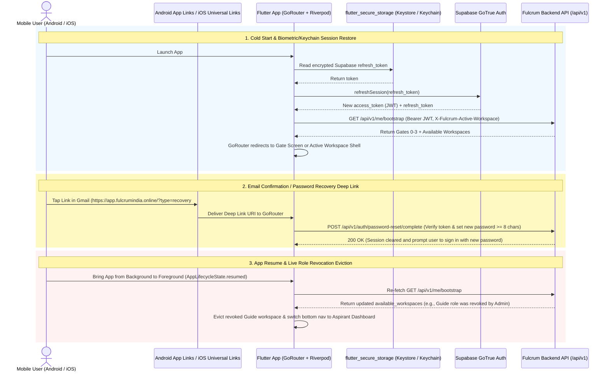

---

## 3. Role Portals on Mobile & Explicit Administrator Mobile Strategy (`DEC-MOB-001`)

### 3.1 Aspirant, Guide & SME Mobile Workspaces (100% Feature Parity)
- **Aspirant Mobile Shell (`SCR-08`–`SCR-13`)**: Bottom `NavigationBar` with 5 primary destinations (`Overview`, `Profile`, `Journey`, `Schemes`, `Consult`) + top AppBar avatar opening `My Mentors & Confidential Complaint` (`SCR-11`), Notification Drawer, and Workspace Switcher (if multi-role).
- **Guide Mobile Shell (`SCR-14`–`SCR-15`)**: Bottom `NavigationBar` with 3 destinations (`My Aspirants`, `All Consultations`, `My Profile`). Selecting an Aspirant opens a dedicated `MenteeDetailScaffold` with a scrollable top `TabBar` across all **6 subtabs** (`Profile`, `Journey`, `Team`, `Schemes`, `Consultations`, `Collaboration`).
- **SME Mobile Shell (`SCR-16`–`SCR-17`)**: Bottom `NavigationBar` with 3 destinations (`Assigned Cases`, `All Consultations`, `My Profile`). Selecting a case opens `SmeCaseScaffold` with **4 subtabs** (`Profile`, `Journey`, `Team`, `Consultations + COI Declaration`).

### 3.2 Administrator Mobile Strategy Evaluation (`DEC-MOB-001` — Requires Owner Approval)
The Sole Administrator workspace (`ADM-01` through `ADM-13`) contains dense multi-column data grids, bulk scheme editors (20+ fields per scheme), and complex side-by-side comparison workflows. Two options are presented for owner decision (`DEC-MOB-001`):
- **Option 1 (Recommended — Web-First Full 13-Tab Suite + High-Priority Mobile Admin Triage)**:
  - **React Web (`FULCRUM_REACT_WEB_HANDOVER.md`)** hosts 100% of all 13 Admin sections (`ADM-01`–`ADM-13`) with desktop and tablet responsiveness.
  - **Flutter Mobile** provides the **Admin Triage & Governance Console** covering urgent on-the-go actions: Control Tower KPIs, Mentor Assignment/Replacement (`ADM-04`), Mentor Inquiry Directives & SSR Approvals (`ADM-05`), Confidential Complaint Resolution (`ADM-09`), 7/10/14-Day Inactivity Alerts with native WhatsApp/Gmail intent launch (`ADM-10`/`11`), SME Conflict Adjudication (`ADM-12`), and Account Suspension/Resume (`ADM-13`), while directing heavy bulk catalog CRUD (`ADM-06`: 20-field scheme editor) to the React Web console.
- **Option 2 (Full 13-Tab Parity Inside Flutter Mobile)**: Implement all 13 Admin sections natively in Flutter using mobile stepper forms for `ADM-02`, `ADM-03`, and `ADM-06`.
- *Note: Both options are mapped in [`FULCRUM_CROSS_PLATFORM_PARITY_AND_QA.md`](./FULCRUM_CROSS_PLATFORM_PARITY_AND_QA.md). No Admin capability is dropped without explicit owner sign-off on `DEC-MOB-001`.*

---

## 4. Offline Behaviour, Network Interruption & Data Integrity Rules

> [!WARNING]
> **Prohibition of Unverified Offline Write Synchronization**: Fulcrum's domain operations—such as releasing a government scheme (`BR-SCH-001`), replying to a consultation (which checks SME COI locks `BR-CMP-001` and updates SLA clocks `BR-MON-001`), editing a Journey milestone (which uses `expected_updated_at` optimistic concurrency `BR-JRN-001`), or archiving an account (`BR-LIFE-001`)—depend on real-time server-side authorization and state checks. **Do NOT implement offline background write queueing for governance or mentorship mutations**, as an SME or Guide whose role was revoked or COI-locked while offline would generate unauthorized or conflicting writes upon reconnection.

1. **Allowed Read Caching & Draft Persistence**:
   - **In-Memory / Encrypted Read Cache**: Cache the user's current profile, Journey timeline, and released schemes for offline viewing during brief cellular drops (displaying an amber `"Offline — Viewing Cached Data"` banner). Never cache private photographs to unencrypted external storage (`SEC-STOR-001`).
   - **Local Unsubmitted Form Drafts**: Persist unsent text typed into the 4-part Profile form or a Consultation reply box in local encrypted storage so a dropped connection does not erase what the user was typing.
2. **Idempotent Retry on Mutating Requests**:
   - Attach a client-generated `Idempotency-Key: <uuid-v4>` header to every `POST` request so automatic network retries over flaky mobile connections never create duplicate consultation tickets, Journey events, or scheme releases (`NFR-REL-003`).

---

## 5. Device Permissions, Media Handling, Deep Links & Store Release Requirements

### 5.1 Android (`AndroidManifest.xml`) & iOS (`Info.plist`) Permissions
Follow strict least-privilege permissions (no background location, contacts scraping, or microphone access):
- **Photo Selection (`image_picker` / Android Photo Picker)**:
  - Android 13+ (API 33+): Uses system Photo Picker (zero storage permission required) + `android.permission.CAMERA` (only if user chooses "Take Photo").
  - iOS: `NSPhotoLibraryUsageDescription` (*"Fulcrum needs access to your photo library so you can upload your private profile photograph."*) and `NSCameraUsageDescription` (*"Fulcrum needs camera access if you choose to take a profile photograph."*).
- **Network & External Intents (`url_launcher`)**:
  - `android.permission.INTERNET`
  - `<queries>` declarations in `AndroidManifest.xml` and `LSApplicationQueriesSchemes` in `Info.plist` for `https`, `mailto`, and `whatsapp` (used by Admin external outreach in `ADM-10`/`ADM-11`).
- **PDF Dossier Viewing & Saving**:
  - Stream PDF bytes from `GET /api/v1/reports/aspirants/{id}/dossier-pdf` into the app's private temporary cache directory (`getTemporaryDirectory()`) and open via native share/print sheet (`printing` / `share_plus` package) without requiring broad external storage permissions.

### 5.2 Deep Links for Email Confirmation & Password Recovery
- Configure **Android App Links** (`https://app.fulcrumindia.online/.well-known/assetlinks.json`) and **iOS Universal Links** (`https://app.fulcrumindia.online/.well-known/apple-app-site-association`) for `/auth/callback` and `/?type=recovery`.
- When a user clicks the Resend confirmation or password reset link on their phone, the OS opens either the installed Flutter app or the React web app seamlessly.

### 5.3 Reuse Path if Native Kotlin (Android) or Swift (iOS) Is Chosen Later
If leadership ever elects to build separate native **Kotlin (Jetpack Compose)** or **Swift (SwiftUI)** apps in the future:
- Those teams consume the **exact same** [`FULCRUM_PLATFORM_INDEPENDENT_CONTRACT.md`](./FULCRUM_PLATFORM_INDEPENDENT_CONTRACT.md), [`FULCRUM_API_OPENAPI.yaml`](./FULCRUM_API_OPENAPI.yaml) (via OpenAPI Kotlin/Swift code generators), [`FULCRUM_DATABASE_MIGRATION_CONTRACT.md`](./FULCRUM_DATABASE_MIGRATION_CONTRACT.md), and [`FULCRUM_UI_UX_DESIGN_SYSTEM.md`](./FULCRUM_UI_UX_DESIGN_SYSTEM.md) tokens without changing a single line of backend API or database code.

---

# FULCRUM-INDIA — DOCUMENT 7: CROSS-PLATFORM PARITY & QA MATRIX

| Document Attribute | Value |
| :--- | :--- |
| **Document ID** | `FULCRUM-XPQ-V2.0` |
| **Filename** | `FULCRUM_CROSS_PLATFORM_PARITY_AND_QA.md` |
| **Baseline Commit** | `235767754f8d8bb4605e819593bb3f370ddeab27` (`2026-11-11`) |
| **Date of Handover Package** | `2026-11-16` |
| **Target Audience** | QA Lead, SDETs, Backend Engineers, React Web Engineers, Flutter Mobile Engineers |
| **Baseline UAT Reference** | [`FULCRUM_UATD_V2.md`](../07_REQUIREMENTS_BASELINE_V2/FULCRUM_UATD_V2.md) (`UAT-AUTH-001` to `UAT-BKP-001`) |

---

## 1. Purpose and Cross-Platform Golden-Test Strategy

When migrating or extending **FULCRUM-INDIA Beta 2.0.0** from a single Streamlit application to **React + TypeScript Web** and **Flutter Android/iOS Mobile** backed by a shared REST API, functional equivalence must be **proven through automated golden tests**, never assumed.

### Mermaid Diagram 1 — Cross-Platform Golden-Test & Parity Verification Architecture

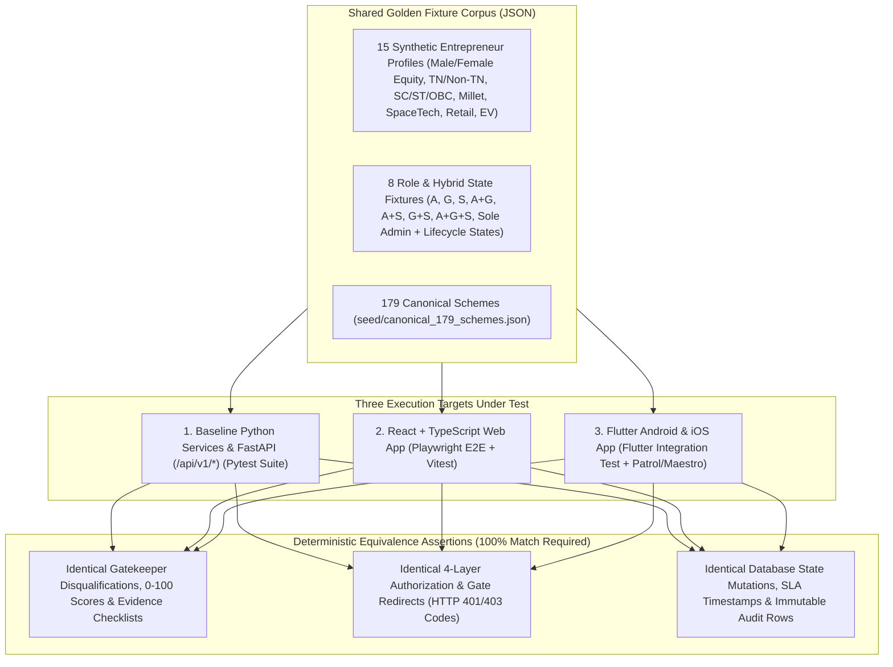

---

## 2. Complete Cross-Platform Feature & Screen Parity Matrix (`SCR-01` to `SCR-30` & `ADM-01` to `ADM-13`)

| Screen & Req ID | Existing Streamlit Baseline (`views/*.py`, `services/*.py`) | React Web Requirement (`FULCRUM_REACT_WEB_HANDOVER.md`) | Flutter Android Requirement (`FULCRUM_FLUTTER_MOBILE_HANDOVER.md`) | Flutter iOS Requirement (`FULCRUM_FLUTTER_MOBILE_HANDOVER.md`) | Shared Backend API Dependency (`/api/v1/*`) | Authz & Gate Requirement | Baseline Automated Test & UAT Ref | Priority | Status in Baseline |
| :--- | :--- | :--- | :--- | :--- | :--- | :--- | :--- | :---: | :--- |
| **`SCR-01` / `FR-AUTH-001..002`** Public Login & Aspirant Signup | `views/login.py` L563–L704, `auth.py::signup_aspirant` | `/login`, `/signup` with Spam notice + Resend button (`DEF-001`,`002`) + `>=8` char PW (`DEF-003`) | `/auth/login`, `/auth/signup` with Spam notice + Resend button + `>=8` char PW | Identical to Android | `POST /api/v1/auth/signup-aspirant`, `POST /api/v1/auth/resend-confirmation` | Public; role locked to `aspirant` | `UAT-AUTH-001..004`, `test_single_admin_master_e2e.py::test_01` | **P0** | Implemented (UX fix `DEF-001..003` pending) |
| **`SCR-02` / `FR-AUTH-003`** Password Recovery | `views/login.py` L375–L558, `auth_callback_component.py` | `/auth/recovery` reading URL hash/PKCE token | Android App Link `https://app.fulcrumindia.online/?type=recovery` | iOS Universal Link `https://app.fulcrumindia.online/?type=recovery` | `POST /api/v1/auth/password-reset/request` & `/complete` | Single-use recovery token; blocks `<SOLE_ADMIN_EMAIL>` | `UAT-AUTH-005..006`, `test_password_recovery_suite.py` | **P0** | Implemented & Tested |
| **`SCR-03` & `SCR-04` / `BR-LIFE-001`** Account Blocked & 30-Day Grace Banner | `app.py` L1095–L1188, `account_lifecycle.py` | `<BlockedAccountScreen />` & `<DeletionGraceBanner />` | Full-screen barrier & top grace banner | Identical to Android | `GET /api/v1/me/bootstrap`, `POST /api/v1/accounts/me/cancel-deletion` | Gate 0 (Fail-closed `DENIED` on error) | `UAT-LIFE-001..002`, `test_argon_p0_negative_security.py` | **P0** | Implemented & Tested |
| **`SCR-05` / `FR-AUTH-004`** First-Login PW Gate | `app.py` L1198–L1232, `auth.py` L880–L995 | `/onboarding/set-password` (`>=8` chars) | `/onboarding/set-password` (`>=8` chars) | Identical to Android | `POST /api/v1/auth/first-login-password` | Gate 1 (`temp_password_issued == true`) | `UAT-ONB-001`, `test_qa32_fixes_regression.py::test_def009` | **P0** | Implemented & Tested |
| **`SCR-06` & `SCR-07` / `FR-LEGAL-001`** Terms & Role NDA Gates | `views/legal_ui.py` L19–L229, `legal.py` | `/onboarding/terms`, `/onboarding/nda/:role` | `/onboarding/terms`, `/onboarding/nda/:role` | Identical to Android | `GET /api/v1/legal/documents/:type`, `POST /api/v1/legal/acceptances` | Gate 2 (Terms) & Gate 3 (`nda_guide`/`nda_sme` + `'I AGREE'`) | `UAT-LEGAL-001`, `test_single_admin_master_e2e.py::test_03..04` | **P0** | Implemented & Tested |
| **Workspace Switcher & Notifs / `FR-ROLE-001`, `FR-NOTIF-001`** | `app.py` L839–L1075, `roles.py`, `notifications.py` | `<WorkspaceSelector />` + `<NotificationDrawer />` | AppBar workspace switcher + notification sheet | Identical to Android | `GET /api/v1/me/bootstrap`, `GET/PATCH /api/v1/notifications` | 7 role combos; 5s revocation eviction (`BR-ROLE-001`) | `UAT-ROLE-001`, `test_multi_role_e2e_workflows.py`, `test_def010` | **P0** | Implemented & Tested |
| **`SCR-08` / `FR-ASP-003`** Aspirant Overview & PDF Dossier | `views/aspirant.py` L100–L218, `pdf_generator.py` | `/aspirant/overview` + PDF download | `/aspirant/overview` + native PDF share/print sheet | Identical to Android (`UIActivityViewController`) | `GET /api/v1/reports/aspirants/:id/dossier-pdf` | Owner `A`, Assigned `G`, `Admin` | `UAT-JRN-001`, `UAT-CONC-001`, `test_single_admin_master_e2e.py::test_09` | **P0** | Implemented & Tested |
| **`SCR-09` / `FR-ASP-001..002`** Aspirant 4-Part Profile & Photo | `views/aspirant.py` L220–L454, `profiles.py`, `aspirant_photos.py` | `/aspirant/profile` + photo uploader | `/aspirant/profile` + Android Photo Picker / Camera | `/aspirant/profile` + `PHPickerViewController` / Camera | `GET/PUT /api/v1/profiles/aspirants/:id`, `POST/GET/DELETE /api/v1/media/aspirant-photo/:id` | Owner `A` (preserves `mentor` dict `DEF-32-006`); Photo: Owner, Admin, Assigned `G`/`S` with NDA | `UAT-PROF-001`, `UAT-PHOTO-001`, `test_aspirant_photo_dashboard_visibility.py` | **P0** | Implemented & Tested |
| **`SCR-10` / `FR-JRN-001`** Aspirant Journey & Revisions | `views/aspirant.py` L456–L644, `journey.py`, `journey_edit_dialog.py` | `/aspirant/journey` + edit modal + revision drawer | `/aspirant/journey` + edit bottom sheet + revisions | Identical to Android | `GET/POST /api/v1/journeys/:id/events`, `PATCH /api/v1/journeys/events/:eventId` | Edit: `actor_id == user.id` or `Admin` + `expected_updated_at` | `UAT-JRN-001`, `verify_journey_governance_and_ui.py` | **P0** | Implemented & Tested |
| **`SCR-11` / `FR-CMP-001`** Aspirant Mentors & Complaint | `views/aspirant.py` L646–L789, `governance.py` | `/aspirant/mentors` + complaint drawer | `/aspirant/mentors` + complaint sheet | Identical to Android | `GET /api/v1/profiles/aspirants/:id`, `GET/POST /api/v1/governance/complaints` | Complaint hidden from Guides (`BR-CMP-001`) | `UAT-CMP-001`, `test_confidential_complaints.py` | **P0** | Implemented & Tested |
| **`SCR-12` / `FR-GUIDE-002`** Aspirant Released Schemes | `views/aspirant.py` L791–L847, `schemes.py` | `/aspirant/schemes` + 7-stage stepper | `/aspirant/schemes` + 7-stage stepper | Identical to Android | `GET /api/v1/schemes/releases/:id`, `PATCH /api/v1/schemes/releases/:id/:schemeId` | Aspirant sees **only** `status='released'` rows | `UAT-SCH-001`, `test_single_admin_master_e2e.py::test_08` | **P0** | Implemented & Tested |
| **`SCR-13` / `FR-CONS-001`** Aspirant Consultations & Case Notes | `views/aspirant.py` L849–L1104, `help_requests.py`, `collaboration.py` | `/aspirant/consultations` | `/aspirant/consultations` | Identical to Android | `GET/POST /api/v1/consultations`, `POST /api/v1/consultations/:id/reply`, `GET/POST /api/v1/cases/:id/discussions` | Blocks new tickets in `PENDING_DELETION`; strips `is_private_mentor_note=true` | `UAT-CONS-001`, `test_consultation_isolation.py` | **P0** | Implemented & Tested |
| **`SCR-14` & `SCR-15` / `FR-GUIDE-001..002`, `FR-SCH-001`** Guide Portal (6 Mentee Subtabs + Overview + Headshot) | `views/guide.py` L60–L1379, `scheme_matching_engine.py`, `scheme_reviews.py`, `professional_photos.py` | `/guide/aspirants/:id/:subtab` (6 subtabs), `/guide/consultations`, `/guide/profile` | `/guide/aspirants/:id` (6 tabs), `/guide/consultations`, `/guide/profile` | Identical to Android | `POST /api/v1/schemes/match/:id`, `POST /api/v1/schemes/releases/:id`, `POST /api/v1/schemes/support-reviews`, `POST /api/v1/media/professional-photo/:id` | Active `guide` role + signed `nda_guide` + assigned in `guide_id` or `guide_ids` | `UAT-SCH-001`, `UAT-PHOTO-002`, `test_scheme_matching_engine.py`, `test_scheme_relevance_synthetic.py` | **P0** | Implemented & Tested |
| **`SCR-16` & `SCR-17` / `FR-SME-001..002`, `FR-CMP-001`** SME Portal (4 Mentee Subtabs + COI + Overview + Headshot) | `views/sme.py` L36–L952, `governance.py`, `professional_photos.py` | `/sme/cases/:id/:subtab` (4 subtabs — no schemes), `/sme/consultations`, `/sme/profile` | `/sme/cases/:id` (4 tabs — no schemes), `/sme/consultations`, `/sme/profile` | Identical to Android | `POST /api/v1/governance/sme-conflicts`, `POST /api/v1/consultations/:id/reply` | Active `sme` role + signed `nda_sme` + assigned in `sme_id`/`sme_ids`; locked if `has_conflict=true` | `UAT-CMP-001`, `UAT-PHOTO-002`, `verify_multi_sme_and_security.py`, `test_def005` | **P0** | Implemented & Tested |
| **`SCR-18`..`SCR-30` (`ADM-01`..`ADM-13`) / `FR-ADMIN-001..013`** Sole Administrator Control Tower (All 13 Sections) | `views/admin.py` L141–L1542, `views/admin_governance.py`, `views/admin_account_lifecycle.py` | **100% Full 13-Section Implementation** (`/admin/*` routes specified in `Doc 5 Section 4`) | Admin Triage Console (or Full 13-Tab Parity per `DEC-MOB-001` in `Doc 6 Section 3.2`) | Identical to Android (`DEC-MOB-001`) | All `/api/v1/admin/*` endpoints | **Sole Admin Only (`<SOLE_ADMIN_EMAIL>`)** verified via `require_sole_admin()` JWT + session check | `UAT-ONB-001`, `UAT-REL-001`, `UAT-MON-001`, `UAT-LIFE-001..002`, `UAT-RPT-001`, `test_qa32_fixes_regression.py` | **P0 (Web) / P1 (Mobile)** | Implemented & Tested |

---

## 3. Eleven High-Risk Parity Scenarios Requiring Dedicated Automated Tests

Every release of the Backend API, React Web app, and Flutter Mobile app must pass automated verification across these 11 security- and business-critical scenarios:

| # | Critical Scenario | Required Golden Test Verification Across API, React & Flutter | Baseline Test Reference |
| :-: | :--- | :--- | :--- |
| **1** | **Multi-Role Hybrid Accounts (`7` Combinations)** | Test all 7 combinations (`A`, `G`, `S`, `A+G`, `A+S`, `G+S`, `A+G+S`). Verify workspace switcher shows only granted roles, anti-self-mentoring blocks `mentor_id == aspirant_id`, and saving an Aspirant profile on `A+G` preserves `profile_data['mentor']` (`DEF-32-006`). | `tests/test_multi_role_e2e_workflows.py`, `tests/test_qa32_fixes_regression.py::test_def006` |
| **2** | **Live Role Revocation While Session Is Active** | While a user has the Guide workspace open in React or Flutter, Admin calls `POST /api/v1/admin/roles/revoke`. Verify the next API call returns `403 ROLE_NOT_AUTHORIZED` and the client evicts the Guide workspace within `<= 5` seconds. | `08_CHAOS_ENGINEERING_REPORT.md` Scenario 7, `tests/test_argon_p0_negative_security.py` |
| **3** | **Private Aspirant Data & Photo Isolation** | Verify unassigned Guides/SMEs, `pending_nda` mentors, and other Aspirants receive `403` on `/api/v1/profiles/aspirants/:id` and `/api/v1/media/aspirant-photo/:id`, and that mentor headshots are masked (`null`) for Aspirants. | `tests/test_aspirant_photo_dashboard_visibility.py` (`test_01`–`test_22`), `tests/test_single_admin_and_photos.py` |
| **4** | **Mentor Unassignment & Co-Guide Promotion Handover** | Assign Primary Guide G1 and Co-Guide G2 to Aspirant A with an open consultation ticket. Unassign G1 (or archive G1). Verify G2 is automatically promoted to `relationships.guide_id` and the open ticket transfers to G2. | `tests/test_checkpoint1_defects_and_handover.py::test_04`, `test_05` |
| **5** | **Sequential Legal & NDA Gating** | Verify that an account with `temp_password_issued=true`, unaccepted Terms, or `pending_nda` receives deterministic `403` gate codes (`PASSWORD_CHANGE_REQUIRED`, `TERMS_ACCEPTANCE_REQUIRED`, `NDA_ACCEPTANCE_REQUIRED`) on all domain endpoints until completed in order. | `tests/test_single_admin_master_e2e.py::test_03`, `test_04`, `tests/test_argon_p0_negative_security.py` |
| **6** | **179-Scheme Deterministic Matching Equivalence** | Feed the 9 synthetic profiles from `tests/test_scheme_relevance_synthetic.py` into `POST /api/v1/schemes/match/:id` and verify 100% identical disqualification reasons, `0–100` scores, and evidence checklists in React and Flutter. | `tests/test_scheme_matching_engine.py`, `tests/test_scheme_relevance_synthetic.py` |
| **7** | **Journey Edit Attribution & Optimistic Locking** | Verify only the original `actor_id` (or Sole Admin) can `PATCH /api/v1/journeys/events/:id`, that a stale `expected_updated_at` returns `409 Conflict`, and that every edit inserts a snapshot in `public.journey_event_revisions`. | `verify_journey_governance_and_ui.py` |
| **8** | **Account Archival Atomic Handover & Compensating Rollback** | Inject a simulated failure during `archive_account()` profile update or audit log insert and verify `_restore_relationship_snapshots()` restores all mentor assignments with zero orphaned mentees; verify `account_lifecycle_log` rejects `UPDATE` and `DELETE`. | `tests/test_account_lifecycle_and_handover_chaos.py`, `tests/test_qa32_fixes_regression.py::test_def001` |
| **9** | **Confirmation Email, Spam Guidance & Resend Control** | Verify public signup returns `pending_confirmation: true`, renders the Spam/Promotions notice (`DEF-001`), blocks login until confirmed, and allows triggering `POST /api/v1/auth/resend-confirmation` (`DEF-002`). | `UAT-AUTH-001`, `UAT-AUTH-002` |
| **10** | **Network Failures, Retries & Idempotency** | Simulate network drop during mobile `POST /api/v1/consultations` retry with the same `Idempotency-Key` header and verify exactly 1 ticket is created; verify database outage fails closed (`DENIED`). | `tests/test_failure_isolation.py`, `NFR-REL-001`, `NFR-REL-003` |
| **11** | **Concurrent Multi-User Operations & PDF Semaphore** | Execute 30–50 concurrent API sessions and 5 simultaneous `/dossier-pdf` requests and verify `0%` errors, zero cross-user token leakage, and `< 800 MiB` container RAM. | `tests/test_concurrency_load.py`, `tests/test_cross_session_isolation.py` |

---

# FULCRUM-INDIA — DOCUMENT 8: PHASED MIGRATION, DELIVERY & RELEASE PLAN

| Document Attribute | Value |
| :--- | :--- |
| **Document ID** | `FULCRUM-MPD-V2.0` |
| **Filename** | `FULCRUM_FUTURE_PLATFORM_MIGRATION_PLAN.md` |
| **Baseline Commit** | `235767754f8d8bb4605e819593bb3f370ddeab27` (`2026-11-11`) |
| **Date of Handover Package** | `2026-11-16` |
| **Target Audience** | CEO / Owner, Programme Managers, Engineering Lead, DevOps / SRE, QA Lead |
| **Core Cutover Rule** | **Zero Downtime & Parallel Coexistence: Do NOT shut down the existing Streamlit application until 100% parity, data integrity, and security gates are signed off** |

---

## 1. Executive Migration Strategy: Parallel Coexistence Over "Big-Bang" Rewrite

The safest, lowest-risk path to evolve **FULCRUM-INDIA Beta 2.0.0** from its current monolithic Streamlit server to a multi-client **React Web + Flutter Android/iOS** platform is a **strangler-fig / parallel-coexistence migration**:
1. **Keep the Existing Supabase Database & Auth Intact**: No user accounts or tables are dropped (`FULCRUM_DATABASE_MIGRATION_CONTRACT.md`).
2. **Stabilize the Live Streamlit App First (Phase 1)**: Apply the quick email-deliverability fixes (`DEF-001` Spam notice, `DEF-002` Resend button, `DEF-003` 8-char password alignment, and Hostinger `_dmarc.notify` DNS record) so current beta entrepreneurs are supported immediately.
3. **Wrap Existing Python `services/*.py` in a Stateless FastAPI Service (Phases 2–3)**: Rather than rewriting 24,343 lines of Python business rules into another language, decouple `services/*.py` from `st.session_state` and expose them via the OpenAPI 3.1 endpoints (`FULCRUM_API_OPENAPI.yaml`).
4. **Run Streamlit and New Clients Side-by-Side Against Staging & Production (Phases 6–9)**: Only switch primary DNS routing once automated golden parity tests (`FULCRUM_CROSS_PLATFORM_PARITY_AND_QA.md`) pass 100%.

### Mermaid Diagram 1 — Ten-Phase Migration & Delivery Roadmap (`[PROPOSED]`)

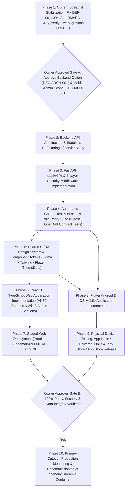

---

## 2. Detailed Ten-Phase Implementation Plan, Dependencies & Approval Gates

*(Note: Effort ranges below are transparent engineering estimates assuming a focused 2–4 person team reusing the existing Python `services/*.py` and Supabase database; they are planning estimates, not fixed-date commitments.)*

| Phase | Phase Name & Scope | Key Deliverables | Upstream Dependencies | Estimated Effort Range *(Assumption-Bounded)* | Approval Gate / Exit Criterion |
| :---: | :--- | :--- | :--- | :---: | :--- |
| **Phase 1** | **Current System Stabilization** | 1. Add `_dmarc.notify` TXT record (`v=DMARC1; p=none;`) in Hostinger DNS & customize Supabase confirmation email template.<br>2. Patch `views/login.py` L693 (`DEF-001` Spam notice, `DEF-002` Resend button, `DEF-003` `>=8` char password, `DEF-004` typo).<br>3. Verify `migrations/009`–`011` and `Site URL` in live Supabase dashboard (`DEC-002`). | Owner DNS & Supabase access | `2 – 3 Days` | Live signup email lands in inbox (or user can self-resend); `UAT-AUTH-001..002` pass. |
| **Phase 2** | **Backend API Architecture Decision** | 1. Owner sign-off on `DEC-ARCH-001` (Recommended: Containerized Python FastAPI reusing `services/*.py` behind Caddy + optional Cloudflare WAF) and `DEC-MOB-001` (Admin mobile scope).<br>2. Refactor `services/*.py` to accept explicit `RequestContext(user_id, email, active_workspace, jwt_token)` instead of reading `st.session_state` directly (keeping backward-compatible shims so Streamlit continues working). | Phase 1 | `1 – 2 Weeks` | **Gate A Signed Off**; existing `pytest tests/` passes 100% with refactored context parameter. |
| **Phase 3** | **API & Security Implementation** | 1. Implement FastAPI routers matching `FULCRUM_API_OPENAPI.yaml` (`/api/v1/auth`, `/me`, `/legal`, `/profiles`, `/media`, `/journeys`, `/schemes`, `/consultations`, `/governance`, `/admin`).<br>2. Implement JWT verification + Gates `0`–`3` middleware, rate limiting, and `X-Forwarded-For` IP logging (`resolving DEF-008`).<br>3. Apply additive Migration `012` on staging. | Phase 2 | `2 – 3 Weeks` | All endpoints in `FULCRUM_API_OPENAPI.yaml` active on staging; `0` service-role keys exposed to clients. |
| **Phase 4** | **Automated Business-Rule Parity Tests** | 1. Build the Golden-Test suite (`FULCRUM_CROSS_PLATFORM_PARITY_AND_QA.md`) running all 159 existing tests + OpenAPI schema validation against `/api/v1/*`. | Phase 3 | `1 Week` | 100% pass rate on security negative tests (`VULN-01..10`), QA32 regressions (`DEF-32-001..010`), and 179-scheme matching. |
| **Phase 5** | **Shared UI/UX Design System** | 1. Implement shared design tokens (`FULCRUM_UI_UX_DESIGN_SYSTEM.md`) in Tailwind CSS (for React) and `FulcrumTheme` (for Flutter).<br>2. Build core reusable components (`WorkspaceSelector`, `TaxonomySelectWithOther`, `SchemeExplorerCard`, `JourneyTimeline`). | Phase 2 | `1 – 2 Weeks` | WCAG 2.1 AA contrast (`>= 4.5:1`) and responsive breakpoints verified. |
| **Phase 6** | **React + TypeScript Web Implementation** | 1. Build Public/Auth screens (`SCR-01..02`), Gate screens (`SCR-03..07`), Aspirant Portal (`SCR-08..13`), Guide Portal (`SCR-14..15`), SME Portal (`SCR-16..17`), and **all 13 Sole Admin sections (`SCR-18..30` / `ADM-01..13`)** per `FULCRUM_REACT_WEB_HANDOVER.md`. | Phases 3, 4, 5 | `4 – 6 Weeks` | All 30 screens and 13 Admin sections functional against staging API; Playwright E2E suite passes. |
| **Phase 7** | **Staged Web Deployment & Acceptance** | 1. Deploy `fulcrum-api` and `fulcrum-web` containers on the Hostinger KVM 2 VPS behind Caddy on a staging route (while `fulcrum-app` Streamlit remains live at `app.fulcrumindia.online`).<br>2. Execute full UAT (`FULCRUM_UATD_V2.md`) with existing accounts. | Phase 6 | `1 Week` | Zero data discrepancies between Streamlit and React views on the same database. |
| **Phase 8** | **Flutter Android & iOS Implementation** | 1. Build shared Dart codebase (`FULCRUM_FLUTTER_MOBILE_HANDOVER.md`) covering Auth, Gates `0`–`3`, Aspirant, Guide, SME, and approved Admin mobile console (`DEC-MOB-001`).<br>2. Configure `flutter_secure_storage`, photo picker, PDF share sheet, and App Links / Universal Links. | Phases 3, 4, 5 | `4 – 6 Weeks` *(Can run in parallel with Phase 6)* | Android `.aab`/`.apk` and iOS `.ipa` builds pass integration test suite on emulators/simulators. |
| **Phase 9** | **Mobile Testing & Store Distribution** | 1. Physical device testing on Android and iPhone (deep links, camera/gallery permissions, background token refresh, live role revocation eviction, offline read banner).<br>2. Submit to Google Play Console (Internal/Closed Track $\rightarrow$ Production) and Apple App Store Connect (TestFlight $\rightarrow$ App Store). | Phase 8 | `1 – 2 Weeks` *(Plus store review window)* | Both Android and iOS builds approved and verified against production API. |
| **Phase 10** | **Production Cutover & Maintenance** | 1. Create pre-cutover database backup (`scripts/supabase_backup_manager.py`).<br>2. Update `Caddyfile` to route `app.fulcrumindia.online` to `fulcrum-web` + `/api/v1/*` to `fulcrum-api`, keeping `fulcrum-app` (Streamlit) stopped on standby for 14 days.<br>3. Decommission Streamlit container after 14-day zero-incident burn-in. | Phases 7 & 9 + **Gate B Approval** | `2 – 3 Days` (+ 14d standby window) | **Gate B Signed Off** by Sole Administrator; `< 3 minute` Caddy rollback verified. |

---

## 3. Suggested Team Composition, Risks & Rollback Strategy

### 3.1 Recommended Engineering Team Structure
- **1 Lead Backend / Python API Engineer**: Refactors `services/*.py` into stateless FastAPI endpoints, maintains Supabase RLS/migrations, and owns the golden parity test suite.
- **1 Senior React + TypeScript Frontend Engineer**: Builds the 30 web screens with primary focus on the 13-section Admin Control Tower and Guide 179-scheme matcher.
- **1 Senior Flutter (Android/iOS) Engineer**: Builds the shared mobile app, deep linking, secure storage, and Play Store / App Store release pipelines.
- **1 QA / Security Verification Lead (Part-Time or Shared)**: Executes the 29-area UAT suite (`FULCRUM_UATD_V2.md`) and cross-platform parity matrix (`FULCRUM_CROSS_PLATFORM_PARITY_AND_QA.md`).

### 3.2 Migration Risk Register & Mitigations

| Risk ID | Migration Risk | Impact | Mitigation Strategy |
| :--- | :--- | :---: | :--- |
| **`MIG-RISK-01`** | **Business-Rule Drift During Translation** (e.g., subtle change in 179-scheme scoring or 7/10/14-day SLA clock logic) | **Critical** | Do **not** rewrite `scheme_matching_engine.py`, `inactivity.py`, or `account_lifecycle.py` into TypeScript/Dart; keep them in Python on the backend (`Option B/C`) and verify with Golden Fixtures (`Doc 7`). |
| **`MIG-RISK-02`** | **Accidental Exposure of Privileged Keys in Web/Mobile Bundles** | **Critical** | Enforce CI check scanning React `dist/` and Flutter `.aab`/`.ipa` binaries for `sb_secret_`, `service_role`, and `re_`; keep all privileged calls inside `fulcrum-api`. |
| **`MIG-RISK-03`** | **Disruption to Live Cohort During Development** | **High** | Keep the current Streamlit app (`fulcrum-app`) running untouched in production while `fulcrum-api`, `fulcrum-web`, and `fulcrum_mobile` are developed and tested against staging. |
| **`MIG-RISK-04`** | **Cutover Regression Discovered Post-Launch** | **Medium** | Because the database schema changes are 100% additive (`Doc 3`), rolling back cutover requires only reverting 2 lines in `Caddyfile` to point back to `fulcrum-app:8501` (`<= 60 seconds` rollback time). |

---

# FULCRUM-INDIA — APPENDIX: COMPLETE OPENAPI 3.1.0 SPECIFICATION (FULCRUM_API_OPENAPI.yaml)

`yaml
openapi: 3.1.0
info:
  title: FULCRUM-INDIA Institutional Platform API (Proposed Target Contract)
  version: 2.0.0
  summary: Proposed stateless REST API wrapping FULCRUM-INDIA Beta 2.0.0 Python domain services for React Web and Flutter Android/iOS clients.
  description: |
    **IMPORTANT STATUS NOTICE**: This OpenAPI 3.1 specification defines the **proposed target REST API** (`/api/v1/*`) for future web (React + TypeScript) and mobile (Flutter Android/iOS) clients.
    Every endpoint maps directly to an existing, verified Python function in `services/*.py` at repository commit `235767754f8d8bb4605e819593bb3f370ddeab27`.
    - Direct browser/mobile access to `SUPABASE_SECRET_KEY` (`service_role`) is strictly prohibited.
    - All authenticated endpoints require `Authorization: Bearer <supabase_jwt>` and evaluate the 4 sequential gates (Account Lifecycle -> First-Login Temp Password -> Terms v1.0.0 -> Role NDA v1.0.0).
servers:
  - url: https://app.fulcrumindia.online/api/v1
    description: Proposed Production API Gateway (Behind Caddy 2 Reverse Proxy)
  - url: http://localhost:8000/api/v1
    description: Local Development FastAPI Server

security:
  - SupabaseBearerJWT: []

tags:
  - name: Auth & Onboarding
    description: Public Aspirant registration, confirmation resend, password recovery, and first-login password rotation.
  - name: Session & Bootstrap
    description: Gate evaluation, active workspace switching, and multi-role grant discovery.
  - name: Legal & NDA
    description: Versioned Terms of Service (`terms_v1_0`) and Role NDA (`nda_guide`, `nda_sme`) execution.
  - name: Profiles & Media
    description: 4-part Aspirant profiles, Mentor profiles, and private WebP photo vaults (`300s` signed URLs).
  - name: Journeys & Dossier PDF
    description: Chronological Enterprise Journey milestones, optimistic-locked edits, revisions, and PDF dossier export.
  - name: Schemes & Matching
    description: 179-scheme deterministic matching engine, Guide scheme releases, 7-stage tracker, and Admin SSR overrides.
  - name: Consultations & Collaboration
    description: Bidirectional consultation threads, mentor-to-admin inquiries, and shared/private case notes.
  - name: Governance & Lifecycle
    description: Confidential Guide complaints, SME COI declarations, 7/10/14-day inactivity monitor, and account archival.
  - name: Sole Administrator (ADM-01..13)
    description: Exclusive endpoints for the Sole Institutional Administrator (`<SOLE_ADMIN_EMAIL>`).

components:
  securitySchemes:
    SupabaseBearerJWT:
      type: http
      scheme: bearer
      bearerFormat: JWT
      description: Supabase GoTrue access token (`sb_access_token`).

  parameters:
    ActiveWorkspaceHeader:
      name: X-Fulcrum-Active-Workspace
      in: header
      required: true
      schema:
        type: string
        enum: [aspirant, guide, sme, admin]
      description: Active workspace selected by the user; verified against `public.user_roles`.
    AspirantIdPath:
      name: aspirant_id
      in: path
      required: true
      schema:
        type: string
        format: uuid

  schemas:
    ErrorEnvelope:
      type: object
      required: [ok, error]
      properties:
        ok:
          type: boolean
          const: false
        error:
          type: object
          required: [code, message]
          properties:
            code:
              type: string
              example: NDA_ACCEPTANCE_REQUIRED
            message:
              type: string
            gate_required:
              type: [string, "null"]
            details:
              type: object
        request_id:
          type: string

    SignupAspirantRequest:
      type: object
      required: [full_name, email, district, password]
      properties:
        full_name:
          type: string
          minLength: 2
          example: Ravi Kumar
        email:
          type: string
          format: email
          example: ravi.kumar@example.in
        phone:
          type: string
          example: "9876543210"
        district:
          type: string
          example: Madurai
        password:
          type: string
          minLength: 8
          description: Standardized to >= 8 characters across all surfaces (resolving DEF-003).

    BootstrapResponse:
      type: object
      required: [ok, data]
      properties:
        ok:
          type: boolean
          const: true
        data:
          type: object
          required: [user, account_lifecycle, gates, roles, notifications]
          properties:
            user:
              type: object
              properties:
                id: { type: string, format: uuid }
                email: { type: string, format: email }
                full_name: { type: string }
                district: { type: string }
            account_lifecycle:
              type: object
              properties:
                account_status:
                  type: string
                  enum: [ACTIVE, TEMPORARILY_SUSPENDED, ARCHIVED, PENDING_DELETION, DENIED]
                is_active: { type: boolean }
                legal_hold: { type: boolean }
                deletion_scheduled_for: { type: [string, "null"], format: date-time }
                lifecycle_reason: { type: [string, "null"] }
            gates:
              type: object
              properties:
                password_change_required: { type: boolean }
                terms_acceptance_required: { type: boolean }
                nda_acceptance_required:
                  type: object
                  properties:
                    guide: { type: boolean }
                    sme: { type: boolean }
            roles:
              type: object
              properties:
                is_sole_admin: { type: boolean }
                active_workspace:
                  type: string
                  enum: [aspirant, guide, sme, admin]
                available_workspaces:
                  type: array
                  items:
                    type: object
                    properties:
                      role: { type: string, enum: [aspirant, guide, sme, admin] }
                      label: { type: string }
                      status: { type: string, enum: [active, pending_nda] }
                      nda_signed: { type: boolean }
            notifications:
              type: object
              properties:
                unread_workspace_count: { type: integer }
                unread_total_count: { type: integer }

    LegalAcceptanceRequest:
      type: object
      required: [doc_type, checkbox_confirmed]
      properties:
        doc_type:
          type: string
          enum: [terms_and_conditions, nda_guide, nda_sme]
        checkbox_confirmed:
          type: boolean
        typed_name:
          type: string
          description: Required for nda_guide and nda_sme (>= 2 chars).
        typed_phrase:
          type: string
          description: Required for nda_guide and nda_sme (must match 'I AGREE' case-insensitively).

    AspirantProfileUpdateRequest:
      type: object
      required: [full_name, district, state, personal_data, professional_data, business_data, demographics_data, assistance_need_data]
      properties:
        full_name: { type: string }
        phone: { type: string }
        district: { type: string }
        state: { type: string, default: "Tamil Nadu" }
        personal_data: { type: object }
        professional_data: { type: object }
        business_data: { type: object }
        demographics_data:
          type: object
          properties:
            social_category: { type: string }
            is_women_led: { type: boolean }
            women_equity_pct: { type: number, minimum: 0, maximum: 100 }
            is_dpiit_recognized: { type: boolean }
            is_startuptn_registered: { type: boolean }
            is_udyam_registered: { type: boolean }
            is_gst_registered: { type: boolean }
            is_fssai_registered: { type: boolean }
            is_drug_license: { type: boolean }
        assistance_need_data:
          type: object
          properties:
            goal: { type: string }
            support_type: { type: string }
            quantum_range: { type: string }
            timeframe: { type: string }

    JourneyEventCreateRequest:
      type: object
      required: [title, description, event_date]
      properties:
        title: { type: string, minLength: 2 }
        description: { type: string, minLength: 2 }
        category_or_topic: { type: string }
        event_date: { type: string, format: date }

    JourneyEventUpdateRequest:
      type: object
      required: [title, description, event_date, change_reason, expected_updated_at]
      properties:
        title: { type: string }
        description: { type: string }
        event_date: { type: string, format: date }
        included_in_roadmap: { type: boolean }
        change_reason: { type: string, minLength: 3 }
        expected_updated_at: { type: string, format: date-time }

    SchemeReleaseRequest:
      type: object
      required: [scheme_id, guide_recommendation, guide_note]
      properties:
        scheme_id: { type: string }
        guide_recommendation:
          type: string
          enum: [HIGH_PRIORITY, RECOMMENDED, EXPLORATORY]
        guide_note: { type: string, minLength: 5 }

    SchemeStageUpdateRequest:
      type: object
      required: [application_stage]
      properties:
        application_stage:
          type: string
          enum:
            - Recommended
            - Preparing Application
            - Application Submitted
            - Under Government Review
            - Clarification Requested
            - Approved / Sanctioned
            - Rejected / Closed
        stage_note: { type: string }

    ConsultationCreateRequest:
      type: object
      required: [subject, message, target_role]
      properties:
        subject: { type: string, minLength: 3 }
        message: { type: string, minLength: 5 }
        priority: { type: string, enum: [LOW, MEDIUM, HIGH, URGENT], default: MEDIUM }
        category: { type: string, default: GENERAL }
        category_detail: { type: string }
        target_role: { type: string, enum: [guide, sme] }
        target_mentor_id: { type: [string, "null"], format: uuid }

    ConsultationReplyRequest:
      type: object
      required: [response]
      properties:
        response: { type: string, minLength: 2 }
        new_status:
          type: string
          enum:
            - OPEN
            - IN_PROGRESS
            - WAITING_ON_ASPIRANT
            - WAITING_ON_GUIDE_SME
            - RESOLVED
            - ESCALATED
            - DIRECTIVE_ISSUED

    AccountLifecycleActionRequest:
      type: object
      required: [action, reason]
      properties:
        action:
          type: string
          enum: [SUSPEND, RESUME, ARCHIVE, RESTORE, REQUEST_DELETION, CANCEL_DELETION, APPLY_LEGAL_HOLD, RELEASE_LEGAL_HOLD]
        reason:
          type: string
          minLength: 5

paths:
  /auth/signup-aspirant:
    post:
      tags: [Auth & Onboarding]
      summary: Register a new Aspirant account and pre-seed profile metadata (FR-AUTH-001)
      security: []
      requestBody:
        required: true
        content:
          application/json:
            schema:
              $ref: "#/components/schemas/SignupAspirantRequest"
      responses:
        "201":
          description: Account created; returns pending_confirmation status and Spam-folder guidance flag.
        "409":
          description: Account with email already exists.
          content:
            application/json:
              schema:
                $ref: "#/components/schemas/ErrorEnvelope"

  /auth/resend-confirmation:
    post:
      tags: [Auth & Onboarding]
      summary: Resend signup confirmation email via Supabase Auth & Resend SMTP (PROP-01 / DEF-002)
      security: []
      requestBody:
        required: true
        content:
          application/json:
            schema:
              type: object
              required: [email]
              properties:
                email: { type: string, format: email }
      responses:
        "200":
          description: Confirmation email re-dispatched if account is unconfirmed.
        "429":
          description: Rate limit exceeded.

  /auth/password-reset/request:
    post:
      tags: [Auth & Onboarding]
      summary: Request a single-use password recovery email (Blocked for Sole Admin, FR-AUTH-003)
      security: []
      requestBody:
        required: true
        content:
          application/json:
            schema:
              type: object
              required: [email]
              properties:
                email: { type: string, format: email }
      responses:
        "200":
          description: Recovery email sent via ephemeral Supabase client.
        "403":
          description: Blocked for Sole Administrator email.

  /auth/first-login-password:
    post:
      tags: [Auth & Onboarding]
      summary: Rotate provisional mentor password on first login (FR-AUTH-004 / Gate 1)
      requestBody:
        required: true
        content:
          application/json:
            schema:
              type: object
              required: [new_password]
              properties:
                new_password: { type: string, minLength: 8 }
      responses:
        "200":
          description: Permanent password set and temp_password_issued cleared.

  /me/bootstrap:
    get:
      tags: [Session & Bootstrap]
      summary: Evaluate Gates 0-3, active roles, available workspaces, and unread notification counts
      parameters:
        - $ref: "#/components/parameters/ActiveWorkspaceHeader"
      responses:
        "200":
          description: Bootstrap payload for initializing React or Flutter shell.
          content:
            application/json:
              schema:
                $ref: "#/components/schemas/BootstrapResponse"
        "401":
          description: Invalid or expired JWT.

  /legal/acceptances:
    post:
      tags: [Legal & NDA]
      summary: Record Terms of Service or Role NDA acceptance and activate pending role (FR-LEGAL-001)
      requestBody:
        required: true
        content:
          application/json:
            schema:
              $ref: "#/components/schemas/LegalAcceptanceRequest"
      responses:
        "201":
          description: Legal acceptance recorded with SHA-256 hash; role activated if NDA.

  /profiles/aspirants/{aspirant_id}:
    get:
      tags: [Profiles & Media]
      summary: Get 4-part Aspirant profile and assigned mentorship team (FR-ASP-001)
      parameters:
        - $ref: "#/components/parameters/AspirantIdPath"
        - $ref: "#/components/parameters/ActiveWorkspaceHeader"
      responses:
        "200":
          description: Authorized Aspirant dossier.
        "403":
          description: Caller is neither owner, assigned active mentor with NDA, nor Sole Admin.
    put:
      tags: [Profiles & Media]
      summary: Update 4-part Aspirant profile and Assistance Need Y while preserving hybrid mentor data (FR-ASP-001)
      parameters:
        - $ref: "#/components/parameters/AspirantIdPath"
      requestBody:
        required: true
        content:
          application/json:
            schema:
              $ref: "#/components/schemas/AspirantProfileUpdateRequest"
      responses:
        "200":
          description: Profile updated and completion percentage recalculated.

  /media/aspirant-photo/{aspirant_id}:
    get:
      tags: [Profiles & Media]
      summary: Generate 300-second signed URL for private Aspirant photo (FR-ASP-002 / SEC-STOR-002)
      parameters:
        - $ref: "#/components/parameters/AspirantIdPath"
        - $ref: "#/components/parameters/ActiveWorkspaceHeader"
      responses:
        "200":
          description: Signed URL (300s TTL) if authorized; null if no photo uploaded.
        "403":
          description: Unauthorized viewer (unassigned or NDA unsigned).
    post:
      tags: [Profiles & Media]
      summary: Upload, strip EXIF, and compress Aspirant photo to <=180KB 600x600 WebP (FR-ASP-002)
      parameters:
        - $ref: "#/components/parameters/AspirantIdPath"
      requestBody:
        required: true
        content:
          multipart/form-data:
            schema:
              type: object
              required: [file]
              properties:
                file: { type: string, format: binary }
      responses:
        "201":
          description: Photo validated, re-encoded to WebP, and stored in aspirant-profile-photos.
    delete:
      tags: [Profiles & Media]
      summary: Delete private Aspirant photograph from storage and metadata table
      parameters:
        - $ref: "#/components/parameters/AspirantIdPath"
      responses:
        "200":
          description: Photo deleted.

  /journeys/{aspirant_id}:
    get:
      tags: [Journeys & Dossier PDF]
      summary: Fetch chronological Enterprise Journey timeline and edit revision history (FR-JRN-001)
      parameters:
        - $ref: "#/components/parameters/AspirantIdPath"
        - $ref: "#/components/parameters/ActiveWorkspaceHeader"
      responses:
        "200":
          description: Chronologically sorted events and revision snapshots.

  /journeys/{aspirant_id}/events:
    post:
      tags: [Journeys & Dossier PDF]
      summary: Add an Aspirant milestone, Guide contribution, SME contribution, or Admin entry (FR-JRN-001)
      parameters:
        - $ref: "#/components/parameters/AspirantIdPath"
        - $ref: "#/components/parameters/ActiveWorkspaceHeader"
      requestBody:
        required: true
        content:
          application/json:
            schema:
              $ref: "#/components/schemas/JourneyEventCreateRequest"
      responses:
        "201":
          description: Event created and attributed to caller role.

  /journeys/events/{event_id}:
    patch:
      tags: [Journeys & Dossier PDF]
      summary: Edit a Journey event with optimistic concurrency check and revision snapshot (FR-JRN-001)
      parameters:
        - name: event_id
          in: path
          required: true
          schema: { type: string, format: uuid }
        - $ref: "#/components/parameters/ActiveWorkspaceHeader"
      requestBody:
        required: true
        content:
          application/json:
            schema:
              $ref: "#/components/schemas/JourneyEventUpdateRequest"
      responses:
        "200":
          description: Revision snapshot written to journey_event_revisions and event updated.
        "403":
          description: Caller is not the original event author or Sole Admin.
        "409":
          description: Optimistic concurrency conflict (expected_updated_at mismatch).

  /reports/aspirants/{aspirant_id}/dossier-pdf:
    get:
      tags: [Journeys & Dossier PDF]
      summary: Generate and download print-ready Executive Business Dossier PDF (FR-ASP-003)
      parameters:
        - $ref: "#/components/parameters/AspirantIdPath"
        - $ref: "#/components/parameters/ActiveWorkspaceHeader"
      responses:
        "200":
          description: Binary PDF stream (%PDF-1.4).
          content:
            application/pdf:
              schema:
                type: string
                format: binary

  /schemes/match/{aspirant_id}:
    post:
      tags: [Schemes & Matching]
      summary: Run 3-stage deterministic matching across 179 schemes (Guide & Admin only, FR-SCH-001)
      parameters:
        - $ref: "#/components/parameters/AspirantIdPath"
        - $ref: "#/components/parameters/ActiveWorkspaceHeader"
      responses:
        "200":
          description: Eligible and disqualified scheme matches with 0-100 scores and evidence checklists.
        "403":
          description: Raw matching is restricted to assigned Guide and Sole Admin.

  /schemes/releases/{aspirant_id}:
    get:
      tags: [Schemes & Matching]
      summary: List Guide-released schemes for an Aspirant (FR-GUIDE-002 / SCR-12)
      parameters:
        - $ref: "#/components/parameters/AspirantIdPath"
      responses:
        "200":
          description: Released schemes with Guide advisory notes and 7-stage application status.
    post:
      tags: [Schemes & Matching]
      summary: Formally release an eligible scheme to an Aspirant (Guide & Admin only, FR-GUIDE-002)
      parameters:
        - $ref: "#/components/parameters/AspirantIdPath"
      requestBody:
        required: true
        content:
          application/json:
            schema:
              $ref: "#/components/schemas/SchemeReleaseRequest"
      responses:
        "201":
          description: Scheme released and Aspirant notified.

  /schemes/releases/{aspirant_id}/{scheme_id}:
    patch:
      tags: [Schemes & Matching]
      summary: Update post-release application stage or withdraw scheme release (FR-GUIDE-002)
      parameters:
        - $ref: "#/components/parameters/AspirantIdPath"
        - name: scheme_id
          in: path
          required: true
          schema: { type: string }
      requestBody:
        required: true
        content:
          application/json:
            schema:
              $ref: "#/components/schemas/SchemeStageUpdateRequest"
      responses:
        "200":
          description: Application stage updated.

  /consultations:
    get:
      tags: [Consultations & Collaboration]
      summary: List consultation tickets scoped to caller's active workspace and assignments (FR-CONS-001)
      parameters:
        - $ref: "#/components/parameters/ActiveWorkspaceHeader"
      responses:
        "200":
          description: List of consultation threads.
    post:
      tags: [Consultations & Collaboration]
      summary: Create a new Aspirant consultation or Mentor-initiated consultation (FR-CONS-001)
      parameters:
        - $ref: "#/components/parameters/ActiveWorkspaceHeader"
      requestBody:
        required: true
        content:
          application/json:
            schema:
              $ref: "#/components/schemas/ConsultationCreateRequest"
      responses:
        "201":
          description: Consultation ticket created.
        "403":
          description: Blocked if account is in PENDING_DELETION (VULN-07).

  /consultations/{request_id}/reply:
    post:
      tags: [Consultations & Collaboration]
      summary: Append a threaded reply and update actor attribution & SLA timestamps (FR-CONS-001)
      parameters:
        - name: request_id
          in: path
          required: true
          schema: { type: string, format: uuid }
        - $ref: "#/components/parameters/ActiveWorkspaceHeader"
      requestBody:
        required: true
        content:
          application/json:
            schema:
              $ref: "#/components/schemas/ConsultationReplyRequest"
      responses:
        "200":
          description: Reply recorded; mentor SLA clock updated only if actor is assigned Guide/SME.
        "403":
          description: Blocked if SME has active COI lock (SME_COI_LOCKED) or workspace mismatch.

  /governance/complaints:
    post:
      tags: [Governance & Lifecycle]
      summary: Submit a Confidential Guide Complaint visible only to Aspirant and Sole Admin (FR-CMP-001)
      requestBody:
        required: true
        content:
          application/json:
            schema:
              type: object
              required: [reason, details]
              properties:
                reason: { type: string }
                details: { type: string, minLength: 15 }
      responses:
        "201":
          description: Complaint logged in public.guide_complaints and Sole Admin notified.

  /governance/sme-conflicts:
    post:
      tags: [Governance & Lifecycle]
      summary: Declare or clear an SME Conflict of Interest for an assigned Aspirant (FR-CMP-001)
      requestBody:
        required: true
        content:
          application/json:
            schema:
              type: object
              required: [aspirant_id, has_conflict]
              properties:
                aspirant_id: { type: string, format: uuid }
                has_conflict: { type: boolean }
                conflict_details: { type: string }
      responses:
        "200":
          description: COI declaration saved; SME consultation replies locked if has_conflict=true.

  /admin/accounts/{user_id}/lifecycle:
    post:
      tags: [Sole Administrator (ADM-01..13)]
      summary: Execute Sole Admin account lifecycle transition with atomic handover & immutable audit log (FR-ADMIN-013)
      parameters:
        - name: user_id
          in: path
          required: true
          schema: { type: string, format: uuid }
      requestBody:
        required: true
        content:
          application/json:
            schema:
              $ref: "#/components/schemas/AccountLifecycleActionRequest"
      responses:
        "200":
          description: Lifecycle transition completed and logged to append-only public.account_lifecycle_log.
        "403":
          description: Caller is not Sole Admin or target is Root Sole Admin (ROOT_ADMIN_IMMUNE).
        "409":
          description: Blocked by active Legal Hold (LEGAL_HOLD_ACTIVE) or handover failure rolled back.
`
