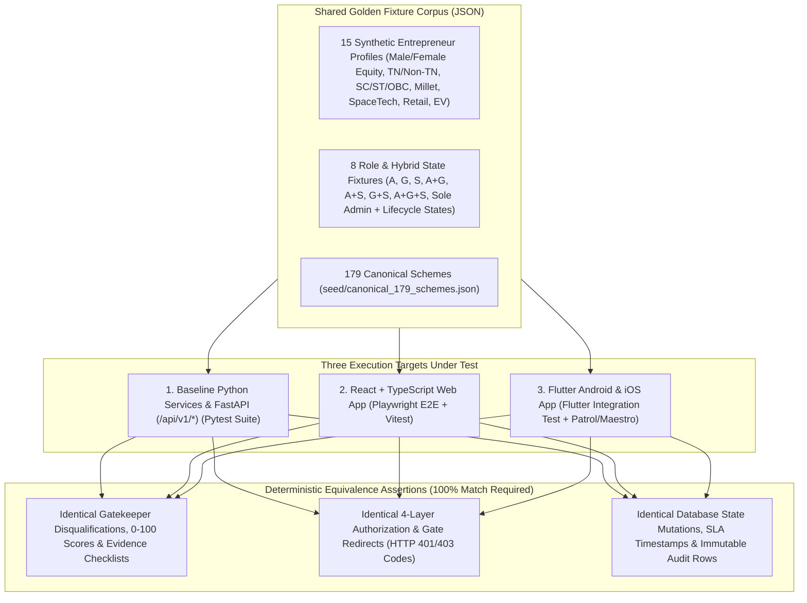

# FULCRUM-INDIA — DOCUMENT 7: CROSS-PLATFORM PARITY & QA MATRIX

| Document Attribute | Value |
| :--- | :--- |
| **Document ID** | `FULCRUM-XPQ-V2.0` |
| **Filename** | `FULCRUM_CROSS_PLATFORM_PARITY_AND_QA.md` |
| **Baseline Commit** | `235767754f8d8bb4605e819593bb3f370ddeab27` (`2026-11-11`) |
| **Date of Handover Package** | `2026-11-16` |
| **Target Audience** | QA Lead, SDETs, Backend Engineers, React Web Engineers, Flutter Mobile Engineers |
| **Baseline UAT Reference** | [`FULCRUM_UATD_V2.md`](../07_REQUIREMENTS_BASELINE_V2/FULCRUM_UATD_V2.md) (`UAT-AUTH-001` to `UAT-BKP-001`) |

---

## 1. Purpose and Cross-Platform Golden-Test Strategy

When migrating or extending **FULCRUM-INDIA Beta 2.0.0** from a single Streamlit application to **React + TypeScript Web** and **Flutter Android/iOS Mobile** backed by a shared REST API, functional equivalence must be **proven through automated golden tests**, never assumed.

### Mermaid Diagram 1 — Cross-Platform Golden-Test & Parity Verification Architecture

---

## 2. Complete Cross-Platform Feature & Screen Parity Matrix (`SCR-01` to `SCR-30` & `ADM-01` to `ADM-13`)

| Screen & Req ID | Existing Streamlit Baseline (`views/*.py`, `services/*.py`) | React Web Requirement (`FULCRUM_REACT_WEB_HANDOVER.md`) | Flutter Android Requirement (`FULCRUM_FLUTTER_MOBILE_HANDOVER.md`) | Flutter iOS Requirement (`FULCRUM_FLUTTER_MOBILE_HANDOVER.md`) | Shared Backend API Dependency (`/api/v1/*`) | Authz & Gate Requirement | Baseline Automated Test & UAT Ref | Priority | Status in Baseline |
| :--- | :--- | :--- | :--- | :--- | :--- | :--- | :--- | :---: | :--- |
| **`SCR-01` / `FR-AUTH-001..002`** Public Login & Aspirant Signup | `views/login.py` L563–L704, `auth.py::signup_aspirant` | `/login`, `/signup` with Spam notice + Resend button (`DEF-001`,`002`) + `>=8` char PW (`DEF-003`) | `/auth/login`, `/auth/signup` with Spam notice + Resend button + `>=8` char PW | Identical to Android | `POST /api/v1/auth/signup-aspirant`, `POST /api/v1/auth/resend-confirmation` | Public; role locked to `aspirant` | `UAT-AUTH-001..004`, `test_single_admin_master_e2e.py::test_01` | **P0** | Implemented (UX fix `DEF-001..003` pending) |
| **`SCR-02` / `FR-AUTH-003`** Password Recovery | `views/login.py` L375–L558, `auth_callback_component.py` | `/auth/recovery` reading URL hash/PKCE token | Android App Link `https://app.fulcrumindia.online/?type=recovery` | iOS Universal Link `https://app.fulcrumindia.online/?type=recovery` | `POST /api/v1/auth/password-reset/request` & `/complete` | Single-use recovery token; blocks `<SOLE_ADMIN_EMAIL>` | `UAT-AUTH-005..006`, `test_password_recovery_suite.py` | **P0** | Implemented & Tested |
| **`SCR-03` & `SCR-04` / `BR-LIFE-001`** Account Blocked & 30-Day Grace Banner | `app.py` L1095–L1188, `account_lifecycle.py` | `<BlockedAccountScreen />` & `<DeletionGraceBanner />` | Full-screen barrier & top grace banner | Identical to Android | `GET /api/v1/me/bootstrap`, `POST /api/v1/accounts/me/cancel-deletion` | Gate 0 (Fail-closed `DENIED` on error) | `UAT-LIFE-001..002`, `test_argon_p0_negative_security.py` | **P0** | Implemented & Tested |
| **`SCR-05` / `FR-AUTH-004`** First-Login PW Gate | `app.py` L1198–L1232, `auth.py` L880–L995 | `/onboarding/set-password` (`>=8` chars) | `/onboarding/set-password` (`>=8` chars) | Identical to Android | `POST /api/v1/auth/first-login-password` | Gate 1 (`temp_password_issued == true`) | `UAT-ONB-001`, `test_qa32_fixes_regression.py::test_def009` | **P0** | Implemented & Tested |
| **`SCR-06` & `SCR-07` / `FR-LEGAL-001`** Terms & Role NDA Gates | `views/legal_ui.py` L19–L229, `legal.py` | `/onboarding/terms`, `/onboarding/nda/:role` | `/onboarding/terms`, `/onboarding/nda/:role` | Identical to Android | `GET /api/v1/legal/documents/:type`, `POST /api/v1/legal/acceptances` | Gate 2 (Terms) & Gate 3 (`nda_guide`/`nda_sme` + `'I AGREE'`) | `UAT-LEGAL-001`, `test_single_admin_master_e2e.py::test_03..04` | **P0** | Implemented & Tested |
| **Workspace Switcher & Notifs / `FR-ROLE-001`, `FR-NOTIF-001`** | `app.py` L839–L1075, `roles.py`, `notifications.py` | `<WorkspaceSelector />` + `<NotificationDrawer />` | AppBar workspace switcher + notification sheet | Identical to Android | `GET /api/v1/me/bootstrap`, `GET/PATCH /api/v1/notifications` | 7 role combos; 5s revocation eviction (`BR-ROLE-001`) | `UAT-ROLE-001`, `test_multi_role_e2e_workflows.py`, `test_def010` | **P0** | Implemented & Tested |
| **`SCR-08` / `FR-ASP-003`** Aspirant Overview & PDF Dossier | `views/aspirant.py` L100–L218, `pdf_generator.py` | `/aspirant/overview` + PDF download | `/aspirant/overview` + native PDF share/print sheet | Identical to Android (`UIActivityViewController`) | `GET /api/v1/reports/aspirants/:id/dossier-pdf` | Owner `A`, Assigned `G`, `Admin` | `UAT-JRN-001`, `UAT-CONC-001`, `test_single_admin_master_e2e.py::test_09` | **P0** | Implemented & Tested |
| **`SCR-09` / `FR-ASP-001..002`** Aspirant 4-Part Profile & Photo | `views/aspirant.py` L220–L454, `profiles.py`, `aspirant_photos.py` | `/aspirant/profile` + photo uploader | `/aspirant/profile` + Android Photo Picker / Camera | `/aspirant/profile` + `PHPickerViewController` / Camera | `GET/PUT /api/v1/profiles/aspirants/:id`, `POST/GET/DELETE /api/v1/media/aspirant-photo/:id` | Owner `A` (preserves `mentor` dict `DEF-32-006`); Photo: Owner, Admin, Assigned `G`/`S` with NDA | `UAT-PROF-001`, `UAT-PHOTO-001`, `test_aspirant_photo_dashboard_visibility.py` | **P0** | Implemented & Tested |
| **`SCR-10` / `FR-JRN-001`** Aspirant Journey & Revisions | `views/aspirant.py` L456–L644, `journey.py`, `journey_edit_dialog.py` | `/aspirant/journey` + edit modal + revision drawer | `/aspirant/journey` + edit bottom sheet + revisions | Identical to Android | `GET/POST /api/v1/journeys/:id/events`, `PATCH /api/v1/journeys/events/:eventId` | Edit: `actor_id == user.id` or `Admin` + `expected_updated_at` | `UAT-JRN-001`, `verify_journey_governance_and_ui.py` | **P0** | Implemented & Tested |
| **`SCR-11` / `FR-CMP-001`** Aspirant Mentors & Complaint | `views/aspirant.py` L646–L789, `governance.py` | `/aspirant/mentors` + complaint drawer | `/aspirant/mentors` + complaint sheet | Identical to Android | `GET /api/v1/profiles/aspirants/:id`, `GET/POST /api/v1/governance/complaints` | Complaint hidden from Guides (`BR-CMP-001`) | `UAT-CMP-001`, `test_confidential_complaints.py` | **P0** | Implemented & Tested |
| **`SCR-12` / `FR-GUIDE-002`** Aspirant Released Schemes | `views/aspirant.py` L791–L847, `schemes.py` | `/aspirant/schemes` + 7-stage stepper | `/aspirant/schemes` + 7-stage stepper | Identical to Android | `GET /api/v1/schemes/releases/:id`, `PATCH /api/v1/schemes/releases/:id/:schemeId` | Aspirant sees **only** `status='released'` rows | `UAT-SCH-001`, `test_single_admin_master_e2e.py::test_08` | **P0** | Implemented & Tested |
| **`SCR-13` / `FR-CONS-001`** Aspirant Consultations & Case Notes | `views/aspirant.py` L849–L1104, `help_requests.py`, `collaboration.py` | `/aspirant/consultations` | `/aspirant/consultations` | Identical to Android | `GET/POST /api/v1/consultations`, `POST /api/v1/consultations/:id/reply`, `GET/POST /api/v1/cases/:id/discussions` | Blocks new tickets in `PENDING_DELETION`; strips `is_private_mentor_note=true` | `UAT-CONS-001`, `test_consultation_isolation.py` | **P0** | Implemented & Tested |
| **`SCR-14` & `SCR-15` / `FR-GUIDE-001..002`, `FR-SCH-001`** Guide Portal (6 Mentee Subtabs + Overview + Headshot) | `views/guide.py` L60–L1379, `scheme_matching_engine.py`, `scheme_reviews.py`, `professional_photos.py` | `/guide/aspirants/:id/:subtab` (6 subtabs), `/guide/consultations`, `/guide/profile` | `/guide/aspirants/:id` (6 tabs), `/guide/consultations`, `/guide/profile` | Identical to Android | `POST /api/v1/schemes/match/:id`, `POST /api/v1/schemes/releases/:id`, `POST /api/v1/schemes/support-reviews`, `POST /api/v1/media/professional-photo/:id` | Active `guide` role + signed `nda_guide` + assigned in `guide_id` or `guide_ids` | `UAT-SCH-001`, `UAT-PHOTO-002`, `test_scheme_matching_engine.py`, `test_scheme_relevance_synthetic.py` | **P0** | Implemented & Tested |
| **`SCR-16` & `SCR-17` / `FR-SME-001..002`, `FR-CMP-001`** SME Portal (4 Mentee Subtabs + COI + Overview + Headshot) | `views/sme.py` L36–L952, `governance.py`, `professional_photos.py` | `/sme/cases/:id/:subtab` (4 subtabs — no schemes), `/sme/consultations`, `/sme/profile` | `/sme/cases/:id` (4 tabs — no schemes), `/sme/consultations`, `/sme/profile` | Identical to Android | `POST /api/v1/governance/sme-conflicts`, `POST /api/v1/consultations/:id/reply` | Active `sme` role + signed `nda_sme` + assigned in `sme_id`/`sme_ids`; locked if `has_conflict=true` | `UAT-CMP-001`, `UAT-PHOTO-002`, `verify_multi_sme_and_security.py`, `test_def005` | **P0** | Implemented & Tested |
| **`SCR-18`..`SCR-30` (`ADM-01`..`ADM-13`) / `FR-ADMIN-001..013`** Sole Administrator Control Tower (All 13 Sections) | `views/admin.py` L141–L1542, `views/admin_governance.py`, `views/admin_account_lifecycle.py` | **100% Full 13-Section Implementation** (`/admin/*` routes specified in `Doc 5 Section 4`) | Admin Triage Console (or Full 13-Tab Parity per `DEC-MOB-001` in `Doc 6 Section 3.2`) | Identical to Android (`DEC-MOB-001`) | All `/api/v1/admin/*` endpoints | **Sole Admin Only (`<SOLE_ADMIN_EMAIL>`)** verified via `require_sole_admin()` JWT + session check | `UAT-ONB-001`, `UAT-REL-001`, `UAT-MON-001`, `UAT-LIFE-001..002`, `UAT-RPT-001`, `test_qa32_fixes_regression.py` | **P0 (Web) / P1 (Mobile)** | Implemented & Tested |

---

## 3. Eleven High-Risk Parity Scenarios Requiring Dedicated Automated Tests

Every release of the Backend API, React Web app, and Flutter Mobile app must pass automated verification across these 11 security- and business-critical scenarios:

| # | Critical Scenario | Required Golden Test Verification Across API, React & Flutter | Baseline Test Reference |
| :-: | :--- | :--- | :--- |
| **1** | **Multi-Role Hybrid Accounts (`7` Combinations)** | Test all 7 combinations (`A`, `G`, `S`, `A+G`, `A+S`, `G+S`, `A+G+S`). Verify workspace switcher shows only granted roles, anti-self-mentoring blocks `mentor_id == aspirant_id`, and saving an Aspirant profile on `A+G` preserves `profile_data['mentor']` (`DEF-32-006`). | `tests/test_multi_role_e2e_workflows.py`, `tests/test_qa32_fixes_regression.py::test_def006` |
| **2** | **Live Role Revocation While Session Is Active** | While a user has the Guide workspace open in React or Flutter, Admin calls `POST /api/v1/admin/roles/revoke`. Verify the next API call returns `403 ROLE_NOT_AUTHORIZED` and the client evicts the Guide workspace within `<= 5` seconds. | `08_CHAOS_ENGINEERING_REPORT.md` Scenario 7, `tests/test_argon_p0_negative_security.py` |
| **3** | **Private Aspirant Data & Photo Isolation** | Verify unassigned Guides/SMEs, `pending_nda` mentors, and other Aspirants receive `403` on `/api/v1/profiles/aspirants/:id` and `/api/v1/media/aspirant-photo/:id`, and that mentor headshots are masked (`null`) for Aspirants. | `tests/test_aspirant_photo_dashboard_visibility.py` (`test_01`–`test_22`), `tests/test_single_admin_and_photos.py` |
| **4** | **Mentor Unassignment & Co-Guide Promotion Handover** | Assign Primary Guide G1 and Co-Guide G2 to Aspirant A with an open consultation ticket. Unassign G1 (or archive G1). Verify G2 is automatically promoted to `relationships.guide_id` and the open ticket transfers to G2. | `tests/test_checkpoint1_defects_and_handover.py::test_04`, `test_05` |
| **5** | **Sequential Legal & NDA Gating** | Verify that an account with `temp_password_issued=true`, unaccepted Terms, or `pending_nda` receives deterministic `403` gate codes (`PASSWORD_CHANGE_REQUIRED`, `TERMS_ACCEPTANCE_REQUIRED`, `NDA_ACCEPTANCE_REQUIRED`) on all domain endpoints until completed in order. | `tests/test_single_admin_master_e2e.py::test_03`, `test_04`, `tests/test_argon_p0_negative_security.py` |
| **6** | **179-Scheme Deterministic Matching Equivalence** | Feed the 9 synthetic profiles from `tests/test_scheme_relevance_synthetic.py` into `POST /api/v1/schemes/match/:id` and verify 100% identical disqualification reasons, `0–100` scores, and evidence checklists in React and Flutter. | `tests/test_scheme_matching_engine.py`, `tests/test_scheme_relevance_synthetic.py` |
| **7** | **Journey Edit Attribution & Optimistic Locking** | Verify only the original `actor_id` (or Sole Admin) can `PATCH /api/v1/journeys/events/:id`, that a stale `expected_updated_at` returns `409 Conflict`, and that every edit inserts a snapshot in `public.journey_event_revisions`. | `verify_journey_governance_and_ui.py` |
| **8** | **Account Archival Atomic Handover & Compensating Rollback** | Inject a simulated failure during `archive_account()` profile update or audit log insert and verify `_restore_relationship_snapshots()` restores all mentor assignments with zero orphaned mentees; verify `account_lifecycle_log` rejects `UPDATE` and `DELETE`. | `tests/test_account_lifecycle_and_handover_chaos.py`, `tests/test_qa32_fixes_regression.py::test_def001` |
| **9** | **Confirmation Email, Spam Guidance & Resend Control** | Verify public signup returns `pending_confirmation: true`, renders the Spam/Promotions notice (`DEF-001`), blocks login until confirmed, and allows triggering `POST /api/v1/auth/resend-confirmation` (`DEF-002`). | `UAT-AUTH-001`, `UAT-AUTH-002` |
| **10** | **Network Failures, Retries & Idempotency** | Simulate network drop during mobile `POST /api/v1/consultations` retry with the same `Idempotency-Key` header and verify exactly 1 ticket is created; verify database outage fails closed (`DENIED`). | `tests/test_failure_isolation.py`, `NFR-REL-001`, `NFR-REL-003` |
| **11** | **Concurrent Multi-User Operations & PDF Semaphore** | Execute 30–50 concurrent API sessions and 5 simultaneous `/dossier-pdf` requests and verify `0%` errors, zero cross-user token leakage, and `< 800 MiB` container RAM. | `tests/test_concurrency_load.py`, `tests/test_cross_session_isolation.py` |
