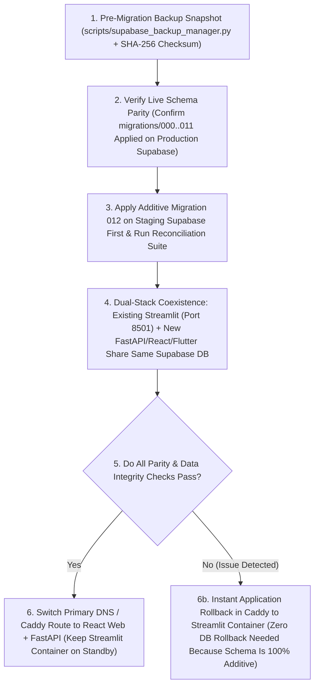

# FULCRUM-INDIA — DOCUMENT 3: DATABASE & DATA MIGRATION SPECIFICATION

| Document Attribute | Value |
| :--- | :--- |
| **Document ID** | `FULCRUM-DMC-V2.0` |
| **Filename** | `FULCRUM_DATABASE_MIGRATION_CONTRACT.md` |
| **Baseline Commit** | `235767754f8d8bb4605e819593bb3f370ddeab27` (`2026-11-11`) |
| **Date of Handover Package** | `2026-11-16` |
| **Target Audience** | Database Architects, Backend Engineers, DevOps / SRE, Security Auditors |
| **Core Database Strategy** | **Retain Existing Supabase PostgreSQL, GoTrue Auth & Private Storage Buckets In-Place (Zero Destructive Drops)** |

---

## 1. Strategic Principle: Retain the Existing Supabase Database In-Place

The existing **FULCRUM-INDIA Beta 2.0.0** persistence tier on **Supabase PostgreSQL (`public` schema), Supabase GoTrue (`auth.users`), and Supabase Private Storage (`storage.buckets` / `storage.objects`)** is already normalized, indexed, and protected by Row Level Security (RLS) and database triggers (`migrations/000` through `011`).

> [!IMPORTANT]
> **No Destructive Database Migration Needed**: Rebuilding the user interface in **React + TypeScript** or **Flutter Android/iOS** does **not** require dropping, recreating, or migrating off the existing Supabase PostgreSQL database. Both the existing Streamlit application and the new Backend API + React/Flutter clients can connect to the **exact same Supabase database**, allowing:
> 1. **Zero User Re-Registration**: All existing `auth.users` password hashes (`bcrypt`), confirmed email timestamps, and UUIDs remain 100% valid. Existing Aspirants, Guides, SMEs, and the Sole Administrator sign into the new React and Flutter apps with their existing email and password.
> 2. **Zero Historical Data Loss**: All `profiles`, `user_roles`, `legal_acceptances`, `relationships`, `assignment_history`, `journeys`, `journey_events`, `journey_event_revisions`, `help_requests`, `case_discussions`, `schemes` (179), `scheme_releases`, `scheme_support_reviews`, `guide_complaints`, `sme_conflict_declarations`, `inactivity_logs`, `external_contact_logs`, `aspirant_photos`, `professional_photos`, and `account_lifecycle_log` rows remain intact.
> 3. **Parallel Coexistence During Cutover**: The legacy Streamlit container (`fulcrum-app`) and the new API/React/Flutter stack can run side-by-side against the same database during phased UAT.

---

## 2. Complete Existing Schema Inventory & Entity Relationship Diagram (`23` Public Tables)

### Mermaid Diagram 1 — Complete PostgreSQL Entity Relationship Diagram (`migrations/000`–`011`)

```mermaid
erDiagram
    AUTH_USERS ||--|| PROFILES : "id (ON DELETE RESTRICT)"
    PROFILES ||--o{ USER_ROLES : "user_id"
    PROFILES ||--o{ LEGAL_ACCEPTANCES : "user_id"
    LEGAL_DOCUMENTS ||--o{ LEGAL_ACCEPTANCES : "doc_type"
    PROFILES ||--o| ASPIRANT_PHOTOS : "user_id"
    PROFILES ||--o| PROFESSIONAL_PHOTOS : "user_id"
    PROFILES ||--o{ ACCOUNT_LIFECYCLE_LOG : "user_id"
    PROFILES ||--o| RELATIONSHIPS : "aspirant_id"
    PROFILES ||--o{ RELATIONSHIPS : "guide_id / sme_id"
    PROFILES ||--o{ ASSIGNMENT_HISTORY : "aspirant_id / mentor_id"
    PROFILES ||--o| JOURNEYS : "aspirant_id"
    JOURNEYS ||--o{ JOURNEY_EVENTS : "journey_id"
    JOURNEY_EVENTS ||--o{ JOURNEY_EVENT_REVISIONS : "journey_event_id"
    PROFILES ||--o{ HELP_REQUESTS : "aspirant_id"
    PROFILES ||--o{ CASE_DISCUSSIONS : "aspirant_id"
    SCHEMES ||--o{ SCHEME_RELEASES : "scheme_id"
    PROFILES ||--o{ SCHEME_RELEASES : "aspirant_id / guide_id"
    SCHEMES ||--o{ SCHEME_SUPPORT_REVIEWS : "scheme_id"
    PROFILES ||--o{ SCHEME_SUPPORT_REVIEWS : "aspirant_id / guide_id"
    PROFILES ||--o{ GUIDE_COMPLAINTS : "aspirant_id / guide_id"
    PROFILES ||--o{ SME_CONFLICT_DECLARATIONS : "sme_id / aspirant_id"
    RELATIONSHIPS ||--o{ INACTIVITY_LOGS : "relationship_id"
    INACTIVITY_LOGS ||--o{ EXTERNAL_CONTACT_LOGS : "inactivity_record_id"
    PROFILES ||--o{ NOTIFICATIONS : "user_id"
    PROFILES ||--o{ ACTIVITY_LOG : "user_id"

    PROFILES {
        uuid id PK
        text email UK
        text full_name
        text phone
        text role
        text district
        text state
        jsonb profile_data
        bool is_active
        text account_status
        bool legal_hold
        text lifecycle_reason
        timestamptz deletion_scheduled_for
    }
    USER_ROLES {
        uuid id PK
        uuid user_id FK
        text role
        text status
        bool nda_accepted
    }
    LEGAL_ACCEPTANCES {
        uuid id PK
        uuid user_id FK
        text doc_type
        text doc_version
        text document_hash
        text typed_name
        text typed_phrase
        timestamptz accepted_at
    }
    RELATIONSHIPS {
        uuid id PK
        uuid aspirant_id FK
        uuid guide_id FK
        uuid sme_id FK
        jsonb guide_ids
        jsonb sme_ids
        text status
    }
    JOURNEYS {
        uuid id PK
        uuid aspirant_id FK
        text title
        text status
    }
    JOURNEY_EVENTS {
        uuid id PK
        uuid journey_id FK
        uuid aspirant_id FK
        uuid actor_id FK
        text actor_role
        text event_type
        text title
        date event_date
        bool included_in_roadmap
    }
    JOURNEY_EVENT_REVISIONS {
        uuid id PK
        uuid journey_event_id FK
        uuid editor_id FK
        text previous_title
        text previous_description
        text change_reason
    }
    HELP_REQUESTS {
        uuid id PK
        uuid aspirant_id FK
        uuid assigned_guide_id FK
        uuid assigned_sme_id FK
        text status
        text request_type
        uuid last_interaction_actor_id
        text last_interaction_actor_role
        timestamptz last_mentor_response_at
    }
    SCHEMES {
        text id PK
        text name
        text agency
        text funding_type
        text stage
        jsonb sectors
        text state_scope
        bool is_active
    }
    SCHEME_RELEASES {
        uuid id PK
        uuid aspirant_id FK
        text scheme_id FK
        uuid guide_id FK
        text status
        text application_stage
    }
    SCHEME_SUPPORT_REVIEWS {
        uuid id PK
        uuid aspirant_id FK
        text scheme_id FK
        uuid guide_id FK
        int match_score
        text status
    }
    INACTIVITY_LOGS {
        uuid id PK
        uuid relationship_id FK
        uuid mentor_id FK
        uuid aspirant_id FK
        text mentor_role
        text escalation_stage
        text inactivity_episode
        text status
    }
    EXTERNAL_CONTACT_LOGS {
        uuid id PK
        uuid admin_id FK
        uuid recipient_id FK
        uuid aspirant_id FK
        text channel
        text status
    }
    ACCOUNT_LIFECYCLE_LOG {
        uuid id PK
        uuid user_id
        uuid actor_id
        text action
        text previous_status
        text new_status
        text reason
    }
```



### 2.1 Complete Table-by-Table Preservation & Constraint Specification

*(For full column definitions, see [`FULCRUM_SRS_V2.md`](../07_REQUIREMENTS_BASELINE_V2/FULCRUM_SRS_V2.md) Section 9.1.)*

| Table / Bucket | Key Integrity Constraints & Triggers to Preserve | Role in Future React & Flutter Architecture |
| :--- | :--- | :--- |
| `auth.users` | Managed by Supabase GoTrue; trigger `on_auth_user_created` calls `public.handle_new_user()` (`migrations/008` L45–L70). | Unchanged. Existing users log into React and Flutter with their current credentials. |
| `public.profiles` | `id UUID PK REFERENCES auth.users(id) ON DELETE RESTRICT` (`009` L170); `check_account_status_valid` (`ACTIVE`,`TEMPORARILY_SUSPENDED`,`ARCHIVED`,`PENDING_DELETION`); trigger `trg_enforce_single_admin_profile` (`008` L94). | Unchanged. Stores 4-part `profile_data` JSONB (`personal`, `professional`, `business`, `demographics`, `assistance_need`, `mentor`, `temp_password_issued`). |
| `public.user_roles` | `UNIQUE(user_id, role)`; `status IN ('active','pending_nda','suspended','revoked')`; trigger `trg_enforce_single_admin_user_roles` (`008` L115). | Unchanged. Source of truth for the 7 non-admin role combinations and workspace switching. |
| `public.legal_documents` & `public.legal_acceptances` | `doc_type IN ('terms_and_conditions','nda_guide','nda_sme')`; stores SHA-256 `document_hash`, `typed_name`, `typed_phrase`. | Unchanged. New Backend API populates `ip_address` and `user_agent` from real HTTP request headers (`resolving DEF-008`). |
| `public.relationships` & `public.assignment_history` | `aspirant_id UUID UNIQUE`; `guide_id`, `sme_id`, plus JSONB arrays `guide_ids` (Co-Guides) and `sme_ids` (Multi-SME). | Unchanged. Enforces primary + co-mentor caseloads and handover history. |
| `public.journeys`, `public.journey_events` & `public.journey_event_revisions` | `aspirant_id UUID UNIQUE` on `journeys`; `included_in_roadmap BOOL` on `journey_events`; append-only revision snapshots in `journey_event_revisions` (`002`). | Unchanged. Powers the chronological Enterprise Journey and PDF dossier export. |
| `public.help_requests` & `public.case_discussions` | `help_requests_status_check` (`011` L17–L28: 10 statuses); actor attribution columns (`004`); `is_private_mentor_note BOOL` on `case_discussions`. | Unchanged. Powers consultations, mentor-to-admin inquiries, and private mentor collaboration notes. |
| `public.schemes`, `public.scheme_releases` & `public.scheme_support_reviews` | `179` canonical rows in `schemes`; `UNIQUE(aspirant_id, scheme_id)` and `application_stage` (`008`) on `scheme_releases`; `UNIQUE(aspirant_id, scheme_id, guide_id)` on `scheme_support_reviews` (`004`). | Unchanged. Powers deterministic matching, Guide releases, 7-stage tracking, and Admin SSR overrides. |
| `public.guide_complaints` & `public.sme_conflict_declarations` | RLS hides `guide_complaints` from Guides; `UNIQUE(sme_id, aspirant_id)` on `sme_conflict_declarations`. | Unchanged. Powers confidential grievances and SME COI recusal locks. |
| `public.inactivity_logs` & `public.external_contact_logs` | Unique index `uq_inactivity_episode_stage(mentor_id, aspirant_id, mentor_role, inactivity_episode, escalation_stage)` (`006` L43). | Unchanged. Powers 7/10/14-day SLA monitoring and WhatsApp/Gmail outreach auditing. |
| `public.aspirant_photos`, `public.professional_photos` & Storage Buckets | Private buckets `aspirant-profile-photos` (`003`,`005`) and `professional-headshots` (`008`: `CHECK width=320 AND height=320 AND byte_size<=153600`). | Unchanged. Served exclusively via 300-second signed URLs from the Backend API. |
| `public.account_lifecycle_log` | Triple-layer append-only immutability (`REVOKE UPDATE, DELETE`, `AS RESTRICTIVE USING (FALSE)` RLS, and `trg_immutable_account_lifecycle_log` in `009` L211–L286). | Unchanged. Permanent institutional lifecycle audit trail. |
| `public.notifications` & `public.activity_log` | Indexed by `(user_id, is_read)` and `created_at DESC`. | Unchanged. Powers workspace-filtered notification feeds across Web and Mobile. |

---

## 3. Proposed Additive Migration `012` for Mobile & API Support (`[PROPOSED]`)

While all 23 existing tables work without modification, adding a **100% additive, non-breaking Migration `012`** is recommended when launching the Backend API and Flutter mobile apps to support:
1. **Mobile Push Notification Device Tokens (`public.user_device_tokens`)**: Optional FCM/APNs token registration if native push notifications are enabled alongside in-app notifications.
2. **API Request Idempotency Keys (`public.api_idempotency_keys`)**: Prevents duplicate mutations if a mobile client retries a `POST` request over an unstable cellular connection.

```sql
-- =============================================================================
-- PROPOSED MIGRATION 012: MOBILE DEVICE TOKENS & API IDEMPOTENCY KEYS (ADDITIVE)
-- =============================================================================
-- Status: PROPOSED (Do not execute until Backend API & Flutter phase is approved)

CREATE TABLE IF NOT EXISTS public.user_device_tokens (
    id UUID PRIMARY KEY DEFAULT gen_random_uuid(),
    user_id UUID NOT NULL REFERENCES public.profiles(id) ON DELETE CASCADE,
    platform TEXT NOT NULL CHECK (platform IN ('android', 'ios', 'web')),
    push_token TEXT NOT NULL,
    active_workspace TEXT DEFAULT 'aspirant',
    last_seen_at TIMESTAMPTZ DEFAULT NOW(),
    created_at TIMESTAMPTZ DEFAULT NOW(),
    CONSTRAINT uq_user_device_token UNIQUE (user_id, push_token)
);

ALTER TABLE public.user_device_tokens ENABLE ROW LEVEL SECURITY;

CREATE POLICY "Users manage own device tokens" ON public.user_device_tokens
    FOR ALL TO authenticated
    USING (user_id = auth.uid())
    WITH CHECK (user_id = auth.uid());

CREATE TABLE IF NOT EXISTS public.api_idempotency_keys (
    idempotency_key TEXT PRIMARY KEY,
    user_id UUID NOT NULL REFERENCES public.profiles(id) ON DELETE CASCADE,
    endpoint_path TEXT NOT NULL,
    response_status INTEGER NOT NULL,
    response_body JSONB NOT NULL,
    created_at TIMESTAMPTZ DEFAULT NOW()
);

ALTER TABLE public.api_idempotency_keys ENABLE ROW LEVEL SECURITY;

CREATE POLICY "Admin full access api_idempotency_keys" ON public.api_idempotency_keys
    FOR ALL TO authenticated
    USING (public.is_admin());
```

---

## 4. Schema Verification, Backup, Rollback & Zero-Downtime Cutover Strategy

### Mermaid Diagram 2 — Database Verification, Coexistence & Rollback Pipeline



### 4.1 Data Reconciliation & Migration Test Cases

| Test ID | Migration Verification Objective | Verification Query / Script | Acceptance Criterion |
| :--- | :--- | :--- | :--- |
| **`MIG-TC-01`** | **Pre-Cutover Row-Count & Checksum Baseline** | Run `python scripts/supabase_backup_manager.py` and record row counts for all 23 `public` tables + `auth.users`. | 100% of tables exported with verified SHA-256 manifest in `backups/`. |
| **`MIG-TC-02`** | **Live Constraint & Trigger Verification (`008`–`011`)** | Query `information_schema.triggers` and `pg_constraint` for `trg_enforce_single_admin_profile`, `trg_enforce_single_admin_user_roles`, `trg_immutable_account_lifecycle_log`, `profiles_id_fkey` (`RESTRICT`), and `help_requests_status_check`. | All 3 triggers and constraints active in production PostgreSQL (`DEC-002`). |
| **`MIG-TC-03`** | **Existing User Zero-Re-Registration Login Test** | Log into the new React Web and Flutter Mobile apps using an existing pre-migration Aspirant, Guide, SME, and Sole Admin account. | `signInWithPassword` succeeds, `GET /api/v1/me/bootstrap` resolves identical roles, and all historical Journey events, consultations, and released schemes render identically. |
| **`MIG-TC-04`** | **Cross-Stack Write Compatibility Test** | Create a consultation reply in React/Flutter and view it in the standby Streamlit app (and vice versa). | Both stacks read and write identical column formats and enum strings with zero schema errors. |
