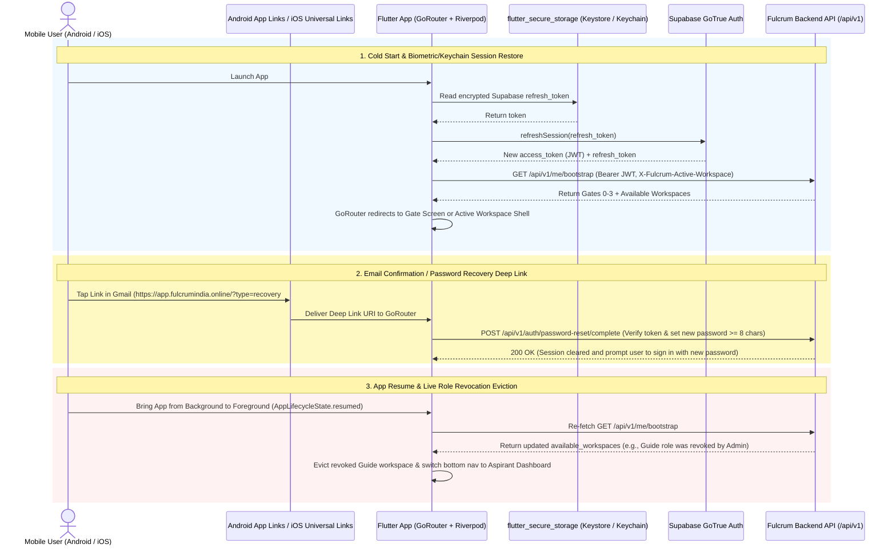

# FULCRUM-INDIA — DOCUMENT 6: FLUTTER ANDROID & iOS MOBILE DEVELOPMENT HANDOVER

| Document Attribute | Value |
| :--- | :--- |
| **Document ID** | `FULCRUM-FMH-V2.0` |
| **Filename** | `FULCRUM_FLUTTER_MOBILE_HANDOVER.md` |
| **Baseline Commit** | `235767754f8d8bb4605e819593bb3f370ddeab27` (`2026-11-11`) |
| **Date of Handover Package** | `2026-11-16` |
| **Target Audience** | Flutter / Dart Mobile Architects, Android & iOS Engineers, QA Engineers |
| **Target Platforms** | Android (API 24+ / Android 7.0+) & iOS (iOS 15.0+) from a Single Shared Flutter Codebase |

---

## 1. Proposed Flutter Architecture & Shared Codebase Strategy

The Flutter mobile application provides a unified **Android and iOS** codebase consuming the exact same REST API ([`FULCRUM_BACKEND_API_CONTRACT.md`](./FULCRUM_BACKEND_API_CONTRACT.md)) and Supabase GoTrue Auth as the React web app.

### Recommended Flutter Stack
- **SDK & Language**: **Flutter 3.24+ / Dart 3.5+** with Material 3 + platform-adaptive Cupertino dialogs.
- **Architecture Pattern**: Feature-first **Clean Architecture** (`presentation` $\rightarrow$ `application/providers` $\rightarrow$ `domain/models` $\rightarrow$ `data/repositories`) with **Riverpod 2.x (`flutter_riverpod` + `riverpod_annotation`)** for reactive state management and dependency injection.
- **Navigation & Deep Linking**: **`go_router`** with a centralized `redirect` guard evaluating the bootstrap gate state (`SCR-03`–`SCR-07`) and handling incoming Universal Links (iOS) / App Links (Android) for email verification and password recovery.
- **Networking**: **`dio`** HTTP client with an `AuthWorkspaceInterceptor` that attaches `Authorization: Bearer <jwt>`, `X-Fulcrum-Active-Workspace: <role>`, and `Idempotency-Key: <uuid>` on mutating requests.
- **Secure Token Persistence**: **`flutter_secure_storage`** (backed by **Android Keystore `EncryptedSharedPreferences`** and **iOS Keychain `kSecAttrAccessibleAfterFirstUnlockThisDeviceOnly`**) for storing the Supabase session refresh token.

```text
fulcrum_mobile/
├── android/                          # AndroidManifest.xml, App Links assetlinks.json config, Gradle
├── ios/                              # Info.plist, Associated Domains, Runner.xcodeproj
├── lib/
│   ├── core/
│   │   ├── api/                      # Dio client, AuthWorkspaceInterceptor, ErrorEnvelope parser
│   │   ├── auth/                     # Supabase Auth listener, SecureStorageSessionManager
│   │   ├── router/                   # GoRouter config + GateRedirectGuard
│   │   ├── theme/                    # FulcrumTheme (Light #F8FAFC, Blue #2563EB, Avenir/PlusJakartaSans)
│   │   └── constants/                # Taxonomies (38 TN districts, 16 sectors, stages, etc.)
│   ├── features/
│   │   ├── auth/                     # SCR-01 Login/Signup/Resend, SCR-02 Recovery Deep Link
│   │   ├── gates/                    # SCR-03 Blocked, SCR-04 DeletionGrace, SCR-05 SetPW, SCR-06 Terms, SCR-07 NDA
│   │   ├── aspirant/                 # SCR-08..13 (Overview/PDF, 4-Part Profile, Journey, Mentors/Complaint, Schemes, Consultations)
│   │   ├── guide/                    # SCR-14..15 (Mentee Selector + 6 Sub-Tabs, Guide Consultations, Guide Profile/Headshot)
│   │   ├── sme/                      # SCR-16..17 (Case Selector + 4 Sub-Tabs + COI Form, SME Consultations, SME Profile)
│   │   └── admin/                    # Mobile Admin Triage Console (or Full Responsive Admin per DEC-MOB-001)
│   └── main.dart
└── pubspec.yaml
```

---

## 2. Mobile Session Lifecycle, Deep Linking & Workspace Eviction

### Mermaid Diagram 1 — Mobile Session Lifecycle, Deep Link Recovery & Live Workspace Eviction



---

## 3. Role Portals on Mobile & Explicit Administrator Mobile Strategy (`DEC-MOB-001`)

### 3.1 Aspirant, Guide & SME Mobile Workspaces (100% Feature Parity)
- **Aspirant Mobile Shell (`SCR-08`–`SCR-13`)**: Bottom `NavigationBar` with 5 primary destinations (`Overview`, `Profile`, `Journey`, `Schemes`, `Consult`) + top AppBar avatar opening `My Mentors & Confidential Complaint` (`SCR-11`), Notification Drawer, and Workspace Switcher (if multi-role).
- **Guide Mobile Shell (`SCR-14`–`SCR-15`)**: Bottom `NavigationBar` with 3 destinations (`My Aspirants`, `All Consultations`, `My Profile`). Selecting an Aspirant opens a dedicated `MenteeDetailScaffold` with a scrollable top `TabBar` across all **6 subtabs** (`Profile`, `Journey`, `Team`, `Schemes`, `Consultations`, `Collaboration`).
- **SME Mobile Shell (`SCR-16`–`SCR-17`)**: Bottom `NavigationBar` with 3 destinations (`Assigned Cases`, `All Consultations`, `My Profile`). Selecting a case opens `SmeCaseScaffold` with **4 subtabs** (`Profile`, `Journey`, `Team`, `Consultations + COI Declaration`).

### 3.2 Administrator Mobile Strategy Evaluation (`DEC-MOB-001` — Requires Owner Approval)
The Sole Administrator workspace (`ADM-01` through `ADM-13`) contains dense multi-column data grids, bulk scheme editors (20+ fields per scheme), and complex side-by-side comparison workflows. Two options are presented for owner decision (`DEC-MOB-001`):
- **Option 1 (Recommended — Web-First Full 13-Tab Suite + High-Priority Mobile Admin Triage)**:
  - **React Web (`FULCRUM_REACT_WEB_HANDOVER.md`)** hosts 100% of all 13 Admin sections (`ADM-01`–`ADM-13`) with desktop and tablet responsiveness.
  - **Flutter Mobile** provides the **Admin Triage & Governance Console** covering urgent on-the-go actions: Control Tower KPIs, Mentor Assignment/Replacement (`ADM-04`), Mentor Inquiry Directives & SSR Approvals (`ADM-05`), Confidential Complaint Resolution (`ADM-09`), 7/10/14-Day Inactivity Alerts with native WhatsApp/Gmail intent launch (`ADM-10`/`11`), SME Conflict Adjudication (`ADM-12`), and Account Suspension/Resume (`ADM-13`), while directing heavy bulk catalog CRUD (`ADM-06`: 20-field scheme editor) to the React Web console.
- **Option 2 (Full 13-Tab Parity Inside Flutter Mobile)**: Implement all 13 Admin sections natively in Flutter using mobile stepper forms for `ADM-02`, `ADM-03`, and `ADM-06`.
- *Note: Both options are mapped in [`FULCRUM_CROSS_PLATFORM_PARITY_AND_QA.md`](./FULCRUM_CROSS_PLATFORM_PARITY_AND_QA.md). No Admin capability is dropped without explicit owner sign-off on `DEC-MOB-001`.*

---

## 4. Offline Behaviour, Network Interruption & Data Integrity Rules

> [!WARNING]
> **Prohibition of Unverified Offline Write Synchronization**: Fulcrum's domain operations—such as releasing a government scheme (`BR-SCH-001`), replying to a consultation (which checks SME COI locks `BR-CMP-001` and updates SLA clocks `BR-MON-001`), editing a Journey milestone (which uses `expected_updated_at` optimistic concurrency `BR-JRN-001`), or archiving an account (`BR-LIFE-001`)—depend on real-time server-side authorization and state checks. **Do NOT implement offline background write queueing for governance or mentorship mutations**, as an SME or Guide whose role was revoked or COI-locked while offline would generate unauthorized or conflicting writes upon reconnection.

1. **Allowed Read Caching & Draft Persistence**:
   - **In-Memory / Encrypted Read Cache**: Cache the user's current profile, Journey timeline, and released schemes for offline viewing during brief cellular drops (displaying an amber `"Offline — Viewing Cached Data"` banner). Never cache private photographs to unencrypted external storage (`SEC-STOR-001`).
   - **Local Unsubmitted Form Drafts**: Persist unsent text typed into the 4-part Profile form or a Consultation reply box in local encrypted storage so a dropped connection does not erase what the user was typing.
2. **Idempotent Retry on Mutating Requests**:
   - Attach a client-generated `Idempotency-Key: <uuid-v4>` header to every `POST` request so automatic network retries over flaky mobile connections never create duplicate consultation tickets, Journey events, or scheme releases (`NFR-REL-003`).

---

## 5. Device Permissions, Media Handling, Deep Links & Store Release Requirements

### 5.1 Android (`AndroidManifest.xml`) & iOS (`Info.plist`) Permissions
Follow strict least-privilege permissions (no background location, contacts scraping, or microphone access):
- **Photo Selection (`image_picker` / Android Photo Picker)**:
  - Android 13+ (API 33+): Uses system Photo Picker (zero storage permission required) + `android.permission.CAMERA` (only if user chooses "Take Photo").
  - iOS: `NSPhotoLibraryUsageDescription` (*"Fulcrum needs access to your photo library so you can upload your private profile photograph."*) and `NSCameraUsageDescription` (*"Fulcrum needs camera access if you choose to take a profile photograph."*).
- **Network & External Intents (`url_launcher`)**:
  - `android.permission.INTERNET`
  - `<queries>` declarations in `AndroidManifest.xml` and `LSApplicationQueriesSchemes` in `Info.plist` for `https`, `mailto`, and `whatsapp` (used by Admin external outreach in `ADM-10`/`ADM-11`).
- **PDF Dossier Viewing & Saving**:
  - Stream PDF bytes from `GET /api/v1/reports/aspirants/{id}/dossier-pdf` into the app's private temporary cache directory (`getTemporaryDirectory()`) and open via native share/print sheet (`printing` / `share_plus` package) without requiring broad external storage permissions.

### 5.2 Deep Links for Email Confirmation & Password Recovery
- Configure **Android App Links** (`https://app.fulcrumindia.online/.well-known/assetlinks.json`) and **iOS Universal Links** (`https://app.fulcrumindia.online/.well-known/apple-app-site-association`) for `/auth/callback` and `/?type=recovery`.
- When a user clicks the Resend confirmation or password reset link on their phone, the OS opens either the installed Flutter app or the React web app seamlessly.

### 5.3 Reuse Path if Native Kotlin (Android) or Swift (iOS) Is Chosen Later
If leadership ever elects to build separate native **Kotlin (Jetpack Compose)** or **Swift (SwiftUI)** apps in the future:
- Those teams consume the **exact same** [`FULCRUM_PLATFORM_INDEPENDENT_CONTRACT.md`](./FULCRUM_PLATFORM_INDEPENDENT_CONTRACT.md), [`FULCRUM_API_OPENAPI.yaml`](./FULCRUM_API_OPENAPI.yaml) (via OpenAPI Kotlin/Swift code generators), [`FULCRUM_DATABASE_MIGRATION_CONTRACT.md`](./FULCRUM_DATABASE_MIGRATION_CONTRACT.md), and [`FULCRUM_UI_UX_DESIGN_SYSTEM.md`](./FULCRUM_UI_UX_DESIGN_SYSTEM.md) tokens without changing a single line of backend API or database code.
