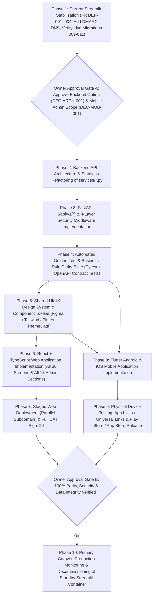

# FULCRUM-INDIA — DOCUMENT 8: PHASED MIGRATION, DELIVERY & RELEASE PLAN

| Document Attribute | Value |
| :--- | :--- |
| **Document ID** | `FULCRUM-MPD-V2.0` |
| **Filename** | `FULCRUM_FUTURE_PLATFORM_MIGRATION_PLAN.md` |
| **Baseline Commit** | `235767754f8d8bb4605e819593bb3f370ddeab27` (`2026-11-11`) |
| **Date of Handover Package** | `2026-11-16` |
| **Target Audience** | CEO / Owner, Programme Managers, Engineering Lead, DevOps / SRE, QA Lead |
| **Core Cutover Rule** | **Zero Downtime & Parallel Coexistence: Do NOT shut down the existing Streamlit application until 100% parity, data integrity, and security gates are signed off** |

---

## 1. Executive Migration Strategy: Parallel Coexistence Over "Big-Bang" Rewrite

The safest, lowest-risk path to evolve **FULCRUM-INDIA Beta 2.0.0** from its current monolithic Streamlit server to a multi-client **React Web + Flutter Android/iOS** platform is a **strangler-fig / parallel-coexistence migration**:
1. **Keep the Existing Supabase Database & Auth Intact**: No user accounts or tables are dropped (`FULCRUM_DATABASE_MIGRATION_CONTRACT.md`).
2. **Stabilize the Live Streamlit App First (Phase 1)**: Apply the quick email-deliverability fixes (`DEF-001` Spam notice, `DEF-002` Resend button, `DEF-003` 8-char password alignment, and Hostinger `_dmarc.notify` DNS record) so current beta entrepreneurs are supported immediately.
3. **Wrap Existing Python `services/*.py` in a Stateless FastAPI Service (Phases 2–3)**: Rather than rewriting 24,343 lines of Python business rules into another language, decouple `services/*.py` from `st.session_state` and expose them via the OpenAPI 3.1 endpoints (`FULCRUM_API_OPENAPI.yaml`).
4. **Run Streamlit and New Clients Side-by-Side Against Staging & Production (Phases 6–9)**: Only switch primary DNS routing once automated golden parity tests (`FULCRUM_CROSS_PLATFORM_PARITY_AND_QA.md`) pass 100%.

### Mermaid Diagram 1 — Ten-Phase Migration & Delivery Roadmap (`[PROPOSED]`)

---

## 2. Detailed Ten-Phase Implementation Plan, Dependencies & Approval Gates

*(Note: Effort ranges below are transparent engineering estimates assuming a focused 2–4 person team reusing the existing Python `services/*.py` and Supabase database; they are planning estimates, not fixed-date commitments.)*

| Phase | Phase Name & Scope | Key Deliverables | Upstream Dependencies | Estimated Effort Range *(Assumption-Bounded)* | Approval Gate / Exit Criterion |
| :---: | :--- | :--- | :--- | :---: | :--- |
| **Phase 1** | **Current System Stabilization** | 1. Add `_dmarc.notify` TXT record (`v=DMARC1; p=none;`) in Hostinger DNS & customize Supabase confirmation email template. 2. Patch `views/login.py` L693 (`DEF-001` Spam notice, `DEF-002` Resend button, `DEF-003` `>=8` char password, `DEF-004` typo). 3. Verify `migrations/009`–`011` and `Site URL` in live Supabase dashboard (`DEC-002`). | Owner DNS & Supabase access | `2 – 3 Days` | Live signup email lands in inbox (or user can self-resend); `UAT-AUTH-001..002` pass. |
| **Phase 2** | **Backend API Architecture Decision** | 1. Owner sign-off on `DEC-ARCH-001` (Recommended: Containerized Python FastAPI reusing `services/*.py` behind Caddy + optional Cloudflare WAF) and `DEC-MOB-001` (Admin mobile scope). 2. Refactor `services/*.py` to accept explicit `RequestContext(user_id, email, active_workspace, jwt_token)` instead of reading `st.session_state` directly (keeping backward-compatible shims so Streamlit continues working). | Phase 1 | `1 – 2 Weeks` | **Gate A Signed Off**; existing `pytest tests/` passes 100% with refactored context parameter. |
| **Phase 3** | **API & Security Implementation** | 1. Implement FastAPI routers matching `FULCRUM_API_OPENAPI.yaml` (`/api/v1/auth`, `/me`, `/legal`, `/profiles`, `/media`, `/journeys`, `/schemes`, `/consultations`, `/governance`, `/admin`). 2. Implement JWT verification + Gates `0`–`3` middleware, rate limiting, and `X-Forwarded-For` IP logging (`resolving DEF-008`). 3. Apply additive Migration `012` on staging. | Phase 2 | `2 – 3 Weeks` | All endpoints in `FULCRUM_API_OPENAPI.yaml` active on staging; `0` service-role keys exposed to clients. |
| **Phase 4** | **Automated Business-Rule Parity Tests** | 1. Build the Golden-Test suite (`FULCRUM_CROSS_PLATFORM_PARITY_AND_QA.md`) running all 159 existing tests + OpenAPI schema validation against `/api/v1/*`. | Phase 3 | `1 Week` | 100% pass rate on security negative tests (`VULN-01..10`), QA32 regressions (`DEF-32-001..010`), and 179-scheme matching. |
| **Phase 5** | **Shared UI/UX Design System** | 1. Implement shared design tokens (`FULCRUM_UI_UX_DESIGN_SYSTEM.md`) in Tailwind CSS (for React) and `FulcrumTheme` (for Flutter). 2. Build core reusable components (`WorkspaceSelector`, `TaxonomySelectWithOther`, `SchemeExplorerCard`, `JourneyTimeline`). | Phase 2 | `1 – 2 Weeks` | WCAG 2.1 AA contrast (`>= 4.5:1`) and responsive breakpoints verified. |
| **Phase 6** | **React + TypeScript Web Implementation** | 1. Build Public/Auth screens (`SCR-01..02`), Gate screens (`SCR-03..07`), Aspirant Portal (`SCR-08..13`), Guide Portal (`SCR-14..15`), SME Portal (`SCR-16..17`), and **all 13 Sole Admin sections (`SCR-18..30` / `ADM-01..13`)** per `FULCRUM_REACT_WEB_HANDOVER.md`. | Phases 3, 4, 5 | `4 – 6 Weeks` | All 30 screens and 13 Admin sections functional against staging API; Playwright E2E suite passes. |
| **Phase 7** | **Staged Web Deployment & Acceptance** | 1. Deploy `fulcrum-api` and `fulcrum-web` containers on the Hostinger KVM 2 VPS behind Caddy on a staging route (while `fulcrum-app` Streamlit remains live at `app.fulcrumindia.online`). 2. Execute full UAT (`FULCRUM_UATD_V2.md`) with existing accounts. | Phase 6 | `1 Week` | Zero data discrepancies between Streamlit and React views on the same database. |
| **Phase 8** | **Flutter Android & iOS Implementation** | 1. Build shared Dart codebase (`FULCRUM_FLUTTER_MOBILE_HANDOVER.md`) covering Auth, Gates `0`–`3`, Aspirant, Guide, SME, and approved Admin mobile console (`DEC-MOB-001`). 2. Configure `flutter_secure_storage`, photo picker, PDF share sheet, and App Links / Universal Links. | Phases 3, 4, 5 | `4 – 6 Weeks` *(Can run in parallel with Phase 6)* | Android `.aab`/`.apk` and iOS `.ipa` builds pass integration test suite on emulators/simulators. |
| **Phase 9** | **Mobile Testing & Store Distribution** | 1. Physical device testing on Android and iPhone (deep links, camera/gallery permissions, background token refresh, live role revocation eviction, offline read banner). 2. Submit to Google Play Console (Internal/Closed Track $\rightarrow$ Production) and Apple App Store Connect (TestFlight $\rightarrow$ App Store). | Phase 8 | `1 – 2 Weeks` *(Plus store review window)* | Both Android and iOS builds approved and verified against production API. |
| **Phase 10** | **Production Cutover & Maintenance** | 1. Create pre-cutover database backup (`scripts/supabase_backup_manager.py`). 2. Update `Caddyfile` to route `app.fulcrumindia.online` to `fulcrum-web` + `/api/v1/*` to `fulcrum-api`, keeping `fulcrum-app` (Streamlit) stopped on standby for 14 days. 3. Decommission Streamlit container after 14-day zero-incident burn-in. | Phases 7 & 9 + **Gate B Approval** | `2 – 3 Days` (+ 14d standby window) | **Gate B Signed Off** by Sole Administrator; `< 3 minute` Caddy rollback verified. |

---

## 3. Suggested Team Composition, Risks & Rollback Strategy

### 3.1 Recommended Engineering Team Structure
- **1 Lead Backend / Python API Engineer**: Refactors `services/*.py` into stateless FastAPI endpoints, maintains Supabase RLS/migrations, and owns the golden parity test suite.
- **1 Senior React + TypeScript Frontend Engineer**: Builds the 30 web screens with primary focus on the 13-section Admin Control Tower and Guide 179-scheme matcher.
- **1 Senior Flutter (Android/iOS) Engineer**: Builds the shared mobile app, deep linking, secure storage, and Play Store / App Store release pipelines.
- **1 QA / Security Verification Lead (Part-Time or Shared)**: Executes the 29-area UAT suite (`FULCRUM_UATD_V2.md`) and cross-platform parity matrix (`FULCRUM_CROSS_PLATFORM_PARITY_AND_QA.md`).

### 3.2 Migration Risk Register & Mitigations

| Risk ID | Migration Risk | Impact | Mitigation Strategy |
| :--- | :--- | :---: | :--- |
| **`MIG-RISK-01`** | **Business-Rule Drift During Translation** (e.g., subtle change in 179-scheme scoring or 7/10/14-day SLA clock logic) | **Critical** | Do **not** rewrite `scheme_matching_engine.py`, `inactivity.py`, or `account_lifecycle.py` into TypeScript/Dart; keep them in Python on the backend (`Option B/C`) and verify with Golden Fixtures (`Doc 7`). |
| **`MIG-RISK-02`** | **Accidental Exposure of Privileged Keys in Web/Mobile Bundles** | **Critical** | Enforce CI check scanning React `dist/` and Flutter `.aab`/`.ipa` binaries for `sb_secret_`, `service_role`, and `re_`; keep all privileged calls inside `fulcrum-api`. |
| **`MIG-RISK-03`** | **Disruption to Live Cohort During Development** | **High** | Keep the current Streamlit app (`fulcrum-app`) running untouched in production while `fulcrum-api`, `fulcrum-web`, and `fulcrum_mobile` are developed and tested against staging. |
| **`MIG-RISK-04`** | **Cutover Regression Discovered Post-Launch** | **Medium** | Because the database schema changes are 100% additive (`Doc 3`), rolling back cutover requires only reverting 2 lines in `Caddyfile` to point back to `fulcrum-app:8501` (`<= 60 seconds` rollback time). |
