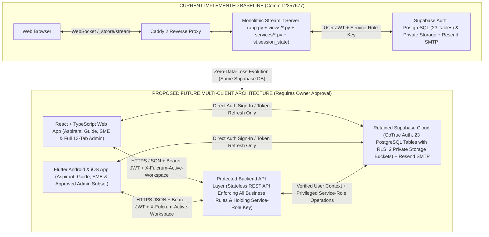
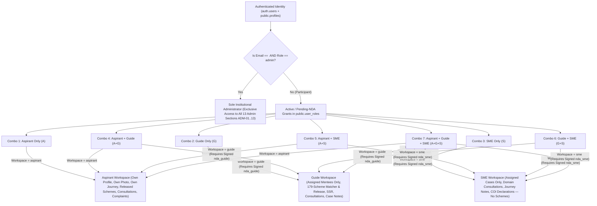
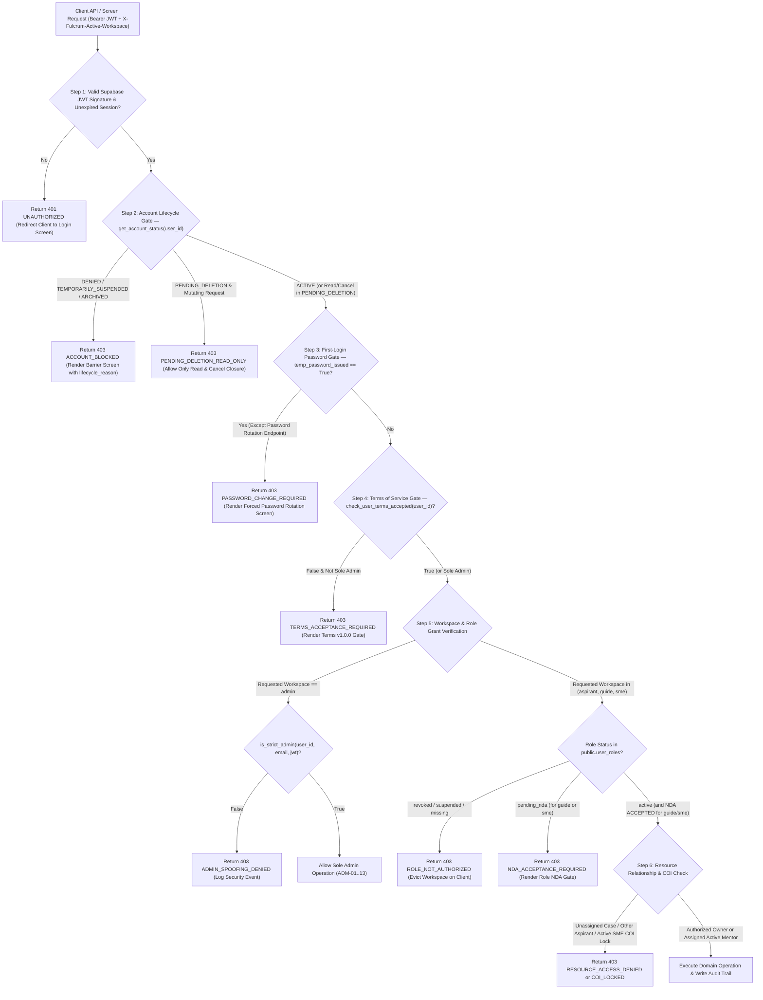
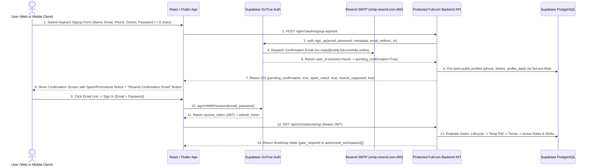
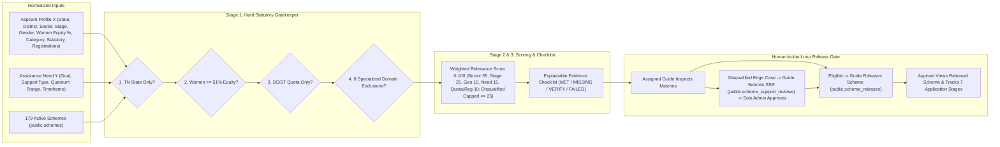
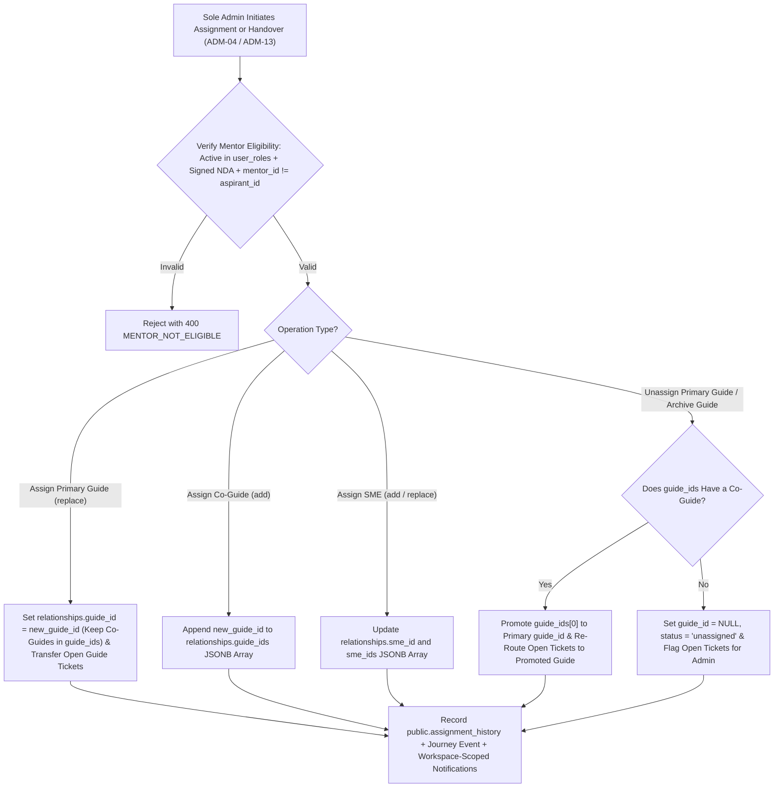
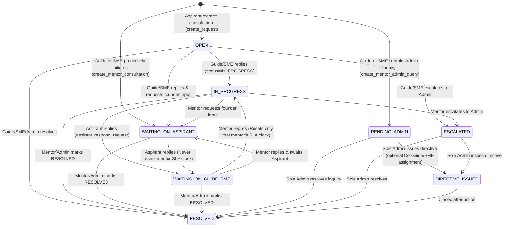
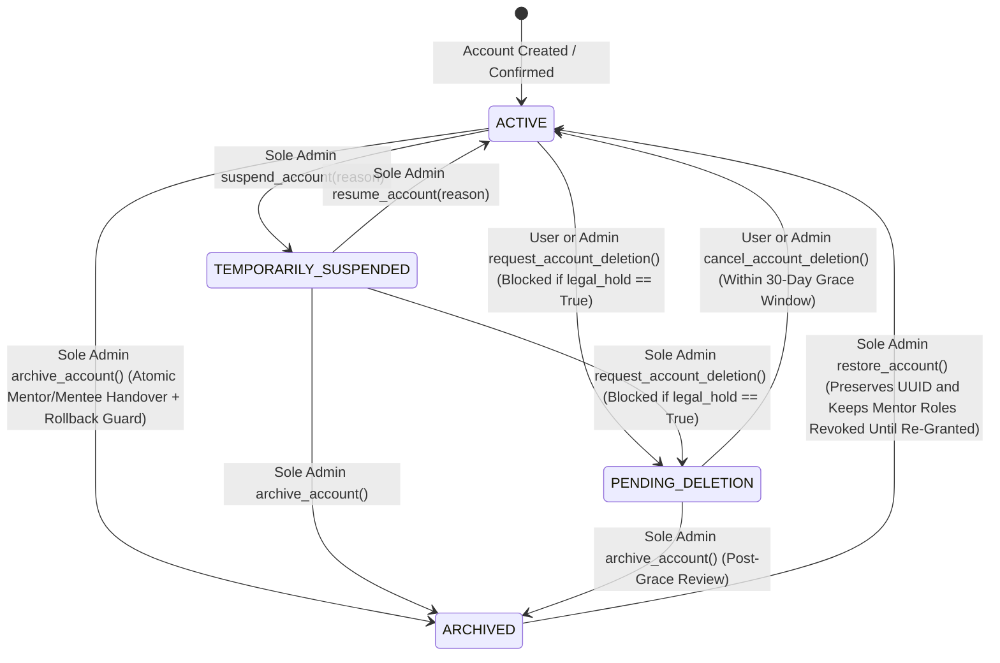

# FULCRUM-INDIA — DOCUMENT 1: PLATFORM-INDEPENDENT FUNCTIONAL & BUSINESS CONTRACT

| Document Attribute | Value |
| :--- | :--- |
| **Document ID** | `FULCRUM-PIC-V2.0` |
| **Filename** | `FULCRUM_PLATFORM_INDEPENDENT_CONTRACT.md` |
| **Baseline Commit** | `235767754f8d8bb4605e819593bb3f370ddeab27` (`2026-11-11`) |
| **Date of Handover Package** | `2026-11-16` |
| **Target Audience** | Backend API Architects, React Web Engineers, Flutter Mobile Engineers, Native Android/iOS Engineers, QA Lead |
| **Document Purpose** | Technology-agnostic behavioural contract that every future frontend (React, Flutter, Kotlin, Swift) and backend API service must obey |

---

## 1. Purpose and Architectural Principle

This document extracts the complete **institutional business logic, role model, authorization invariants, state machines, and domain rules** of **FULCRUM-INDIA Beta 2.0.0** into a **platform-independent functional contract**.

In the current production baseline (`commit 2357677`), UI rendering and business logic execute inside a monolithic Python Streamlit server (`app.py`, `views/*.py`, `services/*.py`) where active user context is held in `st.session_state` and database operations use a mix of user-scoped and service-role Supabase clients. **A current Streamlit function cannot simply be copied into a React browser app or a Flutter mobile binary** because:
1. Browser and mobile clients are **untrusted environments** that must never hold the privileged `SUPABASE_SECRET_KEY` (`service_role` key).
2. `st.session_state` is a server-memory Python dictionary tied to a Streamlit WebSocket; in a multi-client architecture, authentication state must be carried via stateless **Supabase JWT Bearer tokens** and explicit **`X-Fulcrum-Active-Workspace`** request context verified on the server for every API call.
3. Heavy or privileged server operations—such as 179-scheme deterministic matching, cross-user mentor handovers, 7/10/14-day SLA computation, EXIF-stripping WebP image normalization, and headless Chromium/ReportLab PDF dossier generation—must execute inside a **protected backend API tier**, never on the client device.

> **Core Handover Principle**: *One institutional operating model, one authoritative Supabase PostgreSQL + Storage data store, one stateless backend API enforcing identical business rules, and multiple supported client applications (React Web, Flutter Android/iOS, or future native clients).*

### Mermaid Diagram 1 — Current Streamlit Architecture vs. Proposed Multi-Client Shared Backend Architecture

---

## 2. Backend Architecture Options Evaluation (Phase 2 Analysis)

Before building new clients, leadership must approve the backend API runtime (`DEC-ARCH-001`). The table below compares the three candidate backend approaches against Fulcrum's actual codebase requirements:

| Evaluation Criterion | Option A: Pure Cloudflare Workers (`TypeScript / Hono`) | Option B: Containerized Python API Service (`FastAPI + Pydantic v2`) | Option C (Recommended): Controlled Hybrid (`FastAPI Core Service` + Optional `Cloudflare Edge WAF/CDN` + Retained `Supabase & Resend`) |
| :--- | :--- | :--- | :--- |
| **Reuse of Existing `24,343` Lines of Python Business Logic (`services/*.py`)** | ❌ **0% direct code reuse.** Requires rewriting all 31 service modules (`scheme_matching_engine.py`, `inactivity.py`, `account_lifecycle.py`, `relationships.py`, etc.) from Python into TypeScript, creating a high risk of subtle business-rule regressions. | ✅ **~85–90% direct code reuse.** Existing `services/*.py` modules are decoupled from `st.session_state` and wrapped in stateless FastAPI routers with Pydantic request/response schemas. | ✅ **~85–90% direct code reuse** in the Python FastAPI core while leveraging Cloudflare for DNS, DDoS/WAF, TLS caching, and optional lightweight edge routing. |
| **PDF Business Dossier Generation (`services/pdf_generator.py` — Playwright Chromium + ReportLab)** | ❌ **Not natively supported** in standard V8 Worker isolates (requires paid Cloudflare Browser Rendering API or rewriting the entire HTML/ReportLab PDF layout engine). | ✅ **Works out of the box** using the existing `Dockerfile` (`playwright install chromium` + `reportlab` + `BoundedSemaphore(2)` subprocess worker). | ✅ **Works out of the box** on the existing Hostinger KVM 2 container (`fulcrum-api`). |
| **Private Photo Normalization (`Pillow` EXIF Strip + `600x600`/`320x320` WebP Compression)** | ⚠️ Requires replacing Python Pillow (`PIL`) with WASM image libraries inside Worker memory limits. | ✅ **100% reuse** of `validate_and_process_photo()` and `validate_and_normalize_professional_photo()`. | ✅ **100% reuse** of existing Pillow image validation and WebP re-encoding pipeline. |
| **Hosting Cost & Infrastructure Complexity** | Low compute cost, but adds a second language stack and build pipeline. | Zero additional hosting cost: runs alongside or replaces `fulcrum-app` on the existing **Hostinger KVM 2 VPS** behind `fulcrum-caddy`. | Zero additional server cost: Hostinger KVM 2 + Caddy + FastAPI + free Cloudflare proxy/WAF tier. |
| **Architectural Recommendation** | **Not Recommended as Sole Backend** (due to Python rewrite risk and PDF/Pillow constraints). | **Strongly Recommended Core Backend** | **Recommended Production Target (`DEC-ARCH-001` — Requires Owner Approval)** |

---

## 3. Institutional Roles & Multi-Role Combination Contract

Fulcrum's role model is a **strict invariant** (`BRD Section 4`, `SRS Section 8`). Every client and API service must enforce the following rules without exception:

1. **Four Canonical Roles**:
   - `aspirant`: Entrepreneur / Founder (public self-registration or base participant role).
   - `guide`: General Business Mentor (admin-provisioned or admin-granted).
   - `sme`: Subject Matter Expert / Domain Specialist (admin-provisioned or admin-granted).
   - `admin`: Sole Institutional Administrator (`<SOLE_ADMIN_EMAIL>` / `<SOLE_ADMIN_UUID>`).
2. **Prohibition of Additional Admin Hierarchies**: There are **no** Super Admins, District Admins, or Operational Admins. Any legacy string (`district_admin`, `operational_admin`) encountered in data must be treated as `aspirant`.
3. **Seven Non-Admin Participant Combinations**: A non-admin participant may hold any non-empty subset of `{aspirant, guide, sme}` in `public.user_roles`:
   - `(1) aspirant`, `(2) guide`, `(3) sme`, `(4) aspirant + guide`, `(5) aspirant + sme`, `(6) guide + sme`, `(7) aspirant + guide + sme`.
4. **Strict Separation of Sole Admin**: The Sole Administrator holds **only** `admin` and can never hold `aspirant`, `guide`, or `sme`, can never be assigned as a mentor, and can never be suspended, archived, or deleted.

### Mermaid Diagram 2 — Complete User-Role Relationships & Seven Non-Admin Combinations

### 3.1 Platform-Independent Permission Matrix

| Domain Capability | `aspirant` Workspace | `guide` Workspace (Signed NDA) | `sme` Workspace (Signed NDA) | `admin` Workspace (Sole Admin) | Unconfirmed / Temp-PW / Unaccepted Terms | Role `pending_nda` | Account `PENDING_DELETION` | Account `SUSPENDED` / `ARCHIVED` / `DENIED` |
| :--- | :---: | :---: | :---: | :---: | :---: | :---: | :---: | :---: |
| **Read/Update Own 4-Part Enterprise Profile & Assistance Need (`Y`)** | ✅ | ❌ | ❌ | ✅ (Inspect All) | ❌ | ❌ | ⚠️ Read-Only | ❌ |
| **Upload/Delete Own Aspirant Identity Photo (`aspirant-profile-photos`)** | ✅ | ❌ | ❌ | ✅ (Inspect/Delete) | ❌ | ❌ | ❌ Paused | ❌ |
| **View Aspirant Private Photo (300s Signed URL)** | ✅ (Self) | ✅ (Assigned Only) | ✅ (Assigned Only) | ✅ (All) | ❌ | ❌ | ⚠️ Self Read | ❌ |
| **Upload/View Professional Mentor Headshot (`professional-headshots`)** | ❌ Masked | ✅ (Self Only) | ✅ (Self Only) | ✅ (All) | ❌ | ❌ | ❌ | ❌ |
| **Run 179-Scheme Matcher, Release/Withdraw Schemes, Submit SSR** | ❌ (View Released Only) | ✅ (Assigned Only) | ❌ (No Scheme Access) | ✅ (All + Approve SSR) | ❌ | ❌ | ❌ | ❌ |
| **Update Post-Release Scheme Application Stage (`7` Stages)** | ✅ (Own Released) | ✅ (Assigned) | ❌ | ✅ (All) | ❌ | ❌ | ❌ Paused | ❌ |
| **Create Journey Event & Edit Own Event (with Revision Snapshot)** | ✅ (Self) | ✅ (Assigned) | ✅ (Assigned) | ✅ (All) | ❌ | ❌ | ❌ Paused | ❌ |
| **Toggle `included_in_roadmap` & Export Executive PDF Dossier** | ✅ (Self) | ✅ (Assigned) | ❌ (Read Timeline Only) | ✅ (All) | ❌ | ❌ | ⚠️ Export Only | ❌ |
| **Create/Reply to Consultations (`help_requests`)** | ✅ (Self) | ✅ (Assigned) | ✅ (Assigned, If No COI) | ✅ (Directives/All) | ❌ | ❌ | ❌ Blocked | ❌ |
| **Read/Write Private Mentor Notes (`is_private_mentor_note=True`)** | ❌ Hidden | ✅ (Assigned) | ✅ (Assigned) | ✅ (All) | ❌ | ❌ | ❌ | ❌ |
| **Submit Confidential Guide Complaint (`guide_complaints`)** | ✅ (Own Guide) | ❌ Hidden | ❌ | ✅ (Resolve/Reassign) | ❌ | ❌ | ❌ | ❌ |
| **Declare SME Conflict of Interest (`sme_conflict_declarations`)** | ❌ | ❌ | ✅ (Assigned) | ✅ (Approve/Clear) | ❌ | ❌ | ❌ | ❌ |
| **Provision Mentors, Grant/Revoke Roles, Assign Mentors, Manage Lifecycle (`ADM-01..13`)** | ❌ | ❌ | ❌ | ✅ Exclusive | ❌ | ❌ | ❌ | ❌ |

---

## 4. Sequential Authentication, Onboarding & Authorization Gate Contract

Every client application and backend API middleware must evaluate the following **7-step decision chain** in exact order (`app.py` L838–L1275, `SRS Section 7`):

### Mermaid Diagram 3 — Platform-Independent Authorization Decision Flow

### Mermaid Diagram 4 — Authentication, Email Verification & Sequential Gate Flow

---

## 5. Complete Platform-Independent Business Rules Contract (`BR-*`)

Every future client and backend endpoint must implement the following 20 core business rules without alteration:

#### `BR-GOV-001` — Sole Administrator Identity Lock

| Contract Attribute | Specification |
| :--- | :--- |
| **Requirement ID** | `BR-GOV-001` |
| **Rule Title** | Sole Administrator Identity Lock |
| **Preconditions** | System initialized with configured `<SOLE_ADMIN_EMAIL>` and `<SOLE_ADMIN_UUID>`. |
| **Trigger** | Any user creation, profile update, role grant, or admin endpoint invocation. |
| **Required Behaviour** | Verify that the caller's authenticated Supabase JWT email (`lower(email)`) equals `<SOLE_ADMIN_EMAIL>`, `user_id` matches the sole admin UUID, and `profiles.role == 'admin'`. Automatically strip `'admin'`, `'district_admin'`, or `'operational_admin'` from any other user record and downgrade to `'aspirant'`. |
| **Forbidden Behaviour** | Never trust a client-supplied `admin_id` query/body parameter without verifying the caller's bearer JWT (`VULN-02`). Never create a second admin account or multi-admin hierarchy. |
| **Data Affected** | `public.profiles`, `public.user_roles`. |
| **Error Conditions** | Returns HTTP `403 Forbidden` (`ADMIN_SPOOFING_DENIED`) and logs security warning if a non-admin attempts an admin operation. |
| **Acceptance Criteria** | 100% of non-owner admin privilege escalation attempts fail at API and DB trigger layers (`trg_enforce_single_admin_profile`, `trg_enforce_single_admin_user_roles`). |
| **Baseline Reference** | `BRD BR-GOV-001`, `PRD FR-ADMIN-001..013`, `SRS SR-AUTHZ-002`, `SPRD SEC-ADMIN-001` |
| **Implementation Status** | **Implemented — verified in source; Tested** |

#### `BR-GOV-002` — Sole Administrator Exclusion from Participant Workspaces & Lifecycle Immunity

| Contract Attribute | Specification |
| :--- | :--- |
| **Requirement ID** | `BR-GOV-002` |
| **Rule Title** | Sole Administrator Exclusion from Participant Workspaces & Lifecycle Immunity |
| **Preconditions** | Authenticated user is the Sole Administrator. |
| **Trigger** | Workspace listing, mentor assignment, or account lifecycle action (`suspend`, `archive`, `request_deletion`). |
| **Required Behaviour** | Lock the Sole Administrator's workspace list exclusively to `['admin']`. Reject any request to assign the Admin as a Guide/SME or to suspend, archive, or schedule deletion of the Admin account. |
| **Forbidden Behaviour** | Never allow the Sole Administrator to enter Aspirant/Guide/SME workspaces or be locked out via self-suspension/archival. Never allow self-service password reset for `<SOLE_ADMIN_EMAIL>`. |
| **Data Affected** | `public.profiles`, `public.account_lifecycle_log`. |
| **Error Conditions** | Returns HTTP `400/403` (`ROOT_ADMIN_IMMUNE` / `ADMIN_SELF_RESET_FORBIDDEN`). |
| **Acceptance Criteria** | `suspend_account()`, `archive_account()`, `request_account_deletion()`, and `send_password_reset()` reject `<SOLE_ADMIN_EMAIL>`. |
| **Baseline Reference** | `BRD BR-GOV-002`, `PRD SCR-02`, `SPRD SEC-ADMIN-002`, `UATD UAT-LIFE-001` |
| **Implementation Status** | **Implemented — verified in source; Tested** |

#### `BR-ONB-001` — Public Self-Registration Restricted to Aspirants with Profile Pre-Seeding

| Contract Attribute | Specification |
| :--- | :--- |
| **Requirement ID** | `BR-ONB-001` |
| **Rule Title** | Public Self-Registration Restricted to Aspirants with Profile Pre-Seeding |
| **Preconditions** | Unauthenticated user submits public registration. |
| **Trigger** | Submission of public signup payload (`full_name`, `email`, `phone`, `district`, `password`). |
| **Required Behaviour** | Create account with `role = 'aspirant'`, pre-seed `public.profiles` with `phone`, `district`, and initial `profile_data` so metadata is preserved while awaiting email confirmation, and display honest confirmation guidance instructing the user to check **Spam / Promotions** and offering a rate-limited **Resend Confirmation Email** action. |
| **Forbidden Behaviour** | Never allow public registration to select `guide`, `sme`, or `admin`. Never claim the email has arrived in the primary inbox without warning about Spam filters (`DEF-001`). |
| **Data Affected** | `auth.users`, `public.profiles`, `public.journeys`, `public.relationships`. |
| **Error Conditions** | Duplicate email returns `409 Conflict` (`ACCOUNT_ALREADY_EXISTS`); unconfirmed login attempt returns `403` (`EMAIL_NOT_CONFIRMED`). |
| **Acceptance Criteria** | New signup creates `aspirant` profile with phone/district intact; unconfirmed user cannot log in and can trigger confirmation resend. |
| **Baseline Reference** | `BRD BR-ONB-001`, `PRD FR-AUTH-001..002`, `SPRD SEC-CONF-001..002` |
| **Implementation Status** | **Implemented in source (Spam notice & Resend button required in new clients per `DEF-001`, `DEF-002`)** |

#### `BR-ONB-002` — Mandatory First-Login Password Rotation for Admin-Provisioned Mentors

| Contract Attribute | Specification |
| :--- | :--- |
| **Requirement ID** | `BR-ONB-002` |
| **Rule Title** | Mandatory First-Login Password Rotation for Admin-Provisioned Mentors |
| **Preconditions** | Sole Admin provisions a Guide or SME account with a provisional password (`profile_data.temp_password_issued = True`). |
| **Trigger** | Provisioned mentor authenticates for the first time. |
| **Required Behaviour** | Block all workspace and data endpoints until the mentor submits a new permanent password of **at least 8 characters** (`complete_first_login_password_change`), which updates `auth.users` and sets `temp_password_issued = False`. |
| **Forbidden Behaviour** | Never allow a user with `temp_password_issued == True` to bypass Gate 1 or set a password shorter than 8 characters (`DEF-32-009`). |
| **Data Affected** | `auth.users`, `public.profiles` (`profile_data.temp_password_issued`). |
| **Error Conditions** | Password `< 8` chars or mismatch returns `400 Bad Request`. |
| **Acceptance Criteria** | Mentor cannot view mentee data until permanent password (`>= 8` chars) is saved and `temp_password_issued` becomes `False`. |
| **Baseline Reference** | `BRD BR-ONB-002`, `PRD FR-AUTH-004`, `SCR-05`, `SPRD SEC-PWD-004` |
| **Implementation Status** | **Implemented — verified in source; Tested** |

#### `BR-LEGAL-001` — Universal Platform Terms of Service Gate (`terms_v1_0`)

| Contract Attribute | Specification |
| :--- | :--- |
| **Requirement ID** | `BR-LEGAL-001` |
| **Rule Title** | Universal Platform Terms of Service Gate (`terms_v1_0`) |
| **Preconditions** | Authenticated non-admin user has passed Lifecycle and First-Login Password gates. |
| **Trigger** | Any attempt to load a workspace or invoke domain APIs when `check_user_terms_accepted(user_id)` is `False`. |
| **Required Behaviour** | Present the full text of the active `terms_and_conditions` document (`v1.0.0`), require explicit checkbox confirmation, compute the SHA-256 hash of the document text, and insert an immutable row in `public.legal_acceptances` recording `user_id`, `user_email`, `doc_type='terms_and_conditions'`, `doc_version`, `document_hash`, `ip_address` (from reverse-proxy `X-Forwarded-For`), `user_agent`, and `accepted_at`. |
| **Forbidden Behaviour** | Never allow an Aspirant, Guide, or SME to access portal data before accepting the active Terms version. |
| **Data Affected** | `public.legal_documents`, `public.legal_acceptances`. |
| **Error Conditions** | Unchecked confirmation returns `400` (`TERMS_CHECKBOX_REQUIRED`). |
| **Acceptance Criteria** | Acceptance row is persisted with SHA-256 hash and real client IP/User-Agent headers (`DEF-008` resolved in API layer). |
| **Baseline Reference** | `BRD BR-LEGAL-001`, `PRD FR-LEGAL-001`, `SCR-06`, `SRS SR-AUTHZ-001` |
| **Implementation Status** | **Implemented — verified in source; Tested** |

#### `BR-LEGAL-002` — Role-Specific NDA Gate & Role Activation for Guides and SMEs

| Contract Attribute | Specification |
| :--- | :--- |
| **Requirement ID** | `BR-LEGAL-002` |
| **Rule Title** | Role-Specific NDA Gate & Role Activation for Guides and SMEs |
| **Preconditions** | User holds a `guide` or `sme` role grant in `public.user_roles` (initially `status = 'pending_nda'`). |
| **Trigger** | User switches into `guide` or `sme` workspace when `check_user_nda_accepted(user_id, role)` is `False`. |
| **Required Behaviour** | Present the role-specific NDA (`nda_guide` or `nda_sme`), require (1) agreement checkbox, (2) typed full legal name (`>= 2` chars), and (3) typed confirmation phrase `'I AGREE'` (case-insensitive). On submission, insert into `public.legal_acceptances` with SHA-256 document hash and call `activate_role(user_id, role)` to transition `user_roles.status` from `'pending_nda'` to `'active'`. |
| **Forbidden Behaviour** | Never allow a mentor with `status == 'pending_nda'` to view assigned Aspirants, view Aspirant photos (`migrations/005`), or be newly assigned to an Aspirant (`VULN-08`). |
| **Data Affected** | `public.legal_acceptances`, `public.user_roles`. |
| **Error Conditions** | Missing checkbox, short name, or phrase `!= 'I AGREE'` returns `400` (`INVALID_NDA_SIGNATURE`). |
| **Acceptance Criteria** | Signing NDA creates `legal_acceptances` record and transitions `user_roles.status` for that specific role to `'active'`. |
| **Baseline Reference** | `BRD BR-LEGAL-002`, `PRD FR-LEGAL-001`, `SCR-07`, `SPRD SEC-RBAC-001` |
| **Implementation Status** | **Implemented — verified in source; Tested** |

#### `BR-ROLE-001` — Multi-Role Lifecycle, Cross-Session Eviction & Hybrid Workspace Isolation

| Contract Attribute | Specification |
| :--- | :--- |
| **Requirement ID** | `BR-ROLE-001` |
| **Rule Title** | Multi-Role Lifecycle, Cross-Session Eviction & Hybrid Workspace Isolation |
| **Preconditions** | Non-admin user holds one or more grants in `public.user_roles`. |
| **Trigger** | Admin grants, suspends, reinstates, cancels, or revokes a role (`ADM-07`); or user switches active workspace. |
| **Required Behaviour** | 1. Support all 7 non-admin combinations of `{aspirant, guide, sme}`.
2. Scope the user's active permissions, UI badge, and default notification feed strictly to the active workspace (`X-Fulcrum-Active-Workspace`).
3. When `revoke_role(user_id, role)` is called, set `user_roles.status = 'revoked'`, automatically unassign the user from all active mentorship cases in that role (`unassign_guide` / `unassign_sme`), and invalidate role caches so any active client session is evicted from that workspace within `<= 5` seconds.
4. `reinstate_role()` may only reinstate a `'suspended'` role and must refuse `'revoked'` roles. |
| **Forbidden Behaviour** | Never allow a `'revoked'` role to be reinstated via `reinstate_role()` (`test_03_reinstate_role_refuses_revoked_roles`). Never allow Aspirant profile saves on a hybrid account to overwrite `profile_data['mentor']` (`DEF-32-006`). |
| **Data Affected** | `public.user_roles`, `public.relationships`, `public.profiles`, `public.notifications`. |
| **Error Conditions** | Reinstating a revoked role returns `400` (`CANNOT_REINSTATE_REVOKED_ROLE`). |
| **Acceptance Criteria** | Role revocation immediately unassigns cases and evicts active workspace sessions. |
| **Baseline Reference** | `BRD BO-04`, `PRD FR-ADMIN-007`, `FR-ROLE-001`, `UATD UAT-ROLE-001` |
| **Implementation Status** | **Implemented — verified in source; Tested** |

#### `BR-REL-001` — Exclusive Admin Assignment Authority, Co-Guide Promotion & Safe Handover

| Contract Attribute | Specification |
| :--- | :--- |
| **Requirement ID** | `BR-REL-001` |
| **Rule Title** | Exclusive Admin Assignment Authority, Co-Guide Promotion & Safe Handover |
| **Preconditions** | Sole Admin manages assignments in `ADM-04` (`SCR-21`) or unassigns/archives a mentor. |
| **Trigger** | Admin calls `assign_guide`, `assign_sme`, `unassign_guide`, or `unassign_sme`. |
| **Required Behaviour** | 1. Verify mentor eligibility via `is_assignable_mentor()`: target must hold `status='active'` in `user_roles` for that role, have an `ACCEPTED` NDA in `legal_acceptances`, have `account_status == 'ACTIVE'`, and **must not equal `aspirant_id`** (anti-self-mentoring invariant `BR-REL-002`).
2. Support Primary Guide (`guide_id`) + additive Co-Guides (`guide_ids` JSONB array) and Primary SME (`sme_id`) + additive SMEs (`sme_ids` JSONB array).
3. When Primary `guide_id` is unassigned or replaced, if `guide_ids` contains Co-Guides, automatically promote `guide_ids[0]` to primary `guide_id` and transfer open consultation tickets (`OPEN`, `IN_PROGRESS`, `WAITING_ON_ASPIRANT`, `WAITING_ON_GUIDE_SME`, `ACTION_REQUIRED`) to the promoted/replacement Guide. |
| **Forbidden Behaviour** | Never allow Aspirants or Mentors to self-assign. Never assign a mentor to their own Aspirant profile. Never leave Co-Guides wiped out when selectively replacing a single mentor (`test_04_selective_mentor_replacement_preserves_co_mentors`). |
| **Data Affected** | `public.relationships`, `public.assignment_history`, `public.help_requests`, `public.journey_events`, `public.notifications`. |
| **Error Conditions** | Self-assignment or unsigned-NDA mentor returns `400` (`MENTOR_NOT_ELIGIBLE`). |
| **Acceptance Criteria** | Co-Guide promotion and open ticket transfer execute atomically on primary Guide removal. |
| **Baseline Reference** | `BRD BR-REL-001..003`, `PRD FR-ADMIN-004`, `SRS Diagram 4`, `UATD UAT-REL-001` |
| **Implementation Status** | **Implemented — verified in source; Tested** |

#### `BR-PRIV-001` — Relationship-Scoped Dossier & Private Photograph Vault Isolation

| Contract Attribute | Specification |
| :--- | :--- |
| **Requirement ID** | `BR-PRIV-001` |
| **Rule Title** | Relationship-Scoped Dossier & Private Photograph Vault Isolation |
| **Preconditions** | Aspirant uploads an identity photo (`aspirant-profile-photos`) or Guide/SME uploads a professional headshot (`professional-headshots`). |
| **Trigger** | Upload, delete, or signed-URL read request for any photograph or Aspirant profile. |
| **Required Behaviour** | 1. **Image Normalization**: Validate magic bytes (`JPEG`, `PNG`, `WEBP`, `<= 5 MB`), strip all EXIF metadata, and re-encode Aspirant photos to max `600x600` WebP (`<= 180 KB`) and Mentor headshots to exact `320x320` WebP (`<= 150 KB`).
2. **Aspirant Photo Access (`can_view_aspirant_photo` + `migrations/005`)**: Grant 300-second signed URL **only** to the Aspirant owner, the Sole Admin, or a Guide/SME who currently has (a) an `active` relationship in `public.relationships` (`guide_id`, `guide_ids`, `sme_id`, or `sme_ids`), (b) an `active` role in `user_roles`, and (c) an `ACCEPTED` NDA in `legal_acceptances`.
3. **Mentor Headshot Access (`can_view_professional_photo`)**: Grant 300-second signed URL **only** to the subject Mentor or the Sole Admin (masked from Aspirants unless owner decision `DEC-006` changes policy). |
| **Forbidden Behaviour** | Never make storage buckets public. Never serve an Aspirant photo to an unassigned mentor, a `pending_nda` mentor, or another Aspirant. |
| **Data Affected** | `public.aspirant_photos`, `public.professional_photos`, `storage.objects`. |
| **Error Conditions** | Unauthorized viewer returns `None` / `403` (client renders initials avatar). |
| **Acceptance Criteria** | Unassigning a Guide or revoking an SME's role immediately terminates their ability to fetch the Aspirant's photo signed URL. |
| **Baseline Reference** | `BRD BR-PRIV-001..002`, `PRD FR-ASP-002`, `FR-SME-002`, `SPRD SEC-STOR-001..003` |
| **Implementation Status** | **Implemented — verified in source; Tested** |

#### `BR-JRN-001` — Chronological Enterprise Journey, Author-Scoped Edits & Immutable Revision History

| Contract Attribute | Specification |
| :--- | :--- |
| **Requirement ID** | `BR-JRN-001` |
| **Rule Title** | Chronological Enterprise Journey, Author-Scoped Edits & Immutable Revision History |
| **Preconditions** | Aspirant has an active `public.journeys` container. |
| **Trigger** | Actor creates a milestone, toggles `included_in_roadmap`, edits an existing milestone, or exports the Executive PDF Dossier. |
| **Required Behaviour** | 1. Sort events chronologically (`event_date DESC, created_at DESC`).
2. Allow Aspirant, assigned Guide, assigned SME, and Sole Admin to add milestones attributed with their `actor_id` and `actor_role`.
3. Allow editing an event **only** if `editor_id == event.actor_id` or caller is Sole Admin (`can_user_edit_event`).
4. Require a non-empty `change_reason` on every edit, verify optimistic concurrency (`expected_updated_at`), and insert a full before-snapshot (`previous_title`, `previous_description`, `previous_event_date`, `editor_id`, `editor_role`, `change_reason`) into `public.journey_event_revisions` before updating `public.journey_events`.
5. Include only events where `included_in_roadmap == True` when generating the Executive PDF Business Dossier. |
| **Forbidden Behaviour** | Never allow a Guide or SME to overwrite an Aspirant-authored milestone. Never overwrite a milestone without recording a revision row. |
| **Data Affected** | `public.journeys`, `public.journey_events`, `public.journey_event_revisions`. |
| **Error Conditions** | Unauthorized editor returns `403`; stale `expected_updated_at` returns `409 Conflict` (`CONCURRENT_MODIFICATION`). |
| **Acceptance Criteria** | Every edit produces a verifiable row in `journey_event_revisions`; PDF dossier contains only roadmap-included milestones. |
| **Baseline Reference** | `BRD BR-JRN-001`, `PRD FR-JRN-001`, `FR-ASP-003`, `UATD UAT-JRN-001` |
| **Implementation Status** | **Implemented — verified in source; Tested** |

#### `BR-SCH-001` — Deterministic 3-Stage Scheme Matching, Guide-Gated Release & Admin SSR Override

| Contract Attribute | Specification |
| :--- | :--- |
| **Requirement ID** | `BR-SCH-001` |
| **Rule Title** | Deterministic 3-Stage Scheme Matching, Guide-Gated Release & Admin SSR Override |
| **Preconditions** | 179 canonical schemes active in `public.schemes`; Aspirant profile (`X`) and Assistance Need (`Y`) saved. |
| **Trigger** | Guide or Admin runs scheme matching, releases/withdraws a scheme, submits/decides a Scheme Support Review (SSR), or updates the 7-stage application tracker. |
| **Required Behaviour** | 1. **Stage 1 Gatekeeper (`evaluate_gatekeeper_eligibility`)**: Disqualify schemes failing Tamil Nadu jurisdiction (`is_tn_only`), Women-only `>= 51.0%` equity (`is_women_only`), SC/ST affirmative category (`is_sc_st_only`), or the 8 negative domain exclusions (`isro`, `semiconductor`, `aerospace`, `pharma_rd`, `biotech`, `nuclear`, `ev_automotive`, `deeptech_hardware`).
2. **Stage 2 Scoring (`calculate_relevance_score`)**: Score `0–100` deterministically (Sector `35`, Stage `25`, Geography `15`, Need `Y` `15`, Quota/Registration `10`; cap disqualified schemes at `<= 25`).
3. **Stage 3 Checklist (`build_evidence_checklist`)**: Produce item-by-item `MET`/`MISSING`/`VERIFY`/`FAILED` evidence list.
4. **Guide-Gated Visibility**: Aspirants see **only** rows in `public.scheme_releases` with `status = 'released'`. Guides cannot directly release a hard-disqualified scheme, but may submit a `scheme_support_reviews` (`SSR`) request with justification (`>= 15` chars) to the Sole Admin; Admin approval (`APPROVED`) automatically releases the scheme (`allow_disqualified_override=True`).
5. **7-Stage Tracker**: Aspirant and Guide can update `application_stage` across: `Recommended`, `Preparing Application`, `Application Submitted`, `Under Government Review`, `Clarification Requested`, `Approved / Sanctioned`, `Rejected / Closed`. |
| **Forbidden Behaviour** | Never expose raw unvetted scheme matches directly to Aspirants. Never claim a match score or Guide release is official government sanction. |
| **Data Affected** | `public.schemes`, `public.scheme_releases`, `public.scheme_support_reviews`, `public.journey_events`, `public.notifications`. |
| **Error Conditions** | Direct Guide release of a disqualified scheme without Admin SSR override returns `400` (`SCHEME_DISQUALIFIED_REQUIRES_SSR`). |
| **Acceptance Criteria** | Identical profile (`X`) and need (`Y`) inputs produce identical scores, disqualifications, and checklists across Python, React, and Flutter. |
| **Baseline Reference** | `BRD BR-SCH-001..002`, `PRD FR-SCH-001`, `FR-GUIDE-002`, `FR-ADMIN-005..006`, `UATD UAT-SCH-001` |
| **Implementation Status** | **Implemented — verified in source; Tested** |

#### `BR-CONS-001` — Bidirectional Consultations, Actor Attribution & Private Mentor Collaboration Space

| Contract Attribute | Specification |
| :--- | :--- |
| **Requirement ID** | `BR-CONS-001` |
| **Rule Title** | Bidirectional Consultations, Actor Attribution & Private Mentor Collaboration Space |
| **Preconditions** | Active mentorship relationship exists between Aspirant and Guide/SME. |
| **Trigger** | Creation or reply on `public.help_requests` or message post in `public.case_discussions`. |
| **Required Behaviour** | 1. Support all 10 canonical statuses (`OPEN`, `IN_PROGRESS`, `WAITING_ON_ASPIRANT`, `WAITING_ON_GUIDE_SME`, `ACTION_REQUIRED`, `REPLIED`, `RESOLVED`, `ESCALATED`, `PENDING_ADMIN`, `DIRECTIVE_ISSUED`).
2. When a Guide or SME replies, verify their active workspace and role grant, update `last_interaction_actor_id = mentor_id`, `last_interaction_actor_role = 'guide'|'sme'`, and `last_mentor_response_at = NOW()`.
3. When an Aspirant replies (`aspirant_respond_request`), set `status = 'WAITING_ON_GUIDE_SME'`, `last_interaction_actor_role = 'aspirant'`, and `last_aspirant_response_at = NOW()`.
4. In `public.case_discussions`, filter out rows where `is_private_mentor_note == True` whenever the caller is in the `aspirant` workspace. |
| **Forbidden Behaviour** | Never allow an Aspirant reply to overwrite `last_mentor_response_at` or reset a mentor's inactivity clock. Never return `is_private_mentor_note == True` rows to an Aspirant client. |
| **Data Affected** | `public.help_requests`, `public.case_discussions`, `public.notifications`. |
| **Error Conditions** | Ticket creation while caller is in `PENDING_DELETION` returns `403` (`VULN-07`). |
| **Acceptance Criteria** | Private mentor notes are 100% invisible to Aspirant API responses; status transitions match Diagram 7. |
| **Baseline Reference** | `BRD BR-CONS-001`, `PRD FR-CONS-001`, `SRS Diagram 5`, `UATD UAT-CONS-001` |
| **Implementation Status** | **Implemented — verified in source; Tested** |

#### `BR-CMP-001` — Confidential Guide Complaints & SME Conflict-of-Interest Recusal Lock

| Contract Attribute | Specification |
| :--- | :--- |
| **Requirement ID** | `BR-CMP-001` |
| **Rule Title** | Confidential Guide Complaints & SME Conflict-of-Interest Recusal Lock |
| **Preconditions** | Aspirant is assigned to a Guide (`guide_complaints`), or SME is assigned to an Aspirant (`sme_conflict_declarations`). |
| **Trigger** | Aspirant submits a complaint (`>= 15` chars); SME submits a COI declaration; Admin resolves complaint or COI. |
| **Required Behaviour** | 1. **Confidential Complaints**: Insert into `public.guide_complaints` visible **strictly** to the submitting Aspirant and Sole Admin (never to any Guide). Allow Admin to resolve (`UNDER_REVIEW`, `RESOLVED`, `DISMISSED`) and optionally replace the Guide in one atomic workflow.
2. **SME COI Recusal Lock**: When an SME declares `has_conflict = True` (`status = 'PENDING_REVIEW'`), immediately block that SME from submitting consultation replies for that Aspirant (`check_sme_has_conflict() == True`). When Admin adjudicates in `ADM-12`: if `UPHOLD_AND_UNASSIGN` (`APPROVED`), automatically unassign the SME via `unassign_sme()`; if `CLEAR_CONFLICT` (`REJECTED`), set `has_conflict = False` and unlock the SME (`DEF-32-005`). |
| **Forbidden Behaviour** | Never expose `guide_complaints` rows to Guides. Never allow an SME with an active `has_conflict == True` record to reply to consultations for that Aspirant. |
| **Data Affected** | `public.guide_complaints`, `public.sme_conflict_declarations`, `public.relationships`, `public.notifications`. |
| **Error Conditions** | Complaint `< 15` chars or without assigned Guide returns `400`; SME reply while COI-locked returns `403` (`SME_COI_LOCKED`). |
| **Acceptance Criteria** | Guide has zero read access to complaints; SME COI lock and clearance work deterministically. |
| **Baseline Reference** | `BRD BR-CMP-001..002`, `PRD FR-CMP-001`, `FR-ADMIN-009`, `FR-ADMIN-012`, `UATD UAT-CMP-001` |
| **Implementation Status** | **Implemented — verified in source; Tested** |

#### `BR-MON-001` — Independent 7/10/14-Day Mentor SLA Clocks & Honest External Outreach Logging

| Contract Attribute | Specification |
| :--- | :--- |
| **Requirement ID** | `BR-MON-001` |
| **Rule Title** | Independent 7/10/14-Day Mentor SLA Clocks & Honest External Outreach Logging |
| **Preconditions** | Active Guide (`guide_id`/`guide_ids`) and SME (`sme_id`/`sme_ids`) assignments exist. |
| **Trigger** | SLA evaluation (`check_and_process_caseload_inactivity`) or Admin WhatsApp/Gmail outreach in `ADM-10` / `ADM-11`. |
| **Required Behaviour** | 1. Compute `get_last_interaction_date(mentor_id, aspirant_id, mentor_role, assignment_date)` using **only** actions authored by that specific mentor in that role on or after their effective assignment date.
2. Trigger episode-deduplicated stages in `public.inactivity_logs`: `REMINDER_7D` (`>= 7` days), `ALERT_10D` (`>= 10` days), `ESCALATED_14D` (`>= 14` days).
3. When Admin opens a WhatsApp (`wa.me`) or Gmail compose draft, log `status = 'DRAFT_OPENED'` in `public.external_contact_logs` without claiming delivery; transition alert status to `Follow-up Initiated` **only** when Admin confirms `status = 'SENT_CONFIRMED'`. |
| **Forbidden Behaviour** | Never reset a Guide's clock when an SME acts (or vice versa), never reset a mentor's clock when an Aspirant replies, and never treat `DRAFT_OPENED` as a confirmed follow-up. |
| **Data Affected** | `public.inactivity_logs`, `public.external_contact_logs`, `public.notifications`. |
| **Error Conditions** | Invalid/missing phone number disables WhatsApp URL generation safely without crashing. |
| **Acceptance Criteria** | All 24 inactivity and outreach invariants in `tests/test_external_contact_and_sme_inactivity.py` pass. |
| **Baseline Reference** | `BRD BR-MON-001..002`, `PRD FR-ADMIN-010..011`, `UATD UAT-MON-001` |
| **Implementation Status** | **Implemented — verified in source; Tested** |

#### `BR-LIFE-001` — Fail-Closed Account Lifecycle State Machine, Atomic Handover & Immutable Audit Log

| Contract Attribute | Specification |
| :--- | :--- |
| **Requirement ID** | `BR-LIFE-001` |
| **Rule Title** | Fail-Closed Account Lifecycle State Machine, Atomic Handover & Immutable Audit Log |
| **Preconditions** | User account exists in `public.profiles`. |
| **Trigger** | Status check (`get_account_status`) or lifecycle transition (`suspend_account`, `resume_account`, `archive_account`, `restore_account`, `request_account_deletion`, `cancel_account_deletion`, `set_legal_hold`). |
| **Required Behaviour** | 1. **Fail-Closed Evaluation (`VULN-01`)**: Any missing profile, corrupt status, or database error returns `account_status = 'DENIED'`.
2. **Atomic Archival Handover & Rollback (`VULN-03`, `DEF-32-001`)**: Before setting `account_status = 'ARCHIVED'`, snapshot all active relationships and execute `unassign_guide` / `unassign_sme`. If any unassignment, profile update, or audit log insert fails, restore the relationship snapshots (`_restore_relationship_snapshots`) and abort fail-closed.
3. **Restoration Safety**: `restore_account()` restores `account_status = 'ACTIVE'` while preserving the user's UUID and Journey history, but refuses to automatically reactivate revoked mentor roles.
4. **30-Day Deletion Grace & Legal Hold**: `request_account_deletion()` is blocked if `legal_hold == True`; otherwise sets `account_status = 'PENDING_DELETION'` and `deletion_scheduled_for = NOW() + 30 days`, pausing mutations while allowing self-service `cancel_account_deletion()`.
5. **Append-Only Audit Log (`VULN-04`)**: Every transition writes a mandatory reason (`>= 5` chars) to `public.account_lifecycle_log`, which prohibits `UPDATE` and `DELETE` via privileges, `AS RESTRICTIVE` RLS, and trigger `trg_immutable_account_lifecycle_log`. |
| **Forbidden Behaviour** | Never delete `auth.users` rows that own a `public.profiles` record (`ON DELETE RESTRICT`, `VULN-06`). Never allow updates or deletes on `account_lifecycle_log`. |
| **Data Affected** | `public.profiles`, `public.account_lifecycle_log`, `public.relationships`, `public.help_requests`, `public.user_roles`. |
| **Error Conditions** | Deletion request under `legal_hold == True` returns `409 Conflict` (`LEGAL_HOLD_ACTIVE`). |
| **Acceptance Criteria** | All 9 lifecycle chaos tests (`test_account_lifecycle_and_handover_chaos.py`) and 17 negative security tests (`test_argon_p0_negative_security.py`) pass. |
| **Baseline Reference** | `BRD BR-LIFE-001..002`, `PRD FR-ADMIN-013`, `SRS Diagram 7`, `SPRD SEC-AUD-001`, `UATD UAT-LIFE-001..002` |
| **Implementation Status** | **Implemented — verified in source; Tested** |

---

## 6. Domain Workflows & State Machine Diagrams

### Mermaid Diagram 5 — Deterministic 3-Stage Government Scheme Matching & Approval Flow

### Mermaid Diagram 6 — Guide, Co-Guide & SME Assignment and Handover Flow

### Mermaid Diagram 7 — Consultation Ticket State Machine (`public.help_requests`)

### Mermaid Diagram 8 — Account Lifecycle State Machine (`public.profiles` & `public.account_lifecycle_log`)

---

## 7. Canonical Status & Enumeration Dictionary

All future client and backend implementations must use these exact uppercase/lowercase database strings so zero data conversion is needed against existing PostgreSQL rows:

| Domain Entity & Column | Exact Allowed Enum Strings in PostgreSQL |
| :--- | :--- |
| **`profiles.role` & `user_roles.role`** | `'aspirant'`, `'guide'`, `'sme'`, `'admin'` |
| **`user_roles.status`** | `'active'`, `'pending_nda'`, `'suspended'`, `'revoked'` |
| **`profiles.account_status`** | `'ACTIVE'`, `'TEMPORARILY_SUSPENDED'`, `'ARCHIVED'`, `'PENDING_DELETION'` (plus runtime fail-closed `'DENIED'`) |
| **`account_lifecycle_log.action`** | `'SUSPEND'`, `'RESUME'`, `'ARCHIVE'`, `'RESTORE'`, `'REQUEST_DELETION'`, `'CANCEL_DELETION'`, `'APPLY_LEGAL_HOLD'`, `'RELEASE_LEGAL_HOLD'` |
| **`legal_documents.doc_type`** | `'terms_and_conditions'`, `'nda_guide'`, `'nda_sme'` |
| **`relationships.status`** | `'active'`, `'unassigned'`, `'completed'`, `'paused'` |
| **`journeys.status`** | `'active'`, `'paused'`, `'completed'` |
| **`help_requests.status` (`011`)** | `'OPEN'`, `'IN_PROGRESS'`, `'WAITING_ON_ASPIRANT'`, `'WAITING_ON_GUIDE_SME'`, `'ACTION_REQUIRED'`, `'REPLIED'`, `'RESOLVED'`, `'ESCALATED'`, `'PENDING_ADMIN'`, `'DIRECTIVE_ISSUED'` |
| **`scheme_releases.status`** | `'released'`, `'withdrawn'` |
| **`scheme_releases.application_stage`** | `'Recommended'`, `'Preparing Application'`, `'Application Submitted'`, `'Under Government Review'`, `'Clarification Requested'`, `'Approved / Sanctioned'`, `'Rejected / Closed'` |
| **`scheme_support_reviews.status`** | `'PENDING'`, `'APPROVED'`, `'REJECTED'` |
| **`guide_complaints.status`** | `'OPEN'`, `'UNDER_REVIEW'`, `'RESOLVED'`, `'DISMISSED'` |
| **`sme_conflict_declarations.status`** | `'CLEARED'`, `'PENDING_REVIEW'`, `'RESOLVED'`, `'APPROVED'`, `'REJECTED'` |
| **`inactivity_logs.escalation_stage`** | `'REMINDER_7D'`, `'ALERT_10D'`, `'ESCALATED_14D'` |
| **`external_contact_logs.status`** | `'DRAFT_OPENED'`, `'SENT_CONFIRMED'`, `'ACKNOWLEDGED'` |
