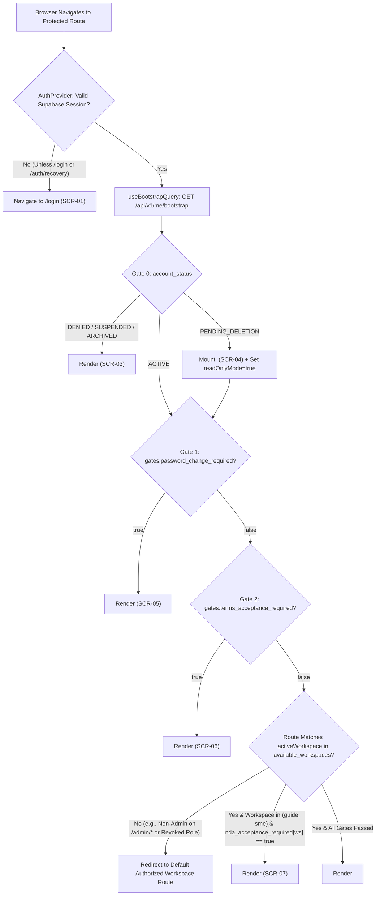

# FULCRUM-INDIA — DOCUMENT 5: REACT + TYPESCRIPT WEB DEVELOPMENT HANDOVER

| Document Attribute | Value |
| :--- | :--- |
| **Document ID** | `FULCRUM-RWH-V2.0` |
| **Filename** | `FULCRUM_REACT_WEB_HANDOVER.md` |
| **Baseline Commit** | `235767754f8d8bb4605e819593bb3f370ddeab27` (`2026-11-11`) |
| **Date of Handover Package** | `2026-11-16` |
| **Target Audience** | React + TypeScript Frontend Architects, Web UI Engineers, QA Engineers |
| **Scope** | Complete Web Application Replacement for `app.py` and `views/*.py` (All 30 Screens & All 13 Admin Sections) |

---

## 1. Proposed React + TypeScript Frontend Architecture

The React web application replaces the Streamlit presentation layer (`app.py` + `views/*.py`) while preserving 100% of the business rules in [`FULCRUM_PLATFORM_INDEPENDENT_CONTRACT.md`](./FULCRUM_PLATFORM_INDEPENDENT_CONTRACT.md) and communicating with the protected backend API defined in [`FULCRUM_BACKEND_API_CONTRACT.md`](./FULCRUM_BACKEND_API_CONTRACT.md).

### Recommended Technology Stack
- **Core Framework & Build**: **React 18+**, **TypeScript 5+ (Strict Mode)**, **Vite 5+** (SPA served via Caddy 2, or Next.js App Router in static/SSR mode).
- **Routing**: **React Router v6.22+** (or TanStack Router) with nested route guards for Gates `0`–`3` and URL-addressable tabs/subtabs.
- **Server State & Caching**: **TanStack Query v5 (`@tanstack/react-query`)** replacing `services/cache.py` (`_GLOBAL_CACHE` & session memo), with automatic cache invalidation on mutations and 5-second background polling/revalidation on `/api/v1/me/bootstrap` for cross-session role revocation eviction.
- **Client UI State**: **Zustand** store holding `activeWorkspace` (`'aspirant' | 'guide' | 'sme' | 'admin'`), sidebar collapse state, and active modal state.
- **Forms & Validation**: **React Hook Form + Zod** enforcing identical field rules (`>= 8` char passwords, `>= 15` char complaints/SSR justifications, `0–100%` women equity, and `'I AGREE'` NDA phrase).
- **Styling & Components**: **Tailwind CSS** configured with the design tokens in [`FULCRUM_UI_UX_DESIGN_SYSTEM.md`](./FULCRUM_UI_UX_DESIGN_SYSTEM.md) (`#F8FAFC` canvas, `#FFFFFF` cards, `#2563EB` primary blue, `#0B0F19` sidebar, `Avenir Next` / `Inter` font stack) + accessible **Radix UI** primitives (`Dialog`, `Tabs`, `Select`, `Toast`, `Tooltip`).

---

## 2. Recommended Project & Folder Structure

```text
fulcrum-web/
├── public/
├── src/
│   ├── api/
│   │   ├── client.ts                 # Axios/Fetch wrapper injecting Bearer JWT & X-Fulcrum-Active-Workspace
│   │   ├── generated/                # OpenAPI TypeScript types generated from FULCRUM_API_OPENAPI.yaml
│   │   └── hooks/                    # TanStack Query hooks per domain (useBootstrap, useSchemes, useJourney, etc.)
│   ├── auth/
│   │   ├── supabaseClient.ts         # Initialized with VITE_SUPABASE_URL & VITE_SUPABASE_PUBLISHABLE_KEY ONLY
│   │   ├── AuthProvider.tsx          # Session listener + token refresh
│   │   └── GateGuard.tsx             # Enforces Gates 0 (Lifecycle), 1 (Temp PW), 2 (Terms), 3 (Role NDA)
│   ├── components/
│   │   ├── layout/                   # AppShell, DarkSidebar, WorkspaceSelector, NotificationDrawer
│   │   ├── shared/                   # TaxonomySelectWithOther, PrivatePhotoVaultCard, SchemeExplorerCard
│   │   ├── journey/                  # JourneyTimeline, JourneyEventModal, RevisionHistoryDrawer
│   │   └── consultations/            # ConsultationThreadCard, CaseCollaborationPanel
│   ├── constants/
│   │   └── taxonomies.ts             # Exact mirror of services/constants.py & services/scheme_rules.py
│   ├── pages/
│   │   ├── public/                   # LoginPage (SCR-01), RecoveryPage (SCR-02)
│   │   ├── gates/                    # BlockedScreen (SCR-03), SetPasswordGate (SCR-05), TermsGate (SCR-06), NdaGate (SCR-07)
│   │   ├── aspirant/                 # SCR-08 Overview, SCR-09 Profile, SCR-10 Journey, SCR-11 Mentors, SCR-12 Schemes, SCR-13 Consultations
│   │   ├── guide/                    # SCR-14 MyAspirants (6 sub-routes), SCR-15 GuideConsultations & GuideProfile
│   │   ├── sme/                      # SCR-16 AssignedCases (4 sub-routes + COI), SCR-17 SmeConsultations & SmeProfile
│   │   └── admin/                    # SCR-18..30: All 13 Admin Sections (ADM-01..ADM-13)
│   ├── store/
│   │   └── workspaceStore.ts         # Zustand store for activeWorkspace & notification filter toggle
│   ├── App.tsx
│   └── main.tsx
├── .env.example                      # VITE_SUPABASE_URL, VITE_SUPABASE_PUBLISHABLE_KEY, VITE_API_BASE_URL
├── package.json
└── tsconfig.json
```

---

## 3. Routing, Gate Guards & API Client Conventions

### Mermaid Diagram 1 — React Router & Sequential Gate Guard Flow



### 3.1 API Client Interceptor Contract (`src/api/client.ts`)
1. **Automatic Header Injection**: On every request to `VITE_API_BASE_URL`, attach `Authorization: Bearer ${session.access_token}` and `X-Fulcrum-Active-Workspace: ${workspaceStore.getState().activeWorkspace}`.
2. **Global Gate & Eviction Handling**:
   - On HTTP `401`: trigger `supabase.auth.refreshSession()`; if refresh fails, sign out and navigate to `/login`.
   - On HTTP `403` with `error.code == 'ROLE_NOT_AUTHORIZED'`: immediately invalidate `['bootstrap']` query so the revoked workspace is removed from `WorkspaceSelector` and the user is redirected to their remaining active workspace within 1 click (`BR-ROLE-001`).
   - On HTTP `403` with `error.gate_required`: redirect to the corresponding Gate screen (`SCR-03`–`SCR-07`).

---

## 4. Deep-Dive Engineering Specification for All 13 Administrator Sections (`ADM-01` to `ADM-13`)

> [!IMPORTANT]
> **Preservation of Full Administrative Authority**: The Sole Administrator workspace (`views/admin.py`, `views/admin_governance.py`, `views/admin_account_lifecycle.py`) is the operational heart of Fulcrum. In the React web application, **all 13 Administrator sections must be preserved in full** and must not be reduced to generic CRUD tables that strip away business side-effects (such as Co-Guide promotion, SSR override auto-release, COI recusal locks, WhatsApp/Gmail outreach auditing, or pre-archive impact previews).

| Admin Section & Route | React Page Component | Required UI Controls, Filters & Complex Business Workflows to Preserve | Backend API Endpoints Used |
| :--- | :--- | :--- | :--- |
| **Control Tower Header** (Global across `/admin/*`) | `<AdminControlTowerHeader />` | 10 real-time KPI cards & alert pills: Verified Aspirants, Active Guides, Active SMEs, Active Journeys, Unassigned Aspirants, Open Tickets, Pending SSRs, Open Complaints, SME Conflicts, Inactivity Alerts (`services/admin_metrics.py`). Clicking any alert pill navigates directly to that tab. | `GET /api/v1/admin/metrics` |
| **`ADM-01` (`/admin/aspirants`)** `SCR-18` | `<AdminAspirantsDirectoryPage />` | Server-paginated table (25/page) with Name/Email search and 38 TN District filter (uniting primary `profiles.role='aspirant'` and hybrid `user_roles.role='aspirant'`, `DEF-32-004`). Slide-over/detail view shows private Aspirant photo, completion %, assigned Primary Guide, Co-Guides & SMEs, 4-part profile, `Export Executive Dossier PDF` button, and Admin Journey milestone creator/editor with revision history. | `GET /api/v1/admin/aspirants`, `GET /api/v1/profiles/aspirants/:id`, `POST /api/v1/journeys/:id/events`, `GET /api/v1/reports/aspirants/:id/dossier-pdf` |
| **`ADM-02` (`/admin/guides`)** `SCR-19` | `<AdminGuidesManagementPage />` | **Provision Guide Modal/Form**: Full Name, Email, Mobile, District (default `Chennai`, `DEF-32-008`), Sector, Expertise, Bio, and stable copyable Provisional Password (`>= 8` chars, `DEF-32-003`). **Paginated Guide Roster (20/page)**: `320x320` headshot or `Missing Photo` badge, NDA status (`Signed` vs `Pending NDA`), caseload count, inline profile editor, and headshot uploader/remover. | `POST /api/v1/admin/mentors` (`role='guide'`), `GET /api/v1/admin/guides`, `PUT /api/v1/profiles/mentors/:id`, `POST/DELETE /api/v1/media/professional-photo/:id` |
| **`ADM-03` (`/admin/smes`)** `SCR-20` | `<AdminSmesManagementPage />` | **Provision SME Modal/Form**: Full Name, Email, Mobile, District (default `Chennai`), Sector, Domain Specialization (GST, Patents, FSSAI, Legal, Debt), Bio, and Provisional Password (`>= 8` chars). **Paginated SME Roster (20/page)** with headshot uploader and inline editor. | `POST /api/v1/admin/mentors` (`role='sme'`), `GET /api/v1/admin/smes`, `PUT /api/v1/profiles/mentors/:id`, `POST/DELETE /api/v1/media/professional-photo/:id` |
| **`ADM-04` (`/admin/assignments`)** `SCR-21` | `<AdminMentorAssignmentsPage />` | **Guide Assignment Panel**: Select Aspirant, select eligible Guide (only active `user_roles` + signed NDA + `id != aspirantId`), and radio mode (`Replace Primary Guide` vs `Add as Co-Guide (Collaborative)`, `DEF-32-008`). **SME Assignment Panel**: Select Aspirant, eligible SME, and mode (`Add to SME Advisory Roster` vs `Replace Primary SME`). **Active Relationship Matrix**: Shows Primary Guide chip, Co-Guide chips (`guide_ids`), and SME chips (`sme_ids`) with individual `Unassign` buttons (triggering automatic Co-Guide promotion and ticket transfer on primary Guide removal) and `Assignment History` drawer. | `POST /api/v1/admin/assignments/guide`, `POST /api/v1/admin/assignments/sme`, `POST /api/v1/admin/assignments/unassign`, `GET /api/v1/admin/relationships` |
| **`ADM-05` (`/admin/inquiries-ssr`)** `SCR-22` | `<AdminInquiriesAndSsrPage />` | **Two Sub-Tabs**:<br>1. **Mentor Inquiries & Escalations**: Lists `PENDING_ADMIN` and `ESCALATED` tickets. Admin Directive form includes Status (`DIRECTIVE_ISSUED` / `RESOLVED`), Directive text, AND optional **Assign Co-Guide** / **Assign Domain SME** dropdowns in the same form (`admin_respond_to_mentor`).<br>2. **Scheme Support Reviews (SSR)**: Shows Aspirant, Scheme, Match Score, Failed/Missing Criteria, and Guide Justification. Admin selects `APPROVED` (which automatically releases the scheme with `allow_disqualified_override=true`) or `REJECTED` with decision notes. | `GET /api/v1/admin/mentor-inquiries`, `POST /api/v1/admin/mentor-inquiries/:id/directive`, `GET /api/v1/schemes/support-reviews`, `POST /api/v1/admin/schemes/support-reviews/:id/decide` |
| **`ADM-06` (`/admin/schemes`)** `SCR-23` | `<AdminSchemeCataloguePage />` | **179-Scheme Playbook Grid (12/page)** with keyword, category, stage, sector, and active/archived filters. Includes **Create/Edit Scheme Modal** (all 20+ fields including private intelligence `hidden_agenda`, `red_flags`, `application_prompt`), **Archive/Unarchive toggle**, **Delete confirmation modal**, and **Delegate Scheme to Guide Panel** (`delegate_scheme_to_guide`). | `GET/POST/PUT/DELETE /api/v1/schemes`, `POST /api/v1/admin/schemes/delegate` |
| **`ADM-07` (`/admin/role-grants`)** `SCR-24` | `<AdminMultiRoleGrantsPage />` | Searchable directory of all non-admin users showing their current role combination badge (`A`, `G`, `S`, `A+G`, `A+S`, `G+S`, `A+G+S`) and per-role status pills (`active`, `pending_nda`, `suspended`, `revoked`). Actions per role: `Grant Role` (`aspirant`/`guide`/`sme`), `Suspend Role` (with reason), `Reinstate Role` (enabled only for `suspended`, disabled for `revoked`), `Cancel Pending Grant`, and `Revoke Role` (with confirmation modal warning that active mentee assignments in that role will be unassigned). | `GET /api/v1/admin/roles/users`, `POST /api/v1/admin/roles/grant`, `POST /api/v1/admin/roles/suspend`, `POST /api/v1/admin/roles/reinstate`, `POST /api/v1/admin/roles/revoke` |
| **`ADM-08` (`/admin/legal-records`)** `SCR-25` | `<AdminLegalRecordsPage />` | Filterable compliance table (`ALL`, `terms_and_conditions`, `nda_guide`, `nda_sme`) displaying summary KPIs and every signed record's User Email, Typed Legal Name, Confirmation Phrase, Document Version (`1.0.0`), SHA-256 Document Hash, Client IP, and Timestamp. | `GET /api/v1/admin/legal/acceptances` |
| **`ADM-09` (`/admin/complaints`)** `SCR-26` | `<AdminComplaintsPage />` | Summary counters (`Open`, `Under Review`, `Resolved`, `DEF-32-008`) and complaint cards showing Aspirant, Reported Guide, Category, and Confidential Description. **Resolution Form**: Status (`UNDER_REVIEW`, `RESOLVED`, `DISMISSED`), Investigation Notes, and optional **One-Step Replacement Guide Selector**. | `GET /api/v1/admin/governance/complaints`, `POST /api/v1/admin/governance/complaints/:id/resolve` |
| **`ADM-10` (`/admin/inactivity`)** `SCR-27` | `<AdminInactivityMonitorPage />` | **Two Radio Modes**:<br>1. **Mentor SLA & Inactivity Alerts**: Displays 7-day (`REMINDER_7D`), 10-day (`ALERT_10D`), and 14-day (`ESCALATED_14D`) alerts with live status (`Needs Attention`, `Follow-up Initiated`, `Mentor Active Again`, `Resolved`). Provides `Open WhatsApp Draft` and `Open Gmail Draft` buttons (logging `DRAFT_OPENED`) and a separate `✓ Confirm Follow-Up Sent` button (logging `SENT_CONFIRMED`, `BR-MON-001`).<br>2. **Aspirant Engagement Roster**: Evaluates founder profile readiness and days since last activity. | `POST /api/v1/admin/inactivity/evaluate`, `GET /api/v1/admin/inactivity/records`, `POST /api/v1/admin/external-contacts`, `GET /api/v1/admin/inactivity/aspirant-roster` |
| **`ADM-11` (`/admin/contact-aspirants`)** `SCR-28` | `<AdminContactAspirantsPage />` | Aspirant selector, Outreach Purpose template selector (`Onboarding`, `Mentorship Check-In`, `Scheme Follow-Up`, `General Support`), editable message preview, `Open WhatsApp Chat` (`wa.me/+91...`), `Open Gmail Compose`, `Record Confirmed Outreach` form, and historical outreach log table. | `POST /api/v1/admin/external-contacts`, `GET /api/v1/admin/external-contacts` |
| **`ADM-12` (`/admin/sme-conflicts`)** `SCR-29` | `<AdminSmeConflictsPage />` | **Two Sub-Tabs**:<br>1. **SME Domain Directory**: Active SMEs by specialization and caseload.<br>2. **Conflict Declarations & Recusals**: Lists all COI rows. Admin adjudicates pending conflicts with `Uphold Conflict & Unassign SME` (`APPROVED` -> auto-runs `unassign_sme`) or `Clear Conflict & Unlock SME` (`REJECTED` -> sets `has_conflict=false`, `DEF-32-005`). | `GET /api/v1/admin/governance/sme-conflicts`, `POST /api/v1/admin/governance/sme-conflicts/:id/resolve` |
| **`ADM-13` (`/admin/account-lifecycle`)** `SCR-30` | `<AdminAccountLifecyclePage />` | **Four Lazy-Loaded Sub-Tabs**:<br>1. **Active & Suspended Accounts**: Searchable directory with `Suspend`, `Resume`, `Legal Hold Toggle`, `Schedule 30-Day Closure`, and **`Archive Account` (opens Pre-Archive Impact Preview Modal showing exact count of affected relationships and open tickets before confirming atomic handover)**.<br>2. **Archived Accounts**: Lists `ARCHIVED` accounts with `Restore Account` modal.<br>3. **Pending Deletion**: Lists accounts in 30-day grace window with `Cancel Closure` and `Archive` actions.<br>4. **Immutable Action History**: Read-only audit viewer for `public.account_lifecycle_log`. | `GET /api/v1/admin/accounts`, `GET /api/v1/admin/accounts/:id/archive-preview`, `POST /api/v1/admin/accounts/:id/lifecycle`, `GET /api/v1/admin/accounts/lifecycle-logs` |

---

## 5. Frontend Testing, Deployment & Environment Configuration

1. **Automated Testing Strategy**:
   - **Unit & Schema Tests (`Vitest`)**: Test `resolveFieldChoice()` taxonomy helpers, Zod form schemas, and role-badge/notification filtering logic.
   - **Component & Gate Integration Tests (`React Testing Library` + `MSW`)**: Mock `/api/v1/me/bootstrap` across all 7 role combinations + Sole Admin and all 4 gate states (`SCR-03`–`SCR-07`).
   - **End-to-End Browser Suite (`Playwright`)**: Port the 10-stage master E2E workflow (`tests/test_single_admin_master_e2e.py`) and 22-test photo visibility suite (`tests/test_aspirant_photo_dashboard_visibility.py`) to Playwright TypeScript specs.
2. **Environment Variables (`.env.production`)**:
   - `VITE_SUPABASE_URL=https://<project-ref>.supabase.co`
   - `VITE_SUPABASE_PUBLISHABLE_KEY=<anon-or-publishable-key>` *(Never include `SUPABASE_SECRET_KEY` in `VITE_*` variables!)*
   - `VITE_API_BASE_URL=https://app.fulcrumindia.online/api/v1`
3. **Deployment**: Build static bundle (`npm run build` $\rightarrow$ `dist/`) and serve directly via the existing `fulcrum-caddy` container (or Cloudflare Pages) while proxying `/api/v1/*` to `fulcrum-api:8000`.
