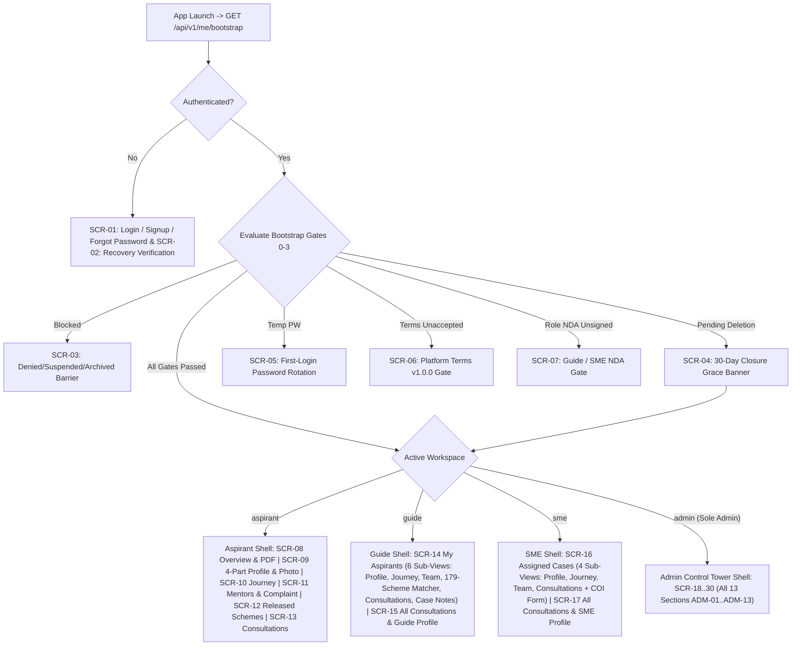

# FULCRUM-INDIA — DOCUMENT 4: SHARED UI/UX DESIGN SYSTEM & SCREEN CONTRACT

| Document Attribute | Value |
| :--- | :--- |
| **Document ID** | `FULCRUM-UXD-V2.0` |
| **Filename** | `FULCRUM_UI_UX_DESIGN_SYSTEM.md` |
| **Baseline Commit** | `235767754f8d8bb4605e819593bb3f370ddeab27` (`2026-11-11`) |
| **Date of Handover Package** | `2026-11-16` |
| **Target Audience** | UI/UX Designers, React Frontend Engineers, Flutter Mobile Engineers, QA Lead |
| **Design Direction** | Clean White/Light Institutional Workspace (`#F8FAFC`/`#FFFFFF`), Authoritative Blue Palette (`#2563EB`), `Avenir Next` / `Avenir` / `Inter` Typography |

---

## 1. Design Philosophy & Usability Principles

Fulcrum's user interface must project **institutional trust, clarity, and executive readability** across web (React) and mobile (Flutter Android/iOS). Future implementations must maintain **100% functional parity** with the 30 baseline screens (`SCR-01` to `SCR-30`), while eliminating Streamlit-specific layout constraints (such as full-script page reruns, nested expander jitter, and non-ARIA markdown cards).

### Core Usability Principles Applied
1. **Consistency & Role Recognition**: The user's active workspace (`Aspirant`, `Guide`, `SME`, or `Admin`) is always visibly anchored in the navigation header/drawer with a distinct role-accent badge so multi-role participants never confuse which hat they are wearing (`DEF-32-010`).
2. **Progressive Disclosure**: Complex workflows—such as the 4-part Aspirant profile, the 179-scheme matcher, and the 13-tab Admin Control Tower—use structured steppers, segmented tabs, and slide-over drawers/modals rather than wall-of-text forms.
3. **Honest & Immediate System Feedback**: Every async action displays a deterministic loading state; email-dependent flows (such as Signup Confirmation and Password Recovery) explicitly instruct users to check **Spam / Promotions** and provide a countdown-guarded **Resend** button (`resolving DEF-001, DEF-002`).
4. **Error Prevention & Recovery**: Destructive or high-impact actions (withdrawing a scheme release, upholding an SME conflict, suspending or archiving an account) require a confirmation modal showing a pre-action impact summary (`get_archive_impact_preview`).

---

## 2. Shared Design Tokens (CSS Variables for React & `ThemeData` for Flutter)

### 2.1 Color Palette System (Light Workspace + Deep Slate Navigation)

| Token Name | Hex Value | Usage Across Web & Mobile | Contrast Compliance (WCAG 2.1 AA) |
| :--- | :---: | :--- | :--- |
| `color.bg.canvas` | `#F8FAFC` | Primary page background (Light Slate 50) | Base surface |
| `color.bg.surface` | `#FFFFFF` | Cards, forms, modals, tables, and workspace switcher box | `>15:1` with `#0F172A` text |
| `color.bg.subtle` | `#F1F5F9` | Secondary panels, read-only field backgrounds, table headers | `>13:1` with `#0F172A` text |
| `color.bg.nav_dark` | `#0B0F19` | Desktop left navigation rail / sidebar header | `>16:1` with `#F8FAFC` text |
| `color.text.primary` | `#0F172A` | Headings, body copy, form input values (Deep Midnight Navy) | `16.1:1` on `#FFFFFF` |
| `color.text.secondary` | `#475569` | Labels, metadata, timestamps, subtitles (Slate 600) | `7.5:1` on `#FFFFFF` |
| `color.text.muted` | `#64748B` | Placeholders, disabled hints (Slate 500) | `4.7:1` on `#FFFFFF` |
| `color.brand.primary` | `#2563EB` | Primary CTA buttons, active tab indicator, links (Royal Blue 600) | `5.1:1` with `#FFFFFF` text |
| `color.brand.hover` | `#1D4ED8` | Primary button hover/pressed state (Blue 700) | `6.7:1` with `#FFFFFF` text |
| `color.brand.subtle` | `#EFF6FF` | Highlighted info banners, selected mentee row (Blue 50) | Paired with `#1E40AF` text |
| `color.role.aspirant` | `#2563EB` / `#DBEAFE` | Verified Aspirant badge & accent (Blue) | `>4.5:1` |
| `color.role.guide` | `#059669` / `#D1FAE5` | Verified Guide badge & accent (Emerald 600) | `>4.5:1` |
| `color.role.sme` | `#0284C7` / `#E0F2FE` | Verified Domain SME badge & accent (Sky 600) | `>4.5:1` |
| `color.role.admin` | `#DB2777` / `#FCE7F3` | Sole Program Admin badge & accent (Pink 600) | `>4.5:1` |
| `color.status.success` | `#16A34A` / `#DCFCE7` | `ACTIVE`, `RESOLVED`, `APPROVED`, `MET` criteria | `>4.5:1` |
| `color.status.warning` | `#D97706` / `#FEF3C7` | `PENDING_DELETION`, `WAITING_ON_ASPIRANT`, `REMINDER_7D`, `VERIFY` | `>4.5:1` |
| `color.status.danger` | `#DC2626` / `#FEE2E2` | `DENIED`, `SUSPENDED`, `ARCHIVED`, `ESCALATED_14D`, `FAILED`, COI lock | `>4.5:1` |
| `color.border.default` | `#E2E8F0` | Card borders, dividers (`1px solid`) | — |
| `color.border.focus` | `#2563EB` | Input focus ring (`2px solid #2563EB`, `offset 2px`) | — |

### 2.2 Typography System (`Avenir Next` / `Avenir` with Licensed/System Fallback Stack)
- **Font Family Stack**: `'Avenir Next', 'Avenir', 'Plus Jakarta Sans', 'Inter', -apple-system, BlinkMacSystemFont, 'Segoe UI', Roboto, sans-serif`
- **Monospace Stack (IDs, Hashes, Logs)**: `'JetBrains Mono', 'Fira Code', monospace`

| Type Scale Token | Size (`rem` / `px`) | Line Height | Weight | Usage |
| :--- | :---: | :---: | :---: | :--- |
| `font.display.xl` | `1.875rem` (`30px`) | `2.25rem` (`36px`) | `800` (ExtraBold) | Portal hero titles, Login landing headline |
| `font.heading.h1` | `1.5rem` (`24px`) | `2.0rem` (`32px`) | `700` (Bold) | Workspace top header title |
| `font.heading.h2` | `1.25rem` (`20px`) | `1.75rem` (`28px`) | `700` (Bold) | Section & tab headers (`ADM-01`..`ADM-13`) |
| `font.heading.h3` | `1.05rem` (`16.8px`) | `1.5rem` (`24px`) | `600` (SemiBold) | Card titles (Scheme card, Milestone card, Ticket subject) |
| `font.body.md` | `0.9375rem` (`15px`) | `1.5rem` (`24px`) | `400` / `500` | Standard body text, form input values, consultation messages |
| `font.body.sm` | `0.8125rem` (`13px`) | `1.25rem` (`20px`) | `500` | Secondary descriptions, table cells, checklist items |
| `font.label.xs` | `0.75rem` (`12px`) | `1.0rem` (`16px`) | `700` (Uppercase, `+0.04em` tracking) | Status pills, role badges, KPI card overlines |

### 2.3 Spacing, Radius, Elevation & Responsive Breakpoints
- **8px Spatial Grid**: `space.1 = 4px`, `space.2 = 8px`, `space.3 = 12px`, `space.4 = 16px`, `space.5 = 20px`, `space.6 = 24px`, `space.8 = 32px`, `space.10 = 40px`.
- **Border Radius**: `radius.sm = 6px` (inputs, badges), `radius.md = 10px` (buttons, inner panels), `radius.lg = 14px` (primary cards, modals), `radius.full = 9999px` (status pills, circular avatars).
- **Responsive Breakpoints**:
  - `mobile`: `< 640px` (1-column stack, bottom navigation bar or slide-out drawer, full-width buttons `min-height: 44px`).
  - `tablet`: `640px – 1023px` (2-column KPI grid, collapsible sidebar rail).
  - `desktop`: `1024px – 1439px` (Persistent `260px` left sidebar + 3-column scheme card grid).
  - `wide`: `>= 1440px` (Max content container `1380px` centered; Admin tables expand to full width).

---

## 3. Core Component Library Specification

| Component | Visual & Interactive Contract | Accessibility & Validation Rules |
| :--- | :--- | :--- |
| **Workspace Switcher (`WorkspaceSelector`)** | High-contrast white dropdown (`#FFFFFF` bg, `#0F172A` bold text, `1.5px solid #CBD5E1`) in the top/sidebar shell. Displays only when `available_workspaces.length > 1` (`non-admin`). Shows `(Pending NDA)` suffix if a role grant is in `pending_nda`. | `aria-label="Current Workspace"`; switching workspace immediately updates route, role badge, and notification filter. |
| **Taxonomy Select with Custom Fallback (`TaxonomySelectWithOther`)** | Reusable compound input pairing a dropdown (`MASTER_SECTORS`, `MASTER_DISTRICTS_TN`, `MASTER_STAGES`, etc.) with a conditional text input that smoothly reveals whenever the user selects `'Other / Not Listed (Specify)'` or `'Other District / Non-TN (Specify)'`. | Preserves custom strings via `resolve_field_choice` logic (`services/constants.py` L149–L187). |
| **Private Photo Avatar & Uploader (`PrivatePhotoVaultCard`)** | Renders circular image (`600x600` Aspirant / `320x320` Mentor) from 300s signed URL with automatic fallback to a deterministic 2-letter initials avatar (`get_initials`). Includes client-side file type/size pre-check (`<= 5 MB`, `JPEG/PNG/WEBP`) before multipart upload. | Auto-refreshes signed URL before the 300-second expiry if the screen remains open. |
| **Chronological Journey Timeline (`JourneyTimeline`)** | Vertical timeline spine (`2px solid #CBD5E1`) with color-coded actor nodes (`Aspirant` blue, `Guide` emerald, `SME` sky, `Admin` pink, `System` slate). Each card includes a `Roadmap PDF` toggle switch, `Edit` button (visible only if `actor_id == current_user.id` or `Admin`), and a collapsible `Revision History (N)` drawer. | Edit modal enforces mandatory `Reason for Edit` and passes `expected_updated_at` for optimistic locking. |
| **Playbook Scheme Card (`SchemeExplorerCard`)** | 3-tier structured card: (1) Header with Agency badge, Funding Type pill, Quantum (`Up to ₹25L`), and Match Score ring (`0–100%` or `Disqualified` badge); (2) Expandable Evidence Checklist (`MET` green check, `MISSING` amber warn, `FAILED` red cross); (3) Role-specific footer (Guide: `Release Scheme` / `Request Admin SSR`; Aspirant: 7-stage `Application Stage` stepper; Admin: `Edit` / `Archive` / `Delete` / `Delegate`). | Clearly displays statutory disclaimer: *"Informational match assessment — final eligibility is determined by the issuing authority."* |
| **Threaded Consultation View (`ConsultationThreadCard`)** | Ticket header with Status pill (`10` statuses), Priority badge, Target Role badge, and SLA timer indicator. Message history bubbles distinguish Aspirant, Guide, SME, and Admin Directive. Separate tab/toggle for `🔒 Private Mentor Notes` (rendered **only** for Guide, SME, and Admin). | Disables SME reply input and displays red banner when `sme_coi_locked == true`. |

---

## 4. Screen-by-Screen Mapping (`SCR-01` to `SCR-30` Across Web & Mobile)

### Mermaid Diagram 1 — Cross-Platform Navigation & Screen Relationship Map

### 4.1 Complete Screen Mapping Table (`SCR-01` to `SCR-30`)

| Baseline Screen ID | Baseline Name & Mapped `FR-*` | React Web Route (`FULCRUM_REACT_WEB_HANDOVER.md`) | Flutter Mobile Route (`FULCRUM_FLUTTER_MOBILE_HANDOVER.md`) | UI Modernization Improvements Over Streamlit Baseline |
| :--- | :--- | :--- | :--- | :--- |
| **`SCR-01`** | Public Landing, Login, Forgot PW & Signup (`FR-AUTH-001..003`) | `/login`, `/signup`, `/forgot-password` | `/auth/login`, `/auth/signup`, `/auth/forgot-password` | Adds inline Spam/Promotions callout, countdown-guarded **"Resend Confirmation Email"** button (`DEF-001`,`002`), and `>= 8` char password meter (`DEF-003`). |
| **`SCR-02`** | Password Recovery Verification (`FR-AUTH-003`) | `/auth/recovery` | Deep Link `fulcrum://auth/recovery` / App Links | Direct URL hash/PKCE token parsing without needing a custom iframe bridge. |
| **`SCR-03`** | Account Blocked Barrier (`BR-LIFE-001`) | `/account/blocked` | `/account/blocked` | Full-screen accessible security card with one-tap support mailto and Sign Out. |
| **`SCR-04`** | 30-Day Deletion Grace Banner (`BR-LIFE-001`) | Persistent top banner + `/account/closure-status` | Persistent top banner + sheet | Disables all mutation buttons across the UI while leaving `Cancel Closure Request` active. |
| **`SCR-05`** | First-Login Password Gate (`FR-AUTH-004`) | `/onboarding/set-password` | `/onboarding/set-password` | Live password strength & confirmation match indicators. |
| **`SCR-06`** | Platform Terms Gate (`FR-LEGAL-001`) | `/onboarding/terms` | `/onboarding/terms` | Sticky bottom acceptance bar after scrolling document container. |
| **`SCR-07`** | Role NDA Gate (`FR-LEGAL-001`) | `/onboarding/nda/:role` | `/onboarding/nda/:role` | Real-time validation of typed full name and `'I AGREE'` phrase. |
| **`SCR-08`** | Aspirant Overview & PDF Dossier (`FR-ASP-003`) | `/aspirant/overview` | `/aspirant/overview` | Non-blocking PDF generation progress toast + native browser/mobile share sheet for PDF download. |
| **`SCR-09`** | Aspirant 4-Part Profile & Photo (`FR-ASP-001..002`) | `/aspirant/profile` | `/aspirant/profile` | 5-step horizontal/vertical form wizard with client-side image crop preview before upload. |
| **`SCR-10`** | Aspirant Journey & Revisions (`FR-JRN-001`) | `/aspirant/journey` | `/aspirant/journey` | Instant optimistic toggle for `Include in Roadmap` without full page reload; clean modal for edits and revision diff viewer. |
| **`SCR-11`** | Aspirant Mentors & Complaint (`FR-CMP-001`) | `/aspirant/mentors` | `/aspirant/mentors` | Dedicated slide-over drawer for Confidential Guide Complaint with character counter (`>= 15` chars). |
| **`SCR-12`** | Aspirant Released Schemes (`FR-GUIDE-002`) | `/aspirant/schemes` | `/aspirant/schemes` | Interactive 7-stage visual stepper on each released scheme card. |
| **`SCR-13`** | Aspirant Consultations & Case Space (`FR-CONS-001`) | `/aspirant/consultations` | `/aspirant/consultations` | Split-pane inbox + chat-style threaded view on desktop; master-detail navigation on mobile. |
| **`SCR-14`** | Guide My Aspirants & 6 Sub-Views (`FR-GUIDE-001..002`) | `/guide/aspirants/:aspirantId/:subtab` | `/guide/aspirants/:aspirantId` (6 tabbed views) | URL-addressable subtabs (`profile`, `journey`, `team`, `schemes`, `consultations`, `collaboration`) so browser Back/Refresh preserves exact mentee & subtab. |
| **`SCR-15`** | Guide Consultations Overview & Profile (`FR-SME-002`) | `/guide/consultations`, `/guide/profile` | `/guide/consultations`, `/guide/profile` | Cross-caseload filterable ticket table + `320x320` headshot cropper. |
| **`SCR-16`** | SME Assigned Cases & 4 Sub-Views + COI (`FR-SME-001`, `FR-CMP-001`) | `/sme/cases/:aspirantId/:subtab` | `/sme/cases/:aspirantId` (4 tabbed views) | Prominent COI status bar at top of mentee workspace; instant form lock when COI declared. |
| **`SCR-17`** | SME Consultations Overview & Profile (`FR-SME-002`) | `/sme/consultations`, `/sme/profile` | `/sme/consultations`, `/sme/profile` | Unified SME inbox and domain specialization editor. |
| **`SCR-18`..`SCR-30`** | **All 13 Sole Admin Sections (`ADM-01` to `ADM-13`, `FR-ADMIN-001..013`)** | `/admin/aspirants`, `/admin/guides`, `/admin/smes`, `/admin/assignments`, `/admin/inquiries-ssr`, `/admin/schemes`, `/admin/role-grants`, `/admin/legal-records`, `/admin/complaints`, `/admin/inactivity`, `/admin/contact-aspirants`, `/admin/sme-conflicts`, `/admin/account-lifecycle` | Web-First Full 13-Tab Suite on React; Companion Mobile Admin Triage App (or Responsive Web) per `DEC-MOB-001` | Fast paginated data tables, slide-over inspection drawers, one-click WhatsApp/Gmail launch + confirmation modal, and pre-archive impact preview modal. |
