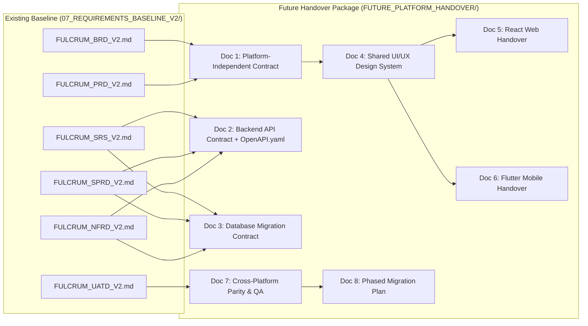

# FULCRUM-INDIA — FUTURE PLATFORM & CROSS-PLATFORM HANDOVER MASTER INDEX

| Attribute | Details |
| :--- | :--- |
| **Handover Directory** | `DOCUMENTATION/FUTURE_PLATFORM_HANDOVER/` |
| **Existing Baseline Directory** | [`DOCUMENTATION/07_REQUIREMENTS_BASELINE_V2/`](../07_REQUIREMENTS_BASELINE_V2/README_DOCUMENTATION.md) |
| **Baseline Commit** | `235767754f8d8bb4605e819593bb3f370ddeab27` (`2026-11-11`) |
| **Date of Handover Package** | `2026-11-16` |
| **Purpose** | Complete engineering handover package enabling a new team to maintain, extend, or rebuild **FULCRUM-INDIA** across **Backend API**, **React Web**, and **Flutter Android/iOS** without re-reverse-engineering the Python codebase |

---

## 1. Complete Inventory of the Future Handover Suite (9 Files)

| # | Filename | Document Title | Purpose |
| :-: | :--- | :--- | :--- |
| **1** | [`FULCRUM_PLATFORM_INDEPENDENT_CONTRACT.md`](./FULCRUM_PLATFORM_INDEPENDENT_CONTRACT.md) | **Platform-Independent Functional Contract** | Technology-agnostic behavioural contract: roles, 7 hybrid combinations, permission matrix, Gates `0`–`3`, all 20 `BR-*` business rules, state machines, and canonical database enum strings. |
| **2** | [`FULCRUM_BACKEND_API_CONTRACT.md`](./FULCRUM_BACKEND_API_CONTRACT.md) | **Backend API & Integration Specification** | Proposed stateless REST API (`/api/v1/*`) wrapping existing `services/*.py` functions, client-vs-server Supabase boundary rules, error codes, rate limits, and JSON payload examples. |
| **2b** | [`FULCRUM_API_OPENAPI.yaml`](./FULCRUM_API_OPENAPI.yaml) | **Proposed OpenAPI 3.1 Specification** | Machine-readable OpenAPI 3.1 contract for generating TypeScript (React) and Dart (Flutter) API clients. |
| **3** | [`FULCRUM_DATABASE_MIGRATION_CONTRACT.md`](./FULCRUM_DATABASE_MIGRATION_CONTRACT.md) | **Database & Data Migration Specification** | In-place preservation of all 23 Supabase PostgreSQL tables, RLS policies, triggers, and private storage buckets (`zero user re-registration`), plus optional additive Migration `012` and reconciliation tests. |
| **4** | [`FULCRUM_UI_UX_DESIGN_SYSTEM.md`](./FULCRUM_UI_UX_DESIGN_SYSTEM.md) | **Shared UI/UX Design System & Screen Contract** | Light workspace (`#F8FAFC`/`#FFFFFF`), Blue (`#2563EB`) color tokens, `Avenir Next` / `Inter` typography scale, reusable components, and 1:1 mapping of all **30 screens (`SCR-01`–`SCR-30`)**. |
| **5** | [`FULCRUM_REACT_WEB_HANDOVER.md`](./FULCRUM_REACT_WEB_HANDOVER.md) | **React + TypeScript Web Development Handover** | Project structure, React Router gate guards, TanStack Query + Zustand state, API interceptors, and detailed specifications for **all 13 Sole Administrator sections (`ADM-01`–`ADM-13`)**. |
| **6** | [`FULCRUM_FLUTTER_MOBILE_HANDOVER.md`](./FULCRUM_FLUTTER_MOBILE_HANDOVER.md) | **Flutter Android/iOS Development Handover** | Shared Dart Clean Architecture, Riverpod state, `flutter_secure_storage`, App Links / Universal Links deep linking, camera/photo permissions, offline read-cache rules, and Admin mobile strategy (`DEC-MOB-001`). |
| **7** | [`FULCRUM_CROSS_PLATFORM_PARITY_AND_QA.md`](./FULCRUM_CROSS_PLATFORM_PARITY_AND_QA.md) | **Cross-Platform Parity & QA Matrix** | Maps every `SCR-*`, `FR-*`, and `ADM-*` across Streamlit, React, Flutter Android, and Flutter iOS; defines the Golden-Test Strategy and 11 critical parity verification scenarios. |
| **8** | [`FULCRUM_FUTURE_PLATFORM_MIGRATION_PLAN.md`](./FULCRUM_FUTURE_PLATFORM_MIGRATION_PLAN.md) | **Phased Migration, Delivery & Release Plan** | 10-phase parallel-coexistence roadmap, effort estimates, team structure, approval gates (`Gate A`, `Gate B`), risk register, and `< 60s` Caddy rollback strategy. |

---

## 2. Mandatory Reading Order by Team Role

### Mermaid Diagram 1 — Handover Documentation Map by Engineering Team

### 2.1 React Web Development Team Reading Path
1. [`FULCRUM_BRD_V2.md`](../07_REQUIREMENTS_BASELINE_V2/FULCRUM_BRD_V2.md) & [`FULCRUM_PRD_V2.md`](../07_REQUIREMENTS_BASELINE_V2/FULCRUM_PRD_V2.md) *(Understand the institutional domain, 30 screens, and 13 Admin tabs)*
2. [`FULCRUM_PLATFORM_INDEPENDENT_CONTRACT.md`](./FULCRUM_PLATFORM_INDEPENDENT_CONTRACT.md) *(Master business rules `BR-*`, 7 role combinations, and Gates `0`–`3`)*
3. [`FULCRUM_BACKEND_API_CONTRACT.md`](./FULCRUM_BACKEND_API_CONTRACT.md) & [`FULCRUM_API_OPENAPI.yaml`](./FULCRUM_API_OPENAPI.yaml) *(REST endpoints, headers, and error codes)*
4. [`FULCRUM_UI_UX_DESIGN_SYSTEM.md`](./FULCRUM_UI_UX_DESIGN_SYSTEM.md) *(Color tokens, typography, and component contracts)*
5. [`FULCRUM_REACT_WEB_HANDOVER.md`](./FULCRUM_REACT_WEB_HANDOVER.md) *(React architecture, route guards, and all 13 Admin sections)*
6. [`FULCRUM_CROSS_PLATFORM_PARITY_AND_QA.md`](./FULCRUM_CROSS_PLATFORM_PARITY_AND_QA.md) *(Acceptance criteria and Playwright parity tests)*

### 2.2 Flutter Android/iOS Development Team Reading Path
1. [`FULCRUM_BRD_V2.md`](../07_REQUIREMENTS_BASELINE_V2/FULCRUM_BRD_V2.md) & [`FULCRUM_PRD_V2.md`](../07_REQUIREMENTS_BASELINE_V2/FULCRUM_PRD_V2.md)
2. [`FULCRUM_PLATFORM_INDEPENDENT_CONTRACT.md`](./FULCRUM_PLATFORM_INDEPENDENT_CONTRACT.md)
3. [`FULCRUM_BACKEND_API_CONTRACT.md`](./FULCRUM_BACKEND_API_CONTRACT.md) & [`FULCRUM_API_OPENAPI.yaml`](./FULCRUM_API_OPENAPI.yaml)
4. [`FULCRUM_UI_UX_DESIGN_SYSTEM.md`](./FULCRUM_UI_UX_DESIGN_SYSTEM.md)
5. [`FULCRUM_FLUTTER_MOBILE_HANDOVER.md`](./FULCRUM_FLUTTER_MOBILE_HANDOVER.md) *(Riverpod architecture, Keystore/Keychain storage, App Links / Universal Links, permissions, and offline rules)*
6. [`FULCRUM_CROSS_PLATFORM_PARITY_AND_QA.md`](./FULCRUM_CROSS_PLATFORM_PARITY_AND_QA.md)

### 2.3 Backend API & Database Development Team Reading Path
1. [`FULCRUM_SRS_V2.md`](../07_REQUIREMENTS_BASELINE_V2/FULCRUM_SRS_V2.md), [`FULCRUM_SPRD_V2.md`](../07_REQUIREMENTS_BASELINE_V2/FULCRUM_SPRD_V2.md) & [`FULCRUM_NFRD_V2.md`](../07_REQUIREMENTS_BASELINE_V2/FULCRUM_NFRD_V2.md)
2. [`FULCRUM_PLATFORM_INDEPENDENT_CONTRACT.md`](./FULCRUM_PLATFORM_INDEPENDENT_CONTRACT.md)
3. [`FULCRUM_BACKEND_API_CONTRACT.md`](./FULCRUM_BACKEND_API_CONTRACT.md) & [`FULCRUM_API_OPENAPI.yaml`](./FULCRUM_API_OPENAPI.yaml)
4. [`FULCRUM_DATABASE_MIGRATION_CONTRACT.md`](./FULCRUM_DATABASE_MIGRATION_CONTRACT.md)

### 2.4 QA & Security Verification Team Reading Path
1. [`FULCRUM_PRD_V2.md`](../07_REQUIREMENTS_BASELINE_V2/FULCRUM_PRD_V2.md), [`FULCRUM_UATD_V2.md`](../07_REQUIREMENTS_BASELINE_V2/FULCRUM_UATD_V2.md) & [`FULCRUM_SPRD_V2.md`](../07_REQUIREMENTS_BASELINE_V2/FULCRUM_SPRD_V2.md)
2. [`FULCRUM_CROSS_PLATFORM_PARITY_AND_QA.md`](./FULCRUM_CROSS_PLATFORM_PARITY_AND_QA.md)

### 2.5 Owner / CEO Reading Path
1. [`FULCRUM_BRD_V2.md`](../07_REQUIREMENTS_BASELINE_V2/FULCRUM_BRD_V2.md) *(Especially Section 19: Open Business Decisions `DEC-001`–`DEC-008`)*
2. [`FULCRUM_FUTURE_PLATFORM_MIGRATION_PLAN.md`](./FULCRUM_FUTURE_PLATFORM_MIGRATION_PLAN.md) *(10-phase roadmap, team composition, and Approval Gates A & B)*
